# ISO SINUX Supporting Docs korpus: Commercial (Sales SOP, Sales Playbook, KPI, deck onboarding)

as_of: 2026-10-14 | lane: ISO Supporting Documents (ingest 13 sampai 14 Okt 2026) | status: NON-KANONIK, dokumen sumber DRAFT | sensitivitas isi: restricted:commercial
Isi: md AI-friendly per dokumen sumber (frontmatter + 1 Ringkasan, 2 Isi lengkap, 3 Diagram mermaid, 4 Peran/RACI/record/KPI, 5 Catatan kualitas berkutipan, 6 Kata kunci).
Navigasi: `readme-iso-supdocs-2026-10-14.md`. Penutup sesi dan keputusan owner: verdict bagian 7 dan handoff (`05_HANDOFF`). Setiap bagian diawali penanda `<!-- FILE: path -->` (path relatif terhadap folder md/ korpus; sama dengan nama berkas di staging `isoraw-*`).

<!-- FILE: commercial/COM-Commercial-Onboarding-Jul2026.md -->

---
doc_code: "tidak bernomor"
title: "Commercial Onboarding. Jul 2026 (New Employee Onboarding, Commercial Division)"
department: Commercial
doc_type: Materi onboarding
source: {drive_file_id: 16TIN9Tsv_sBXMrL4KHeO8f6Ao0F-KsAS, filename: "Commercial Onboarding. Jul 2026.pdf", format: pdf, bytes: 6285535, retrieved: 2026-10-13}
revision: "tidak tertulis di dokumen"
doc_date: "Jul 2026 (dari nama berkas; slide tidak memuat tanggal)"
classification_in_doc: "tidak ada label klasifikasi"
owner_in_doc: "Commercial Division (tidak ada nama pemilik)"
approver_in_doc: "tidak tertulis"
iso_refs: {iso9001: ["7.2 kompetensi (inferensi)", "7.3 kesadaran (inferensi)", "8.2 persyaratan produk dan layanan (inferensi)"], iso27001: []}
kb_sensitivity_suggest: restricted:commercial
related_docs: ["Sales Standard Operating Procedure (Sales SOP, v1.0, 28 Jul 2026)", "Company Profile (dirujuk slide 10, tidak bernomor)", "Sales Playbook.xlsx", "KPI COMMERCIAL & MARKETING.xlsx"]
coverage: {sections_or_sheets: "27 dari 27 slide", tables: 11, images: "27 dibuka dari 27 (plus render ulang 150 dpi untuk slide 9, 11, 25)", notes: "SLIDE 9 'Organization Structure' KOSONG: PDF hanya memuat judul dan latar; tidak ada kotak, nama, atau jabatan (diperiksa teks, daftar gambar tertanam, render 150 dpi, dan ekspor SVG; konten bagan tidak ikut terekspor). Struktur organisasi TIDAK dapat ditranskrip dari berkas ini (UNMEASURED, bukan nol). Slide 10 hanya merujuk 'company profile' tanpa isi produk. Slide 6 (Business Model) tidak memuat angka."}
---
# COM-Commercial-Onboarding-Jul2026 Commercial Onboarding (New Employee Onboarding)

## 1. Ringkasan
- Deck 27 slide untuk karyawan baru Commercial Division PT Strategi Integrasi Nusantara (SINUX), berisi 8 agenda: Company & Business Overview, Products and Services, Sales Process, Sales Tools, Commercial Guideline, KPI & Performance, 30-60 Days Plan, Ideal Customer Profile (ICP).
- SINUX digambarkan sebagai penyedia solusi ICT end-to-end untuk segmen Corporate-Enterprise dan Government di Indonesia (Cloud, Infrastructure, Cyber Security, AI, Observability, Managed Services).
- Proses penjualan 10 langkah (Lead Generation sampai Upsell / Cross-sell / Renewal) dan buying process 11 langkah customer (Initial Discussion sampai Implementation & Go Live), keduanya berupa diagram.
- Metodologi: SPIN Selling (Discovery Meeting) dan MEDDICC (Qualification sampai Negotiation); kualifikasi lima kriteria dan enam Sales Stage di CRM.
- Rencana 30/60/Bulan 3-6 dengan success criteria (antara lain First Closed Won dan Pipeline >=3x target).
- Slide Organization Structure (slide 9) kosong pada berkas sumber.

## 2. Isi lengkap terstruktur

### Slide 1. Judul
PT Strategi Integrasi Nusantara, "New Employee Onboarding", sinux.co.id, label "Commercial Division".

### Slide 2. Agenda Overview
| No | Agenda |
|---|---|
| 01 | Company & Business Overview |
| 02 | Products and Services |
| 03 | Sales Process |
| 04 | Sales Tools |
| 05 | Commercial Guideline |
| 06 | KPI & Performance |
| 07 | 30 - 60 Days Plan |
| 08 | Ideal Customer Profile (ICP) |

### Slide 3. 01 Company & Business Overview, Company Overview
- PT Strategi Integrasi Nusantara (SINUX) adalah perusahaan penyedia solusi Information & Communication Technology (ICT) yang berfokus pada penyediaan solusi end-to-end bagi segmen Corporate - Enterprise dan Government di Indonesia.
- SINUX membantu pelanggan membangun infrastruktur IT yang modern, aman, scalable, dan mudah dikelola melalui kombinasi solusi Cloud, Infrastructure, Cyber Security, AI, Observability, serta Managed Services.

### Slide 4. Vision, Mission, Value
- Our Vision: "To be the first name Indonesian institutions think of when their infrastructure and security cannot fail".
- Our Mission: "We build and operate sovereign cloud, security operations, and managed infrastructure for Indonesia's enterprises and government institutions, engineered by our own people, hosted on Indonesian soil, governed under Indonesian law." (tanda pemisah pada sumber diganti koma).
- Our Value (5): Integrity, Reliability, Vigilance, Ownership, Resourcefulness.

### Slide 5. Core Business dan Product (Nusagrid Ecosystem)
Core Business Sinux (7 kotak): IT Infrastructure & Hardware Solution; Private Cloud Platform; Cybersecurity & Compliance Solution; Business Continuity Planning (BCP); IT Consulting & Managed Services; Platform & Software Development; AI & IoT Solution.

Product (Nusagrid Ecosystem) (7 kotak): Nusagrid Cloud Services; Nusagrid OrionVE (Virtualization Platform); Nusamail; Nusametric; Nusagrid Overseer; Nusagrid AegisWAF; Nusagrid Nexus AI.

### Slide 6. Business Model
Dua model pendapatan: One-Time Revenue (Project) dan Recurring Revenue (Subscription) - Monthly/Annually. Tidak ada angka atau proporsi.

### Slide 7. Target Market, Company, Decision Maker
| Target Market Industry | Target Company | Target PIC / Decision Maker |
|---|---|---|
| Manufacturing | Large Enterprise | CTO |
| Financial Services Industry (FSI) | Enterprise | IT Director / Head of IT (Infra/Application) |
| Healthcare | Mid-Market | IT Manager |
| Education | Small Medium Business (SMB | Infrastructure Manager |
| Energy & Utilities (baris berikutnya "Retail" tanpa bullet sendiri) | | Procurement / Purchasing |
| Transportation & Logistics | | Project Manager |
| Telecommunications & Technology | | |
| Hospitality & Property | | |
| Mining | | |
| Oil & Gas | | |

### Slide 8. Value Proposition & Competitive Advantages
- Value Proposition: "We help organizations build reliable, secure, and future-ready IT environments through end-to-end technology solutions and managed services."
- Lima poin: Reliable IT Infrastructure; Secure Digital Environment; Scalable Cloud Solutions; Proactive Managed Services; End-to-End Technology Partnership.
- Competitive Advantages (6): End-to-End Technology Solutions; Business-Driven Approach; Multi-Vendor Expertise; Experienced Technical Team; Long-Term Partnership; Reliable Service Delivery.

### Slide 9. Organization Structure
KOSONG. Hanya judul "Organization Structure" dan footer. Tidak ada nama atau jabatan yang dapat ditranskrip. Lihat bagian 5.

### Slide 10. 02 Product & Services
"Refer in depth material in our company profile". Tidak ada rincian produk di slide.

### Slide 11. 03 Sales Process
Sepuluh tahap (lihat diagram 3.3): Lead Generation, Qualification, Discovery Solution Design, Proposal / Quotation, Negotiation, Closing (PO / Contract), Project Handover, Delivery / Implementation, Customer Success, Upsell / Cross-sell / Renewal.

### Slide 12. Sales Methodology: SPIN Selling
- Definisi: metode consultative selling yang membantu sales menggali kebutuhan customer melalui serangkaian pertanyaan sebelum menawarkan solusi. Objective: memahami kebutuhan customer sebelum menawarkan solusi. Use case customer: "Server kami sering mengalami downtime."

| Huruf | Tahap | Tujuan | Pertanyaan contoh |
|---|---|---|---|
| S | Situation | Memahami kondisi customer saat ini. | "Saat ini menggunakan infrastruktur atau sistem apa?" |
| P | Problem | Mengidentifikasi masalah yang dihadapi customer. | "Apa kendala terbesar yang sering dihadapi?" |
| I | Implication | Menggali dampak bisnis dari masalah tersebut. | "Apa dampaknya jika masalah ini terus terjadi?" |
| N | Need - Payoff | Menunjukkan manfaat solusi bagi customer. | "Jika masalah ini dapat diselesaikan, apa manfaatnya bagi bisnis?" |

### Slide 13. Sales Methodology: MEDDICC
MEDDICC adalah framework untuk mengelola dan mengevaluasi kualitas opportunity agar peluang closing lebih tinggi.

| Elemen | Arti di slide |
|---|---|
| Metrics | Target atau manfaat bisnis yang ingin dicapai customer. |
| Economic Buyer | Menentukan pengambil keputusan utama. |
| Decision Criteria | Memahami kriteria pemilihan vendor. |
| Decision Process | Memahami proses pengambilan keputusan customer. |
| Identify Pain | Mengidentifikasi masalah utama customer. |
| Champion | Menemukan pihak internal yang mendukung solusi kita. |
| Competition | Memahami kompetitor yang terlibat. |

Use case (opportunity: customer membutuhkan solusi Backup & Disaster Recovery):
- Metrics: Recovery time ditargetkan < 1 jam.
- Economic Buyer: IT Director.
- Decision Criteria: Harga, SLA, keamanan, dan after-sales support.
- Decision Process: Evaluasi teknis, Proposal, Approval Management, PO.
- Identify Pain: Backup saat ini lambat dan belum terotomasi.
- Champion: IT Manager yang aktif mendorong proyek.
- Competition: Vendor A dan Vendor B.

### Slide 14. Sales Methodology: Accountability
Sales Operating Principle:
| Prinsip | Penjelasan |
|---|---|
| Customer First | Memahami kebutuhan sebelum menawarkan solusi. |
| Consultative Selling | Menjadi advisor, bukan sekadar penjual. |
| Data-Driven Qualification | Menggunakan MEDDICC untuk mengevaluasi peluang. |
| Business Value Selling | Menjual dampak bisnis, bukan hanya fitur teknis. |
| Consistent CRM Discipline | Seluruh aktivitas penjualan terdokumentasi di CRM. |

Accountability (7 area):
| Area | Penjelasan |
|---|---|
| Discovery | Menggali kebutuhan bisnis sebelum membahas solusi. |
| Qualification | Memastikan setiap opportunity memenuhi standar MEDDICC. |
| Solution Alignment | Tidak melakukan hard selling atau menawarkan produk yang tidak relevan. |
| Stakeholder Management | Mengidentifikasi seluruh stakeholder, mengetahui Economic Buyer, menemukan Champion internal. |
| Opportunity Management | Memastikan setiap deal memiliki next action. |
| Proposal Management | Menyusun proposal sesuai pain point customer. Melakukan follow-up berdasarkan Decision Process. |
| Forecast Accuracy | Memberikan forecast berdasarkan data, bukan asumsi. |

### Slide 15. Kapan digunakan, Sales Qualification, Sales Stage
- SPIN Selling: digunakan saat Discovery Meeting untuk menggali kebutuhan dan pain point customer.
- MEDDICC: digunakan saat Qualification hingga Negotiation untuk memastikan opportunity memiliki peluang closing yang tinggi.
- Sales Qualification (opportunity harus memiliki): Business Need, Budget, Decision Maker, Timeline, Project Scope.
- Sales Stage (CRM, 6): Leads, Qualified, Opportunity, Bid (Proposal/Quote submitted), Win/Lost, Future Nurture.

### Slide 16. Internal Collaboration
| Fungsi | Peran dalam proses penjualan |
|---|---|
| Presales / Solution Consultant | Solution Design & Technical Validation |
| Commercial Manager | Pricing & Deal Approval |
| Project Delivery | Project Implementation |
| Technical Support / Managed Services | After Sales Support |
| Finance | Quotation, Billing & Payment |
| Procurement | Vendor & Purchasing |
| Legal | NDA, service agreement, contract review, legal compliance |
| Management | Strategic Decision & Executive Support |

### Slide 17. 04 Sales Tools
Sales wajib memahami penggunaan: CRM; Sinux Knowledge Base; Company Profile; Product Deck; Proposal & Quotation Template; Pre-sales Request.

### Slide 18. 05 Commercial Guideline
Sales wajib memahami penggunaan: Sales SOP; CRM Update; Opportunity Management; Pipeline Review; Forecast Submission; Pricing & Discount Approval; Proposal Approval; Handover Project.

### Slide 19. 06 KPI & Performance
Sales dievaluasi berdasarkan (8): Revenue Achievement; Pipeline Generation; Qualified Opportunities; Customer Engagement; Win Rate; CRM Discipline; Forecast Accuracy; Renewal Rate.

### Slide 20. 07 Rencana 30-60-90 (judul pada gambar: "30-60-90->90 Days Plan")
| Fase | Objectives | Success Criteria |
|---|---|---|
| First 30 Days, Learn, Build & Prospect | Memahami company, business model, product portfolio, dan target market. Menguasai sales process dan CRM. Mengenal customer dan partner. Mulai melakukan prospecting, discovery meeting, dan membangun pipeline. | Onboarding selesai. CRM digunakan dengan baik. Target account list tersusun. Pipeline awal mulai terbentuk. Discovery meeting mulai berjalan. |
| First 60 Days, Execute & Close | Mengelola opportunity secara mandiri. Berkolaborasi dengan Presales dalam solution design. Menyusun proposal dan quotation. Melakukan negosiasi. Mencapai closing pertama. | Qualified opportunities aktif. Proposal dikirim ke customer. First Closed Won. Revenue pertama tercapai. |
| Month 3-6, Consistent Performance | Konsisten mencapai KPI individu. Menjaga pipeline tetap sehat. Mengembangkan account melalui upsell/cross-sell jika memungkinkan. Menjadi Sales Executive yang mandiri. | Revenue sesuai target. Pipeline >=3x target. Forecast akurat. CRM disiplin. Siap untuk evaluasi akhir masa percobaan. |

### Slide 21. 08 Ideal Customer Profile (ICP)
Slide pembuka bagian.

### Slide 22. Target Industry
| Primary Target | Secondary Target | Target Company Size |
|---|---|---|
| Manufacturing | Oil & Gas | Large Enterprise: >5.000 |
| Financial Services Industry (FSI) | Mining | Enterprise: 1.000+ |
| Healthcare | Energy & Utilities | Mid-Market: 200 - 999 |
| Education | Retail & FMCG | Small Medium Business (SMB): 1 - 99 |
| Logistics & Transportation | Telecommunication & Technology | |
| Property & Hospitality | | |

Satuan ukuran perusahaan tidak ditulis (inferensi: jumlah karyawan).

### Slide 23. Target Persona
| Persona | Deskripsi di slide |
|---|---|
| CTO | Menentukan arah teknologi, arsitektur sistem, dan keputusan strategis terkait teknologi. |
| IT Director / Head of IT (Infra/Application) | Decision maker utama untuk proyek Infrastructure, Cloud, Cyber Security, dan Managed Services. |
| IT Manager | Mengelola operasional IT, melakukan evaluasi teknis, dan menjadi project owner. |
| Infrastructure Manager | Bertanggung jawab atas server, storage, virtualization, network, dan data center. |
| Procurement / Purchasing | Mengelola proses pengadaan, negosiasi harga, dan administrasi vendor. |
| Project Manager | Mengoordinasikan implementasi proyek dan memastikan project berjalan sesuai timeline dan scope. |

### Slide 24. Common Pain Points
Tantangan bisnis dan operasional IT yang umumnya dihadapi customer dan dapat diselesaikan melalui solusi SINUX:
1. Infrastruktur sudah aging atau obsolete.
2. Downtime yang mengganggu operasional bisnis.
3. Keterbatasan kapasitas server, storage, atau compute resources.
4. Kebutuhan meningkatkan cyber security dan perlindungan data.
5. Belum memiliki strategi Backup & Disaster Recovery yang optimal.
6. Sulit melakukan monitoring dan pengelolaan infrastruktur secara proaktif.
7. Keterbatasan SDM IT untuk mengelola lingkungan IT yang kompleks.
8. Tingginya biaya operasional dan maintenance infrastruktur.
9. Kebutuhan modernisasi infrastruktur untuk mendukung transformasi digital.
10. Kebutuhan solusi yang scalable, secure, dan mudah dikelola.

### Slide 25. Buying Process
Sebelas langkah (lihat diagram 3.6).

### Slide 26 dan 27. Any Questions? / Thank You!
Penutup. Label "Commercial Division", sinux.co.id.

## 3. Diagram

### 3.1 Core Business dan Nusagrid Ecosystem (slide 5)
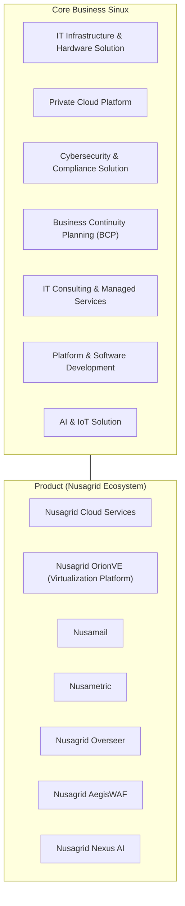
Dua baris kotak biru bertuliskan ikon dan label: baris atas tujuh core business, baris bawah tujuh produk ekosistem Nusagrid. Tidak ada panah; garis penghubung antar-grup hanya penataan visual (tidak ada pemetaan satu-satu di gambar).
Sumber: img/page-05.png

### 3.2 Business Model (slide 6)
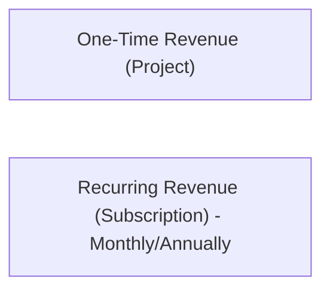
Dua kartu sejajar dengan ikon dolar. Kartu kanan memiliki ikon jam dan koin bersiklus (menandakan berulang). Tidak ada angka.
Sumber: img/page-06.png

### 3.3 Sales Process (slide 11)
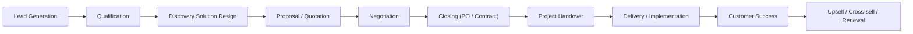
Sepuluh kotak dalam tiga baris (4, 4, 2). Panah satu arah (titik di pangkal, kepala panah di ujung, diperiksa pada render 150 dpi). Dari kotak ke-4 (Proposal / Quotation) dan ke-8 (Delivery / Implementation) garis siku turun ke awal baris berikutnya. Latar biru tua.
Sumber: img/page-11.png

### 3.4 SPIN Selling (slide 12)

Empat kartu sejajar dengan huruf besar S, P, I, N di latar. Urutan kiri ke kanan; tidak ada panah pada gambar (urutan diturunkan dari akronim dan tata letak).
Sumber: img/page-12.png

### 3.5 Rencana 30-60-90 (slide 20, urutan diturunkan dari judul)
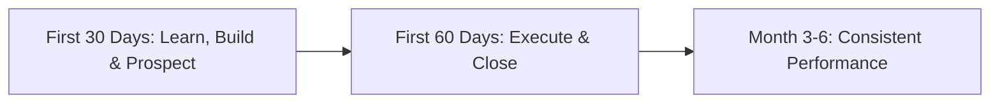
Tiga kolom kartu bergaris biru; masing-masing memuat Objectives dan Success Criteria (lihat tabel slide 20). Tidak ada panah pada gambar.
Sumber: img/page-20.png

### 3.6 Buying Process (slide 25)
```mermaid
flowchart LR
  B1["Initial Discussion / Discovery"] --> B2["Business Need Identified"]
  B2 --> B3["Requirement Gathering"]
  B3 --> B4["Solution Design & Technical Evaluation"]
  B4 --> B5["Proposal & Quotation"]
  B5 --> B6["Commercial Negotiation"]
  B6 --> B7["Management & Budget Approval"]
  B7 --> B8["Procurement Process"]
  B8 --> B9["Purchase Order (PO) / Contract / Signed Quote"]
  B9 --> B10["Project Kick-off"]
  B10 --> B11["Implementation & Go Live"]
```
Sebelas kotak dalam tiga baris (4, 4, 3), panah biru satu arah, garis siku turun dari kotak ke-4 dan ke-8. Latar terang. Ini sudut pandang customer (pembelian), berpasangan dengan Sales Process di 3.3.
Sumber: img/page-25.png

Slide lain (1-4, 7-10, 12-19, 21-24, 26-27) berisi teks, daftar, atau kartu tanpa alur; isinya sudah ditranskrip di bagian 2. Slide 9 kosong (tidak ada diagram).

## 4. Peran, RACI, record, KPI

Peran dan target yang disebut di deck (tidak ada RACI, tidak ada nama orang):
| Peran | Disebut di | Catatan |
|---|---|---|
| Sales Executive | Slide 20 | Menjadi mandiri pada Month 3-6 |
| Presales / Solution Consultant | Slide 16, 20 | Solution Design & Technical Validation |
| Commercial Manager | Slide 16 | Pricing & Deal Approval |
| Project Delivery | Slide 16 | Project Implementation |
| Technical Support / Managed Services | Slide 16 | After Sales Support |
| Finance, Procurement, Legal, Management | Slide 16 | Lihat tabel slide 16 |

KPI evaluasi sales (slide 19): Revenue Achievement; Pipeline Generation; Qualified Opportunities; Customer Engagement; Win Rate; CRM Discipline; Forecast Accuracy; Renewal Rate. Tidak ada bobot atau target angka di deck, kecuali "Pipeline >=3x target" pada success criteria Month 3-6.

Record/tools yang disebut: CRM, Sinux Knowledge Base, Company Profile, Product Deck, Proposal & Quotation Template, Pre-sales Request.

## 5. Catatan kualitas dan celah
- Slide 9 "Organization Structure" kosong (lapisan teks hanya judul dan footer; satu-satunya gambar tertanam pada halaman itu adalah latar JPEG 2048x1157, objek yang sama dengan slide 20; render 150 dpi putih polos): tidak ada struktur organisasi, nama, atau jabatan di berkas ini. Perlu sumber lain untuk bukti struktur organisasi (auditor).
- Teks lapisan PDF slide 20 berbunyi "07. 30609090 Days Plan"; gambar menampilkan "30-60-90->90 Days Plan"; agenda (slide 2) menulis "30 - 60 Days Plan". Isi slide memuat tiga fase (30 hari, 60 hari, bulan 3-6), bukan 90 hari terpisah.
- Typo di sumber: "Sales Metodhology", "Kapan Digunakkan?", "Small Medium Business (SMB" (kurung tidak tertutup), "Energy & Utilities Retail" tampil sebagai satu butir bertulis dua baris di slide 7.
- ICP (slide 22): rentang ukuran perusahaan Large Enterprise ">5.000" dan Enterprise "1.000+" tumpang tindih (1.000+ mencakup >5.000); rentang 100-199 tidak tercakup (Mid-Market mulai 200, SMB berakhir 99). Satuan tidak ditulis.
- Slide 7 memuat 10 butir industri tanpa tingkatan (butir "Energy & Utilities Retail" menyatu dalam satu butir); slide 22 memisahkan "Energy & Utilities" dan "Retail & FMCG" sehingga menjadi 11 industri, dibagi Primary (6) dan Secondary (5). Selain pemisahan butir dan tingkat ini, label "FMCG", dan urutan kata ("Transportation & Logistics" vs "Logistics & Transportation", "Hospitality & Property" vs "Property & Hospitality"), tidak ada inkonsistensi isi.
- Slide 15 mendefinisikan Sales Qualification dengan "Project Scope", sedangkan Sales SOP (hal. 7) memakai "Technical Fit" (lima kriteria; empat sama).
- Slide 16 menyebut "Commercial Manager" sebagai pemberi Pricing & Deal Approval, sedangkan Sales SOP menyebut VP Commercial untuk negosiasi strategis (hal. 11), eskalasi "Permintaan diskon di luar kewenangan" (hal. 17), dan persetujuan penyimpangan SOP (hal. 18); SOP tidak menyebut siapa pemberi Pricing & Deal Approval.
- Daftar KPI slide 19 (8 butir, termasuk Renewal Rate) tidak identik dengan KPI di Sales SOP hal. 16 (9 butir, termasuk Customer Satisfaction) maupun KPI individu di KPI COMMERCIAL & MARKETING.xlsx.
- Slide 23: judul "Procurement / Purchasing" bertumpuk dengan teks deskripsi pada render (cacat tata letak, teks tetap terbaca di lapisan teks).
- Slide 10 (Products & Services) tidak berisi detail produk, hanya rujukan ke company profile ("Refer in depth material in our company profile"); tidak ada berkas berjudul company profile pada ledger B1 sampai B7.
- Slide 6 hanya memuat "One-Time Revenue (Project)" dan "Recurring Revenue (Subscription) - Monthly/Annually", tanpa angka kontribusi.
- Slide 13 menyebut "Vendor A dan Vendor B" (placeholder kompetitor, bukan nama nyata).

## 6. Kata kunci retrieval
onboarding commercial, new employee onboarding, SINUX, sales process, buying process, proses penjualan, SPIN Selling, MEDDICC, BANT, sales stage, lead qualification, ICP, ideal customer profile, target persona, pain points, 30-60-90 days plan, rencana 30 60 90 hari, probation, struktur organisasi (slide kosong), organization structure, Nusagrid, OrionVE, Nusamail, Nusametric, Overseer, AegisWAF, Nexus AI, business model, one-time revenue, recurring revenue, internal collaboration, sales tools, CRM, Pricing & Discount Approval, Handover Project, KPI sales, Commercial Division, divisi komersial

<!-- FILE: commercial/COM-KPI-Commercial-Marketing.md -->

---
doc_code: "tidak bernomor"
title: "KPI COMMERCIAL & MARKETING (KPI Individu - Laras, Olin, Zily)"
department: Commercial
doc_type: Register
source: {drive_file_id: 1TNg8MveAYQ26Fkalk7UlL_iu7FC6EUIb, filename: "KPI COMMERCIAL & MARKETING.xlsx", format: xlsx, bytes: 228639, retrieved: 2026-10-13}
revision: "tidak tertulis; tiap sheet memuat blok KPI baru dan (Laras, Zily) blok berlabel OLD"
doc_date: "Periode 2026 - 2027"
classification_in_doc: "tidak ada label klasifikasi"
owner_in_doc: "tidak tertulis (KPI DEP: Commercial; Brand & Marketing)"
approver_in_doc: "tidak tertulis (keterangan: KPI no. 1 dan 2 ditetapkan Direktur)"
iso_refs: {iso9001: ["5.3 peran dan wewenang (inferensi)", "6.2 sasaran mutu (inferensi)", "9.1 pemantauan dan pengukuran (inferensi)"], iso27001: []}
kb_sensitivity_suggest: restricted:commercial
related_docs: ["Sales Standard Operating Procedure (Sales KPI, hal. 16)", "Commercial Onboarding. Jul 2026 (slide 19)"]
coverage: {sections_or_sheets: "3 sheet dari 3", tables: 10, images: "1 berkas dibuka dari 1 (image1.png = logo SINUX; drawing1 sampai 3 masing-masing mencatat 1 gambar (pictures=1), hanya image1.png yang diekspor sehingga isi gambar lain tidak terverifikasi)", notes: "Kolom Q1 sampai Q4 (Actual, Realisasi, Balancing, Score) kosong pada semua baris data KPI; hanya baris legenda yang berisi 'xx' (Actual, Realisasi), huruf F/H/J/L (Balancing), dan teks 'E x F = G' dst. (Score). Tidak ada realisasi terisi pada satu pun KPI: realisasi UNMEASURED, bukan nol. Rumus kolom W (Score Rata-Rata, W18) berupa ArrayFormula yang isinya tidak terbaca oleh konverter (ditulis sebagai objek). Satu-satunya rumus terbaca: W55 sheet Laras (blok OLD) = sum(W49:W54) bernilai 0. Tidak ada gaji atau data pribadi."}
---
# COM-KPI-Commercial-Marketing KPI COMMERCIAL & MARKETING

## 1. Ringkasan
- Workbook 3 sheet berisi KPI individu periode 2026 - 2027: Laras (VP of Commercial), Olin (Business Development Manager), dan Zily (Brand & Marketing).
- Setiap sheet memuat tabel bobot kategori (4 kategori, total bobot 1,0), tabel KPI individu dengan bobot per KPI (total 1,0), dan kolom pengukuran Q1 sampai Q4 (Actual, Realisasi, Balancing, Score) serta Score Rata-Rata; kolom pengukuran kosong pada semua baris data KPI (hanya baris legenda yang berisi "xx", huruf, dan teks rumus).
- Sheet Laras dan Zily juga menyimpan blok "OLD" (versi KPI sebelumnya) di bawah blok baru; sheet Olin tidak memiliki blok OLD.
- Target kunci: Laras revenue "3 M / yearly", gross margin >=30%, qualified pipeline >=3x target revenue, win rate >=30% per tahun; Olin revenue "1,5 M / yearly", net margin >=30%, pipeline >=3x, win rate >=30%, CRM >=95%, akurasi forecast >=70%.
- Keterangan di sheet: KPI nomor 1 dan 2 adalah KPI perusahaan dan departemen yang ditetapkan Direktur.

## 2. Isi lengkap terstruktur

### Struktur umum tiap sheet (dims A1:Z, logo SINUX di sudut kiri atas A1:C4)
- Header: KPI DEP, Periode, tabel bobot kategori (kolom No, Key Performance Indicators (KPI), Bobot), Title, Nama.
- Tabel KPI individu, kolom: No | KPI Dept. | KPI Individu | Variable | Target | Bobot | Q1 (Actual, Realisasi, Balancing, Score) | Q2 (4 kolom) | Q3 (4 kolom) | Q4 (4 kolom) | Score Rata-Rata.
- Baris legenda di bawah header kolom: kolom A sampai F diberi huruf A, B, C, D, E, F...; kolom Actual dan Realisasi berisi "xx"; Score tiap kuartal berbunyi "E x F = G" (Q1), "E x H = I" (Q2), "E x J = K" (Q3), "E x L = M" (Q4), artinya Score = Bobot (kolom E tabel legenda, yaitu kolom Bobot) x Balancing kuartal tersebut. Score Rata-Rata di kolom W (rumus ArrayFormula, isi tidak terbaca).
- Keterangan variabel: Prosentase; Waktu (tgl/bulan/hari); Jumlah/angka.
- Keterangan: "No. 1 & 2 = KPI Perusahaan & departement yang di tetapkan Direktur".

Tabel skor (diturunkan dari legenda):
| Kuartal | Rumus Score | Sel placeholder |
|---|---|---|
| Q1 | Bobot x Balancing (E x F = G) | Actual G, Realisasi H, Balancing I, Score J |
| Q2 | E x H = I | K, L, M, N |
| Q3 | E x J = K | O, P, Q, R |
| Q4 | E x L = M | S, T, U, V |

### Sheet "KPI Individu - Laras"
KPI DEP: Commercial. Periode: 2026 - 2027. Title: VP of Commercial. Nama: Laras.

Bobot kategori (blok baru):
| No | KPI | Bobot |
|---|---|---|
| 1.0 | Business Growth & Revenue | 0.45 |
| 2.0 | Pipeline & Conversion | 0.2 |
| 3.0 | Market, Customer & Partner Development | 0.15 |
| 4.0 | Commercial Excellence & Execution | 0.2 |

KPI individu (blok baru), periode 2026 - 2027, realisasi Q1 sampai Q4 tidak terisi:
| No | KPI Dept. | KPI Individu | Variable | Target | Bobot | Definisi / formula di sheet |
|---|---|---|---|---|---|---|
| 1 | Business Growth & Revenue | Revenue Achievement | Persentase | 3 M / yearly | 0.3 | Actual Revenue / Target Revenue x100% (sel X19) |
| 1 | Business Growth & Revenue | Gross Margin / Commercial Quality | Persentase | >=30% | 0.15 | tidak ada |
| 2.0 | Pipeline & Conversion | Qualified Pipeline Coverage | Jumlah | >=3x Target Revenue | 0.1 | tidak ada |
| 2.0 | Pipeline & Conversion | Win Rate | Persentase | >=30% / yearly | 0.1 | tidak ada |
| 3.0 | Market, Customer & Partner Development | New Customer Acquisition | Jumlah | >=1 Customer/Bulan | 0.05 | tidak ada |
| 3.0 | Market, Customer & Partner Development | Partner Acquisition | Jumlah | >=2 Partnership/Quarter | 0.05 | tidak ada |
| 3.0 | Market, Customer & Partner Development | Partner-Sourced Revenue | Jumlah | 2 qualified opportunity/registered deal per quarter | 0.05 | tidak ada |
| 4.0 | Commercial Excellence & Execution | Team Capability | Persentase | Team mencapai >=80% KPI yang disepakati | 0.1 | tidak ada |
| 4.0 | Commercial Excellence & Execution | Performance Growth | Persentase | Commercial Department mencapai >=70% dari total departmental KPI target | 0.1 | tidak ada |

Total bobot: 0.3+0.15+0.1+0.1+0.05+0.05+0.05+0.1+0.1 = 1.0.

Blok "OLD" (KPI sebelumnya): KPI DEP: Commercial; Nama: Laras.
| No | KPI Dept. | KPI Individu | Variable | Target | Bobot | Definisi / formula |
|---|---|---|---|---|---|---|
| 1 | Revenue Commercial Division | Pencapaian TCV Commercial | Persentase | 3 M / yearly | 0.35 | Actual Revenue / Target Revenue x100% (X49) |
| 2.0 | Net Margin Commercial | Net Margin Commercial | Persentase | >=30% | 0.2 | tidak ada |
| 3.0 | Sales Pipeline | Pipeline Opportunity | Jumlah | >=3x Target Revenue | 0.1 | tidak ada |
| 4.0 | Business Development Performance | Proposal Win Rate | Persentase | >=30% / yearly | 0.1 | Won Proposal / Submitted Proposal x100% (X52) |
| 5.0 | New Enterprise Customer | Customer Baru Enterprise | Jumlah | >=2 Customer/Bulan | 0.05 | tidak ada |
| 6.0 | Strategic Partnership | Partnership Aktif | Jumlah | >=2 Partnership/Quarter | 0.1 | tidak ada |
| 7.0 | Commercial Leadership | Coaching seluruh Team Commercial | Jumlah | >=2 Coaching/Bulan | 0.1 | tidak ada |

Total bobot OLD: 0.35+0.2+0.1+0.1+0.05+0.1+0.1 = 1.0. Sel W55 = 0 dengan rumus `sum(W49:W54)` (menjumlah Score Rata-Rata baris 49 sampai 54; baris 55 Coaching tidak ikut dalam rentang).

### Sheet "KPI Individu - Olin"
KPI DEP: Commercial. Periode: 2026 - 2027. Title: Business Development Manager. Nama: Olin.

Bobot kategori: identik dengan Laras (Business Growth & Revenue 0.45; Pipeline & Conversion 0.2; Market, Customer & Partner Development 0.15; Commercial Excellence & Execution 0.2).

Catatan: label kategori 3.0 di tabel KPI Olin berbunyi "Market & Customer Development" (tanpa "Partner"), sedangkan tabel bobot di header sheet sama menyebut "Market, Customer & Partner Development".

KPI individu:
| No | KPI Dept. | KPI Individu | Variable | Target | Bobot | Definisi / formula |
|---|---|---|---|---|---|---|
| 1 | Business Growth & Revenue | Revenue Achievement | Persentase | 1,5 M / yearly | 0.3 | Actual Revenue / Target Revenue x100% (X19) |
| 1 | Business Growth & Revenue | Net Margin Achievement | Persentase | >=30% | 0.15 | tidak ada |
| 2.0 | Pipeline & Conversion | Qualified Pipeline | Jumlah | >=3x Target Revenue | 0.1 | tidak ada |
| 2.0 | Pipeline & Conversion | Win Rate | Persentase | >=30% / yearly | 0.1 | tidak ada |
| 3.0 | Market & Customer Development | New Customer Acquisition | Jumlah | >=1 Customer / Bulan | 0.1 | tidak ada |
| 3.0 | Market & Customer Development | Existing Account Expansion | Jumlah | >=2 Account / Quarter | 0.05 | tidak ada |
| 4.0 | Commercial Excellence & Execution | CRM & Pipeline Governance | Persentase | Minimal 95% kelengkapan dan ketepatan data CRM | 0.15 | tidak ada |
| 4.0 | Commercial Excellence & Execution | Sales Forecast Accuracy | Persentase | Minimal 70% akurasi forecast bulanan | 0.05 | tidak ada |

Total bobot: 0.3+0.15+0.1+0.1+0.1+0.05+0.15+0.05 = 1.0. Tidak ada blok OLD.

### Sheet "KPI Individu - Zily"
KPI DEP: Brand & Marketing. Periode: 2026 - 2027. Title: Brand & Marketing. Nama: Zilly (sel B15; nama sheet dan blok OLD menulis "Zily").

Bobot kategori:
| No | KPI | Bobot |
|---|---|---|
| 1.0 | Brand Growth & Market Positioning | 0.35 |
| 2.0 | Demand Generation & Marketing Contribution | 0.1 |
| 3.0 | Digital & Content Performance | 0.35 |
| 4.0 | Market Engagement & Sales Enablement | 0.2 |

KPI individu (blok baru):
| No | KPI Dept. | KPI Individu | Variable | Target | Bobot |
|---|---|---|---|---|---|
| 1.0 | Brand Growth & Market Positioning | Brand Awareness | Persentase | >=20% growth in qualified target-market exposure QoQ | 0.2 |
| 1.0 | Brand Growth & Market Positioning | Brand Development | Persentase | >=90% strategic marketing/sales materials aligned dengan approved SINUX positioning & messaging | 0.15 |
| 2.0 | Demand Generation & Marketing Contribution | Marketing Campaign ROI | Persentase | Memenuhi >=80% target ROI yang disetujui untuk campaign yang dapat diukur | 0.05 |
| 2.0 | Demand Generation & Marketing Contribution | Lead Generation & Marketing Qualified Leads (MQL) | Jumlah | Minimal 2 Leads/bulan dan 1 MQL/bulan | 0.05 |
| 3.0 | Digital & Content Performance | Content Marketing & Brand Communication | Jumlah | Minimal 12 konten/bulan (relevant and engaging content with increasing engagement and reach) | 0.1 |
| 3.0 | Digital & Content Performance | Digital Marketing | Persentase | Traffic website & social media meningkat secara berkala: >=30% QoQ, dengan monthly monitoring. | 0.15 |
| 3.0 | Digital & Content Performance | SEO & Organic Growth (Phase 1 Foundation in 2026) | Persentase | 100% SEO baseline (keyword mapping, technical SEO audit, Google Search Console/Analytics tracking, dan content/keyword strategy) established. | 0.1 |
| 4.0 | Market Engagement & Sales Enablement | Event & Partnership Support | Jumlah | Minimal 2 event/webinar/partner activity setiap quarter | 0.15 |
| 4.0 | Market Engagement & Sales Enablement | Sales Kit & Enablement | Persentase | Seluruh sales collateral 100% up-to-date, seluruh support request Sales diselesaikan sesuai SLA (<=3 hari kerja) | 0.05 |

Total bobot: 0.2+0.15+0.05+0.05+0.1+0.15+0.1+0.15+0.05 = 1.0.

Catatan sheet (sel C30, gabungan C30:C35): "**Phase 2, Growth for SEO in 2027  >=10% QoQ organic traffic growth + >=5 strategic keywords mencapai Top 20." (teks mentah memuat penanda "**" dan " ").

Blok "OLD" (Nama: Zily; KPI DEP tertulis "Brand & Marketing Manager"), kolom: No | KPI Dept. | KPI Individu | Variable | Bobot | Target:
| No | KPI Dept. | KPI Individu | Variable | Bobot | Target |
|---|---|---|---|---|---|
| 1 | Brand Awareness & Brand Developement | Meningkatkan brand awareness dan memperkuat positioning perusahaan. | Persentase | 0.1 | Minimal 1 branding campaign/bulan |
| 1 | (baris kedua, sel gabungan) | (sama) | Persentase | 0.1 | Minimal 1 customer success story/quarter |
| 2.0 | Lead Generation & Marketing Qualified Leads (MQL) | Menghasilkan lead berkualitas dan meningkatkan jumlah Marketing Qualified Leads (MQL). | Jumlah | 0.1 | Minimal 3 Leads/bulan dan 1 MQL/bulan |
| 3.0 | Digital Marketing | Mengoptimalkan digital marketing untuk meningkatkan online visibility dan website performance. | Jumlah | 0.2 | Traffic website & social media meningkat secara berkala, minimum 10% |
| 4.0 | SEO & Organic Growth | Mengelola dan mengoptimalkan strategi SEO untuk meningkatkan visibilitas website, organic traffic, dan peringkat pencarian pada search engine. | % Growth / Ranking | 0.1 | Minimum 5% organic traffic growth & 5 target keywords in Top 20 |
| 5.0 | Content Marketing & Brand Communication | Menghasilkan konten marketing yang konsisten dan mendukung komunikasi brand. | Jumlah | 0.25 | Minimal 12 konten/bulan (relevant and engaging content with increasing engagement and reach) |
| 6.0 | Event & Partnership Support | Mendukung pelaksanaan event dan aktivitas partnership untuk meningkatkan business engagement. | Jumlah | 0.1 | Minimal 1 event/webinar/partner activity setiap bulan |
| 7.0 | Sales Kit & Enablement | Menyediakan sales enablement materials untuk mendukung sales proses atau marketing activity | Persentase | 0.05 | Seluruh sales collateral 100% up-to-date, seluruh support request Sales diselesaikan sesuai SLA (<=3 hari kerja) |

Total bobot OLD: 0.1+0.1+0.1+0.2+0.1+0.25+0.1+0.05 = 1.0.

Perbandingan target Zily, OLD ke baru (diturunkan):
| KPI | OLD | Baru |
|---|---|---|
| Lead Generation / MQL | Minimal 3 Leads/bulan dan 1 MQL/bulan (bobot 0.1) | Minimal 2 Leads/bulan dan 1 MQL/bulan (bobot 0.05) |
| Digital Marketing traffic | minimum 10% (bobot 0.2) | >=30% QoQ (bobot 0.15) |
| SEO | Minimum 5% organic traffic growth & 5 keywords Top 20 (0.1) | Phase 1 2026: 100% SEO baseline; Phase 2 2027: >=10% QoQ dan >=5 keyword Top 20 (0.1) |
| Content | Minimal 12 konten/bulan (0.25) | Minimal 12 konten/bulan (0.1) |
| Event & Partnership | Minimal 1 per bulan (0.1) | Minimal 2 per quarter (0.15) |
| Sales Kit | 100% up-to-date, SLA <=3 hari kerja (0.05) | sama (0.05) |

## 3. Diagram

### 3.1 Logo sheet (image1.png)
Gambar tertanam hanya logo wordmark "SINUX" berwarna biru dengan tiga lengkung di atas huruf U dan X (ada di A1:C4 pada tiap sheet). Bukan diagram alur; tidak ada mermaid untuk gambar ini.
Sumber: img/image1.png

### 3.2 Alur perhitungan skor (diturunkan dari teks header dan legenda)
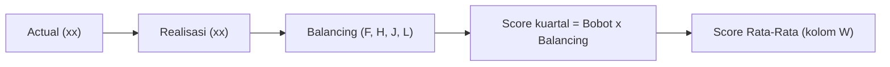
Diturunkan dari header kolom dan baris legenda ("E x F = G" dst.); tidak ada panah di sumber. Kolom Balancing pada baris legenda berisi huruf F, H, J, L; rumus W tidak terbaca (ArrayFormula).
Sumber: teks sheet (conv/.../text.md)

## 4. Peran, RACI, record, KPI

| Nama | Title | KPI DEP | Jumlah KPI individu (baru) | Total bobot |
|---|---|---|---|---|
| Laras | VP of Commercial | Commercial | 9 | 1.0 |
| Olin | Business Development Manager | Commercial | 8 | 1.0 |
| Zily (ditulis "Zilly" di B15) | Brand & Marketing | Brand & Marketing | 9 | 1.0 |

Periode semua sheet: 2026 - 2027. Realisasi per kuartal: tidak ada (placeholder). Satuan target: "M" pada Revenue Achievement (mata uang tidak ditulis; inferensi: miliar rupiah).

## 5. Catatan kualitas dan celah
- Kolom Q1 sampai Q4 (Actual, Realisasi, Balancing, Score) kosong pada semua baris data KPI (tidak ada sel terisi di G19:V27 dan baris data OLD); sel yang terisi hanya baris legenda (Laras baris 18 dan 48, Olin baris 18, Zily baris 18 dan 46): "xx" pada Actual dan Realisasi, huruf F, H, J, L pada Balancing, teks "E x F = G" dst. pada Score. Belum ada realisasi untuk satu pun KPI (UNMEASURED).
- Rumus Score Rata-Rata (W18 ketiga sheet, serta W48 Laras OLD dan W46 Zily OLD) berupa ArrayFormula yang tidak terbaca; tidak diketahui bagaimana skor kuartal digabung.
- Satuan "M" pada target revenue tidak didefinisikan (Laras "3 M / yearly", Olin "1,5 M / yearly"); tidak ada target revenue perusahaan di berkas untuk memeriksa konsistensi (3 M + 1,5 M = 4,5 M hanya aritmetika; apakah target keduanya aditif tidak dinyatakan, inferensi).
- "Gross Margin / Commercial Quality" (Laras baru, C20) berbeda definisi dari "Net Margin Commercial" (Laras OLD, C50) dan "Net Margin Achievement" (Olin, C20), padahal target sama >=30%.
- "Partner-Sourced Revenue" (Laras, C25) bervariabel "Jumlah" dengan target "2 qualified opportunity/registered deal per quarter" (E25), yaitu jumlah opportunity, bukan nilai revenue.
- Kategori 3.0 tabel Olin berlabel "Market & Customer Development" (B23), berbeda dari header sheet "Market, Customer & Partner Development" (B11).
- Penulisan nama: "Zilly" (B15) vs "Zily" (nama sheet, blok OLD). Blok OLD Zily mencantumkan "KPI DEP: Brand & Marketing Manager" (menyatu dengan jabatan), blok baru "Title: Brand & Marketing".
- Blok OLD Zily memakai urutan kolom Bobot lalu Target (E45 Bobot, F45 Target) dan header Q1 digabung E44:J44, berbeda dari tata letak blok baru (Target lalu Bobot); header Q1 tidak sejajar dengan kolom datanya.
- Rumus W55 blok OLD Laras `sum(W49:W54)` tidak memasukkan baris 55 (Coaching, bobot 0.1).
- Sel C30 Zily memuat sisa penanda markup ("**" dan "  ").
- Kolom No memakai format angka campuran ("1" pada sebagian baris, "2.0", "3.0", "4.0" pada baris lain).
- Definisi KPI (formula penghitungan) hanya ada di kolom X: "Actual Revenue / Target Revenue x100%" untuk Revenue Achievement (X19, Laras dan Olin) dan Pencapaian TCV Commercial (X49, Laras OLD), serta "Won Proposal / Submitted Proposal x100%" untuk Proposal Win Rate (X52, Laras OLD). Sheet Zily tidak memuat definisi formula; KPI lain tidak memiliki definisi operasional.
- KPI individu tidak sama dengan daftar KPI di Sales SOP (hal. 16) dan deck onboarding (slide 19); contoh: SOP memuat Customer Satisfaction dan Renewal Rate, sheet Laras/Olin tidak.
- Data gaji atau data pribadi: tidak ada; tidak ada redaksi.

## 6. Kata kunci retrieval
KPI Commercial, KPI Marketing, KPI individu, Laras, VP of Commercial, Olin, Business Development Manager, Zily, Zilly, Brand & Marketing, bobot KPI, target KPI, Revenue Achievement, Gross Margin, Net Margin, Qualified Pipeline Coverage, win rate, New Customer Acquisition, Partner Acquisition, Partner-Sourced Revenue, Team Capability, Performance Growth, CRM & Pipeline Governance, Sales Forecast Accuracy, Brand Awareness, MQL, Marketing Campaign ROI, SEO, content marketing, Event & Partnership Support, Sales Kit & Enablement, periode 2026-2027, Q1 Q2 Q3 Q4, Balancing, Score Rata-Rata, objectives departemen, sasaran mutu

<!-- FILE: commercial/COM-Sales-Playbook.md -->

---
doc_code: "tidak bernomor"
title: "Sales Playbook"
department: Commercial
doc_type: Playbook
source: {drive_file_id: 1RVxuhUAFVTqwbtArb9uG4i2paG7Ph35w, filename: "Sales Playbook.xlsx", format: xlsx, bytes: 14113, retrieved: 2026-10-13, binary_from: "upload owner 14 Okt 2026, ukuran cocok Drive"}
revision: "tidak tertulis"
doc_date: "tidak tertulis (berkas dibuat di Drive 2026-10-13 menurut metadata)"
classification_in_doc: "tidak ada label klasifikasi"
owner_in_doc: "tidak tertulis"
approver_in_doc: "tidak tertulis"
iso_refs: {iso9001: ["8.2 komunikasi dengan pelanggan (inferensi)"], iso27001: []}
kb_sensitivity_suggest: restricted:commercial
related_docs: ["Sales Standard Operating Procedure", "Commercial Onboarding. Jul 2026", "Company Profile (tidak bernomor)"]
coverage: {sections_or_sheets: "1 dari 1 (satu-satunya sheet bernama 'Introduction  Prospecting', dimensi A1:G160)", tables: 2, images: "24 halaman render dibuka dari 24; 0 gambar tertanam (drawing1.xml kosong tanpa anchor)", notes: "LENGKAP (penanda terpotong pada versi teks-konektor dicabut). Dari biner xlsx: seluruh 226 sel terisi dibaca; 49 pertanyaan Q&A (baris sumber 15 sampai 159, 49 pasang Indonesia dan Inggris = 98 baris data) dan seluruhnya sudah ada pada md lama (49 dari 49 sama persis); tidak ada topik baru. Yang dulu dianggap terpotong hanyalah penutup baris pengisi Inggris terakhir (C160), yang di biner utuh. Tidak ada Q&A khusus Nusamail, Nusagrid Overseer, atau objection handling di berkas. Kolom D sampai G (OBJECTION STATEMENT / QUESTION, OBJECTION HANDLING, FOLLOW UP QUESTION, ATTACHMENT) kosong pada seluruh 98 baris data. Tidak ada rumus, data validation, conditional formatting, hyperlink, atau komentar. Terkoreksi dari md lama: emoji pada template Introduction adalah 🙂 (bukan karakter rusak), dan pemisah baris dalam sel jawaban dipulihkan."}
---
# COM-Sales-Playbook Sales Playbook

## 1. Ringkasan
- Playbook penjualan SINUX dalam satu worksheet bernama "Introduction  Prospecting" (dua spasi, apa adanya): blok Introduction (wording perkenalan prospecting formal, Indonesia dan Inggris) dan blok Q&A (pertanyaan dasar customer dan jawaban baku).
- Petunjuk penggunaan di sel A1 dan B1: gunakan COMMAND+F / CTRL+F, masukkan kata kunci (contoh "LAMA IMPLEMENTASI", "PRICING NUSAGRID").
- Blok Q&A berisi 49 pertanyaan dasar Indonesia (48 unik, baris 132 dan 135 duplikat) dalam 10 grup topik: About SINUX (8), SINUX Value (4), Pricing (2), Implementation (3), Reference Client (1), Workshop (1), Fitur (2), Nusagrid (10), Cybersecurity dan SOC (12), Nusametric (6). Setiap pertanyaan diikuti satu baris pengisi bahasa Inggris yang identik di semua 49 posisi. Hanya kolom TOPIC, BASE QUESTION, dan ANSWER yang terisi; empat kolom lain (D sampai G) kosong.
- Klaim komersial kunci di jawaban: Cloud SLA 99.9% uptime; support response 1 jam (kritis) dan 4 jam (tinggi); OrionVE ">60% TCO lebih murah" vs VMware; RTO/RPO kritis 1 jam, non-kritis 4-24 jam; ISO 27001/9001 "dalam progress".
- Versi biner mengonfirmasi cakupan penuh: 49 pertanyaan (sama dengan md lama), tidak ada topik di luar sepuluh grup di atas.

## 2. Isi lengkap terstruktur

### 2.0 Struktur sheet (dibaca dari biner xlsx)
| Aspek | Nilai |
|---|---|
| Jumlah sheet | 1 (visible), nama "Introduction  Prospecting" dengan dua spasi; kemungkinan karakter pemisah (misalnya "&" atau "/") hilang saat ekspor dari Google Sheets (inferensi) |
| Dimensi | A1:G160 (160 baris, 7 kolom), 226 sel terisi |
| Merged cell (13) | A5:D5 (banner INTRODUCTION), A6:B6 (header WORDING / ANSWER), A13:G13 (banner Q&A), dan sel TOPIC vertikal: A15:A37, A39:A49, A51:A55, A57:A64, A66:A67, A69:A70, A72:A76, A78:A106, A108:A142, A144:A160 |
| Lebar kolom | A 18.75; B 51.38; C 51.88; D 45.63; E 41.00; F dan G bawaan 12.63 |
| Rumus, data validation, conditional formatting, hyperlink, komentar, freeze pane, filter | tidak ada |
| Gambar | tidak ada (drawing1.xml tanpa anchor; persons/person.xml kosong); kolom Attachment menyebut "IMAGE" tetapi gambarnya tidak dilampirkan di berkas |
| Gaya | A1:B1 kuning (judul HOW TO USE tebal); banner INTRODUCTION dan Q&A kuning; header baris 6 dan 14 krem; sel TOPIC berwarna per grup (biru muda untuk About SINUX dan SINUX Value, krem untuk Pricing, oranye muda untuk grup lain); baris pertanyaan Indonesia berlatar biru sangat muda, baris Inggris berlatar abu dengan font biru |
| Metadata berkas | tidak ada docProps (ekspor Google Sheets); tanggal, pembuat, dan versi tidak tersedia |

Peta baris: baris 1 (HOW TO USE), 5 (banner INTRODUCTION), 6 (header), 7 (FORMAL), 9 (FORMAL (ENG)), 13 (banner Q&A), 14 (header Q&A), 15 sampai 160 (data Q&A). Pola data: baris pertanyaan Indonesia pada baris r, baris pengisi Inggris pada r+1, baris kosong pada r+2 (kecuali setelah pasangan terakhir di baris 159 dan 160). Baris 2 sampai 4, 8, 10 sampai 12 kosong.

### 2.1 Petunjuk penggunaan
A1 = "HOW TO USE"; B1 = "COMMAND+F / CTRL+F --> INPUT KEYWORD  (LAMA IMPLEMENTASI, PRICING NUSAGRID, DLL)". Kata kunci pencarian yang dimaksud ada pada sel TOPIC (tabel 2.4).

### 2.2 Blok INTRODUCTION (prospecting)
Banner A5:D5 "INTRODUCTION". Header baris 6: A6:B6 "WORDING / ANSWER", C6 "ATTACHMENT", D6 "EXPECTED RESULTS". Sel di bawah (verbatim, baris baru sebagai  ; emoji pada sumber adalah 🙂):

| Sel | Label (kolom A) | Wording / Answer (kolom B) | Attachment (kolom C) | Expected Results (kolom D) |
|---|---|---|---|---|
| baris 7 | FORMAL | Hi Pak/Bu, perkenalkan saya [NAMA] dari SINUX.co.id.  SINUX adalah perusahaan ICT yang menyediakan solusi Cloud & Infrastructure, Cybersecurity, Observability, 24/7 SOC, Backup & Disaster Recovery, serta Managed Services** untuk membantu perusahaan membangun IT environment yang lebih secure, reliable, dan resilient.  Beberapa solusi kami antara lain Nusagrid, Nusametric, Overseer, AegisWAF, dan Nusamail.  Jika Bapak/Ibu memiliki kebutuhan di area tersebut, kami dengan senang hati bisa berdiskusi dan menawarkan free assessment sebagai langkah awal.  Thank you 🙂 | - IMAGE (PROCCESS FROM ASSESMENT TO 3 DAY REPORT) - ASSESMENT LINK / GMEET SCHEDULE | - AWARENESS SINUX - DATABASE - INTRODUCTION MEETING |
| baris 9 | FORMAL (ENG) | Hi, I’m [NAME] from SINUX.co.id. I’d like to briefly introduce SINUX and what we do.  SINUX is an ICT company providing solutions across cloud & infrastructure, cybersecurity, observability, 24/7 SOC, backup & disaster recovery, and managed services.  Our solutions include Nusagrid, Nusametric, Overseer, AegisWAF, and Nusamail.  If you or someone in your network is currently looking for solutions in these areas, we’d be happy to connect and explore how we can help.  We also offer free assessments and freemium options for selected solutions as a starting point.  Thank you, and I hope we can connect. 🙂  | (kosong) | (kosong) |

### 2.3 Blok Q&A: kolom
Banner A13:G13 "Q&A". Header baris 14: A "TOPIC", B "BASE QUESTION", C "ANSWER", D "OBJECTION STATEMENT / QUESTION", E "OBJECTION HANDLING", F "FOLLOW UP QUESTION", G "ATTACHMENT". Kolom D sampai G hanya berisi header; tidak ada satu pun dari 98 baris data yang mengisinya. Sel sumber berisi teks multi-baris (butir jawaban dipisah baris baru; ditulis   di bawah).

### 2.4 Sel TOPIC (kata kunci pencarian, merge vertikal per grup)
| Sel TOPIC | Rentang merge | Grup | Jumlah pertanyaan | Isi sel (verbatim, baris baru sebagai  ) |
|---|---|---|---|---|
| A15 | A15:A37 | About SINUX | 8 | ABOUT SINUX  TENTANG SINUX |
| A39 | A39:A49 | SINUX Value | 4 | SINUX VALUE  KELEBIHAN SINUX |
| A51 | A51:A55 | Pricing | 2 | PRICING  HARGA  COST  TCO   TOTAL COST OF OWNERSHIP  NUSAGRID COST  ORIONVE  MANAGED SERVICE |
| A57 | A57:A64 | Implementation | 3 | IMPLEMENTATION  IMPLEMENTASI  INTEGRASI |
| A66 | A66:A67 | Reference Client | 1 | REFERENCE CLIENT  PERUSAHAAN  COMPANY  CUSTOMER  INDUSTRY |
| A69 | A69:A70 | Workshop | 1 | WORKSHOP  TRAINING  PELATIHAN  ONBOARDING |
| A72 | A72:A76 | Fitur | 2 | FITUR  FEATURE  AI  CAPABILITY  OVERSEER  NUSAMETRIC |
| A78 | A78:A106 | Nusagrid | 10 | NUSAGRID  CAPABILITIES  SERVIS  JASA  SERVICE  PRODUK  PRODUCT  FEATURE  FITUR  Cloud & Infrastructure  CLOUD  INFRA  INFRASTRUKTUR  MIGRASI  INTEGRASI  EXISTING INFRA |
| A108 | A108:A142 | Cybersecurity dan SOC | 12 | Cybersecurity & SOC  AegisWAF  Web Application Firewall  Security  SOC 24/7  Tambahan security layer |
| A144 | A144:A160 | Nusametric | 6 | NUSAMETRIC  OBSERVABILITY  metrics, logs, traces, dan real-time events  monitoring server, network, application, dan cloud  Nusametric Monitoring |

### 2.5 Seluruh baris Q&A (49 pertanyaan, 49 pasang)
Kolom "Baris sumber" menunjukkan sel di sheet: pertanyaan dan jawaban Indonesia pada baris r; baris pengisi Inggris pada r+1 (lihat 2.6). Nomor urut adalah penomoran dokumen ini, bukan kolom sumber. Teks verbatim dari sel; baris baru sebagai  .

| No | Baris sumber (ID / EN) | Topik | BASE QUESTION (kolom B) | ANSWER (kolom C) |
|---|---|---|---|---|
| 1 | B15, C15 / B16, C16 | About SINUX | SINUX fokus di bidang apa? | Kami fokus pada cloud & infrastructure, virtualization, cybersecurity, 24/7 SOC, observability, backup & disaster recovery, consulting, dan managed services. |
| 2 | B18, C18 / B19, C19 | About SINUX | SINUX biasanya melayani perusahaan seperti apa? | Fokus kami adalah B2B, khususnya enterprise dan government yang membutuhkan infrastructure, security, dan IT operations yang reliable dan scalable. |
| 3 | B21, C21 / B22, C22 | About SINUX | Industri apa saja yang dilayani? | Kami melayani berbagai sektor seperti banking, telco, manufacturing, oil & gas, healthcare, dan government. |
| 4 | B24, C24 / B25, C25 | About SINUX | Apa yang membedakan SINUX dengan provider ICT lainnya? | SINUX tidak hanya menyediakan technology atau platform, tetapi juga engineering, implementation, dan ongoing operations. Jadi customer dapat memperoleh solusi end-to-end dari architecture sampai operational support. |
| 5 | B27, C27 / B28, C28 | About SINUX | SINUX system integrator atau managed service provider? | SINUX memiliki kedua kapabilitas tersebut. Kami dapat membantu dari sisi consulting dan integration sampai managed operation. |
| 6 | B30, C30 / B31, C31 | About SINUX | Apakah SINUX memiliki tim engineer sendiri? | Ya, SINUX memiliki engineering dan technical team yang menangani implementation, infrastructure, security, dan operations. |
| 7 | B33, C33 / B34, C34 | About SINUX | Apakah support SINUX tersedia 24/7? | Untuk layanan yang memang memiliki 24/7 operations atau SOC, support dan monitoring dijalankan secara continuous sesuai scope layanan dan SLA yang disepakati. |
| 8 | B36, C36 / B37, C37 | About SINUX | Apa saja layanan dan produk SINUX? | Nusagrid Cloud (Public & Private Cloud)  Virtualisasi & Private Cloud (Nusagrid OrionVE, Arcfra, Virtuozzo)  Cybersecurity & SOC 24/7 (monitoring dan incident response)  Business Continuity & Backup/DR (powered by Acronis)  Observability & Monitoring (Nusametric, Nusagrid Overseer)  Email Terpusat (Nusamail)  Web Application Firewall (Nusagrid AegisWAF)  Managed Services & Consulting (ITSM, DevOps, infrastructure) |
| 9 | B39, C39 / B40, C40 | SINUX Value | Bagaimana SINUX berbeda dari AWS, GCP, atau VMware? | Indonesia-first: data tetap di Indonesia, tanpa kompleksitas multi-region global.  Harga jauh lebih kompetitif: Nusagrid OrionVE >60% TCO lebih murah vs VMware per-node licensing.  Built-in managed services: tidak hanya infrastruktur, tapi juga operasional harian dan SOC 24/7.  Lokal accountability: tim dedicated SINUX yang memahami regulasi lokal (BI, OJK, KOMINFO).  Tidak ada lock-in: platform terbuka untuk hybrid dan multi-cloud. |
| 10 | B42, C42 / B43, C43 | SINUX Value | Berapa uptime SLA dan support response time? | Cloud SLA: 99.9% uptime dengan komitmen ketersediaan layanan.  Support: response time 1 jam untuk kritis, 4 jam untuk tinggi, eskalasi 24/7.  Dedicated account manager: untuk enterprise dan government.  War room 24/7: untuk incident severity tinggi. |
| 11 | B45, C45 / B46, C46 | SINUX Value | Apa data residency policy SINUX? | Data di Indonesia: semua data customer disimpan di data center SINUX di Indonesia, tidak ada cross-border by default.  Compliance lokal: memenuhi regulasi KOMINFO, OJK (sektor keuangan), BI (perbankan).  Audit trail: full audit logging untuk semua akses data dan perubahan konfigurasi.  Option private/hybrid: bisa juga on-premises atau hybrid jika butuh kontrol 100%. |
| 12 | B48, C48 / B49, C49 | SINUX Value | Bagaimana dengan keamanan dan compliance? | 99.9% Uptime SLA di layanan cloud.  SOC 24/7: monitoring real-time, deteksi ancaman, response cepat.  Compliance: audit BI (Bank Indonesia), OJK (sektor keuangan), ISO 27001/9001 dalam progress.  Encryption & DLP: data encryption at-rest dan in-transit, data loss prevention untuk sektor finansial.  Incident response: tim siap 24/7 untuk threat response dan forensik. |
| 13 | B51, C51 / B52, C52 | Pricing | Berapa total cost of ownership (TCO) dibanding on-premises? | 3-5 tahun: cloud biasanya 30-40% lebih murah (tidak ada capex hardware, minimal overhead IT)  Nusagrid OrionVE: 60% cheaper vs VMware renewal over 5 years  Managed services: overhead IT bisa berkurang 40-60% (outsource ops ke SINUX) |
| 14 | B54, C54 / B55, C55 | Pricing | Bagaimana model pricing SINUX? | Cloud (Nusagrid): per VM, per vCPU/memory, pay-as-you-go atau kontrak tahunan.  Virtualisasi (OrionVE): flat-rate per node (bukan per-core), transparan dan scalable.  Managed services: tiered monthly atau retainer, sesuai scope operasional.  SOC 24/7: model hybrid (monitoring events dasar + incident response premium).  Backup/DR: per-instance atau per-data volume. |
| 15 | B57, C57 / B58, C58 | Implementation | Berapa lama implementasi dan migrasi? | PoC/Pilot: 2-4 minggu untuk validasi use case.  Migrasi full: tergantung size (10-100 server: 6-12 minggu), phased approach untuk zero downtime.  Cutover: direncanakan di window maintenance bersama tim Anda.  Post-go-live: support intensif 30 hari pertama, kemudian managed operations. |
| 16 | B60, C60 / B61, C61 | Implementation | Apakah ada service level agreement tertulis? | Ya, setiap kontrak menyertakan SLA tertulis untuk:  Uptime/availability guarantee Response time (critical/high/medium) Incident resolution time Data backup & restore RTO/RPO Maintenance window policy |
| 17 | B63, C63 / B64, C64 | Implementation | Bagaimana integrasi dengan sistem existing saya? | APIs & webhooks: REST API untuk provisioning cloud, monitoring, billing.  Connectors: Kubernetes, Docker, Terraform untuk infrastructure-as-code.  VMware/Proxmox migration: tools native untuk zero-downtime move dari hypervisor lama.  Monitoring export: Prometheus, Grafana, syslog ke tools monitoring Anda.  AD/LDAP: enterprise authentication untuk centralized identity. |
| 18 | B66, C66 / B67, C67 | Reference Client | Apakah SINUX punya referensi customer? | Keuangan: payment provider (compliance BI), banking operations  Pemerintah: Polri DivTIK (34 website nasional), dinas regional  Enterprise: aviation engineering (50+ dedicated ops team), transportation, manufacturing  Manufaktur: FMCG, logistics, production systems |
| 19 | B69, C69 / B70, C70 | Workshop | Bagaimana proses onboarding dan pelatihan? | Discovery phase: workshop 2-3 hari untuk memahami architecture, kebutuhan, risk profile.  Training: hands-on untuk ops team (dashboard, API, troubleshooting).  Documentation: runbook lokal, playbook incident, SOP operasional.  Transition: 30 hari intensive support, knowledge transfer ke tim internal Anda.  Ongoing: quarterly review, architecture optimization, updates. |
| 20 | B72, C72 / B73, C73 | Fitur | Bagaimana disaster recovery dan backup strategy? | Built-in: setiap VM cloud + standby di lokasi berbeda (intra-region redundancy)  Acronis backup: full backup + incremental, instant restore, test DR regular  RTO/RPO: bisa di-customize per aplikasi (critical 1 jam, non-critical 4-24 jam)  Geo-redundancy: option backup ke lokasi terpisah atau cloud partner  3-2-1 rule: 3 copies, 2 storage type, 1 offsite |
| 21 | B75, C75 / B76, C76 | Fitur | Apakah SINUX punya AI capability? | Ya, kami mengembangkan Nexus AI untuk:  Anomaly detection: deteksi otomatis perubahan performa sistem  Predictive analytics: forecasting resource utilization  Assisted troubleshooting: AI-assisted diagnostics di Overseer dan Nusametric  Data privacy: model AI berjalan on-premises, data Anda tetap di perimeter Anda |
| 22 | B78, C78 / B79, C79 | Nusagrid | Nusagrid itu apa? | Nusagrid adalah cloud services dari SINUX yang ditujukan untuk kebutuhan infrastructure perusahaan, dengan pendekatan Indonesia-first dan dukungan untuk deployment public maupun private cloud. |
| 23 | B81, C81 / B82, C82 | Nusagrid | Nusagrid public cloud atau private cloud? | Keduanya. Nusagrid memiliki public cloud services dan private cloud untuk kebutuhan dedicated environment. |
| 24 | B84, C84 / B85, C85 | Nusagrid | SINUX punya layanan cloud apa saja? | Kami menyediakan Nusagrid Public Cloud dan Nusagrid Private Cloud, serta dapat membantu kebutuhan private cloud, virtualization, hybrid environment, dan infrastructure management. |
| 25 | B87, C87 / B88, C88 | Nusagrid | Apakah SINUX menyediakan infrastructure on-premise? | Ya. SINUX dapat menangani kebutuhan on-premise, hybrid, maupun multi-cloud environment, termasuk infrastructure integration dan management. |
| 26 | B90, C90 / B91, C91 | Nusagrid | Apakah SINUX bisa membantu migrasi existing infrastructure? | Bisa. Kami dapat membantu assessment, architecture planning, migration, implementation, sampai operational support. |
| 27 | B93, C93 / B94, C94 | Nusagrid | Apakah SINUX bisa mengelola infrastructure yang sudah kami punya? | Bisa. Kami dapat menyediakan managed services untuk existing infrastructure, tergantung scope dan kondisi environment customer. |
| 28 | B96, C96 / B97, C97 | Nusagrid | Apakah bisa mengintegrasikan cloud SINUX dengan environment existing? | Bisa. Architecture dapat dirancang untuk menghubungkan environment SINUX dengan on-premise, private cloud, maupun public cloud lainnya. |
| 29 | B99, C99 / B100, C100 | Nusagrid | Bagaimana SLA dan reliability infrastructure SINUX? | Untuk Nusagrid, messaging komersial SINUX menggunakan 99.9% uptime SLA. Detail SLA dan service commitment mengikuti layanan dan kontrak yang disepakati. |
| 30 | B102, C102 / B103, C103 | Nusagrid | Di mana data center SINUX? | SINUX menggunakan infrastructure dan data center environment yang sesuai dengan kebutuhan layanan. Untuk kebutuhan spesifik, kami biasanya melakukan assessment terlebih dahulu untuk menentukan deployment yang paling sesuai. |
| 31 | B105, C105 / B106, C106 | Nusagrid | Bagaimana scalability infrastructure SINUX? | Infrastructure dapat disesuaikan dengan kebutuhan workload, baik dari sisi compute, storage, network, maupun deployment model. |
| 32 | B108, C108 / B109, C109 | Cybersecurity dan SOC | SINUX menyediakan solusi cybersecurity apa saja? | Kami menyediakan cybersecurity solutions, security monitoring, SOC 24/7, web application security, serta berbagai security technology melalui ecosystem SINUX dan technology partners.  Ya. SINUX menyediakan layanan Security Operations Center untuk continuous security monitoring, detection, dan incident response. |
| 33 | B111, C111 / B112, C112 | Cybersecurity dan SOC | Apa saja yang dimonitor SOC? | Tergantung scope layanan, tetapi secara umum mencakup security telemetry, events, alerts, dan indicators yang relevan untuk mendeteksi potensi security incident. |
| 34 | B114, C114 / B115, C115 | Cybersecurity dan SOC | Bagaimana SINUX menangani security incident? | SOC melakukan monitoring dan detection, kemudian melakukan analysis dan response sesuai severity, prosedur, serta scope layanan yang disepakati dengan customer. |
| 35 | B117, C117 / B118, C118 | Cybersecurity dan SOC | Apakah SINUX menyediakan security assessment dan vulnerability asessment? | Ya. Assessment dapat dilakukan untuk memahami kondisi existing environment dan mengidentifikasi area yang perlu diperkuat.  Vulnerability assesment dapat disediakan sesuai kebutuhan dan scope security assessment customer. |
| 36 | B120, C120 / B121, C121 | Cybersecurity dan SOC | AegisWAF itu apa? | AegisWAF adalah solusi Web Application Firewall dari SINUX untuk membantu melindungi aplikasi web dari berbagai ancaman pada layer aplikasi. |
| 37 | B123, C123 / B124, C124 | Cybersecurity dan SOC | Apa keuntungan menggunakan AegisWAF? | AegisWAF menambahkan security layer di depan aplikasi untuk mendeteksi dan mengontrol malicious traffic, melindungi web dan API dari berbagai serangan, serta memberikan visibility terhadap aktivitas mencurigakan. |
| 38 | B126, C126 / B127, C127 | Cybersecurity dan SOC | Apa saja yang di cover oleh AegisWAF? | AegisWAF dapat melindungi website, web application, API, dan application endpoints dari malicious traffic dan serangan seperti SQL Injection, XSS, RCE, SSRF, serta berbagai web-based attacks. |
| 39 | B129, C129 / B130, C130 | Cybersecurity dan SOC | Apakah AegisWAF bisa langsung dipasang di existing application? | Bisa dibahas berdasarkan architecture dan environment existing. Tim SINUX dapat melakukan assessment terlebih dahulu untuk menentukan deployment yang sesuai. |
| 40 | B132, C132 / B133, C133 | Cybersecurity dan SOC | Bagaimana cara mengetahui apakah kami membutuhkan AegisWAF?  Tahapan mengetahui membutuhkan aegis atau ga | Kami dapat melakukan assessment untuk melihat exposure aplikasi, traffic pattern, existing security controls, dan kebutuhan protection sebelum menentukan apakah WAF diperlukan. |
| 41 | B135, C135 / B136, C136 | Cybersecurity dan SOC | Bagaimana cara mengetahui apakah kami membutuhkan AegisWAF?  Tahapan mengetahui membutuhkan aegis atau ga | Kami dapat melakukan assessment untuk melihat exposure aplikasi, traffic pattern, existing security controls, dan kebutuhan protection sebelum menentukan apakah WAF diperlukan. |
| 42 | B138, C138 / B139, C139 | Cybersecurity dan SOC | Apakah security SINUX bisa diintegrasikan dengan security tools existing? | Bisa. Pendekatan SINUX dapat disesuaikan dengan existing security architecture dan tools yang sudah digunakan customer. |
| 43 | B141, C141 / B142, C142 | Cybersecurity dan SOC | Apakah SINUX hanya menyediakan tools atau managed security? | Keduanya. Kami dapat menyediakan technology sekaligus implementation, monitoring, dan managed security services sesuai kebutuhan. |
| 44 | B144, C144 / B145, C145 | Nusametric | Nusametric itu apa? | Nusametric adalah platform observability dan monitoring yang membantu memberikan visibility terhadap application, cloud infrastructure, network, dan security telemetry. |
| 45 | B147, C147 / B148, C148 | Nusametric | Apa saja yang bisa dimonitor Nusametric? | Nusametric dapat memberikan visibility terhadap metrics, logs, traces, dan real-time events dari berbagai environment. |
| 46 | B150, C150 / B151, C151 | Nusametric | Apakah Nusametric bisa monitoring server, network, application, dan cloud? | Ya. Nusametric dirancang untuk memberikan end-to-end visibility across applications, cloud infrastructure, networks, dan security telemetry. |
| 47 | B153, C153 / B154, C154 | Nusametric | Nusametric SaaS atau self-hosted? | Nusametric memiliki positioning sebagai observability platform yang dapat digunakan dalam environment customer. Untuk kebutuhan deployment spesifik, model dan architecture perlu disesuaikan dengan requirement customer. |
| 48 | B156, C156 / B157, C157 | Nusametric | Apakah SINUX menyediakan managed observability? | Ya. Selain platform, SINUX dapat membantu implementation, monitoring, dan operational management sesuai scope layanan. |
| 49 | B159, C159 / B160, C160 | Nusametric | Apakah Nusametric bisa diintegrasikan dengan tools existing? | Ya. Integration merupakan bagian penting dalam observability karena customer biasanya sudah memiliki berbagai monitoring dan infrastructure tools. |

Hitungan: About SINUX 8 + SINUX Value 4 + Pricing 2 + Implementation 3 + Reference Client 1 + Workshop 1 + Fitur 2 + Nusagrid 10 + Cybersecurity dan SOC 12 + Nusametric 6 = 49. Nomor 40 (sel B132 dan C132) dan nomor 41 (sel B135 dan C135) identik penuh (pertanyaan dan jawaban sama), sehingga 49 pertanyaan terdiri dari 48 pertanyaan unik.

### 2.6 Baris pengisi bahasa Inggris (49 baris, dicatat sekali)
Pada baris r+1 untuk setiap pertanyaan (B16, B19, B22, ..., B160; 49 baris), sel B berisi "What does SINUX specialize in?" dan sel C berisi "We specialize in cloud and infrastructure, virtualization, cybersecurity, 24/7 SOC, observability, backup and disaster recovery, consulting, and managed services." Teks sama persis pada seluruh 49 baris (49 baris, 1 nilai unik) dan bukan terjemahan dari pertanyaan di atasnya; baris terakhir (B160, C160) utuh dengan titik penutup. Ini adalah teks bawaan untuk slot terjemahan Inggris yang belum diisi (inferensi).

## 3. Diagram
Berkas ini tidak memuat gambar tertanam (24 halaman render dibuka seluruhnya: hanya teks sel dan pita warna). Kolom Attachment (C7) menyebut "IMAGE (PROCCESS FROM ASSESMENT TO 3 DAY REPORT)" tetapi gambar itu tidak ada di berkas. Tiga alur berikut DITURUNKAN DARI TEKS jawaban Q&A.

### 3.1 Onboarding dan pelatihan customer (nomor 19, baris sumber 69, diturunkan dari teks)
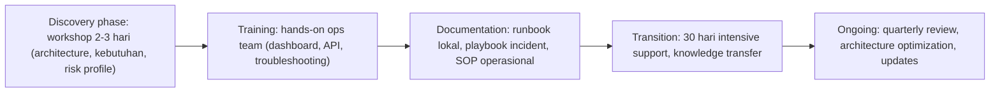
Sumber: teks jawaban "Bagaimana proses onboarding dan pelatihan?" (urutan mengikuti urutan penyebutan, inferensi).

### 3.2 Implementasi dan migrasi (nomor 15, baris sumber 57, diturunkan dari teks)
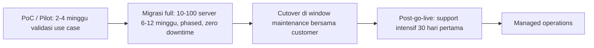
Sumber: teks jawaban "Berapa lama implementasi dan migrasi?" (urutan mengikuti penyebutan, inferensi).

### 3.3 Penanganan security incident (nomor 34, baris sumber 114, diturunkan dari teks)
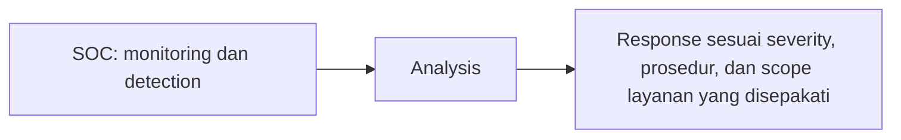
Sumber: teks jawaban "Bagaimana SINUX menangani security incident?".

## 4. Peran, RACI, record, KPI
- Peran yang disebut: SOC team, engineering dan technical team, dedicated account manager (untuk enterprise dan government), war room 24/7 (untuk incident severity tinggi). Tidak ada RACI.
- Angka layanan yang dicantumkan sebagai pesan komersial: Cloud SLA 99.9% uptime; response time 1 jam (kritis) dan 4 jam (tinggi), eskalasi 24/7; RTO/RPO kritis 1 jam dan non-kritis 4-24 jam; backup 3-2-1 (3 copies, 2 storage type, 1 offsite); PoC/Pilot 2-4 minggu; migrasi 10-100 server 6-12 minggu; support intensif 30 hari pertama; workshop discovery 2-3 hari; TCO cloud 30-40% lebih murah (3-5 tahun); OrionVE >60% (blok Value) dan 60% (blok Pricing) lebih murah vs VMware; managed services mengurangi overhead IT 40-60%.
- Dokumen/record yang disebut: SLA tertulis per kontrak (Uptime/availability guarantee; Response time critical/high/medium; Incident resolution time; Data backup & restore RTO/RPO; Maintenance window policy), runbook lokal, playbook incident, SOP operasional, audit trail.
- KPI: tidak ada.

## 5. Catatan kualitas dan celah
- Koreksi status: versi sebelumnya (hanya teks konektor) menandai berkas terpotong karena teks konektor terputus pada baris pengisi Inggris terakhir. Biner xlsx membuktikan isi lengkap: 49 pertanyaan Indonesia (baris 15, 18, 21, ..., 159) sama persis dengan md lama (49 dari 49, tanpa selisih), dan baris 160 utuh. Tidak ada tambahan topik, tidak ada Q&A khusus Nusamail atau Nusagrid Overseer (keduanya hanya muncul di template Introduction dan jawaban "Apa saja layanan dan produk SINUX?", serta kata kunci TOPIC grup Fitur), dan tidak ada objection handling.
- Baris pengisi "What does SINUX specialize in?" berulang setelah semua 49 pertanyaan dan tidak berkaitan dengan pertanyaan di atasnya (slot terjemahan Inggris yang terisi seragam, inferensi). Gayanya berbeda (font biru, latar abu) dari baris Indonesia. Nilainya tidak informatif; akibatnya berkas tidak punya versi Inggris yang sah untuk satu pun jawaban Q&A.
- Pertanyaan AegisWAF "Bagaimana cara mengetahui apakah kami membutuhkan AegisWAF?" muncul dua kali berurutan dengan isi sama (baris 132 dan 135). Sel pertanyaan berisi dua paragraf; paragraf kedua "Tahapan mengetahui membutuhkan aegis atau ga" adalah catatan informal yang ikut tertulis dalam sel pertanyaan.
- Jawaban baris 108 (nomor 32) menyatukan dua jawaban dalam satu sel ("...technology partners." lalu "Ya. SINUX menyediakan layanan Security Operations Center...").
- Kolom OBJECTION STATEMENT / QUESTION, OBJECTION HANDLING, FOLLOW UP QUESTION, ATTACHMENT (D sampai G) kosong pada seluruh baris Q&A (0 dari 98), padahal header menyediakannya; playbook belum memuat penanganan keberatan.
- Klaim TCO OrionVE tidak seragam: ">60% TCO lebih murah vs VMware per-node licensing" (nomor 9, baris 39) dan "60% cheaper vs VMware renewal over 5 years" (nomor 13, baris 51). Tidak ada dasar perhitungan atau rujukan dalam berkas.
- Residensi data: nomor 11 (baris 45) menyatakan semua data customer disimpan di data center SINUX di Indonesia dan tidak ada cross-border by default; nomor 30 (baris 102) menjawab lokasi data center secara umum ("sesuai dengan kebutuhan layanan", assessment dahulu) tanpa lokasi spesifik. Nomor 11 juga menyebut KOMINFO sebagai regulator.
- Klaim compliance nomor 12 (baris 48): "audit BI (Bank Indonesia), OJK (sektor keuangan), ISO 27001/9001 dalam progress" (inferensi: sertifikasi ISO belum dimiliki per teks ini, karena "dalam progress").
- Nomor 10 (baris 42) menyebut response time 1 jam (kritis) dan 4 jam (tinggi) tetapi nomor 16 (baris 60) menyebut response time "critical/high/medium" tanpa angka untuk medium; nomor 16 mencantumkan "Incident resolution time" dan "Data backup & restore RTO/RPO" tanpa angka; angka hanya contoh di nomor 20 (baris 72: "bisa di-customize per aplikasi (critical 1 jam, non-critical 4-24 jam)").
- Nomor 29 (baris 99) menyebut "messaging komersial SINUX menggunakan 99.9% uptime SLA", sedangkan nomor 10 dan 12 menyebut 99.9% sebagai komitmen layanan cloud; detail mengikuti kontrak.
- Nomor 15 (baris 57) menyebut migrasi "phased approach untuk zero downtime" sementara "Cutover: direncanakan di window maintenance bersama tim Anda" pada jawaban yang sama; tidak dijelaskan apakah window maintenance berarti downtime.
- Nomor 47 (baris 153), pertanyaan "Nusametric SaaS atau self-hosted?" tidak dijawab tegas ("memiliki positioning sebagai observability platform yang dapat digunakan dalam environment customer").
- Nomor 8 (baris 36) menyebut produk virtualisasi "Nusagrid OrionVE, Arcfra, Virtuozzo", sedangkan deck onboarding slide 5 hanya mencantumkan Nusagrid OrionVE sebagai platform virtualisasi.
- Typo di sumber: "ASSESMENT", "PROCCESS" (C7), "asessment" (pertanyaan baris 117), "assesment" (jawaban baris 117), "Managed Services**" (tanda bintang, B7), "aegis atau ga" (B132 dan B135).
- Referensi pelanggan (nomor 18, baris 66) tanpa nama perusahaan kecuali "Polri DivTIK (34 website nasional)".
- Template Introduction berbahasa Indonesia (FORMAL) memakai sapaan "Pak/Bu" dan "Bapak/Ibu" (sebagaimana sumber); template Inggris menyebut "freemium options for selected solutions" yang tidak ada di versi Indonesia (versi Indonesia hanya "free assessment").
- Tidak ada nomor dokumen, revisi, tanggal, pemilik, penyetuju, atau label klasifikasi di berkas.

## 6. Kata kunci retrieval
sales playbook, Q&A penjualan, introduction prospecting, wording perkenalan, free assessment, freemium, objection handling (kolom kosong), Nusagrid, public cloud, private cloud, OrionVE, VMware, TCO, total cost of ownership, pricing model, SLA 99.9%, response time, RTO RPO, Acronis backup, disaster recovery, 3-2-1 rule, data residency, data center Indonesia, KOMINFO OJK BI, ISO 27001 9001 dalam progress, SOC 24/7, AegisWAF, WAF, Nusametric, observability, Overseer, Nexus AI, managed services, implementasi, migrasi, PoC pilot, onboarding customer, workshop, reference client, Polri DivTIK, customer reference

<!-- FILE: commercial/COM-Sales-SOP.md -->

---
doc_code: "tidak bernomor"
title: "Sales Standard Operating Procedure"
department: Commercial
doc_type: SOP
source: {drive_file_id: 19Hex8udn1JDG4NKY7hZaODjroHeHwMM0, filename: "SALES STANDARD OPERATING PROCEDURE.pdf", format: pdf, bytes: 2666844, retrieved: 2026-10-13}
revision: "Version 1.0"
doc_date: "Effective Date 28th of July, 2026 (Review Cycle: Every 6 Months)"
classification_in_doc: "tidak ada label klasifikasi"
owner_in_doc: "VP of Commercial (Document Owner); Department: Commercial (Sales)"
approver_in_doc: "tidak tertulis (tidak ada blok persetujuan)"
iso_refs: {iso9001: ["4.4 proses (inferensi)", "5.3 peran dan wewenang (inferensi)", "8.2 komunikasi dan persyaratan pelanggan (inferensi)", "8.5.1 pengendalian penyediaan layanan (inferensi)", "9.1.2 kepuasan pelanggan (inferensi)", "7.5 informasi terdokumentasi, CRM (inferensi)"], iso27001: ["A.5.34 privasi dan perlindungan data, kerahasiaan data customer di Code of Conduct (inferensi)"]}
kb_sensitivity_suggest: restricted:commercial
related_docs: ["Commercial Onboarding. Jul 2026 (deck)", "KPI COMMERCIAL & MARKETING.xlsx", "Sales Playbook.xlsx", "CRM (sistem, tidak bernomor)", "BANT / MEDDICC / SPIN Selling (metodologi)"]
coverage: {sections_or_sheets: "16 bagian SOP (19 halaman) dari 16", tables: 10, images: "19 dibuka dari 19 (render ulang 150 dpi halaman 10)", notes: "Tidak ada nilai ambang diskon, batas kewenangan harga, tenggat approval, form/template bernomor, atau nama orang. Halaman 3 render memperlihatkan judul kartu 3, 7, 8 bertumpuk dengan teks (cacat tata letak, teks utuh di lapisan teks)."}
---
# COM-Sales-SOP Sales Standard Operating Procedure

## 1. Ringkasan
- SOP penjualan v1.0 untuk tim Commercial SINUX, efektif 28 Juli 2026, siklus tinjau setiap 6 bulan, pemilik dokumen VP of Commercial.
- Cakupan: seluruh aktivitas dari prospecting sampai handover ke tim Delivery/Project; 10 tahap proses penjualan dengan objective, aktivitas, deliverables, dan KPI per tahap.
- Pengendalian kunci: proposal hanya setelah Discovery; sebelum proposal dikirim wajib Review internal, Approval harga, lalu Approval diskon (jika ada); dilarang diskon tanpa approval; CRM wajib diperbarui maksimal 24 jam setelah aktivitas.
- Standar respon: email maksimal 1 hari kerja, WhatsApp maksimal 2 jam kerja, permintaan internal maksimal 4 jam kerja.
- Handover ke Delivery wajib dengan handover meeting sebelum implementasi dimulai (enam butir minimal).
- Eskalasi ke VP Commercial untuk 8 kondisi; kepatuhan SOP menjadi bagian evaluasi kinerja dan probation.

## 2. Isi lengkap terstruktur

### Halaman 1. Sampul dan metadata
| Atribut | Nilai |
|---|---|
| Judul | Sales Standard Operating Procedure |
| Unit | Commercial Department |
| Document Owner | VP of Commercial |
| Department | Commercial (Sales) |
| Version | 1.0 |
| Effective Date | 28th of July, 2026 |
| Review Cycle | Every 6 Months |

### 01. Purpose (hal. 2)
Dokumen ini menjadi standar operasional bagi seluruh anggota tim Commercial dalam menjalankan aktivitas penjualan secara konsisten, profesional, dan terukur. SOP ini bertujuan memastikan setiap peluang bisnis dikelola dengan baik, meningkatkan customer experience, mempercepat sales cycle, serta mencapai target revenue perusahaan.

### 02. Scope (hal. 2)
SOP berlaku untuk seluruh tim Commercial yang saat ini terdiri dari:
- Business Development.
- SOP ini mencakup seluruh aktivitas mulai dari prospecting hingga handover ke tim Delivery/Project.

### 03. Objective (hal. 2)
Setiap anggota tim Commercial diharapkan mampu: memahami standar proses penjualan di SINUX; menjalankan aktivitas sales secara konsisten dan terukur; mengelola pipeline dan forecast secara akurat; berkolaborasi secara efektif dengan tim internal; memberikan pengalaman terbaik kepada customer; berkontribusi terhadap pertumbuhan revenue perusahaan.

### 04. Commercial Principles (hal. 3)
| No | Prinsip | Isi |
|---|---|---|
| 1 | Customer Success First | Pahami kebutuhan bisnis customer sebelum menawarkan solusi. Fokus pada penyelesaian masalah dan penciptaan nilai jangka panjang. |
| 2 | Consultative Selling | Sales bertindak sebagai trusted advisor, bukan sekadar penjual produk. Setiap rekomendasi harus didasarkan pada kebutuhan, tantangan, dan tujuan bisnis customer. |
| 3 | Integrity & Professionalism | Menjunjung tinggi integritas dalam setiap aktivitas penjualan. Seluruh informasi kepada customer harus akurat, transparan, dan dapat dipertanggungjawabkan. |
| 4 | CRM is the Single Source of Truth | Seluruh aktivitas penjualan, opportunity, forecast, dan customer engagement wajib tercatat di CRM. Data yang akurat menjadi dasar pengambilan keputusan bisnis. |
| 5 | Collaboration Drives Success | Keberhasilan penjualan adalah hasil kolaborasi antara Commercial, Presales, Project Delivery, Finance, Procurement, dan Management. Libatkan tim yang tepat pada waktu yang tepat. |
| 6 | Data-Driven Decision Making | Setiap keputusan penjualan harus didukung oleh data, pipeline, forecast, dan informasi customer yang valid, bukan asumsi. |
| 7 | Ownership & Accountability | Setiap Sales Executive bertanggung jawab penuh terhadap opportunity yang dikelolanya, mulai dari prospecting hingga project handover. |
| 8 | Continuous Improvement | Selalu mengevaluasi proses, meningkatkan kompetensi, dan berbagi pembelajaran untuk menciptakan performa tim yang lebih baik. |

### Commercial Mindset (hal. 4)
Setiap Sales Executive diharapkan memiliki pola pikir: (1) Understand before you propose. (2) Solve business problems, not just sell products. (3) Build relationships, not just transactions. (4) Keep the pipeline healthy. (5) Commit to execution and accountability. (6) Every customer interaction should create value.

### 05. Commercial Sales Process (hal. 5 sampai 12)
Daftar tahap (hal. 5): Stage 1 Prospecting; Stage 2 Lead Qualification; Stage 3 Discovery Meeting; Stage 4 Solution Presentation; Stage 5 Product Demo; Stage 6 Proposal & Quotation; Stage 7 Negotiation; Stage 8 Closing; Stage 9 Project Handover; Stage 10 Account Management.

| Stage | Objective | Aktivitas / syarat | Deliverables / Output | KPI |
|---|---|---|---|---|
| 1 Prospecting (hal. 6) | Mengidentifikasi calon pelanggan yang sesuai dengan Ideal Customer Profile (ICP). | Melakukan outbound prospecting; menghubungi existing network; mengelola referral; mengikuti event dan networking; melakukan LinkedIn outreach; mengelola inbound leads dari Marketing. | Lead tercatat di CRM; informasi perusahaan lengkap; PIC dan kontak utama. | New Leads Generated; Prospecting Activities; Qualified Leads |
| 2 Lead Qualification (hal. 7) | Memastikan lead memiliki potensi bisnis. | Kriteria: Business Need, Budget, Decision Maker, Timeline, Technical Fit. Sebelum opportunity masuk ke tahap Proposal, Sales harus memastikan opportunity memenuhi kriteria qualification menggunakan BANT atau MEDDICC, serta telah melakukan discovery melalui pendekatan SPIN Selling. | Qualification Notes; Customer Pain Points; Opportunity Score | tidak disebut |
| 3 Discovery Meeting (hal. 8) | Menggali kebutuhan bisnis customer secara menyeluruh. | Minimum Discussion: Business Challenges; Existing System; Current Process; Pain Points; Desired Outcome; Project Timeline; Budget Expectation; Decision Process. | Discovery Notes; Business Requirement; Opportunity Assessment | tidak disebut |
| 4 Solution Presentation (hal. 9) | Menyampaikan solusi berdasarkan kebutuhan customer. | Presentation wajib menjelaskan: Customer Challenges; Proposed Solution; Business Value; ROI; Competitive Advantage; Implementation Overview. Don'ts: Sales dilarang melakukan product dumping tanpa memahami kebutuhan customer. | tidak disebut | tidak disebut |
| 5 Product Demo (hal. 10) | Demo dilakukan bersama Presales apabila diperlukan. | Sales bertanggung jawab: menentukan agenda demo; menjelaskan business context; memastikan demo menjawab kebutuhan customer; mendokumentasikan feedback customer. | tidak disebut | tidak disebut |
| 6 Proposal & Quotation (hal. 10) | Proposal hanya dibuat setelah Discovery selesai. (kalimat pembuka, sumber tanpa label Objective) | Proposal wajib mencakup: Scope of Work; Proposed Solution; Deliverables; Timeline; Commercial Proposal; Assumptions; Exclusions. Sebelum dikirim ke customer: Review internal, Approval harga, Approval diskon (jika ada). | tidak disebut | tidak disebut |
| 7 Negotiation (hal. 11) | tidak ada objective eksplisit | Sales bertanggung jawab: memahami concern customer; menjaga value solusi; tidak memberikan diskon tanpa approval; melibatkan VP Commercial apabila negosiasi strategis. | tidak disebut | tidak disebut |
| 8 Closing (hal. 11) | tidak ada objective eksplisit | Closing dinyatakan berhasil apabila: Purchase Order diterima; Kontrak ditandatangani; Internal approval selesai; Project Kick-off atau implementasi telah dimulai sesuai ruang lingkup yang disepakati. Sales wajib memastikan seluruh dokumen lengkap sebelum handover. | tidak disebut | tidak disebut |
| 9 Project Handover (hal. 11) | Sales wajib melakukan handover kepada Delivery. (kalimat pembuka, sumber tanpa label Objective) | Minimal mencakup: Customer Background; Scope; Timeline; Risks; Commitment; Contact Person. Handover meeting wajib dilakukan sebelum implementasi dimulai. | tidak disebut | tidak disebut |
| 10 Account Management (hal. 12) | Setelah implementasi, sales tetap bertanggung jawab untuk: (kalimat pembuka, sumber tanpa label Objective) | Relationship Management; Upselling; Cross-selling; Renewal; Customer Satisfaction. | tidak disebut | tidak disebut |

### 06. CRM Policy (hal. 13)
Seluruh aktivitas penjualan wajib dicatat di CRM. Mandatory update meliputi: Lead; Opportunity; Meeting Notes; Follow-up; Proposal; Quotation; Forecast; Closing Status. CRM harus diperbarui maksimal 24 jam setelah aktivitas dilakukan.

### 07. Customer Communication Standard (hal. 14)
| Kanal | Response time maksimal |
|---|---|
| Email | 1 hari kerja |
| WhatsApp | 2 jam kerja |
| Internal Request | 4 jam kerja |

Seluruh komunikasi wajib menggunakan bahasa yang profesional, jelas, dan berorientasi pada solusi.

### 08. Proposal & Pricing Policy (hal. 15)
Sales tidak diperbolehkan: mengubah pricing sendiri; memberikan diskon tanpa persetujuan; menawarkan fitur yang belum tersedia; menjanjikan timeline tanpa konfirmasi Delivery.

### 09. Internal Collaboration (hal. 15)
| Fungsi | Lingkup kolaborasi |
|---|---|
| Marketing | Lead generation; Campaign feedback; Event collaboration |
| Presales | Technical discussion; Demo; Solution design; RFP support |
| Delivery | Project handover; Timeline confirmation; Scope clarification |
| Finance | Invoice; Payment status; Commercial terms |
| Legal | NDA preparation/review; Contract review; Commercial terms & conditions; Contract negotiation support; Legal compliance |

### 10. Sales KPI (hal. 16)
| Kelompok | KPI |
|---|---|
| Activity KPI | Pipeline Generation; Customer Engagement; CRM Discipline |
| Performance KPI | Revenue Achievement; Qualified Opportunities; Win Rate; Forecast Accuracy |
| Customer KPI | Customer Satisfaction; Renewal Rate |

Tidak ada bobot atau target angka di SOP ini.

### 11. Weekly Commercial Rhythm (hal. 16)
| Frekuensi | Kegiatan |
|---|---|
| Daily | Prospecting; Follow-up; CRM Update |
| Weekly | Pipeline Review; Forecast Review; Opportunity Review; Customer Visit; Internal Sync |
| Monthly | Sales Performance Review; Revenue Review; Territory Planning; Account Review |

### 12. Reporting Standard (hal. 16)
Sales wajib mengirimkan:
| Frekuensi | Isi laporan |
|---|---|
| Daily | Aktivitas utama (jika diminta) |
| Weekly | Pipeline Update; Deal Progress; Risks; Next Action; Support Needed |
| Monthly | Revenue Achievement; Forecast; Pipeline Health; Lessons Learned |

Penerima laporan dan format tidak disebutkan.

### 13. Code of Conduct (hal. 17)
Sales wajib: menjaga kerahasiaan data customer; tidak memberikan informasi yang tidak dapat dipastikan; tidak melakukan overpromise; tidak melakukan pricing negotiation di luar kewenangan; menjaga profesionalisme dalam seluruh interaksi.

### 14. Escalation Matrix (hal. 17)
Segera eskalasikan kepada VP Commercial apabila terjadi: opportunity bernilai strategis; permintaan diskon di luar kewenangan; risiko kehilangan customer; konflik kontrak; isu legal; komplain kritis; kompetitor melakukan displacement; potensi churn.

### 15. Success Metrics (hal. 17)
Commercial dianggap berhasil apabila mampu: membangun pipeline yang sehat dan berkualitas; menjaga forecast yang akurat; memenuhi target revenue dan margin; meningkatkan customer satisfaction; memperluas peluang upsell dan cross-sell; menjalankan proses penjualan secara disiplin dan sesuai SOP.

### 16. SOP Compliance (hal. 18)
Seluruh anggota tim Commercial wajib mematuhi SOP ini. Kepatuhan terhadap SOP menjadi bagian dari evaluasi kinerja dan probation. Penyimpangan terhadap prosedur harus mendapatkan persetujuan dari VP Commercial atau pihak yang berwenang. Dokumen akan ditinjau secara berkala agar proses penjualan tetap relevan dengan strategi bisnis dan perkembangan pasar.

Halaman 19: penutup "Thank You!" (Commercial Division).

## 3. Diagram

### 3.1 Sepuluh tahap proses penjualan (hal. 5, urutan diturunkan dari penomoran Stage 1 sampai 10)
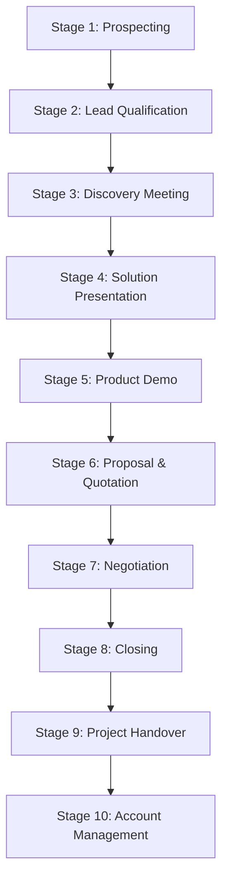
Sepuluh kotak transparan bertumpuk vertikal di latar biru, bernomor Stage 1 sampai 10; tidak ada panah pada gambar.
Sumber: img/page-05.png

### 3.2 Rantai persetujuan sebelum proposal dikirim (hal. 10, panah eksplisit pada gambar)

Tiga kotak di bawah label "Sebelum dikirim ke customer:", panah biru satu arah dari kiri ke kanan (diperiksa pada render 150 dpi). Berdampingan dengan kartu Stage 5 Product Demo.
Sumber: img/page-10.png

### 3.3 Alur end-to-end dengan gerbang kendali (diturunkan dari teks hal. 5 sampai 12)
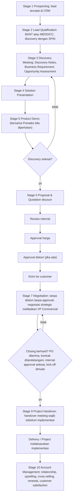
Diagram ini DITURUNKAN DARI TEKS, bukan gambar tunggal di sumber. Kondisi "Discovery selesai?" mencerminkan kalimat "Proposal hanya dibuat setelah Discovery selesai", dan jalur "tidak" kembali ke Discovery adalah inferensi. Jalur "tidak" pada Closing kembali ke Negotiation adalah inferensi (sumber tidak menggambarkan kegagalan closing). Stage 8 Closing dilebur ke simpul keputusan.
Sumber: teks hal. 5 sampai 12 (img/page-05.png sampai page-12.png)

### 3.4 Matriks eskalasi (hal. 17)
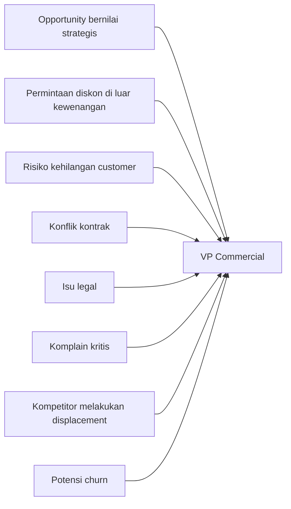
Kartu "14. Escalation Matrix" berisi delapan butir bertanda centang; kalimat pembuka "Segera eskalasikan kepada VP Commercial apabila terjadi". Panah di diagram menggambarkan hubungan kondisi ke penerima eskalasi (tidak ada panah pada gambar).
Sumber: img/page-17.png

## 4. Peran, RACI, record, KPI

Peran yang disebut:
| Peran | Tanggung jawab di SOP |
|---|---|
| VP of Commercial (VP Commercial) | Document Owner; dilibatkan pada negosiasi strategis; penerima eskalasi; pemberi persetujuan penyimpangan SOP "atau pihak yang berwenang" |
| Sales Executive | Bertanggung jawab penuh atas opportunity dari prospecting sampai project handover |
| Business Development | Satu-satunya anggota tim yang tercantum di Scope |
| Marketing | Lead generation, campaign feedback, event collaboration |
| Presales | Technical discussion, demo, solution design, RFP support |
| Delivery / Project | Penerima handover; konfirmasi timeline dan scope |
| Finance | Invoice, payment status, commercial terms |
| Legal | NDA, review kontrak, T&C komersial, dukungan negosiasi, legal compliance |
| Procurement, Management | Disebut di Prinsip 5 (kolaborasi) tanpa rincian tugas |

Matriks persetujuan (sebagaimana tertulis):
| Keputusan | Siapa | Batas / tenggat |
|---|---|---|
| Review internal proposal | tidak disebut | tidak ada tenggat |
| Approval harga | tidak disebut | tidak ada batas |
| Approval diskon (jika ada) | tidak disebut | tidak ada ambang diskon |
| Diskon di luar kewenangan | VP Commercial (eskalasi) | batas kewenangan tidak didefinisikan |
| Negosiasi strategis | VP Commercial dilibatkan | definisi "strategis" tidak ada |
| Penyimpangan SOP | VP Commercial atau pihak yang berwenang | tidak ada |

Tenggat dan SLA di SOP: CRM maksimal 24 jam; email 1 hari kerja; WhatsApp 2 jam kerja; internal request 4 jam kerja; siklus tinjau SOP 6 bulan.

Dokumen dan record yang disebut: Qualification Notes; Customer Pain Points; Opportunity Score; Discovery Notes; Business Requirement; Opportunity Assessment; Proposal (Scope of Work, Proposed Solution, Deliverables, Timeline, Commercial Proposal, Assumptions, Exclusions); Purchase Order; Kontrak; paket handover (Customer Background, Scope, Timeline, Risks, Commitment, Contact Person); laporan Daily/Weekly/Monthly; catatan di CRM.

Handover ke Delivery: wajib handover meeting sebelum implementasi dimulai; enam butir minimal; seluruh dokumen harus lengkap sebelum handover. Tidak ada form handover bernomor dan tidak disebut penerima atau penanggung jawab Delivery.

KPI (hal. 16): tiga kelompok (lihat tabel Sales KPI). KPI per tahap pada Stage 1: New Leads Generated, Prospecting Activities, Qualified Leads.

## 5. Catatan kualitas dan celah
- Scope (02) berbunyi "tim Commercial yang saat ini terdiri dari: Business Development" tetapi isi dokumen berbicara tentang "Sales Executive", "Presales", dan VP Commercial; KPI COMMERCIAL & MARKETING.xlsx memuat VP of Commercial (sheet Laras B14) dan Business Development Manager (sheet Olin B14). Komposisi tim tidak konsisten antar bagian.
- Tidak ada nama atau jabatan penyetuju (approver) dan tidak ada riwayat revisi, nomor dokumen, atau klasifikasi (hal. 1 hanya memuat "Document Owner: VP of Commercial", "Version: 1.0", "Effective Date: 28th of July, 2026", "Review Cycle: Every 6 Months").
- Pricing dan diskon: tidak ada tingkat kewenangan (siapa memberi approval harga dan diskon), ambang persentase, SLA approval, atau form/templat. Hanya urutan "Review internal, Approval harga, Approval diskon (jika ada)". Onboarding slide 16 menyebut "Commercial Manager" untuk Pricing & Deal Approval; SOP menyebut VP Commercial untuk negosiasi strategis (hal. 11), eskalasi diskon di luar kewenangan (hal. 17), dan persetujuan penyimpangan SOP (hal. 18), tanpa menyatakan siapa pemberi approval harga dan diskon.
- Kriteria kualifikasi SOP (hal. 7: Business Need, Budget, Decision Maker, Timeline, Technical Fit) berbeda satu butir dari deck onboarding (slide 15: Project Scope menggantikan Technical Fit). SOP memperbolehkan "BANT atau MEDDICC" (hal. 7), deck menyatakan MEDDICC (slide 14 dan 15).
- Stage 6 sampai Stage 10 tidak memiliki label "Objective" eksplisit (hanya Stage 1 sampai 5 yang berlabel; pada tabel bagian 2, isi kolom Objective untuk Stage 6, 9, dan 10 adalah kalimat pembuka, bukan label sumber), dan Stage 2 sampai 10 tidak mencantumkan KPI per tahap seperti Stage 1 (hal. 6).
- Tidak ada tenggat untuk follow-up lead, approval internal, atau handover; hanya CRM 24 jam (hal. 13) dan batas respons komunikasi (hal. 14).
- Delivery disebut sebagai penerima handover ("Sales wajib melakukan handover kepada Delivery", hal. 11) tanpa penerima individu atau form terdefinisi. Tidak ada tahap Delivery/implementation di dalam 10 tahap SOP (berakhir dengan Account Management), berbeda dengan deck onboarding yang mencantumkan Delivery / Implementation dan Customer Success.
- KPI SOP (hal. 16, 9 butir) tidak identik dengan 8 KPI deck onboarding dan KPI individu pada KPI COMMERCIAL & MARKETING.xlsx (tidak ada bobot atau target di SOP).
- Alat yang dirujuk SOP hanya "CRM" (hal. 13), tanpa nama produk CRM. Deck onboarding slide 17 menyebut "CRM" dan "Sinux Knowledge Base" sebagai dua alat terpisah (nama produk CRM juga tidak disebut di deck); "Sinux Knowledge Base" tidak muncul di SOP ini. Tidak ada rujukan nomor dokumen lain.
- "Sales tidak diperbolehkan: ... Menawarkan fitur yang belum tersedia. Menjanjikan timeline tanpa konfirmasi Delivery." (hal. 15) adalah kontrol yang jelas (penilaian, inferensi); tidak ada mekanisme verifikasi atau rekaman bukti kepatuhan selain CRM.
- Cacat tata letak: kartu 3, 7, dan 8 pada halaman 3 memperlihatkan judul bertumpuk pada teks (render); isi tetap utuh di lapisan teks.

## 6. Kata kunci retrieval
sales SOP, standard operating procedure penjualan, Commercial Department, VP of Commercial, SINUX, sales process 10 stage, prospecting, lead qualification, BANT, MEDDICC, SPIN Selling, discovery meeting, solution presentation, product demo, proposal quotation, approval harga, approval diskon, pricing policy, diskon tanpa approval, negotiation, closing, purchase order, project handover, handover meeting, account management, upselling, cross-selling, renewal, CRM policy 24 jam, response time email WhatsApp, weekly commercial rhythm, reporting standard, code of conduct, escalation matrix, success metrics, SOP compliance, probation, KPI sales, forecast accuracy, win rate
