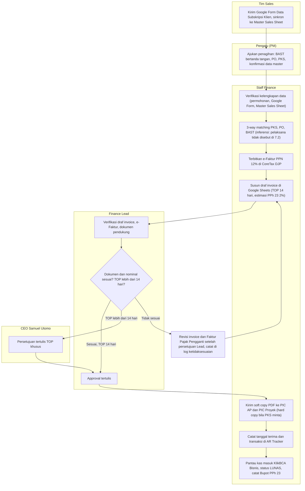
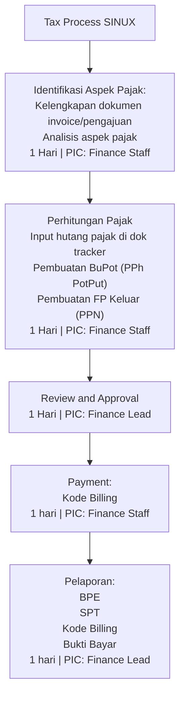

# ISO SINUX Supporting Docs korpus: FAT (SOP Billing dan Invoicing, SOP Tax)

as_of: 2026-10-14 | lane: ISO Supporting Documents (ingest 13 sampai 14 Okt 2026) | status: NON-KANONIK, dokumen sumber DRAFT | sensitivitas isi: restricted:finance
Isi: md AI-friendly per dokumen sumber (frontmatter + 1 Ringkasan, 2 Isi lengkap, 3 Diagram mermaid, 4 Peran/RACI/record/KPI, 5 Catatan kualitas berkutipan, 6 Kata kunci).
Navigasi: `readme-iso-supdocs-2026-10-14.md`. Penutup sesi dan keputusan owner: verdict bagian 7 dan handoff (`05_HANDOFF`). Setiap bagian diawali penanda `<!-- FILE: path -->` (path relatif terhadap folder md/ korpus; sama dengan nama berkas di staging `isoraw-*`).

<!-- FILE: fat/FAT-SOP-Billing-Invoicing.md -->

---
doc_code: tidak bernomor
title: Standar Operasional Prosedur (SOP) - Billing dan Invoicing
department: FAT
doc_type: SOP
source: {drive_file_id: 1sZfTBx1ZxBIryhzJHf14eOcRR7HuQ1E1Qox3DdwmHKI, filename: "2. SOP Billing and Invoicing (Google Doc, diekspor docx)", format: gdoc, bytes: 139861, retrieved: 2026-10-13}
revision: "kosong (field Versi tidak diisi)"
doc_date: "kosong (field Tanggal Berlaku tidak diisi)"
classification_in_doc: "Rahasia (Confidential) untuk dokumen keuangan (Bagian 7.1); label klasifikasi dokumen SOP sendiri tidak ada"
owner_in_doc: "Departemen Finance, Accounting & Tax (FAT); disusun oleh Samuel Kristanto Utomo (Direktur Utama)"
approver_in_doc: "Samuel Kristanto Utomo, Direktur Utama (juga pada kolom Diperiksa dan Disetujui)"
iso_refs: {iso9001: ["8.2", "8.5"], iso27001: ["A.5.33"]}
kb_sensitivity_suggest: restricted:finance
related_docs: [SOP Tax Process (batch yang sama), Form Permohonan Penagihan (Lampiran 1, tidak ada), Templat Invoice (Lampiran 2, tidak ada), Flowchart (Lampiran 3, tidak ada), Format Register Penagihan dan Penjualan (Lampiran 4, tidak ada)]
coverage: {sections_or_sheets: "9 dari 9 bagian (1 sampai 9)", tables: "2 terlihat (metadata kosong, pengesahan); stats.json menyebut 4 (2 sisanya tabel layout, tidak terlihat)", images: "1 dibuka dari 1", notes: "Satu-satunya gambar (image1.png) adalah logo SINUX di kop, bukan diagram alur. Lampiran 1 sampai 4 hanya dirujuk, isinya tidak ada di dokumen. Mermaid bagian 3 diturunkan dari teks 6 dan 9.2."}
---
# SOP Billing dan Invoicing

> Sensitivitas: restricted:finance. Tidak ada nomor rekening, kredensial, atau NPWP pribadi di sumber (tidak ada redaksi). Sumber menyebut akun portal CoreTax DJP dan KlikBCA Bisnis tetapi tanpa user atau password.

## 1. Ringkasan (maks 6 butir, fakta)
- SOP penagihan Departemen Finance, Accounting & Tax (FAT) untuk penjualan jasa dan proyek (IT Service Development, konsultasi, retainer/kontrak periodik).
- Invoice hanya diproses bila 4 dokumen pendukung lengkap dan 3-way matching (PKS, PO, BAST) lolos; e-Faktur Pajak (PPN 12%) via CoreTax DJP; estimasi PPh 23 (2%) dicatat dan direkonsiliasi saat Bupot diterima.
- Term of Payment standar 14 hari kalender; TOP lebih dari 14 hari wajib persetujuan tertulis CEO (Samuel Utomo) sebelum PKS atau PO disepakati.
- Segregasi: Sales (data master klien), Pengaju/PM (permohonan), Maker/Staff Finance, Checker/Finance Lead (approval), Approver/CEO (TOP khusus). Staff Finance dilarang mengirim invoice tanpa approval tertulis Finance Lead.
- Retensi arsip penagihan dan bukti pajak minimal 10 tahun; pemusnahan dengan Berita Acara Pemusnahan Dokumen disetujui Finance Lead dan CEO.
- Dokumen belum terkendali: field Perusahaan, No Dokumen, Versi, Tanggal Berlaku, Status kosong; Lampiran 1 sampai 4 tidak disertakan.

## 2. Isi lengkap terstruktur

### Kop dan kontrol dokumen
| Field | Nilai di sumber |
|---|---|
| Judul | Standar Operasional Prosedur (SOP) - Finance (judul sampul: SOP - Billing dan Invoicing) |
| Perusahaan | (kosong) |
| No Dokumen | (kosong) |
| Versi | (kosong) |
| Tanggal Berlaku | (kosong) |
| Status | (kosong) |

Pengesahan:
| Peran | Nama (sumber) | Jabatan |
|---|---|---|
| Disusun oleh | SAMUEL KRISTANTO UTOMO | Direktur Utama, PT STRATEGI INTEGRASI NUSANTARA |
| Diperiksa oleh | SAMUEL KRISTANTO UTOMO | Direktur Utama, PT STRATEGI INTEGRASI NUSANTARA |
| Disetujui oleh | SAMUEL KRISTANTO UTOMO | Direktur Utama, PT STRATEGI INTEGRASI NUSANTARA |
(tanda tangan dan tanggal tidak tampak di teks)

### 1. Maksud dan Tujuan
1.1 Latar Belakang dan Kepatuhan ISO. SOP sebagai panduan kerja resmi Departemen FAT PT Strategi Integrasi Nusantara. Menjamin kepatuhan terhadap:
- ISO 9001:2015: Klausa 8.2 (Persyaratan Produk dan Jasa) dan Klausa 8.5 (Pengendalian Operasional Penagihan).
- ISO/IEC 27001:2022: Lampiran A.5.33 (Perlindungan dan Kerahasiaan Catatan Keuangan).

1.2 Tujuan Operasional:
1. Seluruh tagihan (invoice) diterbitkan dengan nominal 100% akurat berdasarkan PKS, PO, dan BAST yang sah.
2. Pengakuan pendapatan (revenue recognition) dan pencatatan piutang usaha (AR) tepat waktu.
3. Kepatuhan penuh perpajakan nasional, khususnya e-Faktur Pajak (PPN 11% (sic, lihat bagian 5)) via portal CoreTax DJP dan pencatatan kewajiban pemotongan PPh Pasal 23 (2%).
4. Bukti kendali mutu dan jejak pemeriksaan (audit trail) digital yang terstruktur dan aman.

### 2. Ruang Lingkup
- 2.1 Entitas dan Unit Bisnis: berlaku wajib untuk seluruh aktivitas penagihan di lingkungan PT Strategi Integrasi Nusantara tanpa terkecuali.
- 2.2 Cakupan Transaksi: seluruh penagihan atas penjualan jasa dan pekerjaan proyek: (a) Proyek Pengembangan Sistem dan Layanan IT (IT Service Development); (b) Layanan Konsultasi dan Pekerjaan Berbasis Retainer/Kontrak Periodik.

### 3. Definisi dan Istilah
3.1 Istilah Keuangan dan Operasional
| Istilah | Definisi |
|---|---|
| Invoice (Surat Tagihan) | Dokumen komersial resmi dari SINUX ke klien sebagai permintaan pembayaran atas penyerahan jasa atau penyelesaian pekerjaan proyek |
| BAST | Dokumen bukti legal bahwa deliverable, laporan milestone, atau jasa telah diselesaikan dan diterima serta disetujui klien |
| PO / SPK | Dokumen pemesanan resmi dari klien; dasar hukum memulai pekerjaan dan menerbitkan tagihan |
| PKS / Kontrak | Kesepakatan tertulis SINUX dan klien: hak dan kewajiban, nilai proyek, jadwal pembayaran, syarat khusus |
| Term of Payment (TOP) | Jangka waktu klien melunasi tagihan, dihitung sejak tanggal invoice diterbitkan hingga jatuh tempo. Standar 14 hari kalender |
| AR / Piutang Usaha | Hak tagih perusahaan kepada klien atas penjualan jasa secara kredit |

3.2 Istilah Perpajakan
| Istilah | Definisi |
|---|---|
| e-Faktur Pajak (PPN Keluar) | Bukti pemungutan PPN (12%) elektronik oleh SINUX atas penyerahan Jasa Kena Pajak (JKP) kepada klien melalui CoreTax DJP |
| PPh Pasal 23 | PPh yang dipotong klien (pemotong pajak) atas pembayaran jasa SINUX, 2% dari Dasar Pengenaan Pajak (DPP) |

3.3 Platform dan Perangkat Kerja Digital
| Perangkat | Fungsi |
|---|---|
| Google Sheets | Lembar kerja cloud untuk Register Penagihan dan Penjualan secara real-time |
| DJP CoreTax Portal | Portal DJP untuk penerbitan e-Faktur Pajak |
| KlikBCA Bisnis | Internet banking perusahaan untuk verifikasi penerimaan pembayaran (cash-in) |

### 4. Peran dan Tanggung Jawab
4.1 Matriks Tanggung Jawab (Segregasi Tugas)
| Peran | Tanggung jawab |
|---|---|
| Tim Sales | Mengirim tautan Google Form Data Subskripsi Klien kepada klien baru saat penandatanganan kontrak/PKS; memastikan klien melengkapi data utama (Nama Lengkap PT/Entitas Legal, NPWP Klien, Alamat Operasional/Faktur, Email dan Kontak PIC Finance/AP, Email dan Kontak PIC Proyek); mengunggah dan memperbarui detail transaksi, acuan PO/PKS, dan data master klien ke Master Sales Sheet secara rutin |
| Pengaju (User / Project Manager) | Mengajukan permohonan penagihan resmi ke Tim Finance setelah milestone atau pekerjaan selesai; memastikan 4 dokumen pendukung wajib tersedia: PKS, PO, BAST, dan Hasil Google Form Data Subskripsi Klien |
| Pembuat (Maker / Staff Finance) | Memverifikasi kesesuaian data draf invoice dengan Master Sales Sheet dan respon Google Form (Nama PT, NPWP, Alamat Operasional, Email PIC Finance dan Proyek); menerbitkan e-Faktur Pajak (PPN 12%) via CoreTax DJP; menyusun draf invoice di Google Sheets dan mengirim soft copy via email ke PIC AP dan PIC Proyek (hard copy bila dipersyaratkan PKS); mencatat transaksi di Register Penagihan dan Penjualan (AR Tracker) |
| Pemeriksa (Checker / Finance Lead) | Memeriksa keabsahan draf invoice terhadap nilai PKS dan BAST; memeriksa perhitungan PPN 12% dan catatan PPh 23; memberi approval draf invoice sebelum dikirim ke klien |
| Penyetuju (Approver / CEO - Samuel Utomo) | Keputusan dan persetujuan tertulis atas perubahan Term of Payment di luar standar 14 hari kalender |

4.2 Wewenang dan Batas Tanggung Jawab
- Batas Kewenangan Pembuatan: Staff Finance dilarang keras menerbitkan atau mengirim invoice kepada klien tanpa approval tertulis Finance Lead.
- Batas Kewenangan Kredit: Finance Lead tidak berwenang mengubah atau memperpanjang jatuh tempo melebihi 14 hari kalender tanpa persetujuan langsung CEO (Samuel Utomo).
- Jejak Audit: setiap perubahan nominal, revisi tanggal, atau pembatalan invoice yang telah disetujui wajib dicatat alasan perubahan beserta bukti persetujuannya dalam sistem pengarsipan.

### 5. Ketentuan Umum Penagihan
5.1 Syarat Utama dan Master Data Penagihan
- Google Form Data Subskripsi Klien: sebelum permohonan penagihan diproses, Tim Sales memastikan klien mengisi form. Data wajib: (1) Nama Lengkap Badan Usaha (Full Legal PT/CV Name) sesuai NPWP/NIB; (2) NPWP Klien; (3) Alamat Operasional dan Alamat Surat-Menyurat Resmi; (4) Kontak PIC Finance/AP (Nama, Email, No. HP/WA); (5) Kontak PIC Proyek/Operational User (Nama, Email, No. HP/WA).
- Master Sales Sheet: data respon Google Form beserta status PKS, nilai PO, dan skema pembayaran disinkronkan Tim Sales ke Master Sales Sheet.
- Kelengkapan Dokumen Pendukung: tagihan hanya diproses bila 4 dokumen utama lengkap dan tervalidasi: PKS/Kontrak (skema nilai, pasal pembayaran, syarat penagihan); PO/SPK (bukti pemesanan klien); BAST (ditandatangani kedua belah pihak); NPWP Klien (validasi data e-Faktur).

5.2 Ketentuan Perpajakan
- PPN 12%: seluruh penyerahan JKP dikenakan PPN 12%; e-Faktur Pajak Keluar wajib diterbitkan elektronik via CoreTax DJP pada saat penerbitan invoice atau penyerahan jasa.
- PPh Pasal 23: dipotong 2% oleh klien; Tim Finance mencatat estimasi pemotongan di Register Penagihan dan merekonsiliasi saat Bukti Potong (Bupot) diterima dari klien.

5.3 Kebijakan Pengiriman Tagihan dan Jatuh Tempo
- Soft Copy (standar): berkas penagihan (PDF) via email resmi ke PIC AP dan PIC Proyek.
- Hard Copy: cetak resmi bertanda tangan dan berstempel via kurir hanya bila eksplisit dipersyaratkan PKS/Kontrak.
- Standar TOP: 14 hari kalender terhitung sejak tanggal invoice resmi dikirimkan kepada klien.
- Pengecualian: TOP di atas 14 hari wajib persetujuan tertulis CEO (Samuel Utomo) sebelum PKS atau PO disepakati. Invoice melewati jatuh tempo masuk kategori Overdue dan diproses sesuai prosedur pemantauan piutang (AR).

### 6. Prosedur Operasional Penagihan
6.1 Tahap 1 Pengumpulan Data dan Pengajuan Penagihan
- Pengiriman Form oleh Sales: kirim tautan Google Form Data Subskripsi Klien (Nama PT, NPWP, Alamat Operasional, PIC Finance/AP, PIC Proyek).
- Pengajuan oleh PM: ajukan permohonan penagihan ke Tim Finance dengan melampirkan BAST yang sudah ditandatangani, acuan PO, PKS, dan konfirmasi data master klien di Master Sales Sheet/Google Form sudah lengkap.
- Verifikasi Finance Staff: periksa kelengkapan data antara permohonan, respon Google Form, dan Master Sales Sheet.

6.2 Tahap 2 Pembuatan e-Faktur Pajak dan Draf Invoice
- Penerbitan e-Faktur Pajak: Staff Finance mengakses CoreTax DJP, menerbitkan e-Faktur Pajak Keluar PPN 12% sesuai DPP transaksi.
- Penyusunan Draf Invoice: templat resmi di Google Sheets dengan nomor invoice, tanggal penerbitan, rincian pekerjaan, nominal PPN 12%, estimasi PPh 23 (2%), dan tanggal jatuh tempo (TOP 14 hari).

6.3 Tahap 3 Pemeriksaan dan Approval
- Finance Lead memverifikasi menyeluruh draf invoice, e-Faktur, dan dokumen pendukung terhadap Master Sales Sheet dan Google Form.
- Jika sesuai: approval tertulis untuk pengiriman invoice. Jika ada TOP khusus (lebih dari 14 hari): draf diteruskan ke CEO (Samuel Utomo) untuk persetujuan khusus.

6.4 Tahap 4 Pengiriman Berkas Penagihan
- Soft copy (standar): email berisi lampiran PDF Invoice Resmi, e-Faktur Pajak, BAST, PO, dan PKS kepada PIC Finance/AP dan PIC Proyek.
- Hard copy (opsional sesuai PKS): cetak, tanda tangan dan stempel, kirim via kurir ke alamat penagihan.
- Konfirmasi Penerimaan: pastikan berkas diterima klien dan catat tanggal penerimaan resmi sebagai acuan perhitungan jatuh tempo (TOP).

6.5 Tahap 5 Pencatatan dan Pemantauan Piutang (AR)
- Update Register Penagihan: catat transaksi ke Register Penagihan dan Penjualan (AR Tracker) di Google Sheets.
- Pemantauan Pembayaran: pemantauan harian arus kas masuk via KlikBCA Bisnis; rekonsiliasi piutang setelah pembayaran diterima.

### 7. Pengendalian Keamanan Informasi dan Mutu
7.1 Keamanan Informasi (ISO/IEC 27001:2022)
- Lampiran A.5.33: dokumen keuangan, daftar harga (rate card), data tagihan klien, dan informasi rekening bank diklasifikasikan Rahasia (Confidential). Akses folder Google Drive FAT dan Register Penagihan Google Sheets dibatasi ketat hanya untuk personel FAT dan CEO.
- Keamanan Akses: akun CoreTax DJP dan KlikBCA Bisnis wajib 2FA dan tidak dibagikan; dokumen tagihan digital ke pihak eksternal wajib PDF terkunci non-editable.

7.2 Pengendalian Mutu Operasional (ISO 9001:2015)
- Klausa 8.5: setiap draf invoice wajib validasi 3 arah (3-way matching) antara nominal PKS, acuan PO, dan BAST sebelum e-Faktur Pajak diterbitkan. Finance Lead memastikan kelengkapan dan keakuratan atribut tagihan sebelum approval.
- Ketidaksesuaian dan revisi: bila ada kesalahan data atau penolakan tagihan klien, Staff Finance wajib menerbitkan Surat Pembatalan/Revisi Invoice serta Faktur Pajak Pengganti via CoreTax DJP setelah persetujuan Finance Lead. Seluruh riwayat pembatalan dan revisi dicatat dalam log ketidaksesuaian untuk evaluasi kendali mutu bulanan.

### 8. Dokumen Terkait dan Arsip
8.1 Dokumen Pendukung Wajib: PKS/Kontrak Jasa; PO/SPK; BAST; Faktur Pajak Elektronik (e-Faktur PPN 12%) diunduh dari CoreTax DJP; Salinan NPWP Klien.

8.2 Pengarsipan dan Retensi
- Penyimpanan digital: seluruh berkas penagihan (Invoice, e-Faktur, PKS, PO, BAST) dalam .pdf di folder Google Drive Departemen FAT; struktur folder `[Tahun] / [Nama Klien] / [Nomor Invoice]`.
- Register Penagihan: Staff Finance memperbarui Google Sheets Register Penagihan dan Penjualan secara real-time setiap perubahan status invoice (Draf, Terkirim, Lunas, atau Cancel).
- Retensi: minimal 10 (sepuluh) tahun sesuai ketentuan perpajakan dan audit ISO 9001/ISO 27001. Pemusnahan dicatat dalam Berita Acara Pemusnahan Dokumen dengan persetujuan Finance Lead dan CEO.

### 9. Lampiran dan Drafting Matrix
9.1 Daftar Lampiran (hanya dirujuk, isi tidak ada)
| Lampiran | Judul | Deskripsi di sumber |
|---|---|---|
| 1 | Form Permohonan Penagihan (Billing Request Form) | Templat pengajuan oleh PM dengan checklist verifikasi 4 dokumen pendukung |
| 2 | Templat Invoice Resmi FAT | Format baku invoice: informasi perusahaan, rincian jasa, DPP, PPN 12%, PPh 23 |
| 3 | Matriks Alur Prosedur Penagihan (Flowchart) | Diagram dari pengajuan (PM), e-Faktur dan invoice (Staff Finance), verifikasi (Finance Lead), hingga pelunasan (KlikBCA Bisnis) |
| 4 | Format Register Penagihan dan Penjualan | Lembar Google Sheets status tagihan, jatuh tempo (TOP 14 hari), rekonsiliasi piutang (AR) |

9.2 Matriks Alur Kerja Penagihan (Billing Workflow Summary)
1. Pengajuan: PM melengkapi PKS, PO, BAST, dan NPWP Klien, lalu mengirim berkas ke Tim FAT.
2. Penerbitan: Staff Finance menerbitkan e-Faktur PPN 12% di CoreTax DJP, lalu membuat draf invoice di Google Sheets.
3. Verifikasi dan Approval: Finance Lead memeriksa kesesuaian dokumen dan nominal, memberi persetujuan tertulis (approval CEO bila TOP lebih dari 14 hari).
4. Pengiriman dan Pencatatan: Staff Finance mengirim berkas lengkap ke klien, mencatat tanggal kirim di Register Penagihan.
5. Pelunasan dan Rekonsiliasi: Staff Finance memantau kas masuk via KlikBCA Bisnis, memperbarui status menjadi LUNAS, mencatat Bukti Potong PPh 23.

## 3. Diagram

### 3.1 Gambar image1.png
Gambar tertanam hanya logo SINUX (teks "SINUX" biru dengan tiga lengkung di atas huruf U dan X) pada kop dokumen; bukan diagram alur. Tidak ada mermaid untuk gambar ini. Sumber gambar: conv/1sZfTBx1ZxBIryhzJHf14eOcRR7HuQ1E1Qox3DdwmHKI/img/media/image1.png

### 3.2 Alur penagihan (diturunkan dari teks Bagian 6 dan 9.2)
Lampiran 3 (flowchart) tidak ada di dokumen, sehingga alur di bawah dibuat dari teks (diturunkan dari teks). Lane: Sales, PM, Staff Finance, Finance Lead, CEO.

Deskripsi: urutan 7.2 menyatakan 3-way matching dilakukan sebelum e-Faktur diterbitkan; 6.1 sampai 6.3 menaruh verifikasi Finance Lead setelah e-Faktur dan draf invoice. Cabang "Tidak sesuai" ke revisi mengikuti Bagian 7.2 (Surat Pembatalan/Revisi Invoice dan Faktur Pajak Pengganti); kembalinya ke penyusunan draf adalah inferensi. Sumber gambar: tidak ada (diturunkan dari teks).

## 4. Peran, RACI, record, KPI
| Aktivitas | Sales | PM | Staff Finance | Finance Lead | CEO |
|---|---|---|---|---|---|
| Kumpulkan data klien (Google Form, Master Sales Sheet) | R | C | I | I | - |
| Ajukan penagihan dan 4 dokumen | - | R | I | - | - |
| Verifikasi data, 3-way matching | - | - | R | A (inferensi) | - |
| Terbit e-Faktur dan draf invoice | - | - | R | I | - |
| Approval invoice | - | - | I | R/A | - |
| Persetujuan TOP lebih dari 14 hari | - | - | I | C | A |
| Kirim invoice, catat AR | - | - | R | I | - |
| Pantau kas masuk, rekonsiliasi | - | - | R | I | - |
| Revisi/pembatalan invoice | - | - | R | A | - |
| Pemusnahan arsip | - | - | R (inferensi) | A | A |
Catatan: RACI di atas adalah pemetaan peneliti dari teks 4.1 dan 4.2 (tidak ada RACI formal di sumber); sel bertanda inferensi tidak dinyatakan eksplisit.

Record dan angka kunci: Register Penagihan dan Penjualan (AR Tracker, status Draf/Terkirim/Lunas/Cancel); Master Sales Sheet; Google Form Data Subskripsi Klien; log ketidaksesuaian (evaluasi bulanan); Berita Acara Pemusnahan Dokumen; TOP 14 hari kalender; PPN 12%; PPh 23 2%; retensi 10 tahun; format folder `[Tahun]/[Nama Klien]/[Nomor Invoice]`; 2FA untuk CoreTax dan KlikBCA Bisnis. KPI/SLA waktu per tahap: tidak ada di dokumen.

## 5. Catatan kualitas dan celah (fakta terukur saja)
1. Kontrol dokumen kosong: Perusahaan, No Dokumen, Versi, Tanggal Berlaku, Status tidak diisi (tabel awal, baris "Perusahaan :", "No Dokumen :", dst. tanpa nilai). Judul tabel "Judul: Standar Operasional Prosedur (SOP) - Finance" berbeda dengan judul sampul "Billing dan Invoicing".
2. Disusun, Diperiksa, dan Disetujui oleh orang yang sama (Samuel Kristanto Utomo, Direktur Utama); tidak ada pemisahan peran penyusun, pemeriksa, penyetuju.
3. Ejaan nama: "SAMUEL KRISTANTO UTOMO" (blok Pengesahan), "Samuel Utomo" (isi, 4.1 "Penyetuju (Approver / CEO - Samuel Utomo)" dan 4.2), sedangkan HR-JA-001 menulis "Samuel Kristianto Utomo" (JA-01). Jabatan: "CEO" (isi 4.1, 4.2, 5.3, 6.3) vs "Direktur Utama" (Pengesahan dan HR-JA-001 JA-01).
4. Tarif PPN tidak konsisten: Bagian 1.2 butir 3 menulis "e-Faktur Pajak (PPN 11%)", seluruh bagian lain 12% (3.2, 4.1, 5.2, 6.2, 8.1, 9.1, 9.2).
5. Titik awal hitungan TOP tidak konsisten: 3.1 "sejak tanggal invoice diterbitkan"; 5.3 "sejak tanggal invoice resmi dikirimkan"; 6.4 "tanggal penerimaan resmi sebagai acuan".
6. "4 dokumen pendukung wajib" didefinisikan berbeda: Bagian 4.1 (PKS, PO, BAST, Hasil Google Form) vs 5.1 (PKS, PO, BAST, NPWP Klien) vs 9.2 butir 1 (PKS, PO, BAST, NPWP Klien); 8.1 mendaftar 5 dokumen (ditambah e-Faktur).
7. Urutan proses tidak konsisten: 7.2 menyatakan 3-way matching sebelum e-Faktur diterbitkan; 6.2 menerbitkan e-Faktur sebelum 6.3 approval Finance Lead; 5.2 menyatakan e-Faktur diterbitkan "pada saat penerbitan invoice". Risiko (inferensi): e-Faktur terbit sebelum approval, sehingga koreksi memerlukan Faktur Pajak Pengganti (7.2: "menerbitkan Surat Pembatalan / Revisi Invoice serta Faktur Pajak Pengganti").
8. Tidak ada SLA waktu per tahap (berbeda dengan SOP Tax, tabel IV kolom Waktu "1 day" pada kelima langkah), tidak ada prosedur Overdue rinci ("diproses sesuai prosedur pemantauan piutang" tanpa dokumen rujukan), tidak ada tindak lanjut collection.
9. Lampiran 1 sampai 4 dirujuk (9.1, mis. Lampiran 3 "Matriks Alur Prosedur Penagihan (Flowchart)") tetapi tidak ada isinya; gambar tertanam hanya logo SINUX (image1.png dibuka), bukan flowchart.
10. Ruang lingkup 2.2 hanya "Proyek Pengembangan Sistem & Layanan IT (IT Service Development)" dan "Layanan Konsultasi dan Pekerjaan Berbasis Retainer/Kontrak Periodik"; penjualan perangkat atau lisensi tidak disebut (celah cakupan, inferensi: transaksi hardware tidak tercakup eksplisit).
11. Segregasi (inferensi: ketergantungan pada satu peran): Finance Lead tunggal sebagai pemeriksa (4.1) dan juga disebut untuk persetujuan pemusnahan (8.2: "dengan persetujuan Finance Lead dan CEO"); tidak ada pengganti bila Finance Lead tidak hadir (tidak disebut di sumber). Peran "Finance Lead" dan "Staff Finance" tidak ada sebagai jabatan di HR-JA-001 (JA-10 "Finance", JA-11 "Accounting & Tax").
12. Klasifikasi "Rahasia (Confidential)" disebut untuk dokumen keuangan (7.1: "diklasifikasikan sebagai dokumen Rahasia (Confidential)"), tetapi dokumen SOP sendiri tidak berlabel klasifikasi (tabel kontrol dokumen tidak memuat kolom klasifikasi).
13. Istilah "Klausa" dan "Lampiran A.5.33" dipakai untuk ISO (1.1: ISO 9001:2015 "Klausa 8.2" dan "Klausa 8.5"; ISO/IEC 27001:2022 "Lampiran A.5.33"); tidak ada pemetaan klausul lain (mis. 7.5 dokumen terinformasi) walau ada kontrol arsip dan retensi (8.2).
14. Teks "$\rightarrow$" (LaTeX) tersisa di Bagian 9.2 sumber.

## 6. Kata kunci retrieval
SOP billing, invoicing, penagihan, invoice, e-Faktur Pajak, CoreTax DJP, PPN 12%, PPN 11%, PPh 23, Bupot, bukti potong, Term of Payment, TOP 14 hari, BAST, PKS, PO, SPK, 3-way matching, AR Tracker, Register Penagihan dan Penjualan, Master Sales Sheet, Google Form Data Subskripsi Klien, KlikBCA Bisnis, Finance Lead, Staff Finance, Maker Checker, approval CEO, overdue, piutang, accounts receivable, retensi 10 tahun, Faktur Pajak Pengganti, ISO 9001 8.5, ISO 27001 A.5.33, FAT

<!-- FILE: fat/FAT-SOP-Tax-Administration-Reporting.md -->

---
doc_code: tidak bernomor
title: "SOP Tax Process (file: 6. SOP Tax Administration & Reporting)"
department: FAT
doc_type: SOP
source: {drive_file_id: 1iMKby6u4X8MYyGlrC5qz73D0y2anOv87, filename: "6. SOP Tax Administration & Reporting.docx", format: docx, bytes: 127108, retrieved: 2026-10-13}
revision: tidak dicantumkan
doc_date: tidak dicantumkan
classification_in_doc: tidak dicantumkan
owner_in_doc: tidak dicantumkan
approver_in_doc: tidak dicantumkan
iso_refs: {iso9001: [], iso27001: []}
kb_sensitivity_suggest: restricted:finance
related_docs: [SOP Billing and Invoicing (batch yang sama)]
coverage: {sections_or_sheets: "5 dari 5 bagian (I Latar Belakang, II Tujuan, III Ruang Lingkup, IV Tax Process, V Flow Chart)", tables: 1, images: "1 dibuka dari 1", notes: "Dokumen tanpa blok metadata (nomor, revisi, tanggal, pemilik, penyetuju). Penomoran bagian di sumber campuran (1, 2 lalu III, IV, V). Tidak ada rujukan ISO. Tabel proses IV terlihat di text.md (HTML) meski stats.json menyebut 0 tabel."}
---
# SOP Tax Process (SOP Tax Administration & Reporting)

> Sensitivitas: restricted:finance. Tidak ada kredensial, NPWP pribadi, atau rekening di sumber (tidak ada redaksi).

## 1. Ringkasan (maks 6 butir, fakta)
- SOP perpajakan Departemen FAT PT Strategi Integrasi Nusantara (jasa IT; customer swasta, Instansi Pemerintah, vendor software/hardware) untuk akurasi hitung, ketepatan bayar, dan kepatuhan lapor pajak (PPN, PPh PotPut, PPh Badan).
- Empat tujuan: kepatuhan perpajakan, standardisasi alur kerja antara tim FAT dan divisi lain, mitigasi risiko (telat setor/lapor, salah faktur pajak, salah pencatatan utang/piutang pajak), dan optimalisasi arus kas serta ekualisasi laporan keuangan komersial dengan SPT.
- Ruang lingkup: PPN (Faktur Pajak Keluaran, PPN Pemungut WAPU/Kode 02 untuk Instansi Pemerintah/BUMN, kredit Faktur Pajak Masukan, rekonsiliasi), PPh 21 (termasuk Gross-Up dan penyesuaian akhir tahun), PPh 23/26 dan PPh 4(2), PPh Badan (SPT Tahunan, angsuran PPh 25), administrasi (ID Billing, BPN/NTPN, bukti lapor, filing untuk audit).
- Proses inti 5 langkah, masing-masing 1 hari: Identifikasi Aspek Pajak (Staff), Perhitungan pajak (Staff), Review & Approval (Lead), Pembayaran/kode billing (Staff), Pelaporan/pengarsipan (Lead).
- Flow chart tertanam berupa timeline 5 titik dengan label durasi dan PIC (Finance Staff atau Finance Lead).
- Dokumen belum memuat nomor, revisi, pemilik, penyetuju, atau SLA/tenggat statutori.

## 2. Isi lengkap terstruktur

### I. Latar Belakang
PT Strategi Integrasi Nusantara (SINUX) adalah entitas bisnis di bidang Jasa Teknologi Informasi (IT Services). Dalam operasionalnya SINUX memiliki berbagai customer mulai dari perusahaan swasta hingga Instansi Pemerintah, maupun vendor software/hardware yang bersinggungan langsung dengan berbagai kewajiban perpajakan yang diatur perundang-undangan Indonesia.

SOP Tax Process ini disusun khusus untuk merinci alur kerja dan proses perpajakan guna memastikan akurasi perhitungan, ketepatan waktu pembayaran, serta kepatuhan pelaporan pajak (tax compliance) agar SINUX terhindar dari risiko sanksi berupa denda, bunga administratif, maupun sengketa pajak.

### II. Tujuan
1. Memastikan Kepatuhan Perpajakan (Tax Compliance): menjamin seluruh kewajiban menghitung, memotong/memungut, menyetor, dan melaporkan pajak (PPN, PPh PotPut, dan PPh Badan) sesuai peraturan perundang-undangan perpajakan.
2. Standardisasi Alur Kerja: panduan dan batasan tanggung jawab yang jelas antara tim FAT dan divisi lain yang terkait dalam mengeksekusi transaksi yang memiliki implikasi pajak.
3. Mitigasi Risiko: mencegah keterlambatan penyetoran dan pelaporan pajak, kesalahan penerbitan faktur pajak, serta kesalahan pada Laporan Keuangan akibat ketidaksesuaian pencatatan utang/piutang pajak.
4. Optimalisasi Arus Kas & Ekualisasi: mengelola hak kompensasi pajak (Tax Asset) secara efektif dan mewujudkan ekualisasi antara Laporan Keuangan Komersial dan Surat Pemberitahuan (SPT) Pajak.

### III. Ruang Lingkup
SOP berlaku untuk seluruh kegiatan operasional yang memiliki aspek perpajakan di proses bisnis SINUX, meliputi namun tidak terbatas pada:

1. Pajak Pertambahan Nilai (PPN):
   - Penerbitan Faktur Pajak Keluaran atas setiap transaksi penjualan kepada customer.
   - Penanganan khusus PPN Pemungut (WAPU/Kode 02) atas transaksi dengan Instansi Pemerintah/BUMN.
   - Pengkreditan Faktur Pajak Masukan.
   - Rekonsiliasi PPN setiap Masa Pajak.
2. Pajak Penghasilan (PPh):
   - Pemotongan PPh Pasal 21 atas gaji, bonus, dan tunjangan karyawan (termasuk metode Gross-Up dan penyesuaian akhir tahun).
   - Pemotongan/Pemungutan PPh Pasal 23/26 dan PPh Pasal 4 ayat (2) atas transaksi dengan pihak ketiga (vendor jasa, sewa, pengadaan infrastruktur).
   - Rekonsiliasi PPh Potong dan Pungut di setiap masa pajak.
   - Rekonsiliasi PPh Potong dan Pungut di setiap akhir tahun pajak untuk perhitungan dan pelaporan PPh Badan.
3. Pajak Penghasilan (PPh) Badan:
   - Perhitungan laba komersial dan fiskal, serta penyusunan SPT Tahunan PPh Badan.
   - Perhitungan angsuran PPh Pasal 25 (jika ada).
   - Rekonsiliasi semua kredit pajak yang dapat digunakan untuk perhitungan PPh Badan.
4. Administrasi & Rekonsiliasi:
   - Pembuatan ID Billing (pembayaran pajak) dan pengelolaan Bukti Penerimaan Negara (BPN/NTPN).
   - Pembuatan bukti lapor pajak bagi setiap Masa dan Tahun Pajak berjalan.
   - Filing (pengarsipan) dokumen perpajakan yang sistematis untuk persiapan audit (internal, eksternal, maupun pemeriksaan DJP).

### IV. Tax Process
| No | Aktivitas | Waktu | PIC |
|---|---|---|---|
| 1 | Identifikasi Aspek Pajak: (a) Kelengkapan dokumen invoice/pengajuan; (b) Analisis aspek pajak | 1 day | Staff |
| 2 | Perhitungan pajak: (a) Input hutang pajak di dokumen tracker; (b) Pembuatan bukti potong (PPh PotPut); (c) Pembuatan Faktur Pajak Keluar (PPN) | 1 day | Staff |
| 3 | Review & Approval: (a) Rekonsiliasi nilai pajak terhutang di setiap akhir Masa Pajak; (b) Proses approval dan pengajuan payment | 1 day | Lead |
| 4 | Pembayaran: (a) Pembuatan kode billing | 1 day | Staff |
| 5 | Pelaporan: (a) Pengarsipan dokumen bukti lapor (BPE, SPT, Kode billing dan bukti bayar) | 1 day | Lead |

### V. Flow Chart
Berisi satu gambar (lihat bagian 3).

## 3. Diagram

### 3.1 Gambar "Tax Process SINUX" (image1.png)
Mermaid setia ke gambar. Gambar tidak memiliki panah; urutan mengikuti posisi titik pada garis vertikal tengah dari atas ke bawah (zig-zag kanan-kiri-kanan-kiri-kanan) dan nomor tabel IV. Kotak berbingkai biru tua, label durasi dan PIC berlatar hitam.

Deskripsi: timeline vertikal dengan judul "Tax Process SINUX" (kotak hitam). Lima titik pada garis tengah: kanan atas "Identifikasi Aspek Pajak" (1 Hari, Finance Staff), kiri "Perhitungan Pajak" (1 Hari, Finance Staff), kanan "Review & Approval" (1 Hari, Finance Lead), kiri "Payment: Kode Billing" (1 hari, Finance Staff), kanan bawah "Pelaporan: BPE, SPT, Kode Billing, Bukti Bayar" (1 hari, Finance Lead). Tidak ada percabangan ya/tidak. Singkatan di gambar: BuPot, FP Keluar, BPE. Total durasi 5 hari adalah penjumlahan (inferensi), tidak tertulis di dokumen.
Sumber gambar: conv/1iMKby6u4X8MYyGlrC5qz73D0y2anOv87/img/media/image1.png

## 4. Peran, RACI, record, KPI
| Langkah | Staff (Finance Staff) | Lead (Finance Lead) | Output/record |
|---|---|---|---|
| 1 Identifikasi Aspek Pajak | Pelaksana (PIC) | - | Hasil cek kelengkapan invoice/pengajuan dan analisis aspek pajak |
| 2 Perhitungan pajak | Pelaksana (PIC) | - | Hutang pajak di dokumen tracker, bukti potong PPh PotPut, Faktur Pajak Keluar |
| 3 Review & Approval | - | Pelaksana (PIC) | Rekonsiliasi nilai pajak terhutang akhir Masa Pajak, approval dan pengajuan payment |
| 4 Pembayaran | Pelaksana (PIC) | - | Kode billing |
| 5 Pelaporan | - | Pelaksana (PIC) | Arsip BPE, SPT, kode billing, bukti bayar |

KPI/target: hanya durasi 1 hari per langkah. Tidak ada KPI lain, tidak ada matriks RACI di sumber (tabel di atas hanya memetakan PIC, bukan RACI formal).

## 5. Catatan kualitas dan celah (fakta terukur saja)
1. Tidak ada nomor dokumen, revisi, tanggal, pemilik, penyetuju, klasifikasi, atau riwayat revisi (teks sumber diawali "1. Latar Belakang" tanpa blok metadata). Nama berkas "SOP Tax Administration & Reporting" berbeda dengan judul isi "SOP Tax Process" (Latar Belakang: "SOP Tax Process ini disusun"; Bagian IV "Tax Process").
2. Penomoran bagian tidak konsisten: "1. Latar Belakang", "2. Tujuan", lalu "III. Ruang Lingkup", "IV. Tax Process", "V. Flow Chart".
3. Ruang lingkup mencakup PPN, PPh 21, 23/26, 4(2), 25, PPh Badan, SPT Tahunan, namun proses IV hanya 5 langkah generik, tanpa pembedaan alur per jenis pajak, tanpa tenggat statutori setor/lapor, dan tanpa penyebutan portal (mis. CoreTax) atau bank.
4. Langkah 4 "Pembayaran" (tabel IV) hanya mencantumkan "Pembuatan kode billing"; tidak ada langkah penyetoran dan siapa yang membayar. Ruang lingkup III.4 menyebut "pengelolaan Bukti Penerimaan Negara (BPN/NTPN)", tetapi NTPN tidak muncul di tabel IV (langkah 5 hanya "BPE, SPT, Kode billing dan bukti bayar" pada gambar). Langkah 3 mencakup "Proses approval dan pengajuan payment" tanpa rujukan form atau batas wewenang approval.
5. Gambar memakai label "Payment" dan "Pelaporan: BPE, SPT, Kode Billing, Bukti Bayar" tanpa kata "Pengarsipan"; tabel memakai "Pembayaran" dan "Pengarsipan dokumen bukti lapor". PIC di gambar "Finance Staff"/"Finance Lead", di tabel "Staff"/"Lead".
6. Peran "Finance Staff" dan "Finance Lead" tidak ada sebagai jabatan di SINUX_Job_Analysis_2026 (HR-JA-001), yang hanya memuat "Finance" (JA-10) dan "Accounting & Tax" (JA-11). Tidak jelas siapa Lead untuk pajak (inferensi: JA-11 "Accounting & Tax" tidak berlevel).
7. Tidak ada rujukan ISO 9001 atau ISO/IEC 27001, klasifikasi informasi, atau masa retensi arsip pajak (berbeda dengan SOP Billing and Invoicing 8.2: "minimal 10 (sepuluh) tahun").
8. Tidak disebut dokumen tracker secara spesifik (nama/lokasi "dokumen tracker").

## 6. Kata kunci retrieval
SOP pajak, tax process, tax compliance, PPN, e-Faktur, Faktur Pajak Keluaran, Faktur Pajak Masukan, WAPU, PPN Pemungut, PPh 21, Gross-Up, PPh 23, PPh 26, PPh 4 ayat 2, PPh 25, PPh Badan, SPT Tahunan, SPT Masa, bukti potong, BuPot, ID Billing, kode billing, NTPN, BPE, BPN, ekualisasi, rekonsiliasi pajak, DJP, FAT, Finance Staff, Finance Lead, tax asset, filing, audit pajak
