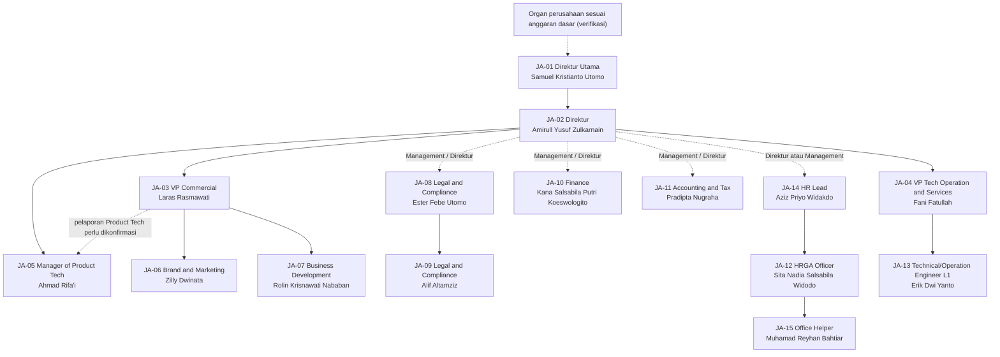
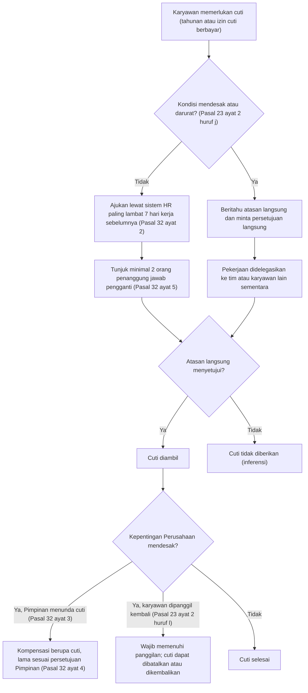
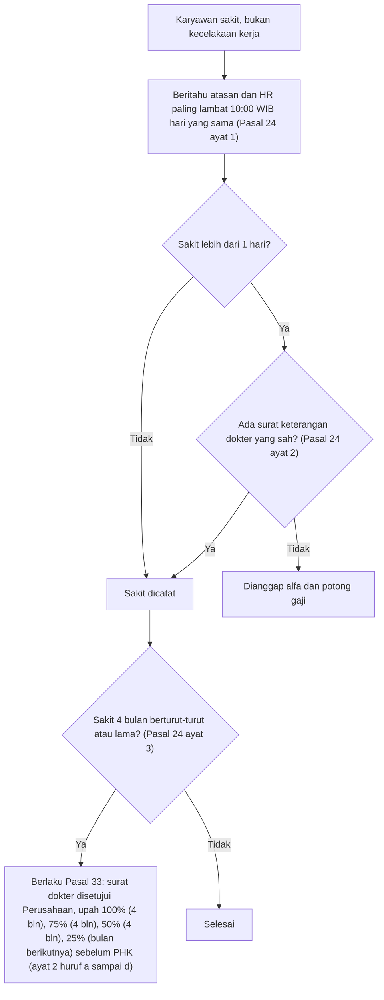

# ISO SINUX Supporting Docs korpus: HR (HR-JA-001 Job Analysis 15 jabatan, PP Cuti)

as_of: 2026-10-14 | lane: ISO Supporting Documents (ingest 13 sampai 14 Okt 2026) | status: NON-KANONIK, dokumen sumber DRAFT | sensitivitas isi: restricted:hr
Isi: md AI-friendly per dokumen sumber (frontmatter + 1 Ringkasan, 2 Isi lengkap, 3 Diagram mermaid, 4 Peran/RACI/record/KPI, 5 Catatan kualitas berkutipan, 6 Kata kunci).
Navigasi: `readme-iso-supdocs-2026-10-14.md`. Penutup sesi dan keputusan owner: verdict bagian 7 dan handoff (`05_HANDOFF`). Setiap bagian diawali penanda `<!-- FILE: path -->` (path relatif terhadap folder md/ korpus; sama dengan nama berkas di staging `isoraw-*`).

<!-- FILE: hr/HR-JA-001.md -->

---
doc_code: "HR-JA-001 (usulan, validasi Document Control)"
title: SINUX Job Analysis 2026
department: HR
doc_type: Job description
source: {drive_file_id: 1m91WrfxiL4BnQSMItHSgF_VP9eUD5Vt1, filename: SINUX_Job_Analysis_2026.docx, format: docx, bytes: 51426, retrieved: 2026-10-13}
revision: "03 (tanda hubung kosong setelah angka, status DRAF)"
doc_date: "tidak ada (Effective Date: '-')"
classification_in_doc: "tidak dicantumkan"
owner_in_doc: "HR Lead, Aziz Priyo Widakdo (Process Owner)"
approver_in_doc: "Management / Authorized Director (belum disahkan)"
iso_refs: {iso9001: ["5.3", "7.2", "7.3", "7.5"], iso27001: []}
kb_sensitivity_suggest: restricted:hr
related_docs: [KPI Matrix (terpisah, tidak ada di batch), Authority Matrix, Competency Matrix]
coverage: {sections_or_sheets: "4 bagian utama + 15 jabatan dari 4 + 15", tables: "17 tabel terlihat di text.md (stats.json menyebut 34, selisih tidak dapat diverifikasi, kemungkinan tabel layout internal docx); semua 17 tertulis", images: "0 dibuka dari 0 (dokumen tanpa gambar)", notes: "Dokumen TIDAK memuat bagian KPI per jabatan; KPI hanya disebut 'usulan indikator ... ditetapkan pada KPI Matrix terpisah'. Tidak ada bagan organisasi di dokumen; mermaid di bagian 3 diturunkan dari relasi atasan-bawahan. Sumber memuat frasa kompetensi janggal yang diduga sisa penggantian kata otomatis (inferensi; lihat bagian 5)."}
---
# HR-JA-001 SINUX Job Analysis 2026

> Sensitivitas: restricted:hr. Nama pemegang jabatan dan jabatan ditulis karena dibutuhkan untuk struktur organisasi. Tidak ada NIK, NPWP pribadi, rekening, atau gaji individu di sumber (tidak ada redaksi).

## 1. Ringkasan
- Dokumen job analysis SINUX untuk 15 jabatan aktif (JA-01 sampai JA-15); setiap jabatan memuat identitas, Uraian Jabatan, Persyaratan, Kompetensi Teknis, Kompetensi Perilaku, Wewenang, dan Hubungan Kerja.
- Status DRAF, Revision 03, menunggu verifikasi jabatan dan persetujuan Management; Effective Date belum ada. Nomor dokumen HR-JA-001 masih "usulan, validasi Document Control".
- Process Owner: HR Lead Aziz Priyo Widakdo. Cakupan: 15 jabatan aktif, posisi kosong dan grading tidak dicantumkan.
- Dokumen menyatakan hubungan atasan-bawahan bertanda "usulan/konfirmasi" tidak boleh dianggap reporting line resmi sampai disahkan.
- KPI tidak dirinci per jabatan; ditunda ke KPI Matrix terpisah. Authority dibatasi Authority Matrix (tidak otomatis hak tanda tangan kontrak atau otorisasi keuangan).
- Rujukan ISO 9001:2015: klausul 5.3 (tanggung jawab dan wewenang), 7.2 (kompetensi), 7.3 dan 7.5 (kesadaran, informasi terdokumentasi).

## 2. Isi lengkap terstruktur

### 2.0 Kontrol dokumen (tabel awal)
| Atribut | Nilai |
|---|---|
| Document Code | HR-JA-001 (usulan, validasi Document Control) |
| Revision | 03 - |
| Status | DRAF - Menunggu verifikasi jabatan dan persetujuan Management |
| Process Owner | HR Lead - Aziz Priyo Widakdo |
| Cakupan | 15 jabatan aktif. Posisi kosong dan grading tidak dicantumkan. |
| Effective Date | - |

### 2.1 Bagian 1. Tujuan, Ruang Lingkup dan Prinsip
Dokumen ini menjelaskan tujuan, tugas dan tanggung jawab, persyaratan, kompetensi, kewenangan, serta hubungan kerja untuk setiap jabatan yang tercantum dalam struktur organisasi SINUX. Dokumen digunakan untuk rekrutmen, orientasi karyawan baru, performance management, competency assessment, dan bukti penetapan peran dalam sistem manajemen mutu.

Nama pemegang jabatan dan posisi mengacu pada daftar jabatan yang disampaikan perusahaan. Uraian tugas, persyaratan kompetensi, kewenangan, dan hubungan pelaporan yang belum dinyatakan secara resmi merupakan usulan untuk ditinjau dan disahkan oleh Management. oleh pemegang fungsi dan Management, bukan fakta yang telah disahkan. (kutipan apa adanya; kalimat terpotong di sumber)

Dokumen ini memuat uraian tugas, persyaratan jabatan, kompetensi, kewenangan, dan hubungan kerja. Atasan langsung serta bawahan langsung yang belum ditetapkan secara resmi harus dikonfirmasi oleh manajemen sebelum pengesahan.

### 2.2 Bagian 2. Pedoman Validasi dan Keterkaitan ISO
- ISO 9001:2015 klausul 5.3: tanggung jawab dan kewenangan harus ditetapkan, dikomunikasikan dan dipahami.
- ISO 9001:2015 klausul 7.2: tetapkan kompetensi yang diperlukan, nilai kompetensi aktual, lakukan tindakan jika terdapat kesenjangan, simpan bukti pendukung.
- ISO 9001:2015 klausul 7.3 dan 7.5: pemahaman karyawan serta pengendalian informasi terdokumentasi.
- KPI dalam dokumen merupakan usulan indikator, target numerik, bobot dan sumber data ditetapkan pada KPI Matrix terpisah.
- Authority dalam dokumen dibatasi oleh persetujuan Authority Matrix, jabatan tidak otomatis memperoleh hak tanda tangan kontrak atau otorisasi keuangan.
- Hubungan atasan-bawahan bertanda "usulan/konfirmasi" tidak boleh diperlakukan sebagai reporting line resmi sampai disahkan.

### 2.3 Bagian 3. Indeks Posisi
| Kode | Jabatan | Pemegang |
|---|---|---|
| JA-01 | Direktur Utama | Samuel Kristianto Utomo |
| JA-02 | Direktur | Amirull Yusuf Zulkarnain |
| JA-03 | VP Commercial | Laras Rasmawati |
| JA-04 | VP Tech Operation and Services | Fani Fatullah |
| JA-05 | Manager of Product Tech | Ahmad Rifa'i |
| JA-06 | Brand & Marketing | Zilly Dwinata |
| JA-07 | Business Development | Rolin Krisnawati Nababan |
| JA-08 | Legal & Compliance | Ester Febe Utomo |
| JA-09 | Legal & Compliance | Alif Altamziz |
| JA-10 | Finance | Kana Salsabila Putri Koeswologito |
| JA-11 | Accounting & Tax | Pradipta Nugraha |
| JA-12 | HRGA Officer | Sita Nadia Salsabila Widodo |
| JA-13 | Technical/Operation Engineer L1 | Erik Dwi Yanto |
| JA-14 | HR Lead | Aziz Priyo Widakdo |
| JA-15 | Office Helper | Muhamad Reyhan Bahtiar |

### 2.4 Detail setiap jabatan (JA-01 sampai JA-15)
Setiap jabatan memuat enam bagian sumber: A Uraian Jabatan, B Persyaratan Jabatan, C Kompetensi Teknis, D Kompetensi Perilaku, E Wewenang dan Batas Kewenangan, F Hubungan Kerja dan Koordinasi. Teks di bawah disalin apa adanya dari sumber (termasuk kata yang janggal akibat penggantian otomatis, lihat bagian 5). Dokumen tidak memiliki bagian KPI per jabatan.

#### JA-01 | Direktur Utama
| Pemegang Jabatan  | Samuel Kristianto Utomo                                                                        |
|-------------------|------------------------------------------------------------------------------------------------|
| Unit / Departemen | Management                                                                                     |
| Penamaan Jabatan  | Direktur Utama                                                                                 |
| Atasan Langsung   | Organ perusahaan sesuai ketentuan dan anggaran dasar (verifikasi)                              |
| Bawahan Langsung  | Direktur, pimpinan fungsi sesuai struktur disahkan                                             |
| Tujuan Jabatan    | Menetapkan arah strategis dan memastikan tata kelola, mutu layanan, serta keberlanjutan usaha. |

##### A. Uraian Jabatan (Job Description)

1. Menetapkan strategi, sasaran bisnis dan prioritas tahunan perusahaan.

2. Meninjau kinerja keuangan, komersial, operasi, risiko dan kepatuhan melalui rapat berkala.

3. Memastikan kebijakan mutu, sasaran mutu, dan kebutuhan sumber daya ditetapkan dan dikomunikasikan.

4. Mengarahkan evaluasi risiko strategis, kontinuitas layanan dan tindak lanjut ketidaksesuaian signifikan.

5. Menetapkan akuntabilitas pimpinan fungsi dan meninjau pencapaian targetnya.

6. Mengesahkan kebijakan utama, anggaran dan perubahan organisasi sesuai kewenangan korporasi.

7. Memimpin tinjauan manajemen dan memastikan keputusan memiliki penanggung jawab serta tenggat tindak lanjut.

##### B. Persyaratan Jabatan (Job Requirements)

Pendidikan & pengalaman: Pendidikan relevan (S1 diutamakan), pengalaman kepemimpinan dan pengelolaan fungsi yang memadai, kemampuan mengambil keputusan berbasis data. Kesetaraan pengalaman dapat dipertimbangkan.

Persyaratan tambahan: memahami SOP dan kerahasiaan informasi, sertifikasi profesi/vendor hanya diwajibkan bila ditetapkan dalam competency matrix atau kebutuhan kontrak pelanggan. Masa pengalaman minimum ditentukan setelah job evaluation.

##### C. Kompetensi Teknis (Hard Skills)

1. Perencanaan strategis dan penganggaran

2. Pemahaman laporan keuangan dan manajemen risiko

3. Tata kelola perusahaan dan sistem manajemen mutu

4. Analisis portofolio layanan IT dan kontrak bisnis

##### D. Kompetensi Perilaku (Soft Skills)

1. Kepemimpinan strategis

2. Pengambilan keputusan

3. Komunikasi eksekutif

4. Integritas

5. Manajemen perubahan

##### E. Wewenang dan Batas Kewenangan

1. Menyetujui strategi, kebijakan dan sumber daya dalam batas anggaran dasar

2. Mendelegasikan kewenangan dengan bukti tertulis

3. Meminta tindakan perbaikan lintas fungsi

Batasan umum: keputusan keuangan, legal, perubahan kontrak, pengangkatan/pemutusan hubungan kerja, serta perubahan sistem produksi tetap mengikuti delegasi dan persetujuan tertulis yang berlaku.

##### F. Hubungan Kerja dan Koordinasi

Internal: berkoordinasi dengan Management, Commercial, Tech Operation and Services, Legal, Finance, Accounting & Tax, serta HR/GA sesuai kebutuhan proses. Eksternal: pelanggan, vendor, regulator atau konsultan hanya sesuai mandat dan ruang lingkup jabatan.

#### JA-02 | Direktur
| Pemegang Jabatan  | Amirull Yusuf Zulkarnain                                                                                               |
|-------------------|------------------------------------------------------------------------------------------------------------------------|
| Unit / Departemen | Management                                                                                                             |
| Penamaan Jabatan  | Direktur                                                                                                               |
| Atasan Langsung   | Direktur Utama                                                                                                         |
| Bawahan Langsung  | Pimpinan departemen yang ditetapkan Management                                                                         |
| Tujuan Jabatan    | Mengintegrasikan strategi menjadi eksekusi, memastikan target departemen, koordinasi dan pengendalian risiko berjalan. |

##### A. Uraian Jabatan (Job Description)

1. Menerjemahkan strategi perusahaan menjadi target operasional lintas fungsi.

2. Mengkoordinasikan Commercial, Tech Operation and Services, dan fungsi pendukung sesuai penugasan resmi.

3. Meninjau proyeksi penjualan, delivery proyek, SLA layanan, collection, dan eskalasi klien.

4. Menyelesaikan hambatan lintas departemen dengan keputusan yang terdokumentasi.

5. Memastikan kepatuhan terhadap kebijakan dan proses yang disahkan.

6. Mengevaluasi kebutuhan sumber daya, efektivitas tim, dan usulan perbaikan proses.

7. Melaporkan pencapaian dan risiko utama kepada Direktur Utama.

##### B. Persyaratan Jabatan (Job Requirements)

Pendidikan & pengalaman: Pendidikan relevan (S1 diutamakan), pengalaman kepemimpinan dan pengelolaan fungsi yang memadai, kemampuan mengambil keputusan berbasis data. Kesetaraan pengalaman dapat dipertimbangkan.

Persyaratan tambahan: memahami SOP dan kerahasiaan informasi, sertifikasi profesi/vendor hanya diwajibkan bila ditetapkan dalam competency matrix atau kebutuhan kontrak pelanggan. Masa pengalaman minimum ditentukan setelah job evaluation.

##### C. Kompetensi Teknis (Hard Skills)

1. Business operations dan ringkasan kinerja KPI

2. Commercial/project financial literacy

3. Risk and issue management

4. Pengetahuan umum IT infrastructure dan managed services

##### D. Kompetensi Perilaku (Soft Skills)

1. Leadership lintas fungsi

2. Negosiasi

3. Analytical thinking

4. Problem solving

5. pihak terkait management

##### E. Wewenang dan Batas Kewenangan

1. Mengarahkan prioritas kerja antar fungsi sesuai mandat

2. Memberikan peninjauan dan persetujuan operasional sesuai matriks otorisasi

3. Meminta laporan kinerja dan rencana perbaikan

Batasan umum: keputusan keuangan, legal, perubahan kontrak, pengangkatan/pemutusan hubungan kerja, serta perubahan sistem produksi tetap mengikuti delegasi dan persetujuan tertulis yang berlaku.

##### F. Hubungan Kerja dan Koordinasi

Internal: berkoordinasi dengan Management, Commercial, Tech Operation and Services, Legal, Finance, Accounting & Tax, serta HR/GA sesuai kebutuhan proses. Eksternal: pelanggan, vendor, regulator atau konsultan hanya sesuai mandat dan ruang lingkup jabatan.

#### JA-03 | VP Commercial
| Pemegang Jabatan  | Laras Rasmawati                                                                                               |
|-------------------|---------------------------------------------------------------------------------------------------------------|
| Unit / Departemen | Commercial                                                                                                    |
| Penamaan Jabatan  | VP Commercial                                                                                                 |
| Atasan Langsung   | Direktur                                                                                                      |
| Bawahan Langsung  | Business Development dan Brand & Marketing. Hubungan pelaporan Manager of Product Tech perlu dikonfirmasi.    |
| Tujuan Jabatan    | Mengelola kinerja komersial dari pipeline, penawaran, kontrak sampai koordinasi billing dan kepuasan account. |

##### A. Uraian Jabatan (Job Description)

1. Menyusun sales plan, target, pipeline dan proyeksi periodik per account/produk.

2. Memastikan kebutuhan pelanggan terdokumentasi dan diserahkan ke tim teknis untuk solusi.

3. Mengendalikan proses proposal, pricing peninjauan, negosiasi dan persetujuan sebelum penawaran.

4. Memastikan kelengkapan kontrak/PO/SPK dan serah terima ke operasi.

5. Memonitor booking TCV, billing schedule, collection bersama Finance, dan risiko account.

6. Mengevaluasi margin, diskon, perubahan scope dan potensi komitmen di luar kontrak.

7. Melakukan peninjauan aktivitas tim komersial dan tindakan perbaikan terhadap kesenjangan target.

##### B. Persyaratan Jabatan (Job Requirements)

Pendidikan & pengalaman: Pendidikan relevan (S1 diutamakan), pengalaman kepemimpinan dan pengelolaan fungsi yang memadai, kemampuan mengambil keputusan berbasis data. Kesetaraan pengalaman dapat dipertimbangkan.

Persyaratan tambahan: memahami SOP dan kerahasiaan informasi, sertifikasi profesi/vendor hanya diwajibkan bila ditetapkan dalam competency matrix atau kebutuhan kontrak pelanggan. Masa pengalaman minimum ditentukan setelah job evaluation.

##### C. Kompetensi Teknis (Hard Skills)

1. CRM/pipeline management

2. Proposal, pricing, TCV dan margin

3. Account management dan contract serah terima

4. Forecasting dan analisis penjualan

##### D. Kompetensi Perilaku (Soft Skills)

1. Commercial judgment

2. Negosiasi

3. Customer orientation

4. pembinaan

5. Kolaborasi

##### E. Wewenang dan Batas Kewenangan

1. Merekomendasikan harga/diskon untuk persetujuan

2. Mengatur prioritas pipeline dan account

3. Menolak submission komersial yang belum lengkap

Batasan umum: keputusan keuangan, legal, perubahan kontrak, pengangkatan/pemutusan hubungan kerja, serta perubahan sistem produksi tetap mengikuti delegasi dan persetujuan tertulis yang berlaku.

##### F. Hubungan Kerja dan Koordinasi

Internal: berkoordinasi dengan Management, Commercial, Tech Operation and Services, Legal, Finance, Accounting & Tax, serta HR/GA sesuai kebutuhan proses. Eksternal: pelanggan, vendor, regulator atau konsultan hanya sesuai mandat dan ruang lingkup jabatan.

#### JA-04 | VP Tech Operation and Services
| Pemegang Jabatan  | Fani Fatullah                                                                                    |
|-------------------|--------------------------------------------------------------------------------------------------|
| Unit / Departemen | Operations                                                                                       |
| Penamaan Jabatan  | VP Tech Operation and Services                                                                   |
| Atasan Langsung   | Direktur                                                                                         |
| Bawahan Langsung  | Tim operasional dan layanan teknis sesuai struktur serta penugasan yang disahkan.                |
| Tujuan Jabatan    | Memastikan delivery proyek dan layanan teknis memenuhi scope, mutu, SLA dan kebutuhan pelanggan. |

##### A. Uraian Jabatan (Job Description)

1. Menyusun delivery plan, kapasitas teknis, alokasi sumber daya dan prioritas pekerjaan.

2. Mengawasi implementasi, konfigurasi, uji fungsi, serah terima dan dokumentasi proyek.

3. Memonitor tiket insiden, permintaan layanan, perubahan konfigurasi dan eskalasi SLA.

4. Memastikan kontrol keamanan, akses, backup dan perubahan sesuai kebijakan teknis.

5. Mengelola risiko delivery, defect, keterlambatan, serta tindakan korektif.

6. Menyelaraskan perubahan scope dengan Commercial dan pelanggan melalui persetujuan.

7. Mengevaluasi kinerja vendor/engineer serta efektivitas pemeliharaan dan layanan.

##### B. Persyaratan Jabatan (Job Requirements)

Pendidikan & pengalaman: Pendidikan relevan (S1 diutamakan), pengalaman kepemimpinan dan pengelolaan fungsi yang memadai, kemampuan mengambil keputusan berbasis data. Kesetaraan pengalaman dapat dipertimbangkan.

Persyaratan tambahan: memahami SOP dan kerahasiaan informasi, sertifikasi profesi/vendor hanya diwajibkan bila ditetapkan dalam competency matrix atau kebutuhan kontrak pelanggan. Masa pengalaman minimum ditentukan setelah job evaluation.

##### C. Kompetensi Teknis (Hard Skills)

1. Project/service delivery management

2. IT infrastructure, cloud dan networking

3. ITSM incident/change/problem

4. SLA, RCA dan technical documentation

##### D. Kompetensi Perilaku (Soft Skills)

1. Prioritization

2. Incident leadership

3. pelanggan communication

4. Risk pemahaman karyawan

5. pembinaan

##### E. Wewenang dan Batas Kewenangan

1. Menetapkan penugasan teknis sesuai mandat

2. Mengeskalasi risiko SLA dan mengusulkan sumber daya

3. Menahan perubahan berisiko tanpa persetujuan

Batasan umum: keputusan keuangan, legal, perubahan kontrak, pengangkatan/pemutusan hubungan kerja, serta perubahan sistem produksi tetap mengikuti delegasi dan persetujuan tertulis yang berlaku.

##### F. Hubungan Kerja dan Koordinasi

Internal: berkoordinasi dengan Management, Commercial, Tech Operation and Services, Legal, Finance, Accounting & Tax, serta HR/GA sesuai kebutuhan proses. Eksternal: pelanggan, vendor, regulator atau konsultan hanya sesuai mandat dan ruang lingkup jabatan.

#### JA-05 | Manager of Product Tech
| Pemegang Jabatan  | Ahmad Rifa'i                                                                       |
|-------------------|------------------------------------------------------------------------------------|
| Unit / Departemen | Operations                                                                         |
| Penamaan Jabatan  | Manager of Product Tech                                                            |
| Atasan Langsung   | Direktur                                                                           |
| Bawahan Langsung  | -                                                                                 |
| Tujuan Jabatan    | Memastikan kesiapan solusi dan validitas teknis produk yang ditawarkan perusahaan. |

##### A. Uraian Jabatan (Job Description)

1. Memelihara product knowledge, katalog layanan dan batasan kapabilitas solusi.

2. Mengumpulkan kebutuhan teknis dan menilai kelayakan solusi bersama Commercial.

3. Menyusun desain tingkat tinggi, BOM/BOQ, sizing dan asumsi teknis proposal.

4. Melakukan peninjauan risiko implementasi, lisensi, kompatibilitas dan dependensi vendor.

5. Mendukung demo/PoC, technical clarification dan pembahasan solusi pelanggan.

6. Mengelola knowledge transfer ke tim delivery setelah deal.

7. Mengevaluasi kesenjangan produk dan mengusulkan improvement berdasarkan feedback pasar.

##### B. Persyaratan Jabatan (Job Requirements)

Pendidikan & pengalaman: Pendidikan D3/S1 pada bidang relevan atau pengalaman setara, pengalaman praktis sesuai kompleksitas fungsi, mampu menggunakan aplikasi dan prosedur kerja terkait.

Persyaratan tambahan: memahami SOP dan kerahasiaan informasi, sertifikasi profesi/vendor hanya diwajibkan bila ditetapkan dalam competency matrix atau kebutuhan kontrak pelanggan. Masa pengalaman minimum ditentukan setelah job evaluation.

##### C. Kompetensi Teknis (Hard Skills)

1. Solution architecture dasar

2. Sizing dan BOM/BOQ

3. Cloud/network/security product knowledge

4. Vendor technical documentation

5. PoC dan technical proposal

##### D. Kompetensi Perilaku (Soft Skills)

1. Analytical thinking

2. Consultative communication

3. Detail orientation

4. Collaboration

5. Learning agility

##### E. Wewenang dan Batas Kewenangan

1. Memberi rekomendasi kelayakan teknis

2. Meminta klarifikasi kebutuhan dan peninjauan desain

3. Mengeskalasi proposal yang tidak feasible

Batasan umum: keputusan keuangan, legal, perubahan kontrak, pengangkatan/pemutusan hubungan kerja, serta perubahan sistem produksi tetap mengikuti delegasi dan persetujuan tertulis yang berlaku.

##### F. Hubungan Kerja dan Koordinasi

Internal: berkoordinasi dengan Management, Commercial, Tech Operation and Services, Legal, Finance, Accounting & Tax, serta HR/GA sesuai kebutuhan proses. Eksternal: pelanggan, vendor, regulator atau konsultan hanya sesuai mandat dan ruang lingkup jabatan.

#### JA-06 | Brand & Marketing
| Pemegang Jabatan  | Zilly Dwinata                                                                                       |
|-------------------|-----------------------------------------------------------------------------------------------------|
| Unit / Departemen | Commercial                                                                                          |
| Penamaan Jabatan  | Brand & Marketing                                                                                   |
| Atasan Langsung   | Commercial - Laras Rasmawati                                                                        |
| Bawahan Langsung  | -                                                                                                  |
| Tujuan Jabatan    | Membangun awareness dan permintaan pasar melalui aktivitas brand, konten dan campaign yang terukur. |

##### A. Uraian Jabatan (Job Description)

1. Menyusun kalender kampanye, positioning dan target audience sesuai sales priorities.

2. Menyiapkan materi brand, konten digital, company profile dan sales collateral.

3. Menjaga konsistensi pesan, identitas visual dan persetujuan publikasi.

4. Mengelola event/webinar/campaign serta koordinasi vendor bila ada.

5. Memonitor reach, engagement, lead dan efektivitas biaya pemasaran.

6. Menyerahkan qualified leads ke Commercial beserta sumber dan statusnya.

7. Mengarsipkan materi, izin penggunaan aset dan evaluasi kegiatan.

##### B. Persyaratan Jabatan (Job Requirements)

Pendidikan & pengalaman: Pendidikan D3/S1 pada bidang relevan atau pengalaman setara, pengalaman praktis sesuai kompleksitas fungsi, mampu menggunakan aplikasi dan prosedur kerja terkait.

Persyaratan tambahan: memahami SOP dan kerahasiaan informasi, sertifikasi profesi/vendor hanya diwajibkan bila ditetapkan dalam competency matrix atau kebutuhan kontrak pelanggan. Masa pengalaman minimum ditentukan setelah job evaluation.

##### C. Kompetensi Teknis (Hard Skills)

1. Content planning dan copywriting

2. Digital analytics dan campaign reporting

3. Brand guidelines

4. CRM/lead attribution

5. Desain materi dasar

##### D. Kompetensi Perilaku (Soft Skills)

1. Creativity

2. Communication

3. Time management

4. Customer insight

5. Collaboration

##### E. Wewenang dan Batas Kewenangan

1. Mengusulkan kampanye dan konten

2. Menjadwalkan publikasi setelah persetujuan

3. Meminta koreksi materi yang tidak sesuai brand

Batasan umum: keputusan keuangan, legal, perubahan kontrak, pengangkatan/pemutusan hubungan kerja, serta perubahan sistem produksi tetap mengikuti delegasi dan persetujuan tertulis yang berlaku.

##### F. Hubungan Kerja dan Koordinasi

Internal: berkoordinasi dengan Management, Commercial, Tech Operation and Services, Legal, Finance, Accounting & Tax, serta HR/GA sesuai kebutuhan proses. Eksternal: pelanggan, vendor, regulator atau konsultan hanya sesuai mandat dan ruang lingkup jabatan.

#### JA-07 | Business Development
| Pemegang Jabatan  | Rolin Krisnawati Nababan                                                               |
|-------------------|----------------------------------------------------------------------------------------|
| Unit / Departemen | Commercial                                                                             |
| Penamaan Jabatan  | Business Development                                                                   |
| Atasan Langsung   | Commercial - Laras Rasmawati                                                           |
| Bawahan Langsung  | -                                                                                     |
| Tujuan Jabatan    | Menghasilkan peluang bisnis baru dan menjaga proses penjualan sampai handover kontrak. |

##### A. Uraian Jabatan (Job Description)

1. Melakukan prospek, pemetaan account dan identifikasi decision maker.

2. Menggali kebutuhan pelanggan dan mengkualifikasi peluang.

3. Mengisi CRM dengan aktivitas, nilai peluang, tahapan dan estimasi closing.

4. Mengkoordinasikan demo/technical discovery dengan Product Tech.

5. Menyiapkan proposal komersial dan tindak lanjut penawaran sesuai persetujuan.

6. Menjaga dokumentasi komunikasi, keberatan pelanggan dan status negosiasi.

7. Melakukan serah terima kontrak/PO dan memonitor billing atau collection bersama fungsi terkait.

##### B. Persyaratan Jabatan (Job Requirements)

Pendidikan & pengalaman: Pendidikan D3/S1 pada bidang relevan atau pengalaman setara, pengalaman praktis sesuai kompleksitas fungsi, mampu menggunakan aplikasi dan prosedur kerja terkait.

Persyaratan tambahan: memahami SOP dan kerahasiaan informasi, sertifikasi profesi/vendor hanya diwajibkan bila ditetapkan dalam competency matrix atau kebutuhan kontrak pelanggan. Masa pengalaman minimum ditentukan setelah job evaluation.

##### C. Kompetensi Teknis (Hard Skills)

1. Prospecting dan CRM

2. Discovery dan account mapping

3. Sales proposal/TCV dasar

4. Negosiasi komersial

5. Pemahaman solusi IT infrastructure

##### D. Kompetensi Perilaku (Soft Skills)

1. Relationship building

2. Persistence

3. Active listening

4. Ownership

5. Prioritization

##### E. Wewenang dan Batas Kewenangan

1. Mengusulkan peluang dan strategi account

2. Menegosiasikan dalam batas penawaran disetujui

3. Mengeskalasi diskon/scope yang belum disetujui

Batasan umum: keputusan keuangan, legal, perubahan kontrak, pengangkatan/pemutusan hubungan kerja, serta perubahan sistem produksi tetap mengikuti delegasi dan persetujuan tertulis yang berlaku.

##### F. Hubungan Kerja dan Koordinasi

Internal: berkoordinasi dengan Management, Commercial, Tech Operation and Services, Legal, Finance, Accounting & Tax, serta HR/GA sesuai kebutuhan proses. Eksternal: pelanggan, vendor, regulator atau konsultan hanya sesuai mandat dan ruang lingkup jabatan.

#### JA-08 | Legal & Compliance
| Pemegang Jabatan  | Ester Febe Utomo                                                                                           |
|-------------------|------------------------------------------------------------------------------------------------------------|
| Unit / Departemen | Legal                                                                                                      |
| Penamaan Jabatan  | Legal & Compliance                                                                                         |
| Atasan Langsung   | Management / Direktur                                                                                      |
| Bawahan Langsung  | Alif Altamziz                                                                                              |
| Tujuan Jabatan    | Mengendalikan risiko hukum perusahaan dan memastikan dokumen serta aktivitas bisnis ditinjau secara legal. |

##### A. Uraian Jabatan (Job Description)

1. Melakukan legal peninjauan kontrak pelanggan, vendor, tenaga kerja dan kemitraan.

2. Memelihara template kontrak, klausul standar dan daftar deviasi hukum.

3. Memantau masa berlaku perizinan, kewajiban pelaporan dan perubahan regulasi relevan.

4. Memberi advis hukum tertulis atas risiko dan pilihan mitigasi.

5. Mengelola dokumentasi legal, NDA, surat kuasa dan legal register.

6. Mendukung penanganan sengketa, klaim dan koordinasi penasihat hukum eksternal.

7. Meninjau tindak lanjut temuan legal dan menyampaikan eskalasi material ke Management.

##### B. Persyaratan Jabatan (Job Requirements)

Pendidikan & pengalaman: Pendidikan D3/S1 pada bidang relevan atau pengalaman setara, pengalaman praktis sesuai kompleksitas fungsi, mampu menggunakan aplikasi dan prosedur kerja terkait.

Persyaratan tambahan: memahami SOP dan kerahasiaan informasi, sertifikasi profesi/vendor hanya diwajibkan bila ditetapkan dalam competency matrix atau kebutuhan kontrak pelanggan. Masa pengalaman minimum ditentukan setelah job evaluation.

##### C. Kompetensi Teknis (Hard Skills)

1. Contract drafting/peninjauan

2. Hukum perdata dan perusahaan Indonesia

3. Legal kepatuhan register

4. Negotiation support

5. pengendalian dokumen

##### D. Kompetensi Perilaku (Soft Skills)

1. Judgment

2. Confidentiality

3. Attention to detail

4. Integrity

5. Advisory communication

##### E. Wewenang dan Batas Kewenangan

1. Memberikan legal clearance/rekomendasi

2. Meminta revisi klausul berisiko

3. Mengeskalasi risiko yang memerlukan keputusan Direksi

Batasan umum: keputusan keuangan, legal, perubahan kontrak, pengangkatan/pemutusan hubungan kerja, serta perubahan sistem produksi tetap mengikuti delegasi dan persetujuan tertulis yang berlaku.

##### F. Hubungan Kerja dan Koordinasi

Internal: berkoordinasi dengan Management, Commercial, Tech Operation and Services, Legal, Finance, Accounting & Tax, serta HR/GA sesuai kebutuhan proses. Eksternal: pelanggan, vendor, regulator atau konsultan hanya sesuai mandat dan ruang lingkup jabatan.

#### JA-09 | Legal & Compliance
| Pemegang Jabatan  | Alif Altamziz                                                                                 |
|-------------------|-----------------------------------------------------------------------------------------------|
| Unit / Departemen | Legal                                                                                         |
| Penamaan Jabatan  | Legal & Compliance                                                                            |
| Atasan Langsung   | Ester Febe Utomo                                                                              |
| Bawahan Langsung  | -                                                                                            |
| Tujuan Jabatan    | Mendukung administrasi dan telaah hukum dengan akurasi dokumen serta pelacakan tindak lanjut. |

##### A. Uraian Jabatan (Job Description)

1. Mengumpulkan dokumen dan data untuk proses peninjauan perjanjian.

2. Menyusun draft awal kontrak dan korespondensi hukum berdasarkan template.

3. Memperbarui contract register, tanggal berakhir, dan reminder kewajiban.

4. Memeriksa kelengkapan tanda tangan, lampiran dan arsip dokumen.

5. Menelusuri regulasi relevan dan merangkum perubahan untuk peninjauan atasan.

6. Menyiapkan bukti audit/legal kepatuhan dan tindak lanjut revisi.

7. Menjaga kerahasiaan data perusahaan, karyawan dan klien.

##### B. Persyaratan Jabatan (Job Requirements)

Pendidikan & pengalaman: Pendidikan D3/S1 pada bidang relevan atau pengalaman setara, pengalaman praktis sesuai kompleksitas fungsi, mampu menggunakan aplikasi dan prosedur kerja terkait.

Persyaratan tambahan: memahami SOP dan kerahasiaan informasi, sertifikasi profesi/vendor hanya diwajibkan bila ditetapkan dalam competency matrix atau kebutuhan kontrak pelanggan. Masa pengalaman minimum ditentukan setelah job evaluation.

##### C. Kompetensi Teknis (Hard Skills)

1. Legal document administration

2. Basic contract drafting

3. Regulatory research

4. Spreadsheet register

5. Document version control

##### D. Kompetensi Perilaku (Soft Skills)

1. Accuracy

2. Confidentiality

3. Follow-through

4. Communication

5. Learning agility

##### E. Wewenang dan Batas Kewenangan

1. Meminta kelengkapan dokumen

2. Menyampaikan temuan untuk peninjauan atasan

3. Tidak memberi legal persetujuan final tanpa delegasi

Batasan umum: keputusan keuangan, legal, perubahan kontrak, pengangkatan/pemutusan hubungan kerja, serta perubahan sistem produksi tetap mengikuti delegasi dan persetujuan tertulis yang berlaku.

##### F. Hubungan Kerja dan Koordinasi

Internal: berkoordinasi dengan Management, Commercial, Tech Operation and Services, Legal, Finance, Accounting & Tax, serta HR/GA sesuai kebutuhan proses. Eksternal: pelanggan, vendor, regulator atau konsultan hanya sesuai mandat dan ruang lingkup jabatan.

#### JA-10 | Finance
| Pemegang Jabatan  | Kana Salsabila Putri Koeswologito                                                                          |
|-------------------|------------------------------------------------------------------------------------------------------------|
| Unit / Departemen | Finance                                                                                                    |
| Penamaan Jabatan  | Finance                                                                                                    |
| Atasan Langsung   | Management / Direktur                                                                                      |
| Bawahan Langsung  | -                                                                                                         |
| Tujuan Jabatan    | Mengendalikan cash flow, penerimaan dan pengeluaran, serta menyediakan validasi data keuangan operasional. |

##### A. Uraian Jabatan (Job Description)

1. Menyusun cash flow proyeksi dan memantau kebutuhan likuiditas.

2. Mengelola proses billing, penagihan dan rekonsiliasi penerimaan pelanggan.

3. Memverifikasi bukti pembayaran aktual untuk eligible collection SIP.

4. Memeriksa kelengkapan payment request dan kesesuaian dengan persetujuan.

5. Mengendalikan aging receivable/payable dan eskalasi overdue.

6. Menyediakan data margin/COGS yang relevan untuk verifikasi komersial bersama Accounting.

7. Menyusun laporan kas dan exception pembayaran berkala.

##### B. Persyaratan Jabatan (Job Requirements)

Pendidikan & pengalaman: Pendidikan D3/S1 pada bidang relevan atau pengalaman setara, pengalaman praktis sesuai kompleksitas fungsi, mampu menggunakan aplikasi dan prosedur kerja terkait.

Persyaratan tambahan: memahami SOP dan kerahasiaan informasi, sertifikasi profesi/vendor hanya diwajibkan bila ditetapkan dalam competency matrix atau kebutuhan kontrak pelanggan. Masa pengalaman minimum ditentukan setelah job evaluation.

##### C. Kompetensi Teknis (Hard Skills)

1. Cash management dan reconciliation

2. AR/AP dan aging analysis

3. Collection verification

4. Excel financial modeling

5. Internal control pembayaran

##### D. Kompetensi Perilaku (Soft Skills)

1. Integrity

2. Numerical accuracy

3. Risk pemahaman karyawan

4. pihak terkait coordination

5. Confidentiality

##### E. Wewenang dan Batas Kewenangan

1. Memverifikasi/menahan pembayaran yang belum lengkap

2. Meminta dokumen pendukung dan klarifikasi

3. Mengusulkan prioritas cash flow kepada approver

Batasan umum: keputusan keuangan, legal, perubahan kontrak, pengangkatan/pemutusan hubungan kerja, serta perubahan sistem produksi tetap mengikuti delegasi dan persetujuan tertulis yang berlaku.

##### F. Hubungan Kerja dan Koordinasi

Internal: berkoordinasi dengan Management, Commercial, Tech Operation and Services, Legal, Finance, Accounting & Tax, serta HR/GA sesuai kebutuhan proses. Eksternal: pelanggan, vendor, regulator atau konsultan hanya sesuai mandat dan ruang lingkup jabatan.

#### JA-11 | Accounting & Tax
| Pemegang Jabatan  | Pradipta Nugraha                                                                       |
|-------------------|----------------------------------------------------------------------------------------|
| Unit / Departemen | Accounting & Tax                                                                       |
| Penamaan Jabatan  | Accounting & Tax                                                                       |
| Atasan Langsung   | Management / Direktur                                                                  |
| Bawahan Langsung  | -                                                                                     |
| Tujuan Jabatan    | Menjaga akurasi pembukuan, pelaporan keuangan, perpajakan, dan rekonsiliasi transaksi. |

##### A. Uraian Jabatan (Job Description)

1. Melakukan pencatatan transaksi sesuai kebijakan akuntansi dan dokumen pendukung.

2. Melakukan closing bulanan, jurnal penyesuaian dan rekonsiliasi buku besar.

3. Menyusun laporan keuangan dan analisis varians.

4. Menghitung, menyetor dan melaporkan kewajiban pajak sesuai ketentuan.

5. Memverifikasi klasifikasi COGS, biaya proyek dan margin yang dilaporkan.

6. Mengendalikan kelengkapan faktur, bukti potong dan arsip akuntansi.

7. Menindaklanjuti audit findings serta menyiapkan pendukung schedules.

##### B. Persyaratan Jabatan (Job Requirements)

Pendidikan & pengalaman: Pendidikan D3/S1 pada bidang relevan atau pengalaman setara, pengalaman praktis sesuai kompleksitas fungsi, mampu menggunakan aplikasi dan prosedur kerja terkait.

Persyaratan tambahan: memahami SOP dan kerahasiaan informasi, sertifikasi profesi/vendor hanya diwajibkan bila ditetapkan dalam competency matrix atau kebutuhan kontrak pelanggan. Masa pengalaman minimum ditentukan setelah job evaluation.

##### C. Kompetensi Teknis (Hard Skills)

1. PSAK dan general ledger

2. Tax kepatuhan Indonesia

3. Month-end closing

4. COGS/project costing

5. Financial reporting

##### D. Kompetensi Perilaku (Soft Skills)

1. Accuracy

2. Integrity

3. Analytical thinking

4. tenggat waktu discipline

5. Confidentiality

##### E. Wewenang dan Batas Kewenangan

1. Meminta koreksi jurnal/dokumen

2. Mengusulkan adjustment untuk persetujuan

3. Menolak posting tanpa dukungan yang memadai

Batasan umum: keputusan keuangan, legal, perubahan kontrak, pengangkatan/pemutusan hubungan kerja, serta perubahan sistem produksi tetap mengikuti delegasi dan persetujuan tertulis yang berlaku.

##### F. Hubungan Kerja dan Koordinasi

Internal: berkoordinasi dengan Management, Commercial, Tech Operation and Services, Legal, Finance, Accounting & Tax, serta HR/GA sesuai kebutuhan proses. Eksternal: pelanggan, vendor, regulator atau konsultan hanya sesuai mandat dan ruang lingkup jabatan.

#### JA-12 | HRGA Officer
| Pemegang Jabatan  | Sita Nadia Salsabila Widodo                                                                |
|-------------------|--------------------------------------------------------------------------------------------|
| Unit / Departemen | HR / GA                                                                                    |
| Penamaan Jabatan  | HRGA Officer                                                                               |
| Atasan Langsung   | HR Lead - Aziz Priyo Widakdo                                                               |
| Bawahan Langsung  | Office Helper - Muhamad Reyhan Bahtiar                                                     |
| Tujuan Jabatan    | Melaksanakan administrasi HR dan general affairs sesuai SOP serta arahan process owner HR. |

##### A. Uraian Jabatan (Job Description)

1. Memelihara data karyawan, kontrak, personal file dan administrasi orientasi karyawan baru/proses keluar karyawan.

2. Menyiapkan dokumen absensi, cuti, benefit dan payroll input untuk verifikasi HR Lead.

3. Mendukung rekrutmen scheduling, administrasi assessment dan komunikasi kandidat.

4. Mengelola administrasi fasilitas kantor, inventaris dan kebutuhan operasional GA.

5. Memelihara arsip, retensi dokumen dan kontrol akses sesuai kebijakan.

6. Menyiapkan bukti pelaksanaan pelatihan, evaluasi dan dokumentasi audit HR.

7. Melaporkan deviasi administrasi dan kebutuhan perbaikan kepada HR Lead.

##### B. Persyaratan Jabatan (Job Requirements)

Pendidikan & pengalaman: Pendidikan D3/S1 pada bidang relevan atau pengalaman setara, pengalaman praktis sesuai kompleksitas fungsi, mampu menggunakan aplikasi dan prosedur kerja terkait.

Persyaratan tambahan: memahami SOP dan kerahasiaan informasi, sertifikasi profesi/vendor hanya diwajibkan bila ditetapkan dalam competency matrix atau kebutuhan kontrak pelanggan. Masa pengalaman minimum ditentukan setelah job evaluation.

##### C. Kompetensi Teknis (Hard Skills)

1. HRIS dan personnel administration

2. Payroll/attendance input

3. BPJS administration

4. Asset and facility administration

5. pengendalian dokumen

##### D. Kompetensi Perilaku (Soft Skills)

1. Service orientation

2. Confidentiality

3. Accuracy

4. Organization

5. Responsiveness

##### E. Wewenang dan Batas Kewenangan

1. Meminta kelengkapan data/dokumen

2. Memproses administrasi dalam SOP

3. Mengeskalasi keputusan HR dan persetujuan ke HR Lead

Batasan umum: keputusan keuangan, legal, perubahan kontrak, pengangkatan/pemutusan hubungan kerja, serta perubahan sistem produksi tetap mengikuti delegasi dan persetujuan tertulis yang berlaku.

##### F. Hubungan Kerja dan Koordinasi

Internal: berkoordinasi dengan Management, Commercial, Tech Operation and Services, Legal, Finance, Accounting & Tax, serta HR/GA sesuai kebutuhan proses. Eksternal: pelanggan, vendor, regulator atau konsultan hanya sesuai mandat dan ruang lingkup jabatan.

#### JA-13 | Technical/Operation Engineer L1
| Pemegang Jabatan  | Erik Dwi Yanto                                                       |
|-------------------|----------------------------------------------------------------------|
| Unit / Departemen | Operation                                                            |
| Penamaan Jabatan  | Technical/Operation Engineer L1                                      |
| Atasan Langsung   | VP Tech Operation and Services                                       |
| Bawahan Langsung  | -                                                                   |
| Tujuan Jabatan    | Memberikan dukungan teknis lini pertama sesuai SOP, runbook dan SLA. |

##### A. Uraian Jabatan (Job Description)

1. Menerima, mengklasifikasikan dan mencatat tiket/permintaan layanan.

2. Melakukan diagnosis awal jaringan, server, cloud atau endpoint sesuai kewenangan.

3. Menjalankan pemeriksaan rutin pemantauan, backup status dan alert.

4. Melakukan tindakan pemulihan standar sesuai runbook dan persetujuan akses.

5. Mengeskalasi insiden yang melewati batas kemampuan atau SLA ke engineer senior.

6. Memperbarui ticket notes, bukti pendukung dan status komunikasi pengguna.

7. Menjaga kerahasiaan credential serta mengikuti kontrol keamanan dan change management.

##### B. Persyaratan Jabatan (Job Requirements)

Pendidikan & pengalaman: Pendidikan SMK/D3/S1 bidang IT atau setara, pemahaman dasar jaringan, OS dan troubleshooting, pengalaman helpdesk/NOC merupakan nilai tambah.

Persyaratan tambahan: memahami SOP dan kerahasiaan informasi, sertifikasi profesi/vendor hanya diwajibkan bila ditetapkan dalam competency matrix atau kebutuhan kontrak pelanggan. Masa pengalaman minimum ditentukan setelah job evaluation.

##### C. Kompetensi Teknis (Hard Skills)

1. Basic TCP/IP dan networking

2. OS/server troubleshooting

3. Ticketing/ITSM

4. pemantauan dan log analysis

5. Runbook dan security hygiene

##### D. Kompetensi Perilaku (Soft Skills)

1. Customer service

2. Troubleshooting mindset

3. Discipline

4. Communication

5. Escalation pemahaman karyawan

##### E. Wewenang dan Batas Kewenangan

1. Menjalankan tindakan standar yang disetujui

2. Mengeskalasi insiden prioritas tinggi

3. Tidak mengubah konfigurasi kritis tanpa persetujuan

Batasan umum: keputusan keuangan, legal, perubahan kontrak, pengangkatan/pemutusan hubungan kerja, serta perubahan sistem produksi tetap mengikuti delegasi dan persetujuan tertulis yang berlaku.

##### F. Hubungan Kerja dan Koordinasi

Internal: berkoordinasi dengan Management, Commercial, Tech Operation and Services, Legal, Finance, Accounting & Tax, serta HR/GA sesuai kebutuhan proses. Eksternal: pelanggan, vendor, regulator atau konsultan hanya sesuai mandat dan ruang lingkup jabatan.

#### JA-14 | HR Lead
| Pemegang Jabatan  | Aziz Priyo Widakdo                                                                                     |
|-------------------|--------------------------------------------------------------------------------------------------------|
| Unit / Departemen | Human Resources                                                                                        |
| Penamaan Jabatan  | HR Lead                                                                                                |
| Atasan Langsung   | Direktur atau Management sesuai struktur yang disahkan                                                 |
| Bawahan Langsung  | HRGA Officer - Sita Nadia Salsabila Widodo. Pengawasan fungsi Office Helper melalui HRGA Officer.      |
| Tujuan Jabatan    | Memimpin dan bertanggung jawab atas strategi, kepatuhan, efektivitas dan seluruh output Departemen HR. |

##### A. Uraian Jabatan (Job Description)

1. Menyusun rencana kerja tahunan Departemen HR, kebutuhan tenaga kerja, usulan anggaran, serta sasaran yang selaras dengan kebutuhan perusahaan.

2. Memimpin proses rekrutmen dan seleksi, mulai dari persetujuan kebutuhan tenaga kerja, pencarian kandidat, penilaian, penawaran kerja, hingga pemantauan SLA rekrutmen.

3. Mengendalikan administrasi kepegawaian, termasuk perjanjian kerja, pengelolaan berkas karyawan, orientasi karyawan baru, perubahan data, dan proses pengakhiran hubungan kerja.

4. Mengendalikan proses manajemen kinerja, termasuk penyusunan KPI, penilaian berkala, kalibrasi hasil, rencana perbaikan kinerja, dan pengarsipan dokumen.

5. Memastikan kebutuhan kompetensi tiap jabatan telah ditetapkan, kesenjangan kompetensi dievaluasi, serta rencana dan efektivitas pelatihan ditindaklanjuti.

6. Meninjau data penggajian, tunjangan, kepesertaan BPJS, usulan penyesuaian kompensasi, dan administrasi insentif sesuai kewenangan serta persetujuan yang berlaku.

7. Menangani hubungan karyawan, pemeriksaan dugaan pelanggaran, penegakan disiplin, penyelesaian keluhan, dan mitigasi risiko ketenagakerjaan secara objektif.

8. Menyusun, meninjau, menerapkan dan mengevaluasi SOP/kebijakan HR serta kepatuhan regulasi.

9. Mengawasi hasil kerja HRGA, memberikan pembinaan, membagi tugas dan menilai kinerja pelaksana.

10. Bertanggung jawab atas kesiapan audit Departemen HR, ketersediaan bukti pelaksanaan, tindak lanjut temuan, serta evaluasi efektivitas tindakan perbaikan.

11. Menyampaikan laporan kinerja Departemen HR, risiko yang perlu ditangani, perkembangan tindakan perbaikan, serta hal yang memerlukan keputusan Management.

##### B. Persyaratan Jabatan (Job Requirements)

Pendidikan & pengalaman: Pendidikan relevan (S1 diutamakan), pengalaman kepemimpinan dan pengelolaan fungsi yang memadai, kemampuan mengambil keputusan berbasis data. Kesetaraan pengalaman dapat dipertimbangkan.

Persyaratan tambahan: memahami SOP dan kerahasiaan informasi, sertifikasi profesi/vendor hanya diwajibkan bila ditetapkan dalam competency matrix atau kebutuhan kontrak pelanggan. Masa pengalaman minimum ditentukan setelah job evaluation.

##### C. Kompetensi Teknis (Hard Skills)

1. UU ketenagakerjaan dan praktik hubungan industrial Indonesia

2. rekrutmen assessment dan workforce planning

3. KPI/performance management

4. Compensation, payroll verification dan BPJS

5. Competency mapping, TNA dan pelatihan evaluation

6. ISO 9001 HR process control dan pengendalian dokumen

7. HR analytics dan HRIS

##### D. Kompetensi Perilaku (Soft Skills)

1. Leadership dan pembinaan

2. Judgment dan fairness

3. Confidentiality dan integrity

4. Conflict resolution

5. pihak terkait influence

6. Analytical problem solving

7. Change management

##### E. Wewenang dan Batas Kewenangan

1. Menetapkan prioritas dan pembagian tugas HR

2. Melakukan quality peninjauan dan meminta koreksi atas hasil kerja HRGA

3. Menyetujui dokumen administratif dalam batas matriks otorisasi

4. Merekomendasikan hiring, salary action, disciplinary action dan policy kepada approver

5. Mengeskalasi risiko ketenagakerjaan dan temuan audit

6. Mengendalikan akses informasi personal sesuai kebijakan

Batasan umum: keputusan keuangan, legal, perubahan kontrak, pengangkatan/pemutusan hubungan kerja, serta perubahan sistem produksi tetap mengikuti delegasi dan persetujuan tertulis yang berlaku.

##### F. Hubungan Kerja dan Koordinasi

Internal: berkoordinasi dengan Management, Commercial, Tech Operation and Services, Legal, Finance, Accounting & Tax, serta HR/GA sesuai kebutuhan proses. Eksternal: pelanggan, vendor, regulator atau konsultan hanya sesuai mandat dan ruang lingkup jabatan.

#### JA-15 | Office Helper
| Pemegang Jabatan  | Muhamad Reyhan Bahtiar                                                                                      |
|-------------------|-------------------------------------------------------------------------------------------------------------|
| Unit / Departemen | HRGA / General Affairs                                                                                      |
| Penamaan Jabatan  | Office Helper                                                                                               |
| Atasan Langsung   | HRGA Officer - Sita Nadia Salsabila Widodo                                                                  |
| Bawahan Langsung  | -                                                                                                          |
| Tujuan Jabatan    | Mendukung kelancaran operasional umum dan pemeliharaan area kerja sesuai instruksi dan standar keselamatan. |

##### A. Uraian Jabatan (Job Description)

1. Melaksanakan tugas pendukung operasional kantor sesuai work order.

2. Membantu penataan ruang, logistik internal dan perpindahan barang ringan dengan aman.

3. Memeriksa kebersihan/kesiapan fasilitas dan melaporkan kerusakan.

4. Membantu penerimaan, pencatatan dan distribusi barang sesuai prosedur.

5. Menjaga aset, kunci dan area kerja sesuai pembatasan akses.

6. Menggunakan APD bila diwajibkan dan melaporkan potensi bahaya.

7. Mendokumentasikan penyelesaian tugas serta eskalasi kendala ke penanggung jawab GA.

##### B. Persyaratan Jabatan (Job Requirements)

Pendidikan & pengalaman: Pendidikan sesuai kebutuhan operasional, mampu membaca instruksi kerja, bekerja aman dan melaksanakan tugas rutin dengan konsisten.

Persyaratan tambahan: memahami SOP dan kerahasiaan informasi, sertifikasi profesi/vendor hanya diwajibkan bila ditetapkan dalam competency matrix atau kebutuhan kontrak pelanggan. Masa pengalaman minimum ditentukan setelah job evaluation.

##### C. Kompetensi Teknis (Hard Skills)

1. Basic inventory handling

2. Facility checklist

3. Basic workplace safety

4. Simple work-order documentation

##### D. Kompetensi Perilaku (Soft Skills)

1. Reliability

2. Service orientation

3. Punctuality

4. Safety pemahaman karyawan

5. Teamwork

##### E. Wewenang dan Batas Kewenangan

1. Meminta klarifikasi instruksi

2. Menghentikan aktivitas yang tidak aman dan melapor

3. Tidak mengakses aset/ruang terbatas tanpa izin

Batasan umum: keputusan keuangan, legal, perubahan kontrak, pengangkatan/pemutusan hubungan kerja, serta perubahan sistem produksi tetap mengikuti delegasi dan persetujuan tertulis yang berlaku.

##### F. Hubungan Kerja dan Koordinasi

Internal: berkoordinasi dengan Management, Commercial, Tech Operation and Services, Legal, Finance, Accounting & Tax, serta HR/GA sesuai kebutuhan proses. Eksternal: pelanggan, vendor, regulator atau konsultan hanya sesuai mandat dan ruang lingkup jabatan.

### 2.5 Bagian 4. Daftar Persetujuan dan Pengendalian Perubahan
| Tahapan | Pihak |
|---|---|
| Prepared by | HR Lead - Aziz Priyo Widakdo |
| Reviewed by | Pemegang fungsi terkait / Department Owner |
| Approved by | Management / Authorized Director |
| Next review | 12 bulan sejak efektif atau saat ada perubahan signifikan |

Catatan pengendalian: semua hubungan pelaporan dan batas otoritas yang belum terkonfirmasi harus diselesaikan sebelum dokumen diberi status Controlled / Effective.

## 3. Diagram

Dokumen tidak memiliki gambar. Bagan organisasi di bawah (diturunkan dari teks) dibuat dari kolom "Atasan Langsung" dan "Bawahan Langsung" tiap jabatan. Garis putus-putus = relasi yang di sumber bertanda "verifikasi", "perlu dikonfirmasi", atau berbunyi umum ("Management / Direktur", "Direktur atau Management").

Deskripsi (diturunkan dari teks): JA-01 di puncak, atasannya organ perusahaan menurut anggaran dasar. JA-02 melapor ke JA-01. JA-03, JA-04, dan JA-05 menyebut atasan langsung "Direktur" (JA-02). JA-06 dan JA-07 melapor ke "Commercial - Laras Rasmawati" (JA-03). JA-13 melapor ke "VP Tech Operation and Services" (JA-04). JA-09 melapor ke JA-08. JA-12 melapor ke JA-14, JA-15 melapor ke JA-12; JA-14 menyebut pengawasan fungsi Office Helper melalui HRGA Officer. JA-08, JA-10, JA-11 menyebut atasan "Management / Direktur" dan JA-14 "Direktur atau Management sesuai struktur yang disahkan"; penempatan di bawah JA-02 adalah inferensi. Sumber gambar: tidak ada (diturunkan dari teks).

## 4. Peran, RACI, record, KPI

### 4.1 Ringkasan relasi pelaporan per jabatan (dari kolom sumber)
| Kode | Jabatan | Pemegang | Unit / Departemen (sumber) | Atasan Langsung (sumber) | Bawahan Langsung (sumber) |
|---|---|---|---|---|---|
| JA-01 | Direktur Utama | Samuel Kristianto Utomo | Management | Organ perusahaan sesuai ketentuan dan anggaran dasar (verifikasi) | Direktur, pimpinan fungsi sesuai struktur disahkan |
| JA-02 | Direktur | Amirull Yusuf Zulkarnain | Management | Direktur Utama | Pimpinan departemen yang ditetapkan Management |
| JA-03 | VP Commercial | Laras Rasmawati | Commercial | Direktur | Business Development dan Brand & Marketing. Hubungan pelaporan Manager of Product Tech perlu dikonfirmasi. |
| JA-04 | VP Tech Operation and Services | Fani Fatullah | Operations | Direktur | Tim operasional dan layanan teknis sesuai struktur serta penugasan yang disahkan. |
| JA-05 | Manager of Product Tech | Ahmad Rifa'i | Operations | Direktur | - |
| JA-06 | Brand & Marketing | Zilly Dwinata | Commercial | Commercial - Laras Rasmawati | - |
| JA-07 | Business Development | Rolin Krisnawati Nababan | Commercial | Commercial - Laras Rasmawati | - |
| JA-08 | Legal & Compliance | Ester Febe Utomo | Legal | Management / Direktur | Alif Altamziz |
| JA-09 | Legal & Compliance | Alif Altamziz | Legal | Ester Febe Utomo | - |
| JA-10 | Finance | Kana Salsabila Putri Koeswologito | Finance | Management / Direktur | - |
| JA-11 | Accounting & Tax | Pradipta Nugraha | Accounting & Tax | Management / Direktur | - |
| JA-12 | HRGA Officer | Sita Nadia Salsabila Widodo | HR / GA | HR Lead - Aziz Priyo Widakdo | Office Helper - Muhamad Reyhan Bahtiar |
| JA-13 | Technical/Operation Engineer L1 | Erik Dwi Yanto | Operation | VP Tech Operation and Services | - |
| JA-14 | HR Lead | Aziz Priyo Widakdo | Human Resources | Direktur atau Management sesuai struktur yang disahkan | HRGA Officer - Sita Nadia Salsabila Widodo. Pengawasan fungsi Office Helper melalui HRGA Officer. |
| JA-15 | Office Helper | Muhamad Reyhan Bahtiar | HRGA / General Affairs | HRGA Officer - Sita Nadia Salsabila Widodo | - |

### 4.2 Tujuan jabatan (ringkas dari sumber)
| Kode | Tujuan Jabatan |
|---|---|
| JA-01 | Menetapkan arah strategis dan memastikan tata kelola, mutu layanan, serta keberlanjutan usaha. |
| JA-02 | Mengintegrasikan strategi menjadi eksekusi, memastikan target departemen, koordinasi dan pengendalian risiko berjalan. |
| JA-03 | Mengelola kinerja komersial dari pipeline, penawaran, kontrak sampai koordinasi billing dan kepuasan account. |
| JA-04 | Memastikan delivery proyek dan layanan teknis memenuhi scope, mutu, SLA dan kebutuhan pelanggan. |
| JA-05 | Memastikan kesiapan solusi dan validitas teknis produk yang ditawarkan perusahaan. |
| JA-06 | Membangun awareness dan permintaan pasar melalui aktivitas brand, konten dan campaign yang terukur. |
| JA-07 | Menghasilkan peluang bisnis baru dan menjaga proses penjualan sampai handover kontrak. |
| JA-08 | Mengendalikan risiko hukum perusahaan dan memastikan dokumen serta aktivitas bisnis ditinjau secara legal. |
| JA-09 | Mendukung administrasi dan telaah hukum dengan akurasi dokumen serta pelacakan tindak lanjut. |
| JA-10 | Mengendalikan cash flow, penerimaan dan pengeluaran, serta menyediakan validasi data keuangan operasional. |
| JA-11 | Menjaga akurasi pembukuan, pelaporan keuangan, perpajakan, dan rekonsiliasi transaksi. |
| JA-12 | Melaksanakan administrasi HR dan general affairs sesuai SOP serta arahan process owner HR. |
| JA-13 | Memberikan dukungan teknis lini pertama sesuai SOP, runbook dan SLA. |
| JA-14 | Memimpin dan bertanggung jawab atas strategi, kepatuhan, efektivitas dan seluruh output Departemen HR. |
| JA-15 | Mendukung kelancaran operasional umum dan pemeliharaan area kerja sesuai instruksi dan standar keselamatan. |

### 4.3 KPI
Tidak ada KPI per jabatan di dokumen ini. Sumber hanya menyatakan: "KPI dalam dokumen merupakan usulan indikator, target numerik, bobot dan sumber data ditetapkan pada KPI Matrix terpisah." (UNMEASURED: KPI Matrix tidak termasuk batch ini.) Satu-satunya rujukan terkait kinerja: JA-14 menyusun KPI (Uraian butir 4) dan memantau SLA rekrutmen (butir 2), tanpa angka.

### 4.4 Record dan dokumen terkait yang disebut
Authority Matrix, Competency Matrix, KPI Matrix (ketiganya tidak ada di batch ini, UNMEASURED), job evaluation, SOP, runbook, matriks otorisasi, CRM, contract register, HRIS.

## 5. Catatan kualitas dan celah (fakta terukur saja)
1. Status dokumen DRAF, Revision "03 -" (tanda hubung menggantung), Effective Date "-", nomor dokumen "usulan" (tabel kontrol dokumen di awal berkas: Status "DRAF - Menunggu verifikasi jabatan dan persetujuan Management", Document Code "HR-JA-001 (usulan, validasi Document Control)"). Bukan dokumen terkendali (sumber sendiri, Bagian 4 Catatan pengendalian: "harus diselesaikan sebelum dokumen diberi status Controlled / Effective").
2. Tidak ada bagian KPI per jabatan (subbagian A sampai F tiap jabatan tanpa KPI; Bagian 2: "KPI dalam dokumen merupakan usulan indikator, target numerik, bobot dan sumber data ditetapkan pada KPI Matrix terpisah"), tidak ada bagan organisasi, tidak ada nama grade. Cakupan hanya 15 jabatan aktif (tabel kontrol dokumen, Cakupan: "15 jabatan aktif. Posisi kosong dan grading tidak dicantumkan."); posisi kosong tidak dicantumkan.
3. Kalimat terpotong di Bagian 1 paragraf 2: "...disahkan oleh Management. oleh pemegang fungsi dan Management, bukan fakta yang telah disahkan."
4. Frasa kompetensi janggal, diduga sisa penggantian kata otomatis (inferensi: kata Indonesia huruf kecil menggantikan istilah Inggris), tidak masuk akal sebagaimana tertulis: "pihak terkait management" (JA-02 D.5), "pelanggan communication" (JA-04 D.3), "Risk pemahaman karyawan" (JA-04 D.4 dan JA-10 D.3), "pihak terkait coordination" (JA-10 D.4), "tenggat waktu discipline" (JA-11 D.4), "Escalation pemahaman karyawan" (JA-13 D.5), "Safety pemahaman karyawan" (JA-15 D.4), "pihak terkait influence" (JA-14 D.5), "Legal kepatuhan register" (JA-08 C.3), "Tax kepatuhan Indonesia" (JA-11 C.2). Frasa huruf kecil tunggal yang masih bermakna tetapi berpola sama (inferensi: kemungkinan padanan "document control", "coaching", "monitoring"): "pengendalian dokumen" (JA-08 C.5 dan JA-12 C.5), "pembinaan" tunggal (JA-03 D.4, JA-04 D.5), "pemantauan dan log analysis" (JA-13 C.4). Frasa kelompok pertama perlu dikoreksi sebelum dipakai sebagai bukti 5.3 dan 7.2.
5. Pelaporan Manager of Product Tech tidak konsisten: JA-05 menyebut Atasan Langsung "Direktur", JA-03 (Bawahan Langsung) menyebut "Hubungan pelaporan Manager of Product Tech perlu dikonfirmasi" (inferensi: tersirat di bawah VP Commercial).
6. Atasan JA-06 dan JA-07 ditulis "Commercial - Laras Rasmawati" (nama departemen, bukan jabatan "VP Commercial").
7. JA-08, JA-10, JA-11 menyebut atasan "Management / Direktur"; JA-14 "Direktur atau Management sesuai struktur yang disahkan". Tidak ditetapkan satu atasan.
8. Penamaan unit tidak seragam: "Operations" (JA-04, JA-05), "Operation" (JA-13), "HR / GA" (JA-12), "Human Resources" (JA-14), "HRGA / General Affairs" (JA-15).
9. Dua jabatan berjudul sama "Legal & Compliance" (JA-08 Ester Febe Utomo dan JA-09 Alif Altamziz) tanpa pembeda level pada judul; hubungan pelaporan dinyatakan di tabel identitas (JA-08 Bawahan Langsung "Alif Altamziz", JA-09 Atasan Langsung "Ester Febe Utomo"). Dokumen Jobdesk Line Manager Legal dan Staff Legal (batch yang sama) memakai judul "Line Manager Legal" dan "Staff Legal" tanpa nama; pemetaan ke Ester dan Alif tidak dinyatakan di sumber (inferensi: JA-08 = Line Manager, JA-09 = Staff, didukung hubungan atasan-bawahan di atas).
10. Tidak ada jabatan "Finance Lead" atau "Finance Staff" (judul JA-10 "Finance" dan JA-11 "Accounting & Tax" tidak memuat kata Lead atau Staff; pencarian "Finance Lead" pada teks sumber tidak menemukan hasil), padahal SOP Billing and Invoicing (4.1: "Pembuat (Maker / Staff Finance)", "Pemeriksa (Checker / Finance Lead)") dan SOP Tax (kolom PIC "Staff" dan "Lead"; gambar "PIC: Finance Staff" dan "PIC: Finance Lead") di batch yang sama memakai peran tersebut.
11. Ejaan nama Direktur Utama: "Samuel Kristianto Utomo" (dokumen ini, JA-01) vs "SAMUEL KRISTANTO UTOMO" (blok Pengesahan SOP Billing and Invoicing) dan "Samuel Utomo" (SOP Billing 4.1 dan 4.2). Sebutan "CEO" di SOP Billing (4.1: "Penyetuju (Approver / CEO - Samuel Utomo)") dan Jobdesk Line Manager Legal (Atasan langsung "CEO") tidak sama dengan "Direktur Utama" di dokumen ini (JA-01) dan di blok Pengesahan SOP Billing.
12. Teks Persyaratan tambahan (B) dan Hubungan Kerja (F) identik kata per kata di seluruh 15 jabatan. Pada Wewenang (E) hanya kalimat "Batasan umum: keputusan keuangan, legal, perubahan kontrak, pengangkatan/pemutusan hubungan kerja, serta perubahan sistem produksi tetap mengikuti delegasi dan persetujuan tertulis yang berlaku." yang identik; butir wewenang (3 butir, 6 butir pada JA-14) berbeda per jabatan. Pendidikan & pengalaman (B) memiliki empat varian: kepemimpinan (JA-01 sampai JA-04 dan JA-14), D3/S1 (JA-05 sampai JA-12), JA-13 ("SMK/D3/S1 bidang IT atau setara"), dan JA-15 ("sesuai kebutuhan operasional"). Tidak ada batas nominal atau tingkat persetujuan keuangan/kontrak per jabatan (tidak ada angka pada butir Wewenang).
13. Masa pengalaman minimum belum ada (Bagian B tiap jabatan: "Masa pengalaman minimum ditentukan setelah job evaluation"). Sertifikasi hanya bila ditetapkan competency matrix ("sertifikasi profesi/vendor hanya diwajibkan bila ditetapkan dalam competency matrix atau kebutuhan kontrak pelanggan").
14. Jumlah tabel: stats.json menyebut 34, text.md memuat 17 tabel (1 kontrol dokumen, 15 identitas jabatan, 1 persetujuan). Selisih 17 tidak dapat diverifikasi (UNMEASURED).
15. Bagian 2 menyebut ISO 9001:2015 klausul 7.3 dan 7.5 sebagai "pemahaman karyawan serta pengendalian informasi terdokumentasi" (padanan 7.3 awareness dan 7.5 documented information adalah pengetahuan standar, bukan teks sumber); tidak ada rujukan ISO/IEC 27001 (pencarian "27001" pada teks sumber tidak menemukan hasil).

## 6. Kata kunci retrieval
job analysis, job description, uraian jabatan, struktur organisasi, bagan organisasi, org chart, HR-JA-001, JA-01 sampai JA-15, Direktur Utama, Direktur, VP Commercial, VP Tech Operation and Services, Manager of Product Tech, Brand and Marketing, Business Development, Legal and Compliance, Finance, Accounting and Tax, HRGA Officer, Technical Operation Engineer L1, HR Lead, Office Helper, atasan langsung, bawahan langsung, wewenang, kompetensi, soft skills, hard skills, ISO 9001 5.3, ISO 9001 7.2, authority matrix, KPI matrix, competency matrix, reporting line, Samuel Kristianto Utomo, Amirull Yusuf Zulkarnain, Laras Rasmawati, Fani Fatullah, Aziz Priyo Widakdo

<!-- FILE: hr/HR-PP-Cuti.md -->

---
doc_code: tidak bernomor
title: "BAB VI HARI LIBUR, CUTI, DAN MENINGGALKAN PEKERJAAN (berkas PP - Cuti; PP dibaca Peraturan Perusahaan, inferensi dari nama berkas)"
department: HR
doc_type: Kebijakan
source: {drive_file_id: 1i2JaRaQolbKxKL9HjDao2s4F0bzma9-Z, filename: PP - Cuti.docx, format: docx, bytes: 30617, retrieved: 2026-10-13, binary_from: "upload owner 14 Okt 2026, ukuran cocok Drive"}
revision: tidak dicantumkan
doc_date: tidak dicantumkan
classification_in_doc: tidak dicantumkan
owner_in_doc: tidak dicantumkan
approver_in_doc: tidak dicantumkan
iso_refs: {iso9001: [], iso27001: []}
kb_sensitivity_suggest: restricted:hr
related_docs: [Peraturan Perusahaan (bab lain, tidak ada di batch), UU No. 13 Tahun 2003 Pasal 93 ayat (3) (dirujuk Pasal 33)]
coverage: {sections_or_sheets: "13 pasal dari 13 (Pasal 22 sampai 34), 44 ayat bernomor, 27 butir huruf, 6 butir bullet", tables: 0, images: "7 halaman render dibuka dari 7; 0 gambar tertanam", notes: "Versi berbasis biner docx (upload owner 14 Okt 2026). Penomoran ayat (1), (2), butir huruf a, b, dan bullet dipulihkan dari numbering.xml dan dicocokkan dengan render halaman. Koreksi dari md lama: Pasal 27 memakai butir huruf a sampai i (bukan angka 1 sampai 9); Pasal 23 ayat (2) adalah judul sub-bagian yang menaungi butir huruf a sampai l; Pasal 33 ayat (2) memuat butir huruf a sampai d; Pasal 34 ayat (2) memuat butir huruf a dan b. Sumber tidak memuat tabel; tabel di berkas ini adalah turunan dari teks. Dokumen hanya BAB VI dari Peraturan Perusahaan yang lebih besar (inferensi)."}
---
# HR-PP-Cuti BAB VI: Hari Libur, Cuti, dan Meninggalkan Pekerjaan

> Sensitivitas: restricted:hr. Tidak ada kredensial atau data pribadi sensitif di sumber (tidak ada redaksi). Berkas: PP - Cuti.docx (PP = Peraturan Perusahaan, inferensi dari nama berkas; frasa itu tidak tertulis di teks sumber).

## 1. Ringkasan (maks 6 butir, fakta)
- BAB VI (Pasal 22 sampai 34, 13 pasal) mengatur hari libur resmi, cuti tahunan, cuti sakit, cuti haid, cuti melahirkan dan keguguran, cuti khusus, izin ibadah, izin meninggalkan pekerjaan pada jam kerja, cuti tanpa dibayar, bekerja dari rumah (WFH), prosedur pengajuan cuti, sakit berkepanjangan, dan sanksi pelanggaran hari non kerja.
- Cuti tahunan (Pasal 23 ayat (2)): 12 hari per tahun (huruf a), hak muncul setelah masa percobaan dan/atau masa kerja minimal 3 bulan (huruf b), prorata (huruf c), 12 hari diberikan setiap Januari sejak tahun kedua (huruf d), cuti ulang tahun 1 hari kerja (huruf e), masa kerja di atas 3 tahun mendapat 14 hari kerja (huruf h).
- Sisa cuti dapat dibawa maksimal 6 hari (huruf f) dan berlaku hingga 30 Juni tahun berjalan (huruf g).
- Pengajuan cuti melalui sistem HR dengan persetujuan atasan langsung, selambat-lambatnya 7 hari kerja sebelumnya (Pasal 23 ayat (2) huruf i, Pasal 32 ayat (2)); wajib menunjuk minimal 2 orang penanggung jawab pengganti (Pasal 32 ayat (5)).
- Sakit: lapor atasan dan HR selambat-lambatnya pukul 10:00 WIB hari yang sama (Pasal 24 ayat (1)); sakit lebih dari 1 hari wajib surat dokter, tanpa itu dianggap alfa dan potong gaji (ayat (2)); sakit berkepanjangan dibayar 100%, 75%, 50%, 25% bertahap (Pasal 33 ayat (2) huruf a sampai d).
- Sanksi (Pasal 34 ayat (2)): tanpa keterangan 2 sampai 4 hari = SP1 sampai SP2; 5 hari tidak berturut = SP2; 5 hari berturut = SP3 dan/atau potong cuti dan/atau potong gaji; calon karyawan tetap pada masa percobaan lebih ketat (1 hari sudah SP1 sampai SP2).

## 2. Isi lengkap terstruktur
Penomoran dipulihkan dari biner docx. Di sumber, ayat tampil sebagai "1.", "2." dan butir huruf sebagai "a.", "b." (tanpa kurung); rujukan internal dokumen memakai bentuk "ayat (3)" dan "ayat (1)". Di berkas ini ayat ditulis "(n)" dan butir huruf "a." Teks di bawah verbatim dari sumber (termasuk salah ketik), kecuali tanda pisah en dash diganti tanda hubung.

### 2.0 Struktur dokumen
Judul: "BAB VI" (Heading 1) dan "HARI LIBUR, CUTI, DAN MENINGGALKAN PEKERJAAN" (Heading 1). Setiap pasal ditulis dua baris Heading 2 ("Pasal NN" lalu judul pasal). A4, 7 halaman, tanpa header, footer, tabel, atau gambar. Metadata berkas: pembuat dan penyunting terakhir "Sita Work", dibuat 13 Oktober 2026 11:28 UTC, disimpan 11:34 UTC, Microsoft Word 16, 1981 kata.

| Pasal | Judul | Ayat bernomor | Butir di bawah ayat |
|---|---|---|---|
| 22 | Hari Libur Resmi | (1) sampai (4) | tidak ada |
| 23 | Cuti Tahunan | (1), (2) | ayat (2) berjudul "Cuti Tahunan" dan memuat butir huruf a sampai l (12 butir) |
| 24 | Cuti Sakit | (1) sampai (3) | tidak ada |
| 25 | Cuti Haid | (1), (2) | tidak ada |
| 26 | Cuti Melahirkan dan Keguguran | (1) sampai (8) | tidak ada |
| 27 | Cuti Khusus | tidak bernomor (kalimat pengantar) | butir huruf a sampai i (9 butir) |
| 28 | Izin Tidak Masuk Kerja untuk Menjalankan Kewajiban Ibadah | (1) sampai (7) | tidak ada |
| 29 | Izin Meninggalkan Pekerjaan pada Waktu Jam Kerja | (1) sampai (4) | tidak ada |
| 30 | Izin untuk Cuti Kerja Tanpa Dibayar | satu paragraf tanpa nomor | tidak ada |
| 31 | Bekerja Dari Rumah | (1) sampai (5) | tidak ada |
| 32 | Prosedur Pengajuan Cuti | (1) sampai (5) | tidak ada |
| 33 | Sakit Berkepanjangan | (1), (2) | ayat (2): butir huruf a sampai d (4 butir) |
| 34 | Sanksi Atas Pelanggaran Hari Non Kerja | (1), (2) | ayat (2): huruf a (3 bullet) dan huruf b (3 bullet) |

Jumlah: 44 ayat bernomor, 27 butir huruf (12 + 9 + 4 + 2), 6 bullet.

### BAB VI. HARI LIBUR, CUTI, DAN MENINGGALKAN PEKERJAAN

### Pasal 22. Hari Libur Resmi

(1) Hari libur resmi adalah hari libur nasional yang ditetapkan oleh Pemerintah Indonesia;

(2) Karyawan tidak wajib bekerja pada hari-hari libur resmi;

(3) Perusahaan dapat mempekerjakan karyawan untuk bekerja pada hari-hari libur resmi apabila jenis dan sifat pekerjaan tersebut harus dilaksanakan atau dijalankan secara terus-menerus atau pada keadaan lain berdasarkan kesepakatan antara karyawan dengan Perusahaan;

(4) Perusahaan yang mempekerjakan karyawan yang melakukan pekerjaan pada hari libur resmi sebagaimana dimaksud pada ayat (3) wajib membayar upah kerja lembur atau memberikan penggantian cuti di hari lain sesuai dengan peraturan yang telah ditetapkan oleh Perusahaan

### Pasal 23. Cuti Tahunan

(1) Pengusaha wajib memberi waktu istirahat dan cuti kepada karyawan;

(2) Cuti Tahunan
  - **a.** Karyawan berhak mendapatkan cuti tahunan sebanyak 12 (dua belas) hari selama satu tahun;
  - **b.** Hak cuti diberikan setelah selesai masa percobaan dan/atau telah memiliki masa kerja minimal selama 3 (tiga) bulan;
  - **c.** Setelah masa percobaan selesai dan/atau memiliki masa kerja selama minimal 3 (tiga) bulan maka karyawan berhak mendapatkan jatah cuti tahunan penuh berdasarkan perhitungan (prorata);
  - **d.** Sejak tahun kedua dan seterusnya, karyawan akan mendapatkan 12 (dua belas) cuti tahunan di bulan Januari;
  - **e.** Karyawan berhak mengambil cuti ulang tahun sebanyak 1 (satu) hari kerja yang dapat digunakan pada bulan yang bersangkutan;
  - **f.** Cuti tahunan yang belum diambil sama sekali masih berlaku untuk tahun yang berjalan dan dapat dibawa dengan cuti tahun berikutnya maksimal sebanyak 6 (enam) hari;
  - **g.** Sisa cuti yang belum digunakan pada tahun sebelumnya dapat dimanfaatkan pada tahun berjalan dan berlaku hingga 30 Juni tahun tersebut;
  - **h.** Karyawan dengan masa kerja diatas 3 (tiga) tahun berhak cuti selama 14 (empat belas) hari kerja;
  - **i.** Bagi karyawan yang akan menggunakan hak cuti tahunannya, selambat-lambatnya 7 (tujuh) hari kerja sebelumnya harus mengajukan permohonan melalui sistem HR yang digunakan oleh Perusahaan yang mana akan memerlukan persetujuan dari atasan langsung;
  - **j.** Apabila karyawan sedang dalam kondisi mendesak atau darurat, dapat secara langsung mengajukan cuti dengan syarat telah memberitahukan dan mendapatkan persetujuan dari atasan langsung serta pekerjaan yang menjadi tanggung jawab karyawan yang bersangkutan dapat didelegasikan kepada tim atau karyawan lain nya untuk sementara waktu;
  - **k.** Hak cuti tahunan selama periode sakit berkepanjangan dilaksanakan sesuai dengan ketentuan peraturan perundang-undangan dan kebijakan Perusahaan sepanjang tidak mengurangi hak normatif Pekerja;
  - **l.** Apabila ada kepentingan Perusahaan yang mendesak dimana kepentingan tersebut hanya dapat didelegasikan kepada karyawan yang sedang cuti, karyawan dapat dipanggil kembali bekerja serta wajib memenuhi panggilan tersebut. Dalam kondisi kepentingan Perusahaan tersebut, cuti yang telah diambil oleh karyawan dapat dibatalkan atau dikembalikan.

### Pasal 24. Cuti Sakit

(1) Karyawan yang tidak dapat bekerja karena sakit atau dalam kondisi tidak sehat yang bukan disebabkan oleh kecelakaan kerja diharuskan untuk memberitahu atasannya dan HR selambat-lambatnya pukul 10:00 WIB di hari yang sama;

(2) Karyawan yang cuti karena sakit lebih dari 1 (satu) hari harus dapat menunjukkan surat keterangan sakit dari dokter. Tanpa surat keterangan sakit dari dokter yang sah, maka absen sakit tersebut dianggap sebagai alfa dan akan diberlakukan potong gaji.

(3) Apabila Karyawan mengalami sakit selama 4 (empat) bulan berturut-turut atau untuk waktu yang lama, maka berlaku ketentuan-ketentuan yang disebut dalam Pasal 33.

### Pasal 25. Cuti Haid

(1) Karyawan perempuan yang sedang dalam masa haidnya merasakan sakit, wajib memberitahukan kepada Perusahaan dan tidak diwajibkan bekerja pada hari pertama serta kedua waktu haid dengan tetap mendapatkan upah penuh;

(2) Kelalaian tidak memberitahukan akan dianggap tidak masuk kerja tanpa izin/ mangkir dan dapat diberi surat peringatan serta memotong cuti tahunan karyawan.

### Pasal 26. Cuti Melahirkan dan Keguguran

(1) Karyawan perempuan berhak memperoleh cuti melahirkan paling singkat selama 3 (tiga) bulan dan dapat memperoleh tambahan paling lama 3 (tiga) bulan berikutnya apabila terdapat kondisi khusus sebagaimana ditentukan berdasarkan peraturan perundang-undangan dan dibuktikan dengan surat keterangan dokter;

(2) Cuti melahirkan dapat diambil karyawan dengan melampirkan surat dokter yang mencantumkan Hari Perkiraan Lahiran (HPL);

(3) Apabila karyawan perempuan karena satu dan lain hal tetap bekerja dan menunda jadwal pengambilan cuti melahirkannya, maka wajib memberitahukan kepada atasan langsung serta HR disertai surat keterangan dokter yang menyatakan bahwa karyawan yang bersangkutan dapat atau sanggup bekerja sampai dengan tanggal yang diajukan;

(4) Apabila istri karyawan telah melahirkan, maka wajib memberitahukan kelahiran atas bayi nya kepada Perusahaan atau HR untuk didaftarkan dan dilakukan pengkinian tanggungan karyawan;

(5) Karyawan perempuan yang mengalami keguguran kandungan berhak memperoleh istirahat selama 1,5 (satu setengah) bulan atau sesuai dengan surat keterangan dokter kandungan atau bidan;

(6) Karyawan yang mendampingi istri melahirkan atau keguguran berhak mendapatkan cuti tambahan sebanyak 2 (dua) hari di luar cuti tahunan yang dapat diambil dengan melampirkan surat dokter yang mencantumkan Hari Perkiraan Lahiran (HPL) istri;

(7) Karyawan perempuan yang anaknya masih menyusui dapat diberikan kesempatan sepatutnya untuk menyusui anaknya jika hal itu harus dilakukan selama waktu kerja;

(8) Karyawan yang menggunakan hak cuti melahirkan dan kegugurannya tetap berhak mendapatkan upah sesuai ketentuan perundangan yang berlaku.

### Pasal 27. Cuti Khusus

Selain cuti yang telah diatur sebagaimana disebutkan di atas, Perusahaan juga wajib memberikan izin dan hak istirahat karyawan dengan tetap membayarkan upah kepada karyawan yang tidak masuk bekerja dengan kondisi dan alasan sebagai berikut:
  - **a.** Karyawan menikah, diberikan izin selama 3 (tiga) hari;
  - **b.** Karyawan menikahkan anaknya, diberikan izin selama 2 (dua) hari;
  - **c.** Karyawan mengkhitankan anaknya, diberikan izin selama 2 (dua) hari;
  - **d.** Karyawan membaptiskan anaknya, diberikan izin selama 2 (dua) hari;
  - **e.** Istri melahirkan atau keguguran kandungan, diberikan izin selama 2 (dua) hari;
  - **f.** Suami/istri, orang tua/mertua atau anak atau menantu, nenek/kakek dan saudara kandung meninggal dunia, diberikan izin selama 2 (dua) hari;
  - **g.** Anggota keluarga dalam satu rumah meninggal dunia, diberikan izin selama 1 (satu) hari;
  - **h.** Memenuhi panggilan instansi pemerintah yang dibuktikan dengan surat resmi dari instansi yang bersangkutan yang lamanya sesuai dengan isi surat tersebut;
  - **i.** Mendapat musibah (kebakaran, kebanjiran, atau hal - hal lain) yang lamanya akan ditetapkan berdasarkan pertimbangan Perusahaan;

### Pasal 28. Izin Tidak Masuk Kerja untuk Menjalankan Kewajiban Ibadah

(1) Pengusaha memberikan kesempatan secukupnya kepada karyawan untuk melaksanakan ibadah yang diwajibkan oleh agamanya masing-masing;

(2) Karyawan yang beragama Islam dan untuk pertama kalinya akan menunaikan ibadah haji diberikan izin 1 (satu) kali untuk menunaikan ibadah haji;

(3) Cuti untuk ibadah haji atau ibadah kerohanian lainnya hanya diberikan 1 (satu) kali dalam masa kerja karyawan, apabila karyawan akan menjalankan ibadah kembali pada kesempatan berikutnya tidak berhak mendapatkan upah;

(4) Jumlah hari cuti diberikan untuk karyawan yang akan pergi menunaikan ibadah Haji atau ibadah kerohanian lainnya harus sesuai jangka waktu yang diperlukan untuk menyelesaikan ibadah tersebut sesuai program yang diambil oleh karyawan tersebut;

(5) Dalam segala hal, jangka waktu maksimal cuti yang diambil tidak boleh lebih dari 40 (empat puluh) hari atau jangka waktu yang berlaku yang diperlukan untuk menunaikan ibadah Haji. Karyawan diharuskan menunjukkan dokumentasi pendukung yang menegaskan jangka waktu yang diperlukan untuk Karyawan tersebut menunaikan ibadah Haji;

(6) Karyawan diharuskan mengajukan permohonan untuk mendapatkan cuti pergi menunaikan ibadah Haji selambat-lambatnya 10 (sepuluh) minggu sebelum tanggal keberangkatan;

(7) Karyawan yang akan melakukan ibadah Umroh dapat menggunakan hak cuti tahunan.

### Pasal 29. Izin Meninggalkan Pekerjaan pada Waktu Jam Kerja

(1) Karyawan tidak diperkenankan untuk keluar dari area kantor pada jam kerja tanpa ada izin dan pemberitahuan sebelumnya kepada atasan langsung;

(2) Atasan dapat memberikan izin kepada karyawan yang terlambat datang atau meninggalkan pekerjaan pada waktu jam kerja untuk suatu urusan atau kepentingan pribadi yang mendesak dan penting dengan alasan yang dapat diterima oleh Perusahaan dengan terlebih dahulu izin kepada atasan dan diketahui oleh HR.

(3) Karyawan yang mengajukan izin karena terlambat datang atau meninggalkan pekerjaan pada waktu jam kerja untuk suatu urusan atau kepentingan pribadi, dengan alasan yang tidak dapat diterima oleh Perusahaan, maka hal tersebut dapat ditolak oleh atasan;

(4) Apabila karyawan tidak menerima penolakan dari atasan dan tetap bersikeras, maka karyawan bersangkutan dapat dikenakan peringatan atau sanksi pelanggaran tata tertib kerja.

### Pasal 30. Izin untuk Cuti Kerja Tanpa Dibayar

Karyawan dapat mengajukan suatu permohonan cuti kerja tanpa dibayar untuk kebutuhan pribadi selama jumlah hari yang diambil berdasarkan pada perjanjian atau kesepakatan dan persetujuan dari atasan langsung maupun Perusahaan.

### Pasal 31. Bekerja Dari Rumah

(1) Bekerja dari Rumah dapat diberikan untuk karyawan yang memiliki halangan untuk berangkat ke kantor, tapi bukan karena sakit maupun cuti;

(2) Karyawan harus mengajukan izin bekerja dari rumah ke atasan langsung dan mengajukan permohonan melalui sistem HR yang digunakan oleh Perusahaan sebelum hari kerja yang akan digunakan untuk bekerja dari rumah dan/atau selambat-lambatnya sebelum jam masuk kerja;

(3) Karyawan yang memilih untuk bekerja dari rumah tetap menjalankan pekerjaannya seperti biasa dan harus tetap dapat dihubungi pada jam kerja melalui saluran komunikasi yang biasa digunakan di Perusahaan;

(4) Karyawan diwajibkan memberikan laporan kepada atasan atas pekerjaan yang dilakukan;

(5) Jika ada kondisi atau situasi dimana Perusahaan meminta karyawan bekerja dari rumah, karyawan harus menuruti perintah dari Perusahaan.

### Pasal 32. Prosedur Pengajuan Cuti

(1) Prosedur pengambilan semua jenis cuti baik cuti tahunan maupun izin cuti kerja dengan dibayar, dilakukan atas persetujuan atasan langsung serta dengan mengajukan permohonan melalui sistem HR yang digunakan oleh Perusahaan;

(2) Permohonan cuti diajukan selambat-lambatnya tujuh 7 (tujuh) hari kerja sebelumnya dan/atau apabila dalam kondisi tertentu akan menyesuaikan dengan ketentuan dan keputusan dari atasan langsung dan Pimpinan Perusahaan;

(3) Untuk kepentingan Perusahaan, Pimpinan Perusahaan dapat menunda waktu cuti karyawan;

(4) Dalam hal ini, kepada karyawan yang bersangkutan dapat diberikan kompensasi berupa cuti yang lamanya ditentukan dan sesuai persetujuan Pimpinan Perusahaan;

(5) Karyawan yang mengajukan cuti, wajib untuk menunjuk minimal 2 (dua) orang penanggung jawab pengganti atas pekerjaan yang sedang dijalankan.

### Pasal 33. Sakit Berkepanjangan

(1) Pengusaha wajib untuk tetap membayarkan upah karyawan yang mengalami sakit berkepanjangan dan bersifat terus-menerus dengan syarat dapat dibuktikan dengan surat keterangan dokter dimana menyatakan tidak dapat melakukan pekerjaan dan surat keterangan dokter tersebut harus disetujui oleh Perusahaan;

(2) Upah yang dibayarkan kepada karyawan yang sakit sebagaimana dimaksud dalam ayat (1) di atas berpedoman pada Undang-Undang No. 13 tahun 2003 Pasal 93 ayat (3) yang besarnya sebagai berikut:
  - **a.** untuk 4 (empat) bulan pertama, dibayar 100% (seratus perseratus) dari upah;
  - **b.** untuk 4 (empat) bulan kedua, dibayar 75% (tujuh puluh lima perseratus) dari upah;
  - **c.** untuk 4 (empat) bulan ketiga, dibayar 50% (lima puluh perseratus) dari upah;
  - **d.** untuk bulan selanjutnya dibayar 25% (dua puluh lima perseratus) dari upah sebelum pemutusan hubungan kerja dilakukan oleh Perusahaan.

### Pasal 34. Sanksi Atas Pelanggaran Hari Non Kerja

(1) Segala pelanggaran terhadap cuti ataupun izin yang telah dipaparkan di atas akan dianggap sebagai pelanggaran hari non kerja dan bersifat memotong gaji yang bersangkutan secara proporsional.

(2) Pelanggaran Sanksi atas pelanggaran hari non kerja antara lain sebagai berikut:
  - **a.** Tidak Masuk Kerja Tanpa Keterangan
    - 2 - 4 hari tidak masuk kerja akan dikenakan sanksi berupa Surat Peringatan Pertama sampai dengan Surat Peringatan Kedua;
    - 5 hari tidak masuk kerja tidak berturut-turut akan dikenakan Sanksi Surat Peringatan Kedua;
    - 5 hari tidak masuk kerja berturut-turut akan dikenakan Sanksi berupa Surat Peringatan Ketiga dan/atau pemotongan cuti dan/atau pemotongan gaji selama jumlah hari yang ditinggalkan
  - **b.** Pelanggaran Sanksi atas pelanggaran hari non kerja yang dilakukan oleh Calon karyawan tetap yang berada dalam masa percobaan, antara lain sebagai berikut:
    - 1 hari tidak masuk kerja tanpa keterangan akan dikenakan sanksi berupa Surat Peringatan Pertama sampai dengan Surat Peringatan Kedua;
    - 2 hari tidak masuk kerja tanpa keterangan akan dikenakan Sanksi Surat Peringatan Kedua;
    - 3 hari tidak masuk kerja tanpa keterangan akan dikenakan Sanksi Surat Peringatan Ketiga dan/atau dinyatakan tidak lulus masa percobaan dan/atau pemutusan hubungan kerja.

### 2.1 Tabel upah sakit berkepanjangan (Pasal 33 ayat (2), diturunkan dari teks)
| Butir | Periode sakit | Upah dibayar |
|---|---|---|
| a | 4 bulan pertama | 100% dari upah |
| b | 4 bulan kedua | 75% dari upah |
| c | 4 bulan ketiga | 50% dari upah |
| d | Bulan selanjutnya | 25% dari upah, sebelum pemutusan hubungan kerja dilakukan Perusahaan |

### 2.2 Tabel sanksi tidak masuk kerja tanpa keterangan (Pasal 34 ayat (2), diturunkan dari teks)
Huruf a, "Tidak Masuk Kerja Tanpa Keterangan" (sumber tidak memberi label subjek pada huruf a; huruf b khusus calon karyawan tetap dalam masa percobaan, sehingga huruf a kemungkinan karyawan di luar masa percobaan (inferensi)):

| Kondisi | Sanksi |
|---|---|
| 2 sampai 4 hari tidak masuk | Surat Peringatan Pertama sampai dengan Surat Peringatan Kedua |
| 5 hari tidak masuk, tidak berturut-turut | Surat Peringatan Kedua |
| 5 hari tidak masuk, berturut-turut | Surat Peringatan Ketiga dan/atau pemotongan cuti dan/atau pemotongan gaji selama jumlah hari yang ditinggalkan |

Huruf b, calon karyawan tetap dalam masa percobaan:

| Kondisi | Sanksi |
|---|---|
| 1 hari tidak masuk tanpa keterangan | Surat Peringatan Pertama sampai dengan Surat Peringatan Kedua |
| 2 hari tidak masuk tanpa keterangan | Surat Peringatan Kedua |
| 3 hari tidak masuk tanpa keterangan | Surat Peringatan Ketiga dan/atau dinyatakan tidak lulus masa percobaan dan/atau pemutusan hubungan kerja |

### 2.3 Rekap hak hari cuti (diturunkan dari teks)
| Jenis | Hak | Syarat/dokumen | Rujukan |
|---|---|---|---|
| Cuti tahunan | 12 hari/tahun; 14 hari kerja bila masa kerja di atas 3 tahun | Selesai masa percobaan dan/atau 3 bulan kerja; prorata tahun pertama; 12 hari tiap Januari mulai tahun kedua | Pasal 23 (2) a, b, c, d, h |
| Cuti ulang tahun | 1 hari kerja | Dipakai pada bulan yang bersangkutan | Pasal 23 (2) e |
| Carry-over | Maks. 6 hari, berlaku hingga 30 Juni | Sisa cuti tahun sebelumnya | Pasal 23 (2) f, g |
| Cuti sakit | Jumlah hari tidak ditetapkan di sumber | Lapor atasan dan HR sebelum 10:00 WIB; surat dokter bila lebih dari 1 hari | Pasal 24 (1), (2) |
| Cuti haid | Hari pertama dan kedua haid, upah penuh | Wajib memberitahu Perusahaan | Pasal 25 (1) |
| Cuti melahirkan | Min. 3 bulan, tambahan maks. 3 bulan (kondisi khusus) | Surat dokter dengan HPL | Pasal 26 (1), (2) |
| Keguguran | 1,5 bulan atau sesuai surat dokter kandungan/bidan | Surat dokter kandungan atau bidan | Pasal 26 (5) |
| Pendampingan istri melahirkan/keguguran | 2 hari di luar cuti tahunan | Surat dokter dengan HPL istri | Pasal 26 (6) dan Pasal 27 e |
| Menikah | 3 hari | - | Pasal 27 a |
| Menikahkan, mengkhitankan, membaptiskan anak | 2 hari masing-masing | - | Pasal 27 b, c, d |
| Kematian keluarga inti (pasangan, orang tua/mertua, anak/menantu, nenek/kakek, saudara kandung) | 2 hari | - | Pasal 27 f |
| Kematian anggota keluarga satu rumah | 1 hari | - | Pasal 27 g |
| Panggilan instansi pemerintah | Sesuai surat | Surat resmi instansi | Pasal 27 h |
| Musibah | Ditetapkan Perusahaan | - | Pasal 27 i |
| Haji (pertama kali, beragama Islam) | 1 kali selama masa kerja, maks. 40 hari | Dokumen jangka waktu; pengajuan 10 minggu sebelum berangkat | Pasal 28 (2), (3), (5), (6) |
| Umroh | Memakai cuti tahunan | - | Pasal 28 (7) |
| Cuti tanpa dibayar | Sesuai kesepakatan | Persetujuan atasan langsung dan Perusahaan | Pasal 30 |
| WFH | Bukan cuti | Izin atasan dan sistem HR sebelum jam masuk; lapor hasil kerja | Pasal 31 |

## 3. Diagram
Dokumen tanpa gambar tertanam (7 halaman render dibuka, seluruhnya teks). Dua alur di bawah diturunkan dari teks (diturunkan dari teks).

### 3.1 Alur pengajuan cuti (Pasal 23 ayat (2) huruf i, j, l dan Pasal 32) (diturunkan dari teks)

### 3.2 Alur cuti sakit dan sakit berkepanjangan (Pasal 24 dan 33) (diturunkan dari teks)

Deskripsi: kedua diagram merangkum urutan kewajiban pada Pasal 23, 24, 32, dan 33. Cabang "Cuti tidak diberikan" tidak dinyatakan di sumber dan ditandai inferensi. Sumber gambar: tidak ada (diturunkan dari teks).

## 4. Peran, RACI, record, KPI
| Peran | Tanggung jawab di sumber |
|---|---|
| Karyawan | Mengajukan cuti via sistem HR (Pasal 23 (2) i, Pasal 32 (1)), menunjuk minimal 2 penanggung jawab pengganti (Pasal 32 (5)), memberi tahu atasan dan HR untuk sakit (Pasal 24 (1)), menyerahkan surat dokter (Pasal 24 (2)), lapor hasil kerja saat WFH (Pasal 31 (4)) |
| Atasan langsung | Menyetujui semua jenis cuti dan WFH (Pasal 32 (1), Pasal 31 (2)), memberi izin keluar jam kerja (Pasal 29 (2)), dapat menolak izin tanpa alasan yang dapat diterima (Pasal 29 (3)) |
| HR | Menerima pemberitahuan sakit dan kelahiran (Pasal 24 (1), Pasal 26 (4)), mengetahui izin meninggalkan pekerjaan (Pasal 29 (2)), pengkinian tanggungan (Pasal 26 (4)) |
| Pimpinan Perusahaan | Dapat menunda cuti, menetapkan kompensasi cuti (Pasal 32 (3), (4)), ikut menentukan kondisi tertentu pengajuan (Pasal 32 (2)) |
| Perusahaan | Menetapkan lama cuti musibah (Pasal 27 i), menyetujui surat dokter sakit berkepanjangan (Pasal 33 (1)), menyetujui cuti tanpa dibayar bersama atasan langsung (Pasal 30) |

Record yang disebut: permohonan di sistem HR (nama sistem tidak disebut), surat keterangan dokter, surat dokter dengan HPL, surat resmi instansi pemerintah, dokumentasi haji, Surat Peringatan 1 sampai 3. KPI atau target numerik kepatuhan cuti: tidak ada di dokumen.

## 5. Catatan kualitas dan celah (fakta terukur saja)
1. Tidak ada kode dokumen, revisi, tanggal, pemilik, penyetuju, atau klasifikasi; berkas diawali "BAB VI" berjudul "HARI LIBUR, CUTI, DAN MENINGGALKAN PEKERJAAN" dan memuat Pasal 22 sampai 34, sehingga hanya satu bab (bab lain tidak tersedia). Bahwa bab ini bagian dari "Peraturan Perusahaan" yang lebih besar adalah inferensi dari nama berkas "PP - Cuti" dan penomoran BAB VI; frasa "Peraturan Perusahaan" tidak tertulis di teks sumber.
2. Penomoran ayat kini terverifikasi dari biner. Rujukan internal cocok dengan urutan butir: Pasal 22 ayat (4) "sebagaimana dimaksud pada ayat (3)" menunjuk ayat (3) tentang mempekerjakan karyawan pada hari libur resmi; Pasal 33 ayat (2) "sebagaimana dimaksud dalam ayat (1) di atas" menunjuk ayat (1) tentang upah sakit berkepanjangan; Pasal 24 ayat (3) menunjuk Pasal 33. Rujukan lain ke "Pasal 93 ayat (3)" adalah rujukan ke UU No. 13 Tahun 2003, bukan ke dokumen ini.
3. Pasal 26 ayat (6) ("cuti tambahan sebanyak 2 (dua) hari di luar cuti tahunan") dan Pasal 27 huruf e ("Istri melahirkan atau keguguran kandungan, diberikan izin selama 2 (dua) hari") mengatur peristiwa yang sama dengan jumlah hari sama di dua tempat (inferensi: kemungkinan hak yang sama); tidak dinyatakan apakah kumulatif (4 hari) atau satu hak.
4. Pasal 23 ayat (2) memuat dua aturan sisa cuti yang berdekatan: huruf f ("dapat dibawa dengan cuti tahun berikutnya maksimal sebanyak 6 (enam) hari") dan huruf g ("berlaku hingga 30 Juni tahun tersebut"); tidak dinyatakan apakah batas 6 hari berlaku sebelum atau sesudah 30 Juni, dan bagaimana sisa lebih dari 6 hari diperlakukan.
5. Pasal 23 ayat (2) huruf h ("Karyawan dengan masa kerja diatas 3 (tiga) tahun berhak cuti selama 14 (empat belas) hari kerja") bersanding dengan huruf d ("Sejak tahun kedua dan seterusnya, karyawan akan mendapatkan 12 (dua belas) cuti tahunan di bulan Januari"); tidak dijelaskan kapan 14 hari mulai diberikan (Januari atau tanggal ulang tahun masa kerja). Tidak dinyatakan apakah cuti ulang tahun (huruf e, "1 (satu) hari kerja") termasuk dalam 12 hari.
6. Satuan berbeda: cuti tahunan "12 (dua belas) hari" (huruf a) vs "14 (empat belas) hari kerja" (huruf h).
7. Pasal 32 ayat (2): "tujuh 7 (tujuh) hari kerja" (penulisan ganda); Pasal 23 ayat (2) huruf i menulis "7 (tujuh) hari kerja" (konsisten angkanya).
8. Pasal 34 ayat (2) huruf a tidak mengatur sanksi SP untuk 1 hari tanpa keterangan dan tidak mengatur lebih dari 5 hari bagi karyawan di luar masa percobaan (hanya 2 sampai 4 hari, 5 hari tidak berturut-turut, dan 5 hari berturut-turut); ayat (1) tetap menyatakan pelanggaran "bersifat memotong gaji yang bersangkutan secara proporsional" (inferensi: celah ada pada sanksi SP, bukan pada pemotongan gaji). Huruf a tidak memiliki label subjek (hanya "Tidak Masuk Kerja Tanpa Keterangan").
9. Pasal 34 ayat (2) huruf a: kondisi 2 sampai 4 hari dapat SP1 sampai SP2 (rentang sanksi, bukan satu sanksi pasti); dua kategori 5 hari (tidak berturut vs berturut) dengan sanksi SP2 vs SP3.
10. Pasal 29 ayat (4) menyebut "peringatan atau sanksi pelanggaran tata tertib kerja" tanpa merujuk pasal tata tertib.
11. Rujukan UU No. 13 Tahun 2003 Pasal 93 ayat (3) ditulis apa adanya; verifikasi terhadap perubahan regulasi tidak dilakukan di sini.
12. Nama "sistem HR" yang dipakai untuk pengajuan tidak disebut (Pasal 23 ayat (2) huruf i, Pasal 31 ayat (2), Pasal 32 ayat (1): "sistem HR yang digunakan oleh Perusahaan").
13. Pasal 23 ayat (2) hanya berisi judul "Cuti Tahunan" dan menaungi butir huruf a sampai l; ayat (1) berdiri sendiri ("Pengusaha wajib memberi waktu istirahat dan cuti kepada karyawan"). Struktur ini sebelumnya tidak jelas pada hasil teks.
14. Pasal 23 ayat (2) huruf c: "jatah cuti tahunan penuh berdasarkan perhitungan (prorata)": kata "penuh" dan "prorata" bersanding dan rumus prorata tidak dijabarkan.
15. Istilah subjek tidak seragam: "Pengusaha" (Pasal 23 ayat (1), Pasal 28 ayat (1), Pasal 33 ayat (1)) vs "Perusahaan" (pasal lain); "HR", "atasan langsung", "Pimpinan Perusahaan" tidak didefinisikan di bab ini.
16. Pasal 28: ayat (2) khusus karyawan beragama Islam pertama kali haji; ayat (3) dan (4) menyebut "ibadah kerohanian lainnya", tetapi batas maksimal 40 hari di ayat (5) hanya menyebut ibadah Haji; ketentuan hari untuk ibadah agama lain hanya "sesuai jangka waktu yang diperlukan" (ayat (4)).
17. Pasal 30: satu paragraf tanpa nomor ayat dan tanpa batas maksimum hari ("selama jumlah hari yang diambil berdasarkan pada perjanjian atau kesepakatan").
18. Salah ketik di sumber (dikutip): "karyawan lain nya" (Pasal 23 ayat (2) huruf j), "bayi nya" (Pasal 26 ayat (4)), "diatas" (Pasal 23 ayat (2) huruf h), "Pelanggaran Sanksi atas pelanggaran" (Pasal 34 ayat (2), kata ganda).

## 6. Kata kunci retrieval
cuti, cuti tahunan, annual leave, cuti ulang tahun, cuti sakit, sick leave, surat dokter, cuti haid, cuti melahirkan, maternity leave, keguguran, cuti khusus, cuti menikah, cuti kematian, ibadah haji, umroh, cuti tanpa dibayar, unpaid leave, WFH, bekerja dari rumah, izin meninggalkan pekerjaan, prosedur pengajuan cuti, penanggung jawab pengganti, sakit berkepanjangan, Pasal 93 UU 13/2003, sanksi, surat peringatan, SP1 SP2 SP3, alfa, mangkir, masa percobaan, carry-over cuti, Peraturan Perusahaan, BAB VI, HR, Pasal 22 sampai 34
