# ISO SINUX Supporting Docs korpus: Information Security (15 dokumen ISMS: REG, PRO, SOA, SOP-01..05, FRM, PLN)

as_of: 2026-10-14 | lane: ISO Supporting Documents (ingest 13 sampai 14 Okt 2026) | status: NON-KANONIK, dokumen sumber DRAFT | sensitivitas isi: restricted:ops
Isi: md AI-friendly per dokumen sumber (frontmatter + 1 Ringkasan, 2 Isi lengkap, 3 Diagram mermaid, 4 Peran/RACI/record/KPI, 5 Catatan kualitas berkutipan, 6 Kata kunci).
Navigasi: `readme-iso-supdocs-2026-10-14.md`. Penutup sesi dan keputusan owner: verdict bagian 7 dan handoff (`05_HANDOFF`). Setiap bagian diawali penanda `<!-- FILE: path -->` (path relatif terhadap folder md/ korpus; sama dengan nama berkas di staging `isoraw-*`).

<!-- FILE: isms/SNX-ISMS-FRM-01.md -->

---
doc_code: SNX-ISMS-FRM-01
title: Backup Log & Restore Testing Records
department: Information Security
doc_type: Form/Record
source: {drive_file_id: 1J436lMZJSgowkEeMD6m45N70h7Go6_ZV, filename: SNX-ISMS-FRM-01_Backup_Log_Restore_Testing_Records.xlsx, format: xlsx, bytes: 145875, retrieved: 2026-10-13}
revision: 00 (DRAFT)
doc_date: 13 Oktober 2026
classification_in_doc: RESTRICTED (Internal)
owner_in_doc: Lead NOC
approver_in_doc: COO, Amirull Yusuf Zulkarnain
iso_refs: {iso9001: ["8.5.3"], iso27001: ["Annex A 8.13"]}
kb_sensitivity_suggest: restricted:ops
related_docs: [SNX-ISMS-SOP-03, SNX-OPS-RPT-01, SNX-OPS-SOP-04, SNX-ISMS-REG-01, SNX-ISMS-REG-02, SNX-ISMS-REG-03, SNX-ISMS-SOA-01]
coverage: {sections_or_sheets: "7 dari 7", tables: 11, images: "1 dibuka dari 1", notes: "Daftar Job (area sampai baris 86), Backup Log (sampai baris 606), Restore Record (sampai baris 155) hanya berisi baris CONTOH: 2 job, 2 entri log, 1 restore. Nilai Ringkasan berasal dari data contoh."}
---
# SNX-ISMS-FRM-01 Backup Log & Restore Testing Records

## 1. Ringkasan
- Form/record untuk daftar job backup, log pemeriksaan harian, dan record restore (uji berkala maupun permintaan) sesuai SNX-ISMS-SOP-03; pemilik Lead NOC, masa simpan 3 tahun.
- Aturan operasi: shift malam mengisi Backup Log setiap hari; status Gagal dua kali berturut menjadi tiket P2; setiap restore dicatat di Restore Record dengan durasi dan kepatuhan RTO dihitung otomatis dari Daftar Job.
- KPI pada sheet Ringkasan: tingkat sukses backup 98% dan tingkat keberhasilan uji restore 95% (per bulan), dipakai untuk laporan SNX-OPS-RPT-01.
- RPO dan RTO dicatat per job dalam jam (contoh: JOB-001 RPO 24, RTO 8; JOB-002 RPO 24, RTO 4); retensi contoh 30 hari, offsite Ya, encryption Ya.
- Restore ke produksi butuh approval Lead NOC dan persetujuan pelanggan.
- Isi saat ini hanya data CONTOH (2 job, 2 baris log 10 Nov 2026, 1 restore 12 Nov 2026); hasil contoh Ringkasan Nov 2026: tingkat sukses backup 50% (di bawah KPI 98%), uji restore 100%.

## 2. Isi lengkap terstruktur

### 2.1 Sheet "Kontrol Dokumen"
| Field | Isi |
|---|---|
| Nomor dokumen | SNX-ISMS-FRM-01 |
| Judul | Backup Log & Restore Testing Records |
| Revisi | 00 (DRAFT) |
| Tanggal draft | 13 Oktober 2026 |
| Tanggal efektif | Ditetapkan saat pengesahan |
| Klasifikasi | RESTRICTED (Internal) |
| Pemilik dokumen | Lead NOC |
| Disetujui oleh | COO, Amirull Yusuf Zulkarnain |
| Acuan ISO 9001:2015 | Klausul 8.5.3 |
| Acuan ISO/IEC 27001:2022 | Klausul atau kontrol Annex A 8.13 |
| Masa simpan record | 3 tahun |
| Tujuan | Daftar job backup, log pemeriksaan harian, dan record restore (uji berkala maupun permintaan) sesuai SNX-ISMS-SOP-03. |

Subjudul: "PT Strategi Integrasi Nusantara (SINUX) · Divisi Operation".

**Cara pakai (teks sumber)**
1. Daftarkan setiap job di sheet Daftar Job beserta RPO dan RTO.
2. Shift malam mengisi Backup Log setiap hari; status Gagal dua kali berturut menjadi tiket P2.
3. Setiap restore (uji berkala atau permintaan) dicatat di Restore Record; durasi dan kepatuhan RTO dihitung otomatis dari Daftar Job.
4. Sheet Ringkasan menghitung tingkat sukses backup dan uji restore per bulan untuk SNX-OPS-RPT-01.

Legenda warna: sel input; baris CONTOH (hapus atau timpa saat dipakai); sel rumus (jangan diubah).

**Riwayat revisi**
| Revisi | Tanggal | Uraian perubahan | Disusun | Disetujui |
|---|---|---|---|---|
| 00 | 13 Oktober 2026 | Draft awal untuk sertifikasi ISO 9001 dan ISO/IEC 27001 | Divisi Operation | Menunggu |
| 00 | 13 Oktober 2026 | Review bahasa dan konsistensi: istilah teknologi dalam bahasa Inggris, bahasa Indonesia formal, label klasifikasi, keselarasan RTO dan target pulih | Divisi Operation | Menunggu |

**Pengesahan**
| Peran | Nama dan jabatan | Tanda tangan | Tanggal |
|---|---|---|---|
| Disusun oleh | Lead NOC | (kosong) | (kosong) |
| Diperiksa oleh | ISO/ISMS Coordinator | (kosong) | (kosong) |
| Disetujui oleh | COO, Amirull Yusuf Zulkarnain | (kosong) | (kosong) |

### 2.2 Sheet "Alur Proses"
Judul "Diagram alur proses" dan legenda warna (biru = output akhir, oranye = cabang, putus-putus = kembali). Isi gambar di bagian 3.

### 2.3 Sheet "Daftar" (nilai dropdown)
| Kolom | Nama | Nilai |
|---|---|---|
| A | Jenis | Full; Incremental; Differential; Snapshot; Konfigurasi |
| B | YaTidak | Ya; Tidak |
| C | Status | Sukses; Peringatan; Gagal |
| D | Shift | Shift 1; Shift 2; Shift 3 |
| E | Restore | Uji berkala; Permintaan pelanggan; Pemulihan insiden |
| F | Hasil | Berhasil; Gagal; Sebagian |

### 2.4 Sheet "Daftar Job"
Judul "Daftar job backup"; catatan: "RPO dan RTO dalam jam." Header baris 4, data mulai baris 5, area sampai baris 86 (82 baris). Dropdown: D (Jenis) = Daftar!A2:A6; G (Offsite) dan H (Encryption) = Daftar!B2:B3.

**Kolom**: Job ID; Pelanggan atau internal; Sumber data atau sistem; Jenis; Jadwal; Retensi (hari); Offsite (Ya/Tidak); Encryption (Ya/Tidak); RPO (jam); RTO (jam); Pemilik; Catatan.

**Data terisi (2 baris CONTOH)**
| Job ID | Pelanggan atau internal | Sumber data atau sistem | Jenis | Jadwal | Retensi (hari) | Offsite | Encryption | RPO (jam) | RTO (jam) | Pemilik | Catatan |
|---|---|---|---|---|---|---|---|---|---|---|---|
| JOB-001 | [pelanggan A] | VM produksi [nama] | Incremental | Harian 01:00 | 30 | Ya | Ya | 24 | 8 | Lead NOC | CONTOH |
| JOB-002 | Internal | Password manager (AST-001) | Full | Harian 02:00 | 30 | Ya | Ya | 24 | 4 | Lead NOC | CONTOH |

### 2.5 Sheet "Backup Log"
Judul "Log pemeriksaan backup harian"; catatan "Baris biru muda = CONTOH." Header baris 4, area sampai baris 606 (602 baris). Dropdown: B (Shift) = Daftar!D2:D4; C (Job ID) = 'Daftar Job'!A5:A86; D (Status) = Daftar!C2:C4.

**Kolom**: Tanggal; Shift; Job ID; Status (Sukses/Peringatan/Gagal); Ukuran (GB); Durasi (menit); Tindakan bila gagal; Ref tiket; Diperiksa oleh.

**Data terisi (2 baris CONTOH)**
| Tanggal | Shift | Job ID | Status | Ukuran (GB) | Durasi (menit) | Tindakan bila gagal | Ref tiket | Diperiksa oleh |
|---|---|---|---|---|---|---|---|---|
| 2026-11-10 | Shift 3 | JOB-001 | Sukses | 42.5 | 18 | (kosong) | (kosong) | [pemeriksa] |
| 2026-11-10 | Shift 3 | JOB-002 | Gagal | (kosong) | (kosong) | Dijalankan ulang 03:10, sukses | (kosong) | [pemeriksa] |

### 2.6 Sheet "Restore Record"
Judul "Record restore dan uji restore"; catatan: "Durasi, RTO, dan kepatuhan dihitung otomatis. Restore ke produksi butuh approval Lead NOC dan persetujuan pelanggan." Header baris 4, area sampai baris 155 (151 baris). Dropdown: C (Jenis) = Daftar!E2:E4; L (Integritas terverifikasi) = Daftar!B2:B3; M (Hasil) = Daftar!F2:F4.

**Kolom dan rumus**
| Kol | Header | Arti / rumus |
|---|---|---|
| A | ID restore | Format RST-tahun-nnn |
| B | Tanggal | Tanggal restore |
| C | Jenis | Uji berkala / Permintaan pelanggan / Pemulihan insiden |
| D | Job ID | Rujukan Daftar Job |
| E | Data dipulihkan | Teks |
| F | Lokasi tujuan | Teks |
| G | Mulai | Waktu mulai |
| H | Selesai | Waktu selesai |
| I | Durasi (menit) | `=IF(OR(G="",H=""),"",ROUND((H-G)*1440,0))` |
| J | RTO (jam) | `=IF(D="","",IFERROR(INDEX('Daftar Job'!J5:J86,MATCH(D,'Daftar Job'!A5:A86,0)),""))`: RTO diambil dari Daftar Job berdasarkan Job ID |
| K | Dalam RTO | `=IF(OR(I="",J=""),"",IF(I<=J*60,"Ya","Tidak"))`: Ya bila durasi menit <= RTO jam x 60 |
| L | Integritas terverifikasi | Ya/Tidak |
| M | Hasil | Berhasil / Gagal / Sebagian |
| N | Disetujui oleh | Peran |
| O | Pelaksana | Nama |
| P | Bukti | Teks |
| Q | Catatan | Teks |

**Data terisi (1 baris CONTOH)**
| ID restore | Tanggal | Jenis | Job ID | Data dipulihkan | Lokasi tujuan | Mulai | Selesai | Durasi (menit) | RTO (jam) | Dalam RTO | Integritas | Hasil | Disetujui oleh | Pelaksana | Bukti | Catatan |
|---|---|---|---|---|---|---|---|---|---|---|---|---|---|---|---|---|
| RST-2026-001 | 2026-11-12 | Uji berkala | JOB-001 | Folder /data/app (sampel) | Path uji /restore-test | 2026-11-12 10:00 | 2026-11-12 10:35 | 35 | 8 | Ya | Ya | Berhasil | Lead NOC | [pelaksana] | Checksum cocok, log restore | CONTOH |

Perhitungan: 35 menit <= 8 x 60 = 480 menit, maka Dalam RTO = Ya.

### 2.7 Sheet "Ringkasan"
Judul "Ringkasan backup dan restore bulanan". Sel B3 = bulan (tanggal 1), tersimpan 2026-11-01. Seluruh hitungan memfilter tanggal >= B3 dan <= EOMONTH(B3,0).
| Indikator | Rumus (logika) | Nilai tersimpan | Hitung ulang python |
|---|---|---|---|
| Pemeriksaan job tercatat | COUNTIFS Backup Log Tanggal dalam bulan | 2 | 2 |
| Job sukses | COUNTIFS Status = "Sukses" dalam bulan | 1 | 1 |
| Job gagal | COUNTIFS Status = "Gagal" dalam bulan | 1 | 1 |
| Tingkat sukses backup (KPI 98%) | `=IF(B4=0,"",B5/B4)` | 0.5 (50%) | 0.5 |
| Uji restore berkala dilaksanakan | COUNTIFS Restore Record Jenis = "Uji berkala" dalam bulan | 1 | 1 |
| Uji restore berhasil | COUNTIFS Jenis = "Uji berkala" dan Hasil = "Berhasil" dalam bulan | 1 | 1 |
| Tingkat keberhasilan uji restore (KPI 95%) | `=IF(B8=0,"",B9/B8)` | 1 (100%) | 1 |
| Restore dalam RTO | COUNTIFS Dalam RTO = "Ya" dalam bulan | 1 | 1 |

Selisih sheet vs hitung ulang: 0. Catatan logika: "Job sukses" hanya menghitung status "Sukses"; status "Peringatan" masuk penyebut tetapi bukan pembilang. Tidak ada kredensial, IP, atau data pribadi (placeholder [pelanggan A], [pemeriksa], [pelaksana]); tidak ada redaksi.

## 3. Diagram

### 3.1 Alur pengisian Backup Log & Restore Testing Records (gambar "Alur Proses")
Judul gambar: "Log backup harian dan uji restore menjadi bukti pemulihan"; subjudul "Alur pengisian Backup Log & Restore Testing Records". Kotak oranye = Tiket P2 (SNX-OPS-SOP-04); kotak biru = Ringkasan bulanan (output akhir); garis putus-putus = kembali ke alur utama.

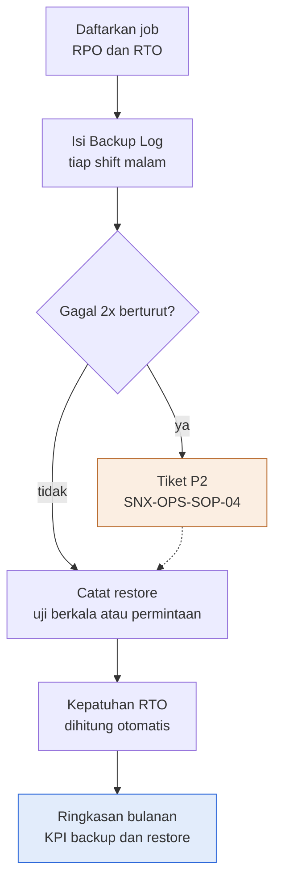

Deskripsi: job didaftarkan beserta RPO dan RTO, Backup Log diisi tiap shift malam, lalu keputusan "Gagal 2x berturut?". "ya" menuju Tiket P2 (rujukan SNX-OPS-SOP-04, oranye) yang kembali ke alur utama lewat garis putus-putus; "tidak" langsung ke "Catat restore (uji berkala atau permintaan)". Berikutnya kepatuhan RTO dihitung otomatis, lalu output "Ringkasan bulanan (KPI backup dan restore)" (biru).
Sumber gambar: conv/1J436lMZJSgowkEeMD6m45N70h7Go6_ZV/img/image1.png

## 4. Peran, RACI, record, KPI
| Peran | Keterangan |
|---|---|
| Lead NOC | Pemilik dokumen, penyusun; pemilik job; penyetuju restore (approval restore ke produksi); penyetuju pada contoh restore |
| Shift malam (Shift 1, 2, 3 di dropdown) | Mengisi Backup Log setiap hari (kolom Diperiksa oleh) |
| Pelanggan | Memberi persetujuan restore ke produksi |
| ISO/ISMS Coordinator | Pemeriksa dokumen |
| COO (Amirull Yusuf Zulkarnain) | Penyetuju dokumen |

| KPI / parameter | Nilai |
|---|---|
| Tingkat sukses backup | 98% (target di label Ringkasan) |
| Tingkat keberhasilan uji restore | 95% (target di label Ringkasan) |
| Eskalasi backup gagal | Gagal dua kali berturut menjadi tiket P2 |
| RPO dan RTO | Per job dalam jam (contoh RPO 24 jam; RTO 8 jam dan 4 jam) |
| Retensi job | Kolom Retensi (hari), contoh 30 hari |
| Masa simpan record form | 3 tahun |

Record: Daftar Job, Backup Log, Restore Record, Ringkasan bulanan (untuk SNX-OPS-RPT-01).

## 5. Catatan kualitas dan celah
- Semua isi adalah data CONTOH berisi placeholder: Daftar Job L5:L6 "CONTOH", Restore Record Q5 "CONTOH", Backup Log A2 "Baris biru muda = CONTOH.", placeholder "[pelanggan A]" (Daftar Job B5), "[pemeriksa]" (Backup Log I5:I6), "[pelaksana]" (Restore Record O5). Belum ada job, log, atau restore nyata, sehingga form belum menjadi bukti implementasi untuk Annex A 8.13 (Kontrol Dokumen B13) maupun RTP-006 di SNX-ISMS-REG-03 (sheet Rencana Penanganan F10 "catat di SNX-ISMS-FRM-01", G10 "8.13") (inferensi).
- Tanggal contoh (Backup Log A5:A6 2026-11-10, Restore Record B5 2026-11-12, Ringkasan B3 2026-11-01) jatuh setelah tanggal draft dokumen (Kontrol Dokumen B7 "13 Oktober 2026").
- Rujukan prosedur terverifikasi di tiga dokumen. Tujuan (Kontrol Dokumen B15) "sesuai SNX-ISMS-SOP-03" (judul "SOP Backup & Recovery"); Cara pakai B19 "status Gagal dua kali berturut menjadi tiket P2" dan gambar menunjuk SNX-OPS-SOP-04 (md/ops, judul "SOP Technical Incident Handling & Escalation"). SNX-ISMS-SOP-03 Bagian 7.2 butir 2: "gagal 2 kali berturut-turut menjadi tiket P2 sesuai SNX-OPS-SOP-04", dan matriks severity SNX-OPS-SOP-04 Bagian 6 baris "P2 Tinggi" memuat contoh "Backup job gagal 2 kali berturut".
- KPI: SNX-ISMS-SOP-03 Bagian 9 memuat empat KPI ("Job backup sukses" 98%, "Uji restore bulanan terlaksana per pelanggan backup" 100%, "Uji restore berhasil pada percobaan pertama" 95%, "Waktu restore uji dalam RTO" 100%). Sheet Ringkasan hanya berlabel "(KPI 98%)" (A7) dan "(KPI 95%)" (A10), serta menghitung "Restore dalam RTO" (A11) sebagai jumlah tanpa persentase. Restore Record tidak punya kolom percobaan ke berapa, sehingga "percobaan pertama" tidak dapat dibedakan (inferensi). SNX-OPS-RPT-01 (md/ops, KPI no 3 dan 4) juga hanya memuat 98% dan 95%, jadi dua KPI 100% milik SOP-03 tidak punya wadah ukur di FRM-01 maupun RPT-01.
- Parameter contoh JOB-002 (Daftar Job C6 "Password manager (AST-001)", D6 Full, F6 30, I6 24, J6 4) selaras dengan SNX-ISMS-REG-01 (AST-001 "Password manager internal"), SNX-ISMS-PLN-01 Bagian 4 baris 5 (password manager, RTO "4 jam", RPO "24 jam") dan SNX-ISMS-SOP-03 Bagian 6.1 (sistem internal kritis: harian, 30 hari, offsite Ya, RPO 24 jam). Angka 4 jam berasal dari PLN-01; SOP-03 hanya menyebut rentang "4 sampai 24 jam".
- Frekuensi uji restore tidak ditetapkan di form ini: Restore Record kolom C hanya berisi "Uji berkala / Permintaan pelanggan / Pemulihan insiden", dan Ringkasan A8 menghitung "Uji restore berkala dilaksanakan" per bulan sebagai satu angka agregat tanpa pengelompokan per pelanggan. Frekuensi ada di SNX-ISMS-SOP-03 Bagian 7.4 butir 1 ("minimal bulanan untuk setiap pelanggan berlayanan backup, dan minimal triwulanan untuk sistem internal kritis"), SNX-ISMS-PLN-01 Bagian 10 (Bulanan; Triwulanan) dan RTP-006 (REG-03 F10 "uji restore bulanan per pelanggan dan triwulanan untuk sistem internal"). SNX-OPS-FRM-07 (md/ops) hanya menjadwalkan uji restore bulanan untuk "Pelanggan berlayanan backup" (aktivitas no 7), tanpa baris triwulanan untuk sistem internal.
- RPO diisi per job (Daftar Job kolom I) tetapi tidak ada rumus pemeriksaan kepatuhan RPO; rumus otomatis hanya ada di Restore Record I, J, K (durasi, RTO, "Dalam RTO") dan Ringkasan B4 sampai B11.
- Contoh JOB-001 (Incremental, RPO 24, RTO 8) dan JOB-002 (Full, RPO 24, RTO 4) memakai RTO berbeda; form tidak memuat tabel RTO standar per kritikalitas (Daftar Job kolom J bebas isi). Revisi 00 (Kontrol Dokumen C31) memuat "keselarasan RTO dan target pulih" tanpa nilai standar yang terlihat di form. Nilai standar berada di dokumen lain: SNX-ISMS-SOP-03 Bagian 6.1 (konfigurasi 4 jam; sistem internal kritis "Sesuai SNX-ISMS-PLN-01 Bagian 4 (4 sampai 24 jam)") dan SNX-ISMS-PLN-01 Bagian 4.
- Hasil contoh Ringkasan menunjukkan tingkat sukses 50% (B7 = B5/B4, 1 sukses dari 2 pemeriksaan; label A7 "KPI 98%"), karena hanya 2 entri contoh; angka ini tidak mewakili kinerja nyata.
- Tidak ada kolom tanggal kedaluwarsa retensi atau pengecekan pelanggaran retensi 30 hari: Daftar Job hanya punya kolom F "Retensi (hari)" (nilai 30), dan header Daftar Job A4:L4 serta Backup Log A4:I4 tidak memuat tanggal kedaluwarsa.
- Ditambahkan pada audit ulang: SNX-ISMS-SOP-03 Bagian 7.3 butir 3 menyebut "sheet Restore Test dan Request", sedangkan sheet di form ini bernama "Restore Record" (A1 "Record restore dan uji restore"); nama sheet tidak sama.
- Pengesahan kosong (Kontrol Dokumen C35:D37 tanda tangan dan tanggal kosong); status persetujuan "Menunggu" (E30:E31); revisi 00 tercatat dua kali (A30 dan A31, tanggal "13 Oktober 2026").

## 6. Kata kunci retrieval
backup log, restore testing, uji restore, record restore, SNX-ISMS-FRM-01, SNX-ISMS-SOP-03, RPO, RTO, retensi backup, offsite, encryption, Acronis, tiket P2, backup gagal dua kali berturut, kepatuhan RTO, tingkat sukses backup 98%, keberhasilan uji restore 95%, Annex A 8.13, information backup, ISO 9001 8.5.3, Lead NOC, shift malam, daftar job backup, SNX-OPS-RPT-01, JOB-001, JOB-002, RST-2026-001

<!-- FILE: isms/SNX-ISMS-FRM-02.md -->

---
doc_code: SNX-ISMS-FRM-02
title: Security Incident & Investigation Records
department: Information Security
doc_type: Form/Record
source: {drive_file_id: 1ILWYIkwaqe3SkpTsEPzY_IB-HMqCqui2, filename: SNX-ISMS-FRM-02_Security_Incident_Investigation_Records.xlsx, format: xlsx, bytes: 151668, retrieved: 2026-10-13}
revision: 00 (DRAFT)
doc_date: 13 Oktober 2026
classification_in_doc: RESTRICTED (Internal)
owner_in_doc: Lead SOC
approver_in_doc: COO, Amirull Yusuf Zulkarnain
iso_refs: {iso9001: ["10.2"], iso27001: ["Annex A 5.25", "Annex A 5.26", "Annex A 5.27", "Annex A 5.28"]}
kb_sensitivity_suggest: restricted:ops
related_docs: [SNX-ISMS-SOP-01, SNX-ISMS-REG-02, SNX-ISMS-SOA-01, SKILL_ir-report, RCA-2026-002]
coverage: {sections_or_sheets: "6 dari 6", tables: 10, images: "1 dibuka dari 1", notes: "Register (area sampai baris 155) hanya berisi 1 baris CONTOH (SIR-2026-001) dengan placeholder; sheet Investigasi hanya berisi label (kolom isian B kosong); Chain of Custody hanya header (area sampai baris 154)."}
---
# SNX-ISMS-FRM-02 Security Incident & Investigation Records

## 1. Ringkasan
- Form/record register insiden keamanan informasi, lembar investigasi, dan chain of custody bukti sesuai SNX-ISMS-SOP-01; pemilik Lead SOC, masa simpan 5 tahun.
- Nomor insiden SIR-YYYY-NNN; kategori 10 jenis; severity P1 sampai P4; waktu ke containment dan ke pulih dihitung otomatis dalam jam dari waktu deteksi.
- Bila data pribadi terlibat, kolom Notifikasi PDP otomatis menandai "WAJIB DIKAJI" dengan batas maksimal 3 x 24 jam dari waktu deteksi (keputusan COO dan Legal).
- Untuk insiden P1 dan P2: salin sheet Investigasi (20 butir) per insiden dan isi Chain of Custody untuk setiap bukti (hash SHA-256 dihitung saat pengumpulan dan diverifikasi tiap perpindahan).
- Laporan insiden ke pelanggan memakai format beku SKILL_ir-report.
- Isi saat ini 1 insiden CONTOH (SIR-2026-001, webshell dan doorway judi online pada akun hosting, P2, containment 0.8 jam, pulih 5.8 jam, ref risiko ISR-002); form lain kosong.

## 2. Isi lengkap terstruktur

### 2.1 Sheet "Kontrol Dokumen"
| Field | Isi |
|---|---|
| Nomor dokumen | SNX-ISMS-FRM-02 |
| Judul | Security Incident & Investigation Records |
| Revisi | 00 (DRAFT) |
| Tanggal draft | 13 Oktober 2026 |
| Tanggal efektif | Ditetapkan saat pengesahan |
| Klasifikasi | RESTRICTED (Internal) |
| Pemilik dokumen | Lead SOC |
| Disetujui oleh | COO, Amirull Yusuf Zulkarnain |
| Acuan ISO 9001:2015 | Klausul 10.2 |
| Acuan ISO/IEC 27001:2022 | Klausul atau kontrol Annex A 5.25, 5.26, 5.27, 5.28 |
| Masa simpan record | 5 tahun |
| Tujuan | Register insiden keamanan informasi, catatan investigasi, dan chain of custody bukti sesuai SNX-ISMS-SOP-01. |

Subjudul: "PT Strategi Integrasi Nusantara (SINUX) · Divisi Operation".

**Cara pakai (teks sumber)**
1. Satu baris per insiden keamanan di sheet Register; nomor SIR-YYYY-NNN.
2. Waktu containment dan pemulihan dihitung otomatis dalam jam dari waktu deteksi.
3. Bila data pribadi terlibat, kolom Notifikasi PDP otomatis menandai kewajiban pemberitahuan maksimal 3 x 24 jam (keputusan COO dan Legal).
4. Untuk insiden P1 dan P2, salin sheet Investigasi per insiden dan isi Chain of Custody untuk setiap bukti.
5. Laporan insiden ke pelanggan memakai format beku SKILL_ir-report.

Legenda warna: sel input; baris CONTOH (hapus atau timpa saat dipakai); sel rumus (jangan diubah).

**Riwayat revisi**
| Revisi | Tanggal | Uraian perubahan | Disusun | Disetujui |
|---|---|---|---|---|
| 00 | 13 Oktober 2026 | Draft awal untuk sertifikasi ISO 9001 dan ISO/IEC 27001 | Divisi Operation | Menunggu |
| 00 | 13 Oktober 2026 | Review bahasa dan konsistensi: istilah teknologi dalam bahasa Inggris, bahasa Indonesia formal, label klasifikasi, keselarasan RTO dan target pulih | Divisi Operation | Menunggu |

**Pengesahan**
| Peran | Nama dan jabatan | Tanda tangan | Tanggal |
|---|---|---|---|
| Disusun oleh | Lead SOC | (kosong) | (kosong) |
| Diperiksa oleh | ISO/ISMS Coordinator | (kosong) | (kosong) |
| Disetujui oleh | COO, Amirull Yusuf Zulkarnain | (kosong) | (kosong) |

### 2.2 Sheet "Alur Proses"
Judul "Diagram alur proses" dan legenda warna (biru = output akhir, oranye = cabang, putus-putus = kembali). Isi gambar di bagian 3.

### 2.3 Sheet "Daftar" (nilai dropdown)
| Kolom | Nama | Nilai |
|---|---|---|
| A | Kategori | Malware atau ransomware; Webshell atau backdoor; Akses tidak sah; Kebocoran data; Phishing; DDoS; Kredensial terpapar; Pelanggaran kebijakan; Kehilangan perangkat; Lainnya |
| B | Severity | P1; P2; P3; P4 |
| C | YaTidak | Ya; Tidak |
| D | Status | Investigasi; Containment; Eradication; Pemulihan; Ditutup |
| E | Sumber | SIEM atau Wazuh; WAF; EDR atau antivirus; Monitoring; Laporan pelanggan; Laporan personel; Pihak ketiga |

Catatan: dropdown Sumber deteksi (Register C) memakai Daftar!E2:E8 (7 sumber); Kategori (G) = Daftar!A2:A11; Severity (H) = Daftar!B2:B5; Data pribadi terlibat (J) = Daftar!C2:C3; Status (Q) = Daftar!D2:D6. Definisi severity P1 sampai P4 tidak ditulis di form ini.

### 2.4 Sheet "Register"
Judul "Security incident register"; catatan: "Baris biru muda = CONTOH. Kolom abu-abu dihitung otomatis." Header baris 4, data mulai baris 5, area sampai baris 155 (151 baris).

**Kolom dan rumus**
| Kol | Header | Arti / rumus |
|---|---|---|
| A | ID insiden | SIR-YYYY-NNN |
| B | Waktu deteksi | Tanggal dan jam |
| C | Sumber deteksi | Dropdown |
| D | Pelapor | Nama atau placeholder |
| E | Aset terdampak | Teks |
| F | Pelanggan | Teks |
| G | Kategori | Dropdown |
| H | Severity | Dropdown P1..P4 |
| I | CIA terdampak | Mis. "C, I" |
| J | Data pribadi terlibat | Ya/Tidak |
| K | Uraian | Teks |
| L | Waktu containment | Tanggal dan jam |
| M | Waktu pulih | Tanggal dan jam |
| N | Jam ke containment | `=IF(OR(B="",L=""),"",ROUND((L-B)*24,1))` |
| O | Jam ke pulih | `=IF(OR(B="",M=""),"",ROUND((M-B)*24,1))` |
| P | Notifikasi PDP | `=IF(J="Ya","WAJIB DIKAJI, maksimal "&TEXT(B+3,"dd-mmm hh:mm"),IF(J="","","Tidak"))`: bila data pribadi terlibat, tampil batas 3 hari (3 x 24 jam) dari waktu deteksi |
| Q | Status | Investigasi / Containment / Eradication / Pemulihan / Ditutup |
| R | Tgl info pelanggan | Tanggal pelanggan diinformasikan |
| S | No RCA | Rujukan RCA |
| T | Ref risiko | Rujukan ISR di SNX-ISMS-REG-02 |
| U | Tindakan dan pembelajaran | Teks |
| V | Catatan | Teks |

**Data terisi (1 baris CONTOH)**
| Kolom | Nilai |
|---|---|
| ID insiden | SIR-2026-001 |
| Waktu deteksi | 2026-11-03 08:15 |
| Sumber deteksi | WAF |
| Pelapor | [pelapor] |
| Aset terdampak | Akun hosting [domain] pada server WHM [nama] |
| Pelanggan | [pelanggan] |
| Kategori | Webshell atau backdoor |
| Severity | P2 |
| CIA terdampak | C, I |
| Data pribadi terlibat | Tidak |
| Uraian | Webshell dan halaman doorway judi online pada satu akun hosting |
| Waktu containment | 2026-11-03 09:00 |
| Waktu pulih | 2026-11-03 14:00 |
| Jam ke containment | 0.8 (45 menit = 0.75 jam, dibulatkan) |
| Jam ke pulih | 5.8 (5 jam 45 menit = 5.75 jam, dibulatkan) |
| Notifikasi PDP | Tidak |
| Status | Ditutup |
| Tgl info pelanggan | 2026-11-03 |
| No RCA | RCA-2026-002 |
| Ref risiko | ISR-002 |
| Tindakan dan pembelajaran | Quarantine mv, sweep IOC 35 server, handoff app-level ke PIC |
| Catatan | CONTOH |

Baris 6 sampai 155 hanya berisi rumus N, O, P (kosong). Tidak ada kredensial, IP, atau data pribadi; semua identitas berupa placeholder (tidak ada redaksi).

### 2.5 Sheet "Investigasi"
Judul: "Lembar investigasi insiden (salin sheet ini per insiden P1 dan P2)". Dua kolom (A label, B isian kosong). Butir isian (20):
| No | Butir |
|---|---|
| 1 | ID insiden |
| 2 | Incident Commander |
| 3 | Tim investigasi |
| 4 | Ringkasan awal |
| 5 | Ruang lingkup (aset, akun, periode) |
| 6 | Vektor masuk (dugaan dan bukti) |
| 7 | Indikator kompromi (hash, IP, domain, file) |
| 8 | Persistence ditemukan |
| 9 | Data terdampak dan klasifikasinya |
| 10 | Langkah containment dan waktunya |
| 11 | Langkah eradication |
| 12 | Sweep ke host sejenis (cakupan dan hasil) |
| 13 | Verifikasi bersih (dua sumber independen) |
| 14 | Pemulihan dan verifikasi layanan |
| 15 | Pemberitahuan (pelanggan, regulator, aparat) dan dasar keputusan |
| 16 | Akar masalah |
| 17 | Tindakan korektif (ref RCA) |
| 18 | Risiko yang diperbarui (ref SNX-ISMS-REG-02) |
| 19 | Disusun oleh dan tanggal |
| 20 | Disetujui Lead SOC dan tanggal |

### 2.6 Sheet "Chain of Custody"
Judul "Chain of custody bukti"; catatan: "Satu baris per perpindahan atau tindakan atas bukti. Hash SHA-256 dihitung saat pengumpulan dan diverifikasi setiap perpindahan." Header baris 4, area baris 5 sampai 154 (150 baris), tidak ada baris terisi.
Kolom: ID insiden; ID bukti; Uraian bukti; Sumber (host, path, sistem); Hash SHA-256; Waktu; Tindakan; Diserahkan oleh; Diterima oleh; Lokasi simpan; Hash diverifikasi.
Dropdown: Tindakan (G) = Dikumpulkan; Dipindahkan; Dianalisis; Diserahkan; Dimusnahkan. Hash diverifikasi (K) = Daftar!C2:C3 (Ya/Tidak).

## 3. Diagram

### 3.1 Alur pengisian Security Incident & Investigation Records (gambar "Alur Proses")
Judul gambar: "Insiden keamanan tercatat lengkap dengan bukti yang terjaga"; subjudul "Alur pengisian Security Incident & Investigation Records". Dua kotak oranye: Lembar investigasi (salin per insiden) dan Kaji notifikasi PDP (COO dan Legal); kotak biru = Tutup dan pembelajaran (output akhir); garis putus-putus = kembali ke alur utama.

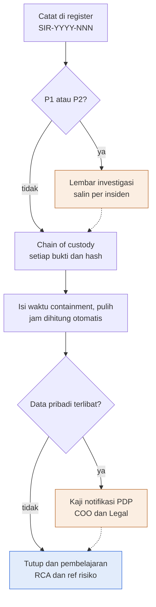

Deskripsi: insiden dicatat di register (SIR-YYYY-NNN), lalu keputusan "P1 atau P2?". "ya" menuju "Lembar investigasi (salin per insiden)" yang kembali ke alur utama (putus-putus); "tidak" langsung ke "Chain of custody (setiap bukti dan hash)". Selanjutnya waktu containment dan pulih diisi (jam dihitung otomatis), keputusan "Data pribadi terlibat?": "ya" menuju "Kaji notifikasi PDP (COO dan Legal)" lalu kembali (putus-putus); "tidak" langsung ke output "Tutup dan pembelajaran (RCA dan ref risiko)".
Sumber gambar: conv/1ILWYIkwaqe3SkpTsEPzY_IB-HMqCqui2/img/image1.png

## 4. Peran, RACI, record, KPI
| Peran | Keterangan |
|---|---|
| Lead SOC | Pemilik dokumen, penyusun; menyetujui lembar investigasi |
| Incident Commander | Diisi per insiden P1 dan P2 di lembar investigasi |
| Tim investigasi | Diisi per insiden |
| COO dan Legal | Memutuskan notifikasi PDP (maksimal 3 x 24 jam) |
| ISO/ISMS Coordinator | Pemeriksa dokumen |
| COO (Amirull Yusuf Zulkarnain) | Penyetuju dokumen |

| Parameter | Nilai |
|---|---|
| Severity | P1, P2, P3, P4 (definisi tidak ada di form) |
| Batas notifikasi PDP | Maksimal 3 x 24 jam dari waktu deteksi (kolom Notifikasi PDP) |
| Metrik waktu | Jam ke containment dan jam ke pulih dari waktu deteksi (otomatis) |
| Hash bukti | SHA-256, diverifikasi setiap perpindahan |
| Verifikasi bersih | Dua sumber independen (butir lembar investigasi) |
| Masa simpan record | 5 tahun |

Record: Register insiden, Lembar investigasi (per insiden P1/P2), Chain of Custody, RCA (rujukan No RCA), laporan pelanggan (format beku SKILL_ir-report).

## 5. Catatan kualitas dan celah
- Hanya 1 baris CONTOH (Register V5 "CONTOH"; A2 "Baris biru muda = CONTOH.") dengan placeholder "[pelapor]" (D5) dan "[pelanggan]" (F5); belum ada insiden nyata. Contoh bertanggal 2026-11-03 (B5), setelah tanggal draft (Kontrol Dokumen B7 "13 Oktober 2026").
- Definisi severity, SLA respons, dan RTO tidak ada di form: sheet Daftar kolom B hanya berisi nilai P1 sampai P4 untuk dropdown, dan Tujuan (Kontrol Dokumen B15) hanya menyatakan "sesuai SNX-ISMS-SOP-01". Definisi dan Ack ada di SNX-ISMS-SOP-01 Bagian 8 butir 2 (Ack P1 "15 menit", P2 "30 menit", P3 "2 jam kerja", P4 "1 hari kerja"). SOP-01 tidak menetapkan RTO atau target pulih insiden keamanan (Bagian 14: "Mean time to contain insiden P1" = "Dikalibrasi setelah 3 bulan data"); target pulih P1 sampai P4 (4, 8, 24, 72 jam, berlabel USULAN) ada di SNX-OPS-SOP-04 Bagian 6 untuk insiden teknis.
- Masa simpan record 5 tahun (Kontrol Dokumen B14; sesuai SNX-ISMS-SOP-01 Bagian 13), berbeda dari FRM-01 dan REG-04 (B14 "3 tahun"), REG-01, REG-02, REG-03 dan SOA-01 (B14 "Berlaku sampai digantikan"), serta FRM-03 (B14 "Durasi kontrak + 3 tahun").
- Kolom Notifikasi PDP (Register P5) menghitung batas dari waktu deteksi: rumus `"WAJIB DIKAJI, maksimal "&TEXT(B5+3,...)` dengan B = Waktu deteksi dan +3 hari kalender; Cara pakai B20 "maksimal 3 x 24 jam (keputusan COO dan Legal)". Hanya ada kolom "Tgl info pelanggan" (R); tidak ada kolom waktu notifikasi aktual ke regulator atau subjek data. Dasar hukum tidak disebut di form (hanya "PDP"); UU No. 27 Tahun 2022 disebut di SNX-ISMS-SOP-01 Bagian 3, dan SOP-01 Bagian 11 butir 2 menghitung "paling lambat 3 x 24 jam sejak diketahui" sedangkan form menghitung dari waktu deteksi (inferensi: kedua titik awal tidak selalu sama).
- Sheet Investigasi hanya berisi label (A3:A22; kolom B kosong; A1 "salin sheet ini per insiden P1 dan P2", sama dengan Cara pakai B21). Chain of Custody hanya header A4:K4 tanpa contoh (A2 "Satu baris per perpindahan atau tindakan atas bukti").
- "SKILL_ir-report" (Cara pakai B22 "format beku SKILL_ir-report") adalah nama berpola SKILL_ (inferensi: nama skill internal); PRO-OPS-001 (md/ops, "Rujukan teknis") mendaftarkannya dan hanya menyebut "lima section dengan urutan tetap" tanpa isi, sehingga isi skill tidak ada di korpus. "RCA-2026-002" (Register S5) sesuai format "RCA-[YYYY]-[nomor urut]" di SNX-OPS-FRM-10 (atribut "Nomor RCA"), tetapi tidak ada dokumen RCA bernomor itu di korpus (inferensi: nilai contoh). Kode SKILL_ juga muncul di SNX-ISMS-REG-01 (Register Aset O11, AST-007 "Acuan baseline" = "SKILL_backup-snapshot-ops").
- Annex A 5.25 sampai 5.28 dirujuk di Kontrol Dokumen B13. SNX-ISMS-SOA-01 (sheet SoA) memetakan 5.25 ke "SNX-ISMS-SOP-01, SNX-ISMS-FRM-02" (I29) dan 5.28 "Collection of evidence" ke "SNX-ISMS-SOP-01, SNX-ISMS-FRM-02 (Chain of Custody)" (I32); konsisten. Ditambahkan pada audit ulang: SoA tidak menautkan FRM-02 untuk 5.26 (I30 "SNX-ISMS-SOP-01, SNX-OPS-SOP-04") dan 5.27 (I31 "SNX-ISMS-SOP-01, SNX-OPS-FRM-10"), padahal keduanya ada di header FRM-02.
- Contoh ISR-002 (Register T5) cocok dengan SNX-ISMS-REG-02: Register Risiko A6 "ISR-002", B6 "Fleet WHM dan cPanel pelanggan pemerintah", C6 "Webshell, doorway judi online, backdoor", G6 5 x H6 4 = 20 (Matriks Risiko A3 dan A24: Kritis 20 sampai 25). Contoh insiden berseverity P2 (H5) sedangkan risiko terkait berlevel Kritis; severity insiden dan level risiko adalah dua skala berbeda.
- Jam ke containment dan pulih memakai rumus `ROUND((L5-B5)*24,1)` dan `ROUND((M5-B5)*24,1)` (N5, O5): 08:15 ke 09:00 = 0.75 jam menjadi 0.8, dan ke 14:00 = 5.75 jam menjadi 5.8, sehingga tidak persis.
- Pengesahan kosong (Kontrol Dokumen C36:D38); status persetujuan "Menunggu" (E31:E32); revisi 00 tercatat dua kali (A31 dan A32, tanggal "13 Oktober 2026").

## 6. Kata kunci retrieval
security incident register, register insiden keamanan, SIR-YYYY-NNN, incident response, investigasi insiden, chain of custody, hash SHA-256, bukti digital, severity P1 P2 P3 P4, notifikasi PDP 3 x 24 jam, perlindungan data pribadi, containment, eradication, pemulihan, RCA root cause analysis, webshell, doorway judi online, WHM cPanel, Incident Commander, Lead SOC, SNX-ISMS-FRM-02, SNX-ISMS-SOP-01, Annex A 5.25 5.26 5.27 5.28, ISO 9001 10.2, SKILL_ir-report, indikator kompromi IOC, sweep host sejenis

<!-- FILE: isms/SNX-ISMS-FRM-03.md -->

---
doc_code: SNX-ISMS-FRM-03
title: Supplier Technical & Security Evaluation Records
department: Information Security
doc_type: Form/Record
source: {drive_file_id: 1I0qEhkegW3w-k7YvTnKftqvUUbMg3rmg, filename: SNX-ISMS-FRM-03_Supplier_Technical_Security_Evaluation.xlsx, format: xlsx, bytes: 139666, retrieved: 2026-10-13}
revision: 00 (DRAFT)
doc_date: 13 Oktober 2026
classification_in_doc: RESTRICTED (Internal)
owner_in_doc: Head of Operation
approver_in_doc: COO, Amirull Yusuf Zulkarnain
iso_refs: {iso9001: ["8.4"], iso27001: ["Annex A 5.19", "Annex A 5.20", "Annex A 5.21", "Annex A 5.22", "Annex A 5.23"]}
kb_sensitivity_suggest: restricted:ops
related_docs: [SNX-OPS-SOP-05, SNX-ISMS-REG-01, SNX-ISMS-REG-02, SNX-ISMS-SOA-01]
coverage: {sections_or_sheets: "6 dari 6", tables: 11, images: "1 dibuka dari 1", notes: "Daftar Supplier terisi 8 supplier (area sampai baris 52); sheet Evaluasi (area sampai baris 104) tidak berisi data evaluasi; Kuesioner Keamanan berisi 12 pertanyaan tanpa jawaban. Belum ada evaluasi, nilai, atau keputusan nyata."}
---
# SNX-ISMS-FRM-03 Supplier Technical & Security Evaluation Records

## 1. Ringkasan
- Form/record daftar supplier teknis, evaluasi kinerja dan keamanan informasi berkala, serta kuesioner keamanan supplier (Annex A 5.19 sampai 5.23, ISO 9001 klausul 8.4); pemilik Head of Operation, masa simpan "Durasi kontrak + 3 tahun".
- 8 supplier teridentifikasi dari knowledge base (SUP-001 sampai SUP-008): 5 kritikalitas Tinggi, 3 Sedang; status kontrak, NDA, dan sertifikasi wajib diverifikasi dengan Commercial dan Legal.
- Frekuensi evaluasi: kritikalitas Tinggi setiap 6 bulan (semester), Sedang dan Rendah setiap 12 bulan; tanggal berikutnya otomatis, saat ini semua "Belum pernah" (belum ada evaluasi).
- Evaluasi memakai 6 kriteria berbobot (25%, 15%, 25%, 15%, 10%, 10%), skor 1 sampai 5; nilai = rata-rata tertimbang x 20 (skala 0 sampai 100). 80 ke atas Disetujui; 60 sampai 79 Disetujui bersyarat; di bawah 60 Tinjau ulang.
- Kuesioner Keamanan berisi 12 pertanyaan; penilaian SINUX (Memadai, Kurang, Tidak ada) dipakai untuk kriteria Kontrol keamanan informasi.
- Dari 8 supplier: sertifikasi keamanan Ya hanya 3 (Cloudflare, Acronis, Google Workspace), 5 "Belum diketahui"; klausul keamanan di kontrak dan NDA "Belum diketahui" untuk semua 8.

## 2. Isi lengkap terstruktur

### 2.1 Sheet "Kontrol Dokumen"
| Field | Isi |
|---|---|
| Nomor dokumen | SNX-ISMS-FRM-03 |
| Judul | Supplier Technical & Security Evaluation Records |
| Revisi | 00 (DRAFT) |
| Tanggal draft | 13 Oktober 2026 |
| Tanggal efektif | Ditetapkan saat pengesahan |
| Klasifikasi | RESTRICTED (Internal) |
| Pemilik dokumen | Head of Operation |
| Disetujui oleh | COO, Amirull Yusuf Zulkarnain |
| Acuan ISO 9001:2015 | Klausul 8.4 |
| Acuan ISO/IEC 27001:2022 | Klausul atau kontrol Annex A 5.19, 5.20, 5.21, 5.22, 5.23 |
| Masa simpan record | Durasi kontrak + 3 tahun |
| Tujuan | Daftar supplier teknis, evaluasi kinerja dan keamanan informasi berkala, serta kuesioner keamanan supplier (A 5.19 sampai 5.23, ISO 9001 klausul 8.4). |

Subjudul: "PT Strategi Integrasi Nusantara (SINUX) · Divisi Operation".

**Cara pakai (teks sumber)**
1. Daftarkan setiap supplier yang menopang layanan atau memegang akses atau data di sheet Daftar Supplier, berkoordinasi dengan Commercial dan Legal.
2. Evaluasi supplier kritikal Tinggi setiap semester, Sedang dan Rendah setiap tahun; jadwal berikutnya dihitung otomatis.
3. Isi skor 1 sampai 5 per kriteria di sheet Evaluasi; nilai tertimbang dan keputusan dihitung otomatis.
4. Gunakan sheet Kuesioner Keamanan untuk supplier baru dan supplier berakses data.
5. Breach SLA yang disebabkan supplier (SNX-OPS-SOP-05) menjadi masukan kriteria kinerja.

Legenda warna: sel input; baris CONTOH (hapus atau timpa saat dipakai); sel rumus (jangan diubah).

**Riwayat revisi**
| Revisi | Tanggal | Uraian perubahan | Disusun | Disetujui |
|---|---|---|---|---|
| 00 | 13 Oktober 2026 | Draft awal untuk sertifikasi ISO 9001 dan ISO/IEC 27001 | Divisi Operation | Menunggu |
| 00 | 13 Oktober 2026 | Review bahasa dan konsistensi: istilah teknologi dalam bahasa Inggris, bahasa Indonesia formal, label klasifikasi, keselarasan RTO dan target pulih | Divisi Operation | Menunggu |

**Pengesahan**
| Peran | Nama dan jabatan | Tanda tangan | Tanggal |
|---|---|---|---|
| Disusun oleh | Head of Operation | (kosong) | (kosong) |
| Diperiksa oleh | ISO/ISMS Coordinator | (kosong) | (kosong) |
| Disetujui oleh | COO, Amirull Yusuf Zulkarnain | (kosong) | (kosong) |

### 2.2 Sheet "Alur Proses"
Judul "Diagram alur proses" dan legenda warna (biru = output akhir, oranye = cabang, putus-putus = kembali). Isi gambar di bagian 3.

### 2.3 Sheet "Daftar" (nilai dropdown)
| Kolom | Nama | Nilai |
|---|---|---|
| A | Kategori | Infrastruktur cloud dan DC; Partner SOC; Platform observability; Keamanan dan CDN; Backup; Lisensi software; Sertifikat SSL; SaaS kolaborasi; Lainnya |
| B | Kritikalitas | Tinggi; Sedang; Rendah |
| C | YaTidak | Ya; Tidak; Belum diketahui |
| D | Skor | 1; 2; 3; 4; 5 |

Dropdown: Daftar Supplier D = Daftar!A2:A10; E = Daftar!B2:B4; F, G, H = Daftar!C2:C4. Evaluasi D5:I104 = Daftar!D2:D6 (skor 1 sampai 5). Kuesioner E5:E16 = "Memadai,Kurang,Tidak ada".

### 2.4 Sheet "Daftar Supplier"
Judul "Daftar supplier teknis". Catatan: "Baris biru muda = supplier yang teridentifikasi di knowledge base; status kontrak, NDA, dan sertifikasi wajib diverifikasi dengan Commercial dan Legal." Header baris 4, data baris 5 sampai 52 (48 baris area), terisi 8.

**Kolom**
| Kol | Header | Arti / rumus |
|---|---|---|
| A | ID | SUP-nnn |
| B | Nama supplier | Teks |
| C | Layanan yang dipasok | Teks |
| D | Kategori | Dropdown |
| E | Kritikalitas | Tinggi/Sedang/Rendah (sel diwarnai kondisional untuk Tinggi dan Sedang) |
| F | Akses ke data atau sistem | Ya/Tidak/Belum diketahui |
| G | Sertifikasi keamanan (misalnya ISO 27001, SOC 2) | Ya/Tidak/Belum diketahui |
| H | Kontrak dan NDA memuat klausul keamanan | Ya/Tidak/Belum diketahui |
| I | PIC internal | Peran |
| J | Evaluasi terakhir | Tanggal (kosong semua) |
| K | Evaluasi berikutnya | `=IF(J="","Belum pernah",EDATE(J,IF(E="Tinggi",6,12)))`: +6 bulan bila Tinggi, +12 bulan selain itu; "Belum pernah" bila belum dievaluasi |
| L | Catatan | Teks |

**Data lengkap 8 supplier** (kolom J kosong; K = "Belum pernah" untuk semua)
| ID | Nama supplier | Layanan yang dipasok | Kategori | Kritikalitas | Akses data/sistem | Sertifikasi keamanan | Kontrak dan NDA memuat klausul keamanan | PIC internal | Catatan |
|---|---|---|---|---|---|---|---|---|---|
| SUP-001 | Penyedia infrastruktur Nusagrid (Maxcloud atau Awandata) | Platform, node, console, DC Nusagrid | Infrastruktur cloud dan DC | Tinggi | Ya | Belum diketahui | Belum diketahui | Head of Operation | Verifikasi status kontrak dan sertifikasi |
| SUP-002 | Partner SOC (Arktech) | Operasi SIEM dan Wazuh untuk pelanggan tertentu | Partner SOC | Tinggi | Ya | Belum diketahui | Belum diketahui | Lead SOC | (kosong) |
| SUP-003 | TelemetryFlow | Platform Nusametric dan TFO-Agent | Platform observability | Sedang | Ya | Belum diketahui | Belum diketahui | Lead NOC | (kosong) |
| SUP-004 | Cloudflare | DNS, WAF, CDN pelanggan | Keamanan dan CDN | Tinggi | Ya | Ya | Belum diketahui | Head of Operation | (kosong) |
| SUP-005 | Acronis | Platform Cyber Protect | Backup | Tinggi | Ya | Ya | Belum diketahui | Lead NOC | (kosong) |
| SUP-006 | Penyedia lisensi cPanel (Antmedia) | Lisensi cPanel, CloudLinux, KernelCare | Lisensi software | Sedang | Tidak | Belum diketahui | Belum diketahui | Lead NOC | (kosong) |
| SUP-007 | Reseller SSL (GoGetSSL dan CA Sectigo) | Sertifikat SSL wildcard | Sertifikat SSL | Sedang | Tidak | Belum diketahui | Belum diketahui | Lead NOC | (kosong) |
| SUP-008 | Google Workspace | Email, Drive, dokumen | SaaS kolaborasi | Tinggi | Ya | Ya | Belum diketahui | COO | (kosong) |

Baris 13 sampai 52 hanya berisi rumus K (kosong).

**Hitung ulang (python)**: Kritikalitas Tinggi 5 (SUP-001, 002, 004, 005, 008), Sedang 3 (SUP-003, 006, 007), Rendah 0. Akses data/sistem: Ya 6, Tidak 2 (SUP-006, 007). Sertifikasi: Ya 3 (SUP-004, 005, 008), Belum diketahui 5. Kontrak dan NDA: Belum diketahui 8. PIC: Lead NOC 4 (SUP-003, 005, 006, 007), Head of Operation 2 (SUP-001, 004), Lead SOC 1, COO 1. Evaluasi berikutnya jika dievaluasi: Tinggi +6 bulan, Sedang +12 bulan.

### 2.5 Sheet "Evaluasi"
Judul "Evaluasi kinerja dan keamanan supplier". Catatan: "Skor 1 (sangat buruk) sampai 5 (sangat baik). Nilai = rata-rata tertimbang dikali 20 (skala 0 sampai 100). 80 ke atas Disetujui · 60 sampai 79 Disetujui bersyarat · di bawah 60 Tinjau ulang." Header baris 4; baris 3 berisi bobot. Area baris 5 sampai 104 (100 baris), tidak ada baris terisi.

**Kriteria dan bobot (6 kriteria evaluasi)**
| Kol | Kriteria | Bobot |
|---|---|---|
| D | Kinerja dan availability sesuai SLA | 0.25 (25%) |
| E | Responsivitas dukungan dan eskalasi | 0.15 (15%) |
| F | Kontrol keamanan informasi | 0.25 (25%) |
| G | Kepatuhan kontrak, legal, dan pelindungan data | 0.15 (15%) |
| H | Insiden atau breach terkait supplier (5 = tidak ada) | 0.10 (10%) |
| I | Keberlanjutan dan kapasitas teknis | 0.10 (10%) |
| | Jumlah bobot | 1.00 (100%) |

**Kolom lain dan rumus**
| Kol | Header | Arti / rumus |
|---|---|---|
| A | Periode | Periode evaluasi |
| B | ID supplier | Rujukan SUP-nnn |
| C | Nama supplier | `=IF(B="","",IFERROR(INDEX('Daftar Supplier'!B5:B52,MATCH(B,'Daftar Supplier'!A5:A52,0)),"ID tidak ada"))`: nama diambil otomatis |
| D sampai I | 6 kriteria | Skor 1 sampai 5 (dropdown) |
| J | Nilai | `=IF(COUNT(D:I)<6,"",ROUND(SUMPRODUCT(D:I,$D$3:$I$3)/SUM($D$3:$I$3)*20,0))`: nilai terhitung hanya bila keenam skor terisi; hasil dibulatkan, skala 20 sampai 100 |
| K | Keputusan | `=IF(J="","",IF(J>=80,"Disetujui",IF(J>=60,"Disetujui bersyarat","Tinjau ulang")))` (pewarnaan kondisional per keputusan) |
| L | Tindak lanjut | Teks |
| M | Evaluator | Teks |
| N | Disetujui | Teks |

Catatan logika: skor minimum praktis 1 menghasilkan nilai 20 (bukan 0), maksimum 5 menghasilkan 100; skala "0 sampai 100" di catatan sheet tidak dapat mencapai 0 dengan skor 1 sampai 5.

### 2.6 Sheet "Kuesioner Keamanan"
Judul "Kuesioner keamanan supplier". Catatan: "Satu set jawaban per supplier; salin sheet ini bila perlu. Penilaian dipakai untuk kriteria Kontrol keamanan informasi pada sheet Evaluasi." Sel "ID supplier:" (D3) kosong. Header baris 4: No; Pertanyaan; Jawaban supplier; Bukti; Penilaian SINUX (Memadai, Kurang, Tidak ada). Jawaban, bukti, dan penilaian kosong.

| No | Pertanyaan |
|---|---|
| 1 | Apakah supplier memiliki sertifikasi keamanan informasi yang masih berlaku (ISO/IEC 27001, SOC 2)? Lampirkan sertifikat dan ruang lingkupnya. |
| 2 | Di negara dan lokasi mana data SINUX atau pelanggan disimpan dan diproses? |
| 3 | Apakah supplier memakai subkontraktor atau sub-processor untuk layanan ini? Sebutkan. |
| 4 | Bagaimana kontrol akses dan MFA untuk personel supplier yang mengakses sistem atau data? |
| 5 | Apakah data di-encrypt saat in transit dan at rest? Siapa yang memegang kunci? |
| 6 | Berapa lama dan melalui kanal apa supplier memberi tahu insiden keamanan yang berdampak ke SINUX? |
| 7 | Bagaimana backup, redundansi, dan rencana kelangsungan layanan supplier? Kapan terakhir diuji? |
| 8 | Apakah SLA tertulis dan bagaimana kompensasi bila SLA tidak tercapai? |
| 9 | Apakah kontrak memuat klausul kerahasiaan, hak audit, dan kepatuhan UU PDP? |
| 10 | Bagaimana proses pengembalian dan penghapusan data saat kontrak berakhir? |
| 11 | Bagaimana vulnerability management dan patch pada platform yang dipakai SINUX? |
| 12 | Siapa kontak eskalasi teknis dan keamanan 24x7? |

Tidak ada kredensial, kunci, atau data pribadi di berkas ini (tidak ada redaksi).

## 3. Diagram

### 3.1 Alur Supplier Technical & Security Evaluation (gambar "Alur Proses")
Judul gambar: "Supplier dievaluasi berkala dan diberi keputusan"; subjudul "Alur Supplier Technical & Security Evaluation". Dua kotak oranye: Kuesioner keamanan (sheet Kuesioner) dan Tinjau ulang (rencana alternatif); kotak biru = Disetujui (jadwal evaluasi berikutnya); garis putus-putus = kembali ke alur utama.

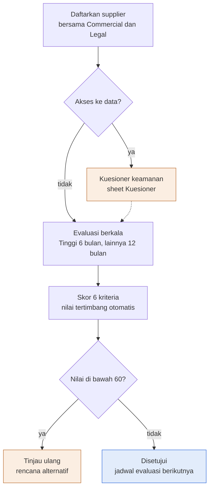

Deskripsi: supplier didaftarkan bersama Commercial dan Legal, lalu keputusan "Akses ke data?". "ya" menuju Kuesioner keamanan (sheet Kuesioner) yang kembali ke alur utama lewat garis putus-putus; "tidak" langsung ke "Evaluasi berkala" (Tinggi 6 bulan, lainnya 12 bulan). Setelah skor 6 kriteria (nilai tertimbang otomatis), keputusan "Nilai di bawah 60?": "ya" menuju "Tinjau ulang (rencana alternatif)" (oranye, tanpa panah lanjutan), "tidak" menuju output "Disetujui (jadwal evaluasi berikutnya)" (biru). Gambar tidak menampilkan cabang "Disetujui bersyarat" untuk nilai 60 sampai 79; cabang itu hanya ada pada rumus sheet.
Sumber gambar: conv/1I0qEhkegW3w-k7YvTnKftqvUUbMg3rmg/img/image1.png

## 4. Peran, RACI, record, KPI
| Peran | Keterangan |
|---|---|
| Head of Operation | Pemilik dokumen, penyusun; PIC SUP-001 dan SUP-004 |
| Lead NOC | PIC SUP-003, 005, 006, 007 |
| Lead SOC | PIC SUP-002 |
| COO (Amirull Yusuf Zulkarnain) | Penyetuju dokumen; PIC SUP-008 |
| Commercial dan Legal | Koordinasi daftar supplier; verifikasi kontrak, NDA, dan sertifikasi |
| Evaluator, Disetujui (kolom Evaluasi) | Diisi per evaluasi; peran tidak diberi nama di form |
| ISO/ISMS Coordinator | Pemeriksa dokumen |

| Parameter | Nilai |
|---|---|
| Frekuensi evaluasi | Tinggi: setiap semester (6 bulan); Sedang dan Rendah: setiap tahun (12 bulan) |
| Bobot kriteria | 25, 15, 25, 15, 10, 10 (total 100) |
| Ambang keputusan | 80 ke atas Disetujui; 60 sampai 79 Disetujui bersyarat; di bawah 60 Tinjau ulang |
| Kuesioner | 12 pertanyaan; penilaian Memadai, Kurang, Tidak ada |
| Masa simpan record | Durasi kontrak + 3 tahun |

Record: Daftar Supplier, Evaluasi, Kuesioner Keamanan. Masukan: breach SLA oleh supplier (SNX-OPS-SOP-05).

## 5. Catatan kualitas dan celah
- Belum ada evaluasi: Daftar Supplier J5:J12 (Evaluasi terakhir) kosong untuk SUP-001 sampai SUP-008, sehingga K (Evaluasi berikutnya, rumus) bernilai "Belum pernah"; sheet Evaluasi hanya berisi rumus (A1:N104, tanpa skor); Kuesioner Keamanan kolom C sampai E (jawaban, bukti, penilaian) kosong. Karena itu belum ada bukti implementasi Annex A 5.19 sampai 5.23 (Kontrol Dokumen B13) dan ISO 9001 klausul 8.4 (B12) (inferensi).
- Kolom H "Kontrak dan NDA memuat klausul keamanan" = "Belum diketahui" untuk 8 dari 8 supplier; kolom G (sertifikasi keamanan) "Belum diketahui" untuk 5 dari 8 (SUP-001, 002, 003, 006, 007; SUP-004, 005, 008 = "Ya"). Daftar Supplier A2: "status kontrak, NDA, dan sertifikasi wajib diverifikasi dengan Commercial dan Legal."
- Supplier kritikalitas Tinggi dengan sertifikasi "Belum diketahui": SUP-001 (B5 "Penyedia infrastruktur Nusagrid (Maxcloud atau Awandata)") dan SUP-002 (B6 "Partner SOC (Arktech)"), keduanya kolom F (Akses ke data atau sistem) = "Ya"; catatan SUP-001 L5 "Verifikasi status kontrak dan sertifikasi".
- Nama SUP-001 ambigu: "Maxcloud atau Awandata" (B5, dua kemungkinan penyedia). Nama SUP-006 "Antmedia" (B10) dan SUP-002 "Arktech" (B6) ditulis dalam kurung sebagai identitas penyedia; keabsahan nama perlu diverifikasi (inferensi, A2 hanya meminta verifikasi kontrak, NDA, dan sertifikasi).
- SUP-001 selaras dengan risiko ISR-005 di SNX-ISMS-REG-02 (Register Risiko B9 "Layanan pelanggan Nusagrid", D9 "Ketergantungan pada satu penyedia infrastruktur") (inferensi). FRM-03 tidak memuat rujukan ISR atau AST di sel mana pun, dan REG-02 tidak memuat nomor SUP.
- SNX-ISMS-REG-01 memuat Cloudflare (AST-010 "Akun Cloudflare"), Google Workspace (AST-011), Acronis (AST-007 "Acronis Cyber Protect (console dan repository)") dan Nusametric (AST-006 "Monitoring Nusametric dan Overseer"); padanannya di FRM-03 adalah SUP-004 "Cloudflare", SUP-008 "Google Workspace", SUP-005 "Acronis", SUP-003 "TelemetryFlow" (C7 "Platform Nusametric dan TFO-Agent"). Keterkaitan itu tidak dituliskan di salah satu dokumen (inferensi: terkait).
- Catatan skala Evaluasi A2: "Nilai = rata-rata tertimbang dikali 20 (skala 0 sampai 100)", tetapi dengan skor 1 sampai 5 (Daftar D2:D6) nilai minimum yang mungkin adalah 20 (rumus J5 `SUMPRODUCT(...)/SUM(...)*20`).
- Gambar tidak memuat cabang "Disetujui bersyarat" (60 sampai 79), padahal Evaluasi A2 ("60 sampai 79 Disetujui bersyarat") dan rumus K5 memuatnya; gambar hanya punya keputusan "Nilai di bawah 60?" (Tinjau ulang) dan "Disetujui".
- Tidak ada batas waktu tindak lanjut untuk keputusan "Disetujui bersyarat" atau "Tinjau ulang"; kolom L (Tindak lanjut) bebas isi (tanpa dropdown, validasi hanya pada D5:I104).
- Supplier SUP-008 (D12 "SaaS kolaborasi", I12 "COO") berpadanan dengan AST-011 di SNX-ISMS-REG-01 (klasifikasi "RESTRICTED", pemilik "COO"); FRM-03 tidak punya kolom klasifikasi data yang dipegang supplier.
- Ditambahkan pada audit ulang: SNX-ISMS-PLN-01 Bagian 5 baris "Kegagalan supplier kritis (partner SOC, penyedia lisensi, platform monitoring)" menunjuk FRM-03 untuk "Kontak eskalasi, rencana alternatif per supplier", tetapi FRM-03 tidak punya kolom kontak eskalasi atau rencana alternatif per supplier; yang ada hanya Kuesioner butir 12 "Siapa kontak eskalasi teknis dan keamanan 24x7?" dan cabang diagram "Tinjau ulang, rencana alternatif" (nilai di bawah 60).
- Pengesahan kosong (Kontrol Dokumen C36:D38); status persetujuan "Menunggu" (E31:E32); revisi 00 tercatat dua kali (A31 dan A32, tanggal "13 Oktober 2026").

## 6. Kata kunci retrieval
supplier evaluation, evaluasi supplier, penilaian supplier teknis, supplier security evaluation, SNX-ISMS-FRM-03, supplier register, daftar supplier, kuesioner keamanan supplier, supply chain, Annex A 5.19 5.20 5.21 5.22 5.23, ISO 9001 8.4, kritikalitas supplier, evaluasi semester, skor tertimbang, Disetujui bersyarat, Tinjau ulang, Maxcloud, Awandata, Arktech, TelemetryFlow, Cloudflare, Acronis, Antmedia, cPanel, CloudLinux, KernelCare, GoGetSSL, Sectigo, Google Workspace, sertifikasi ISO 27001 SOC 2, sub-processor, UU PDP, NDA

<!-- FILE: isms/SNX-ISMS-PLN-01.md -->

---
doc_code: SNX-ISMS-PLN-01
title: Business Continuity / IT Recovery Plan
department: Information Security
doc_type: Rencana
source: {drive_file_id: 1vwD5tORDQNQ7SNaQ6w4KitPKTcsw9ZVX, filename: SNX-ISMS-PLN-01_Business_Continuity_IT_Recovery_Plan.docx, format: docx, bytes: 153968, retrieved: 2026-10-13}
revision: 00 (DRAFT)
doc_date: 13 Oktober 2026 (tanggal draft; tanggal efektif "Ditetapkan saat pengesahan")
classification_in_doc: RESTRICTED (Internal)
owner_in_doc: Head of Operation
approver_in_doc: COO, Amirull Yusuf Zulkarnain
iso_refs: {iso9001: ["6.1", "7.1.3"], iso27001: ["A 5.29", "A 5.30", "A 8.14"]}
kb_sensitivity_suggest: restricted:ops
related_docs: [SNX-ISMS-SOP-01, SNX-ISMS-SOP-02, SNX-ISMS-SOP-03, SNX-ISMS-FRM-01, SNX-ISMS-FRM-03, SNX-ISMS-REG-02, SNX-OPS-SOP-04, SNX-OPS-FRM-10]
coverage: {sections_or_sheets: "14 H1 (Bagian 1-11, Diagram, Lampiran A, Pengesahan)", tables: "12 dari 12 (termasuk 4 tabel Lampiran A: identitas uji, hasil, temuan, tanda tangan uji)", images: "1 dibuka dari 1", notes: "Tidak ada celah baca. Tabel Bagian 4 (9 layanan) ditulis lengkap. Lampiran A adalah form kosong."}
---
# SNX-ISMS-PLN-01 Business Continuity / IT Recovery Plan

## 1. Ringkasan
- Rencana kelangsungan dan pemulihan layanan TI kritis Divisi Operation; 9 layanan kritis dengan RTO, RPO, dan Tingkat (1 sampai 3) pada Bagian 4.
- RTO sistem internal: password manager 4 jam, Jumphost 4 jam, WAF dan proxy 4 jam, monitoring 4 jam, managed services server pelanggan 4 jam, ticketing 8 jam, knowledge base 24 jam. RPO: 24 jam (monitoring, ticketing, password manager, knowledge base); 1 minggu untuk konfigurasi Jumphost dan WAF. Nusagrid, email Google Workspace: mengikuti SLA kontrak atau penyedia.
- Aktivasi bila insiden P1 diperkirakan melewati RTO Tingkat 1 atau beberapa layanan kritis terganggu bersamaan; pemutus: Head of Operation, lalu COO, lalu CEO.
- Tahapan respon: penilaian awal 0 sampai 30 menit; komunikasi awal dalam 1 jam; stabilisasi; pemulihan berurutan (Tingkat 1, akses dan monitoring paling awal); verifikasi; kembali normal; RCA dan pembaruan rencana.
- Program uji: uji restore bulanan (pelanggan) dan triwulanan (internal kritis); tabletop tahunan; uji pemulihan teknis tahunan; uji daftar kontak semesteran; rencana ditinjau minimal tahunan dan setelah aktivasi nyata atau perubahan besar.
- RTO dan RPO sistem internal berlabel USULAN (disahkan Head of Operation); Lampiran A adalah formulir laporan uji yang masih kosong.

## 2. Isi lengkap terstruktur

### 2.0 Kontrol dokumen

| Atribut | Isi |
|---|---|
| Nomor dokumen | SNX-ISMS-PLN-01 |
| Judul | Business Continuity / IT Recovery Plan |
| Revisi | 00 (DRAFT) |
| Tanggal draft | 13 Oktober 2026 |
| Tanggal efektif | Ditetapkan saat pengesahan |
| Klasifikasi | RESTRICTED (Internal) |
| Pemilik dokumen | Head of Operation |
| Disetujui oleh | COO, Amirull Yusuf Zulkarnain |
| Acuan ISO 9001:2015 | Klausul 6.1, 7.1.3 |
| Acuan ISO/IEC 27001:2022 | Klausul atau kontrol Annex A 5.29, 5.30, 8.14 |
| Masa simpan record | Berlaku sampai digantikan |

Riwayat revisi:

| Revisi | Tanggal | Uraian perubahan | Disusun | Disetujui |
|---|---|---|---|---|
| 00 | 13 Oktober 2026 | Draft awal untuk sertifikasi ISO 9001:2015 dan ISO/IEC 27001:2022 | Divisi Operation | Menunggu |
| 00 | 13 Oktober 2026 | Review bahasa dan konsistensi: istilah teknologi dalam bahasa Inggris, bahasa Indonesia formal, label klasifikasi, keselarasan RTO dan target pulih | Divisi Operation | Menunggu |

### 2.1 Tujuan (Bagian 1)
Menetapkan cara SINUX mempertahankan dan memulihkan layanan TI kritis, termasuk keamanan informasinya, saat terjadi gangguan besar, beserta program pengujian yang membuktikan rencana ini berjalan. Cakupan dan kedalaman rencana disesuaikan dengan hasil penilaian risiko SNX-ISMS-REG-02.

### 2.2 Ruang lingkup (Bagian 2)
Layanan yang dikelola Divisi Operation dan sistem internal yang menopangnya. Kelangsungan fasilitas data center dan platform upstream menjadi tanggung jawab penyedianya sesuai kontrak; rencana ini mengatur cara SINUX merespons, berkomunikasi, dan memulihkan bagian yang menjadi kendalinya.

### 2.3 Referensi (Bagian 3)
- ISO 9001:2015 klausul 6.1, 7.1.3.
- ISO/IEC 27001:2022 Annex A 5.29 (keamanan informasi saat gangguan), 5.30 (kesiapan TIK untuk kelangsungan bisnis), 8.14 (redundansi).
- SNX-ISMS-SOP-03 Backup & Recovery, SNX-ISMS-SOP-01 Information Security Incident Management.

### 2.4 Layanan kritis, ketergantungan, dan target pemulihan (Bagian 4, tabel lengkap)

| No | Layanan atau sistem | Ketergantungan utama | Dampak bila mati | RTO | RPO | Tingkat |
|---|---|---|---|---|---|---|
| 1 | Layanan pelanggan Nusagrid (VM, storage, network) | Platform dan DC upstream, network | SLA pelanggan, banyak pelanggan sekaligus | Sesuai SLA kontrak | Sesuai layanan backup | 1 |
| 2 | Managed services server pelanggan (termasuk fleet hosting pemerintah) | Akses Jumphost, kredensial, monitoring | SLA dan reputasi | 4 jam | Sesuai kontrak | 1 |
| 3 | Monitoring dan alert (Nusametric, Overseer) | Server monitoring, notifikasi | Insiden tidak terdeteksi | 4 jam | 24 jam | 1 |
| 4 | Ticketing system (Zammad, Service Hub) | VM, email, integrasi WhatsApp | Laporan pelanggan tidak tercatat | 8 jam | 24 jam | 2 |
| 5 | Password manager internal | VM, backup ter-encrypt | Operator tidak dapat mengakses sistem | 4 jam | 24 jam | 1 |
| 6 | Jumphost | VM, network | Akses production terhambat | 4 jam | 1 minggu (konfigurasi) | 1 |
| 7 | WAF dan proxy (AegisWAF, Cloudflare) | VM, konfigurasi, layanan Cloudflare | Website pelanggan tidak terlindungi atau tidak terjangkau | 4 jam | 1 minggu (konfigurasi) | 1 |
| 8 | Email dan kolaborasi (Google Workspace) | Penyedia SaaS | Komunikasi terganggu | Sesuai penyedia | Sesuai penyedia | 2 |
| 9 | Knowledge base dan dokumentasi | VM, database, backup | Runbook tidak dapat diakses | 24 jam | 24 jam | 3 |

RTO dan RPO sistem internal adalah USULAN dan disahkan Head of Operation; RTO layanan pelanggan mengikuti kontrak.

### 2.5 Skenario gangguan dan strategi (Bagian 5)

| Skenario | Strategi utama | Prosedur rujukan |
|---|---|---|
| Kegagalan platform atau DC upstream Nusagrid | Eskalasi ke penyedia, komunikasi pelanggan, pemindahan VM kritis bila kapasitas alternatif tersedia, pemulihan dari backup | Bagian 7, SNX-OPS-SOP-04 |
| Ransomware atau kompromi luas | Isolasi, forensik, pemulihan dari backup bersih (immutable), rotasi kredensial menyeluruh | SNX-ISMS-SOP-01, SNX-ISMS-SOP-03 |
| Kehilangan sistem internal kritis (password manager, Jumphost, tiket) | Restore dari backup ke VM baru; akses darurat break-glass | SNX-ISMS-SOP-03 |
| Gangguan WAF, DNS, atau penyedia CDN | Alihkan lalu lintas sesuai konfigurasi cadangan; komunikasi pelanggan | Runbook WAF di knowledge base |
| Gangguan internet atau kantor | Kerja jarak jauh dengan laptop kerja, akses melalui Jumphost dan VPN | SNX-ISMS-SOP-02 |
| Ketidaktersediaan personel kunci | Dokumentasi runbook, pelatihan silang, daftar cadangan per keahlian (WAF dan proxy, network, DC fisik, platform), on-call bergilir | Bagian 9 |
| Kegagalan supplier kritis (partner SOC, penyedia lisensi, platform monitoring) | Kontak eskalasi, rencana alternatif per supplier | SNX-ISMS-FRM-03 |

### 2.6 Aktivasi rencana (Bagian 6)
1. Rencana diaktifkan bila insiden P1 diperkirakan melewati RTO layanan Tingkat 1, atau bila beberapa layanan kritis terganggu bersamaan.
2. Pemberi keputusan aktivasi: Head of Operation; bila tidak tersedia, COO; bila keduanya tidak tersedia, CEO.
3. Saat aktivasi, Head of Operation menunjuk Recovery Lead (umumnya Lead NOC) dan Incident Commander keamanan (Lead SOC) bila ada unsur keamanan.
4. Seluruh keputusan dan langkah dicatat kronologis di parent ticket.

### 2.7 Tahapan respon dan pemulihan (Bagian 7)
1. Penilaian awal (0 sampai 30 menit): ruang lingkup dampak, layanan terdampak, penyebab awal, perkiraan durasi.
2. Komunikasi awal (dalam 1 jam): internal ke manajemen; eksternal ke pelanggan terdampak melalui Service Delivery Manager.
3. Stabilisasi: tahan penyebaran (containment), lindungi data dan bukti, pertahankan kontrol keamanan; keamanan informasi tidak dilonggarkan demi kecepatan kecuali disetujui Head of Operation dan dicatat (A 5.29).
4. Pemulihan sesuai urutan prioritas Bagian 4: Tingkat 1 terlebih dahulu; akses (password manager, Jumphost) dan monitoring dipulihkan paling awal karena menjadi syarat pemulihan lainnya.
5. Verifikasi: layanan diuji dari sisi pelanggan; integritas data diperiksa.
6. Kembali normal: hapus jalur sementara, rotasi kredensial darurat yang dipakai, kembalikan konfigurasi ke baseline.
7. Pasca kejadian: RCA (SNX-OPS-FRM-10) dan pembaruan rencana ini.

### 2.8 Komunikasi (Bagian 8)

| Audiens | Penanggung jawab | Kanal | Frekuensi |
|---|---|---|---|
| Manajemen (COO, CEO) | Head of Operation | Telepon, grup manajemen | Saat aktivasi, lalu tiap 1 jam |
| Pelanggan terdampak | Service Delivery Manager | Email resmi, grup pelanggan | Saat aktivasi, lalu sesuai severity |
| Tim internal | Recovery Lead | Grup on-call | Berkelanjutan |
| Supplier | Recovery Lead | Kanal eskalasi supplier | Sesuai kebutuhan |
| Regulator, aparat, media | COO dan Legal | Sesuai ketentuan | Atas keputusan COO |

Daftar kontak darurat dipelihara di file kontak restricted:ops dan password manager, dengan salinan yang dapat diakses saat sistem utama tidak tersedia.

### 2.9 Kesiapan sumber daya (Bagian 9)
1. Runbook pemulihan per sistem kritis tersedia di knowledge base dan salinannya di lokasi kedua.
2. Setiap keahlian kritis (platform cloud, WAF dan proxy, network, DC fisik, panel hosting, SIEM) memiliki minimal satu cadangan terlatih. Celah saat ini dicatat sebagai risiko di SNX-ISMS-REG-02.
3. Akses break-glass ke sistem kritis tersimpan di password manager dengan prosedur pemakaian dan rotasi.
4. Laptop kerja personel on-call siap dipakai dari luar kantor.

### 2.10 Program pengujian (Bagian 10)

| Jenis uji | Cakupan | Frekuensi minimal | Penanggung jawab | Bukti |
|---|---|---|---|---|
| Uji restore backup | Sampel data pelanggan berlayanan backup | Bulanan | Lead NOC | SNX-ISMS-FRM-01 |
| Uji restore sistem internal kritis | Password manager, tiket, knowledge base, konfigurasi WAF | Triwulanan | Lead NOC | SNX-ISMS-FRM-01 |
| Tabletop exercise | Satu skenario Bagian 5 per sesi | Tahunan | Head of Operation | Laporan uji (Lampiran A) |
| Uji pemulihan teknis (simulasi) | Pemulihan satu layanan Tingkat 1 ke environment pengganti | Tahunan | Lead NOC | Laporan uji (Lampiran A) |
| Uji daftar kontak | Kontak darurat internal dan supplier | Semester | Service Delivery Manager | Laporan uji (Lampiran A) |

Hasil uji dibandingkan dengan RTO dan RPO; temuan menjadi tindakan perbaikan dengan pemilik dan tenggat. Rencana ditinjau minimal tahunan, setelah aktivasi nyata, dan setelah perubahan besar pada layanan atau supplier.

### 2.11 Record terkait (Bagian 11)

| Record | Nomor |
|---|---|
| Laporan uji BCP dan IT recovery | Lampiran A dokumen ini |
| Backup Log & Restore Testing Records | SNX-ISMS-FRM-01 |
| IS Risk Assessment Register | SNX-ISMS-REG-02 |
| RCA pasca aktivasi | SNX-OPS-FRM-10 |

### 2.12 Lampiran A. Formulir laporan uji BCP dan IT recovery

Identitas uji (kolom Item dan Isi; semua isi kosong kecuali penanda):

| Item | Isi |
|---|---|
| Nomor uji | BCP-[YYYY]-[nomor] |
| Tanggal dan durasi | (kosong) |
| Jenis uji | [ ] Tabletop · [ ] Simulasi teknis · [ ] Uji restore · [ ] Uji kontak |
| Skenario | (kosong) |
| Layanan atau sistem diuji | (kosong) |
| Peserta | (kosong) |
| Fasilitator dan pengamat | (kosong) |
| Target RTO dan RPO | (kosong) |

Hasil (3 baris kosong):

| Langkah atau tujuan uji | Hasil diharapkan | Hasil aktual | Waktu tercapai | Lolos atau gagal |
|---|---|---|---|---|
| (kosong) | (kosong) | (kosong) | (kosong) | (kosong) |
| (kosong) | (kosong) | (kosong) | (kosong) | (kosong) |
| (kosong) | (kosong) | (kosong) | (kosong) | (kosong) |

Temuan dan tindakan perbaikan (1 baris bernomor 1, sisanya kosong):

| No | Temuan | Tindakan | Pemilik | Tenggat |
|---|---|---|---|---|
| 1 | (kosong) | (kosong) | (kosong) | (kosong) |

Kesimpulan: [ ] Rencana efektif · [ ] Efektif dengan perbaikan · [ ] Tidak efektif, uji ulang pada [tanggal]

Tanda tangan uji:

| Peran | Nama | Tanda tangan | Tanggal |
|---|---|---|---|
| Penanggung jawab uji | (kosong) | (kosong) | (kosong) |
| Disetujui (Head of Operation) | (kosong) | (kosong) | (kosong) |

### 2.13 Pengesahan

| Peran | Nama dan jabatan | Tanda tangan | Tanggal |
|---|---|---|---|
| Disusun oleh | Head of Operation | (kosong) | (kosong) |
| Diperiksa oleh | ISO/ISMS Coordinator | (kosong) | (kosong) |
| Disetujui oleh | COO, Amirull Yusuf Zulkarnain | (kosong) | (kosong) |

## 3. Diagram

### 3.1 Alur Business Continuity / IT Recovery Plan

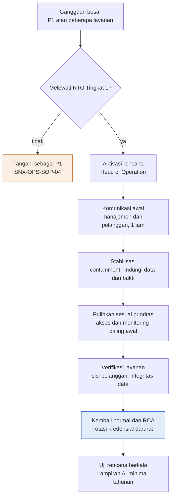

Deskripsi: Judul gambar "Gangguan besar: aktivasi, stabilkan, pulihkan sesuai prioritas". Alur vertikal dari "Gangguan besar" ke satu diamond "Melewati RTO Tingkat 1?" (tidak ke kotak oranye "Tangani sebagai P1, SNX-OPS-SOP-04", tanpa garis kembali; ya lanjut). Berikutnya Aktivasi rencana, Komunikasi awal (1 jam), Stabilisasi, Pulihkan sesuai prioritas, Verifikasi layanan, lalu kotak biru "Kembali normal dan RCA" dan terakhir kotak putih "Uji rencana berkala". Kotak biru (output akhir menurut legenda) bukan kotak terakhir; kotak "Uji rencana berkala" berada di bawahnya.
Sumber gambar: conv/1vwD5tORDQNQ7SNaQ6w4KitPKTcsw9ZVX/img/media/rId25.png

## 4. Peran, RACI, record, KPI
- Peran: pemutus aktivasi Head of Operation (cadangan COO, lalu CEO); Recovery Lead (umumnya Lead NOC); Incident Commander keamanan (Lead SOC); Service Delivery Manager (komunikasi pelanggan, uji kontak); COO dan Legal (regulator, aparat, media). Tabel komunikasi: 2.8; program uji: 2.10. RACI formal tidak ada.
- Record: tabel 2.11 (laporan uji di Lampiran A, FRM-01, REG-02, FRM-10). Tidak ada tabel KPI di dokumen ini.
- Urutan prioritas pemulihan (dari Bagian 4 dan 7): Tingkat 1 (Nusagrid, managed services, monitoring, password manager, Jumphost, WAF dan proxy) lebih dulu, akses dan monitoring paling awal; Tingkat 2 (ticketing, email); Tingkat 3 (knowledge base).

## 5. Catatan kualitas dan celah
- RTO dan RPO sistem internal berlabel USULAN (Bagian 4, di bawah tabel: "RTO dan RPO sistem internal adalah USULAN dan disahkan Head of Operation; RTO layanan pelanggan mengikuti kontrak"). Baris 1 (layanan pelanggan Nusagrid) berisi RTO "Sesuai SLA kontrak" dan RPO "Sesuai layanan backup" tanpa angka; baris 2 (managed services server pelanggan) justru memakai "4 jam", sehingga kalimat "RTO layanan pelanggan mengikuti kontrak" tidak sepenuhnya cocok dengan baris 2 (inferensi). Istilah MTPD tidak muncul di dokumen.
- Cakupan Bagian 4 tidak memuat tiga hal yang disebut di ruang lingkup SNX-ISMS-SOP-03 Bagian 2: Acronis Cyber Protect ("Layanan backup pelanggan (Acronis Cyber Protect, ...)"), "konfigurasi network device dan WAF" (khusus network device; WAF ada di baris 7) dan "dokumen di Drive". Acronis dan network device tidak muncul di PLN-01 (nol kemunculan). Drive tidak disebut eksplisit; kemungkinan tercakup baris 8 "Email dan kolaborasi (Google Workspace)" (inferensi; SNX-ISMS-REG-01 AST-011 "Email, Drive, dokumen"). SIEM tidak punya baris di Bagian 4 dan hanya disebut sebagai keahlian kritis di Bagian 9 butir 2.
- Kolom RTO dan RPO "Sesuai penyedia" (baris 8 Google Workspace) serta RTO "Sesuai SLA kontrak" (baris 1 Nusagrid) tidak dapat dibandingkan dengan target internal.
- Penomoran Tingkat: password manager Tingkat 1 (baris 5), ticketing Tingkat 2 (baris 4), knowledge base Tingkat 3 (baris 9), sedangkan SNX-ISMS-SOP-03 Bagian 6.1 menyamakan ketiganya dalam satu kelompok "Sistem internal kritis (ticketing system, password manager, knowledge base dan database-nya)" dengan RPO "24 jam" dan RTO "Sesuai SNX-ISMS-PLN-01 Bagian 4 (4 sampai 24 jam)". Tidak bertentangan, karena SOP-03 mendelegasikan RTO ke PLN-01 (4, 8, 24 jam sesuai baris 5, 4, 9).
- Jumphost (baris 6) dan WAF (baris 7) memakai RPO "1 minggu (konfigurasi)" dan RTO "4 jam", selaras dengan SNX-ISMS-SOP-03 Bagian 6.1 baris "Konfigurasi network device, WAF, dan server kritis" (RPO "1 minggu", RTO "4 jam"). Jumphost tidak disebut di SOP-03 (nol kemunculan), sehingga keselarasan Jumphost hanya lewat frasa "server kritis" (inferensi).
- Komunikasi awal ke pelanggan dalam 1 jam (Bagian 7 butir 2 "Komunikasi awal (dalam 1 jam): ... eksternal ke pelanggan terdampak melalui Service Delivery Manager") lebih ketat daripada pemberitahuan P1 ke pelanggan "paling lambat 24 jam dengan laporan awal" di SNX-ISMS-SOP-01 Bagian 11 butir 1; keduanya memiliki pemicu berbeda (aktivasi BCP versus insiden keamanan P1). SNX-OPS-SOP-04 Bagian 6 mewajibkan "Update ke pelanggan" P1 "Tiap 1 jam".
- Diagram: kotak biru "Kembali normal dan RCA" ditandai output akhir (legenda: "Kotak biru adalah output akhir") namun masih diikuti kotak "Uji rencana berkala"; Bagian 7 menyebut tahap terakhir "Pasca kejadian: RCA (SNX-OPS-FRM-10) dan pembaruan rencana ini", sedangkan "Uji rencana berkala" tidak ada pada tahapan Bagian 7 (ada di Bagian 10, Program pengujian).
- Diagram menggambarkan cabang "tidak" dari "Melewati RTO Tingkat 1?" ke kotak oranye "Tangani sebagai P1 / SNX-OPS-SOP-04" tanpa garis kembali; Bagian 6 butir 1: "Rencana diaktifkan bila insiden P1 diperkirakan melewati RTO layanan Tingkat 1, atau bila beberapa layanan kritis terganggu bersamaan". Kasus "beberapa layanan kritis terganggu bersamaan" hanya ada di kotak awal "P1 atau beberapa layanan" dan tidak punya cabang sendiri (inferensi). SNX-OPS-SOP-04 (md/ops) Bagian 6 mendefinisikan P1 Kritis (target pulih "4 jam", USULAN; eskalasi "Lead langsung, COO dalam 30 menit, CEO bila COO tidak tersedia").
- Peran CEO muncul sebagai pemutus cadangan aktivasi (Bagian 6 butir 2 "bila keduanya tidak tersedia, CEO") dan audiens komunikasi (Bagian 8 "Manajemen (COO, CEO)"). CEO tidak muncul di enam dokumen SOP/PRO ISMS lain (SOP-01 sampai SOP-05 dan PRO-01) maupun di sheet dokumen xlsx ISMS (nol kemunculan), tetapi muncul di SNX-OPS-SOP-04 Bagian 6 (P1 "saat COO tidak dapat dihubungi", "CEO"). Nama CEO tidak disebut di dokumen mana pun; hanya COO yang disebut dengan nama (penyetuju).
- Rujukan SNX-ISMS-FRM-03 (Bagian 5 baris "Kegagalan supplier kritis") dan SNX-ISMS-REG-02 (Bagian 1, 9 butir 2, 11) ada di md/isms. FRM-03 memuat supplier yang disebut di skenario (SUP-002 Partner SOC, SUP-006 penyedia lisensi, SUP-003 platform monitoring) tetapi tidak punya kolom kontak eskalasi atau rencana alternatif per supplier (hanya Kuesioner butir 12 dan cabang diagram "Tinjau ulang, rencana alternatif"). REG-02 ISR-004 ("Keahlian terkonsentrasi pada satu orang; runbook belum lengkap") selaras dengan "Celah saat ini dicatat sebagai risiko di SNX-ISMS-REG-02" (Bagian 9 butir 2). Lampiran A adalah form kosong (tabel hasil, temuan, tanda tangan uji tanpa isi; belum ada hasil uji).
- Pengesahan: tanda tangan dan tanggal kosong; riwayat revisi dua baris bertanggal sama ("13 Oktober 2026") berstatus "Menunggu".

## 6. Kata kunci retrieval
business continuity, BCP, IT recovery plan, rencana pemulihan, RTO, RPO, tingkat layanan, layanan kritis, Nusagrid, Jumphost, password manager, AegisWAF, Cloudflare, Nusametric, Overseer, Zammad, Service Hub, Google Workspace, aktivasi rencana, Recovery Lead, tabletop exercise, uji pemulihan, uji kontak, break-glass, komunikasi krisis, laporan uji BCP, Lampiran A, ISO 27001 A 5.29 A 5.30 A 8.14

<!-- FILE: isms/SNX-ISMS-PRO-01.md -->

---
doc_code: SNX-ISMS-PRO-01
title: Information Classification & Handling Procedure
department: Information Security
doc_type: Prosedur
source: {drive_file_id: 1h5PtuUGE8UDPbwPtccUQ8pgwgAoW64Io, filename: SNX-ISMS-PRO-01_Information_Classification_Handling_Procedure.docx, format: docx, bytes: 158648, retrieved: 2026-10-13}
revision: 00 (DRAFT)
doc_date: 13 Oktober 2026 (tanggal draft; tanggal efektif "Ditetapkan saat pengesahan")
classification_in_doc: RESTRICTED (Internal)
owner_in_doc: ISMS Coordinator
approver_in_doc: COO, Amirull Yusuf Zulkarnain
iso_refs: {iso9001: ["7.5.3"], iso27001: ["A 5.12", "A 5.13", "A 5.14", "A 5.33", "A 7.10", "A 8.10", "A 8.12 (hanya di Bagian 3 Referensi)"]}
kb_sensitivity_suggest: restricted:ops
related_docs: [SNX-ISMS-REG-01, SNX-ISMS-SOP-01, SNX-ISMS-SOP-04, SNX-ISMS-FRM-02]
coverage: {sections_or_sheets: "12 dari 12 (Bagian 1-10, Diagram, Pengesahan)", tables: "8 dari 8 (kontrol dokumen, riwayat revisi, tingkat klasifikasi, pelabelan, aturan penanganan, peran, record, pengesahan)", images: "1 dibuka dari 1", notes: "Tidak ada celah baca. Daftar aturan penentuan (4 butir) dan aturan khusus (5 butir) ditulis lengkap."}
---
# SNX-ISMS-PRO-01 Information Classification & Handling Procedure

## 1. Ringkasan
- Empat tingkat klasifikasi: PUBLIC, INTERNAL, RESTRICTED (dipecah per domain: ops, commercial, legal, hr, finance), dan SECRET.
- Pemilik informasi (pemilik aset di SNX-ISMS-REG-01) menetapkan klasifikasi saat informasi dibuat atau diterima; bila ragu pakai tingkat lebih tinggi; informasi pelanggan minimal RESTRICTED; agregasi dapat menaikkan tingkat.
- Tanpa label berarti INTERNAL; label wajib untuk RESTRICTED dan SECRET pada email (subjek diawali tingkat).
- SECRET (kredensial, private key, token API, data pribadi sensitif, data pelanggan yang diatur regulator) hanya boleh di password manager internal (vault) atau sistem khusus ter-encrypt; dilarang di dokumen, spreadsheet, chat, tiket, email, dan paket knowledge base.
- Pelanggaran penanganan RESTRICTED atau SECRET dilaporkan sebagai event keamanan sesuai SNX-ISMS-SOP-01; pengecualian harus tertulis, berbatas waktu, disetujui pemilik informasi dan ISMS Coordinator.
- Status DRAFT revisi 00, belum ditandatangani (kolom tanda tangan dan tanggal pengesahan kosong).

## 2. Isi lengkap terstruktur

### 2.0 Kontrol dokumen

| Atribut | Isi |
|---|---|
| Nomor dokumen | SNX-ISMS-PRO-01 |
| Judul | Information Classification & Handling Procedure |
| Revisi | 00 (DRAFT) |
| Tanggal draft | 13 Oktober 2026 |
| Tanggal efektif | Ditetapkan saat pengesahan |
| Klasifikasi | RESTRICTED (Internal) |
| Pemilik dokumen | ISMS Coordinator |
| Disetujui oleh | COO, Amirull Yusuf Zulkarnain |
| Acuan ISO 9001:2015 | Klausul 7.5.3 |
| Acuan ISO/IEC 27001:2022 | Klausul atau kontrol Annex A 5.12, 5.13, 5.14, 5.33, 7.10, 8.10 |
| Masa simpan record | Berlaku sampai digantikan |

Riwayat revisi:

| Revisi | Tanggal | Uraian perubahan | Disusun | Disetujui |
|---|---|---|---|---|
| 00 | 13 Oktober 2026 | Draft awal untuk sertifikasi ISO 9001:2015 dan ISO/IEC 27001:2022 | Divisi Operation | Menunggu |
| 00 | 13 Oktober 2026 | Review bahasa dan konsistensi: istilah teknologi dalam bahasa Inggris, bahasa Indonesia formal, label klasifikasi, keselarasan RTO dan target pulih | Divisi Operation | Menunggu |

### 2.1 Tujuan (Bagian 1)
Menetapkan tingkat klasifikasi informasi SINUX, cara memberi label, dan aturan penanganan per tingkat (penyimpanan, pengiriman, berbagi, pencetakan, retensi, dan pemusnahan), sehingga informasi dilindungi sesuai nilai dan risikonya.

### 2.2 Ruang lingkup (Bagian 2)
Semua informasi yang dibuat, diterima, disimpan, atau diproses oleh personel Divisi Operation dan pihak ketiga yang bekerja atas nama SINUX, dalam bentuk apa pun: dokumen, spreadsheet, email, chat, tiket, log, konfigurasi, backup, database, rekaman, dan kertas. Termasuk informasi milik pelanggan yang SINUX kelola.

### 2.3 Referensi (Bagian 3)
- ISO 9001:2015 klausul 7.5.3 (pengendalian informasi terdokumentasi).
- ISO/IEC 27001:2022 Annex A 5.12, 5.13, 5.14, 5.33, 7.10, 8.10, 8.12.
- Label sensitivitas knowledge base SINUX (public, internal, restricted per domain).
- SNX-ISMS-REG-01 Information Asset Register.

### 2.4 Tingkat klasifikasi (Bagian 4)

| Tingkat | Definisi | Contoh | Dampak bila bocor |
|---|---|---|---|
| PUBLIC | Informasi yang disetujui untuk umum | Company profile, materi pemasaran yang sudah disetujui, halaman website | Tidak ada |
| INTERNAL | Untuk seluruh karyawan dan kontraktor SINUX; tidak untuk pihak luar tanpa alasan bisnis | SOP umum, jadwal shift, pengumuman internal, template | Kecil, memalukan atau merugikan ringan |
| RESTRICTED | Hanya untuk peran atau tim yang membutuhkan; dipecah per domain: ops, commercial, legal, hr, finance | Topologi dan konfigurasi pelanggan, register risiko, laporan insiden, kontrak, harga, data karyawan | Besar: kerugian pelanggan, pelanggaran kontrak, sanksi |
| SECRET | Informasi yang bila bocor langsung memberi akses atau melanggar hukum | Kredensial, private key dan sertifikat, token API, data pribadi sensitif, data pelanggan yang diatur regulator | Kritis: kompromi sistem, kebocoran data pribadi, pelanggaran UU PDP |

Aturan penentuan:
1. Pemilik informasi (pemilik aset pada SNX-ISMS-REG-01) menetapkan klasifikasi saat informasi dibuat atau diterima.
2. Bila ragu, gunakan tingkat yang lebih tinggi. Menurunkan klasifikasi hanya boleh oleh pemilik informasi dan dicatat.
3. Informasi pelanggan minimal RESTRICTED, kecuali pelanggan menetapkan lebih tinggi.
4. Kumpulan informasi dapat naik tingkat (agregasi): daftar lengkap IP address server pelanggan beserta versi software minimal RESTRICTED.

### 2.5 Pelabelan (Bagian 5)

| Media | Cara pelabelan |
|---|---|
| Dokumen Word, PDF, slide | Header atau footer setiap halaman, misalnya "RESTRICTED (Internal)" |
| Spreadsheet | Sheet Kontrol Dokumen atau header cetak |
| Email | Subjek diawali tingkat bila RESTRICTED atau SECRET, misalnya "[RESTRICTED]" |
| Folder Drive | Nama folder atau deskripsi menyebut tingkat; izin akses sesuai tingkat |
| Tiket | Kolom atau tag klasifikasi bila sistem mendukung |
| Media fisik dan kertas | Label pada sampul atau halaman pertama |
| Entri knowledge base | Label sensitivity (public, internal, restricted per domain) |

Informasi PUBLIC dan INTERNAL boleh tanpa label; tanpa label dianggap INTERNAL.

### 2.6 Aturan penanganan (Bagian 6), matriks aktivitas x tingkat

| Aktivitas | PUBLIC | INTERNAL | RESTRICTED | SECRET |
|---|---|---|---|---|
| Penyimpanan | Bebas | Sistem resmi SINUX (Drive, Service Hub, knowledge base) | Sistem resmi dengan akses terbatas per peran | Hanya password manager internal (vault) atau sistem khusus ter-encrypt; dilarang di dokumen, spreadsheet, chat, tiket, atau email |
| Pengiriman internal | Bebas | Kanal kerja resmi | Kanal resmi kepada penerima yang berhak; share link, bukan lampiran bila memungkinkan | Hanya melalui fitur berbagi password manager atau direct message yang lalu dihapus; penerima rotate setelah pakai |
| Berbagi ke pihak luar | Bebas | Dengan alasan bisnis | Butuh NDA atau kontrak yang berlaku dan persetujuan pemilik informasi | Dilarang, kecuali kepada pemiliknya (misalnya kredensial pelanggan kembali ke pelanggan) |
| Grup chat (WhatsApp dan sejenisnya) | Bebas | Boleh | Hanya grup kerja resmi dengan anggota terverifikasi; tanpa lampiran topologi lengkap | Dilarang |
| Cetak | Bebas | Seperlunya | Seperlunya, diambil langsung dari printer, tidak ditinggal | Dilarang |
| Perangkat kerja | Bebas | Perangkat kerja | Perangkat kerja dengan disk encryption dan screen lock | Hanya di vault; tidak disalin ke perangkat |
| Removable media (USB, disk eksternal) | Bebas | Dihindari | Hanya ter-encrypt dan dengan persetujuan Lead | Dilarang |
| Retensi | Sesuai kebutuhan | Sesuai master list | Sesuai master list dan kontrak | Sesingkat mungkin; rotasi berkala |
| Pemusnahan | Biasa | Hapus biasa | Hapus aman; kertas dihancurkan | Hapus aman dan rotasi; media dihancurkan atau di-wipe sesuai SNX-ISMS-SOP-04 |

### 2.7 Aturan khusus (Bagian 7)
1. Kredensial, token, dan secret tidak pernah ditulis di chat, tiket, dokumen, spreadsheet, atau paket knowledge base. Kredensial yang ditemukan di tempat tersebut segera dihapus, dirotasi, dan dilaporkan sebagai event keamanan sesuai SNX-ISMS-SOP-01.
2. Kredensial pelanggan diterima melalui direct message atau password manager, dipakai seperlunya, dan pelanggan diminta mengganti setelah dipakai.
3. Dokumen teknis untuk pelanggan pemerintah tidak memuat harga, diskon, tier, maupun roadmap komersil.
4. Data pelanggan di test environment mengikuti klasifikasi aslinya; data pribadi dimasking bila tidak dibutuhkan untuk uji.
5. Penggunaan layanan AI atau pihak ketiga untuk memproses informasi RESTRICTED hanya melalui layanan yang disetujui SINUX; informasi SECRET dilarang dimasukkan.

### 2.8 Peran dan tanggung jawab (Bagian 8)

| Peran | Tanggung jawab |
|---|---|
| ISMS Coordinator | Pemilik prosedur; sosialisasi dan pemantauan kepatuhan |
| Pemilik informasi atau aset | Menetapkan klasifikasi, menyetujui akses dan berbagi |
| Seluruh personel | Memberi label dan menangani informasi sesuai tingkatnya; melaporkan pelanggaran |
| Head of Operation | Menegakkan prosedur di Divisi Operation; meninjau pengecualian |

### 2.9 Pelanggaran dan pengecualian (Bagian 9)
1. Pelanggaran penanganan informasi RESTRICTED atau SECRET dilaporkan sebagai event keamanan sesuai SNX-ISMS-SOP-01 dan ditindak sesuai kebijakan disipliner perusahaan.
2. Pengecualian hanya sah bila tertulis, berbatas waktu, disetujui pemilik informasi dan ISMS Coordinator.

### 2.10 Record terkait (Bagian 10)

| Record | Nomor |
|---|---|
| Information Asset Register (kolom klasifikasi) | SNX-ISMS-REG-01 |
| Security Incident & Investigation Records | SNX-ISMS-FRM-02 |

### 2.11 Pengesahan

| Peran | Nama dan jabatan | Tanda tangan | Tanggal |
|---|---|---|---|
| Disusun oleh | ISMS Coordinator | (kosong) | (kosong) |
| Diperiksa oleh | ISO/ISMS Coordinator | (kosong) | (kosong) |
| Disetujui oleh | COO, Amirull Yusuf Zulkarnain | (kosong) | (kosong) |

## 3. Diagram

### 3.1 Alur Information Classification & Handling

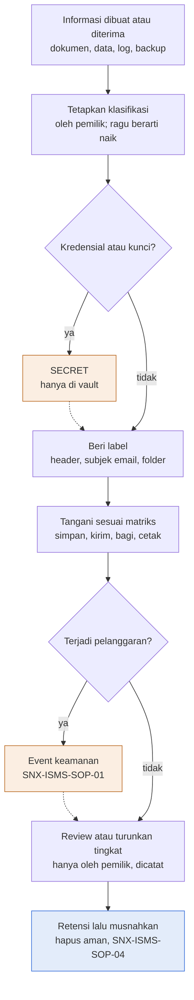

Deskripsi: Judul gambar "Setiap informasi diklasifikasi, diberi label, lalu ditangani sesuai tingkatnya". Alur vertikal dari informasi dibuat atau diterima sampai retensi dan pemusnahan. Dua diamond keputusan (kredensial atau kunci; terjadi pelanggaran) masing-masing punya cabang "ya" ke kotak oranye (SECRET; Event keamanan) yang garis putus-putusnya kembali ke alur utama. Kotak biru adalah output akhir (Retensi lalu musnahkan). Catatan di bawah gambar: kotak biru output akhir, kotak oranye cabang ke tindakan atau prosedur lain, garis putus-putus kembali ke alur utama.
Sumber gambar: conv/1h5PtuUGE8UDPbwPtccUQ8pgwgAoW64Io/img/media/rId23.png

## 4. Peran, RACI, record, KPI
- Peran: lihat tabel 2.8. RACI formal tidak ada di dokumen (tidak ada matriks RACI).
- Record: SNX-ISMS-REG-01 (kolom klasifikasi), SNX-ISMS-FRM-02. Masa simpan record dokumen ini: "Berlaku sampai digantikan".
- KPI: tidak ada bagian Pemantauan kinerja di dokumen ini (berbeda dari SOP-01 sampai SOP-05 yang memilikinya).

## 5. Catatan kualitas dan celah
- Ruang lingkup Bagian 2 hanya menyebut "personel Divisi Operation dan pihak ketiga yang bekerja atas nama SINUX", padahal judul dan Bagian 1 membahas "tingkat klasifikasi informasi SINUX" secara umum; divisi lain (HR, FAT, Commercial, Legal) tidak disebut di cakupan. Label domain "ops, commercial, legal, hr, finance" hanya muncul pada definisi RESTRICTED (Bagian 4).
- Header kontrol dokumen mencantumkan Annex A 5.12, 5.13, 5.14, 5.33, 7.10, 8.10, sedangkan Bagian 3 menambah "8.12" yang tidak ada di header (master list SNX-OPS-ML-00 untuk PRO-01 juga tanpa 8.12). Judul kontrol 8.12 tidak ditulis di PRO-01; di SNX-ISMS-SOA-01 (sheet SoA) 8.12 berjudul "Data leakage prevention" dengan usulan "Perlu keputusan" dan bukti "-", jadi 8.12 belum dipetakan ke PRO-01 di SoA. A 5.33 ada di header tetapi tidak ada bagian isi yang membahas perlindungan record secara eksplisit; SoA memetakan 5.33 "Protection of records" ke "SNX-ISMS-PRO-01, master list SNX-OPS-ML-00 (masa simpan)", yakni baris Retensi di Bagian 6.
- Label sensitivitas knowledge base di Bagian 3 ("Label sensitivitas knowledge base SINUX (public, internal, restricted per domain)") dan Bagian 5 (baris "Entri knowledge base") hanya tiga nilai; tidak ada label SECRET di KB. Larangan memasukkan secret ke KB ada di Bagian 7 butir 1 ("paket knowledge base"); bahwa larangan itu menjadi alasan tidak adanya label SECRET tidak dinyatakan eksplisit (inferensi).
- Rujukan keluar ada di md/isms dan konsisten: SNX-ISMS-REG-01 (Bagian 3, 4 aturan 1, 10) memiliki kolom "Klasifikasi" (Register Aset H) dengan nilai PUBLIC, INTERNAL, RESTRICTED, SECRET (Daftar B2:B5) sama dengan Bagian 4; SNX-ISMS-FRM-02 (Bagian 10) berjudul "Security Incident & Investigation Records" sesuai. Pemusnahan SECRET merujuk SNX-ISMS-SOP-04 (Bagian 6 baris Pemusnahan: "media dihancurkan atau di-wipe sesuai SNX-ISMS-SOP-04"), dan SOP-04 Bagian 6.5 butir 1 memuat wipe dan penghancuran fisik.
- Retensi INTERNAL dan RESTRICTED (Bagian 6 baris Retensi: "Sesuai master list", "Sesuai master list dan kontrak") merujuk "master list" tanpa nomor. Master list yang bersangkutan adalah SNX-OPS-ML-00 (md/ops, kolom "Masa simpan" per dokumen), yang disebut bernomor oleh SoA untuk 5.33; bahwa "master list" di PRO-01 = ML-00 adalah inferensi.
- Tabel pelabelan (Bagian 5 baris Email) menyebut "Subjek diawali tingkat bila RESTRICTED atau SECRET", tetapi Bagian 6 melarang SECRET di email (baris Penyimpanan: "dilarang di dokumen, spreadsheet, chat, tiket, atau email") dan pengiriman SECRET hanya lewat password manager atau direct message; tidak ada penjelasan kasus label SECRET pada email (inferensi: label untuk email yang melanggar).
- Pengesahan: tanda tangan dan tanggal kosong; riwayat revisi dua baris bertanggal sama ("13 Oktober 2026") berstatus "Menunggu". Penyusun pada Pengesahan "ISMS Coordinator" dan pemeriksa "ISO/ISMS Coordinator" (dua penamaan peran berbeda; Bagian 8 memakai "ISMS Coordinator").
- Tidak ada target KPI dan tidak ada bagian definisi istilah (heading sumber: Bagian 1 sampai 10, Diagram, Pengesahan; tidak ada "Pemantauan kinerja" atau "Definisi").

## 6. Kata kunci retrieval
klasifikasi informasi, information classification, PUBLIC, INTERNAL, RESTRICTED, SECRET, pelabelan, labeling, penanganan informasi, handling rules, vault, password manager, NDA, removable media, retensi, pemusnahan, hapus aman, secure deletion, agregasi, UU PDP, data pelanggan, knowledge base sensitivity, ISO 27001 A 5.12, A 5.13, A 5.14, A 7.10, A 8.10, SNX-ISMS-PRO-01, ISMS Coordinator

<!-- FILE: isms/SNX-ISMS-REG-01.md -->

---
doc_code: SNX-ISMS-REG-01
title: Information Asset Register
department: Information Security
doc_type: Register
source: {drive_file_id: 1mMx6v0UhAWMQU6I6rAfsZz20nsjv-FkP, filename: SNX-ISMS-REG-01_Information_Asset_Register.xlsx, format: xlsx, bytes: 133130, retrieved: 2026-10-13}
revision: 00 (DRAFT)
doc_date: 13 Oktober 2026
classification_in_doc: RESTRICTED (Internal)
owner_in_doc: Head of Operation
approver_in_doc: COO, Amirull Yusuf Zulkarnain
iso_refs: {iso9001: ["7.1.3"], iso27001: ["Annex A 5.9", "Annex A 5.10", "Annex A 5.11", "Annex A 5.12"]}
kb_sensitivity_suggest: restricted:ops
related_docs: [SNX-ISMS-REG-02]
coverage: {sections_or_sheets: "5 dari 5", tables: 6, images: "1 dibuka dari 1", notes: "Register Aset memiliki area rumus sampai baris 216, tetapi hanya 12 baris terisi (AST-001 sampai AST-012). Sheet Pemusnahan kosong (hanya header). Kolom S (Tanggal masuk) kosong di semua baris."}
---
# SNX-ISMS-REG-01 Information Asset Register

## 1. Ringkasan
- Register inventaris aset informasi dan aset TI berisi pemilik, klasifikasi, nilai CIA (skala 1 sampai 3), status konfigurasi (CI), backup, monitoring, siklus hidup, dan jadwal review.
- Terisi 12 aset (AST-001 sampai AST-012), seluruhnya bertanda CONTOH: aset internal yang diidentifikasi dari knowledge base, pemilik dan status harus diverifikasi.
- Nilai aset = nilai tertinggi dari C, I, A; kritikalitas: 3 Tinggi, 2 Sedang, 1 Rendah (dihitung otomatis).
- Dari 12 aset: 10 Tinggi (nilai 3) dan 2 Sedang (nilai 2: AST-002, AST-012), 4 SECRET dan 8 RESTRICTED; review berikutnya otomatis 6 bulan setelah review terakhir (13 Okt 2026 menjadi 13 Apr 2027).
- Sheet Pemusnahan (berita acara pemusnahan aman) disediakan dengan dropdown metode, belum ada isi.
- Register menjadi dasar penilaian risiko SNX-ISMS-REG-02.

## 2. Isi lengkap terstruktur

### 2.1 Sheet "Kontrol Dokumen"
| Field | Isi |
|---|---|
| Nomor dokumen | SNX-ISMS-REG-01 |
| Judul | Information Asset Register |
| Revisi | 00 (DRAFT) |
| Tanggal draft | 13 Oktober 2026 |
| Tanggal efektif | Ditetapkan saat pengesahan |
| Klasifikasi | RESTRICTED (Internal) |
| Pemilik dokumen | Head of Operation |
| Disetujui oleh | COO, Amirull Yusuf Zulkarnain |
| Acuan ISO 9001:2015 | Klausul 7.1.3 |
| Acuan ISO/IEC 27001:2022 | Klausul atau kontrol Annex A 5.9, 5.10, 5.11, 5.12 |
| Masa simpan record | Berlaku sampai digantikan |
| Tujuan | Inventaris aset informasi dan aset TI beserta pemilik, klasifikasi, nilai CIA, status konfigurasi, dan siklus hidup. |

Subjudul sheet: "PT Strategi Integrasi Nusantara (SINUX) · Divisi Operation".

**Cara pakai (teks sumber, 6 butir)**
1. Daftarkan setiap aset baru paling lambat saat mulai dipakai; aset pelanggan wajib sebelum gate G3.
2. Isi nilai C, I, A dengan skala 1 (rendah) sampai 3 (tinggi); nilai dan kritikalitas aset dihitung otomatis.
3. Tandai CI = Ya untuk aset yang konfigurasinya dikendalikan dan isi acuan baseline.
4. Review berikutnya dihitung otomatis 6 bulan setelah review terakhir; baris merah berarti review terlambat.
5. IP address dan detail teknis sensitif boleh dicatat di sini karena register berklasifikasi RESTRICTED; kredensial dilarang.
6. Baris CONTOH (biru muda) adalah aset internal yang teridentifikasi dari knowledge base; verifikasi pemilik dan statusnya.

**Legenda warna**: sel input (diisi pengguna); baris CONTOH (hapus atau timpa saat dipakai); sel rumus (jangan diubah).

**Riwayat revisi**
| Revisi | Tanggal | Uraian perubahan | Disusun | Disetujui |
|---|---|---|---|---|
| 00 | 13 Oktober 2026 | Draft awal untuk sertifikasi ISO 9001 dan ISO/IEC 27001 | Divisi Operation | Menunggu |
| 00 | 13 Oktober 2026 | Review bahasa dan konsistensi: istilah teknologi dalam bahasa Inggris, bahasa Indonesia formal, label klasifikasi, keselarasan RTO dan target pulih | Divisi Operation | Menunggu |

**Pengesahan**
| Peran | Nama dan jabatan | Tanda tangan | Tanggal |
|---|---|---|---|
| Disusun oleh | Head of Operation | (kosong) | (kosong) |
| Diperiksa oleh | ISO/ISMS Coordinator | (kosong) | (kosong) |
| Disetujui oleh | COO, Amirull Yusuf Zulkarnain | (kosong) | (kosong) |

### 2.2 Sheet "Alur Proses"
Berisi judul "Diagram alur proses" dan legenda: kotak biru = output akhir; kotak oranye = cabang ke tindakan atau prosedur lain; garis putus-putus = kembali ke alur utama. Isi gambar ada di bagian 3.

### 2.3 Sheet "Daftar" (nilai dropdown)
| Kolom | Nama | Nilai |
|---|---|---|
| A | Jenis | Hardware; VM atau server; Layanan cloud atau SaaS; Software atau lisensi; Informasi atau data; Network device; Endpoint; Domain atau sertifikat; Layanan pihak ketiga |
| B | Klasifikasi | PUBLIC; INTERNAL; RESTRICTED; SECRET |
| C | CIA | 1; 2; 3 |
| D | YaTidak | Ya; Tidak |
| E | Status | Aktif; Dalam pengadaan; Dinonaktifkan; Dimusnahkan |

### 2.4 Sheet "Register Aset"
Rentang A1:V216; header di baris 4, data mulai baris 5, area terformat sampai baris 216. Judul: "Information asset register". Catatan baris 2: "Nilai aset = nilai tertinggi dari C, I, A. Kritikalitas: 3 Tinggi, 2 Sedang, 1 Rendah."

**Kolom dan arti**
| Kol | Header | Arti / validasi |
|---|---|---|
| A | ID aset | Format AST-nnn |
| B | Nama aset | Nama aset (boleh memuat hostname/nama sistem) |
| C | Jenis | Dropdown Daftar!A2:A10 |
| D | Fungsi atau deskripsi | Teks bebas |
| E | Pemilik | Peran pemilik aset |
| F | Pengguna atau pelanggan | Teks bebas |
| G | Lokasi atau platform | Teks bebas |
| H | Klasifikasi | Dropdown Daftar!B2:B5 |
| I | C (Confidentiality) | Dropdown 1..3 |
| J | I (Integrity) | Dropdown 1..3 |
| K | A (Availability) | Dropdown 1..3 |
| L | Nilai aset | Rumus `=IF(COUNT(I:K)=0,"",MAX(I:K))`: nilai tertinggi dari C, I, A |
| M | Kritikalitas | Rumus `=IF(L="","",CHOOSE(L,"Rendah","Sedang","Tinggi"))`: 1 Rendah, 2 Sedang, 3 Tinggi |
| N | CI | Dropdown Ya/Tidak (configuration item) |
| O | Acuan baseline | Teks bebas |
| P | Backup | Dropdown Ya/Tidak |
| Q | Monitoring | Dropdown Ya/Tidak |
| R | Status | Dropdown Daftar!E2:E5 |
| S | Tanggal masuk | Tanggal (kosong di semua baris terisi) |
| T | Review terakhir | Tanggal input |
| U | Review berikutnya | Rumus `=IF(T="","",EDATE(T,6))`: 6 bulan setelah review terakhir; baris merah jika terlambat |
| V | Catatan | Teks bebas |

**Data terisi (12 baris, semua Catatan = CONTOH, Review terakhir 2026-10-13, Review berikutnya 2027-04-13)**
| ID | Nama aset | Jenis | Fungsi | Pemilik | Pengguna | Lokasi | Klas. | C | I | A | Nilai | Kritikalitas | CI | Acuan baseline | Backup | Monitoring | Status |
|---|---|---|---|---|---|---|---|---|---|---|---|---|---|---|---|---|---|
| AST-001 | Password manager internal (vault.sinux.co.id) | VM atau server | Penyimpanan kredensial tim | Head of Operation | Internal | Nusagrid | SECRET | 3 | 3 | 3 | 3 | Tinggi | Ya | Runbook password manager | Ya | Ya | Aktif |
| AST-002 | SINUX Service Hub GLPI (ticket.sinux.co.id) | VM atau server | Tiket GMF dedicated dan permintaan internal | Head of Operation | Internal, GMF | Nusagrid | RESTRICTED | 2 | 2 | 2 | 2 | Sedang | Ya | SINUX_SERVICE_HUB | Ya | Ya | Aktif |
| AST-003 | Helpdesk Zammad Nusagrid | VM atau server | Tiket pelanggan Nusagrid (WhatsApp, telepon) | Lead NOC | Pelanggan Nusagrid | Nusagrid | RESTRICTED | 2 | 2 | 3 | 3 | Tinggi | Ya | Belum ada | Ya | Ya | Aktif |
| AST-004 | Jumphost multi-customer | VM atau server | Akses production ter-audit | Head of Operation | Internal | Nusagrid | SECRET | 3 | 3 | 3 | 3 | Tinggi | Ya | Runbook jumphost | Ya | Ya | Aktif |
| AST-005 | AegisWAF edge | VM atau server | WAF dan reverse proxy layanan | Tech dan Product | Internal dan pelanggan | Nusagrid | RESTRICTED | 2 | 3 | 3 | 3 | Tinggi | Ya | SINUX_AEGISWAF_OPS | Ya | Ya | Aktif |
| AST-006 | Monitoring Nusametric dan Overseer | Layanan cloud atau SaaS | Monitoring availability dan perangkat | Lead NOC | Internal dan pelanggan | Nusagrid | RESTRICTED | 2 | 2 | 3 | 3 | Tinggi | Ya | Belum ada | Ya | Ya | Aktif |
| AST-007 | Acronis Cyber Protect (console dan repository) | Layanan cloud atau SaaS | Backup pelanggan dan internal | Lead NOC | Pelanggan backup | Acronis via Nusagrid | SECRET | 3 | 3 | 3 | 3 | Tinggi | Ya | SKILL_backup-snapshot-ops | Ya | Ya | Aktif |
| AST-008 | Knowledge base SINUX dan database pendukung | Informasi atau data | Pengetahuan kanonik dan runbook | COO | Internal | VM ops | RESTRICTED | 3 | 3 | 2 | 3 | Tinggi | Ya | Runbook KB | Ya | Ya | Aktif |
| AST-009 | Server email mail.nusagrid.co.id | VM atau server | Email layanan Nusagrid | Lead NOC | Internal dan pelanggan | Nusagrid | RESTRICTED | 3 | 2 | 2 | 3 | Tinggi | Ya | Belum ada | Ya | Ya | Aktif |
| AST-010 | Akun Cloudflare | Layanan pihak ketiga | DNS, WAF, CDN pelanggan | Head of Operation | Pelanggan | Cloudflare | SECRET | 3 | 3 | 3 | 3 | Tinggi | Tidak | - | Tidak | Ya | Aktif |
| AST-011 | Google Workspace sinux.co.id | Layanan cloud atau SaaS | Email, Drive, dokumen | COO | Seluruh personel | Google | RESTRICTED | 3 | 2 | 2 | 3 | Tinggi | Tidak | - | Tidak | Tidak | Aktif |
| AST-012 | Laptop kerja personel Operation | Endpoint | Perangkat kerja | Head of Operation | Personel Operation | Fisik | RESTRICTED | 2 | 2 | 2 | 2 | Sedang | Tidak | - | Tidak | Tidak | Aktif |

Baris 17 sampai 216: hanya rumus L, M, U (kosong, tidak ada data). Tidak ada IP address, password, atau token di register ini (tidak ada yang direduksi).

**Hitung ulang agregat (python, openpyxl data_only, dari 12 baris terisi; konsisten dengan nilai tersimpan di sel rumus)**
- Kritikalitas: Tinggi 10 (AST-001, 003, 004, 005, 006, 007, 008, 009, 010, 011), Sedang 2 (AST-002, AST-012), Rendah 0. Total 12.
- Klasifikasi: SECRET 4 (AST-001, 004, 007, 010), RESTRICTED 8.
- Backup = Ya: 9 aset; Tidak: 3 (AST-010, 011, 012). Monitoring = Ya: 10; Tidak: 2 (AST-011, 012). CI = Ya: 9; Tidak: 3.
- Pemilik: Head of Operation 5 (AST-001, 002, 004, 010, 012), Lead NOC 4 (AST-003, 006, 007, 009), COO 2 (AST-008, 011), Tech dan Product 1 (AST-005).

### 2.5 Sheet "Pemusnahan"
Tujuan: berita acara pemusnahan dan penghapusan aman; setiap pemusnahan media atau dekomisi aset dicatat di sini dan status aset di Register Aset diubah menjadi Dimusnahkan.
Kolom (baris 4): No BA; Tanggal; ID aset; Uraian aset dan media; Metode; Alasan; Pelaksana; Saksi; Bukti. Area baris 5 sampai 44 (40 baris), tidak ada baris terisi.
Dropdown Metode (E5:E44): Overwrite atau secure erase; Penghancuran fisik; Crypto erase; Penghapusan VM sesuai kontrak.

## 3. Diagram

### 3.1 Alur pengisian Information Asset Register (gambar "Alur Proses")
Judul gambar: "Register aset dipelihara sebagai dasar penilaian risiko"; subjudul "Alur pengisian Information Asset Register". Warna: kotak abu (langkah), belah ketupat (keputusan), kotak oranye (cabang ke prosedur lain, Berita acara), kotak biru (output akhir), garis putus-putus (kembali ke alur utama).

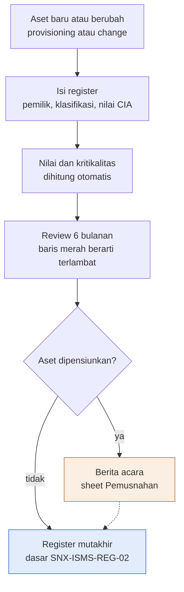

Deskripsi: alur linear dari aset baru atau berubah, pengisian register, perhitungan otomatis nilai dan kritikalitas, lalu review 6 bulanan. Pada keputusan "Aset dipensiunkan?", jawaban "ya" menuju Berita acara (sheet Pemusnahan, kotak oranye) yang kemudian kembali ke alur utama lewat garis putus-putus; jawaban "tidak" langsung menuju output "Register mutakhir" (kotak biru) yang menjadi dasar SNX-ISMS-REG-02.
Sumber gambar: conv/1mMx6v0UhAWMQU6I6rAfsZz20nsjv-FkP/img/image1.png

## 4. Peran, RACI, record, KPI
| Peran | Keterangan dari dokumen |
|---|---|
| Head of Operation | Pemilik dokumen; penyusun; pemilik aset AST-001, 002, 004, 010, 012 |
| ISO/ISMS Coordinator | Pemeriksa dokumen |
| COO (Amirull Yusuf Zulkarnain) | Penyetuju dokumen; pemilik aset AST-008, 011 |
| Lead NOC | Pemilik aset AST-003, 006, 007, 009 |
| Tech dan Product | Pemilik aset AST-005 |

Record: Register Aset (masa simpan: berlaku sampai digantikan), Berita Acara Pemusnahan (sheet Pemusnahan). Tidak ada KPI atau RACI formal di dokumen. Ketentuan frekuensi: review aset tiap 6 bulan; aset baru didaftarkan paling lambat saat mulai dipakai; aset pelanggan wajib terdaftar sebelum gate G3.

## 5. Catatan kualitas dan celah
- Seluruh 12 baris bertanda "CONTOH" (Register Aset V5:V16); Cara pakai B23: "Baris CONTOH (biru muda) adalah aset internal yang teridentifikasi dari knowledge base; verifikasi pemilik dan statusnya." Belum ada aset resmi terverifikasi (inferensi).
- Hanya 12 aset (AST-001 sampai AST-012). Daftar A2:A10 menyediakan 9 jenis; jenis yang tidak terpakai: "Hardware", "Software atau lisensi", "Network device", "Domain atau sertifikat" (jenis terpakai: VM atau server, Layanan cloud atau SaaS, Informasi atau data, Layanan pihak ketiga, Endpoint). Tidak ada aset milik pelanggan sebagai baris sendiri walaupun Cara pakai B18 menyatakan "aset pelanggan wajib sebelum gate G3"; kolom F hanya memuat pengguna atau pelanggan layanan, misalnya AST-002 "Internal, GMF" (inferensi tentang makna "aset pelanggan").
- Kolom S "Tanggal masuk" kosong di semua baris; hanya kolom T "Review terakhir" terisi (T5:T16 seluruhnya 2026-10-13), dan U "Review berikutnya" adalah rumus EDATE 6 bulan.
- Acuan baseline "Belum ada" pada AST-003 (O7), AST-006 (O10), AST-009 (O13) padahal CI = "Ya" (N7, N10, N13); Cara pakai B20: "Tandai CI = Ya ... dan isi acuan baseline".
- AST-010 (Akun Cloudflare, SECRET, C/I/A 3/3/3 sehingga nilai 3) bertanda Backup "Tidak" (P14) dan CI "Tidak" (N14); AST-011 (Google Workspace, C/I/A 3/2/2 sehingga nilai 3) Backup "Tidak" (P15) dan Monitoring "Tidak" (Q15).
- Pemilik AST-005 (E9) ditulis "Tech dan Product" (nama fungsi); nilai sama dipakai di SNX-ISMS-REG-02 (K11) dan SNX-ISMS-REG-03 (H11). Bahwa itu bukan satu peran bernama adalah inferensi (peran lain di dokumen ISMS ditulis sebagai satu jabatan, misalnya "Head of Operation", "Lead NOC").
- Sheet Pemusnahan hanya header (A4:I4; A5:I44 kosong); tanggal efektif (Kontrol Dokumen B8 "Ditetapkan saat pengesahan"), tanda tangan dan tanggal pengesahan (C37:D39) kosong; status persetujuan "Menunggu" (E32:E33). SNX-ISMS-SOP-04 Bagian 8 menyebut "Berita acara pemusnahan | Lampiran SNX-ISMS-REG-01 | 5 tahun"; lampiran itu adalah sheet Pemusnahan ini (kolom No BA, Tanggal, ID aset, Uraian aset dan media, Metode, Alasan, Pelaksana, Saksi, Bukti), tetapi Kontrol Dokumen B14 REG-01 hanya "Berlaku sampai digantikan" dan tidak menyebut masa simpan 5 tahun untuk sheet tersebut.
- Riwayat revisi mencatat dua entri bernomor revisi sama (00) pada tanggal sama (A32 dan A33, "13 Oktober 2026").

## 6. Kata kunci retrieval
Information Asset Register, register aset informasi, aset TI, inventaris aset, SNX-ISMS-REG-01, klasifikasi informasi, PUBLIC INTERNAL RESTRICTED SECRET, nilai CIA, confidentiality integrity availability, kritikalitas aset, configuration item, CI baseline, review 6 bulan, pemusnahan aset, berita acara pemusnahan, secure erase, crypto erase, Annex A 5.9 5.10 5.11 5.12, ISO 27001 asset inventory, ISO 9001 7.1.3, Nusagrid, jumphost, password manager, GLPI, Zammad, AegisWAF, Acronis Cyber Protect, Cloudflare, Google Workspace, knowledge base SINUX

<!-- FILE: isms/SNX-ISMS-REG-02.md -->

---
doc_code: SNX-ISMS-REG-02
title: Information Security Risk Assessment Register
department: Information Security
doc_type: Register
source: {drive_file_id: 1skCiIY43Vz6qfT71vEKz55EZFGHVCl4Q, filename: SNX-ISMS-REG-02_IS_Risk_Assessment_Register.xlsx, format: xlsx, bytes: 119823, retrieved: 2026-10-13}
revision: 00 (DRAFT)
doc_date: 13 Oktober 2026
classification_in_doc: RESTRICTED (Internal)
owner_in_doc: ISMS Coordinator
approver_in_doc: COO, Amirull Yusuf Zulkarnain
iso_refs: {iso9001: ["6.1"], iso27001: ["6.1.2", "8.2", "Annex A 5.12", "5.14", "5.15", "5.17", "5.18", "5.22", "5.23", "5.26", "5.29", "5.30", "5.37", "6.3", "7.9", "8.1", "8.2", "8.5", "8.7", "8.8", "8.9", "8.13", "8.14", "8.15", "8.16", "8.19", "8.32"]}
kb_sensitivity_suggest: restricted:ops
related_docs: [SNX-ISMS-REG-01, SNX-ISMS-REG-03]
coverage: {sections_or_sheets: "6 dari 6", tables: 9, images: "1 dibuka dari 1", notes: "Area rumus Register Risiko sampai baris 79, hanya 15 baris terisi (ISR-001 sampai ISR-015). Semua 15 risiko berstatus Usulan awal, belum Disetujui."}
---
# SNX-ISMS-REG-02 Information Security Risk Assessment Register

## 1. Ringkasan
- Register penilaian risiko keamanan informasi (ISO/IEC 27001:2022 klausul 6.1.2 dan 8.2), pemilik ISMS Coordinator, penyetuju COO.
- Berisi 15 risiko usulan awal Divisi Operation dari riwayat operasi di knowledge base SINUX (ISR-001 sampai ISR-015); wajib divalidasi ISMS Coordinator dan pemilik risiko, lalu kolom Catatan diubah menjadi Disetujui.
- Skor = Likelihood x Impact (skala 1 sampai 5). Level: Rendah 1 sampai 4, Sedang 5 sampai 9, Tinggi 10 sampai 19, Kritis 20 sampai 25.
- Profil: Kritis 1 (ISR-002, skor 20), Tinggi 10, Sedang 4, Rendah 0; total 15 (hitung ulang python sama dengan sheet Ringkasan, selisih 0).
- Kriteria penerimaan: Rendah dapat diterima pemilik risiko; Sedang ke atas wajib rencana penanganan di SNX-ISMS-REG-03; ke-15 risiko dipetakan 1:1 ke RTP-001 sampai RTP-015 dengan keputusan Mitigasi.
- Penilaian ulang minimal tahunan, setelah insiden P1, dan setelah perubahan besar.

## 2. Isi lengkap terstruktur

### 2.1 Sheet "Kontrol Dokumen"
| Field | Isi |
|---|---|
| Nomor dokumen | SNX-ISMS-REG-02 |
| Judul | Information Security Risk Assessment Register |
| Revisi | 00 (DRAFT) |
| Tanggal draft | 13 Oktober 2026 |
| Tanggal efektif | Ditetapkan saat pengesahan |
| Klasifikasi | RESTRICTED (Internal) |
| Pemilik dokumen | ISMS Coordinator |
| Disetujui oleh | COO, Amirull Yusuf Zulkarnain |
| Acuan ISO 9001:2015 | Klausul 6.1 |
| Acuan ISO/IEC 27001:2022 | Klausul atau kontrol Annex A 6.1.2, 8.2 |
| Masa simpan record | Berlaku sampai digantikan |
| Tujuan | Register penilaian risiko keamanan informasi (ISO/IEC 27001:2022 klausul 6.1.2 dan 8.2). |

Subjudul: "PT Strategi Integrasi Nusantara (SINUX) · Divisi Operation".

**Cara pakai (teks sumber)**
1. Identifikasi risiko per aset atau kelompok aset (rujuk ID SNX-ISMS-REG-01): threat, vulnerability, dan dampak terhadap C, I, A.
2. Nilai Likelihood dan Impact 1 sampai 5 sesuai sheet Matriks Risiko; skor dan level dihitung otomatis.
3. Kriteria penerimaan: level Rendah dapat diterima pemilik risiko; Sedang ke atas wajib rencana penanganan di SNX-ISMS-REG-03.
4. Penilaian ulang minimal tahunan, setelah insiden P1, dan setelah perubahan besar.
5. Usulan awal Divisi Operation dari riwayat operasi di knowledge base SINUX; wajib divalidasi ISMS Coordinator dan pemilik risiko.

Legenda warna: sel input; baris CONTOH (hapus atau timpa saat dipakai); sel rumus (jangan diubah). Catatan baris 2 sheet Register Risiko: "Baris biru muda = usulan awal, bukan baris contoh: validasi lalu ubah kolom Catatan menjadi Disetujui."

**Riwayat revisi**
| Revisi | Tanggal | Uraian perubahan | Disusun | Disetujui |
|---|---|---|---|---|
| 00 | 13 Oktober 2026 | Draft awal untuk sertifikasi ISO 9001 dan ISO/IEC 27001 | Divisi Operation | Menunggu |
| 00 | 13 Oktober 2026 | Review bahasa dan konsistensi: istilah teknologi dalam bahasa Inggris, bahasa Indonesia formal, label klasifikasi, keselarasan RTO dan target pulih | Divisi Operation | Menunggu |

**Pengesahan**
| Peran | Nama dan jabatan | Tanda tangan | Tanggal |
|---|---|---|---|
| Disusun oleh | ISMS Coordinator | (kosong) | (kosong) |
| Diperiksa oleh | ISO/ISMS Coordinator | (kosong) | (kosong) |
| Disetujui oleh | COO, Amirull Yusuf Zulkarnain | (kosong) | (kosong) |

### 2.2 Sheet "Alur Proses"
Judul "Diagram alur proses", legenda: kotak biru = output akhir; kotak oranye = cabang ke tindakan atau prosedur lain; garis putus-putus = kembali ke alur utama. Isi gambar di bagian 3.

### 2.3 Sheet "Daftar" (nilai dropdown)
| Kolom | Nama | Nilai |
|---|---|---|
| A | Skala | 1; 2; 3; 4; 5 |
| B | Keputusan | Mitigasi; Hindari; Transfer; Terima |
| C | CIA | C; I; A; C, I; C, A; I, A; C, I, A |

Dropdown di Register Risiko: E (CIA) = Daftar!C2:C8; G (L) dan H (I) = Daftar!A2:A6; M (Keputusan) = Daftar!B2:B5.

### 2.4 Sheet "Register Risiko"
Rentang A1:Q79 (header baris 4, data mulai baris 5, area rumus sampai baris 79). Tujuan: mengidentifikasi dan menilai risiko per aset atau kelompok aset.

**Kolom**
| Kol | Header | Arti / rumus |
|---|---|---|
| A | ID risiko | ISR-nnn |
| B | Aset atau kelompok aset | Rujuk ID aset SNX-ISMS-REG-01 atau kelompok |
| C | Threat | Ancaman |
| D | Vulnerability | Kerentanan |
| E | CIA | Dimensi terdampak (dropdown) |
| F | Kontrol eksisting | Kontrol yang sudah ada, diperhitungkan dalam penilaian L dan I |
| G | L | Likelihood 1..5 (dropdown) |
| H | I | Impact 1..5 (dropdown) |
| I | Skor | `=IF(OR(G="",H=""),"",G*H)` |
| J | Level | `=IF(I="","",IF(I>=20,"Kritis",IF(I>=10,"Tinggi",IF(I>=5,"Sedang","Rendah"))))` |
| K | Pemilik risiko | Peran pemilik |
| L | Kontrol Annex A | Nomor kontrol Annex A 2022 yang diusulkan |
| M | Keputusan | Mitigasi / Hindari / Transfer / Terima |
| N | Ref RTP | Rujukan baris SNX-ISMS-REG-03 |
| O | Tgl penilaian | Tanggal penilaian |
| P | Penilaian ulang | `=IF(O="","",EDATE(O,12))` (12 bulan setelah penilaian) |
| Q | Catatan | Status (saat ini "Usulan awal") |

**Data lengkap 15 risiko** (Tgl penilaian semua 2026-10-13; Penilaian ulang semua 2027-10-13; Catatan semua "Usulan awal"; Keputusan semua "Mitigasi")

| ID | Aset atau kelompok aset | Threat | Vulnerability | CIA | Kontrol eksisting | L | I | Skor | Level | Pemilik risiko | Kontrol Annex A | Ref RTP |
|---|---|---|---|---|---|---|---|---|---|---|---|---|
| ISR-001 | AST-001, kredensial tim | Kebocoran kredensial | Kredensial masih tersimpan di Google Sheets dan Excel password-protected sebelum migrasi ke vault | C | Password manager internal sudah dipasang, belum live | 3 | 5 | 15 | Tinggi | Head of Operation | 5.17, 8.5 | RTP-001 |
| ISR-002 | Fleet WHM dan cPanel pelanggan pemerintah | Webshell, doorway judi online, backdoor | Aplikasi web pelanggan rentan dan tidak dikelola SINUX; banyak akun per server | C, I | ImunifyAV, WAF Cloudflare, sweep IOC by hash, playbook insiden | 5 | 4 | 20 | Kritis | Lead SOC | 8.7, 8.8, 8.16, 5.26 | RTP-002 |
| ISR-003 | AST-009 server email | Eksploitasi CVE RCE pre-auth | Patch Zimbra terlambat; layanan terbuka ke internet | C, I, A | Containment insiden sebelumnya, monitoring | 4 | 4 | 16 | Tinggi | Lead NOC | 8.8, 8.19 | RTP-003 |
| ISR-004 | Layanan WAF, proxy, network, DC fisik | Pemulihan lambat karena personel kunci tidak tersedia | Keahlian terkonsentrasi pada satu orang; runbook belum lengkap | A | Runbook sebagian di knowledge base | 3 | 4 | 12 | Tinggi | Head of Operation | 5.30, 6.3, 5.37 | RTP-004 |
| ISR-005 | Layanan pelanggan Nusagrid | Gangguan massal platform atau DC upstream | Ketergantungan pada satu penyedia infrastruktur | A | Eskalasi ke penyedia, SLA kontrak | 3 | 5 | 15 | Tinggi | Head of Operation | 5.22, 5.30, 8.14 | RTP-005 |
| ISR-006 | Backup pelanggan dan internal | Restore gagal saat dibutuhkan | Uji restore belum terjadwal dan terdokumentasi rutin | I, A | Backup harian Acronis | 3 | 5 | 15 | Tinggi | Lead NOC | 8.13 | RTP-006 |
| ISR-007 | AST-005 AegisWAF | Kontrol WAF hilang tanpa diketahui | Konfigurasi vhost dihasilkan generator; perubahan manual dapat tertimpa saat Apply | C, A | Backup konfigurasi saat perubahan | 3 | 3 | 9 | Sedang | Tech dan Product | 8.9, 8.32 | RTP-007 |
| ISR-008 | Notifikasi ticketing system dan monitoring | Alert atau notifikasi tidak sampai ke manusia | Pengiriman email notifikasi belum diverifikasi ke inbox penerima | A | Transport SMTP terkonfigurasi | 3 | 3 | 9 | Sedang | Lead NOC | 8.16 | RTP-008 |
| ISR-009 | Semua sistem dengan akun | Akses tidak sah oleh mantan personel atau vendor | Belum ada review akses periodik dan register akses terpusat | C, I | Jumphost dengan RBAC | 2 | 5 | 10 | Tinggi | Head of Operation | 5.15, 5.18, 8.2 | RTP-009 |
| ISR-010 | Komunikasi pelanggan | Kebocoran informasi melalui grup chat | Banyak koordinasi pelanggan melalui grup WhatsApp; risiko kredensial atau topologi terkirim | C | Aturan direct message untuk kredensial | 4 | 4 | 16 | Tinggi | Service Delivery Manager | 5.14, 5.12 | RTP-010 |
| ISR-011 | Data RESTRICTED internal dan pelanggan | Kebocoran melalui layanan AI atau SaaS pihak ketiga | Penggunaan alat AI dalam kerja harian tanpa klasifikasi yang jelas | C | Knowledge base ber-RBAC, aturan larangan kredensial | 3 | 4 | 12 | Tinggi | ISMS Coordinator | 5.23, 5.14 | RTP-011 |
| ISR-012 | Edge dan server dikelola | Investigasi insiden lambat atau tidak tuntas | Log per host dan korelasi request belum lengkap | I, A | Log edge dasar | 3 | 3 | 9 | Sedang | Lead SOC | 8.15, 8.16 | RTP-012 |
| ISR-013 | Operasi 24x7 Nusagrid | Salah tindakan di production oleh tim baru | Tim support 3 shift baru terbentuk; pengalaman insiden terbatas | I, A | Go-gate production, approval lead | 3 | 4 | 12 | Tinggi | Head of Operation | 6.3, 5.37, 8.32 | RTP-013 |
| ISR-014 | Sistem internal kritis | Ransomware | Kredensial terpapar atau vulnerability tidak terpatch | C, I, A | Backup harian, EDR sebagian | 2 | 5 | 10 | Tinggi | Lead SOC | 8.7, 8.13, 5.29 | RTP-014 |
| ISR-015 | AST-012 laptop kerja | Kehilangan atau pencurian perangkat | Encryption disk belum diverifikasi di semua perangkat | C | Kunci layar, akun ber-MFA | 2 | 4 | 8 | Sedang | Head of Operation | 8.1, 7.9 | RTP-015 |

Baris 20 sampai 79: hanya rumus I, J, P (kosong). Tidak ada kredensial atau data pribadi di register ini (tidak ada redaksi).

**Hitung ulang (python, openpyxl dari data L dan I)**
- Skor dihitung ulang = L x I untuk 15 baris: semua sama dengan nilai tersimpan; level sesuai ambang.
- Distribusi: Kritis 1 (ISR-002); Tinggi 10 (ISR-001, 003, 004, 005, 006, 009, 010, 011, 013, 014); Sedang 4 (ISR-007, 008, 012, 015); Rendah 0.
- Pemilik risiko: Head of Operation 6 (ISR-001, 004, 005, 009, 013, 015), Lead NOC 3 (ISR-003, 006, 008), Lead SOC 3 (ISR-002, 012, 014), Tech dan Product 1 (ISR-007), Service Delivery Manager 1 (ISR-010), ISMS Coordinator 1 (ISR-011).

### 2.5 Sheet "Matriks Risiko"
Judul: "Matriks risiko 5x5 dan skala penilaian". Skor = Likelihood x Impact. Rendah 1 sampai 4; Sedang 5 sampai 9; Tinggi 10 sampai 19; Kritis 20 sampai 25.

**Matriks (baris Likelihood, kolom Impact)**
| Likelihood \ Impact | 1 | 2 | 3 | 4 | 5 |
|---|---|---|---|---|---|
| 5 | 5 Sedang | 10 Tinggi | 15 Tinggi | 20 Kritis | 25 Kritis |
| 4 | 4 Rendah | 8 Sedang | 12 Tinggi | 16 Tinggi | 20 Kritis |
| 3 | 3 Rendah | 6 Sedang | 9 Sedang | 12 Tinggi | 15 Tinggi |
| 2 | 2 Rendah | 4 Rendah | 6 Sedang | 8 Sedang | 10 Tinggi |
| 1 | 1 Rendah | 2 Rendah | 3 Rendah | 4 Rendah | 5 Sedang |

**Skala**
| Skala | Likelihood (kemungkinan) | Impact (dampak) |
|---|---|---|
| 1 | Sangat jarang: kurang dari sekali dalam 3 tahun | Tidak berarti: tanpa gangguan layanan, tanpa data terdampak |
| 2 | Jarang: sekali dalam 1 sampai 3 tahun | Kecil: gangguan kurang dari 1 jam, satu pelanggan, tanpa data sensitif |
| 3 | Mungkin: sekali dalam setahun | Sedang: gangguan 1 sampai 4 jam atau SLA satu pelanggan terancam |
| 4 | Sering: beberapa kali dalam setahun | Besar: breach SLA, beberapa pelanggan, atau data internal bocor |
| 5 | Hampir pasti: bulanan atau lebih sering | Kritis: layanan utama mati lebih dari 4 jam, data pelanggan bocor, sanksi hukum atau kontrak |

**Ketentuan penanganan per level**
| Level | Ketentuan penanganan |
|---|---|
| Rendah | Diterima, dipantau saat review berkala |
| Sedang | Mitigasi dalam rencana normal, pemilik risiko ditetapkan |
| Tinggi | Rencana mitigasi wajib dengan tenggat; dilaporkan ke Head of Operation dan dinaikkan ke register risiko ISMS |
| Kritis | Tindakan segera; dilaporkan ke COO; penerimaan risiko hanya oleh COO secara tertulis |

### 2.6 Sheet "Ringkasan"
Judul "Ringkasan profil risiko". Rumus `=COUNTIF('Register Risiko'!$J$5:$J$79, level)`, Total `=SUM(B4:B7)`.
| Level | Jumlah (sheet) | Hitung ulang python | Selisih |
|---|---|---|---|
| Kritis | 1 | 1 | 0 |
| Tinggi | 10 | 10 | 0 |
| Sedang | 4 | 4 | 0 |
| Rendah | 0 | 0 | 0 |
| Total | 15 | 15 | 0 |

## 3. Diagram

### 3.1 Alur Information Security Risk Assessment (gambar "Alur Proses")
Judul gambar: "Risiko dinilai dari aset, threat, dan vulnerability"; subjudul "Alur Information Security Risk Assessment". Kotak oranye = Terima risiko; kotak biru = Penilaian ulang (output akhir).

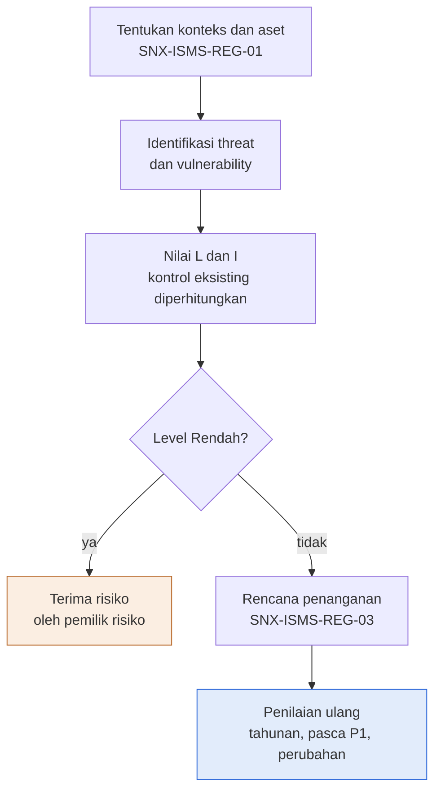

Deskripsi: lima langkah dari penentuan konteks dan aset (merujuk SNX-ISMS-REG-01), identifikasi threat dan vulnerability, penilaian L dan I dengan kontrol eksisting diperhitungkan, lalu keputusan "Level Rendah?". Jawaban "ya" menuju "Terima risiko oleh pemilik risiko" (oranye, tanpa panah lanjutan di gambar); jawaban "tidak" menuju "Rencana penanganan" (SNX-ISMS-REG-03) lalu "Penilaian ulang" (biru, tahunan, pasca P1, perubahan).
Sumber gambar: conv/1skCiIY43Vz6qfT71vEKz55EZFGHVCl4Q/img/image1.png

## 4. Peran, RACI, record, KPI
| Peran | Keterangan |
|---|---|
| ISMS Coordinator | Pemilik dokumen, penyusun; pemilik risiko ISR-011; validator usulan awal |
| ISO/ISMS Coordinator | Pemeriksa dokumen |
| COO (Amirull Yusuf Zulkarnain) | Penyetuju dokumen; pelapor dan penerima risiko Kritis secara tertulis |
| Head of Operation | Pemilik risiko ISR-001, 004, 005, 009, 013, 015; menerima laporan risiko Tinggi |
| Lead NOC | Pemilik risiko ISR-003, 006, 008 |
| Lead SOC | Pemilik risiko ISR-002, 012, 014 |
| Tech dan Product | Pemilik risiko ISR-007 |
| Service Delivery Manager | Pemilik risiko ISR-010 |

Record: Register Risiko (masa simpan: berlaku sampai digantikan). Frekuensi: penilaian ulang minimal tahunan (kolom P otomatis 12 bulan), setelah insiden P1, dan setelah perubahan besar. Tidak ada KPI atau RACI formal; ketentuan eskalasi tercantum pada tabel level di 2.5.

## 5. Catatan kualitas dan celah
- Seluruh 15 risiko berstatus "Usulan awal" (Register Risiko Q5:Q19), belum "Disetujui"; A2 "validasi lalu ubah kolom Catatan menjadi Disetujui" dan Cara pakai B22 "wajib divalidasi ISMS Coordinator dan pemilik risiko".
- Satu-satunya risiko Kritis (ISR-002, G6 5 x H6 4 = 20) menurut Matriks Risiko B24 "dilaporkan ke COO; penerimaan risiko hanya oleh COO secara tertulis". Pemilik risikonya Lead SOC (K6) dan keputusan "Mitigasi" (M6), jadi belum ada penerimaan yang dipersyaratkan; pemilik berbeda dari penerima. Register tidak punya kolom tenggat maupun skor sisa risiko (residual risk); residual ada di SNX-ISMS-REG-03 (kolom L sampai O).
- Tidak ada risiko Rendah (level: 1 Kritis, 10 Tinggi, 4 Sedang, 0 Rendah dari skor G x H) dan tidak ada keputusan selain "Mitigasi" (M5:M19); Hindari, Transfer, Terima ada di dropdown (Daftar B2:B5) tetapi tidak dipakai.
- Kolom G (L, Likelihood) dan H (I, Impact) dinilai dengan "kontrol eksisting diperhitungkan" (gambar, kotak "Nilai L dan I"), tetapi register hanya punya satu pasang L dan I dan satu skor (I); tidak ada skor inheren versus residual.
- Banyak ID aset tidak terhubung ke SNX-ISMS-REG-01: hanya AST-001 (B5), AST-009 (B7), AST-005 (B11), AST-012 (B19) yang dirujuk eksplisit (4 dari 15 risiko), padahal Cara pakai B18 menginstruksikan "(rujuk ID SNX-ISMS-REG-01)". Kelompok lain (Fleet WHM dan cPanel, Backup pelanggan dan internal, Komunikasi pelanggan, dan lain-lain) ditulis sebagai nama kelompok; REG-01 memuat aset yang kemungkinan berpadanan, misalnya AST-007 Acronis untuk "Backup pelanggan dan internal" dan AST-002, AST-003, AST-006 untuk "Notifikasi ticketing system dan monitoring" (inferensi).
- Rujukan ke produk "Zimbra" (D7 ISR-003 "Patch Zimbra terlambat") pada AST-009 (B7 "AST-009 server email"); REG-01 menamai AST-009 "Server email mail.nusagrid.co.id" tanpa menyebut Zimbra. Zimbra disebut di SNX-ISMS-SOP-05 Bagian 5 butir 1 sebagai stack yang dipantau advisory-nya.
- Sheet Matriks Risiko (B23, ketentuan penanganan level Tinggi) menyebut "Rencana mitigasi wajib dengan tenggat; dilaporkan ke Head of Operation dan dinaikkan ke register risiko ISMS"; register risiko ISMS yang terpisah tidak ada di korpus md/isms (inferensi: register ini sendiri berperan sebagai register tersebut).
- Revisi 00 tercatat dua kali pada tanggal sama (Kontrol Dokumen A31 dan A32, "13 Oktober 2026"); pengesahan (tanda tangan, tanggal; C36:D38) kosong; status persetujuan "Menunggu" (E31:E32).

## 6. Kata kunci retrieval
risk assessment, penilaian risiko keamanan informasi, risk register, SNX-ISMS-REG-02, ISR-001 ISR-015, likelihood impact, matriks risiko 5x5, skor risiko, level Kritis Tinggi Sedang Rendah, risk owner, pemilik risiko, kontrol eksisting, Annex A, ISO 27001 6.1.2, 8.2, risk acceptance, penerimaan risiko COO, kebocoran kredensial, webshell, WHM cPanel, Zimbra RCE, restore gagal, backup Acronis, AegisWAF, review akses, grup WhatsApp, AI SaaS, ransomware, kehilangan laptop, key person dependency, penilaian ulang tahunan

<!-- FILE: isms/SNX-ISMS-REG-03.md -->

---
doc_code: SNX-ISMS-REG-03
title: Information Security Risk Treatment Plan
department: Information Security
doc_type: Rencana
source: {drive_file_id: 1NdkQrRWevHXuH9thxmoTPsRIf0wNl-MJ, filename: SNX-ISMS-REG-03_IS_Risk_Treatment_Plan.xlsx, format: xlsx, bytes: 126916, retrieved: 2026-10-13}
revision: 00 (DRAFT)
doc_date: 13 Oktober 2026
classification_in_doc: RESTRICTED (Internal)
owner_in_doc: ISMS Coordinator
approver_in_doc: COO, Amirull Yusuf Zulkarnain
iso_refs: {iso9001: ["6.1"], iso27001: ["6.1.3", "8.3", "Annex A 5.12", "5.14", "5.15", "5.17", "5.18", "5.22", "5.23", "5.26", "5.29", "5.30", "5.37", "6.3", "7.9", "8.1", "8.2", "8.5", "8.7", "8.8", "8.9", "8.13", "8.14", "8.15", "8.16", "8.19", "8.32"]}
kb_sensitivity_suggest: restricted:ops
related_docs: [SNX-ISMS-REG-02, SNX-ISMS-SOA-01, SNX-ISMS-SOP-05, SNX-ISMS-PLN-01, SNX-ISMS-FRM-01, SNX-ISMS-REG-04, SNX-ISMS-PRO-01]
coverage: {sections_or_sheets: "4 dari 4", tables: 7, images: "1 dibuka dari 1", notes: "Area rumus Rencana Penanganan sampai baris 59, hanya 15 baris terisi (RTP-001 sampai RTP-015). Kolom Sumber daya atau biaya, Diterima oleh, Tgl penerimaan, Bukti penyelesaian kosong di semua baris."}
---
# SNX-ISMS-REG-03 Information Security Risk Treatment Plan

## 1. Ringkasan
- Rencana penanganan risiko keamanan informasi (ISO/IEC 27001:2022 klausul 6.1.3 dan 8.3), termasuk risiko residual dan penerimaan oleh pemilik risiko.
- 15 baris RTP (RTP-001 sampai RTP-015), satu per risiko di SNX-ISMS-REG-02 (ISR-001 sampai ISR-015), semua opsi Mitigasi, semua status "Belum mulai".
- Target selesai usulan: 31 Maret 2027 untuk 11 RTP, 30 Juni 2027 untuk 4 RTP (RTP-007, 008, 012, 015).
- Skor residual = L residual x I residual; hasil: Tinggi 2 (RTP-002, 005), Sedang 11, Rendah 2 (RTP-008, 015), total 15; hitung ulang python sama dengan nilai sel.
- Kontrol Annex A yang dipilih di sini menjadi dasar kolom Berlaku pada SoA SNX-ISMS-SOA-01. Residual wajib diterima pemilik risiko secara tertulis (kolom penerimaan masih kosong).
- Target tanggal dan residual adalah usulan, ditetapkan bersama pemilik risiko.

## 2. Isi lengkap terstruktur

### 2.1 Sheet "Kontrol Dokumen"
| Field | Isi |
|---|---|
| Nomor dokumen | SNX-ISMS-REG-03 |
| Judul | Information Security Risk Treatment Plan |
| Revisi | 00 (DRAFT) |
| Tanggal draft | 13 Oktober 2026 |
| Tanggal efektif | Ditetapkan saat pengesahan |
| Klasifikasi | RESTRICTED (Internal) |
| Pemilik dokumen | ISMS Coordinator |
| Disetujui oleh | COO, Amirull Yusuf Zulkarnain |
| Acuan ISO 9001:2015 | Klausul 6.1 |
| Acuan ISO/IEC 27001:2022 | Klausul atau kontrol Annex A 6.1.3, 8.3 |
| Masa simpan record | Berlaku sampai digantikan |
| Tujuan | Rencana penanganan risiko keamanan informasi (klausul 6.1.3 dan 8.3), termasuk risiko residual dan penerimaan oleh pemilik risiko. |

Subjudul: "PT Strategi Integrasi Nusantara (SINUX) · Divisi Operation".

**Cara pakai (teks sumber)**
1. Satu baris per tindakan penanganan; Ref risiko merujuk SNX-ISMS-REG-02.
2. Isi L dan I residual setelah tindakan selesai; level residual dihitung otomatis.
3. Risiko residual harus diterima pemilik risiko secara tertulis (kolom Diterima oleh dan Tanggal penerimaan).
4. Kontrol Annex A yang dipilih di sini menjadi dasar kolom Berlaku pada SoA SNX-ISMS-SOA-01.
5. Usulan awal Divisi Operation dari riwayat operasi di knowledge base SINUX; wajib divalidasi ISMS Coordinator dan pemilik risiko.

Legenda warna: sel input; baris CONTOH (hapus atau timpa saat dipakai); sel rumus (jangan diubah).

**Riwayat revisi**
| Revisi | Tanggal | Uraian perubahan | Disusun | Disetujui |
|---|---|---|---|---|
| 00 | 13 Oktober 2026 | Draft awal untuk sertifikasi ISO 9001 dan ISO/IEC 27001 | Divisi Operation | Menunggu |
| 00 | 13 Oktober 2026 | Review bahasa dan konsistensi: istilah teknologi dalam bahasa Inggris, bahasa Indonesia formal, label klasifikasi, keselarasan RTO dan target pulih | Divisi Operation | Menunggu |

**Pengesahan**
| Peran | Nama dan jabatan | Tanda tangan | Tanggal |
|---|---|---|---|
| Disusun oleh | ISMS Coordinator | (kosong) | (kosong) |
| Diperiksa oleh | ISO/ISMS Coordinator | (kosong) | (kosong) |
| Disetujui oleh | COO, Amirull Yusuf Zulkarnain | (kosong) | (kosong) |

### 2.2 Sheet "Alur Proses"
Judul "Diagram alur proses", legenda warna sama seperti dokumen lain (biru = output akhir, oranye = cabang, putus-putus = kembali). Isi gambar di bagian 3.

### 2.3 Sheet "Daftar" (nilai dropdown)
| Kolom | Nama | Nilai |
|---|---|---|
| A | Opsi | Mitigasi; Hindari; Transfer; Terima |
| B | Status | Belum mulai; Berjalan; Selesai; Tertunda |
| C | Skala | 1; 2; 3; 4; 5 |

Dropdown di sheet Rencana Penanganan: E (Opsi) = Daftar!A2:A5; K (Status) = Daftar!B2:B5; L dan M (L/I residual) = Daftar!C2:C6.

### 2.4 Sheet "Rencana Penanganan"
Rentang A1:R59 (header baris 4; data mulai baris 5; area rumus sampai baris 59). Catatan baris 2: "Target tanggal dan residual adalah usulan; ditetapkan bersama pemilik risiko."

**Kolom**
| Kol | Header | Arti / rumus |
|---|---|---|
| A | ID RTP | RTP-nnn |
| B | Ref risiko | Rujukan ISR-nnn di SNX-ISMS-REG-02 |
| C | Risiko | Threat: aset atau kelompok aset |
| D | Level awal | Level dari REG-02 (nilai ketik, bukan rumus) |
| E | Opsi | Mitigasi / Hindari / Transfer / Terima |
| F | Tindakan atau kontrol | Uraian tindakan |
| G | Kontrol Annex A | Kontrol terpilih (dasar kolom Berlaku di SoA) |
| H | Pemilik | Peran |
| I | Sumber daya atau biaya | (kosong di semua baris) |
| J | Target selesai | Tanggal usulan |
| K | Status | Dropdown |
| L | L residual | 1..5 |
| M | I residual | 1..5 |
| N | Skor residual | `=IF(OR(L="",M=""),"",L*M)` |
| O | Level residual | `=IF(N="","",IF(N>=20,"Kritis",IF(N>=10,"Tinggi",IF(N>=5,"Sedang","Rendah"))))` |
| P | Diterima oleh | (kosong) |
| Q | Tgl penerimaan | (kosong) |
| R | Bukti penyelesaian | (kosong) |

**Data lengkap 15 baris RTP** (Opsi semua "Mitigasi"; Status semua "Belum mulai"; kolom I, P, Q, R kosong)

| ID RTP | Ref risiko | Risiko | Level awal | Tindakan atau kontrol | Annex A | Pemilik | Target selesai | L res | I res | Skor res | Level res |
|---|---|---|---|---|---|---|---|---|---|---|---|
| RTP-001 | ISR-001 | Kebocoran kredensial: AST-001, kredensial tim | Tinggi | Migrasikan seluruh kredensial dari dua sumber ke vault, rotasi kredensial terpapar, hapus sumber lama | 5.17, 8.5 | Head of Operation | 2027-03-31 | 1 | 5 | 5 | Sedang |
| RTP-002 | ISR-002 | Webshell, doorway judi online, backdoor: Fleet WHM dan cPanel pelanggan pemerintah | Kritis | Sweep IOC berkala, hardening akun hosting, WAF ketat, edukasi PIC pelanggan untuk update aplikasi | 8.7, 8.8, 8.16, 5.26 | Lead SOC | 2027-03-31 | 3 | 4 | 12 | Tinggi |
| RTP-003 | ISR-003 | Eksploitasi CVE RCE pre-auth: AST-009 server email | Tinggi | Patch ke versi aman, batasi akses admin, pantau advisory mingguan sesuai SNX-ISMS-SOP-05 | 8.8, 8.19 | Lead NOC | 2027-03-31 | 2 | 4 | 8 | Sedang |
| RTP-004 | ISR-004 | Pemulihan lambat karena personel kunci tidak tersedia: Layanan WAF, proxy, network, DC fisik | Tinggi | Pelatihan silang minimal satu cadangan per keahlian, lengkapi runbook, jadwal on-call | 5.30, 6.3, 5.37 | Head of Operation | 2027-03-31 | 2 | 3 | 6 | Sedang |
| RTP-005 | ISR-005 | Gangguan massal platform atau DC upstream: Layanan pelanggan Nusagrid | Tinggi | Pantau SLA upstream, rencana pemindahan VM kritis, uji BCP tahunan sesuai SNX-ISMS-PLN-01 | 5.22, 5.30, 8.14 | Head of Operation | 2027-03-31 | 2 | 5 | 10 | Tinggi |
| RTP-006 | ISR-006 | Restore gagal saat dibutuhkan: Backup pelanggan dan internal | Tinggi | Jadwalkan uji restore bulanan per pelanggan dan triwulanan untuk sistem internal; catat di SNX-ISMS-FRM-01 | 8.13 | Lead NOC | 2027-03-31 | 1 | 5 | 5 | Sedang |
| RTP-007 | ISR-007 | Kontrol WAF hilang tanpa diketahui: AST-005 AegisWAF | Sedang | Verifikasi ulang konfigurasi setelah setiap Apply; pindahkan perubahan ke template generator | 8.9, 8.32 | Tech dan Product | 2027-06-30 | 2 | 3 | 6 | Sedang |
| RTP-008 | ISR-008 | Alert atau notifikasi tidak sampai ke manusia: Notifikasi ticketing system dan monitoring | Sedang | Uji pengiriman notifikasi ke inbox penerima, alert ganda via kanal kedua | 8.16 | Lead NOC | 2027-06-30 | 1 | 3 | 3 | Rendah |
| RTP-009 | ISR-009 | Akses tidak sah oleh mantan personel atau vendor: Semua sistem dengan akun | Tinggi | Terapkan SNX-ISMS-REG-04 dan review akses privileged triwulanan | 5.15, 5.18, 8.2 | Head of Operation | 2027-03-31 | 1 | 5 | 5 | Sedang |
| RTP-010 | ISR-010 | Kebocoran informasi melalui grup chat: Komunikasi pelanggan | Tinggi | Sosialisasi SNX-ISMS-PRO-01, kredensial hanya melalui vault, audit sampling grup kerja | 5.14, 5.12 | Service Delivery Manager | 2027-03-31 | 2 | 4 | 8 | Sedang |
| RTP-011 | ISR-011 | Kebocoran melalui layanan AI atau SaaS pihak ketiga: Data RESTRICTED internal dan pelanggan | Tinggi | Daftar layanan AI yang disetujui, larangan data SECRET, pelatihan | 5.23, 5.14 | ISMS Coordinator | 2027-03-31 | 2 | 4 | 8 | Sedang |
| RTP-012 | ISR-012 | Investigasi insiden lambat atau tidak tuntas: Edge dan server dikelola | Sedang | Correlation ID edge ke origin, log per host, retensi log minimal 90 hari | 8.15, 8.16 | Lead SOC | 2027-06-30 | 2 | 3 | 6 | Sedang |
| RTP-013 | ISR-013 | Salah tindakan di production oleh tim baru: Operasi 24x7 Nusagrid | Tinggi | Onboarding dan pelatihan runbook, pendampingan shift, go-gate wajib | 6.3, 5.37, 8.32 | Head of Operation | 2027-03-31 | 2 | 4 | 8 | Sedang |
| RTP-014 | ISR-014 | Ransomware: Sistem internal kritis | Tinggi | Backup immutable, EDR di semua server internal, rotasi kredensial, uji restore | 8.7, 8.13, 5.29 | Lead SOC | 2027-03-31 | 1 | 5 | 5 | Sedang |
| RTP-015 | ISR-015 | Kehilangan atau pencurian perangkat: AST-012 laptop kerja | Sedang | Verifikasi disk encryption dan EDR di semua laptop, prosedur pelaporan kehilangan | 8.1, 7.9 | Head of Operation | 2027-06-30 | 1 | 4 | 4 | Rendah |

Baris 20 sampai 59: hanya rumus N dan O (kosong). Tidak ada kredensial atau data pribadi (tidak ada redaksi).

**Perbandingan skor awal (REG-02) dan residual (REG-03), hitung ulang python**
| RTP | Skor awal | Skor residual | Penurunan |
|---|---|---|---|
| RTP-001 | 15 | 5 | 10 |
| RTP-002 | 20 | 12 | 8 |
| RTP-003 | 16 | 8 | 8 |
| RTP-004 | 12 | 6 | 6 |
| RTP-005 | 15 | 10 | 5 |
| RTP-006 | 15 | 5 | 10 |
| RTP-007 | 9 | 6 | 3 |
| RTP-008 | 9 | 3 | 6 |
| RTP-009 | 10 | 5 | 5 |
| RTP-010 | 16 | 8 | 8 |
| RTP-011 | 12 | 8 | 4 |
| RTP-012 | 9 | 6 | 3 |
| RTP-013 | 12 | 8 | 4 |
| RTP-014 | 10 | 5 | 5 |
| RTP-015 | 8 | 4 | 4 |

Agregat python: Level residual Tinggi 2, Sedang 11, Rendah 2 (total 15); Status Belum mulai 15; Target 2027-03-31 sebanyak 11 dan 2027-06-30 sebanyak 4; pemilik Head of Operation 6, Lead SOC 3, Lead NOC 3, Tech dan Product 1, Service Delivery Manager 1, ISMS Coordinator 1. Level awal dan pemilik serta kontrol Annex A semua konsisten dengan REG-02 (15 dari 15).

## 3. Diagram

### 3.1 Alur Information Security Risk Treatment Plan (gambar "Alur Proses")
Judul gambar: "Risiko residual diterima tertulis oleh pemiliknya"; subjudul "Alur Information Security Risk Treatment Plan". Kotak oranye = Tindakan tambahan (cabang); kotak biru = Penerimaan tertulis (output akhir).

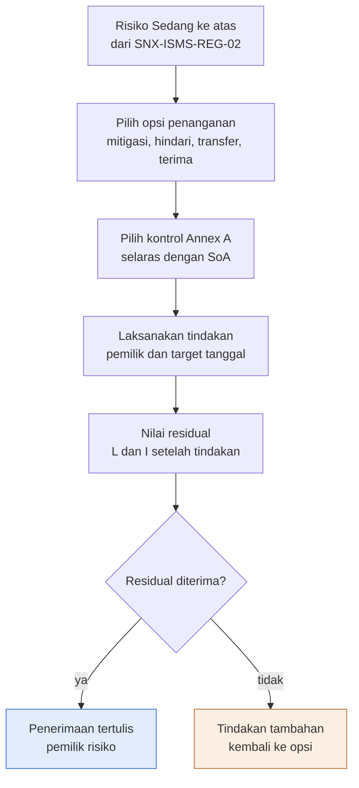

Deskripsi: enam langkah berurutan dari risiko Sedang ke atas (REG-02), pemilihan opsi (mitigasi, hindari, transfer, terima), pemilihan kontrol Annex A selaras SoA, pelaksanaan tindakan dengan pemilik dan target tanggal, penilaian residual L dan I, lalu keputusan "Residual diterima?". "ya" menuju "Penerimaan tertulis oleh pemilik risiko" (biru); "tidak" menuju "Tindakan tambahan, kembali ke opsi" (oranye, panah ke kanan tanpa garis kembali yang digambar).
Sumber gambar: conv/1NdkQrRWevHXuH9thxmoTPsRIf0wNl-MJ/img/image1.png

## 4. Peran, RACI, record, KPI
| Peran | Keterangan |
|---|---|
| ISMS Coordinator | Pemilik dokumen, penyusun; pemilik RTP-011; validator usulan |
| ISO/ISMS Coordinator | Pemeriksa dokumen |
| COO (Amirull Yusuf Zulkarnain) | Penyetuju dokumen |
| Head of Operation | Pemilik RTP-001, 004, 005, 009, 013, 015 |
| Lead SOC | Pemilik RTP-002, 012, 014 |
| Lead NOC | Pemilik RTP-003, 006, 008 |
| Tech dan Product | Pemilik RTP-007 |
| Service Delivery Manager | Pemilik RTP-010 |
| Pemilik risiko (umum) | Menerima risiko residual secara tertulis |

Record: Risk Treatment Plan dan penerimaan risiko residual (masa simpan: berlaku sampai digantikan). Tenggat: 31 Maret 2027 dan 30 Juni 2027 (usulan). Ketentuan frekuensi dalam tindakan: advisory dipantau mingguan (RTP-003), uji restore bulanan per pelanggan dan triwulanan untuk sistem internal (RTP-006), review akses privileged triwulanan (RTP-009), uji BCP tahunan (RTP-005), retensi log minimal 90 hari (RTP-012). Tidak ada KPI formal.

## 5. Catatan kualitas dan celah
- Semua target tanggal dan nilai residual berlabel usulan: Rencana Penanganan A2 "Target tanggal dan residual adalah usulan; ditetapkan bersama pemilik risiko."; Cara pakai B22 "wajib divalidasi ISMS Coordinator dan pemilik risiko". Tidak ada yang final.
- Residual L dan I (L5:M19) sudah terisi walau semua status "Belum mulai" (K5:K19); Cara pakai B19 menyatakan "Isi L dan I residual setelah tindakan selesai" (inferensi: nilai saat ini adalah proyeksi, sesuai label usulan di A2).
- Kolom I "Sumber daya atau biaya", P "Diterima oleh", Q "Tgl penerimaan", dan R "Bukti penyelesaian" kosong pada 15 baris; Cara pakai B20 mensyaratkan penerimaan residual secara tertulis, sehingga penerimaan tertulis belum ada.
- RTP-002 (D6 awal "Kritis", residual 3 x 4 = 12, Tinggi) dan RTP-005 (residual 2 x 5 = 10, Tinggi) adalah satu-satunya dua residual berlevel Tinggi (13 lainnya Sedang atau Rendah). Menurut SNX-ISMS-REG-02 (Matriks Risiko B23) level Tinggi mewajibkan "Rencana mitigasi wajib dengan tenggat; dilaporkan ke Head of Operation", tetapi di REG-03 tidak ada baris rencana lanjutan untuk menurunkan residual ini, dan penerimaan tertulis (kolom P dan Q) belum diisi; ketentuan "penerimaan risiko hanya oleh COO secara tertulis" (REG-02 B24) berlaku untuk level Kritis, dan apakah berlaku pada risiko awal Kritis ISR-002 yang residualnya Tinggi tidak dinyatakan (inferensi).
- Seluruh 15 risiko memakai opsi "Mitigasi" (E5:E19); Hindari, Transfer, dan Terima (Daftar A3:A5) tidak dipakai.
- Rujukan dokumen lain: SNX-ISMS-SOP-05 (RTP-003, F7 "pantau advisory mingguan sesuai SNX-ISMS-SOP-05"), SNX-ISMS-PLN-01 (RTP-005, F9 "uji BCP tahunan sesuai SNX-ISMS-PLN-01"), SNX-ISMS-FRM-01 (RTP-006, F10), SNX-ISMS-REG-04 (RTP-009, F13), SNX-ISMS-PRO-01 (RTP-010, F14). Kelimanya ada di md/isms dan isinya sejalan: SOP-05 Bagian 5 "Lead SOC menelaah sumber tersebut minimal mingguan", PLN-01 Bagian 10 (Tabletop dan uji pemulihan teknis "Tahunan"), SOP-02 Bagian 7.6 (privileged triwulanan). Kode "PRO-01" memakai awalan PRO, sedangkan dokumen ISMS lain memakai SOP, FRM, REG, PLN, SOA; master list SNX-OPS-ML-00 mencatat jenis PRO-01 sebagai "Prosedur" (jenis berbeda dari "SOP"), jadi awalan itu mengikuti jenis dokumen.
- Pengesahan (tanda tangan, tanggal; Kontrol Dokumen C36:D38) kosong; status persetujuan "Menunggu" (E31:E32); revisi 00 tercatat dua kali (A31 dan A32, "13 Oktober 2026").
- Judul kolom C "Risiko" menggabungkan threat dan aset (format "Threat: aset", misalnya C5 "Kebocoran kredensial: AST-001, kredensial tim"); header A4:R4 tidak punya kolom vulnerability (vulnerability ada di SNX-ISMS-REG-02 kolom D).

## 6. Kata kunci retrieval
risk treatment plan, rencana penanganan risiko, RTP-001 RTP-015, SNX-ISMS-REG-03, risiko residual, penerimaan risiko tertulis, mitigasi hindari transfer terima, ISO 27001 6.1.3, 8.3, Annex A, SoA, target selesai, pemilik risiko, migrasi vault kredensial, sweep IOC, patch Zimbra, uji restore bulanan, BCP tahunan, review akses privileged triwulanan, EDR, backup immutable, disk encryption, correlation ID, retensi log 90 hari, go-gate production

<!-- FILE: isms/SNX-ISMS-REG-04.md -->

---
doc_code: SNX-ISMS-REG-04
title: User Access Register & Periodic Access Review
department: Information Security
doc_type: Register
source: {drive_file_id: 14JtND6eqCuvufrVoPDzKJyrHp4eQsGjT, filename: SNX-ISMS-REG-04_User_Access_Register_Periodic_Review.xlsx, format: xlsx, bytes: 159140, retrieved: 2026-10-13}
revision: 00 (DRAFT)
doc_date: 13 Oktober 2026
classification_in_doc: RESTRICTED (Internal)
owner_in_doc: Head of Operation
approver_in_doc: COO, Amirull Yusuf Zulkarnain
iso_refs: {iso9001: ["7.1.3"], iso27001: ["Annex A 5.15", "Annex A 5.18", "Annex A 8.2"]}
kb_sensitivity_suggest: restricted:ops
related_docs: [SNX-ISMS-SOP-02, SNX-ISMS-REG-02, SNX-ISMS-REG-03]
coverage: {sections_or_sheets: "6 dari 6", tables: 8, images: "1 dibuka dari 1", notes: "Register Akses (area sampai baris 256) hanya berisi 2 baris CONTOH berisi placeholder; Review Periodik (area sampai baris 205) hanya 1 baris isian (berwarna biru muda seperti baris CONTOH tetapi tidak berlabel CONTOH; status contoh adalah inferensi). Tidak ada akun nyata, hostname, IP, atau kredensial di berkas ini."}
---
# SNX-ISMS-REG-04 User Access Register & Periodic Access Review

## 1. Ringkasan
- Register hak akses pengguna ke sistem internal dan sistem pelanggan, serta catatan review akses periodik sesuai SNX-ISMS-SOP-02; satu baris per akun per sistem.
- Aturan review otomatis: akun privileged (level Admin atau Privileged) ditinjau triwulanan (3 bulan), akses biasa semesteran (6 bulan); tindak lanjut hasil review maksimal 10 hari kerja.
- Kolom Cek otomatis: CABUT (personel Keluar tetapi akun masih Aktif), KEDALUWARSA (tanggal Berlaku sampai lewat dan akun Aktif), REVIEW (tanggal review berikutnya lewat dan akun Aktif), selain itu OK.
- Isi saat ini hanya 2 baris CONTOH (ACC-0001 Jumphost Operator, ACC-0002 SIEM Wazuh Admin vendor/partner) dengan nama dan tiket berupa placeholder, dan 1 baris review contoh (2026-Q4).
- Ringkasan akses: akun aktif 2, privileged aktif 1, tanpa MFA 0, CABUT 0, KEDALUWARSA 0, REVIEW 0, temuan review terbuka 0.
- Masa simpan record 3 tahun; larangan keras menulis password atau token di berkas ini.

## 2. Isi lengkap terstruktur

### 2.1 Sheet "Kontrol Dokumen"
| Field | Isi |
|---|---|
| Nomor dokumen | SNX-ISMS-REG-04 |
| Judul | User Access Register & Periodic Access Review |
| Revisi | 00 (DRAFT) |
| Tanggal draft | 13 Oktober 2026 |
| Tanggal efektif | Ditetapkan saat pengesahan |
| Klasifikasi | RESTRICTED (Internal) |
| Pemilik dokumen | Head of Operation |
| Disetujui oleh | COO, Amirull Yusuf Zulkarnain |
| Acuan ISO 9001:2015 | Klausul 7.1.3 |
| Acuan ISO/IEC 27001:2022 | Klausul atau kontrol Annex A 5.15, 5.18, 8.2 |
| Masa simpan record | 3 tahun |
| Tujuan | Register hak akses pengguna ke sistem internal dan sistem pelanggan, serta catatan review akses periodik sesuai SNX-ISMS-SOP-02. |

Subjudul: "PT Strategi Integrasi Nusantara (SINUX) · Divisi Operation".

**Cara pakai (teks sumber)**
1. Satu baris per akun per sistem. Jangan pernah menulis password atau token di file ini.
2. Kolom Privileged, Review berikutnya, dan Cek dihitung otomatis: privileged ditinjau triwulanan, akses biasa semesteran.
3. Cek = CABUT bila personel berstatus Keluar tetapi akun masih Aktif; Cek = REVIEW bila review terlambat.
4. Hasil review periodik dicatat di sheet Review Periodik; tindak lanjut maksimal 10 hari kerja.

Legenda warna: sel input; baris CONTOH (hapus atau timpa saat dipakai); sel rumus (jangan diubah).

**Riwayat revisi**
| Revisi | Tanggal | Uraian perubahan | Disusun | Disetujui |
|---|---|---|---|---|
| 00 | 13 Oktober 2026 | Draft awal untuk sertifikasi ISO 9001 dan ISO/IEC 27001 | Divisi Operation | Menunggu |
| 00 | 13 Oktober 2026 | Review bahasa dan konsistensi: istilah teknologi dalam bahasa Inggris, bahasa Indonesia formal, label klasifikasi, keselarasan RTO dan target pulih | Divisi Operation | Menunggu |

**Pengesahan**
| Peran | Nama dan jabatan | Tanda tangan | Tanggal |
|---|---|---|---|
| Disusun oleh | Head of Operation | (kosong) | (kosong) |
| Diperiksa oleh | ISO/ISMS Coordinator | (kosong) | (kosong) |
| Disetujui oleh | COO, Amirull Yusuf Zulkarnain | (kosong) | (kosong) |

### 2.2 Sheet "Alur Proses"
Judul "Diagram alur proses" dan legenda warna (biru = output akhir, oranye = cabang, putus-putus = kembali). Isi gambar di bagian 3.

### 2.3 Sheet "Daftar" (nilai dropdown)
| Kolom | Nama | Nilai |
|---|---|---|
| A | Status personel | Aktif; Mutasi; Keluar; Vendor atau partner |
| B | Level | Read-only; Operator; Admin; Privileged |
| C | MFA | Ya; Tidak; Tidak didukung |
| D | Status akun | Aktif; Dinonaktifkan; Dicabut |
| E | Keputusan | Tetap; Ubah; Cabut |

Dropdown: Register Akses D = Daftar!A2:A5 (Status personel); G = Daftar!B2:B5 (Level akses); I = Daftar!C2:C4 (MFA); O = Daftar!D2:D4 (Status akun). Review Periodik G (Keputusan) = Daftar!E2:E4.

### 2.4 Sheet "Register Akses"
Rentang A1:S256 (header baris 4, data mulai baris 5, area rumus sampai baris 256 = 252 baris). Catatan baris 2: "Baris biru muda = CONTOH. Kolom abu-abu dihitung otomatis."

**Kolom**
| Kol | Header | Arti / rumus |
|---|---|---|
| A | ID | ACC-nnnn |
| B | Nama pengguna | Nama atau placeholder |
| C | Peran | Peran pekerjaan |
| D | Status personel | Dropdown |
| E | Sistem | Sistem yang diakses |
| F | Pelanggan | Internal atau nama pelanggan |
| G | Level akses | Dropdown |
| H | Privileged | `=IF(G="","",IF(OR(G="Admin",G="Privileged"),"Ya","Tidak"))` |
| I | MFA | Dropdown |
| J | Ref tiket | Rujukan tiket permintaan akses |
| K | Disetujui oleh | Penyetuju akses |
| L | Tgl diberikan | Tanggal |
| M | Berlaku sampai | Tanggal kedaluwarsa akses |
| N | Tgl dicabut | Tanggal |
| O | Status akun | Dropdown |
| P | Review terakhir | Tanggal |
| Q | Review berikutnya | `=IF(P="","",EDATE(P,IF(H="Ya",3,6)))`: +3 bulan bila privileged, +6 bulan bila tidak |
| R | Cek | `=IF(A="","",IF(AND(D="Keluar",O="Aktif"),"CABUT",IF(AND(M<>"",M<TODAY(),O="Aktif"),"KEDALUWARSA",IF(AND(Q<>"",Q<TODAY(),O="Aktif"),"REVIEW","OK"))))`, urutan prioritas CABUT, KEDALUWARSA, REVIEW, OK |
| S | Catatan | Teks bebas |

**Data terisi (2 baris, keduanya CONTOH)**
| ID | Nama pengguna | Peran | Status personel | Sistem | Pelanggan | Level | Privileged | MFA | Ref tiket | Disetujui oleh | Tgl diberikan | Berlaku sampai | Tgl dicabut | Status akun | Review terakhir | Review berikutnya | Cek | Catatan |
|---|---|---|---|---|---|---|---|---|---|---|---|---|---|---|---|---|---|---|
| ACC-0001 | [nama personel] | NOC Engineer | Aktif | Jumphost | Internal | Operator | Tidak | Ya | [no tiket] | Head of Operation | 2026-10-01 | (kosong) | (kosong) | Aktif | 2026-10-01 | 2027-04-01 | OK | CONTOH |
| ACC-0002 | [nama vendor] | Partner SOC | Vendor atau partner | SIEM Wazuh [pelanggan] | [pelanggan] | Admin | Ya | Ya | [no tiket] | Head of Operation | 2026-09-01 | 2027-08-31 | (kosong) | Aktif | 2026-09-01 | 2026-12-01 | OK | CONTOH |

Catatan: Nilai Cek tersimpan "OK" dihitung berdasarkan TODAY() saat berkas terakhir dihitung; nilai ini bergantung tanggal buka berkas (ACC-0002 Review berikutnya 2026-12-01 akan menjadi REVIEW setelah tanggal tersebut bila belum direview). Baris 7 sampai 256 hanya rumus H, Q, R (kosong). Tidak ada IP, hostname, password, atau token (tidak ada redaksi).

### 2.5 Sheet "Review Periodik"
Rentang A1:L205 (header baris 4, area sampai baris 205 = 201 baris). Tujuan: catatan review akses periodik, satu baris per akun yang ditinjau; setelah review, kolom Review terakhir di Register Akses diperbarui.

**Kolom**
| Kol | Header | Arti / rumus |
|---|---|---|
| A | Periode review | mis. 2026-Q4 |
| B | Sistem | Sistem ditinjau |
| C | ID akun | Rujukan ACC-nnnn |
| D | Nama pengguna | Nama |
| E | Level akses | Level |
| F | Reviewer (pemilik sistem) | Peran reviewer |
| G | Keputusan | Dropdown Tetap/Ubah/Cabut |
| H | Alasan | Teks |
| I | Tgl review | Tanggal |
| J | Tindak lanjut selesai | Tanggal |
| K | Pelaksana tindak lanjut | Peran |
| L | Status | `=IF(G="","",IF(G="Tetap","Selesai",IF(J="","Terbuka","Selesai")))`: Tetap otomatis Selesai; Ubah atau Cabut Terbuka sampai tanggal tindak lanjut diisi |

**Data terisi (1 baris)**
| Periode | Sistem | ID akun | Nama | Level | Reviewer | Keputusan | Alasan | Tgl review | Tindak lanjut selesai | Pelaksana | Status |
|---|---|---|---|---|---|---|---|---|---|---|---|
| 2026-Q4 | Jumphost | ACC-0001 | [nama personel] | Operator | Head of Operation | Tetap | Sesuai peran | 2026-12-15 | (kosong) | (kosong) | Selesai |

### 2.6 Sheet "Ringkasan"
| Indikator | Rumus | Nilai tersimpan | Hitung ulang python |
|---|---|---|---|
| Akun aktif | COUNTIF Status akun = "Aktif" | 2 | 2 |
| Akun privileged aktif | COUNTIFS Privileged = "Ya" dan Status akun = "Aktif" | 1 | 1 |
| Akun aktif tanpa MFA | COUNTIFS MFA = "Tidak" dan Status akun = "Aktif" | 0 | 0 |
| Harus dicabut (personel keluar) | COUNTIF Cek = "CABUT" | 0 | 0 |
| Kedaluwarsa masih aktif | COUNTIF Cek = "KEDALUWARSA" | 0 | 0 |
| Review terlambat | COUNTIF Cek = "REVIEW" | 0 | 0 |
| Temuan review terbuka | COUNTIF Review Periodik Status = "Terbuka" | 0 | 0 |

Selisih sheet vs hitung ulang: 0 (ringkasan konsisten dengan 2 baris contoh).

## 3. Diagram

### 3.1 Alur pengisian User Access Register & Periodic Review (gambar "Alur Proses")
Judul gambar: "Register akses memberi peringatan otomatis untuk dicabut atau direview"; subjudul "Alur pengisian User Access Register & Periodic Review". Kotak oranye = Tindak lanjut (cabang); kotak biru = Perbarui review terakhir (output akhir); garis putus-putus = kembali ke alur utama.

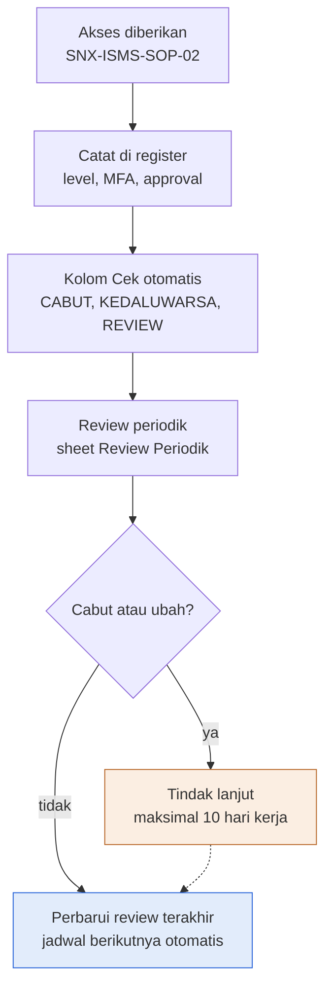

Deskripsi: akses diberikan sesuai SNX-ISMS-SOP-02, dicatat di register (level, MFA, approval), kolom Cek memberi tanda otomatis CABUT, KEDALUWARSA, REVIEW, lalu review periodik di sheet Review Periodik. Pada keputusan "Cabut atau ubah?", "ya" menuju Tindak lanjut maksimal 10 hari kerja (oranye) yang kembali ke alur utama lewat garis putus-putus; "tidak" langsung ke "Perbarui review terakhir" (biru) dengan jadwal berikutnya otomatis.
Sumber gambar: conv/14JtND6eqCuvufrVoPDzKJyrHp4eQsGjT/img/image1.png

## 4. Peran, RACI, record, KPI
| Peran | Keterangan |
|---|---|
| Head of Operation | Pemilik dokumen, penyusun; penyetuju akses contoh; reviewer (pemilik sistem) pada contoh review |
| ISO/ISMS Coordinator | Pemeriksa dokumen |
| COO (Amirull Yusuf Zulkarnain) | Penyetuju dokumen |
| Pemilik sistem | Reviewer pada sheet Review Periodik |
| Pelaksana tindak lanjut | Menyelesaikan keputusan Ubah atau Cabut dalam maksimal 10 hari kerja |

Record: Register Akses dan Review Periodik, masa simpan 3 tahun. Frekuensi: review privileged triwulanan (3 bulan), akses biasa semesteran (6 bulan); tindak lanjut maksimal 10 hari kerja. Indikator pada Ringkasan: akun aktif, privileged aktif, tanpa MFA, harus dicabut, kedaluwarsa masih aktif, review terlambat, temuan review terbuka.

## 5. Catatan kualitas dan celah
- Register Akses hanya memuat 2 baris CONTOH (S5:S6 "CONTOH"; A2 "Baris biru muda = CONTOH.") berisi placeholder "[nama personel]" (B5), "[nama vendor]" (B6), "[no tiket]" (J5:J6), "[pelanggan]" (F6); belum ada akun nyata, sehingga ISR-009 ("Akses tidak sah oleh mantan personel atau vendor", SNX-ISMS-REG-02 Register Risiko C13, mitigasi RTP-009 "Terapkan SNX-ISMS-REG-04") belum punya bukti register terisi.
- Baris review contoh (Review Periodik A5 "2026-Q4", I5 Tgl review 2026-12-15) bertanggal setelah tanggal draft (Kontrol Dokumen B7 "13 Oktober 2026"); baris itu berwarna biru muda sama seperti baris CONTOH tetapi sheet ini tidak berlabel "CONTOH", sehingga statusnya sebagai nilai contoh adalah inferensi. Ditambahkan pada audit ulang: Register Akses P5 (Review terakhir ACC-0001) masih 2026-10-01 padahal Review Periodik mencatat review ACC-0001 tanggal 2026-12-15, dan A2 sheet Review Periodik menyatakan "perbarui kolom Review terakhir di Register Akses".
- Review terakhir ACC-0002 2026-09-01 (P6) sebelum tanggal draft; Review berikutnya 2026-12-01 (Q6, rumus EDATE 3 bulan karena Admin = privileged), sedangkan baris review contoh hanya untuk ACC-0001 (Review Periodik C5).
- Masa simpan record 3 tahun (Kontrol Dokumen B14; SNX-ISMS-SOP-02 Bagian 8 "3 tahun") berbeda dengan SNX-ISMS-REG-01, REG-02, REG-03 dan SOA-01 yang memakai "Berlaku sampai digantikan"; sama dengan FRM-01 (3 tahun).
- Kolom R (Cek) hanya mengevaluasi akun berstatus "Aktif" (O): CABUT bila D = "Keluar" dan O = "Aktif", KEDALUWARSA dan REVIEW juga bersyarat O = "Aktif"; akun "Dinonaktifkan" atau "Dicabut" tidak diperiksa dan menghasilkan "OK". Rumus memakai TODAY(), sehingga nilai tersimpan dapat berbeda saat dibuka. Cara pakai B20 hanya menjelaskan CABUT dan REVIEW; KEDALUWARSA ada di rumus tetapi tidak di Cara pakai.
- Nilai Level "Privileged" ada di dropdown (Daftar B5) dan kolom H (Privileged) dihitung dengan istilah sama: `=IF(G5="","",IF(OR(G5="Admin",G5="Privileged"),"Ya","Tidak"))`; Admin dan Privileged keduanya dianggap privileged, Operator dan Read-only tidak. Dropdown Level (Read-only, Operator, Admin, Privileged) tidak memuat nilai matriks SNX-ISMS-SOP-02 Bagian 6 seperti "Agent", "Group admin", "Analyst", dan "Collection" (ditambahkan pada audit ulang).
- SNX-ISMS-SOP-02 dirujuk (Tujuan B15 "sesuai SNX-ISMS-SOP-02") dan ada di md/isms; SOP-02 Bagian 7.6 butir 2 menyebut "sheet Periodic Review pada SNX-ISMS-REG-04", sedangkan sheet di REG-04 bernama "Review Periodik" (Cara pakai B21 juga "sheet Review Periodik"); SOP-02 Bagian 6 menyatakan matriks akses detail ditetapkan di REG-04, tetapi REG-04 hanya register per akun tanpa matriks per sistem dan peran.
- Pengesahan kosong (Kontrol Dokumen C35:D37); status persetujuan "Menunggu" (E30:E31); revisi 00 tercatat dua kali (A30 dan A31, "13 Oktober 2026").

## 6. Kata kunci retrieval
user access register, register akses pengguna, periodic access review, review akses periodik, SNX-ISMS-REG-04, SNX-ISMS-SOP-02, privileged access, review triwulanan, review semesteran, MFA, jumphost, SIEM Wazuh, vendor access, partner SOC, CABUT, KEDALUWARSA, REVIEW, joiner mover leaver, offboarding, pencabutan akses, Annex A 5.15, 5.18, 8.2, access control, tindak lanjut 10 hari kerja

<!-- FILE: isms/SNX-ISMS-SOA-01.md -->

---
doc_code: SNX-ISMS-SOA-01
title: Statement of Applicability (SoA)
department: Information Security
doc_type: Register
source: {drive_file_id: 1g9Yiuv6EDJP2ikgAbpcnRVE0ZVFkLWG2, filename: SNX-ISMS-SOA-01_Statement_of_Applicability.xlsx, format: xlsx, bytes: 121372, retrieved: 2026-10-13}
revision: 00 (DRAFT)
doc_date: 13 Oktober 2026
classification_in_doc: RESTRICTED (Internal)
owner_in_doc: ISMS Coordinator
approver_in_doc: COO, Amirull Yusuf Zulkarnain
iso_refs: {iso9001: [], iso27001: ["6.1.3 d", "Annex A 5.1 sampai 8.34 (93 kontrol)"]}
kb_sensitivity_suggest: restricted:ops
related_docs: [SNX-ISMS-REG-03, SNX-ISMS-REG-01, SNX-ISMS-REG-02, SNX-ISMS-REG-04, SNX-ISMS-FRM-01, SNX-ISMS-FRM-02, SNX-ISMS-FRM-03, SNX-ISMS-SOP-01, SNX-ISMS-SOP-02, SNX-ISMS-SOP-03, SNX-ISMS-SOP-04, SNX-ISMS-SOP-05, SNX-ISMS-PRO-01, SNX-ISMS-PLN-01, SNX-OPS-SOP-01, SNX-OPS-SOP-02, SNX-OPS-SOP-03, SNX-OPS-SOP-04, SNX-OPS-SOP-05, SNX-OPS-FRM-01, SNX-OPS-FRM-02, SNX-OPS-FRM-04, SNX-OPS-FRM-05, SNX-OPS-FRM-07, SNX-OPS-FRM-10, SNX-OPS-PRC-01, SNX-OPS-ML-00]
coverage: {sections_or_sheets: "5 dari 5", tables: 8, images: "1 dibuka dari 1", notes: "Seluruh 93 kontrol Annex A 2022 dicatat. Kolom Berlaku (final), Alasan dikecualikan kosong di 93 baris; Alasan dimasukkan dan Status implementasi kosong untuk 45 kontrol Perlu keputusan. Sel Acuan ISO 27001 di Kontrol Dokumen berbunyi \"6.1.3 d\" (klausul 6.1.3 butir d, kewajiban menyusun SoA; tidak terpotong)."}
---
# SNX-ISMS-SOA-01 Statement of Applicability (SoA)

## 1. Ringkasan
- SoA memuat 93 kontrol ISO/IEC 27001:2022 Annex A (Organizational 37, People 8, Physical 14, Technological 34) dengan status berlaku, justifikasi, status implementasi, dan rujukan bukti.
- Usulan Divisi Operation: 48 kontrol "Ya" (punya bukti di paket dokumen Operation) dan 45 kontrol "Perlu keputusan" ISMS Coordinator.
- Kolom "Berlaku (final)" kosong di semua 93 kontrol (keputusan final belum diambil); tidak ada kontrol yang dinyatakan "Tidak" (dikecualikan).
- Status implementasi: 48 kontrol "Sebagian", 0 "Diterapkan", 0 "Belum", 0 "Direncanakan"; 45 kontrol lain kosong. Hitung ulang python sama dengan sheet Ringkasan, selisih 0 pada semua sel.
- Alasan dimasukkan (48 kontrol Ya): Risiko 24, Best practice 24; tidak ada alasan Kontrak atau Regulasi yang dipakai.
- Satu inkonsistensi dengan SNX-ISMS-REG-03: kontrol 6.3 dipilih di RTP-004 dan RTP-013, tetapi di SoA masih "Perlu keputusan" (cara pakai butir 5 mewajibkan Berlaku = Ya).

## 2. Isi lengkap terstruktur

### 2.1 Sheet "Kontrol Dokumen"
| Field | Isi |
|---|---|
| Nomor dokumen | SNX-ISMS-SOA-01 |
| Judul | Statement of Applicability (SoA) |
| Revisi | 00 (DRAFT) |
| Tanggal draft | 13 Oktober 2026 |
| Tanggal efektif | Ditetapkan saat pengesahan |
| Klasifikasi | RESTRICTED (Internal) |
| Pemilik dokumen | ISMS Coordinator |
| Disetujui oleh | COO, Amirull Yusuf Zulkarnain |
| Acuan ISO 9001:2015 | Klausul - (tidak ada) |
| Acuan ISO/IEC 27001:2022 | Klausul atau kontrol Annex A 6.1.3 d |
| Masa simpan record | Berlaku sampai digantikan |
| Tujuan | Statement of Applicability: 93 kontrol ISO/IEC 27001:2022 Annex A dengan status berlaku, justifikasi, status implementasi, dan rujukan bukti. |

Subjudul: "PT Strategi Integrasi Nusantara (SINUX) · Divisi Operation".

**Cara pakai (teks sumber)**
1. Dokumen ini disusun secara teknis oleh Divisi Operation bersama ISO/ISMS Coordinator; keputusan akhir dan pengesahan oleh ISMS Coordinator dan manajemen.
2. Kolom Usulan Ops terisi untuk kontrol yang punya bukti di paket dokumen Operation; kontrol lain bertanda Perlu keputusan ISMS Coordinator.
3. Untuk setiap kontrol, tetapkan Berlaku (Ya atau Tidak), alasan dimasukkan (risiko, kontrak, regulasi, praktik baik), atau alasan dikecualikan.
4. Status implementasi: Belum, Direncanakan, Sebagian, Diterapkan. Ringkasan dihitung otomatis.
5. SoA harus konsisten dengan SNX-ISMS-REG-03: kontrol yang dipilih dalam rencana penanganan wajib Berlaku = Ya.

Legenda warna: sel input; baris CONTOH (hapus atau timpa saat dipakai); sel rumus (jangan diubah).

**Riwayat revisi**
| Revisi | Tanggal | Uraian perubahan | Disusun | Disetujui |
|---|---|---|---|---|
| 00 | 13 Oktober 2026 | Draft awal untuk sertifikasi ISO 9001 dan ISO/IEC 27001 | Divisi Operation | Menunggu |
| 00 | 13 Oktober 2026 | Review bahasa dan konsistensi: istilah teknologi dalam bahasa Inggris, bahasa Indonesia formal, label klasifikasi, keselarasan RTO dan target pulih | Divisi Operation | Menunggu |

**Pengesahan**
| Peran | Nama dan jabatan | Tanda tangan | Tanggal |
|---|---|---|---|
| Disusun oleh | ISMS Coordinator | (kosong) | (kosong) |
| Diperiksa oleh | ISO/ISMS Coordinator | (kosong) | (kosong) |
| Disetujui oleh | COO, Amirull Yusuf Zulkarnain | (kosong) | (kosong) |

### 2.2 Sheet "Alur Proses"
Judul "Diagram alur proses" dan legenda warna (biru = output akhir, oranye = cabang, putus-putus = kembali). Isi gambar di bagian 3.

### 2.3 Sheet "Daftar" (nilai dropdown)
| Kolom | Nama | Nilai |
|---|---|---|
| A | YaTidak | Ya; Tidak |
| B | Impl | Belum; Direncanakan; Sebagian; Diterapkan |
| C | Alasan | Risiko; Kontrak; Regulasi; Best practice; Risiko dan kontrak |

Dropdown di sheet SoA: E (Berlaku final) = Daftar!A2:A3; F (Alasan dimasukkan) = Daftar!C2:C6; H (Status implementasi) = Daftar!B2:B5.

### 2.4 Sheet "SoA": tabel lengkap 93 kontrol Annex A 2022
Rentang A1:L97 (header baris 4, data baris 5 sampai 97 = 93 kontrol). Catatan baris 2: "Usulan Ops = usulan teknis Divisi Operation. Kolom Berlaku (final) diisi ISMS Coordinator."

**Kolom sheet (12)**: Kontrol; Judul kontrol; Tema; Usulan Ops (Ya atau Perlu keputusan); Berlaku (final) (Ya/Tidak, dropdown); Alasan dimasukkan (dropdown); Alasan dikecualikan; Status implementasi (dropdown); Dokumen atau bukti; Risiko terkait; Pemilik kontrol; Catatan. Tidak ada rumus pada sheet SoA; rumus hanya di sheet Ringkasan.

**Kolom kosong di seluruh 93 baris** (tidak dimasukkan ke tabel agar ringkas, bukan karena hilang): Berlaku (final) (E), Alasan dikecualikan (G). Artinya keputusan Berlaku final belum diambil untuk satu pun kontrol dan tidak ada pengecualian yang dibenarkan.

**Kode catatan (kolom L)**: C1 = "Dokumen draft rev 00; implementasi diverifikasi saat audit internal" (48 kontrol, semua usulan Ya). C2 = "Di luar paket dokumen Operation" (45 kontrol, semua Perlu keputusan). Untuk kontrol Perlu keputusan, kolom Dokumen atau bukti dan Risiko terkait berisi "-" (kecuali 6.3 yang memuat Risiko terkait ISR-004, ISR-013).

| No | Nama kontrol | Tema | Berlaku (usulan Ops) | Alasan dimasukkan | Status implementasi | Dokumen atau bukti | Risiko terkait | Pemilik kontrol | Catatan |
|---|---|---|---|---|---|---|---|---|---|
| 5.1 | Policies for information security | Organizational | Perlu keputusan | (kosong) | (kosong) | - | - | ISMS Coordinator | C2 |
| 5.2 | Information security roles and responsibilities | Organizational | Perlu keputusan | (kosong) | (kosong) | - | - | ISMS Coordinator | C2 |
| 5.3 | Segregation of duties | Organizational | Perlu keputusan | (kosong) | (kosong) | - | - | ISMS Coordinator | C2 |
| 5.4 | Management responsibilities | Organizational | Perlu keputusan | (kosong) | (kosong) | - | - | ISMS Coordinator | C2 |
| 5.5 | Contact with authorities | Organizational | Perlu keputusan | (kosong) | (kosong) | - | - | ISMS Coordinator | C2 |
| 5.6 | Contact with special interest groups | Organizational | Perlu keputusan | (kosong) | (kosong) | - | - | ISMS Coordinator | C2 |
| 5.7 | Threat intelligence | Organizational | Ya | Best practice | Sebagian | SNX-ISMS-SOP-05 | - | Lead SOC | C1 |
| 5.8 | Information security in project management | Organizational | Ya | Best practice | Sebagian | SNX-OPS-SOP-01, SNX-OPS-FRM-01, SNX-OPS-FRM-02 | - | Service Delivery Manager | C1 |
| 5.9 | Inventory of information and other associated assets | Organizational | Ya | Best practice | Sebagian | SNX-ISMS-REG-01, SNX-ISMS-SOP-04 | - | Head of Operation | C1 |
| 5.10 | Acceptable use of information and other associated assets | Organizational | Ya | Best practice | Sebagian | SNX-ISMS-SOP-04 | - | Head of Operation | C1 |
| 5.11 | Return of assets | Organizational | Ya | Best practice | Sebagian | SNX-ISMS-SOP-04, SNX-ISMS-SOP-02 | - | Head of Operation | C1 |
| 5.12 | Classification of information | Organizational | Ya | Risiko | Sebagian | SNX-ISMS-PRO-01 | ISR-010 | ISMS Coordinator | C1 |
| 5.13 | Labelling of information | Organizational | Ya | Best practice | Sebagian | SNX-ISMS-PRO-01 | - | ISMS Coordinator | C1 |
| 5.14 | Information transfer | Organizational | Ya | Risiko | Sebagian | SNX-ISMS-PRO-01 | ISR-010, ISR-011 | ISMS Coordinator | C1 |
| 5.15 | Access control | Organizational | Ya | Risiko | Sebagian | SNX-ISMS-SOP-02, SNX-ISMS-REG-04 | ISR-009 | Head of Operation | C1 |
| 5.16 | Identity management | Organizational | Ya | Best practice | Sebagian | SNX-ISMS-SOP-02, SNX-ISMS-REG-04 | - | Head of Operation | C1 |
| 5.17 | Authentication information | Organizational | Ya | Risiko | Sebagian | SNX-ISMS-SOP-02 | ISR-001 | Head of Operation | C1 |
| 5.18 | Access rights | Organizational | Ya | Risiko | Sebagian | SNX-ISMS-SOP-02, SNX-ISMS-REG-04 | ISR-009 | Head of Operation | C1 |
| 5.19 | Information security in supplier relationships | Organizational | Ya | Best practice | Sebagian | SNX-ISMS-FRM-03 | - | Head of Operation | C1 |
| 5.20 | Addressing information security within supplier agreements | Organizational | Ya | Best practice | Sebagian | SNX-ISMS-FRM-03 (bersama Commercial dan Legal) | - | Head of Operation | C1 |
| 5.21 | Managing information security in the ICT supply chain | Organizational | Ya | Best practice | Sebagian | SNX-ISMS-FRM-03 | - | Head of Operation | C1 |
| 5.22 | Monitoring, review and change management of supplier services | Organizational | Ya | Risiko | Sebagian | SNX-ISMS-FRM-03, SNX-OPS-SOP-05 | ISR-005 | Service Delivery Manager | C1 |
| 5.23 | Information security for use of cloud services | Organizational | Ya | Risiko | Sebagian | SNX-ISMS-FRM-03, SNX-ISMS-PRO-01 | ISR-011 | Head of Operation | C1 |
| 5.24 | Information security incident management planning and preparation | Organizational | Ya | Best practice | Sebagian | SNX-ISMS-SOP-01 | - | Lead SOC | C1 |
| 5.25 | Assessment and decision on information security events | Organizational | Ya | Best practice | Sebagian | SNX-ISMS-SOP-01, SNX-ISMS-FRM-02 | - | Lead SOC | C1 |
| 5.26 | Response to information security incidents | Organizational | Ya | Risiko | Sebagian | SNX-ISMS-SOP-01, SNX-OPS-SOP-04 | ISR-002 | Lead SOC | C1 |
| 5.27 | Learning from information security incidents | Organizational | Ya | Best practice | Sebagian | SNX-ISMS-SOP-01, SNX-OPS-FRM-10 | - | Lead SOC | C1 |
| 5.28 | Collection of evidence | Organizational | Ya | Best practice | Sebagian | SNX-ISMS-SOP-01, SNX-ISMS-FRM-02 (Chain of Custody) | - | Lead SOC | C1 |
| 5.29 | Information security during disruption | Organizational | Ya | Risiko | Sebagian | SNX-ISMS-PLN-01 | ISR-014 | Head of Operation | C1 |
| 5.30 | ICT readiness for business continuity | Organizational | Ya | Risiko | Sebagian | SNX-ISMS-PLN-01, SNX-ISMS-FRM-01 | ISR-004, ISR-005 | Head of Operation | C1 |
| 5.31 | Legal, statutory, regulatory and contractual requirements | Organizational | Perlu keputusan | (kosong) | (kosong) | - | - | ISMS Coordinator | C2 |
| 5.32 | Intellectual property rights | Organizational | Perlu keputusan | (kosong) | (kosong) | - | - | ISMS Coordinator | C2 |
| 5.33 | Protection of records | Organizational | Ya | Best practice | Sebagian | SNX-ISMS-PRO-01, master list SNX-OPS-ML-00 (masa simpan) | - | ISMS Coordinator | C1 |
| 5.34 | Privacy and protection of PII | Organizational | Perlu keputusan | (kosong) | (kosong) | - | - | ISMS Coordinator | C2 |
| 5.35 | Independent review of information security | Organizational | Perlu keputusan | (kosong) | (kosong) | - | - | ISMS Coordinator | C2 |
| 5.36 | Compliance with policies, rules and standards for information security | Organizational | Perlu keputusan | (kosong) | (kosong) | - | - | ISMS Coordinator | C2 |
| 5.37 | Documented operating procedures | Organizational | Ya | Risiko | Sebagian | SNX-OPS-PRC-01 dan seluruh SOP pada master list | ISR-004, ISR-013 | Head of Operation | C1 |
| 6.1 | Screening | People | Perlu keputusan | (kosong) | (kosong) | - | - | ISMS Coordinator | C2 |
| 6.2 | Terms and conditions of employment | People | Perlu keputusan | (kosong) | (kosong) | - | - | ISMS Coordinator | C2 |
| 6.3 | Information security awareness, education and training | People | Perlu keputusan | (kosong) | (kosong) | - | ISR-004, ISR-013 | ISMS Coordinator | C2 |
| 6.4 | Disciplinary process | People | Perlu keputusan | (kosong) | (kosong) | - | - | ISMS Coordinator | C2 |
| 6.5 | Responsibilities after termination or change of employment | People | Perlu keputusan | (kosong) | (kosong) | - | - | ISMS Coordinator | C2 |
| 6.6 | Confidentiality or non-disclosure agreements | People | Perlu keputusan | (kosong) | (kosong) | - | - | ISMS Coordinator | C2 |
| 6.7 | Remote working | People | Perlu keputusan | (kosong) | (kosong) | - | - | ISMS Coordinator | C2 |
| 6.8 | Information security event reporting | People | Ya | Best practice | Sebagian | SNX-ISMS-SOP-01 Bagian 7 | - | Lead SOC | C1 |
| 7.1 | Physical security perimeters | Physical | Perlu keputusan | (kosong) | (kosong) | - | - | ISMS Coordinator | C2 |
| 7.2 | Physical entry | Physical | Perlu keputusan | (kosong) | (kosong) | - | - | ISMS Coordinator | C2 |
| 7.3 | Securing offices, rooms and facilities | Physical | Perlu keputusan | (kosong) | (kosong) | - | - | ISMS Coordinator | C2 |
| 7.4 | Physical security monitoring | Physical | Perlu keputusan | (kosong) | (kosong) | - | - | ISMS Coordinator | C2 |
| 7.5 | Protecting against physical and environmental threats | Physical | Perlu keputusan | (kosong) | (kosong) | - | - | ISMS Coordinator | C2 |
| 7.6 | Working in secure areas | Physical | Perlu keputusan | (kosong) | (kosong) | - | - | ISMS Coordinator | C2 |
| 7.7 | Clear desk and clear screen | Physical | Perlu keputusan | (kosong) | (kosong) | - | - | ISMS Coordinator | C2 |
| 7.8 | Equipment siting and protection | Physical | Perlu keputusan | (kosong) | (kosong) | - | - | ISMS Coordinator | C2 |
| 7.9 | Security of assets off-premises | Physical | Ya | Risiko | Sebagian | SNX-ISMS-SOP-04 | ISR-015 | Head of Operation | C1 |
| 7.10 | Storage media | Physical | Ya | Best practice | Sebagian | SNX-ISMS-PRO-01, SNX-ISMS-SOP-04 | - | Head of Operation | C1 |
| 7.11 | Supporting utilities | Physical | Perlu keputusan | (kosong) | (kosong) | - | - | ISMS Coordinator | C2 |
| 7.12 | Cabling security | Physical | Perlu keputusan | (kosong) | (kosong) | - | - | ISMS Coordinator | C2 |
| 7.13 | Equipment maintenance | Physical | Ya | Best practice | Sebagian | SNX-OPS-SOP-03, SNX-OPS-FRM-07 | - | Lead NOC | C1 |
| 7.14 | Secure disposal or re-use of equipment | Physical | Ya | Best practice | Sebagian | SNX-ISMS-SOP-04 | - | Head of Operation | C1 |
| 8.1 | User endpoint devices | Technological | Ya | Risiko | Sebagian | SNX-ISMS-SOP-04 | ISR-015 | Head of Operation | C1 |
| 8.2 | Privileged access rights | Technological | Ya | Risiko | Sebagian | SNX-ISMS-SOP-02, SNX-ISMS-REG-04 | ISR-009 | Head of Operation | C1 |
| 8.3 | Information access restriction | Technological | Ya | Best practice | Sebagian | SNX-ISMS-SOP-02 | - | Head of Operation | C1 |
| 8.4 | Access to source code | Technological | Perlu keputusan | (kosong) | (kosong) | - | - | ISMS Coordinator | C2 |
| 8.5 | Secure authentication | Technological | Ya | Risiko | Sebagian | SNX-ISMS-SOP-02 | ISR-001 | Head of Operation | C1 |
| 8.6 | Capacity management | Technological | Ya | Best practice | Sebagian | SNX-OPS-SOP-03 | - | Lead NOC | C1 |
| 8.7 | Protection against malware | Technological | Ya | Risiko | Sebagian | SNX-ISMS-SOP-05 | ISR-002, ISR-014 | Lead SOC | C1 |
| 8.8 | Management of technical vulnerabilities | Technological | Ya | Risiko | Sebagian | SNX-ISMS-SOP-05 | ISR-002, ISR-003 | Lead SOC | C1 |
| 8.9 | Configuration management | Technological | Ya | Risiko | Sebagian | SNX-ISMS-SOP-04 | ISR-007 | Head of Operation | C1 |
| 8.10 | Information deletion | Technological | Ya | Best practice | Sebagian | SNX-ISMS-PRO-01, SNX-ISMS-SOP-04 | - | Head of Operation | C1 |
| 8.11 | Data masking | Technological | Perlu keputusan | (kosong) | (kosong) | - | - | ISMS Coordinator | C2 |
| 8.12 | Data leakage prevention | Technological | Perlu keputusan | (kosong) | (kosong) | - | - | ISMS Coordinator | C2 |
| 8.13 | Information backup | Technological | Ya | Risiko | Sebagian | SNX-ISMS-SOP-03, SNX-ISMS-FRM-01 | ISR-006, ISR-014 | Lead NOC | C1 |
| 8.14 | Redundancy of information processing facilities | Technological | Ya | Risiko | Sebagian | SNX-ISMS-PLN-01, SNX-ISMS-SOP-03 | ISR-005 | Head of Operation | C1 |
| 8.15 | Logging | Technological | Ya | Risiko | Sebagian | SNX-ISMS-SOP-01 (bukti log); prosedur logging khusus belum ada | ISR-012 | Lead SOC | C1 |
| 8.16 | Monitoring activities | Technological | Ya | Risiko | Sebagian | SNX-OPS-SOP-04, SNX-OPS-SOP-05 | ISR-002, ISR-008, ISR-012 | Lead NOC | C1 |
| 8.17 | Clock synchronization | Technological | Perlu keputusan | (kosong) | (kosong) | - | - | ISMS Coordinator | C2 |
| 8.18 | Use of privileged utility programs | Technological | Ya | Best practice | Sebagian | SNX-ISMS-SOP-02 Bagian 7.7 | - | Head of Operation | C1 |
| 8.19 | Installation of software on operational systems | Technological | Ya | Risiko | Sebagian | SNX-ISMS-SOP-04, SNX-ISMS-SOP-05 | ISR-003 | Head of Operation | C1 |
| 8.20 | Networks security | Technological | Perlu keputusan | (kosong) | (kosong) | - | - | ISMS Coordinator | C2 |
| 8.21 | Security of network services | Technological | Perlu keputusan | (kosong) | (kosong) | - | - | ISMS Coordinator | C2 |
| 8.22 | Segregation of networks | Technological | Perlu keputusan | (kosong) | (kosong) | - | - | ISMS Coordinator | C2 |
| 8.23 | Web filtering | Technological | Perlu keputusan | (kosong) | (kosong) | - | - | ISMS Coordinator | C2 |
| 8.24 | Use of cryptography | Technological | Perlu keputusan | (kosong) | (kosong) | - | - | ISMS Coordinator | C2 |
| 8.25 | Secure development life cycle | Technological | Perlu keputusan | (kosong) | (kosong) | - | - | ISMS Coordinator | C2 |
| 8.26 | Application security requirements | Technological | Perlu keputusan | (kosong) | (kosong) | - | - | ISMS Coordinator | C2 |
| 8.27 | Secure system architecture and engineering principles | Technological | Perlu keputusan | (kosong) | (kosong) | - | - | ISMS Coordinator | C2 |
| 8.28 | Secure coding | Technological | Perlu keputusan | (kosong) | (kosong) | - | - | ISMS Coordinator | C2 |
| 8.29 | Security testing in development and acceptance | Technological | Ya | Best practice | Sebagian | SNX-OPS-FRM-05 | - | Service Delivery Manager | C1 |
| 8.30 | Outsourced development | Technological | Perlu keputusan | (kosong) | (kosong) | - | - | ISMS Coordinator | C2 |
| 8.31 | Separation of development, test and production environments | Technological | Perlu keputusan | (kosong) | (kosong) | - | - | ISMS Coordinator | C2 |
| 8.32 | Change management | Technological | Ya | Risiko | Sebagian | SNX-OPS-SOP-02, SNX-OPS-FRM-04 | ISR-007, ISR-013 | Head of Operation | C1 |
| 8.33 | Test information | Technological | Perlu keputusan | (kosong) | (kosong) | - | - | ISMS Coordinator | C2 |
| 8.34 | Protection of information systems during audit testing | Technological | Perlu keputusan | (kosong) | (kosong) | - | - | ISMS Coordinator | C2 |

**Hitung ulang python (openpyxl pada sheet SoA) dibandingkan sheet Ringkasan**
Format sel: nilai di sheet Ringkasan (nilai hitung ulang python).

| Tema | Jumlah kontrol | Usulan Ops: Ya | Perlu keputusan | Berlaku (final) Ya | Berlaku (final) Tidak | Diterapkan | Sebagian |
|---|---|---|---|---|---|---|---|
| Organizational | 37 (37) | 26 (26) | 11 (11) | 0 (0) | 0 (0) | 0 (0) | 26 (26) |
| People | 8 (8) | 1 (1) | 7 (7) | 0 (0) | 0 (0) | 0 (0) | 1 (1) |
| Physical | 14 (14) | 4 (4) | 10 (10) | 0 (0) | 0 (0) | 0 (0) | 4 (4) |
| Technological | 34 (34) | 17 (17) | 17 (17) | 0 (0) | 0 (0) | 0 (0) | 17 (17) |
| Total | 93 (93) | 48 (48) | 45 (45) | 0 (0) | 0 (0) | 0 (0) | 48 (48) |

Selisih sheet Ringkasan vs hitung ulang: 0 pada semua sel (total 93 kontrol, 93 nomor kontrol unik).

**Distribusi tambahan (python)**
| Dimensi | Nilai |
|---|---|
| Alasan dimasukkan | Risiko 24; Best practice 24; kosong 45 (Kontrak, Regulasi, Risiko dan kontrak: 0) |
| Status implementasi | Sebagian 48; Belum 0; Direncanakan 0; Diterapkan 0; kosong 45 |
| Pemilik kontrol | ISMS Coordinator 49; Head of Operation 27; Lead SOC 10; Lead NOC 4; Service Delivery Manager 3 |

**Kontrol Perlu keputusan per tema (45)**
- Organizational (11): 5.1, 5.2, 5.3, 5.4, 5.5, 5.6, 5.31, 5.32, 5.34, 5.35, 5.36.
- People (7): 6.1, 6.2, 6.3, 6.4, 6.5, 6.6, 6.7.
- Physical (10): 7.1, 7.2, 7.3, 7.4, 7.5, 7.6, 7.7, 7.8, 7.11, 7.12.
- Technological (17): 8.4, 8.11, 8.12, 8.17, 8.20, 8.21, 8.22, 8.23, 8.24, 8.25, 8.26, 8.27, 8.28, 8.30, 8.31, 8.33, 8.34.

**Konsistensi dengan SNX-ISMS-REG-03 (python)**: REG-03 memilih 25 nomor kontrol Annex A unik. 24 di antaranya Berlaku usulan "Ya" dengan alasan "Risiko", dan kolom Risiko terkait SoA memuat semua ISR yang merujuknya (24 dari 24 cocok). Satu kontrol, 6.3 (Information security awareness, education and training), dirujuk RTP-004 dan RTP-013 tetapi bertanda "Perlu keputusan" di SoA. Tidak ada kontrol berstatus Risiko yang kolom Risiko terkaitnya kosong.

### 2.5 Sheet "Ringkasan"
Judul "Ringkasan SoA". Rumus `COUNTIF`/`COUNTIFS` pada SoA!C (Tema), D (Usulan Ops), E (Berlaku final), H (Status implementasi); baris Total = SUM kolom. Isi tersimpan sama dengan tabel hitung ulang di 2.4.

## 3. Diagram

### 3.1 Alur penyusunan Statement of Applicability (gambar "Alur Proses")
Judul gambar: "SoA disusun dari hasil penanganan risiko"; subjudul "Alur penyusunan Statement of Applicability". Kotak oranye = Justifikasi (cabang "tidak"); kotak biru = Sahkan SoA (output akhir).

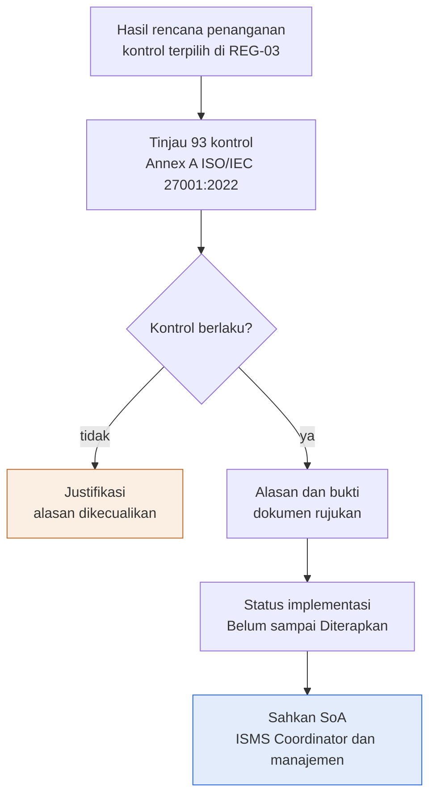

Deskripsi: SoA berawal dari hasil rencana penanganan (kontrol terpilih di REG-03), lalu 93 kontrol Annex A ISO/IEC 27001:2022 ditinjau. Pada keputusan "Kontrol berlaku?", jawaban "tidak" menuju "Justifikasi, alasan dikecualikan" (oranye, tanpa panah lanjutan di gambar); jawaban "ya" menuju "Alasan dan bukti (dokumen rujukan)", "Status implementasi (Belum sampai Diterapkan)", lalu "Sahkan SoA" oleh ISMS Coordinator dan manajemen (biru).
Sumber gambar: conv/1g9Yiuv6EDJP2ikgAbpcnRVE0ZVFkLWG2/img/image1.png

## 4. Peran, RACI, record, KPI
| Peran | Keterangan |
|---|---|
| ISMS Coordinator | Pemilik dokumen, penyusun, pemutus Berlaku final; pemilik 49 kontrol (45 Perlu keputusan ditambah 5.12, 5.13, 5.14, 5.33) |
| ISO/ISMS Coordinator | Pemeriksa dokumen; bersama Divisi Operation menyusun secara teknis |
| COO (Amirull Yusuf Zulkarnain) | Penyetuju dokumen |
| Head of Operation | Pemilik 27 kontrol |
| Lead SOC | Pemilik 10 kontrol (5.7, 5.24, 5.25, 5.26, 5.27, 5.28, 6.8, 8.7, 8.8, 8.15) |
| Lead NOC | Pemilik 4 kontrol (7.13, 8.6, 8.13, 8.16) |
| Service Delivery Manager | Pemilik 3 kontrol (5.8, 5.22, 8.29) |

Rincian pemilik per kontrol ada pada kolom "Pemilik kontrol" di tabel 2.4 (sumber otoritatif). Record: SoA (masa simpan: berlaku sampai digantikan). Tidak ada KPI atau frekuensi review di dokumen ini.

## 5. Catatan kualitas dan celah
- Keputusan final belum ada: kolom E "Berlaku (final)" kosong di 93 baris (SoA E5:E97); 45 kontrol bertanda "Perlu keputusan" di kolom D "Usulan Ops" (45 dari 93 = 48,4%), semuanya dengan catatan "Di luar paket dokumen Operation" (kolom L) dan pemilik kontrol "ISMS Coordinator" (kolom K). SoA A2: "Kolom Berlaku (final) diisi ISMS Coordinator."
- SoA ini belum dapat dipakai sebagai bukti audit sertifikasi sebelum 45 kontrol diputuskan dan alasan pengecualian (bila ada) ditulis (inferensi). Kolom G "Alasan dikecualikan" kosong di 93 baris; tidak ada kontrol yang diberi alasan dikecualikan. Cara pakai B20: "tetapkan Berlaku (Ya atau Tidak), alasan dimasukkan ..., atau alasan dikecualikan."
- Seluruh 48 kontrol usulan "Ya" berstatus "Sebagian" (kolom H); tidak ada "Diterapkan". Kolom L untuk 48 kontrol itu berbunyi "Dokumen draft rev 00; implementasi diverifikasi saat audit internal".
- Inkonsistensi dengan SNX-ISMS-REG-03: kontrol 6.3 ("Information security awareness, education and training") dipilih di RTP-004 (G8 "5.30, 6.3, 5.37") dan RTP-013 (G17 "6.3, 5.37, 8.32") tetapi "Perlu keputusan" di SoA (D, baris 6.3; J "ISR-004, ISR-013"), bertentangan dengan Cara pakai B22 "SoA harus konsisten dengan SNX-ISMS-REG-03: kontrol yang dipilih dalam rencana penanganan wajib Berlaku = Ya" dan REG-03 Cara pakai B21. Seluruh kontrol REG-03 lain berstatus "Ya" di SoA (hanya 6.3 yang tidak). Karena "Berlaku (final)" kosong untuk semua kontrol, pelanggaran formalnya adalah pada usulan (kolom D), bukan pada kolom E (inferensi).
- Alasan dimasukkan (kolom F) hanya "Risiko" (24) dan "Best practice" (24); "Kontrak" dan "Regulasi" (Daftar C3:C4) tidak dipakai, walaupun dokumen lain menunjukkan layanan ke pelanggan pemerintah (SNX-ISMS-SOP-01 Bagian 2 "pelanggan pemerintah tertentu"; REG-03 RTP-002 "pelanggan pemerintah") dan kontrak dengan pelanggan (SNX-ISMS-SOP-03 Bagian 1 "sesuai kebutuhan bisnis dan kontrak") (inferensi bahwa persyaratan kontrak dan regulasi belum dikaji).
- Kontrol 8.15 Logging (I, baris 8.15): bukti ditulis "SNX-ISMS-SOP-01 (bukti log); prosedur logging khusus belum ada".
- Sel Acuan ISO 27001 pada Kontrol Dokumen (B13): "Klausul atau kontrol Annex A 6.1.3 d" dan Acuan ISO 9001 (B12) "Klausul -". Bahwa 6.1.3 d adalah klausul utama ISO/IEC 27001:2022 (butir d kewajiban menyusun SoA), bukan kontrol Annex A, sehingga label "Annex A" kurang tepat, adalah pengetahuan standar di luar korpus (inferensi); master list SNX-OPS-ML-00 mencatat "6.1.3 d" tanpa label Annex A.
- Rujukan di kolom I (Dokumen atau bukti) semuanya ada di korpus: md/isms (SOP-01 sampai SOP-05, PRO-01, PLN-01, REG-01, REG-04, FRM-01, FRM-02, FRM-03) dan md/ops (SNX-OPS-SOP-01 sampai SOP-05, FRM-01, 02, 04, 05, 07, 10, PRC-01, ML-00); tidak ada nomor dokumen yatim. Bahwa tiap dokumen benar-benar mendukung kontrol yang dipetakan belum diuji satu per satu (hanya sampel: 5.25 dan 5.28 terhadap FRM-02, 6.3 terhadap REG-03, 5.33 dan 8.12 terhadap PRO-01).
- Kode jenis "PRO" pada SNX-ISMS-PRO-01 berbeda dari SOP, tetapi dokumen ISMS lain juga memakai kode jenis yang masing-masing tunggal (FRM, REG, PLN, SOA); master list SNX-OPS-ML-00 mencatat jenis PRO-01 sebagai "Prosedur". Tidak ada daftar kode jenis resmi di dokumen ISMS.
- Kontrol 5.20 (I, baris 5.20) menyebut "SNX-ISMS-FRM-03 (bersama Commercial dan Legal)", sehingga bukti sebagian berada di luar Operation (inferensi); selaras dengan FRM-03 Cara pakai B18 "berkoordinasi dengan Commercial dan Legal".
- Pengesahan kosong (Kontrol Dokumen C36:D38); status persetujuan "Menunggu" (E31:E32); revisi 00 tercatat dua kali (A31 dan A32, "13 Oktober 2026").

## 6. Kata kunci retrieval
Statement of Applicability, SoA, SNX-ISMS-SOA-01, ISO 27001:2022 Annex A, 93 kontrol, Organizational People Physical Technological, kontrol berlaku, alasan dimasukkan, alasan dikecualikan, status implementasi Sebagian Diterapkan, Perlu keputusan, pemilik kontrol, risiko terkait ISR, kesiapan audit sertifikasi, threat intelligence 5.7, access control 5.15, backup 8.13, logging 8.15, change management 8.32, incident management 5.24 5.26, supplier 5.19 5.23, cryptography 8.24, physical security 7.x, 6.3 awareness training

<!-- FILE: isms/SNX-ISMS-SOP-01.md -->

---
doc_code: SNX-ISMS-SOP-01
title: SOP Information Security Incident Management
department: Information Security
doc_type: SOP
source: {drive_file_id: 1MApsp9RPPMO1Xottjb2fGQJlaQas2M99, filename: SNX-ISMS-SOP-01_SOP_IS_Incident_Management.docx, format: docx, bytes: 194046, retrieved: 2026-10-13}
revision: 00 (DRAFT)
doc_date: 13 Oktober 2026 (tanggal draft; tanggal efektif "Ditetapkan saat pengesahan")
classification_in_doc: RESTRICTED (Internal)
owner_in_doc: Lead SOC
approver_in_doc: COO, Amirull Yusuf Zulkarnain
iso_refs: {iso9001: ["10.2"], iso27001: ["A 5.24", "A 5.25", "A 5.26", "A 5.27", "A 5.28", "A 6.8"]}
kb_sensitivity_suggest: restricted:ops
related_docs: [SNX-OPS-SOP-04, SNX-OPS-SOP-02, SNX-ISMS-FRM-02, SNX-OPS-FRM-10, SNX-OPS-FRM-04, SNX-ISMS-REG-02, SNX-ISMS-REG-03, SNX-ISMS-PLN-01, SNX-OPS-RPT-01, SKILL_ir-report, SKILL_incident-rca]
coverage: {sections_or_sheets: "16 dari 16 (Bagian 1-14, Diagram, Pengesahan)", tables: "8 dari 8", images: "1 dibuka dari 1", notes: "Tidak ada celah baca. Tabel severity (disisipkan dalam butir 8.2) ditulis lengkap."}
---
# SNX-ISMS-SOP-01 SOP Information Security Incident Management

## 1. Ringkasan
- Siklus: persiapan, pelaporan event, triage dan penetapan severity P1 sampai P4, respon (forensik dahulu, containment, eradication, sweep IOC), pengumpulan bukti (SHA-256, chain of custody), pemberitahuan pihak luar, pelaporan, dan lessons learned.
- Batas waktu kunci: lapor event ke SOC paling lambat 1 jam sejak mengetahui; ack P1 15 menit, P2 30 menit, P3 2 jam kerja, P4 1 hari kerja; COO diberi tahu dalam 30 menit untuk P1.
- Pemberitahuan luar: pelanggan untuk P1 paling lambat 24 jam (laporan awal, oleh Service Delivery Manager); kegagalan pelindungan data pribadi ke subjek data dan lembaga berwenang paling lambat 3 x 24 jam sejak diketahui (keputusan COO dan Legal, UU PDP). Tidak ada batas waktu yang disebut untuk BSSN, regulator sektor, atau aparat penegak hukum (diputuskan COO bersama Legal tanpa tenggat).
- Aturan forensik: bukti diamankan sebelum mengubah apa pun; webshell tidak di-probe dengan GET atau HEAD; file mencurigakan dipindah (`mv`) ke quarantine, tidak dihapus (`rm`); klaim "bersih" butuh dua sumber independen.
- Bukti untuk proses hukum disimpan minimal 5 tahun atau sesuai arahan Legal; record FRM-02 dan RCA (FRM-10) disimpan 5 tahun.
- Target KPI: alert kritis di-triage dalam 15 menit 95%; laporan insiden tepat waktu dan sesuai format 100%; insiden berulang akar sama nol; MTTC P1 belum ditetapkan (dikalibrasi setelah 3 bulan data).

## 2. Isi lengkap terstruktur

### 2.0 Kontrol dokumen

| Atribut | Isi |
|---|---|
| Nomor dokumen | SNX-ISMS-SOP-01 |
| Judul | SOP Information Security Incident Management |
| Revisi | 00 (DRAFT) |
| Tanggal draft | 13 Oktober 2026 |
| Tanggal efektif | Ditetapkan saat pengesahan |
| Klasifikasi | RESTRICTED (Internal) |
| Pemilik dokumen | Lead SOC |
| Disetujui oleh | COO, Amirull Yusuf Zulkarnain |
| Acuan ISO 9001:2015 | Klausul 10.2 |
| Acuan ISO/IEC 27001:2022 | Klausul atau kontrol Annex A 5.24, 5.25, 5.26, 5.27, 5.28, 6.8 |
| Masa simpan record | Berlaku sampai digantikan |

Riwayat revisi:

| Revisi | Tanggal | Uraian perubahan | Disusun | Disetujui |
|---|---|---|---|---|
| 00 | 13 Oktober 2026 | Draft awal untuk sertifikasi ISO 9001:2015 dan ISO/IEC 27001:2022 | Divisi Operation | Menunggu |
| 00 | 13 Oktober 2026 | Review bahasa dan konsistensi: istilah teknologi dalam bahasa Inggris, bahasa Indonesia formal, label klasifikasi, keselarasan RTO dan target pulih | Divisi Operation | Menunggu |

### 2.1 Tujuan (Bagian 1)
Menetapkan cara SINUX menyiapkan diri, mendeteksi, menilai, merespon, dan belajar dari insiden keamanan informasi, termasuk pengumpulan bukti dan kewajiban pemberitahuan, agar dampak terhadap confidentiality, integrity, dan availability informasi diminimalkan.

### 2.2 Ruang lingkup (Bagian 2)
Event dan insiden keamanan informasi pada infrastruktur internal SINUX dan pada sistem pelanggan yang dikelola SINUX sesuai kontrak. Untuk pelanggan yang SOC-nya menjadi tanggung jawab pelanggan sendiri (misalnya pelanggan pemerintah tertentu), SINUX menangani keamanan host yang dikelolanya sebagai managed services dan berkoordinasi dengan tim keamanan pelanggan.

### 2.3 Referensi (Bagian 3)
- ISO 9001:2015 klausul 10.2.
- ISO/IEC 27001:2022 Annex A 5.24, 5.25, 5.26, 5.27, 5.28, 6.8.
- SKILL_ir-report (format laporan insiden beku), SKILL_incident-rca.
- SNX-OPS-SOP-04 Technical Incident Handling & Escalation.
- UU No. 27 Tahun 2022 tentang Pelindungan Data Pribadi (kewajiban pemberitahuan kegagalan pelindungan data pribadi).

### 2.4 Definisi (Bagian 4)

| Istilah | Arti |
|---|---|
| Event keamanan | Kejadian yang mungkin berdampak pada keamanan informasi, misalnya alert SIEM, login gagal berulang |
| Insiden keamanan | Event yang terkonfirmasi merugikan atau berpotensi besar merugikan confidentiality, integrity, atau availability |
| IOC | Indicator of compromise: hash file, IP, domain, atau pola yang menandai kompromi |
| Containment | Langkah menahan penyebaran: blok IP, nonaktifkan akun, isolasi VM |
| Chain of custody | Catatan siapa memegang bukti, kapan, dan apa yang dilakukan terhadapnya |

### 2.5 Peran dan tanggung jawab (Bagian 5)

| Peran | Tanggung jawab |
|---|---|
| Lead SOC | Pemilik SOP; Incident Commander untuk insiden keamanan P1 dan P2; reviewer laporan |
| SOC Analyst | Triage, containment awal, pengumpulan bukti, sweep IOC, draft laporan |
| NOC | Pemulihan availability, eksekusi perubahan, dukungan teknis |
| Head of Operation | Keputusan eskalasi, pemanggilan personel, komunikasi ke manajemen |
| ISMS Coordinator | Memastikan pembelajaran masuk ke register risiko dan tindakan korektif; pelaporan ISMS |
| COO dan Legal | Keputusan pemberitahuan ke pihak luar (pelanggan, regulator, aparat) |
| Seluruh personel | Melaporkan event atau kelemahan keamanan sesegera mungkin |

### 2.6 Persiapan (Bagian 6, A 5.24)
1. Daftar kontak eskalasi internal dan eksternal (partner SOC, penyedia infrastruktur, pelanggan) dipelihara di file kontak restricted:ops dan ditinjau triwulanan.
2. Akses darurat ke sistem kritis tersedia melalui Jumphost dan password manager untuk peran on-call.
3. Playbook untuk skenario berulang dipelihara di knowledge base: webshell dan judi online pada server web, kompromi akun email, malware atau miner, kebocoran kredensial, serangan DDoS.
4. Latihan tabletop minimal setahun sekali, hasilnya dicatat sebagai bukti di SNX-ISMS-PLN-01.

### 2.7 Pelaporan event (Bagian 7, A 6.8)
1. Siapa pun yang melihat event keamanan (alert, perilaku aneh, laporan pelanggan, kredensial tersebar) melapor ke SOC on-duty melalui ticketing system atau kanal on-call, paling lambat 1 jam sejak mengetahui.
2. Pelapor tidak mencoba menguji atau mengeksploitasi kelemahan yang ditemukan.

### 2.8 Penilaian dan keputusan (Bagian 8, A 5.25)
1. SOC Analyst melakukan triage: true positive, false positive, atau butuh investigasi, dan mencatat alasannya.
2. Event yang terkonfirmasi menjadi insiden dan diberi severity:

| Severity | Kriteria insiden keamanan | Ack | Pemberitahuan internal |
|---|---|---|---|
| P1 | Kompromi root atau host baru; kebocoran data pelanggan atau data pribadi; ransomware; akses tidak sah ke sistem kritis | 15 menit | Lead SOC dan Head of Operation segera; COO dalam 30 menit |
| P2 | Kompromi terbatas tanpa bukti kebocoran data (misalnya webshell pada satu akun hosting, akun email dipakai spam); malware tertahan | 30 menit | Lead SOC dalam 1 jam |
| P3 | Upaya serangan gagal yang butuh tindak lanjut; pelanggaran kebijakan ringan | 2 jam kerja | Melalui tiket |
| P4 | Event informatif, tuning rule | 1 hari kerja | Melalui tiket |

3. Satu insiden = satu parent ticket; alert terkait ditautkan. Insiden dicatat di SNX-ISMS-FRM-02.

### 2.9 Respon (Bagian 9, A 5.26)
1. Forensik terlebih dahulu, perbaikan kemudian: amankan bukti (log, hash file, daftar proses, koneksi aktif, snapshot bila memungkinkan) sebelum mengubah apa pun.
2. Webshell tidak pernah di-probe dengan GET atau HEAD, karena probe sama dengan eksekusi.
3. File mencurigakan diquarantine dengan memindahkannya (`mv`) ke folder quarantine, bukan dihapus (`rm`).
4. Containment mengikuti SNX-OPS-SOP-02; Lead SOC boleh menyatakan darurat dan langsung bertindak dengan pencatatan.
5. Setelah satu host terbukti kompromi, sweep IOC ke host sejenis berdasarkan hash.
6. Eradication: hapus persistence (cron, akun, kunci SSH, plugin), tutup vektor masuk (patch, ganti kredensial), lalu pulihkan dari backup bersih bila perlu.
7. Pekerjaan app-level pelanggan (pembersihan konten aplikasi, perbaikan kode) diserahkan ke developer atau PIC pelanggan dengan temuan tertulis.
8. Klaim "bersih" atau "aman" wajib didukung dua sumber independen (misalnya sweep hash dan pemeriksaan dari vantage eksternal).
9. Status disampaikan ke pelanggan terdampak sesuai frekuensi update severity.

### 2.10 Pengumpulan bukti (Bagian 10, A 5.28)
1. Bukti dikumpulkan dengan cara yang tidak mengubah aslinya; hitung hash (SHA-256) untuk setiap file bukti.
2. Setiap bukti dicatat pada sheet Chain of Custody di SNX-ISMS-FRM-02: ID bukti, uraian, sumber, hash, waktu, pengumpul, lokasi simpan, dan setiap perpindahan tangan.
3. Bukti disimpan di lokasi RESTRICTED dengan akses terbatas pada tim investigasi.
4. Bukti yang mungkin dibutuhkan untuk proses hukum disimpan minimal 5 tahun atau sesuai arahan Legal.

### 2.11 Pemberitahuan pihak luar (Bagian 11)
1. Pemberitahuan ke pelanggan mengikuti kontrak; untuk insiden P1, Service Delivery Manager memberi tahu PIC pelanggan paling lambat 24 jam dengan laporan awal.
2. Bila insiden melibatkan kegagalan pelindungan data pribadi, COO dan Legal memutuskan pemberitahuan kepada subjek data dan lembaga berwenang sesuai UU PDP (paling lambat 3 x 24 jam sejak diketahui).
3. Pelaporan ke regulator sektor atau aparat penegak hukum diputuskan COO bersama Legal.
4. Komunikasi kepada media hanya oleh pihak yang ditunjuk manajemen.

### 2.12 Pelaporan dan pembelajaran (Bagian 12, A 5.27)
1. Laporan insiden memakai format beku SKILL_ir-report (lima section dengan urutan tetap), direview Lead SOC sebelum dikirim.
2. Insiden P1 dan P2: RCA dengan SNX-OPS-FRM-10 dan tindakan korektif ber-pemilik dan ber-tenggat.
3. ISMS Coordinator memperbarui SNX-ISMS-REG-02 dan SNX-ISMS-REG-03 bila insiden menunjukkan risiko baru atau kontrol yang tidak efektif.
4. Lessons learned disetor ke knowledge base melalui jalur staging, tanpa kredensial.
5. Statistik insiden keamanan dilaporkan bulanan di SNX-OPS-RPT-01.

### 2.13 Record terkait (Bagian 13)

| Record | Nomor | Masa simpan |
|---|---|---|
| Security Incident & Investigation Records (register, investigasi, chain of custody) | SNX-ISMS-FRM-02 | 5 tahun |
| RCA & Corrective Action Report | SNX-OPS-FRM-10 | 5 tahun |
| Change request containment | SNX-OPS-FRM-04 | 3 tahun |
| Register risiko keamanan informasi | SNX-ISMS-REG-02 | Berlaku sampai digantikan |

### 2.14 Pemantauan kinerja (Bagian 14)

| Indikator | Target |
|---|---|
| Alert kritis di-triage dalam 15 menit | 95% |
| Mean time to contain insiden P1 | Dikalibrasi setelah 3 bulan data |
| Laporan insiden tepat waktu dan sesuai format | 100% |
| Insiden berulang dengan akar yang sama | Nol |

### 2.15 Pengesahan

| Peran | Nama dan jabatan | Tanda tangan | Tanggal |
|---|---|---|---|
| Disusun oleh | Lead SOC | (kosong) | (kosong) |
| Diperiksa oleh | ISO/ISMS Coordinator | (kosong) | (kosong) |
| Disetujui oleh | COO, Amirull Yusuf Zulkarnain | (kosong) | (kosong) |

### 2.16 Ringkasan tahapan insiden (disusun dari teks Bagian 6 sampai 12)

| Tahap | Bagian | Batas waktu atau ketentuan |
|---|---|---|
| Persiapan | 6 | Kontak ditinjau triwulanan; tabletop minimal tahunan |
| Deteksi dan pelaporan event | 7 | Lapor ke SOC paling lambat 1 jam sejak mengetahui |
| Triage dan penetapan severity | 8 | Ack P1 15 menit, P2 30 menit, P3 2 jam kerja, P4 1 hari kerja |
| Respon: bukti, containment, eradication, recovery | 9, 10 | Forensik dahulu; bukti SHA-256 dan chain of custody |
| Pemberitahuan pihak luar | 11 | Pelanggan P1 24 jam; PDP 3 x 24 jam; regulator/aparat tanpa tenggat |
| Pelaporan, RCA, lessons learned | 12 | RCA untuk P1 dan P2; statistik bulanan; tanpa tenggat tertulis untuk laporan akhir |

## 3. Diagram

### 3.1 Alur SOP Information Security Incident Management

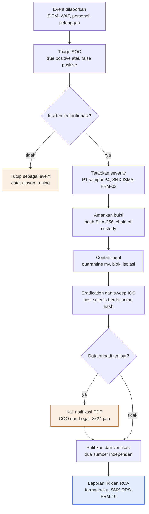

Deskripsi: Judul gambar "Insiden keamanan: bukti terlebih dahulu, containment, lalu belajar". Alur vertikal sembilan kotak utama dengan dua diamond: "Insiden terkonfirmasi?" (cabang tidak ke kotak oranye "Tutup sebagai event", tanpa garis kembali) dan "Data pribadi terlibat?" (cabang ya ke kotak oranye "Kaji notifikasi PDP", garis putus-putus kembali ke alur utama sebelum "Pulihkan dan verifikasi"). Kotak biru di dasar adalah "Laporan IR dan RCA". Gambar tidak memuat kotak terpisah untuk persiapan, pelaporan event 1 jam, pemberitahuan pelanggan 24 jam, atau lessons learned (hanya ada di teks).
Sumber gambar: conv/1MApsp9RPPMO1Xottjb2fGQJlaQas2M99/img/media/rId25.png

## 4. Peran, RACI, record, KPI
- Peran: tabel 2.5. Incident Commander: Lead SOC (P1 dan P2). Pemberi keputusan notifikasi luar: COO dan Legal. Pemberi tahu pelanggan P1: Service Delivery Manager (peran ini tidak ada di tabel peran Bagian 5).
- Record dan masa simpan: tabel 2.13. KPI: tabel 2.14. RACI formal tidak ada.

## 5. Catatan kualitas dan celah
- Rujukan "SNX-OPS-SOP-04 Technical Incident Handling & Escalation" (Bagian 3) sesuai judul dokumen di md/ops ("SOP Technical Incident Handling & Escalation"). Rujukan "Containment mengikuti SNX-OPS-SOP-02" (Bagian 9 butir 4) menunjuk "SOP Project Change Management" (md/ops) yang memuat jenis change "Emergency" dengan kriteria "Containment insiden aktif" dan approver "Lead on-duty, dicatat; COO diberi tahu dalam 30 menit" (SNX-OPS-SOP-02 Bagian 5); "Lead SOC boleh menyatakan darurat" selaras dengan itu (inferensi bahwa Lead SOC termasuk Lead on-duty).
- "SKILL_ir-report" dan "SKILL_incident-rca" (Bagian 3) serta "lima section dengan urutan tetap" (Bagian 12 butir 1) bukan nomor dokumen QMS/ISMS (inferensi: nama skill internal; PRO-OPS-001 di md/ops mendaftarkan keduanya sebagai "Rujukan teknis"). Kelima section tidak diuraikan di SOP-01 maupun di PRO-OPS-001 (prosedur SOC-03 butir 1 hanya mengulang "lima section dengan urutan tetap").
- Bagian 11 butir 3: "Pelaporan ke regulator sektor atau aparat penegak hukum diputuskan COO bersama Legal", tanpa batas waktu. SOP-01 tidak menyebut BSSN sama sekali (nol kemunculan); BSSN hanya muncul di SNX-ISMS-SOP-05 Bagian 5 butir 2 ("peringatan BSSN dan CSIRT sektor terkait") sebagai sumber advisory. Batas waktu hanya ada untuk pemberitahuan data pribadi (Bagian 11 butir 2, "paling lambat 3 x 24 jam sejak diketahui") dan pelanggan P1 (butir 1, "paling lambat 24 jam").
- "frekuensi update severity" (Bagian 9 butir 9: "Status disampaikan ke pelanggan terdampak sesuai frekuensi update severity") dirujuk, tetapi tabel severity Bagian 8 butir 2 hanya berkolom Severity, Kriteria, Ack, Pemberitahuan internal. Frekuensi update ada di SNX-OPS-SOP-04 Bagian 6 (kolom "Update ke pelanggan": P1 "Tiap 1 jam", P2 "Tiap 3 jam atau per shift", P3 "Harian", P4 "Saat selesai"), yang berlaku untuk severity tiket teknis; SOP-01 tidak menunjuk tabel itu secara eksplisit.
- Target MTTC P1 tidak ditetapkan (Bagian 14: "Mean time to contain insiden P1" = "Dikalibrasi setelah 3 bulan data"), jadi belum terukur.
- Ack P1 "15 menit" (Bagian 8 butir 2) tidak dijelaskan terhadap titik awal (waktu alert, laporan, atau pembuatan tiket); Bagian 7 butir 1 memberi pelapor hingga "paling lambat 1 jam sejak mengetahui" untuk melapor ke SOC (jeda sebelum SOC mengetahui, inferensi). SNX-OPS-SOP-04 Bagian 7 menetapkan tiket "dibuat paling lambat 10 menit setelah konfirmasi" tetapi juga tidak mengaitkannya dengan titik awal Ack (inferensi dari matriks Bagian 6 yang hanya menulis "Ack 15 menit").
- Header kontrol dokumen: masa simpan record "Berlaku sampai digantikan", sementara tabel record Bagian 13 menyebut "5 tahun" (SNX-ISMS-FRM-02, SNX-OPS-FRM-10), "3 tahun" (SNX-OPS-FRM-04) dan "Berlaku sampai digantikan" (SNX-ISMS-REG-02).
- Pengesahan: tanda tangan dan tanggal kosong; riwayat revisi dua baris bertanggal sama ("13 Oktober 2026") berstatus "Menunggu".
- Penamaan pemeriksa "ISO/ISMS Coordinator" (Pengesahan) berbeda dengan peran "ISMS Coordinator" di Bagian 5.

## 6. Kata kunci retrieval
insiden keamanan informasi, security incident, incident management, severity P1 P2 P3 P4, triage, SOC, Lead SOC, Incident Commander, containment, eradication, IOC sweep, webshell, quarantine, chain of custody, SHA-256, bukti digital, forensik, notifikasi pelanggan 24 jam, UU PDP 3x24 jam, BSSN, regulator, lessons learned, RCA, tabletop, laporan insiden, SNX-ISMS-FRM-02, ISO 27001 A 5.24 A 5.25 A 5.26 A 5.27 A 5.28 A 6.8

<!-- FILE: isms/SNX-ISMS-SOP-02.md -->

---
doc_code: SNX-ISMS-SOP-02
title: SOP User Access Control & Authorization
department: Information Security
doc_type: SOP
source: {drive_file_id: 1JoSiwoMglIxy7Ic3t0EhRfvzJgf5ydzT, filename: SNX-ISMS-SOP-02_SOP_User_Access_Control_Authorization.docx, format: docx, bytes: 167959, retrieved: 2026-10-13}
revision: 00 (DRAFT)
doc_date: 13 Oktober 2026 (tanggal draft; tanggal efektif "Ditetapkan saat pengesahan")
classification_in_doc: RESTRICTED (Internal)
owner_in_doc: Head of Operation
approver_in_doc: COO, Amirull Yusuf Zulkarnain
iso_refs: {iso9001: ["7.1.3"], iso27001: ["A 5.15", "A 5.16", "A 5.17", "A 5.18", "A 8.2", "A 8.3", "A 8.5", "A 8.18 (hanya di butir 7.7)"]}
kb_sensitivity_suggest: restricted:ops
related_docs: [SNX-ISMS-PRO-01, SNX-ISMS-REG-04, SNX-ISMS-REG-01, SNX-ISMS-SOP-01, SNX-ISMS-SOP-04, SNX-OPS-SOP-02, SNX-OPS-FRM-06]
coverage: {sections_or_sheets: "10 H1 (Bagian 1-9, Pengesahan; diagram ada di dalam Bagian 7) + 7 sub-bagian 7.1-7.7, semua dari sumber", tables: "7 dari 7", images: "1 dibuka dari 1", notes: "Tidak ada celah baca. Tidak ada istilah tingkat akses tertulis selain nilai di matriks Bagian 6 (Agent, Group admin, Read-only, Admin, Operator, Analyst, dll.)."}
---
# SNX-ISMS-SOP-02 SOP User Access Control & Authorization

## 1. Ringkasan
- Mengatur pemberian, perubahan, peninjauan, dan pencabutan hak akses (joiner, mover, leaver) berdasarkan least privilege, need-to-know, satu orang satu akun, segregation of duties, dan akses production pelanggan hanya via Jumphost yang merekam sesi.
- Joiner: permintaan di Service Hub (kategori Access atau Permission), konfirmasi atasan, persetujuan pemilik sistem (privileged ke sistem pelanggan: Head of Operation, plus persetujuan pelanggan bila kontrak mensyaratkan), akun dibuat dengan MFA, dicatat di SNX-ISMS-REG-04.
- Mover: akses lama yang tidak relevan dicabut paling lambat 5 hari kerja. Leaver: semua akses dicabut paling lambat hari terakhir kerja (pemberhentian mendadak: segera); HR atau atasan memberi tahu mutasi dan pemberhentian paling lambat pada hari efektif.
- Review akses: privileged setiap triwulan, biasa setiap semester; temuan (akun yatim, hak berlebih, akun tidak aktif lebih dari 90 hari) ditindaklanjuti paling lambat 10 hari kerja; service account dirotasi minimal tahunan.
- Autentikasi: MFA wajib untuk email, password manager, Jumphost, console cloud, Cloudflare, dan akses internet ke sistem administratif; password minimal 12 karakter, unik per sistem.
- Matriks peran-ke-sistem hanya "acuan awal (USULAN)"; detail ditetapkan pemilik sistem di SNX-ISMS-REG-04. Log sesi Jumphost disimpan sesuai kapasitas, minimal 90 hari.

## 2. Isi lengkap terstruktur

### 2.0 Kontrol dokumen

| Atribut | Isi |
|---|---|
| Nomor dokumen | SNX-ISMS-SOP-02 |
| Judul | SOP User Access Control & Authorization |
| Revisi | 00 (DRAFT) |
| Tanggal draft | 13 Oktober 2026 |
| Tanggal efektif | Ditetapkan saat pengesahan |
| Klasifikasi | RESTRICTED (Internal) |
| Pemilik dokumen | Head of Operation |
| Disetujui oleh | COO, Amirull Yusuf Zulkarnain |
| Acuan ISO 9001:2015 | Klausul 7.1.3 |
| Acuan ISO/IEC 27001:2022 | Klausul atau kontrol Annex A 5.15, 5.16, 5.17, 5.18, 8.2, 8.3, 8.5 |
| Masa simpan record | Berlaku sampai digantikan |

Riwayat revisi:

| Revisi | Tanggal | Uraian perubahan | Disusun | Disetujui |
|---|---|---|---|---|
| 00 | 13 Oktober 2026 | Draft awal untuk sertifikasi ISO 9001:2015 dan ISO/IEC 27001:2022 | Divisi Operation | Menunggu |
| 00 | 13 Oktober 2026 | Review bahasa dan konsistensi: istilah teknologi dalam bahasa Inggris, bahasa Indonesia formal, label klasifikasi, keselarasan RTO dan target pulih | Divisi Operation | Menunggu |

### 2.1 Tujuan (Bagian 1)
Mengatur pemberian, perubahan, peninjauan, dan pencabutan hak akses ke sistem SINUX dan sistem pelanggan yang dikelola SINUX, berdasarkan prinsip least privilege dan need-to-know, agar hanya orang yang berwenang yang dapat mengakses informasi dan sistem.

### 2.2 Ruang lingkup (Bagian 2)
Seluruh akun manusia dan service account pada:
- Sistem internal: email dan Drive, ticketing system (Zammad, Service Hub GLPI), knowledge base, password manager, Jumphost, monitoring (Nusametric, Overseer), SIEM, console Nusagrid, Acronis, Cloudflare, AegisWAF.
- Sistem pelanggan yang dikelola SINUX: server, VM, panel hosting (WHM dan cPanel), network device, dan aplikasi manajemen.

### 2.3 Referensi (Bagian 3)
- ISO/IEC 27001:2022 Annex A 5.15, 5.16, 5.17, 5.18, 8.2, 8.3, 8.5.
- SNX-ISMS-PRO-01 Information Classification & Handling Procedure.
- SNX-ISMS-REG-04 User Access Register & Periodic Access Review.

### 2.4 Prinsip (Bagian 4)
1. Least privilege: hak akses sebatas yang dibutuhkan untuk tugas.
2. Need-to-know: akses ke informasi RESTRICTED hanya untuk peran yang membutuhkan.
3. Satu orang satu akun: akun bersama (shared) dilarang, kecuali akun break-glass yang disimpan di password manager dan setiap pemakaiannya dicatat.
4. Akses privileged (root, administrator, admin panel) diberikan terpisah dari akun harian dan hanya melalui Jumphost bila sistem mendukung.
5. Segregation of duties: pemohon akses tidak menyetujui aksesnya sendiri.
6. Akses production pelanggan hanya melalui Jumphost SINUX yang merekam sesi.

### 2.5 Peran dan tanggung jawab (Bagian 5)

| Peran | Tanggung jawab |
|---|---|
| Head of Operation | Pemilik SOP; approver akses privileged ke sistem pelanggan |
| Pemilik sistem (sesuai SNX-ISMS-REG-01) | Menyetujui akses ke sistemnya; reviewer periodik |
| Atasan langsung pemohon | Mengonfirmasi kebutuhan akses sesuai peran |
| Administrator sistem | Membuat, mengubah, dan mencabut akun sesuai approval; mencatat di register |
| HR atau atasan | Memberi tahu mutasi dan pemberhentian paling lambat pada hari efektif |
| ISMS Coordinator | Memantau pelaksanaan review akses dan tindak lanjutnya |

### 2.6 Matriks akses berbasis peran (Bagian 6, acuan)

| Sistem | NOC Engineer | SOC Analyst | Lead NOC dan SOC | SD dan PM | Catatan |
|---|---|---|---|---|---|
| Ticketing system | Agent | Agent | Group admin | Agent | |
| Monitoring | Read-only, acknowledge alert | Read-only | Admin | Read-only | |
| SIEM dan WAF | Read-only | Analyst | Admin | Tidak | Perubahan rule melalui SNX-OPS-SOP-02 |
| Console Nusagrid | Operator | Read-only | Admin | Read-only | |
| Acronis | Operator | Read-only | Admin | Tidak | Restore produksi butuh approval Lead |
| Jumphost ke server pelanggan | Sesuai aset yang ditugaskan | Sesuai investigasi | Sesuai kebutuhan | Tidak | Sesi direkam |
| Password manager | Collection tim sendiri | Collection tim sendiri | Collection manager | Collection proyek | |
| Knowledge base | Sesuai peran tech-ops | Sesuai peran tech-ops | Sesuai peran | Sesuai peran | Data di luar scope tidak tampil |

Matriks ini acuan awal (USULAN); pemilik sistem menetapkan detailnya di SNX-ISMS-REG-04.

### 2.7 Prosedur (Bagian 7)

#### 7.1 Permintaan dan pemberian akses (joiner)
1. Pemohon atau atasannya mengajukan permintaan di Service Hub (kategori Access atau Permission): nama, peran, sistem, tingkat akses, alasan, dan masa berlaku.
2. Atasan langsung mengonfirmasi kebutuhan; pemilik sistem menyetujui. Akses privileged ke sistem pelanggan butuh approval Head of Operation, dan bila kontrak mensyaratkan, persetujuan pelanggan.
3. Administrator membuat akun dengan hak sesuai approval, mengaktifkan MFA bila sistem mendukung, lalu mencatatnya di SNX-ISMS-REG-04.
4. Kredensial awal diserahkan melalui password manager dan wajib diganti pada login pertama.

#### 7.2 Autentikasi (A 5.17, 8.5)
1. MFA wajib untuk email, password manager, Jumphost, console cloud, Cloudflare, dan semua akses dari internet ke sistem administratif bila sistem mendukung.
2. Password minimal 12 karakter, unik per sistem, disimpan hanya di password manager.
3. Kredensial tidak pernah dikirim melalui chat, tiket, email, atau dokumen.
4. Kredensial yang terpapar segera dirotasi dan dilaporkan sesuai SNX-ISMS-SOP-01.

#### 7.3 Akses sementara dan pihak ketiga
1. Akses vendor atau partner diberikan dengan masa berlaku, sebatas sistem yang dibutuhkan, melalui Jumphost, dan dicatat sebagai akun pihak ketiga.
2. Akses sementara tim proyek dicabut saat gate G3 (SNX-OPS-FRM-06).

#### 7.4 Perubahan akses (mover)
1. Saat seseorang pindah peran, atasan mengajukan perubahan; akses lama yang tidak relevan dicabut paling lambat 5 hari kerja.

#### 7.5 Pencabutan akses (leaver, A 5.18)
1. Saat pemberhentian, semua akses dicabut paling lambat pada hari terakhir kerja; untuk pemberhentian mendadak, segera.
2. Kredensial bersama atau darurat yang diketahui orang tersebut dirotasi.
3. Aset perusahaan dikembalikan sesuai SNX-ISMS-SOP-04.
4. Pencabutan dicatat di SNX-ISMS-REG-04 dengan tanggal dan pelaksana.

#### 7.6 Review akses periodik
1. Pemilik sistem meninjau semua akun di sistemnya: akses privileged setiap triwulan, akses biasa setiap semester.
2. Review memakai sheet Periodic Review pada SNX-ISMS-REG-04: setiap akun diputuskan Tetap, Ubah, atau Cabut.
3. Temuan (akun yatim, hak berlebih, akun tidak aktif lebih dari 90 hari) ditindaklanjuti paling lambat 10 hari kerja.
4. Service account ditinjau pemilik dan tujuannya; kredensialnya dirotasi minimal tahunan atau saat pengelola berganti.

#### 7.7 Penggunaan akses privileged (A 8.2, 8.18)
1. Akses root atau administrator hanya untuk tugas yang membutuhkan dan, untuk production pelanggan, dalam kerangka change request (SNX-OPS-SOP-02).
2. Sesi privileged melalui Jumphost direkam; log ditinjau sampling triwulanan oleh Lead SOC.

### 2.8 Siklus joiner, mover, leaver (ringkasan tabel dari Bagian 7)

| Siklus | Pemicu | Pemberi persetujuan atau pelaksana | Batas waktu | Record |
|---|---|---|---|---|
| Joiner | Permintaan di Service Hub | Atasan (konfirmasi), pemilik sistem (setuju), Head of Operation (privileged pelanggan), administrator (buat akun) | Tidak ada batas waktu pembuatan akun tertulis; kredensial awal diganti saat login pertama | SNX-ISMS-REG-04, tiket Service Hub |
| Mover | Pindah peran | Atasan mengajukan perubahan | Akses lama tidak relevan dicabut paling lambat 5 hari kerja | SNX-ISMS-REG-04 |
| Leaver | Pemberhentian | HR atau atasan memberi tahu paling lambat hari efektif; administrator mencabut | Hari terakhir kerja; mendadak: segera | SNX-ISMS-REG-04 (tanggal dan pelaksana) |
| Review periodik | Jadwal | Pemilik sistem | Privileged triwulan, biasa semester; temuan 10 hari kerja; akun tidak aktif lebih dari 90 hari jadi temuan | Sheet Periodic Review SNX-ISMS-REG-04 |

### 2.9 Record terkait (Bagian 8)

| Record | Nomor | Masa simpan |
|---|---|---|
| User Access Register & Periodic Access Review | SNX-ISMS-REG-04 | 3 tahun |
| Tiket permintaan akses | Service Hub | 3 tahun |
| Log sesi Jumphost | Jumphost | Sesuai kapasitas, minimal 90 hari |

### 2.10 Pemantauan kinerja (Bagian 9)

| Indikator | Target |
|---|---|
| Akses dicabut pada hari terakhir kerja | 100% |
| Review akses privileged triwulanan terlaksana | 100% |
| Temuan review ditutup dalam 10 hari kerja | 95% |
| Sistem administratif dengan MFA aktif | 100% dari sistem yang mendukung |

### 2.11 Pengesahan

| Peran | Nama dan jabatan | Tanda tangan | Tanggal |
|---|---|---|---|
| Disusun oleh | Head of Operation | (kosong) | (kosong) |
| Diperiksa oleh | ISO/ISMS Coordinator | (kosong) | (kosong) |
| Disetujui oleh | COO, Amirull Yusuf Zulkarnain | (kosong) | (kosong) |

## 3. Diagram

### 3.1 Alur SOP User Access Control & Authorization

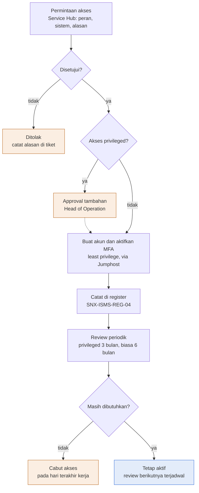

Deskripsi: Judul gambar "Akses diberikan sesuai kebutuhan dan dicabut tepat waktu". Alur vertikal dari permintaan akses sampai "Tetap aktif". Tiga diamond: "Disetujui?" (tidak ke kotak oranye "Ditolak"), "Akses privileged?" (ya ke kotak oranye "Approval tambahan: Head of Operation" dengan garis putus-putus kembali ke alur utama), dan "Masih dibutuhkan?" (tidak ke kotak oranye "Cabut akses pada hari terakhir kerja"). Kotak biru adalah "Tetap aktif". Kotak oranye "Ditolak" dan "Cabut akses" tidak punya garis kembali.
Sumber gambar: conv/1JoSiwoMglIxy7Ic3t0EhRfvzJgf5ydzT/img/media/rId26.png

## 4. Peran, RACI, record, KPI
- Peran: tabel 2.5; matriks akses: tabel 2.6; record: 2.9; KPI: 2.10. RACI formal tidak ada.
- Pemilik SOP dan approver akses privileged ke sistem pelanggan: Head of Operation. Reviewer periodik: pemilik sistem. Sampling log Jumphost triwulanan: Lead SOC.

## 5. Catatan kualitas dan celah
- Matriks Bagian 6 berlabel "acuan awal (USULAN)": "Matriks ini acuan awal (USULAN); pemilik sistem menetapkan detailnya di SNX-ISMS-REG-04." SNX-ISMS-REG-04 (md/isms) hanya register per akun (2 baris CONTOH) dengan dropdown Level "Read-only, Operator, Admin, Privileged"; tidak memuat matriks akses per sistem dan peran, sehingga detail yang dirujuk belum ada.
- Diagram menulis cabang "Masih dibutuhkan? tidak" menjadi kotak "Cabut akses / pada hari terakhir kerja". Teks Bagian 7.6 butir 3 menyatakan "Temuan (akun yatim, hak berlebih, akun tidak aktif lebih dari 90 hari) ditindaklanjuti paling lambat 10 hari kerja" (butir 2: keputusan Tetap, Ubah, atau Cabut); bahwa hasil review "Cabut" termasuk temuan ber-tenggat 10 hari kerja adalah inferensi, dan SNX-ISMS-REG-04 Cara pakai B21 menyebut "tindak lanjut maksimal 10 hari kerja". Frasa "hari terakhir kerja" di teks hanya ada di Bagian 7.5 butir 1 (pemberhentian) dan KPI Bagian 9 ("Akses dicabut pada hari terakhir kerja"). Selisih antara diagram dan teks.
- Tidak ada batas waktu tertulis untuk pembuatan akun setelah approval (Bagian 7.1 butir 3 "Administrator membuat akun dengan hak sesuai approval" tanpa waktu) dan tidak ada SLA respons permintaan akses (Bagian 9 hanya memuat empat KPI: pencabutan, review privileged, temuan 10 hari kerja, MFA).
- Akses privileged ke sistem pelanggan menyebut persetujuan pelanggan hanya bersyarat (Bagian 7.1 butir 2: "dan bila kontrak mensyaratkan, persetujuan pelanggan").
- Retensi log sesi Jumphost "Sesuai kapasitas, minimal 90 hari" (Bagian 8) sementara sampling review "triwulanan" oleh Lead SOC (Bagian 7.7 butir 2); triwulan sekitar 90 sampai 92 hari, sehingga log awal triwulan tidak dijamin masih tersedia saat sampling (inferensi). Masa simpan register REG-04 "3 tahun" (Bagian 8; sama dengan Kontrol Dokumen REG-04 B14 dan master list SNX-OPS-ML-00).
- Header ISO mencantumkan 5.15, 5.16, 5.17, 5.18, 8.2, 8.3, 8.5; butir 7.7 juga memakai "A 8.2, 8.18" dan 8.18 tidak ada di header (SoA memetakan 8.18 ke "SNX-ISMS-SOP-02 Bagian 7.7"). Hanya 5.17 dan 8.5 (7.2), 5.18 (7.5), dan 8.2 (7.7) yang bertanda eksplisit di heading; 5.15, 5.16, dan 8.3 tidak punya butir bertanda (SoA memetakan 8.3 "Information access restriction" ke SOP-02 secara umum).
- Rujukan SNX-OPS-SOP-02 untuk change request (Bagian 7.7 butir 1; judul "SOP Project Change Management"); SNX-ISMS-SOP-04 untuk pengembalian aset (Bagian 7.5 butir 3, "Aset perusahaan dikembalikan sesuai SNX-ISMS-SOP-04"; SOP-04 Bagian 6.4 "Pengembalian aset (A 5.11)"). SNX-ISMS-REG-04 (Bagian 7.1, 7.5, 7.6), SNX-ISMS-REG-01 ("Pemilik sistem (sesuai SNX-ISMS-REG-01)"; REG-01 punya kolom Pemilik) dan SNX-OPS-FRM-06 (Bagian 7.3 butir 2 "gate G3 (SNX-OPS-FRM-06)"; judul "Project Handover / BAST & Closure Report", memuat Checklist G3) ada di korpus.
- Tabel peran Bagian 5 tidak memuat Lead SOC (sampling log, Bagian 7.7) dan tidak memuat Service Delivery Manager; matriks Bagian 6 memakai kolom "SD dan PM" tanpa definisi di SOP-02 (POL-OPS-001 di md/ops mendefinisikan sub divisi "Service Delivery dan PM" dan peran "SD dan PM").
- Pengesahan: tanda tangan dan tanggal kosong; riwayat revisi dua baris bertanggal sama ("13 Oktober 2026") berstatus "Menunggu".

## 6. Kata kunci retrieval
kontrol akses, access control, user access, joiner mover leaver, onboarding offboarding akses, pencabutan akses, mutasi, review akses, access review, privileged access, Jumphost, MFA, password 12 karakter, least privilege, need-to-know, segregation of duties, break-glass, service account, akun pihak ketiga, vendor access, matriks akses peran, SNX-ISMS-REG-04, Service Hub, ISO 27001 A 5.15 A 5.16 A 5.17 A 5.18 A 8.2 A 8.3 A 8.5

<!-- FILE: isms/SNX-ISMS-SOP-03.md -->

---
doc_code: SNX-ISMS-SOP-03
title: SOP Backup & Recovery
department: Information Security
doc_type: SOP
source: {drive_file_id: 1z6y_n2i6cTN6C1y7alJsCasuy9hU6Qzc, filename: SNX-ISMS-SOP-03_SOP_Backup_Recovery.docx, format: docx, bytes: 142164, retrieved: 2026-10-13}
revision: 00 (DRAFT)
doc_date: 13 Oktober 2026 (tanggal draft; tanggal efektif "Ditetapkan saat pengesahan")
classification_in_doc: RESTRICTED (Internal)
owner_in_doc: Lead NOC
approver_in_doc: COO, Amirull Yusuf Zulkarnain
iso_refs: {iso9001: ["7.1.3", "8.5.3"], iso27001: ["A 8.13", "A 8.14"]}
kb_sensitivity_suggest: restricted:ops
related_docs: [SNX-ISMS-PLN-01, SNX-ISMS-FRM-01, SNX-ISMS-REG-01, SNX-ISMS-PRO-01, SNX-ISMS-SOP-02, SNX-ISMS-SOP-04, SNX-OPS-SOP-02, SNX-OPS-SOP-04, SNX-OPS-FRM-07, SNX-OPS-FRM-08, SNX-OPS-RPT-01, SKILL_backup-snapshot-ops]
coverage: {sections_or_sheets: "10 H1 (Bagian 1-9, Pengesahan; diagram ada di dalam Bagian 7) + 7 sub-bagian (6.1, 6.2, 7.1-7.5), semua dari sumber", tables: "8 dari 8", images: "1 dibuka dari 1", notes: "Tidak ada celah baca. Jadwal backup per sistem hanya pada tabel 6.1 (tingkat kelompok), tidak ada jadwal jam per job."}
---
# SNX-ISMS-SOP-03 SOP Backup & Recovery

## 1. Ringkasan
- Cakupan: layanan backup pelanggan (Acronis Cyber Protect, backup VM Nusagrid, backup server dikelola) sesuai kontrak, dan sistem internal (ticketing, Service Hub, knowledge base dan database, password manager, monitoring, konfigurasi network device dan WAF, dokumen Drive).
- Parameter standar (tabel 6.1): pelanggan sesuai kontrak (standar harian, retensi 30 hari); sistem internal kritis harian, retensi 30 hari, offsite ya, RPO 24 jam, RTO per PLN-01 Bagian 4 (4 sampai 24 jam); konfigurasi network device, WAF, server kritis setiap perubahan dan mingguan, retensi 90 hari, RPO 1 minggu, RTO 4 jam; snapshot pre-change sampai stabil maksimal 14 hari.
- Uji restore: bulanan untuk setiap pelanggan berlayanan backup, triwulanan untuk sistem internal kritis; uji gagal menjadi tiket P2 dan dianalisis akarnya; hasil masuk laporan bulanan pelanggan dan SNX-OPS-RPT-01.
- Pemantauan: shift malam memeriksa semua job; job gagal 2 kali berturut-turut menjadi tiket P2 (SNX-OPS-SOP-04); kapasitas repository dipantau mingguan, di atas 80% ditindaklanjuti.
- Perlindungan: aturan 3-2-1, encryption in transit dan at rest, kunci enkripsi di password manager terpisah dari backup, immutable copy bila didukung, akses console backup dibatasi dengan MFA.
- Target KPI: job sukses 98%; uji restore bulanan terlaksana 100%; uji restore berhasil percobaan pertama 95%; waktu restore uji dalam RTO 100%. Parameter sistem internal berlabel USULAN.

## 2. Isi lengkap terstruktur

### 2.0 Kontrol dokumen

| Atribut | Isi |
|---|---|
| Nomor dokumen | SNX-ISMS-SOP-03 |
| Judul | SOP Backup & Recovery |
| Revisi | 00 (DRAFT) |
| Tanggal draft | 13 Oktober 2026 |
| Tanggal efektif | Ditetapkan saat pengesahan |
| Klasifikasi | RESTRICTED (Internal) |
| Pemilik dokumen | Lead NOC |
| Disetujui oleh | COO, Amirull Yusuf Zulkarnain |
| Acuan ISO 9001:2015 | Klausul 7.1.3, 8.5.3 |
| Acuan ISO/IEC 27001:2022 | Klausul atau kontrol Annex A 8.13, 8.14 |
| Masa simpan record | Berlaku sampai digantikan |

Riwayat revisi:

| Revisi | Tanggal | Uraian perubahan | Disusun | Disetujui |
|---|---|---|---|---|
| 00 | 13 Oktober 2026 | Draft awal untuk sertifikasi ISO 9001:2015 dan ISO/IEC 27001:2022 | Divisi Operation | Menunggu |
| 00 | 13 Oktober 2026 | Review bahasa dan konsistensi: istilah teknologi dalam bahasa Inggris, bahasa Indonesia formal, label klasifikasi, keselarasan RTO dan target pulih | Divisi Operation | Menunggu |

### 2.1 Tujuan (Bagian 1)
Memastikan informasi, software, dan konfigurasi sistem dicadangkan sesuai kebutuhan bisnis dan kontrak, dilindungi dari kerusakan dan akses tidak sah, serta terbukti dapat dipulihkan melalui uji restore berkala.

### 2.2 Ruang lingkup (Bagian 2)
1. Layanan backup pelanggan (Acronis Cyber Protect, backup VM Nusagrid, backup server dikelola) sesuai kontrak.
2. Sistem internal SINUX yang mendukung operasi: ticketing system, Service Hub, knowledge base dan database pendukungnya, password manager, monitoring, konfigurasi network device dan WAF, dokumen di Drive.

Pelanggan tanpa layanan backup tidak dijanjikan pemulihan data; snapshot sebelum perubahan tetap diambil sebagai bagian dari SNX-OPS-SOP-02.

### 2.3 Referensi (Bagian 3)
- ISO 9001:2015 klausul 7.1.3, 8.5.3 (properti pelanggan).
- ISO/IEC 27001:2022 Annex A 8.13 (information backup), 8.14 (redundancy).
- SKILL_backup-snapshot-ops.
- SNX-ISMS-FRM-01 Backup Log & Restore Testing Records.

### 2.4 Definisi (Bagian 4)

| Istilah | Arti |
|---|---|
| RPO | Recovery Point Objective: batas maksimal data yang boleh hilang, diukur dalam waktu |
| RTO | Recovery Time Objective: batas maksimal waktu memulihkan layanan |
| Full backup, incremental backup | Copy seluruh data, atau hanya perubahan sejak backup terakhir |
| Offsite copy | Salinan di lokasi atau platform terpisah dari sumber |
| Immutable | Copy yang tidak dapat diubah atau dihapus selama masa retensi |

### 2.5 Peran dan tanggung jawab (Bagian 5)

| Peran | Tanggung jawab |
|---|---|
| Lead NOC | Pemilik SOP; menetapkan dan meninjau kebijakan backup; menyetujui restore produksi |
| NOC Engineer | Memantau job, menangani kegagalan, melaksanakan restore dan uji restore, mengisi log |
| Service Delivery Manager | Mencatat parameter backup pelanggan dari kontrak; melaporkan hasil uji restore di laporan bulanan |
| Pemilik sistem internal | Menetapkan RPO dan RTO sistemnya |
| Lead SOC | Memastikan backup terlindungi dari ransomware dan akses tidak sah |

### 2.6 Kebijakan backup (Bagian 6)

#### 6.1 Parameter standar

| Kelompok | Frekuensi minimal | Retensi minimal | Offsite copy | RPO | RTO |
|---|---|---|---|---|---|
| Layanan backup pelanggan | Sesuai kontrak; standar harian | Sesuai kontrak; standar 30 hari | Sesuai paket | Sesuai kontrak | Sesuai kontrak |
| Sistem internal kritis (ticketing system, password manager, knowledge base dan database-nya) | Harian | 30 hari | Ya | 24 jam | Sesuai SNX-ISMS-PLN-01 Bagian 4 (4 sampai 24 jam) |
| Konfigurasi network device, WAF, dan server kritis | Setiap perubahan dan mingguan | 90 hari | Ya | 1 minggu | 4 jam |
| Snapshot sebelum change | Setiap change yang berisiko | Sampai change dinyatakan stabil, maksimal 14 hari | Tidak wajib | Saat change | Sesuai rollback |

Parameter sistem internal adalah USULAN dan ditetapkan bersama SNX-ISMS-PLN-01.

#### 6.2 Prinsip perlindungan
1. Aturan 3-2-1 untuk data kritis: tiga copy, dua media atau platform berbeda, satu di luar lokasi sumber; immutable copy bila platform mendukung.
2. Backup di-encrypt saat in transit dan at rest; encryption key disimpan di password manager, terpisah dari backup.
3. Akses ke console dan repository backup dibatasi pada peran operator dengan MFA, sesuai SNX-ISMS-SOP-02.
4. Backup mengikuti klasifikasi data sumbernya (SNX-ISMS-PRO-01).
5. Data backup pelanggan adalah properti pelanggan dan hanya dipulihkan atas permintaan atau persetujuan PIC pelanggan yang berwenang.

### 2.7 Prosedur (Bagian 7)

#### 7.1 Konfigurasi job
1. Setiap job backup baru didokumentasikan: sumber, jadwal, retensi, tujuan, encryption, dan pemilik.
2. Job didaftarkan di SNX-ISMS-FRM-01 (sheet Daftar Job) dan sistemnya di SNX-ISMS-REG-01.
3. Perubahan job yang menurunkan frekuensi atau retensi diperlakukan sebagai change Normal.

#### 7.2 Pemantauan
1. Shift malam memeriksa status semua job backup dan mencatat hasilnya di SNX-ISMS-FRM-01 (sheet Backup Log).
2. Job gagal dijalankan ulang secepatnya; gagal 2 kali berturut-turut menjadi tiket P2 sesuai SNX-OPS-SOP-04.
3. Kapasitas repository dipantau mingguan; penggunaan di atas 80% ditindaklanjuti.

#### 7.3 Restore atas permintaan
1. Permintaan restore dicatat sebagai tiket dari PIC pelanggan yang terdaftar.
2. Restore ke lokasi produksi butuh approval Lead NOC dan persetujuan tertulis pelanggan; restore ke path uji terlebih dahulu bila memungkinkan, untuk menghindari menimpa data terbaru.
3. Hasil restore diverifikasi bersama pelanggan dan dicatat di SNX-ISMS-FRM-01 (sheet Restore Test dan Request).

#### 7.4 Uji restore berkala
1. Uji restore minimal bulanan untuk setiap pelanggan berlayanan backup, dan minimal triwulanan untuk sistem internal kritis.
2. Uji memulihkan sampel data ke lokasi uji, memverifikasi integritas (checksum atau pembukaan file atau start aplikasi), dan mengukur waktu pemulihan terhadap RTO.
3. Hasil (berhasil atau gagal, waktu, temuan) dicatat di SNX-ISMS-FRM-01; uji gagal ditangani sebagai tiket P2 dan dianalisis akarnya.
4. Ringkasan uji restore dimasukkan ke laporan bulanan pelanggan dan ke SNX-OPS-RPT-01.

#### 7.5 Penghapusan backup
1. Backup yang melewati masa retensi dihapus otomatis oleh platform.
2. Saat offboarding pelanggan, backup diserahkan atau dihapus sesuai kontrak, dengan berita acara.
3. Media backup fisik yang tidak terpakai dimusnahkan sesuai SNX-ISMS-SOP-04.

### 2.8 Record terkait (Bagian 8)

| Record | Nomor | Masa simpan |
|---|---|---|
| Backup Log & Restore Testing Records | SNX-ISMS-FRM-01 | 3 tahun |
| Tiket kegagalan backup dan permintaan restore | SNX-OPS-FRM-08 | 3 tahun |
| Jadwal PM uji restore | SNX-OPS-FRM-07 | 3 tahun |

### 2.9 Pemantauan kinerja (Bagian 9)

| Indikator | Target |
|---|---|
| Job backup sukses | 98% |
| Uji restore bulanan terlaksana per pelanggan backup | 100% |
| Uji restore berhasil pada percobaan pertama | 95% |
| Waktu restore uji dalam RTO | 100% |

### 2.10 Pengesahan

| Peran | Nama dan jabatan | Tanda tangan | Tanggal |
|---|---|---|---|
| Disusun oleh | Lead NOC | (kosong) | (kosong) |
| Diperiksa oleh | ISO/ISMS Coordinator | (kosong) | (kosong) |
| Disetujui oleh | COO, Amirull Yusuf Zulkarnain | (kosong) | (kosong) |

## 3. Diagram

### 3.1 Alur SOP Backup & Recovery

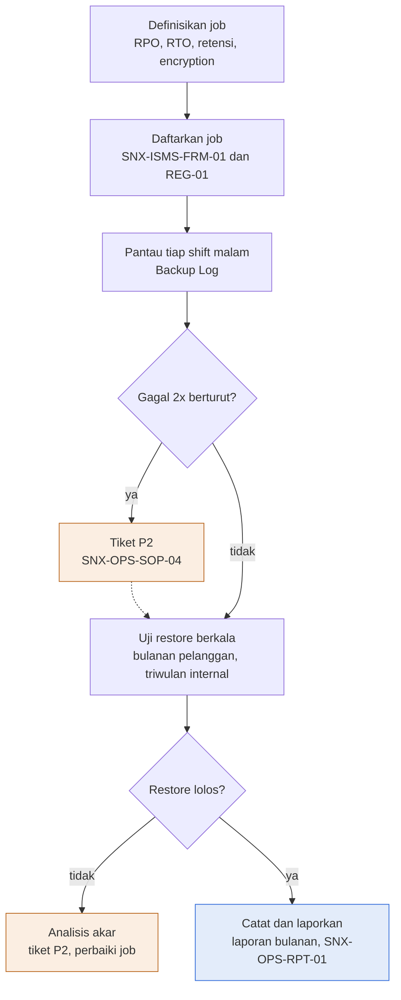

Deskripsi: Judul gambar "Backup dianggap ada hanya bila restore-nya terbukti". Alur vertikal dari definisi job sampai "Catat dan laporkan". Diamond "Gagal 2x berturut?" punya cabang ya ke kotak oranye "Tiket P2" (garis putus-putus kembali ke alur sebelum "Uji restore berkala"); diamond "Restore lolos?" punya cabang tidak ke kotak oranye "Analisis akar: tiket P2, perbaiki job" tanpa garis kembali. Kotak biru adalah "Catat dan laporkan".
Sumber gambar: conv/1z6y_n2i6cTN6C1y7alJsCasuy9hU6Qzc/img/media/rId28.png

## 4. Peran, RACI, record, KPI
- Peran: tabel 2.5; record: 2.8; KPI: 2.9. RACI formal tidak ada.
- Jadwal ringkas (dari tabel 6.1 dan butir 7.2, 7.4): job dipantau setiap shift malam; kapasitas repository mingguan; uji restore pelanggan bulanan; uji restore internal kritis triwulanan; backup konfigurasi setiap perubahan dan mingguan; backup sistem internal kritis harian.

## 5. Catatan kualitas dan celah
- Parameter sistem internal (Bagian 6.1) berlabel USULAN ("Parameter sistem internal adalah USULAN dan ditetapkan bersama SNX-ISMS-PLN-01"); kolom RTO sistem internal kritis hanya merujuk rentang "Sesuai SNX-ISMS-PLN-01 Bagian 4 (4 sampai 24 jam)". Angka per sistem ada di PLN-01 Bagian 4: password manager 4 jam (baris 5), ticketing 8 jam (baris 4), knowledge base 24 jam (baris 9); tidak ada angka per sistem di SOP-03.
- Kelompok "Sistem internal kritis (ticketing system, password manager, knowledge base dan database-nya)" di Bagian 6.1 menyamakan ketiganya (Harian, 30 hari, RPO 24 jam), sedangkan SNX-ISMS-PLN-01 Bagian 4 memberi Tingkat 1 (password manager), Tingkat 2 (ticketing), Tingkat 3 (knowledge base).
- Monitoring (Nusametric, Overseer; PLN-01 Bagian 4 baris 3, RPO "24 jam") dan Jumphost (baris 6, RPO "1 minggu (konfigurasi)") ada di PLN-01 tetapi tidak disebut eksplisit di tabel 6.1; "monitoring" hanya disebut di ruang lingkup (Bagian 2 butir 2), dan "Jumphost" tidak muncul sama sekali di SOP-03 (nol kemunculan); Jumphost hanya bisa tercakup lewat frasa "server kritis" di baris konfigurasi 6.1 (inferensi).
- Tidak ada jadwal jam eksekusi backup atau lokasi atau penyedia offsite yang disebut (Bagian 6.1 hanya "Frekuensi minimal" dan kolom "Offsite copy" Ya atau Tidak wajib; Bagian 4 mendefinisikan offsite copy sebagai "Salinan di lokasi atau platform terpisah dari sumber"). Jumlah copy disebut untuk data kritis: Bagian 6.2 butir 1 "tiga copy, dua media atau platform berbeda, satu di luar lokasi sumber" (aturan 3-2-1). Jadwal jam per job ada di FRM-01 Daftar Job kolom E (contoh "Harian 01:00").
- Frasa "P2" pada tiket backup (Bagian 7.2 butir 2 dan 7.4 butir 3) merujuk skala severity tiket SNX-OPS-SOP-04 (md/ops; Bagian 6 "P2 Tinggi", ack "30 menit", contoh "Backup job gagal 2 kali berturut"), yang berbeda konteks dengan P2 insiden keamanan di SNX-ISMS-SOP-01 Bagian 8 butir 2 ("Kompromi terbatas tanpa bukti kebocoran data ...").
- Header: masa simpan record "Berlaku sampai digantikan"; tabel record Bagian 8 menyebut "3 tahun" (FRM-01, SNX-OPS-FRM-08, SNX-OPS-FRM-07).
- Rujukan "SKILL_backup-snapshot-ops" (Bagian 3) adalah nama berpola SKILL_, bukan dokumen bernomor (inferensi: skill internal; PRO-OPS-001 di md/ops mendaftarkannya sebagai "Rujukan teknis", dan SNX-ISMS-REG-01 AST-007 memakainya sebagai acuan baseline). SNX-ISMS-FRM-01 dan REG-01 ada di md/isms; SNX-OPS-FRM-07 (Maintenance Schedule & Service Report), SNX-OPS-FRM-08 (Technical Ticket / Incident Register, kelas triage "Backup atau snapshot") dan SNX-OPS-RPT-01 (KPI no 3 dan 4 bersumber FRM-01) ada di md/ops. Ketidaksesuaian: Bagian 7.3 butir 3 menyebut "sheet Restore Test dan Request" padahal FRM-01 memakai nama sheet "Restore Record"; SNX-OPS-FRM-07 menjadwalkan uji restore bulanan untuk pelanggan berlayanan backup (aktivitas no 7) tetapi tidak memuat uji restore triwulanan sistem internal yang dituntut Bagian 7.4 butir 1.
- Pengesahan: tanda tangan dan tanggal kosong; riwayat revisi dua baris bertanggal sama ("13 Oktober 2026") berstatus "Menunggu".

## 6. Kata kunci retrieval
backup, recovery, restore, uji restore, restore test, RPO, RTO, retensi backup, offsite copy, immutable, aturan 3-2-1, Acronis Cyber Protect, backup VM Nusagrid, snapshot sebelum change, Backup Log, Lead NOC, NOC Engineer, shift malam, job backup gagal, kapasitas repository 80%, enkripsi backup, SNX-ISMS-FRM-01, ISO 27001 A 8.13 A 8.14, ISO 9001 8.5.3 properti pelanggan

<!-- FILE: isms/SNX-ISMS-SOP-04.md -->

---
doc_code: SNX-ISMS-SOP-04
title: SOP IT Asset & Configuration Management
department: Information Security
doc_type: SOP
source: {drive_file_id: 1L6fR1mUiCePwKjyrpSPOrCz-6FpJbDpg, filename: SNX-ISMS-SOP-04_SOP_IT_Asset_Configuration_Management.docx, format: docx, bytes: 159969, retrieved: 2026-10-13}
revision: 00 (DRAFT)
doc_date: 13 Oktober 2026 (tanggal draft; tanggal efektif "Ditetapkan saat pengesahan")
classification_in_doc: RESTRICTED (Internal)
owner_in_doc: Head of Operation
approver_in_doc: COO, Amirull Yusuf Zulkarnain
iso_refs: {iso9001: ["7.1.3", "8.5.2"], iso27001: ["A 5.9", "A 5.10", "A 5.11", "A 7.9", "A 7.14", "A 8.1", "A 8.9", "A 8.10", "A 8.19"]}
kb_sensitivity_suggest: restricted:ops
related_docs: [SNX-ISMS-REG-01, SNX-OPS-SOP-02, SNX-ISMS-SOP-01, SNX-ISMS-SOP-03, SNX-ISMS-PRO-01, SNX-OPS-FRM-04]
coverage: {sections_or_sheets: "11 H1 (Bagian 1-9, Diagram, Pengesahan) + 6 sub-bagian 6.x, semua dari sumber", tables: "7 dari 7", images: "1 dibuka dari 1", notes: "Tidak ada celah baca."}
---
# SNX-ISMS-SOP-04 SOP IT Asset & Configuration Management

## 1. Ringkasan
- Menjamin aset TI dan konfigurasi (hardware, aset virtual, software dan lisensi, informasi, layanan pihak ketiga) teridentifikasi, berpemilik, terklasifikasi, perubahan terkendali, dan dikembalikan atau dimusnahkan aman.
- Registrasi di SNX-ISMS-REG-01 paling lambat saat aset mulai dipakai, wajib sebelum gate G3 untuk aset pelanggan; data minimal: ID aset, nama, jenis, pemilik, pengguna atau pelanggan, lokasi atau platform, klasifikasi, nilai CIA, status, tanggal review.
- Review register oleh pemilik aset minimal semester; rekonsiliasi dengan sumber aktual triwulanan (selisih ditutup dalam 30 hari, target 95%); drift konfigurasi diperiksa minimal triwulanan.
- Kehilangan atau pencurian aset dilaporkan paling lambat 1 jam sesuai SNX-ISMS-SOP-01.
- Pemusnahan: wipe (overwrite atau secure erase) bila dipakai ulang, hancurkan fisik bila tidak; berita acara disimpan 5 tahun; VM dan volume pelanggan perlu konfirmasi tertulis pelanggan dua kali.
- Setiap perubahan konfigurasi CI melalui SNX-OPS-SOP-02; backup konfigurasi setiap perubahan dan mingguan (SNX-ISMS-SOP-03).

## 2. Isi lengkap terstruktur

### 2.0 Kontrol dokumen

| Atribut | Isi |
|---|---|
| Nomor dokumen | SNX-ISMS-SOP-04 |
| Judul | SOP IT Asset & Configuration Management |
| Revisi | 00 (DRAFT) |
| Tanggal draft | 13 Oktober 2026 |
| Tanggal efektif | Ditetapkan saat pengesahan |
| Klasifikasi | RESTRICTED (Internal) |
| Pemilik dokumen | Head of Operation |
| Disetujui oleh | COO, Amirull Yusuf Zulkarnain |
| Acuan ISO 9001:2015 | Klausul 7.1.3, 8.5.2 |
| Acuan ISO/IEC 27001:2022 | Klausul atau kontrol Annex A 5.9, 5.11, 7.14, 8.9, 8.19 |
| Masa simpan record | Berlaku sampai digantikan |

Riwayat revisi:

| Revisi | Tanggal | Uraian perubahan | Disusun | Disetujui |
|---|---|---|---|---|
| 00 | 13 Oktober 2026 | Draft awal untuk sertifikasi ISO 9001:2015 dan ISO/IEC 27001:2022 | Divisi Operation | Menunggu |
| 00 | 13 Oktober 2026 | Review bahasa dan konsistensi: istilah teknologi dalam bahasa Inggris, bahasa Indonesia formal, label klasifikasi, keselarasan RTO dan target pulih | Divisi Operation | Menunggu |

### 2.1 Tujuan (Bagian 1)
Memastikan seluruh aset TI dan konfigurasi yang dikelola SINUX teridentifikasi, memiliki pemilik, terklasifikasi, dikendalikan perubahannya, dan dikembalikan atau dimusnahkan secara aman di akhir siklus hidupnya.

### 2.2 Ruang lingkup (Bagian 2)
Aset informasi dan aset TI internal SINUX dan aset pelanggan yang dikelola SINUX sesuai kontrak:
- Hardware: server, network device, laptop kerja, media penyimpanan.
- Aset virtual: VM, container, layanan cloud, nama domain, sertifikat.
- Software dan lisensi: OS, panel hosting, security agent dan backup, aplikasi internal.
- Informasi: database, dokumen, konfigurasi, backup, log.
- Layanan pihak ketiga: platform cloud, DNS dan WAF, email, tiket, monitoring.

### 2.3 Referensi (Bagian 3)
- ISO 9001:2015 klausul 7.1.3, 8.5.2 (identifikasi dan ketertelusuran).
- ISO/IEC 27001:2022 Annex A 5.9, 5.10, 5.11, 7.9, 7.14, 8.1, 8.9, 8.19.
- SNX-ISMS-REG-01 Information Asset Register.
- SNX-OPS-SOP-02 Project Change Management.

### 2.4 Definisi (Bagian 4)

| Istilah | Arti |
|---|---|
| Aset | Segala sesuatu yang bernilai bagi SINUX atau pelanggan dan perlu dilindungi |
| Pemilik aset | Peran yang bertanggung jawab atas perlindungan dan penggunaan aset |
| Configuration item (CI) | Aset yang konfigurasinya dikendalikan, misalnya VM produksi, network device, WAF |
| Baseline konfigurasi | Konfigurasi standar yang disetujui sebagai acuan |
| Drift | Perbedaan konfigurasi aktual dari baseline tanpa change yang disetujui |

### 2.5 Peran dan tanggung jawab (Bagian 5)

| Peran | Tanggung jawab |
|---|---|
| Head of Operation | Pemilik SOP; memastikan register lengkap dan ditinjau |
| Pemilik aset | Klasifikasi, akses, dan siklus hidup asetnya |
| NOC Engineer | Mendaftarkan dan memperbarui aset dan CI saat provisioning, perubahan, dan dekomisi |
| Lead SOC | Baseline hardening dan pemeriksaan drift keamanan |
| Pengguna aset | Memakai aset sesuai aturan penggunaan yang dapat diterima |

### 2.6 Prosedur manajemen aset (Bagian 6)

#### 6.1 Registrasi
1. Aset baru didaftarkan di SNX-ISMS-REG-01 paling lambat saat aset mulai dipakai, dan wajib sebelum gate G3 untuk aset pelanggan.
2. Data minimal: ID aset, nama, jenis, pemilik, pengguna atau pelanggan, lokasi atau platform, klasifikasi (SNX-ISMS-PRO-01), nilai CIA, status, dan tanggal review.
3. Penamaan aset konsisten dan unik; IP address dan detail teknis sensitif disimpan di register yang berklasifikasi RESTRICTED.

#### 6.2 Penggunaan yang dapat diterima (A 5.10)
1. Aset perusahaan dipakai untuk kepentingan kerja.
2. Laptop kerja wajib screen lock otomatis, disk encryption, antivirus atau EDR aktif, dan update OS (A 8.1).
3. Instalasi software pada sistem operasional hanya melalui change request dan dari sumber resmi (A 8.19).
4. Kredensial tidak disimpan di laptop di luar password manager.

#### 6.3 Aset di luar kantor (A 7.9)
1. Laptop dan media yang dibawa ke luar kantor tetap dalam pengawasan pemakai dan tidak ditinggal di kendaraan.
2. Kehilangan atau pencurian dilaporkan paling lambat 1 jam sesuai SNX-ISMS-SOP-01; akses akun terkait segera dicabut atau dirotasi.

#### 6.4 Pengembalian aset (A 5.11)
1. Saat pemberhentian atau mutasi, seluruh aset perusahaan dan aset pelanggan yang dipegang dikembalikan dan dicocokkan dengan register.
2. Informasi kerja di perangkat pribadi (bila diizinkan) dihapus dan dikonfirmasi tertulis.

#### 6.5 Penghapusan dan pemusnahan aman (A 7.14, 8.10)
1. Media penyimpanan yang akan dipakai ulang di-wipe dengan metode overwrite atau secure erase; yang tidak dipakai ulang dihancurkan fisik.
2. VM dan volume pelanggan yang dihapus mengikuti kontrak dan konfirmasi tertulis pelanggan dua kali (SNX-OPS-SOP-02).
3. Pemusnahan dicatat dengan berita acara: ID aset, metode, tanggal, pelaksana, saksi. Status aset di register diubah menjadi Dimusnahkan.

#### 6.6 Review register
1. Pemilik aset meninjau asetnya minimal semester; Head of Operation memastikan review terlaksana.
2. Rekonsiliasi register dengan sumber aktual (console Nusagrid, Overseer, Acronis, Cloudflare, daftar lisensi) dilakukan triwulanan; selisih ditindaklanjuti.

### 2.7 Prosedur manajemen konfigurasi (Bagian 7, A 8.9)
1. Configuration item ditandai di SNX-ISMS-REG-01 (kolom CI) beserta acuan baseline konfigurasinya.
2. Baseline hardening disusun per jenis sistem (misalnya server Linux, panel hosting, network device, WAF) dan disimpan di knowledge base sebagai runbook.
3. Setiap perubahan konfigurasi CI melalui SNX-OPS-SOP-02; konfigurasi sebelum dan sesudah dicatat di change request.
4. Backup konfigurasi CI diambil setiap perubahan dan mingguan sesuai SNX-ISMS-SOP-03.
5. Drift diperiksa minimal triwulanan dengan membandingkan konfigurasi aktual ke baseline; drift tanpa change dianalisis sebagai event keamanan atau ketidaksesuaian.
6. Konfigurasi yang dihasilkan otomatis oleh generator (misalnya vhost WAF) diverifikasi ulang setelah setiap Apply, karena perubahan manual dapat tertimpa.

### 2.8 Record terkait (Bagian 8)

| Record | Nomor | Masa simpan |
|---|---|---|
| Information Asset Register | SNX-ISMS-REG-01 | Berlaku sampai digantikan |
| Change request konfigurasi | SNX-OPS-FRM-04 | 3 tahun |
| Berita acara pemusnahan | Lampiran SNX-ISMS-REG-01 | 5 tahun |

### 2.9 Pemantauan kinerja (Bagian 9)

| Indikator | Target |
|---|---|
| Aset produksi terdaftar sebelum G3 | 100% |
| Review register semesteran terlaksana | 100% |
| Selisih rekonsiliasi triwulanan ditutup dalam 30 hari | 95% |
| Drift konfigurasi tanpa change | Nol |

### 2.10 Pengesahan

| Peran | Nama dan jabatan | Tanda tangan | Tanggal |
|---|---|---|---|
| Disusun oleh | Head of Operation | (kosong) | (kosong) |
| Diperiksa oleh | ISO/ISMS Coordinator | (kosong) | (kosong) |
| Disetujui oleh | COO, Amirull Yusuf Zulkarnain | (kosong) | (kosong) |

## 3. Diagram

### 3.1 Alur SOP IT Asset & Configuration Management

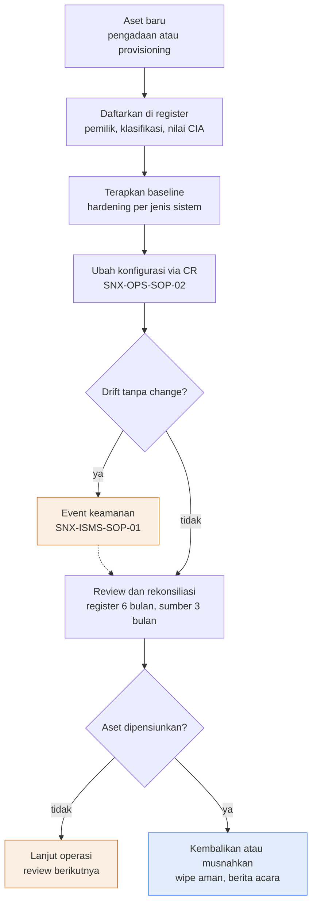

Deskripsi: Judul gambar "Aset tercatat dari masuk sampai dimusnahkan dengan aman". Alur vertikal dari aset baru sampai "Kembalikan atau musnahkan". Diamond "Drift tanpa change?" punya cabang ya ke kotak oranye "Event keamanan SNX-ISMS-SOP-01" dengan garis putus-putus kembali ke alur utama; diamond "Aset dipensiunkan?" punya cabang tidak ke kotak oranye "Lanjut operasi, review berikutnya" (tanpa garis kembali). Kotak biru adalah "Kembalikan atau musnahkan" (wipe aman, berita acara).
Sumber gambar: conv/1L6fR1mUiCePwKjyrpSPOrCz-6FpJbDpg/img/media/rId25.png

## 4. Peran, RACI, record, KPI
- Peran: tabel 2.5; record: 2.8; KPI: 2.9. RACI formal tidak ada.
- Frekuensi: review register oleh pemilik aset semesteran; rekonsiliasi triwulanan; drift triwulanan; backup konfigurasi setiap perubahan dan mingguan; lapor kehilangan aset 1 jam.

## 5. Catatan kualitas dan celah
- Header ISO mencantumkan Annex A 5.9, 5.11, 7.14, 8.9, 8.19; Bagian 3 menambah 5.10, 7.9, 8.1 (5.10 juga di heading 6.2, 8.1 di Bagian 6.2 butir 2, 7.9 di heading 6.3), dan heading 6.5 memakai 8.10; keempatnya tidak ada di header (8.10 hanya di heading 6.5, tidak ada di daftar Bagian 3). SNX-ISMS-SOA-01 memetakan 8.10 "Information deletion" ke "SNX-ISMS-PRO-01, SNX-ISMS-SOP-04".
- Rujukan "SNX-OPS-SOP-02 Project Change Management" dipakai untuk change konfigurasi CI (Bagian 7 butir 3) dan konfirmasi hapus VM pelanggan (Bagian 6.5 butir 2 "konfirmasi tertulis pelanggan dua kali"); SNX-OPS-SOP-02 (md/ops) berjudul sama dan Bagian 6 memuat "Delete VM bersifat unrecoverable dan butuh konfirmasi tertulis pelanggan dua kali". SNX-ISMS-SOP-01 dirujuk untuk pelaporan kehilangan atau pencurian (Bagian 6.3 butir 2, "paling lambat 1 jam"), selaras dengan SOP-01 Bagian 7 butir 1 ("paling lambat 1 jam sejak mengetahui").
- Tidak ada batas waktu untuk pengembalian aset saat pemberhentian atau mutasi (Bagian 6.4 butir 1 "seluruh aset ... dikembalikan dan dicocokkan dengan register"); SNX-ISMS-SOP-02 Bagian 7.5 butir 1 mencabut akses "paling lambat pada hari terakhir kerja" dan butir 3 merujuk pengembalian aset ke SOP-04.
- SNX-ISMS-PRO-01 (Bagian 6 baris Pemusnahan SECRET: "media dihancurkan atau di-wipe sesuai SNX-ISMS-SOP-04") dan SNX-ISMS-SOP-03 (Bagian 7.5 butir 3: "Media backup fisik yang tidak terpakai dimusnahkan sesuai SNX-ISMS-SOP-04") merujuk ke dokumen ini untuk pemusnahan media; isi Bagian 6.5 butir 1 (wipe overwrite atau secure erase, atau hancur fisik) konsisten dengan rujukan tersebut.
- Berita acara pemusnahan disimpan "5 tahun" sebagai "Lampiran SNX-ISMS-REG-01" (Bagian 8); lampiran itu adalah sheet "Pemusnahan" di SNX-ISMS-REG-01 (kolom No BA, Tanggal, ID aset, Uraian aset dan media, Metode, Alasan, Pelaksana, Saksi, Bukti, sesuai Bagian 6.5 butir 3), tetapi sheet itu kosong dan Kontrol Dokumen REG-01 (B14) hanya "Berlaku sampai digantikan" tanpa masa simpan 5 tahun. Header SOP-04 menyebut masa simpan record "Berlaku sampai digantikan".
- Skala nilai CIA tidak didefinisikan di dokumen ini (Bagian 6.1 butir 2 hanya "nilai CIA"); skala ada di SNX-ISMS-REG-01 Cara pakai B19: "nilai C, I, A dengan skala 1 (rendah) sampai 3 (tinggi)".
- Pengesahan: tanda tangan dan tanggal kosong; riwayat revisi dua baris bertanggal sama ("13 Oktober 2026") berstatus "Menunggu".

## 6. Kata kunci retrieval
manajemen aset, IT asset management, configuration management, CI configuration item, baseline konfigurasi, drift konfigurasi, hardening, Information Asset Register, SNX-ISMS-REG-01, pemusnahan aman, secure erase, wipe, berita acara pemusnahan, pengembalian aset, laptop kerja, disk encryption, aset di luar kantor, rekonsiliasi register, gate G3, ISO 27001 A 5.9 A 5.10 A 5.11 A 7.9 A 7.14 A 8.1 A 8.9 A 8.19, ISO 9001 8.5.2

<!-- FILE: isms/SNX-ISMS-SOP-05.md -->

---
doc_code: SNX-ISMS-SOP-05
title: SOP Vulnerability & Patch Management
department: Information Security
doc_type: SOP
source: {drive_file_id: 160t8vg9Eb_ItxjLuWxLG17OIAKpxSsKC, filename: SNX-ISMS-SOP-05_SOP_Vulnerability_Patch_Management.docx, format: docx, bytes: 176549, retrieved: 2026-10-13}
revision: 00 (DRAFT)
doc_date: 13 Oktober 2026 (tanggal draft; tanggal efektif "Ditetapkan saat pengesahan")
classification_in_doc: RESTRICTED (Internal)
owner_in_doc: Lead SOC
approver_in_doc: COO, Amirull Yusuf Zulkarnain
iso_refs: {iso9001: ["10.2"], iso27001: ["A 5.7", "A 8.7", "A 8.8", "A 8.19"]}
kb_sensitivity_suggest: restricted:ops
related_docs: [SNX-OPS-SOP-02, SNX-OPS-SOP-03, SNX-ISMS-SOP-01, SNX-ISMS-REG-01, SNX-ISMS-REG-03, SNX-OPS-FRM-04, SNX-OPS-FRM-07, SNX-OPS-FRM-08]
coverage: {sections_or_sheets: "10 H1 (Bagian 1-9, Pengesahan; diagram ada di dalam Bagian 7) + 5 sub-bagian 7.1-7.5, semua dari sumber", tables: "7 dari 7", images: "1 dibuka dari 1", notes: "Tidak ada celah baca."}
---
# SNX-ISMS-SOP-05 SOP Vulnerability & Patch Management

## 1. Ringkasan
- Tenggat perbaikan atau mitigasi per prioritas: Darurat 72 jam (mitigasi sementara 24 jam); Kritis (CVSS 9.0 atau lebih) 7 hari; Tinggi (CVSS 7.0 sampai 8.9) 30 hari; Sedang (CVSS 4.0 sampai 6.9) 90 hari; Rendah (CVSS di bawah 4.0) siklus patch berikutnya. Tenggat berlabel USULAN.
- Scan: authenticated scan internal dan aset pelanggan terkelola minimal bulanan (dan setelah perubahan besar); scan eksternal minimal bulanan; Lead SOC menelaah sumber advisory minimal mingguan dan segera untuk advisory kritis.
- Sumber: advisory vendor (cPanel dan CloudLinux, Linux, Zimbra, nginx, PHP, hypervisor, Acronis, network device), CVE dan CISA KEV, peringatan BSSN dan CSIRT sektor, hasil scan, temuan insiden, pentest, dan audit.
- Patch production melalui SNX-OPS-SOP-02 (Standar, Normal, atau Emergency untuk patch darurat); di server cPanel `yum install` atau `remove perl-*` dilarang.
- Vulnerability yang dieksploitasi aktif diperlakukan sebagai potensi insiden: sweep IOC sebelum dan sesudah patch (SNX-ISMS-SOP-01).
- Pengecualian prioritas Darurat dan Kritis butuh persetujuan Head of Operation, dicatat di SNX-ISMS-REG-03. KPI: Darurat dan Kritis ditutup dalam tenggat 95%; Tinggi 90%; cakupan scan produksi 100%; anti-malware aktif 100%.

## 2. Isi lengkap terstruktur

### 2.0 Kontrol dokumen

| Atribut | Isi |
|---|---|
| Nomor dokumen | SNX-ISMS-SOP-05 |
| Judul | SOP Vulnerability & Patch Management |
| Revisi | 00 (DRAFT) |
| Tanggal draft | 13 Oktober 2026 |
| Tanggal efektif | Ditetapkan saat pengesahan |
| Klasifikasi | RESTRICTED (Internal) |
| Pemilik dokumen | Lead SOC |
| Disetujui oleh | COO, Amirull Yusuf Zulkarnain |
| Acuan ISO 9001:2015 | Klausul 10.2 |
| Acuan ISO/IEC 27001:2022 | Klausul atau kontrol Annex A 5.7, 8.7, 8.8, 8.19 |
| Masa simpan record | Berlaku sampai digantikan |

Riwayat revisi:

| Revisi | Tanggal | Uraian perubahan | Disusun | Disetujui |
|---|---|---|---|---|
| 00 | 13 Oktober 2026 | Draft awal untuk sertifikasi ISO 9001:2015 dan ISO/IEC 27001:2022 | Divisi Operation | Menunggu |
| 00 | 13 Oktober 2026 | Review bahasa dan konsistensi: istilah teknologi dalam bahasa Inggris, bahasa Indonesia formal, label klasifikasi, keselarasan RTO dan target pulih | Divisi Operation | Menunggu |

### 2.1 Tujuan (Bagian 1)
Menetapkan cara SINUX memperoleh informasi technical vulnerability, menilai paparannya, dan menutupnya melalui patch atau mitigasi dalam tenggat yang sesuai risiko, termasuk perlindungan terhadap malware.

### 2.2 Ruang lingkup (Bagian 2)
Sistem internal SINUX dan sistem pelanggan yang patching-nya menjadi tanggung jawab SINUX menurut kontrak: OS server, hypervisor dan platform, panel hosting (WHM dan cPanel), web server dan PHP, email server, network device, WAF, security agent dan backup, serta aplikasi internal. Patch aplikasi milik pelanggan menjadi tanggung jawab developer atau PIC pelanggan; SINUX menyampaikan temuan dan rekomendasinya.

### 2.3 Referensi (Bagian 3)
- ISO 9001:2015 klausul 10.2.
- ISO/IEC 27001:2022 Annex A 5.7 (threat intelligence), 8.7 (protection against malware), 8.8 (management of technical vulnerabilities), 8.19.
- SNX-OPS-SOP-02 Project Change Management, SNX-OPS-SOP-03 Preventive & Corrective Maintenance.

### 2.4 Peran dan tanggung jawab (Bagian 4)

| Peran | Tanggung jawab |
|---|---|
| Lead SOC | Pemilik SOP; memantau sumber informasi vulnerability; menilai prioritas; memverifikasi penutupan |
| SOC Analyst | Vulnerability scan, triage temuan, sweep IOC terkait CVE yang dieksploitasi |
| Lead NOC dan NOC Engineer | Menjadwalkan dan memasang patch melalui change request |
| Pemilik aset | Menyetujui window patch dan menerima risiko bila patch ditunda |
| Service Delivery Manager | Mengomunikasikan temuan dan jadwal kepada pelanggan |

### 2.5 Sumber informasi vulnerability (Bagian 5, A 5.7)
1. Advisory vendor untuk stack yang dikelola (cPanel dan CloudLinux, distribusi Linux, Zimbra, nginx, PHP, hypervisor, Acronis, network device).
2. Database CVE dan katalog Known Exploited Vulnerabilities (CISA KEV), serta peringatan BSSN dan CSIRT sektor terkait.
3. Hasil vulnerability scan internal dan eksternal.
4. Temuan dari insiden, pentest, dan audit.

Lead SOC menelaah sumber tersebut minimal mingguan dan segera untuk advisory kritis.

### 2.6 Penilaian prioritas (Bagian 6)

| Prioritas | Kriteria | Tenggat perbaikan atau mitigasi |
|---|---|---|
| Darurat | Dieksploitasi aktif di dunia nyata dan dapat dijangkau dari internet, atau RCE tanpa autentikasi | 72 jam; mitigasi sementara (blok WAF, matikan fitur) dalam 24 jam |
| Kritis | CVSS 9.0 atau lebih | 7 hari |
| Tinggi | CVSS 7.0 sampai 8.9 | 30 hari |
| Sedang | CVSS 4.0 sampai 6.9 | 90 hari |
| Rendah | CVSS di bawah 4.0 | Siklus patch berikutnya |

Prioritas dapat dinaikkan atau diturunkan berdasarkan paparan aktual (dapat dijangkau dari internet atau tidak), nilai aset, dan mitigasi yang sudah ada. Tenggat di atas adalah USULAN dan disahkan bersama SNX-ISMS-REG-03.

### 2.7 Prosedur (Bagian 7)

#### 7.1 Identifikasi dan scan
1. Authenticated vulnerability scan terhadap aset internal dan aset pelanggan yang dikelola minimal bulanan, dan setelah perubahan besar.
2. Scan eksternal (dari vantage di luar network internal) terhadap layanan yang terbuka ke internet minimal bulanan.
3. Temuan dicatat sebagai tiket dengan ID aset dari SNX-ISMS-REG-01, CVE, prioritas, dan tenggat.

#### 7.2 Penanganan
1. Patch diuji terlebih dahulu pada sistem non-produksi atau satu host perwakilan bila memungkinkan.
2. Pemasangan patch pada production melalui SNX-OPS-SOP-02: patch rutin sebagai change Standar atau Normal di window maintenance; patch darurat boleh sebagai change Emergency.
3. Di server cPanel, `yum install` atau `remove perl-*` dilarang; update mengikuti mekanisme resmi panel.
4. Bila patch belum tersedia atau tidak bisa dipasang, terapkan mitigasi kompensasi (rule WAF, nonaktifkan layanan yang vulnerable, batasi akses network) dan catat.
5. Vulnerability yang dieksploitasi aktif pada aset kita diperlakukan sebagai potensi insiden: lakukan sweep IOC sesuai SNX-ISMS-SOP-01 sebelum dan sesudah patch, karena patch tidak menghapus kompromi yang sudah terjadi.

#### 7.3 Verifikasi dan penutupan
1. Penutupan diverifikasi dengan scan ulang atau pemeriksaan versi; klaim tertutup didukung dua sumber.
2. Tiket ditutup dengan bukti verifikasi.

#### 7.4 Pengecualian dan penerimaan risiko
1. Patch yang tidak dapat dipasang sesuai tenggat dicatat sebagai pengecualian: alasan, mitigasi, tanggal tinjau ulang, dan persetujuan pemilik aset.
2. Pengecualian untuk prioritas Darurat dan Kritis butuh persetujuan Head of Operation dan dicatat di SNX-ISMS-REG-03 sebagai risiko yang diterima.

#### 7.5 Perlindungan malware (A 8.7)
1. Server dan laptop kerja menjalankan anti-malware atau EDR yang aktif dan diperbarui; fleet hosting pelanggan memakai solusi yang disepakati kontrak (misalnya ImunifyAV untuk panel hosting tertentu).
2. Deteksi malware ditangani sesuai SNX-ISMS-SOP-01.
3. Download software hanya dari sumber resmi dan diverifikasi checksum bila tersedia.

### 2.8 Record terkait (Bagian 8)

| Record | Nomor | Masa simpan |
|---|---|---|
| Tiket temuan vulnerability dan patch | SNX-OPS-FRM-08 | 3 tahun |
| Change request patch | SNX-OPS-FRM-04 | 3 tahun |
| Jadwal dan service report patch bulanan | SNX-OPS-FRM-07 | 3 tahun |
| Pengecualian dan risiko diterima | SNX-ISMS-REG-03 | Berlaku sampai digantikan |
| Laporan scan | Folder SOC (RESTRICTED) | 3 tahun |

### 2.9 Pemantauan kinerja (Bagian 9)

| Indikator | Target |
|---|---|
| Vulnerability Darurat dan Kritis ditutup dalam tenggat | 95% |
| Vulnerability Tinggi ditutup dalam tenggat | 90% |
| Cakupan scan bulanan terhadap aset produksi | 100% |
| Endpoint dengan anti-malware aktif | 100% |

### 2.10 Pengesahan

| Peran | Nama dan jabatan | Tanda tangan | Tanggal |
|---|---|---|---|
| Disusun oleh | Lead SOC | (kosong) | (kosong) |
| Diperiksa oleh | ISO/ISMS Coordinator | (kosong) | (kosong) |
| Disetujui oleh | COO, Amirull Yusuf Zulkarnain | (kosong) | (kosong) |

## 3. Diagram

### 3.1 Alur SOP Vulnerability & Patch Management

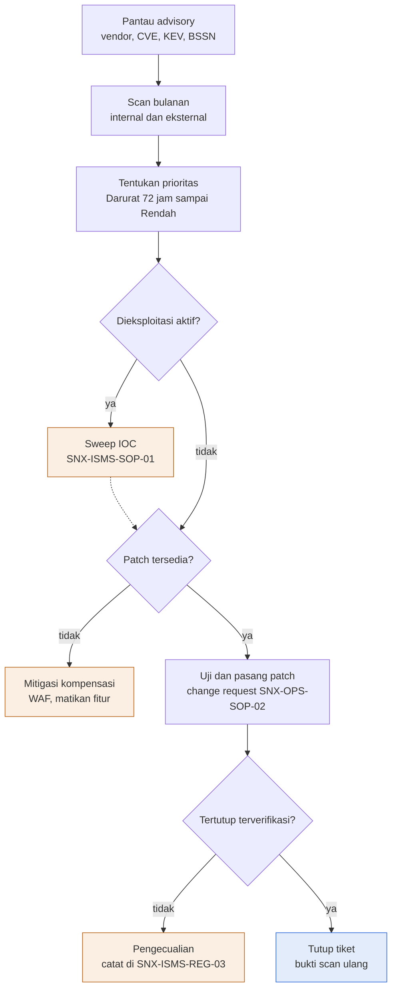

Deskripsi: Judul gambar "Vulnerability ditutup sesuai prioritas, dieksploitasi aktif berarti cek kompromi". Alur vertikal dari "Pantau advisory" sampai "Tutup tiket". Tiga diamond: "Dieksploitasi aktif?" (ya ke kotak oranye "Sweep IOC", garis putus-putus kembali ke alur), "Patch tersedia?" (tidak ke kotak oranye "Mitigasi kompensasi: WAF, matikan fitur", tanpa garis kembali), "Tertutup terverifikasi?" (tidak ke kotak oranye "Pengecualian: catat di SNX-ISMS-REG-03", tanpa garis kembali). Kotak biru adalah "Tutup tiket, bukti scan ulang". Kotak "Tentukan prioritas" memuat label "Darurat 72 jam sampai Rendah".
Sumber gambar: conv/160t8vg9Eb_ItxjLuWxLG17OIAKpxSsKC/img/media/rId26.png

## 4. Peran, RACI, record, KPI
- Peran: tabel 2.4; record: 2.8; KPI: 2.9. RACI formal tidak ada.
- Frekuensi: review sumber advisory minimal mingguan; scan internal dan eksternal minimal bulanan; verifikasi penutupan dengan scan ulang atau cek versi.

## 5. Catatan kualitas dan celah
- Tenggat Bagian 6 berlabel USULAN: "Tenggat di atas adalah USULAN dan disahkan bersama SNX-ISMS-REG-03"; belum final. REG-03 (md/isms) tidak memuat tenggat patch 72 jam, 7, 30, atau 90 hari (hanya RTP-003 F7 "pantau advisory mingguan sesuai SNX-ISMS-SOP-05"), sehingga pengesahan bersama itu belum terlihat di REG-03.
- Kriteria Darurat (Bagian 6) tidak memakai skor CVSS ("Dieksploitasi aktif di dunia nyata dan dapat dijangkau dari internet, atau RCE tanpa autentikasi"), sehingga kerentanan CVSS 9.0 atau lebih tanpa eksploitasi aktif masuk Kritis (7 hari), kecuali prioritas dinaikkan atau diturunkan berdasarkan paparan aktual (kalimat di bawah tabel). Tidak ada aturan bila skor CVSS tidak tersedia.
- Skala prioritas patch (Darurat, Kritis, Tinggi, Sedang, Rendah) berbeda dari severity insiden P1 sampai P4 (SNX-ISMS-SOP-01 Bagian 8 butir 2), Tingkat 1 sampai 3 layanan (SNX-ISMS-PLN-01 Bagian 4), level risiko Kritis, Tinggi, Sedang, Rendah dengan ambang skor (SNX-ISMS-REG-02 Matriks Risiko A3), dan severity tiket P1 Kritis sampai P4 Rendah (SNX-OPS-SOP-04 Bagian 6). Setidaknya empat skala berbeda dipakai dan nama "Kritis", "Tinggi", "Sedang", "Rendah" dipakai ganda tanpa pemetaan antar skala di SOP-05.
- KPI (Bagian 9) hanya mencakup "Darurat dan Kritis" (95%) dan "Tinggi" (90%); Sedang dan Rendah tidak punya target persentase.
- Larangan `yum install` atau `remove perl-*` (Bagian 7.2 butir 3) hanya untuk server cPanel ("Di server cPanel, ... dilarang"); tidak ada aturan setara untuk stack lain (SNX-OPS-SOP-02 md/ops memuat larangan yang sama, juga hanya untuk server cPanel).
- Rujukan SNX-OPS-SOP-02 ("Project Change Management") dan SNX-OPS-SOP-03 ("Preventive & Corrective Maintenance") (Bagian 3) sesuai judul dokumen di md/ops. Bagian 8: SNX-OPS-FRM-04 (Change Request & Approval Log) dan SNX-OPS-FRM-07 (Maintenance Schedule & Service Report; aktivitas no 6 "Patch keamanan dan update OS (SNX-ISMS-SOP-05)", Bulanan) ada dan sejalan. SNX-OPS-FRM-08 (Technical Ticket / Incident Register) dipakai sebagai "Tiket temuan vulnerability dan patch", tetapi dropdown Kelas triage FRM-08 tidak punya kelas vulnerability atau patch (hanya "Keamanan (ke SOC)") dan severity-nya P1 sampai P4, bukan prioritas Darurat sampai Rendah. REG-03 tidak diberi judul di SOP-05; di SOP-01 REG-03 dipakai bersama REG-02 untuk risiko atau kontrol (Bagian 12 butir 3), di SOP-05 untuk pengecualian dan risiko diterima (Bagian 7.4 butir 2); REG-03 berjudul "Information Security Risk Treatment Plan" dan punya kolom "Diterima oleh" serta opsi "Terima".
- Tidak ada waktu respons untuk pengecualian: Bagian 7.4 butir 1 mencatat "alasan, mitigasi, tanggal tinjau ulang, dan persetujuan pemilik aset" tanpa batas maksimum masa pengecualian.
- Header ISO (5.7, 8.7, 8.8, 8.19) identik dengan daftar Bagian 3; tag eksplisit di heading hanya 5.7 (Bagian 5) dan 8.7 (Bagian 7.5), sedangkan 8.8 dan 8.19 hanya ada di Bagian 3.
- Pengesahan: tanda tangan dan tanggal kosong; riwayat revisi dua baris bertanggal sama ("13 Oktober 2026") berstatus "Menunggu".

## 6. Kata kunci retrieval
vulnerability management, patch management, manajemen kerentanan, CVSS, tenggat patch, Darurat 72 jam, Kritis 7 hari, Tinggi 30 hari, Sedang 90 hari, Rendah, CISA KEV, BSSN, CSIRT, authenticated scan, scan eksternal, mitigasi kompensasi, WAF, cPanel, WHM, yum install dilarang, pengecualian patch, risiko diterima, sweep IOC, anti-malware, EDR, ImunifyAV, Lead SOC, ISO 27001 A 5.7 A 8.7 A 8.8 A 8.19
