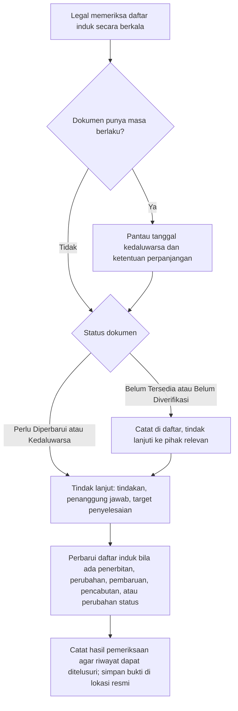
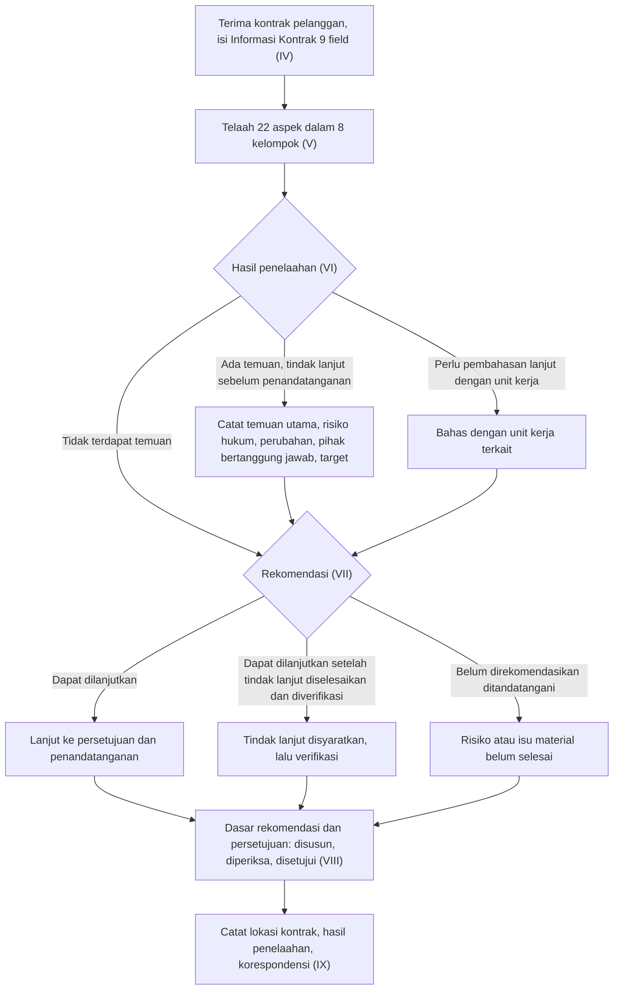
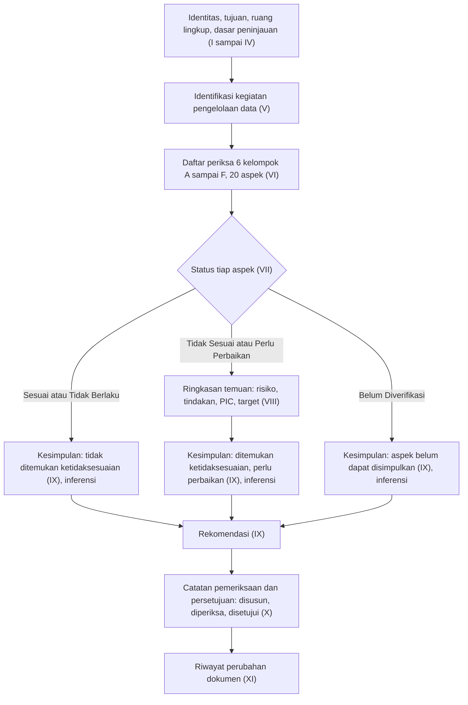
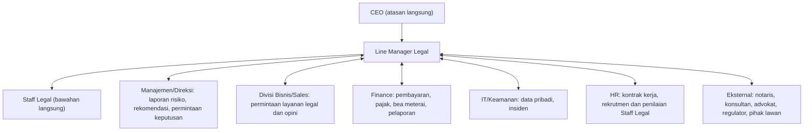
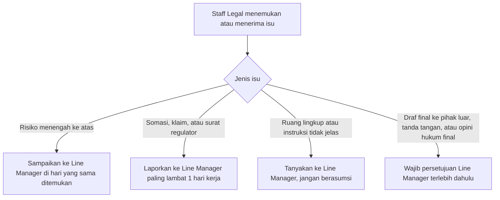
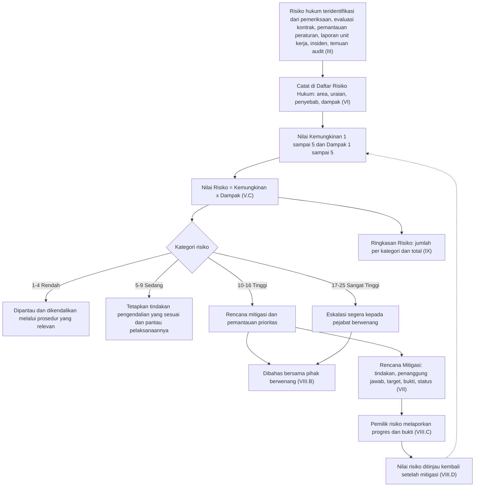
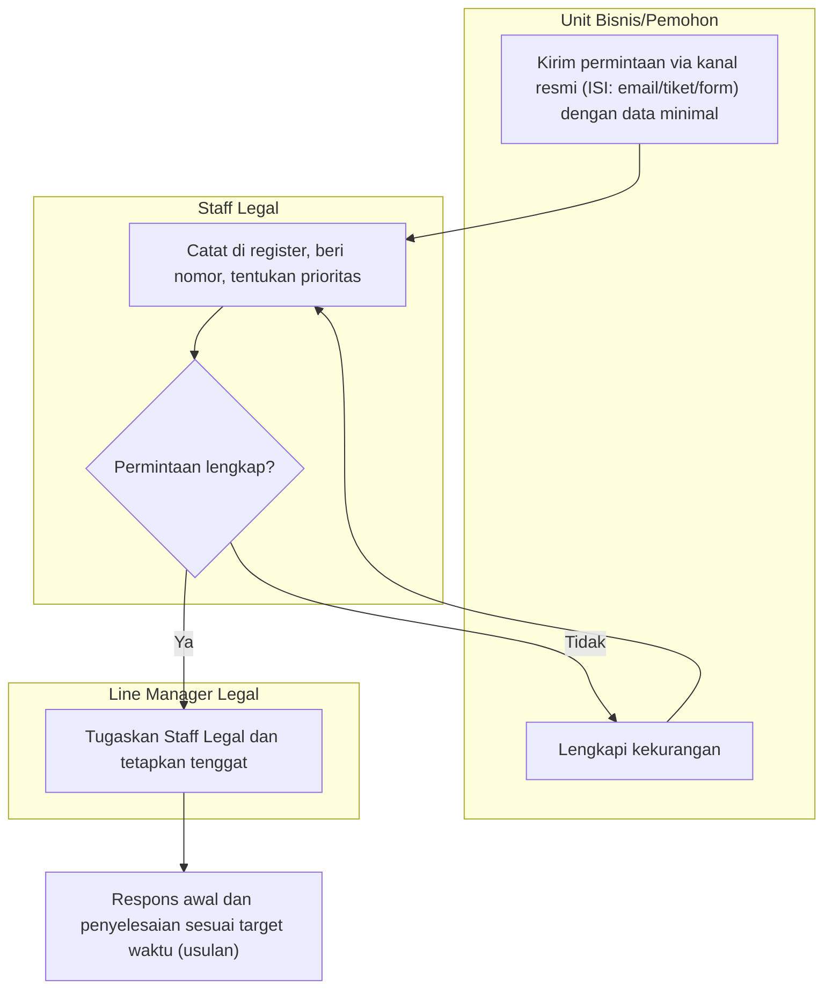
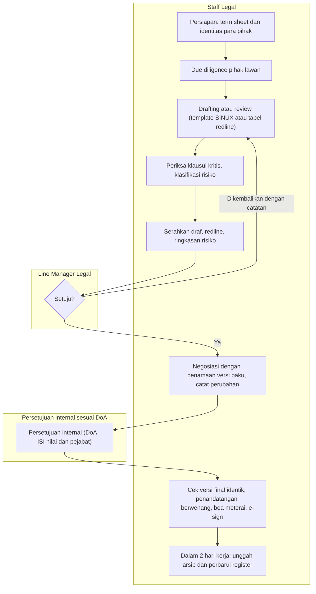
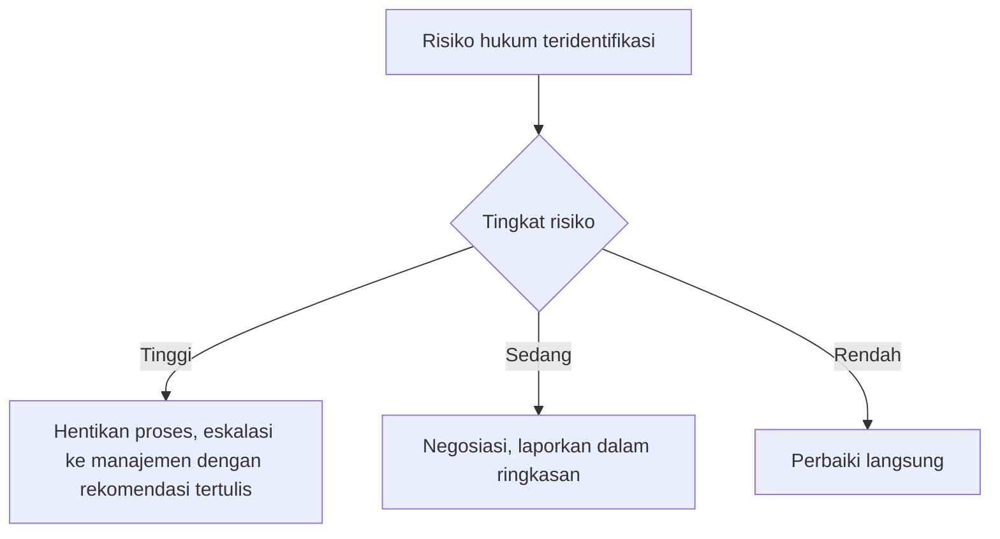
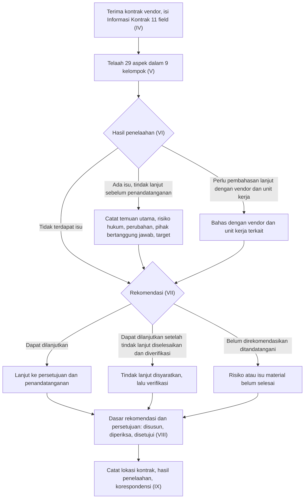

# ISO SINUX Supporting Docs korpus: Legal (8 dokumen: register perizinan, SOP, checklist, DP review, risk register, jobdesk)

as_of: 2026-10-14 | lane: ISO Supporting Documents (ingest 13 sampai 14 Okt 2026) | status: NON-KANONIK, dokumen sumber DRAFT | sensitivitas isi: restricted:legal
Isi: md AI-friendly per dokumen sumber (frontmatter + 1 Ringkasan, 2 Isi lengkap, 3 Diagram mermaid, 4 Peran/RACI/record/KPI, 5 Catatan kualitas berkutipan, 6 Kata kunci).
Navigasi: `readme-iso-supdocs-2026-10-14.md`. Penutup sesi dan keputusan owner: verdict bagian 7 dan handoff (`05_HANDOFF`). Setiap bagian diawali penanda `<!-- FILE: path -->` (path relatif terhadap folder md/ korpus; sama dengan nama berkas di staging `isoraw-*`).

<!-- FILE: legal/001-LEGAL-SINUX-X-2026.md -->

---
doc_code: 001/LEGAL/SINUX/X/2026
title: Company Licenses and Permits Register (Daftar Perizinan Perusahaan dan Legal Perusahaan)
department: Legal
doc_type: Register
source: {drive_file_id: 1a1hDz9zwdRHBAHaU9wALSdg66R4bD8mGD-86TyzJewk, filename: "Company Licenses and Permits Register (Google Doc, diekspor PDF 6 halaman)", format: gdoc, bytes: 7059, retrieved: 2026-10-13}
revision: "00"
doc_date: "[tanggal] (placeholder, Tanggal Penerbitan belum diisi)"
classification_in_doc: tidak dicantumkan
owner_in_doc: "Departemen Legal dan Compliance (Unit Kerja); Disusun oleh: [Nama/Jabatan] (kosong)"
approver_in_doc: "[Nama/Jabatan] (kosong)"
iso_refs: {iso9001: [], iso27001: []}
kb_sensitivity_suggest: restricted:legal
related_docs: [SOP Divisi Legal (register perizinan, Bagian 4.4)]
coverage: {sections_or_sheets: "9 bagian dari 9 (I sampai IX) pada 6 halaman", tables: 5, images: "6 dibuka dari 6 (render halaman)", notes: "Dokumen adalah template kosong: tabel Daftar Perizinan (Bagian V) hanya berisi 3 baris bernomor 1, 2, 3 tanpa isi; tidak ada data NIB, NPWP perusahaan, akta, atau izin. Halaman 6 kosong. Halaman 2 memuat teks '[sengaja dikosongkan]'."}
---
# 001/LEGAL/SINUX/X/2026 Company Licenses and Permits Register

> Sensitivitas: restricted:legal. Tidak ada nomor izin, NIB, atau NPWP perusahaan yang terisi di sumber, sehingga tidak ada yang disalin atau direduksi (tidak ada redaksi).

## 1. Ringkasan (maks 6 butir, fakta)
- Register (daftar induk) perizinan dan legalitas PT Strategi Integrasi Nusantara, Departemen Legal dan Compliance; nomor dokumen 001/LEGAL/SINUX/X/2026, revisi 00, status Draf.
- Ruang lingkup mencakup akta pendirian/perubahan, surat keputusan/penerimaan pemberitahuan instansi, NIB, perizinan berusaha/sertifikat standar OSS berbasis risiko, NPWP perusahaan, izin sektoral, dan legalitas lain; pencantuman tidak otomatis berarti wajib.
- Tabel register memiliki 8 kolom (Nama Dokumen, Nomor Dokumen, Instansi Penerbit, Kegiatan Usaha/KBLI, Tanggal Penerbitan, Masa Berlaku, Status, Penanggung Jawab) tetapi belum berisi data (3 baris kosong).
- Enam status baku: Berlaku, Perlu Diperbarui, Kedaluwarsa, Belum Diverifikasi, Belum Tersedia, Tidak Berlaku untuk Perusahaan.
- Pemantauan: pemeriksaan berkala, pemantauan tanggal kedaluwarsa, tindak lanjut dengan tindakan, penanggung jawab, dan target; bukti pendukung di lokasi penyimpanan resmi.
- Kolom Disusun/Diperiksa/Disetujui, tanggal, dan riwayat perubahan kosong.

## 2. Isi lengkap terstruktur
Judul halaman: Company Licenses and Permits Register. Department: Legal. PT Strategi Integrasi Nusantara.

### I. Identitas Dokumen
| Keterangan | Informasi |
|---|---|
| Nama Dokumen | Daftar Perizinan Perusahaan dan Legal Perusahaan |
| Nomor Dokumen | 001/LEGAL/SINUX/X/2026 |
| Nomor Revisi | 00 |
| Tanggal Penerbitan | [tanggal] |
| Unit Kerja | Legal dan Compliance |
| Disusun oleh | [Nama/Jabatan] |
| Diperiksa oleh | [Nama/Jabatan] |
| Disetujui oleh | [Nama/Jabatan] |
| Status Dokumen | Draf |

### II. Tujuan
A. Sarana pencatatan, pemantauan, dan pengendalian atas perizinan, persetujuan, pendaftaran, serta dokumen legalitas lain yang dimiliki atau wajib dipenuhi perusahaan sesuai kegiatan usaha dan peraturan perundang-undangan.
B. Memastikan informasi legalitas perusahaan tercatat akurat, dapat ditelusuri, dan diperbarui bila ada perubahan yang relevan.

### III. Ruang Lingkup
Pencatatan dan pemantauan dokumen legalitas perusahaan, termasuk namun tidak terbatas pada:
A. Akta pendirian dan akta perubahan perusahaan;
B. Surat keputusan atau surat penerimaan pemberitahuan dari instansi yang berwenang;
C. Nomor Induk Berusaha (NIB);
D. Perizinan berusaha dan sertifikat standar melalui sistem OSS berbasis risiko, apabila dipersyaratkan;
E. Nomor Pokok Wajib Pajak (NPWP) perusahaan;
F. Perizinan, persetujuan, atau pendaftaran sektoral yang relevan; dan
G. Dokumen legalitas lain yang diwajibkan berdasarkan kegiatan usaha, ketentuan hukum, atau persyaratan kontraktual yang berlaku.

Pencantuman suatu jenis dokumen dalam daftar ini tidak dengan sendirinya menyatakan bahwa dokumen tersebut diwajibkan bagi perusahaan. Kewajiban masing-masing dokumen harus diverifikasi berdasarkan kondisi dan kegiatan usaha perusahaan.

### IV. Tanggung Jawab
A. Departemen Legal dan Compliance:
1. Mengelola dan memperbarui daftar induk perizinan dan legalitas perusahaan.
2. Memeriksa kelengkapan serta keakuratan informasi dokumen.
3. Memantau masa berlaku dan kebutuhan pembaruan dokumen.
4. Mengidentifikasi kekurangan dokumen dan mengkoordinasikan tindak lanjut yang diperlukan.
5. Menyimpan atau mencatat lokasi penyimpanan bukti pendukung.

B. Unit Kerja Terkait:
1. Menyampaikan dokumen dan informasi yang diperlukan kepada Departemen Legal.
2. Menginformasikan perubahan kegiatan usaha atau kondisi perusahaan yang dapat mempengaruhi kewajiban perizinan.

C. Pejabat yang Berwenang: melakukan pemeriksaan atau persetujuan sesuai mekanisme internal perusahaan yang berlaku.

[sengaja dikosongkan] (teks di halaman 2)

### V. Daftar Perizinan dan Legalitas Perusahaan
Kolom tabel (header): No. | Nama Dokumen | Nomor Dokumen | Instansi Penerbit | Kegiatan Usaha/KBLI | Tanggal Penerbitan | Masa Berlaku | Status | Penanggung Jawab.

Baris data: 3 baris bernomor 1, 2, 3, seluruh kolom lain kosong. Tidak ada entri izin.

### VI. Keterangan Status Dokumen
Status digunakan secara konsisten dengan ketentuan berikut:
| Status | Keterangan |
|---|---|
| Berlaku | Dokumen telah diperiksa dan masih berlaku, apabila memiliki masa berlaku |
| Perlu Diperbarui | Dokumen memerlukan pembaruan atau perpanjangan sesuai ketentuan yang berlaku |
| Kedaluwarsa | Masa berlaku dokumen telah berakhir |
| Belum Diverifikasi | Keberadaan, keabsahan, atau status dokumen belum selesai diperiksa |
| Belum Tersedia | Dokumen yang relevan belum ditemukan atau belum tersedia |
| Tidak Berlaku untuk Perusahaan | Berdasarkan hasil pemeriksaan, dokumen tidak diwajibkan atau tidak relevan dengan kondisi perusahaan |

### VII. Pemantauan dan Tindak Lanjut
A. Departemen Legal memeriksa kelengkapan dan keakuratan daftar induk secara berkala.
B. Dokumen bermasa berlaku dipantau berdasarkan tanggal kedaluwarsa serta ketentuan perpanjangan yang berlaku.
C. Dokumen yang belum tersedia atau belum diverifikasi dicatat dalam daftar dan ditindaklanjuti kepada pihak yang relevan.
D. Setiap tindak lanjut mencantumkan tindakan yang diperlukan, penanggung jawab, dan target penyelesaian.
E. Daftar induk diperbarui apabila terdapat penerbitan, perubahan, pembaruan, pencabutan, atau perubahan status dokumen.
F. Bukti pendukung disimpan pada lokasi penyimpanan dokumen perusahaan yang ditetapkan dan dapat diakses pihak yang berwenang.
G. Hasil pemeriksaan dan tindak lanjut dicatat agar riwayat pembaruan dapat ditelusuri.

### VIII. Catatan Pemeriksaan dan Persetujuan
| Tahapan | Nama/Jabatan | Tanggal | Tanda Tangan |
|---|---|---|---|
| Disusun oleh | (kosong) | (kosong) | (kosong) |
| Diperiksa oleh | (kosong) | (kosong) | (kosong) |
| Disetujui oleh | (kosong) | (kosong) | (kosong) |

### IX. Riwayat Perubahan Dokumen
| Nomor Revisi | Tanggal Perubahan | Uraian Perubahan | Diubah oleh |
|---|---|---|---|
| (satu baris kosong) | | | |

## 3. Diagram
Tidak ada diagram di dokumen. Halaman 1 sampai 6 dibuka seluruhnya: hanya teks dan tabel (halaman 3 tabel register kosong landscape, halaman 4 tabel status, halaman 5 tabel persetujuan dan riwayat, halaman 6 kosong). Alur pemantauan di bawah diturunkan dari Bagian VII (diturunkan dari teks).

Sumber gambar: conv/1a1hDz9zwdRHBAHaU9wALSdg66R4bD8mGD-86TyzJewk/img/page-1.png sampai page-6.png (semua dibuka; tidak ada diagram alur).

## 4. Peran, RACI, record, KPI
| Peran | Tanggung jawab (Bagian IV) |
|---|---|
| Departemen Legal dan Compliance | Mengelola dan memperbarui daftar induk, memeriksa kelengkapan, memantau masa berlaku, mengidentifikasi kekurangan, mencatat lokasi bukti |
| Unit Kerja Terkait | Menyampaikan dokumen dan informasi, menginformasikan perubahan kegiatan usaha |
| Pejabat yang Berwenang | Pemeriksaan atau persetujuan sesuai mekanisme internal |

Record: daftar induk (Bagian V), catatan pemeriksaan dan persetujuan (VIII), riwayat perubahan (IX), bukti pendukung dan lokasinya. KPI atau frekuensi pemeriksaan: tidak ada angka ("secara berkala"). Berbeda dengan SOP Divisi Legal yang menyebut pengingat perpanjangan 90 hari.

## 5. Catatan kualitas dan celah (fakta terukur saja)
1. Template kosong: tabel Bagian V berisi 3 baris tanpa data; belum ada satu pun entri NIB, NPWP perusahaan, akta, SK Kemenkum, sertifikat standar OSS, atau izin sektoral. Untuk bukti audit, register belum menunjukkan legalitas perusahaan (inferensi dari tabel kosong, halaman 3).
2. Tanggal Penerbitan "[tanggal]" dan Disusun/Diperiksa/Disetujui "[Nama/Jabatan]" masih placeholder; tanda tangan dan riwayat perubahan kosong; status "Draf".
3. Frekuensi pemeriksaan hanya "berkala" (VII.A). SOP Divisi Legal 4.4 menetapkan "pengingat perpanjangan 90 hari sebelum jatuh tempo" untuk register perizinan; tinjauan register bulanan ada di SOP 4.3 ("Register ditinjau setiap bulan oleh Staff Legal", untuk kontrak) dan Jobdesk Staff Legal Bagian 4 (Bulanan: "Meninjau register kontrak dan izin"). Register ini (Bagian V) tidak memuat kolom pengingat atau target tindak lanjut.
4. Tidak ada kolom untuk lokasi bukti pendukung (kolom Bagian V: No., Nama Dokumen, Nomor Dokumen, Instansi Penerbit, Kegiatan Usaha/KBLI, Tanggal Penerbitan, Masa Berlaku, Status, Penanggung Jawab), padahal Bagian IV.A.5 menugaskan "Menyimpan atau mencatat lokasi penyimpanan bukti pendukung" dan VII.F menyatakan "Bukti pendukung disimpan pada lokasi penyimpanan dokumen perusahaan yang ditetapkan".
5. Tidak ada kolom tindak lanjut (tindakan, penanggung jawab, target), padahal VII.D mewajibkannya ("tindakan yang diperlukan, penanggung jawab, dan target penyelesaian"); kolom "Penanggung Jawab" ada tetapi tidak ada kolom "Target".
6. Teks "[sengaja dikosongkan]" di halaman 2 dan halaman 6 kosong sepenuhnya (render halaman 6 dibuka: putih polos).
7. Nomor dokumen "001/LEGAL/SINUX/X/2026" memakai skema berbeda dari dokumen SINUX lain (mis. SNX-OPS-SOP-03 pada ledger B1); Customer Contract Review Checklist belum bernomor (field Nomor Dokumen kosong).
8. Nama dokumen ganda: "Company Licenses and Permits Register" (judul halaman) dan "Daftar Perizinan Perusahaan dan Legal Perusahaan" (field Nama Dokumen).

## 6. Kata kunci retrieval
register perizinan, daftar induk perizinan, licenses and permits register, legalitas perusahaan, NIB, OSS, perizinan berusaha berbasis risiko, sertifikat standar, NPWP perusahaan, akta pendirian, akta perubahan, SK Kemenkum, KBLI, masa berlaku, kedaluwarsa, perlu diperbarui, belum diverifikasi, belum tersedia, penanggung jawab, 001/LEGAL/SINUX/X/2026, Legal dan Compliance

<!-- FILE: legal/LEG-Checklist-Contract-Review.md -->

---
doc_code: tidak bernomor (field Nomor Dokumen kosong)
title: Customer Contract Review Checklist
department: Legal
doc_type: Checklist
source: {drive_file_id: 1lsdhtFZrf7bdckagXYtEXxmIyRw3jNw-28iXJpoTeaY, filename: "Customer Contract Review Checklist (Google Doc, diekspor PDF 6 halaman; versi diperbarui tim setelah ingest pertama; teks resmi Drive sebagai kaki kedua)", format: gdoc, bytes: 6441, retrieved: 2026-10-13}
revision: "kosong (Nomor Revisi tidak diisi)"
doc_date: "kosong (Tanggal Penerbitan tidak diisi); Drive modifiedTime 2026-10-13T16:04:38Z"
classification_in_doc: tidak dicantumkan
owner_in_doc: "Unit Kerja: Legal dan Compliance (tidak ada field Pemilik Dokumen)"
approver_in_doc: "kosong (Disetujui oleh tidak diisi)"
iso_refs: {iso9001: [], iso27001: []}
kb_sensitivity_suggest: restricted:legal
related_docs: [SOP Divisi Legal (Bagian 4.1 klausul kritis, 4.2, 4.5), PRO-OPS-001 (tahap 5 PO atau kontrak), SNX-OPS-SOP-05, SNX-ISMS-PRO-01, 001/LEGAL/SINUX/X/2026, Vendor/Supplier Contract Review Checklist, Legal Risk Register, Data Protection & Confidentiality Compliance Review]
coverage: {sections_or_sheets: "10 bagian dari 10 (I sampai X) pada 6 halaman", tables: 8, images: "6 dibuka dari 6 (render halaman PDF)", notes: "Versi baru (6 halaman), menggantikan versi lama (3 halaman, template tanpa butir aspek). Versi lama dibaca dari md lama dan PDF lama (raw/, 3 halaman) sebelum ditimpa; salinan md lama di work/old_LEG-Checklist-Contract-Review.md. Teks resmi Drive identik dengan teks PDF baru. Daftar periksa: 8 kelompok, 22 baris aspek, kolom Hal yang Diperiksa, Status, Catatan/Tindak Lanjut kosong semua. Tidak ada diagram di sumber (mermaid diturunkan dari teks)."}
---
# Customer Contract Review Checklist

> Sensitivitas: restricted:legal. Template kosong, tidak ada data klien, data pribadi, atau kredensial (tidak ada redaksi). Ditulis ulang dari versi 6 halaman; perubahan dari versi lama dicatat di bagian 5.

## 1. Ringkasan (maks 6 butir, fakta)
- Panduan Departemen Legal untuk memeriksa kontrak yang diajukan pelanggan sebelum ditandatangani pihak berwenang: mengidentifikasi risiko hukum dan memastikan kejelasan hak dan kewajiban para pihak.
- Ruang lingkup: perjanjian layanan TI, layanan komputasi awan, penjualan perangkat keras, layanan implementasi, layanan pemeliharaan, dan kerja sama komersial lainnya; pemeriksaan disesuaikan jenis layanan, karakteristik transaksi, dan risiko tiap kontrak.
- Informasi Kontrak 9 field; daftar periksa 8 kelompok berisi 22 baris aspek (versi baru; versi lama hanya 8 judul kelompok tanpa baris aspek).
- Tiga opsi Hasil Penelaahan (tidak ada temuan; ada temuan sebelum penandatanganan; perlu pembahasan dengan unit kerja) dan, pada versi baru, tiga opsi Rekomendasi yang berbeda dari Hasil (dapat dilanjutkan; dapat dilanjutkan setelah tindak lanjut diselesaikan dan diverifikasi; belum direkomendasikan ditandatangani).
- Seluruh isian kosong; hanya Unit Kerja ("Legal dan Compliance") terisi pada identitas dokumen; Bagian IX berisi placeholder "[lokasi/tautan berkas]".
- Perubahan terhadap versi lama: 22 baris aspek ditambahkan ke Bagian V dan opsi Rekomendasi Bagian VII diganti dari duplikasi opsi Hasil menjadi tiga opsi rekomendasi (rincian di bagian 5).

## 2. Isi lengkap terstruktur

### I. Identitas Dokumen
| Keterangan | Informasi |
|---|---|
| Nama Dokumen | (kosong) |
| Nomor Dokumen | (kosong) |
| Nomor Revisi | (kosong) |
| Tanggal Penerbitan | (kosong) |
| Unit Kerja | Legal dan Compliance |
| Disusun oleh | (kosong) |
| Diperiksa oleh | (kosong) |
| Disetujui oleh | (kosong) |
| Status Dokumen | (kosong) |

Judul halaman: "Customer Contract Review Checklist".

### II. Tujuan
Panduan bagi Departemen Legal dalam melakukan pemeriksaan terhadap kontrak yang diajukan oleh pelanggan, untuk mengidentifikasi risiko hukum, memastikan kejelasan hak dan kewajiban para pihak, serta memastikan bahwa ketentuan kontrak telah ditelaah sebelum ditandatangani oleh pihak yang berwenang.

### III. Ruang Lingkup
Menelaah kontrak antara perusahaan dan pelanggan, termasuk perjanjian layanan teknologi informasi, layanan komputasi awan, penjualan perangkat keras, layanan implementasi, layanan pemeliharaan, dan bentuk kerja sama komersial lainnya. Pemeriksaan disesuaikan dengan jenis layanan, karakteristik transaksi, serta risiko yang timbul dari masing-masing kontrak.

### IV. Informasi Kontrak
| Keterangan | Informasi |
|---|---|
| Nama Klien | (kosong) |
| Nama/Jenis Kontrak | (kosong) |
| Nomor Kontrak | (kosong) |
| Nilai Kontrak | (kosong) |
| Jangka Waktu Kontrak | (kosong) |
| Unit Kerja Pemohon | (kosong) |
| PIC Internal | (kosong) |
| Tanggal Penerimaan | (kosong) |
| Target Penyelesaian | (kosong) |

### V. Daftar Periksa Penelaahan Kontrak
Kolom: No. | Aspek yang Ditelaah | Hal yang Diperiksa | Status | Catatan/Tindak Lanjut. Kolom No., Hal yang Diperiksa, Status, dan Catatan/Tindak Lanjut kosong untuk semua baris. Kelompok adalah baris judul tebal; penomoran C1.1 dan seterusnya ditambahkan untuk rujukan (sumber tidak menomori).

| Rujukan | Kelompok | Aspek yang Ditelaah |
|---|---|---|
| C1.1 | 1. Identitas dan Kewenangan Para Pihak | Identitas Para Pihak |
| C1.2 | | Kewenangan Penandatangan |
| C2.1 | 2. Ruang Lingkup dan Pelaksanaan | Ruang Lingkup Layanan |
| C2.2 | | Spesifikasi dan Keluaran |
| C2.3 | | Standar Layanan |
| C3.1 | 3. Harga dan Pembayaran | Nilai Kontrak |
| C3.2 | | Mekanisme Pembayaran |
| C3.3 | | Pajak |
| C3.4 | | Biaya Tambahan |
| C4.1 | 4. Hak, Kewajiban, dan Risiko Hukum | Hak dan Kewajiban |
| C4.2 | | Ganti Rugi |
| C4.3 | | Pembatasan Tanggung Jawab |
| C4.4 | | Keadaan Kahar |
| C5.1 | 5. Data, Kerahasiaan, dan Kekayaan Intelektual | Kerahasiaan |
| C5.2 | | Perlindungan Data Pribadi |
| C5.3 | | Kekayaan Intelektual |
| C6.1 | 6. Jangka Waktu dan Pengakhiran | Jangka Waktu |
| C6.2 | | Pengakhiran |
| C7.1 | 7. Penyelesaian Sengketa dan Ketentuan Umum | Hukum yang Berlaku |
| C7.2 | | Penyelesaian Sengketa |
| C8.1 | 8. Persetujuan dan Penandatanganan | Persetujuan |
| C8.2 | | Kewenangan Penandatanganan |

Total: 8 kelompok, 22 baris aspek (2 + 3 + 4 + 4 + 3 + 2 + 2 + 2).

### VI. Ringkasan Hasil Penelaahan
Hasil Penelaahan (kotak centang kosong):
- [ ] Tidak terdapat temuan berdasarkan pemeriksaan yang dilakukan
- [ ] Terdapat temuan yang harus ditindaklanjuti sebelum penandatanganan.
- [ ] Diperlukan pembahasan lebih lanjut dengan unit kerja terkait.

Catatan (teks sumber): "checklist sesuai hasil penelaahan."

Field isian (masing-masing berisi "…", kosong): Temuan utama dan Risiko Hukum; Perubahan atau tindak lanjut yang diperlukan; Pihak yang bertanggung jawab dan target penyelesaian.

### VII. Rekomendasi
Pilihan (kotak centang kosong):
- [ ] Dapat dilanjutkan ke tahap persetujuan dan penandatanganan.
- [ ] Dapat dilanjutkan setelah tindak lanjut yang disyaratkan diselesaikan dan diverifikasi.
- [ ] Belum direkomendasikan untuk ditandatangani karena terdapat risiko atau isu material yang belum diselesaikan.

Catatan (teks sumber): "checklist sesuai dengan rekomendasi." Dasar rekomendasi: "…" (kosong).

### VIII. Catatan Penelaahan dan Persetujuan
| Tahapan | Nama/Jabatan | Tanggal | Tanda Tangan |
|---|---|---|---|
| Disusun oleh | (kosong) | (kosong) | (kosong) |
| Diperiksa oleh | (kosong) | (kosong) | (kosong) |
| Disetujui oleh | (kosong) | (kosong) | (kosong) |

### IX. Lokasi Penyimpanan Dokumen
| Keterangan | Informasi |
|---|---|
| Lokasi kontrak yang ditelaah | [lokasi/tautan berkas] |
| Lokasi hasil penelaahan | [lokasi/tautan berkas] |
| Lokasi korespondensi | [lokasi/tautan berkas] |

### X. Riwayat Perubahan Dokumen
| Nomor Revisi | Tanggal Perubahan | Uraian Perubahan | Diubah oleh |
|---|---|---|---|
| (satu baris kosong) | | | |

## 3. Diagram
Dokumen tanpa gambar (6 halaman dibuka: teks, tabel biru, kotak centang kosong). Alur penelaahan berikut diturunkan dari urutan Bagian IV sampai IX (diturunkan dari teks). Penghubung dari opsi Hasil ke Rekomendasi adalah inferensi; sumber tidak memetakan opsi Hasil ke opsi Rekomendasi.

Deskripsi: urutan satu arah dari pengisian informasi kontrak, telaah 22 aspek, penentuan hasil, rekomendasi, persetujuan, sampai pencatatan lokasi dokumen; berbeda dari versi lama, tiga cabang Rekomendasi kini berbeda isinya dari tiga cabang Hasil. Sumber gambar: conv/1lsdhtFZrf7bdckagXYtEXxmIyRw3jNw-28iXJpoTeaY/img/page-1.png sampai page-6.png (semua dibuka; tidak ada diagram alur).

## 4. Peran, RACI, record, KPI
| Peran | Fungsi di checklist |
|---|---|
| Departemen Legal dan Compliance | Pengguna dan pemilik checklist (Unit Kerja) |
| Unit Kerja Pemohon | Field Informasi Kontrak; pembahasan bila ada temuan |
| PIC Internal | Field Informasi Kontrak (identitas tidak ditetapkan) |
| Penyusun, Pemeriksa, Penyetuju | Blok Bagian VIII (nama kosong) |
| Pihak berwenang | Penandatangan kontrak setelah penelaahan (Bagian II) |

Record: lembar checklist per kontrak pelanggan, lokasi kontrak, hasil penelaahan, dan korespondensi (Bagian IX). KPI atau SLA: tidak ada di dokumen (SOP Divisi Legal 3.1 memberi target usulan review kontrak/PKS 3-5 hari kerja).

## 5. Catatan kualitas dan celah (fakta terukur saja)

### 5.1 Perubahan dibanding versi lama (3 halaman)
Perbandingan teks PDF lama (raw/, 3 halaman, tersimpan 13:11 waktu berkas) dengan PDF baru (6 halaman, Drive modifiedTime 2026-10-13T16:04:38Z) memakai pdftotext dan diff; nama field dan teks Bagian I, II, III, IV, VI (opsi Hasil dan tiga field isian), VIII, IX, X identik (selisih hanya pemenggalan baris dan nomor halaman).
| No | Bagian | Versi lama | Versi baru |
|---|---|---|---|
| 1 | Jumlah halaman | 3 halaman | 6 halaman |
| 2 | V Daftar Periksa | 8 judul kelompok, masing-masing diikuti satu baris kosong; tidak ada nama aspek | 8 judul kelompok yang sama diikuti 22 baris aspek bernama (C1.1 sampai C8.2): Identitas Para Pihak; Kewenangan Penandatangan; Ruang Lingkup Layanan; Spesifikasi dan Keluaran; Standar Layanan; Nilai Kontrak; Mekanisme Pembayaran; Pajak; Biaya Tambahan; Hak dan Kewajiban; Ganti Rugi; Pembatasan Tanggung Jawab; Keadaan Kahar; Kerahasiaan; Perlindungan Data Pribadi; Kekayaan Intelektual; Jangka Waktu; Pengakhiran; Hukum yang Berlaku; Penyelesaian Sengketa; Persetujuan; Kewenangan Penandatanganan |
| 3 | VII Rekomendasi | Tiga opsi identik dengan Bagian VI ("Tidak terdapat temuan ...", "Terdapat temuan yang harus ditindaklanjuti ...", "Diperlukan pembahasan lebih lanjut ...") | Tiga opsi berbeda: "Dapat dilanjutkan ke tahap persetujuan dan penandatanganan."; "Dapat dilanjutkan setelah tindak lanjut yang disyaratkan diselesaikan dan diverifikasi."; "Belum direkomendasikan untuk ditandatangani karena terdapat risiko atau isu material yang belum diselesaikan." |
| 4 | Kolom "Hal yang Diperiksa" | Kosong (tanpa baris aspek) | Tetap kosong pada 22 dari 22 baris |
| 5 | Kolom "Status" | Tanpa nilai baku | Tetap tanpa nilai baku |
| 6 | Jumlah tabel dan gambar halaman | 8 tabel, 3 halaman | 8 tabel, 6 halaman |
| 7 | Bytes Drive | 5066 (manifest) | 6441 (Drive fileSize saat ini) |

Status celah dari md lama: (1) template kosong, tetap; (2) "Hal yang Diperiksa" tanpa butir pemeriksaan, tetap (aspek kini bernama tetapi kriteria kosong); (3) Status tanpa nilai baku, tetap; (4) Bagian VI dan VII memuat tiga opsi identik, SELESAI (opsi VII kini berbeda); (5) kalimat "Catatan: checklist sesuai ..." tanpa penjelasan jenis tanda, tetap; (6) tidak ada kolom tingkat risiko, tetap; (7) tidak ada hasil due diligence atau kewenangan penandatangan terhadap DoA, SEBAGIAN (baris Kewenangan Penandatangan dan Persetujuan kini ada, kolom DoA belum); (8) placeholder "[lokasi/tautan berkas]", tetap; (9) selisih cakupan dengan SOP Billing, tetap. Catatan waktu: metadata Drive menunjukkan perubahan terjadi 13 Oktober 2026 pukul 16:04Z, hari yang sama dengan snapshot lama pukul 13:11, bukan hari sebelumnya.

### 5.2 Celah versi baru
1. Template kosong: dari 9 field identitas hanya Unit Kerja terisi; tidak ada nomor, revisi, tanggal, pemilik, penyetuju, status, atau label klasifikasi.
2. Kolom "Hal yang Diperiksa" kosong pada 22 dari 22 aspek; kolom "Status" tanpa daftar nilai baku (Data Protection Review memiliki 5 nilai, register 001 memiliki 6 nilai, dua checklist kontrak tidak); tidak ada kolom tingkat risiko (Tinggi, Sedang, Rendah) yang dipakai SOP Divisi Legal 4.1 butir 5 dan Bagian 5.
3. Ejaan: baris C5.2 "Perlindungan Data Pribadi" (dengan "Per-"), sedangkan Data Protection Review, Vendor Checklist (G4 "Pelindungan Data"), SOP Divisi Legal 4.5 (judul UU "Pelindungan Data Pribadi"), dan Legal Risk Register memakai "Pelindungan". Baris C1.2 "Kewenangan Penandatangan" dan C8.2 "Kewenangan Penandatanganan" adalah dua baris dengan ejaan berbeda untuk hal yang sama.
4. Kelompok 7 "Penyelesaian Sengketa dan Ketentuan Umum" hanya berisi dua baris (Hukum yang Berlaku, Penyelesaian Sengketa); tidak ada baris "ketentuan umum" lain, dan "Keadaan Kahar" ditempatkan di kelompok 4.
5. Cakupan terhadap SOP Divisi Legal 4.1 butir 4 ("Klausul kritis yang wajib diperiksa", 12 butir):
| No | Butir SOP | Padanan baris | Status |
|---|---|---|---|
| 1 | ruang lingkup dan deliverable | C2.1, C2.2 | ada |
| 2 | harga dan mekanisme pembayaran (termasuk apakah pembayaran bergantung pada pembayaran klien akhir) | C3.1, C3.2 | ada; kondisi "bergantung pada pembayaran klien akhir" tidak punya baris |
| 3 | batas tanggung jawab dan ganti rugi | C4.2, C4.3 | ada |
| 4 | hak penangguhan pembayaran atau layanan | tidak ada | celah |
| 5 | masa berlaku, perpanjangan, dan terminasi | C6.1, C6.2 | ada; "perpanjangan" tidak disebut eksplisit |
| 6 | kekayaan intelektual dan kepemilikan hasil kerja | C5.3 | ada |
| 7 | kerahasiaan | C5.1 | ada |
| 8 | pelindungan data pribadi | C5.2 | ada |
| 9 | SLA dan sanksi | C2.3 "Standar Layanan" | sebagian; sanksi tidak punya baris |
| 10 | force majeure | C4.4 "Keadaan Kahar" | ada |
| 11 | penyelesaian sengketa dan hukum yang berlaku | C7.1, C7.2 | ada |
| 12 | potensi tumpang tindih wilayah/produk/pihak dengan kontrak lain | tidak ada | celah |
   Hasil: 9 butir ada (butir 2 dan 5 dengan catatan), 1 sebagian (butir 9), 2 celah (butir 4 dan 12); total 12. Baris tanpa butir SOP: Identitas Para Pihak, Pajak, Biaya Tambahan, Hak dan Kewajiban, Persetujuan (SOP 4.1 butir 2 dan 8, 4.2 butir 2 memuat hal terkait).
6. SOP Divisi Legal 4.1 butir 2 ("Due diligence pihak lawan: verifikasi legalitas, kewenangan penandatangan, dan rekam jejak sengketa"): checklist pelanggan punya "Kewenangan Penandatangan" tetapi tidak punya baris legalitas atau rekam jejak sengketa pihak pelanggan (Vendor Checklist punya "Legalitas Vendor"). SOP 4.1 butir 8 ("Persetujuan internal ... sesuai DoA [ISI: nilai/jenis kontrak dan pejabat]") dan SOP Bagian 8 butir 5 menyatakan matriks DoA belum disusun; baris C8.1 dan C8.2 tidak punya acuan pejabat.
7. Asimetri dengan Vendor Checklist: checklist pelanggan tidak memiliki kelompok Keamanan Informasi (Kewajiban Keamanan Informasi, Pemberitahuan Insiden, Hak Pemeriksaan), Penggunaan Subkontraktor, Perubahan Layanan, Keberlangsungan Layanan, Jaminan dan Kualitas, maupun "Perpanjangan", walau Ruang Lingkup III menyebut layanan komputasi awan dan layanan pemeliharaan. Pemberitahuan insiden ke pelanggan tidak punya baris, padahal SNX-ISMS-SOP-01 Bagian 11 butir 2 memuat keputusan notifikasi "paling lambat 3 x 24 jam sejak diketahui" oleh COO dan Legal (inferensi: relevan bila kontrak pelanggan memuat kewajiban notifikasi).
8. Keterkaitan dengan Operation, dua sisi: PRO-OPS-001 Bagian 8.1 tahap 5 berbunyi "PO atau kontrak | Commercial | Legal (C) | PO atau kontrak ditandatangani, scope dan SLA final | SINUX_LEGAL"; baris C2.3 "Standar Layanan" tidak merujuk target operasional. SNX-OPS-SOP-05 menulis "Target standar availability yang dikomunikasikan: 99.9% per bulan" dan "Bahasa kompensasi atau service credit hanya ada di dokumen kontraktual, tidak di materi pemasaran atau proposal", sedangkan checklist pelanggan tidak punya baris kompensasi atau service credit SLA dan tidak merujuk SOP-05 maupun SOP-04. Rujukan "SINUX_LEGAL" di PRO-OPS-001 adalah artefak internal, bukan dokumen ini.
9. Selisih dengan SNX-ISMS-PRO-01: PRO-01 Bagian 4 aturan 3 menyatakan "Informasi pelanggan minimal RESTRICTED, kecuali pelanggan menetapkan lebih tinggi" dan Bagian 7 butir 3 "Dokumen teknis untuk pelanggan pemerintah tidak memuat harga, diskon, tier, maupun roadmap komersil". Baris C5.1 "Kerahasiaan" dan C5.2 tidak menanyakan klasifikasi informasi pelanggan, dan checklist ini sendiri tidak berlabel (PRO-01 Bagian 5: "tanpa label dianggap INTERNAL"), padahal versi terisi memuat nama klien dan nilai kontrak (RESTRICTED menurut Bagian 4, contoh "kontrak, harga"; inferensi). SOP Divisi Legal 4.7 butir 1 memakai tiga tingkat "Rahasia, Internal, Publik", berbeda dari empat tingkat PRO-01 (PUBLIC, INTERNAL, RESTRICTED, SECRET).
10. Keterkaitan dengan 001/LEGAL/SINUX/X/2026: register 001 tidak memuat kolom yang mengaitkan izin usaha ke kontrak; checklist ini tidak memiliki baris verifikasi izin usaha SINUX untuk jenis layanan yang dikontrakkan (ruang lingkup komputasi awan dan penjualan perangkat keras; KBLI pada 001 kolom "Kegiatan Usaha/KBLI") (inferensi). Kedua dokumen sama-sama berstatus template kosong; hanya 001 yang bernomor ("001/LEGAL/SINUX/X/2026", revisi 00, Draf).
11. Selisih dengan SNX-ISMS-FRM-03: FRM-03 mengelola supplier (hulu), checklist ini kontrak pelanggan (hilir); kedua dokumen tidak saling merujuk. Satu titik temu: bila kontrak pelanggan menjanjikan layanan yang bergantung pada supplier FRM-03 (mis. SUP-001 "Penyedia infrastruktur Nusagrid", kritikalitas Tinggi), checklist tidak punya baris ketergantungan pada pihak ketiga (inferensi).
12. Selisih dengan SOP Billing and Invoicing 2.2 (dari batch lain): Ruang Lingkup III checklist menyebut "layanan komputasi awan, penjualan perangkat keras", sedangkan SOP Billing hanya menyebut "Proyek Pengembangan Sistem & Layanan IT (IT Service Development)" dan "Layanan Konsultasi dan Pekerjaan Berbasis Retainer/Kontrak Periodik" (selisih cakupan; fungsi dokumen berbeda, review kontrak vs penagihan).
13. Tidak ada klausul ISO atau Annex A; keterkaitan ke SNX-ISMS-SOA-01 kontrol 5.31 dan 5.32 ("Intellectual property rights", "Perlu keputusan") adalah inferensi.

## 6. Kata kunci retrieval
customer contract review checklist, checklist penelaahan kontrak pelanggan, review kontrak pelanggan, kontrak klien, identitas para pihak, kewenangan penandatangan, ruang lingkup layanan, spesifikasi dan keluaran, standar layanan, SLA, nilai kontrak, mekanisme pembayaran, pajak, biaya tambahan, hak dan kewajiban, ganti rugi, pembatasan tanggung jawab, keadaan kahar, force majeure, kerahasiaan, perlindungan data pribadi, kekayaan intelektual, jangka waktu, pengakhiran, hukum yang berlaku, penyelesaian sengketa, persetujuan, rekomendasi, temuan, Legal dan Compliance, PKS, komputasi awan, hardware

<!-- FILE: legal/LEG-Data-Protection-Confidentiality-Review.md -->

---
doc_code: tidak bernomor (field Nomor Dokumen kosong)
title: Data Protection & Confidentiality Compliance Review
department: Legal
doc_type: Form/Record
source: {drive_file_id: 1m9mIkrMmiIY4TNmbV7j_rRuXKPUnfiK_EP80myS6lN8, filename: "Data Protection & Confidentiality Compliance Review (Google Doc, diekspor PDF 6 halaman)", format: gdoc, bytes: 7304, retrieved: 2026-10-13}
revision: "kosong (Nomor Revisi tidak diisi)"
doc_date: "kosong (Tanggal Penerbitan tidak diisi); Drive modifiedTime 2026-10-13T16:56:19Z"
classification_in_doc: tidak dicantumkan
owner_in_doc: "Unit Kerja: Legal dan Compliance/IT/Unit Terkait (tidak ada field Pemilik Dokumen)"
approver_in_doc: "kosong (Disetujui oleh tidak diisi)"
iso_refs: {iso9001: [], iso27001: []}
kb_sensitivity_suggest: restricted:legal
related_docs: [SOP Divisi Legal (Bagian 4.5 dan 4.7), SNX-ISMS-PRO-01, SNX-ISMS-SOP-01, SNX-ISMS-FRM-03, SNX-ISMS-SOA-01, Vendor/Supplier Contract Review Checklist, Customer Contract Review Checklist, Legal Risk Register]
coverage: {sections_or_sheets: "11 bagian dari 11 (I sampai XI) pada 6 halaman", tables: 8, images: "6 dibuka dari 6 (render halaman PDF)", notes: "Template kosong. Teks resmi Google Drive (read_file_content, kaki kedua) identik dengan teks PDF: tidak ada perbedaan isi. Dokumen hanya merujuk 'Persyaratan ISO/IEC 27001 yang relevan' tanpa nomor klausul atau kontrol Annex A, sehingga iso_refs dikosongkan. Tidak ada diagram di sumber (mermaid diturunkan dari teks)."}
---
# Data Protection & Confidentiality Compliance Review (Tinjauan Kepatuhan Pelindungan Data dan Kerahasiaan)

> Sensitivitas: restricted:legal. Template kosong, tidak ada data pribadi, kredensial, atau data klien di sumber (tidak ada redaksi).

## 1. Ringkasan (maks 6 butir, fakta)
- Formulir tinjauan Legal dan Compliance atas kepatuhan pengelolaan data pribadi dan informasi rahasia terhadap hukum, kewajiban kontraktual, dan kebijakan internal (Bagian II Tujuan).
- Ruang lingkup 8 butir (A sampai H): pengumpulan dan penggunaan data pribadi; penyimpanan, akses, pengamanan; pengungkapan ke pihak lain; vendor pihak ketiga; kerahasiaan kontraktual; insiden pelindungan data dan keamanan informasi; retensi, pengembalian, penghapusan; kewajiban hukum dan kontraktual.
- Dasar peninjauan 6 butir (A sampai F): UU No. 27 Tahun 2022 (PDP), UU No. 11 Tahun 2008 (ITE) beserta perubahannya, peraturan pelaksana, perjanjian kerahasiaan/kontrak pelanggan/vendor, kebijakan internal, dan persyaratan ISO/IEC 27001 yang relevan.
- Struktur kerja: inventaris kegiatan pengelolaan data (Bagian V, 7 kolom), daftar periksa 6 kelompok (A sampai F) berisi 20 aspek (Bagian VI), 5 nilai status baku (Bagian VII), ringkasan temuan (VIII), 3 opsi kesimpulan (IX).
- Seluruh isian kosong: nomor, revisi, tanggal, penyusun, pemeriksa, penyetuju, status dokumen, tabel kegiatan, kolom "Hal yang Diperiksa", "Status", "Catatan/Tindak Lanjut", temuan, rekomendasi, tanda tangan, riwayat perubahan.
- Hanya dua field Bagian I yang terisi: Nama Dokumen ("Tinjauan Kepatuhan Pelindungan Data dan Kerahasiaan") dan Unit Kerja ("Legal dan Compliance/IT/Unit Terkait").

## 2. Isi lengkap terstruktur

### I. Identitas Dokumen
| Keterangan | Informasi |
|---|---|
| Nama Dokumen | Tinjauan Kepatuhan Pelindungan Data dan Kerahasiaan |
| Nomor Dokumen | (kosong) |
| Nomor Revisi | (kosong) |
| Tanggal Penerbitan | (kosong) |
| Unit Kerja | Legal dan Compliance/IT/Unit Terkait |
| Disusun oleh | (kosong) |
| Diperiksa oleh | (kosong) |
| Disetujui oleh | (kosong) |
| Status Dokumen | (kosong) |

Judul halaman: "Data Protection & Confidentiality Compliance Review".

### II. Tujuan
Dokumen digunakan untuk meninjau kepatuhan perusahaan dalam mengelola data pribadi dan informasi rahasia berdasarkan ketentuan hukum yang berlaku, kewajiban kontraktual, serta kebijakan dan prosedur internal perusahaan yang relevan.

Peninjauan bertujuan mengidentifikasi potensi ketidaksesuaian, menilai kecukupan pengaturan dan pelaksanaan pengelolaan data, serta menetapkan tindak lanjut atas temuan yang memerlukan perbaikan.

### III. Ruang Lingkup
Peninjauan mencakup pengelolaan data pribadi dan informasi rahasia dalam kegiatan operasional perusahaan, termasuk apabila relevan:
- A. Pengumpulan dan penggunaan data pribadi;
- B. Penyimpanan, akses, dan pengamanan data;
- C. Pengungkapan atau pembagian data kepada pihak lain;
- D. Penggunaan vendor atau penyedia layanan pihak ketiga;
- E. Pemenuhan kewajiban kerahasiaan berdasarkan kontrak;
- F. Penanganan insiden pelindungan data dan keamanan informasi;
- G. Penyimpanan, retensi, pengembalian, serta penghapusan data; dan
- H. Pemenuhan kewajiban hukum dan kontraktual terkait pelindungan data.

### IV. Dasar Peninjauan
Peninjauan dilakukan dengan mengacu pada ketentuan yang relevan, termasuk:
- A. Undang-Undang Nomor 27 Tahun 2022 tentang Pelindungan Data Pribadi;
- B. Undang-Undang Nomor 11 Tahun 2008 tentang Informasi dan Transaksi Elektronik beserta perubahannya, sepanjang relevan;
- C. Peraturan pelaksana terkait pelindungan data pribadi dan sistem elektronik yang berlaku;
- D. Perjanjian kerahasiaan, kontrak pelanggan, kontrak vendor, dan perjanjian lain yang relevan;
- E. Kebijakan, prosedur, dan standar internal perusahaan yang telah ditetapkan; dan
- F. Persyaratan ISO/IEC 27001 yang relevan dengan ruang lingkup sistem manajemen keamanan informasi perusahaan.

Catatan (teks sumber): "Dasar peninjauan harus diverifikasi dan diperbarui sesuai peraturan yang berlaku serta ruang lingkup kegiatan perusahaan pada saat pemeriksaan dilakukan."

### V. Identifikasi Kegiatan Pengelolaan Data
Tabel inventaris dengan 7 kolom dan 1 baris kosong (tidak ada entri):
| No. | Kegiatan | Jenis Data/Informasi | Tujuan Penggunaan | Unit Kerja/PIC | Sistem/Lokasi Penyimpanan | Status Verifikasi |
|---|---|---|---|---|---|---|
| (kosong) | (kosong) | (kosong) | (kosong) | (kosong) | (kosong) | (kosong) |

### VI. Daftar Periksa Penelaahan Kontrak
Kolom: No. | Aspek yang Ditelaah | Hal yang Diperiksa | Status | Catatan/Tindak Lanjut. Kolom No., Hal yang Diperiksa, Status, dan Catatan/Tindak Lanjut kosong untuk seluruh baris. Enam kelompok (judul baris, huruf A sampai F) berisi 20 aspek:

| Kelompok | Aspek yang Ditelaah (baris) | Jumlah |
|---|---|---|
| A. Identifikasi dan Dasar Pemrosesan Data | Inventarisasi Data; Tujuan Pemrosesan; Dasar Pemrosesan; Minimalisasi Data | 4 |
| B. Akses dan Pengamanan Data | Hak Akses; Pengelolaan Akun; Pengamanan Penyimpanan; Pemindahan Data; Pencatatan Aktivitas | 5 |
| C. Kerahasiaan Informasi | Perjanjian Kerahasiaan; Kewajiban; Pengungkapan Informasi; Penggunaan Informasi | 4 |
| D. Transfer Data | Klausul Kontrak | 1 |
| E. Retensi dan Penghapusan Data | Masa Retensi; Penghapusan Data; Pengembalian Data | 3 |
| F. Hak Subjek Data dan Penanganan Insiden | Pemenuhan Hak Subjek Data; Penanganan Gangguan; Pemberitahuan Gangguan | 3 |
| Total | | 20 |

### VII. Keterangan Status Pemeriksaan
Kolom: Checklist (kotak centang, kosong) | Status | Keterangan.
| Status | Keterangan |
|---|---|
| Sesuai | Persyaratan yang ditinjau telah dipenuhi berdasarkan bukti yang diperiksa. |
| Tidak Sesuai | Ditemukan ketidaksesuaian terhadap persyaratan yang berlaku atau ketentuan yang telah ditetapkan. |
| Perlu Perbaikan | Terdapat kekurangan yang perlu diperbaiki atau diperjelas. |
| Belum Diverifikasi | Pemeriksaan belum selesai atau bukti pendukung belum tersedia. |
| Tidak Berlaku | Aspek tersebut tidak relevan dengan kegiatan perusahaan yang ditinjau. |

Catatan (teks sumber): "checklist sesuai hasil penelaahan."

### VIII. Ringkasan Temua [sic, judul sumber; maksud: Temuan]
Tabel 6 kolom dengan 3 baris kosong:
| No. | Temuan | Risiko/Dampak | Tindakan yang Diperlukan | PIC | Target Penyelesaian |
|---|---|---|---|---|---|
| (kosong) | (kosong) | (kosong) | (kosong) | (kosong) | (kosong) |
| (kosong) | (kosong) | (kosong) | (kosong) | (kosong) | (kosong) |
| (kosong) | (kosong) | (kosong) | (kosong) | (kosong) | (kosong) |

### IX. Kesimpulan dan Rekomendasi
Kesimpulan Pemeriksaan (tiga opsi dengan kotak centang kosong, ditulis tebal di sumber):
- [ ] Tidak ditemukan ketidaksesuaian berdasarkan pemeriksaan dan bukti yang tersedia.
- [ ] Ditemukan ketidaksesuaian yang memerlukan tindakan perbaikan.
- [ ] Terdapat aspek yang belum dapat disimpulkan karena bukti belum tersedia atau verifikasi belum selesai.

Rekomendasi: (kosong, satu baris isian).

### X. Catatan Pemeriksaan dan Persetujuan
| Tahapan | Nama/Jabatan | Tanggal | Tanda Tangan |
|---|---|---|---|
| Disusun oleh | (kosong) | (kosong) | (kosong) |
| Diperiksa oleh | (kosong) | (kosong) | (kosong) |
| Disetujui oleh | (kosong) | (kosong) | (kosong) |

### XI. Riwayat Perubahan Dokumen
| Nomor Revisi | Tanggal Perubahan | Uraian Perubahan | Diubah oleh |
|---|---|---|---|
| (satu baris kosong) | | | |

## 3. Diagram
Dokumen tanpa gambar (6 halaman dibuka: hanya teks dan tabel biru berisi header, semua sel isian putih kosong). Alur peninjauan berikut diturunkan dari urutan Bagian V sampai IX (diturunkan dari teks). Pemetaan status ke opsi kesimpulan pada diagram adalah inferensi: sumber tidak menyatakan aturan agregasi dari status per aspek ke satu opsi kesimpulan.

Deskripsi: tiga kelompok status mengarah ke tiga opsi kesimpulan yang tersedia di Bagian IX; temuan (VIII) hanya relevan untuk status Tidak Sesuai dan Perlu Perbaikan. Sumber gambar: conv/1m9mIkrMmiIY4TNmbV7j_rRuXKPUnfiK_EP80myS6lN8/img/page-1.png sampai page-6.png (semua dibuka; tidak ada diagram alur).

## 4. Peran, RACI, record, KPI
| Peran | Keterangan di dokumen |
|---|---|
| Legal dan Compliance, IT, Unit Terkait | Unit Kerja pemilik tinjauan (Bagian I); tidak ada pembagian tugas per unit |
| Penyusun, Pemeriksa, Penyetuju | Blok Bagian I dan X (nama, jabatan, tanggal kosong) |
| Unit Kerja/PIC | Kolom pada inventaris kegiatan (Bagian V) dan PIC temuan (VIII) |

Record: lembar tinjauan terisi per periode (inventaris V, daftar periksa VI, temuan VIII, kesimpulan IX, persetujuan X, riwayat XI). KPI, frekuensi tinjauan, dan SLA: tidak ada di dokumen.

## 5. Catatan kualitas dan celah (fakta terukur saja)
1. Template kosong: dari 9 field Bagian I hanya 2 terisi; tidak ada nomor dokumen, revisi, tanggal, penyusun, pemeriksa, penyetuju, status. Tidak ada label klasifikasi.
2. Kolom "Hal yang Diperiksa" kosong pada 20 dari 20 aspek (tidak ada kriteria pemeriksaan); kolom "Status" tidak terikat ke 5 nilai Bagian VII (tidak ada dropdown, hanya kotak centang di tabel keterangan).
3. Judul Bagian VI "Daftar Periksa Penelaahan Kontrak" sama dengan judul Bagian V dua checklist kontrak (Vendor dan Customer), padahal isinya aspek pelindungan data (A sampai F), bukan klausul kontrak per kontrak (kecuali D "Klausul Kontrak"). Judul Bagian VIII tertulis "Ringkasan Temua" (salah ketik; Drive teks resmi sama).
4. Kelompok D "Transfer Data" hanya satu baris ("Klausul Kontrak"); tidak ada baris untuk dasar atau lokasi transfer.
5. Istilah tidak seragam: Ruang Lingkup F memakai "insiden pelindungan data dan keamanan informasi", sedangkan kelompok F memakai "Penanganan Gangguan" dan "Pemberitahuan Gangguan".
6. Tidak ada klausul ISO: Bagian IV.F hanya "Persyaratan ISO/IEC 27001 yang relevan". Keterkaitan ke SNX-ISMS-SOA-01 (kontrol 5.31 "Legal, statutory, regulatory and contractual requirements", 5.34 "Privacy and protection of PII", keduanya "Perlu keputusan", pemilik ISMS Coordinator, bukti "-") adalah inferensi; dokumen ini belum dirujuk SoA.
7. Selisih dengan SOP Divisi Legal 4.5: SOP butir 1 menyebut "Setiap kontrak atau proyek yang melibatkan data pribadi ditinjau dari UU No. 27 Tahun 2022 tentang Pelindungan Data Pribadi: dasar pemrosesan, peran (pengendali/prosesor), kewajiban keamanan, notifikasi insiden." Checklist ini punya "Dasar Pemrosesan" (A) dan "Pemberitahuan Gangguan" (F) tetapi tidak punya baris "peran (pengendali/prosesor)". SOP butir 2 menyebut koordinasi Legal dengan tim keamanan/IT dan "perjanjian pemrosesan data"; checklist tidak punya baris perjanjian pemrosesan data.
8. Selisih dengan SNX-ISMS-SOP-01: SOP-01 Bagian 11 butir 2 ("COO dan Legal memutuskan pemberitahuan kepada subjek data dan lembaga berwenang sesuai UU PDP (paling lambat 3 x 24 jam sejak diketahui)") menetapkan pemutus dan batas waktu notifikasi kegagalan pelindungan data pribadi; baris "Pemberitahuan Gangguan" (F) pada dokumen ini tidak memuat batas waktu atau pemutus, dan SOP Divisi Legal 4.5 butir 2 hanya berbunyi "Legal berkoordinasi dengan tim keamanan/IT untuk pelaporan insiden dan perjanjian pemrosesan data" (tanpa angka 3 x 24 jam).
9. Selisih dengan SNX-ISMS-PRO-01 (klasifikasi): PRO-01 Bagian 4 menempatkan "data pribadi sensitif" di tingkat SECRET dan "kontrak, harga, data karyawan" di RESTRICTED, serta Bagian 5 menyatakan "tanpa label dianggap INTERNAL". Tabel inventaris (V) memiliki kolom "Jenis Data/Informasi" tetapi tidak memiliki kolom klasifikasi PUBLIC/INTERNAL/RESTRICTED/SECRET, dan dokumen ini tidak berlabel (sehingga menurut aturan PRO-01 dianggap INTERNAL, sementara versi terisi akan memuat data RESTRICTED atau SECRET; inferensi). SOP Divisi Legal 4.7 butir 1 memakai tiga tingkat berbeda: "Dokumen legal diklasifikasikan (Rahasia, Internal, Publik)".
10. Selisih dengan PRO-01 Bagian 6 (aturan penanganan): "Berbagi ke pihak luar" untuk RESTRICTED mensyaratkan "NDA atau kontrak yang berlaku dan persetujuan pemilik informasi", dan baris Pemusnahan RESTRICTED "Hapus aman; kertas dihancurkan" serta Retensi "Sesuai master list dan kontrak". Checklist ini memiliki aspek terkait (C "Pengungkapan Informasi", E "Penghapusan Data", E "Masa Retensi") tetapi tidak merujuk PRO-01 maupun SNX-ISMS-SOP-04; SOP Divisi Legal 4.7 butir 4 menyisakan periode retensi sebagai "[ISI: periode retensi]".
11. Selisih dengan SNX-ISMS-FRM-03: Kuesioner Keamanan butir 9 ("Apakah kontrak memuat klausul kerahasiaan, hak audit, dan kepatuhan UU PDP?") dan butir 10 ("Bagaimana proses pengembalian dan penghapusan data saat kontrak berakhir?") menguji hal yang sama dengan kelompok C dan E dokumen ini, tetapi checklist ini tidak menyebut supplier atau FRM-03 dan Bagian IV.D hanya menyebut "kontrak vendor" secara umum. Masa simpan record FRM-03 "Durasi kontrak + 3 tahun" tidak muncul di sini.
12. Rujukan regulasi: Bagian IV.B memakai "beserta perubahannya" tanpa menyebut UU No. 1 Tahun 2024, sedangkan Manual M-SMT-01 (bagian 1.3 butir 3) menulis "UU No. 11 Tahun 2008 jo. UU No. 1 Tahun 2024 tentang Informasi dan Transaksi Elektronik (ITE)" dan juga menyebut PP No. 71 Tahun 2019 serta Peraturan BSSN No. 4 Tahun 2021 yang tidak disebut di Bagian IV.C ("Peraturan pelaksana ... yang berlaku").
13. Perbandingan dengan 001/LEGAL/SINUX/X/2026: tiga dokumen Legal memakai tiga kosakata status berbeda (dokumen ini: Sesuai, Tidak Sesuai, Perlu Perbaikan, Belum Diverifikasi, Tidak Berlaku; register 001: Berlaku, Perlu Diperbarui, Kedaluwarsa, Belum Diverifikasi, Belum Tersedia, Tidak Berlaku untuk Perusahaan; checklist Vendor dan Customer: tidak ada nilai baku). Hanya "Belum Diverifikasi" muncul di dua dokumen dengan arti serupa.
14. Perbedaan versi: PDF ekspor dan teks resmi Drive identik untuk dokumen ini (Drive modifiedTime 2026-10-13T16:56:19Z, sebelum PDF diekspor sekitar 17:04Z).

## 6. Kata kunci retrieval
data protection compliance review, tinjauan kepatuhan pelindungan data, kerahasiaan informasi, confidentiality, UU PDP 27 2022, UU ITE 11 2008, data pribadi, inventarisasi data, dasar pemrosesan, minimalisasi data, hak akses, pencatatan aktivitas, perjanjian kerahasiaan, transfer data, retensi, penghapusan data, hak subjek data, pemberitahuan gangguan, insiden pelindungan data, status pemeriksaan sesuai tidak sesuai perlu perbaikan, ISO/IEC 27001, Legal dan Compliance, checklist legal

<!-- FILE: legal/LEG-Jobdesk-Line-Manager-Legal.md -->

---
doc_code: tidak bernomor
title: Jobdesk Line Manager Legal
department: Legal
doc_type: Job description
source: {drive_file_id: 1Mv6TuLy8QsllpA4YTTjmNg7Hsur4yWiL, filename: "Jobdesk Line Manager Legal – SINUX.docx", format: docx, bytes: 12341, retrieved: 2026-10-13, binary_from: "upload owner 14 Okt 2026, ukuran cocok Drive"}
revision: tidak dicantumkan
doc_date: tidak dicantumkan
classification_in_doc: tidak dicantumkan
owner_in_doc: "tidak dicantumkan (atasan jabatan: CEO)"
approver_in_doc: tidak dicantumkan
iso_refs: {iso9001: [], iso27001: []}
kb_sensitivity_suggest: restricted:legal
related_docs: [SOP Divisi Legal, Jobdesk Staff Legal]
coverage: {sections_or_sheets: "7 dari 7 bagian (Heading 2 bernomor 1 sampai 7; 4 sub-judul Heading 3 pada Bagian 3)", tables: 4, images: "3 halaman render dibuka dari 3; 0 gambar tertanam", notes: "Versi berbasis biner docx (upload owner 14 Okt 2026); seluruh isi kini dibaca dari biner. Dipulihkan dari biner: 14 tanggung jawab utama bernomor 1 sampai 14 secara berkelanjutan melintasi empat sub-judul (md lama menyebut penomoran ditambahkan, keliru); Bagian 7 Kualifikasi (4 butir) adalah bullet, bukan daftar bernomor; angka 5 pada kualifikasi pengalaman ditebalkan. Satu sel Batas wewenang kosong (Menunjuk notaris, konsultan, atau advokat). Salah ketik di sumber: tidak ada spasi pada kalimat Perlu persetujuan atasan (sengketa,perubahan). KPI dan kualifikasi berlabel (usulan). Tidak ada header, footer, gambar, atau metadata dokumen (ekspor Google Docs; core.xml kosong, tanpa app.xml), sehingga tanggal dan penulis tidak tersedia. Tidak ada nama pemegang jabatan di dokumen."}
---
# Jobdesk Line Manager Legal

> Sensitivitas: restricted:legal. Tidak ada data pribadi atau kredensial (tidak ada redaksi).

## 1. Ringkasan (maks 6 butir, fakta)
- Line Manager Legal bertanggung jawab atas seluruh fungsi hukum SINUX dan memimpin Staff Legal; atasan langsung: CEO; bawahan langsung: Staff Legal.
- Tanggung jawab: kontrak dan transaksi (reviewer dan approver internal Legal, playbook klausul, negosiasi kontrak berisiko tinggi), korporasi dan perizinan (OSS, KBLI, spin-off, akta), kepatuhan dan sengketa (UU PDP, somasi), kepemimpinan tim dan pelaporan (bulanan dan triwulanan).
- Wewenang: menyetujui draf kontrak dari sisi hukum, menahan kontrak berisiko tinggi (dengan batas yang bertentangan, lihat bagian 5), menunjuk notaris/konsultan/advokat, menugaskan dan menilai Staff, menetapkan standar template.
- Perlu persetujuan atasan: strategi litigasi, penyelesaian sengketa, perubahan struktur korporasi, penyimpangan dari playbook pada klausul risiko tinggi.
- KPI (usulan): review kontrak sesuai SLA 90% tepat waktu; register 100%; eskalasi risiko tinggi 100%; izin/dokumen korporasi kedaluwarsa 0; laporan bulanan tepat waktu.
- Kualifikasi (usulan): S1 Hukum, pengalaman minimal 5 tahun di legal korporasi atau komersial.

## 2. Isi lengkap terstruktur
Struktur biner: judul "Jobdesk Line Manager Legal" (Heading 1); baris tebal "PT Strategi Integrasi Nusantara (SINUX) ·" (diakhiri titik tengah); paragraf pembuka; tujuh bagian bernomor (Heading 2); Bagian 3 memiliki empat sub-judul (Heading 3); empat tabel (Identitas Jabatan, Wewenang, Hubungan Kerja, Indikator Kinerja) dengan baris header berlatar abu; 3 halaman A4; tidak ada header, footer, atau gambar.

Pembuka: PT Strategi Integrasi Nusantara (SINUX). Line Manager Legal bertanggung jawab atas seluruh fungsi hukum SINUX dan memimpin Staff Legal. Alur kerja rinci diatur di SOP Divisi Legal; dokumen ini hanya memuat peran, tanggung jawab, dan wewenang.

### 1. Identitas Jabatan
| Unsur | Keterangan |
|---|---|
| Jabatan | Line Manager Legal |
| Divisi | Legal |
| Atasan langsung | CEO |
| Bawahan langsung | Staff Legal |
| Mitra kerja utama | Manajemen, Finance, Bisnis/Sales, IT/Keamanan, notaris, konsultan hukum, advokat |

### 2. Tujuan Jabatan
Memastikan seluruh kegiatan usaha SINUX berjalan sesuai hukum, risiko hukum teridentifikasi dan dikendalikan sebelum menjadi kerugian, serta kepentingan perusahaan terlindungi dalam kontrak, korporasi, perizinan, dan sengketa.

### 3. Tanggung Jawab Utama
Kontrak dan Transaksi
1. Menjadi reviewer dan approver internal Legal atas kontrak/PKS, NDA, addendum, dan opini hukum sebelum dikirim ke manajemen atau pihak luar.
2. Menetapkan dan memelihara playbook klausul: batas tanggung jawab, pembayaran, penghentian/terminasi, kekayaan intelektual, kerahasiaan, perlindungan data pribadi, dan penyelesaian sengketa.
3. Menyusun penilaian risiko hukum bertingkat dan rekomendasi bertahap bagi manajemen.
4. Memimpin negosiasi untuk kontrak berisiko tinggi atau bernilai strategis.

Korporasi dan Perizinan
5. Mengelola pendirian dan perubahan entitas, termasuk spin-off, anggaran dasar, KBLI, dan perizinan berusaha melalui OSS.
6. Memverifikasi akta dan dokumen korporasi dari notaris sebelum dinyatakan selesai.
7. Menjaga masa berlaku izin dan kewajiban pelaporan perusahaan.

Kepatuhan dan Sengketa
8. Memastikan kepatuhan regulasi, termasuk perlindungan data pribadi (UU PDP), dan memantau perubahan regulasi yang berdampak pada bisnis.
9. Mengoordinasikan penanganan somasi, klaim, dan sengketa bersama manajemen dan penasihat eksternal.
10. Mengelola hubungan dengan notaris, konsultan hukum, dan advokat, termasuk ruang lingkup dan biaya.

Kepemimpinan Tim dan Pelaporan
11. Membagi beban kerja, menetapkan tenggat, dan mereview hasil kerja Staff Legal.
12. Membina, menilai kinerja, dan mengembangkan kompetensi Staff Legal.
13. Memelihara dan memperbarui SOP, template, dan register Divisi Legal.
14. Melaporkan kinerja dan risiko legal kepada manajemen secara berkala (bulanan dan triwulanan).
(Penomoran 1 sampai 14 berasal dari sumber: satu daftar bernomor berkelanjutan di bawah empat sub-judul.)

### 4. Wewenang
| Wewenang | Batas |
|---|---|
| Menyetujui draf kontrak dari sisi hukum | Tidak menggantikan wewenang penandatanganan menurut anggaran dasar dan DoA |
| Menahan kontrak berisiko tinggi sampai ada keputusan manajemen | Legal tidak berhak menahan dan hanya memberi opini (kecuali ada keputusan dari manajemen) |
| Menunjuk notaris, konsultan, atau advokat | (kosong) |
| Menugaskan dan menilai Staff Legal | Sesuai KPI dari CEO |
| Menetapkan standar template dan klausul | Perubahan material dilaporkan kepada manajemen |

Perlu persetujuan atasan: strategi litigasi, penyelesaian sengketa, perubahan struktur korporasi, dan penyimpangan dari playbook pada klausul risiko tinggi. (Sumber menulis "sengketa,perubahan" tanpa spasi setelah koma; paragraf biasa di bawah tabel, bukan baris tabel.)

### 5. Hubungan Kerja
| Pihak | Bentuk hubungan |
|---|---|
| Manajemen/Direksi | Pelaporan risiko, rekomendasi, dan permintaan keputusan |
| Divisi Bisnis/Sales | Menerima permintaan layanan legal dan memberi opini |
| Finance | Pembayaran, pajak, bea meterai, kewajiban pelaporan |
| IT/Keamanan | Kepatuhan data pribadi, penanganan insiden |
| HR | Kontrak kerja, rekrutmen dan penilaian Staff Legal |
| Pihak eksternal | Notaris, konsultan, advokat, regulator, dan pihak lawan kontrak |

### 6. Indikator Kinerja (usulan)
| Indikator | Target usulan |
|---|---|
| Review kontrak sesuai SLA | 90% tepat waktu |
| Kontrak tercatat lengkap di register | 100% |
| Isu risiko tinggi dieskalasi sebelum penandatanganan | 100% |
| Izin dan dokumen korporasi kedaluwarsa | 0 |
| Laporan bulanan ke manajemen | Terbit tepat waktu setiap bulan |

### 7. Kualifikasi (usulan)
Butir bullet (4 butir) di sumber:
- Pendidikan S1 Hukum; kompetensi hukum kontrak, korporasi, dan perizinan Indonesia.
- Pemahaman regulasi sektor teknologi, OSS/KBLI, dan pelindungan data pribadi.
- Kemampuan negosiasi, penilaian risiko, dan kepemimpinan tim.
- Pengalaman minimal **5** tahun (angka ditebalkan di sumber) di bidang legal korporasi atau komersial.

## 3. Diagram
Dokumen tanpa gambar (3 halaman render dibuka, hanya teks dan tabel). Diagram hubungan kerja diturunkan dari Bagian 1 dan 5 (diturunkan dari teks).

Deskripsi: Line Manager Legal di tengah, melapor ke CEO, memimpin Staff Legal, dan berinteraksi dengan enam pihak sesuai tabel Hubungan Kerja. Sumber gambar: tidak ada (diturunkan dari teks).

## 4. Peran, RACI, record, KPI
| Peran | Tanggung jawab inti |
|---|---|
| CEO | Atasan langsung; sumber KPI untuk penilaian Staff Legal; persetujuan strategi litigasi, penyelesaian sengketa, perubahan struktur korporasi, penyimpangan playbook risiko tinggi (kolom "Perlu persetujuan atasan") |
| Line Manager Legal | Pemilik fungsi Legal (lihat Bagian 2 butir 3 sampai 6) |
| Staff Legal | Bawahan langsung |

KPI: tabel Bagian 2 butir 6. Record: playbook klausul, register Divisi Legal, SOP, template, laporan bulanan dan triwulanan ke manajemen.

## 5. Catatan kualitas dan celah (fakta terukur saja)
1. Tidak ada kode dokumen, revisi, tanggal, pemilik, penyetuju, klasifikasi.
2. Kontradiksi internal pada tabel Wewenang baris 2: wewenang "Menahan kontrak berisiko tinggi sampai ada keputusan manajemen" dengan batas "Legal tidak berhak menahan dan hanya memberi opini (kecuali ada keputusan dari manajemen)". SOP Divisi Legal Bagian 1 (Prinsip kerja butir 5) juga menyatakan Legal memberi opini dan rekomendasi risiko, keputusan bisnis pada manajemen/direksi, sedangkan Bagian 5 SOP pada tingkat risiko Tinggi menetapkan penanganan "Hentikan proses; eskalasi ke manajemen dengan rekomendasi tertulis".
3. Sel batas untuk "Menunjuk notaris, konsultan, atau advokat" kosong; SOP Divisi Legal 4.6 merujuk batas wewenang penunjukan advokat pada dokumen ini.
4. Atasan langsung "CEO" (Bagian 1) tidak sama dengan penamaan di HR-JA-001 (JA-01 "Direktur Utama"; JA-08 Legal & Compliance, Atasan Langsung "Management / Direktur"); SOP Divisi Legal Bagian 2 masih placeholder "[ISI: atasan, mis. Direksi/COO]".
5. Menyebut "DoA" (Bagian 4: "Tidak menggantikan wewenang penandatanganan menurut anggaran dasar dan DoA") dan "KPI dari CEO" (Bagian 4: "Sesuai KPI dari CEO") tanpa dokumen rujukan; matriks DoA tercantum di SOP Divisi Legal Bagian 8 ("Matriks delegasi wewenang (DoA) penandatanganan kontrak") di bawah judul "Lampiran yang Disarankan (belum disusun)".
6. KPI "Review kontrak sesuai SLA" (Bagian 6, target usulan "90% tepat waktu") mengacu SLA; SLA pada SOP Divisi Legal 3.1 berlabel "Target waktu (usulan)" (NDA standar penyelesaian 2 hari kerja, review kontrak/PKS 3-5 hari kerja).
7. KPI dan kualifikasi berlabel "(usulan)" (Bagian 6 "Indikator Kinerja (usulan)", Bagian 7 "Kualifikasi (usulan)"); tidak ada nama pemegang jabatan (pemetaan JA-08 Ester Febe Utomo = Line Manager Legal tetap inferensi dari HR-JA-001: JA-08 tercatat sebagai atasan langsung JA-09 Alif Altamziz; yang sudah berstatus fakta adalah "@a" Supporting PIC Legal = Alif Altamziz, konfirmasi owner 14 Okt 2026).
8. Baris judul "PT Strategi Integrasi Nusantara (SINUX) ·" berakhir titik tengah menggantung; terverifikasi di biner dan render halaman 1, tidak ada teks yang hilang di belakangnya.
9. Salah ketik: "sengketa,perubahan" (tanpa spasi) pada kalimat "Perlu persetujuan atasan" di bawah tabel Wewenang.

## 6. Kata kunci retrieval
jobdesk Line Manager Legal, job description legal manager, line manager legal, wewenang, playbook klausul, review kontrak, approver internal Legal, DoA, OSS, KBLI, spin-off, akta, notaris, UU PDP, somasi, sengketa, litigasi, advokat, KPI legal, SLA review kontrak, izin kedaluwarsa, laporan bulanan, CEO

<!-- FILE: legal/LEG-Jobdesk-Staff-Legal.md -->

---
doc_code: tidak bernomor
title: Jobdesk Staff Legal
department: Legal
doc_type: Job description
source: {drive_file_id: 1dOku3703JwQCVeC39tl9x6k0FMa4f3nW, filename: "Jobdesk Staff Legal – SINUX.docx", format: docx, bytes: 12252, retrieved: 2026-10-13, binary_from: "upload owner 14 Okt 2026, ukuran cocok Drive"}
revision: tidak dicantumkan
doc_date: tidak dicantumkan
classification_in_doc: tidak dicantumkan
owner_in_doc: "tidak dicantumkan (atasan jabatan: Line Manager Legal)"
approver_in_doc: tidak dicantumkan
iso_refs: {iso9001: [], iso27001: []}
kb_sensitivity_suggest: restricted:legal
related_docs: [SOP Divisi Legal, Jobdesk Line Manager Legal]
coverage: {sections_or_sheets: "7 dari 7 bagian (Heading 2 bernomor 1 sampai 7; 4 sub-judul Heading 3 pada Bagian 3)", tables: 3, images: "3 halaman render dibuka dari 3; 0 gambar tertanam", notes: "Versi berbasis biner docx (upload owner 14 Okt 2026); seluruh isi kini dibaca dari biner. Dipulihkan dari biner: 13 tugas pokok bernomor 1 sampai 13 secara berkelanjutan melintasi empat sub-judul (md lama menyebut paragraf tanpa nomor, keliru); Bagian 5 Batasan (5 butir) dan Bagian 7 Kualifikasi (5 butir) adalah bullet, bukan daftar bernomor; angka 1-2 pada kualifikasi pengalaman ditebalkan dengan dua spasi sesudahnya. Dua baris KPI memiliki kolom target kosong. KPI dan kualifikasi berlabel (usulan). Tidak ada header, footer, gambar, atau metadata dokumen (ekspor Google Docs tanpa docProps/app.xml; core.xml kosong), sehingga tanggal dan penulis tidak tersedia. Tidak ada nama pemegang jabatan di dokumen."}
---
# Jobdesk Staff Legal

> Sensitivitas: restricted:legal. Tidak ada data pribadi atau kredensial (tidak ada redaksi).

## 1. Ringkasan (maks 6 butir, fakta)
- Staff Legal menyiapkan, mereview, dan mengadministrasikan seluruh pekerjaan hukum SINUX di bawah arahan Line Manager Legal; alur kerja rinci ada di SOP Divisi Legal.
- Tugas pokok: kontrak dan dokumen hukum; due diligence, korporasi, perizinan; administrasi dan pemantauan (register, pengingat 90/60/30 hari); riset dan dukungan kepatuhan.
- Rutinitas harian, mingguan, bulanan, dan triwulanan didefinisikan.
- Batasan: tidak mengirim draf final ke luar atau menandatangani tanpa persetujuan Line Manager; tidak memberi opini hukum final; isu risiko menengah ke atas disampaikan hari yang sama; somasi/klaim/surat regulator dilaporkan paling lambat 1 hari kerja.
- KPI (usulan): 90% draf/review tepat waktu; 100% register diperbarui dalam 2 hari kerja setelah penandatanganan; dua KPI lain tanpa target.
- Kualifikasi (usulan): S1 Hukum, pengalaman minimal 1-2 tahun (fresh graduate dapat dipertimbangkan).

## 2. Isi lengkap terstruktur
Struktur biner: judul "Jobdesk Staff Legal" (Heading 1); baris tebal "PT Strategi Integrasi Nusantara (SINUX) ·" (diakhiri titik tengah); paragraf pembuka; tujuh bagian bernomor (Heading 2); Bagian 3 memiliki empat sub-judul (Heading 3); tiga tabel (Identitas Jabatan, Rutinitas, Indikator Kinerja) dengan baris header berlatar abu; 3 halaman A4; tidak ada header, footer, atau gambar.

Pembuka: PT Strategi Integrasi Nusantara (SINUX). Staff Legal menyiapkan, mereview, dan mengadministrasikan seluruh pekerjaan hukum SINUX di bawah arahan Line Manager Legal. Alur kerja rinci diatur di dokumen SOP Divisi Legal; dokumen ini hanya memuat peran, tugas, dan batasan.

### 1. Identitas Jabatan
| Unsur | Keterangan |
|---|---|
| Jabatan | Staff Legal |
| Divisi | Legal |
| Atasan langsung | Line Manager Legal |
| Mitra kerja utama | Divisi Bisnis/Sales, Finance, IT, notaris, dan konsultan hukum |

### 2. Tujuan Jabatan
Mendukung Line Manager Legal dengan dokumen hukum yang akurat, tepat waktu, dan tercatat rapi, serta mengangkat risiko hukum sejak dini agar dapat diputuskan oleh pihak yang berwenang.

### 3. Tugas Pokok
Kontrak dan Dokumen Hukum
1. Menyusun draf kontrak, PKS, NDA, addendum, surat kuasa, dan surat legal berdasarkan template dan playbook.
2. Mereview kontrak pihak ketiga, menyusun tabel redline (pasal, isu, risiko, usulan perubahan, prioritas), dan ringkasan risiko untuk Line Manager.
3. Mengelola versi dokumen dengan penamaan baku dan mencatat perubahan yang diterima atau ditolak selama negosiasi.
4. Mengelola proses penandatanganan, termasuk tanda tangan elektronik dan bea meterai, serta memastikan dokumen final lengkap dan identik dengan versi yang disetujui.

Due Diligence, Korporasi, dan Perizinan
5. Melakukan due diligence dasar pihak lawan: akta, SK Kemenkum, NIB, NPWP, kewenangan penandatangan, dan pencarian direktori putusan Mahkamah Agung.
6. Menyiapkan berkas pendirian, perubahan data perusahaan, pembaruan NIB/OSS, dan analisis KBLI.
7. Berkoordinasi dengan notaris dan memantau progres pengurusan dokumen.

Administrasi dan Pemantauan
8. Memelihara register permintaan, register kontrak, register perizinan, dan arsip dokumen.
9. Mengirim pengingat jatuh tempo kontrak dan izin kepada PIC bisnis pada 90, 60, dan 30 hari sebelumnya.
10. Menjaga kerahasiaan dan kontrol akses dokumen legal.

Riset dan Dukungan Kepatuhan
11. Meriset regulasi dan menyusun memo singkat atas pertanyaan hukum dari unit bisnis.
12. Membantu pemeriksaan aspek perlindungan data pribadi pada kontrak dan proyek.
13. Menyiapkan kronologi dan bukti pendukung untuk somasi, klaim, atau sengketa.
(Penomoran 1 sampai 13 berasal dari sumber: satu daftar bernomor berkelanjutan di bawah empat sub-judul.)

### 4. Rutinitas
| Frekuensi | Kegiatan |
|---|---|
| Harian | Memeriksa permintaan masuk, memberi respons awal, memperbarui status di register |
| Mingguan | Rapat status dengan Line Manager; melaporkan hambatan dan isu risiko |
| Bulanan | Meninjau register kontrak dan izin; menandai yang jatuh tempo dalam 90 hari; menyiapkan bahan laporan bulanan |
| Triwulanan | Membantu memo kepatuhan dan pembaruan template |

### 5. Batasan dan Eskalasi
Butir bullet (5 butir) di sumber:
- Tidak mengirim draf final ke pihak luar atau menandatangani dokumen tanpa persetujuan Line Manager.
- Tidak memberikan opini hukum final kepada unit bisnis tanpa persetujuan Line Manager.
- Menyampaikan isu risiko menengah ke atas kepada Line Manager di hari yang sama ditemukan.
- Melaporkan somasi, klaim, atau surat regulator kepada Line Manager paling lambat 1 hari kerja.
- Menanyakan kepada Line Manager bila ruang lingkup atau instruksi tidak jelas, bukan berasumsi.

### 6. Indikator Kinerja (usulan)
| Indikator | Target usulan |
|---|---|
| Draf/review diserahkan sesuai tenggat | 90% tepat waktu |
| Register kontrak dan izin diperbarui dalam 2 hari kerja setelah penandatanganan | 100% |
| Kesalahan material pada dokumen final (pasal, nama pihak, nilai, lampiran) | (kosong) |
| Isu risiko yang terlambat dieskalasi | (kosong) |

### 7. Kualifikasi (usulan)
Butir bullet (5 butir) di sumber:
- Pendidikan S1 Hukum.
- Memahami dasar hukum perikatan dan kontrak: syarat sah perjanjian, wanprestasi, somasi, dan kontrak elektronik.
- Mampu membaca dan menganalisis PKS serta melakukan riset regulasi dasar.
- Teliti, rapi dalam administrasi, dan menjaga kerahasiaan.
- Pengalaman minimal **1-2**  tahun (angka ditebalkan, dua spasi sesudahnya di sumber); fresh graduate dapat dipertimbangkan sesuai level jabatan.

## 3. Diagram
Dokumen tanpa gambar (3 halaman render dibuka, hanya teks dan tabel). Alur eskalasi di bawah diturunkan dari Bagian 5 (diturunkan dari teks).

Deskripsi: empat jalur batasan dan eskalasi dari Bagian 5; semuanya bermuara pada Line Manager Legal. Sumber gambar: tidak ada (diturunkan dari teks).

## 4. Peran, RACI, record, KPI
| Peran | Hubungan |
|---|---|
| Staff Legal | Pelaksana tugas pokok (jabatan dokumen ini) |
| Line Manager Legal | Atasan langsung; menyetujui draf final, opini hukum, penandatanganan |
| Mitra kerja | Divisi Bisnis/Sales, Finance, IT, notaris, konsultan hukum |

Record: register permintaan, register kontrak, register perizinan, arsip dokumen, tabel redline, ringkasan risiko, memo singkat kepatuhan. KPI: lihat Bagian 2 butir 6.

## 5. Catatan kualitas dan celah (fakta terukur saja)
1. Tidak ada kode dokumen, revisi, tanggal, pemilik, penyetuju, klasifikasi.
2. Dua KPI tanpa target: "Kesalahan material pada dokumen final" dan "Isu risiko yang terlambat dieskalasi" (kolom target kosong).
3. KPI dan kualifikasi berlabel "(usulan)", belum ditetapkan.
4. Baris judul "PT Strategi Integrasi Nusantara (SINUX) ·" diakhiri titik tengah menggantung (sisa template); terverifikasi di biner dan render halaman 1, tidak ada teks yang hilang di belakangnya.
5. Tidak ada nama pemegang jabatan di dokumen ini. HR-JA-001 memuat dua jabatan "Legal & Compliance" (JA-08 Ester Febe Utomo dan JA-09 Alif Altamziz) tanpa pemetaan eksplisit ke "Staff Legal". Fakta (konfirmasi owner 14 Okt 2026): "@a" pada daftar Supporting PIC Dep. Legal adalah Alif Altamziz (JA-09), sehingga Alif Altamziz adalah Supporting PIC Legal. Pemetaan jabatan "Staff Legal" ke JA-09 didukung hubungan pelaporan di HR-JA-001 (JA-09 Atasan Langsung "Ester Febe Utomo"; JA-08 Bawahan Langsung "Alif Altamziz"); dokumen ini sendiri tidak menyebut nama.
6. SOP Divisi Legal menyebut "Staff Legal (Senior/Junior)" (Bagian 2, tabel peran); jobdesk ini tidak membedakan level (Bagian 7 hanya "fresh graduate dapat dipertimbangkan sesuai level jabatan").
7. Kualifikasi pengalaman minimal "1-2 tahun" berbentuk rentang, bukan angka tunggal.

## 6. Kata kunci retrieval
jobdesk Staff Legal, job description legal, staff legal, drafting kontrak, PKS, NDA, addendum, surat kuasa, redline, due diligence, NIB, OSS, KBLI, notaris, register kontrak, register perizinan, pengingat 90 60 30 hari, bea meterai, tanda tangan elektronik, UU PDP, somasi, klaim, eskalasi, KPI legal, Line Manager Legal

<!-- FILE: legal/LEG-Legal-Risk-Register.md -->

---
doc_code: tidak bernomor (field Nomor Dokumen kosong)
title: Legal Risk Register
department: Legal
doc_type: Register
source: {drive_file_id: 1ysIL0ytnspFGsYpSolSnuBpCG_MFE9IoiTJIhWfIIhA, filename: "Legal Risk Register (Google Doc; ekspor PDF ulang 14 Okt 2026 6 halaman, sha256 awal 2a4c3fdaeaa3a878, cocok dengan versi Drive modifiedTime 2026-10-13T17:08:49Z; teks resmi Drive sebagai kaki kedua)", format: gdoc, bytes: 7039, retrieved: 2026-10-14}
revision: "kosong (Nomor Revisi tidak diisi); Status Dokumen: Draf"
doc_date: "kosong (Tanggal Penerbitan tidak diisi); Drive modifiedTime 2026-10-13T17:08:49Z"
classification_in_doc: tidak dicantumkan
owner_in_doc: "Pemilik Dokumen: Legal dan Compliance (Departemen Legal dan Compliance)"
approver_in_doc: "kosong (Disetujui oleh tidak diisi)"
iso_refs: {iso9001: [], iso27001: []}
kb_sensitivity_suggest: restricted:legal
related_docs: [SOP Divisi Legal (Bagian 4.1 klasifikasi risiko, Bagian 5 eskalasi, Bagian 6 pelaporan), 001/LEGAL/SINUX/X/2026, SNX-ISMS-REG-02, SNX-ISMS-PRO-01, Data Protection & Confidentiality Compliance Review, Vendor/Supplier Contract Review Checklist, Customer Contract Review Checklist]
coverage: {sections_or_sheets: "11 bagian dari 11 (I sampai XI) pada 5 halaman", tables: 7, images: "5 dibuka dari 5 (render halaman PDF)", notes: "PEMBARUAN 14 Okt 2026: PDF diekspor ulang (6 halaman) sesudah cek kesegaran; render halaman 3 dan 4 kini menampilkan Bagian VI 7 kolom dan 8 area persis seperti teks resmi Drive, jadi isi md tidak berubah. Catatan lama: PDF ekspor pertama (sekitar 17:04Z) lebih lama dari edit terakhir dokumen (Drive modifiedTime 17:08:49Z). Pada PDF, tabel Bagian VI hanya menampilkan header 'No.', 'Area Risiko', 'U' (terpotong) dan 8 baris kosong tanpa nomor atau area; teks resmi Drive memuat 7 kolom lengkap dan 8 area risiko terisi. Bagian VI ditulis dari teks resmi Drive; selisih dicatat di bagian 5. Skala Dampak (Bagian V.B) tidak memiliki keterangan di kedua sumber. Tidak ada diagram di sumber (mermaid diturunkan dari teks)."}
---
# Legal Risk Register (Daftar Risiko Hukum)

> Sensitivitas: restricted:legal. Template register belum berisi penilaian risiko (kolom Uraian sampai Dampak kosong), tidak ada data pribadi atau kredensial (tidak ada redaksi).

## 1. Ringkasan (maks 6 butir, fakta)
- Register Departemen Legal dan Compliance untuk mengidentifikasi, mendokumentasikan, menilai, dan memantau risiko hukum atas kegiatan usaha; Status Dokumen "Draf"; Pemilik Dokumen "Legal dan Compliance".
- Metode: Nilai Risiko = Skor Kemungkinan x Skor Dampak, skala 1 sampai 5 untuk keduanya; 4 kategori: 1-4 Rendah, 5-9 Sedang, 10-16 Tinggi, 17-25 Sangat Tinggi (eskalasi segera kepada pejabat berwenang).
- Daftar Risiko Hukum (Bagian VI) berisi 8 area risiko terisi nomor dan nama (Perizinan Berusaha; Kontrak Pelanggan; Kontrak Vendor; Pelindungan Data Pribadi; Kerahasiaan Informasi; Kepatuhan Regulasi; "Kekayaan Intelektuan" [sic]; Ketenagakerjaan), kolom lain kosong.
- Rencana Mitigasi (VII) 7 kolom dan 3 baris kosong; Ringkasan Risiko (IX) menghitung jumlah per kategori dan total; aturan: risiko yang belum dinilai tidak boleh dimasukkan ke kategori Rendah secara otomatis.
- Tiga peran: Departemen Legal dan Compliance (4 tugas), Pemilik Risiko (3 tugas), Manajemen atau Pihak yang Berwenang (2 tugas); pemantauan 6 butir (A sampai F), frekuensi hanya "secara berkala".
- Belum ada satu pun risiko yang dinilai; nomor, revisi, tanggal, penyusun, pemeriksa, penyetuju, tanda tangan, dan riwayat perubahan kosong.

## 2. Isi lengkap terstruktur

### I. Identitas Dokumen
| Keterangan | Informasi |
|---|---|
| Nama Dokumen | Daftar Risiko Hukum |
| Nomor Dokumen | (kosong) |
| Nomor Revisi | (kosong) |
| Tanggal Penerbitan | (kosong) |
| Unit Kerja | Legal dan Compliance |
| Pemilik Dokumen | Legal dan Compliance |
| Disusun oleh | (kosong) |
| Diperiksa oleh | (kosong) |
| Disetujui oleh | (kosong) |
| Status Dokumen | Draf |

Judul halaman: "Legal Risk Register".

### II. Tujuan
Mengidentifikasi, mendokumentasikan, menilai, dan memantau risiko hukum yang berkaitan dengan kegiatan usaha perusahaan. Daftar risiko hukum digunakan untuk menentukan prioritas penanganan risiko, menetapkan tindakan pengendalian, menunjuk penanggung jawab, dan memantau pelaksanaan tindakan perbaikan atau mitigasi.

### III. Ruang Lingkup
Risiko yang timbul dari kegiatan usaha, hubungan kontraktual, perizinan, kewajiban berdasarkan peraturan perundang-undangan, pengelolaan data dan informasi, hubungan dengan pihak ketiga, serta aspek hukum lain yang relevan dengan operasional perusahaan.

Risiko dicatat berdasarkan hasil pemeriksaan, evaluasi kontrak, pemantauan peraturan, laporan unit kerja, insiden, temuan audit, atau sumber informasi lain yang dapat dipertanggungjawabkan.

### IV. Tanggung Jawab
| Peran | Tanggung jawab |
|---|---|
| A. Departemen Legal dan Compliance | 1. Mengidentifikasi dan mendokumentasikan risiko hukum yang relevan. 2. Melakukan penilaian risiko bersama unit kerja terkait jika diperlukan. 3. Memberikan rekomendasi pengendalian atau mitigasi. 4. Memantau status tindakan mitigasi dan memperbarui daftar risiko. |
| B. Pemilik Risiko (Risk Owner) | 1. Memberikan informasi mengenai risiko pada kegiatan yang menjadi tanggung jawabnya. 2. Melaksanakan tindakan mitigasi yang telah disepakati. 3. Menyampaikan bukti pelaksanaan dan perkembangan tindak lanjut kepada pihak terkait. |
| C. Manajemen atau Pihak yang Berwenang | 1. Meninjau risiko yang memerlukan perhatian atau keputusan manajemen. 2. Menentukan tindak lanjut atas risiko sesuai tingkat kewenangan dan mekanisme internal perusahaan. |

### V. Metode Penilaian Risiko
Penilaian mempertimbangkan kemungkinan terjadinya risiko dan dampak apabila risiko terjadi.

**A. Tingkat Kemungkinan**
| Skor | Tingkat | Keterangan |
|---|---|---|
| 1 | Sangat Rendah | Kemungkinan terjadinya sangat kecil berdasarkan informasi yang tersedia. |
| 2 | Rendah | Kemungkinan terjadinya relatif kecil. |
| 3 | Sedang | Risiko dapat terjadi dalam kondisi tertentu. |
| 4 | Tinggi | Risiko berpeluang besar terjadi. |
| 5 | Sangat Tinggi | Risiko sangat mungkin terjadi atau berulang. |

**B. Tingkat Dampak** (kolom Keterangan kosong di sumber)
| Skor | Tingkat | Keterangan |
|---|---|---|
| 1 | Tidak Signifikan | (kosong) |
| 2 | Rendah | (kosong) |
| 3 | Sedang | (kosong) |
| 4 | Tinggi | (kosong) |
| 5 | Sangat Tinggi | (kosong) |

**C. Perhitungan dan Kategori Risiko** (Nilai Risiko = Skor Kemungkinan x Skor dampak)
| Nilai | Kategori | Keterangan |
|---|---|---|
| 1-4 | Rendah | Dipantau dan dikendalikan melalui prosedur yang relevan. |
| 5-9 | Sedang | Menetapkan tindakan pengendalian yang sesuai dan memantau pelaksanaannya. |
| 10-16 | Tinggi | Memerlukan rencana mitigasi dan pemantauan prioritas. |
| 17-25 | Sangat Tinggi | Memerlukan eskalasi segera kepada pejabat yang berwenang untuk menentukan tindakan. |

**Matriks Kemungkinan x Dampak (dihitung dari rumus sumber, bukan tabel di sumber)**
| Kemungkinan \ Dampak | 1 | 2 | 3 | 4 | 5 |
|---|---|---|---|---|---|
| 5 | 5 (Sedang) | 10 (Tinggi) | 15 (Tinggi) | 20 (Sangat Tinggi) | 25 (Sangat Tinggi) |
| 4 | 4 (Rendah) | 8 (Sedang) | 12 (Tinggi) | 16 (Tinggi) | 20 (Sangat Tinggi) |
| 3 | 3 (Rendah) | 6 (Sedang) | 9 (Sedang) | 12 (Tinggi) | 15 (Tinggi) |
| 2 | 2 (Rendah) | 4 (Rendah) | 6 (Sedang) | 8 (Sedang) | 10 (Tinggi) |
| 1 | 1 (Rendah) | 2 (Rendah) | 3 (Rendah) | 4 (Rendah) | 5 (Sedang) |

Distribusi dari 25 sel: Rendah 8, Sedang 7, Tinggi 7, Sangat Tinggi 3. Skor yang mungkin pada skala 1 sampai 5: 1, 2, 3, 4, 5, 6, 8, 9, 10, 12, 15, 16, 20, 25 (tidak ada 17, 18, 19).

### VI. Daftar Risiko Hukum
Sumber: teks resmi Drive. Kolom (7): No. | Area Risiko | Uraian Risiko | Penyebab/Pemicu | Dampak Potensial | Kemungkinan (1-5) | Dampak (1-5). Delapan baris area terisi nomor dan nama; kolom Uraian Risiko sampai Dampak kosong.
| No. | Area Risiko | Uraian Risiko | Penyebab/Pemicu | Dampak Potensial | Kemungkinan (1-5) | Dampak (1-5) |
|---|---|---|---|---|---|---|
| 1. | Perizinan Berusaha | (kosong) | (kosong) | (kosong) | (kosong) | (kosong) |
| 2. | Kontrak Pelanggan | (kosong) | (kosong) | (kosong) | (kosong) | (kosong) |
| 3. | Kontrak Vendor | (kosong) | (kosong) | (kosong) | (kosong) | (kosong) |
| 4. | Pelindungan Data Pribadi | (kosong) | (kosong) | (kosong) | (kosong) | (kosong) |
| 5. | Kerahasiaan Informasi | (kosong) | (kosong) | (kosong) | (kosong) | (kosong) |
| 6. | Kepatuhan Regulasi | (kosong) | (kosong) | (kosong) | (kosong) | (kosong) |
| 7. | Kekayaan Intelektuan [sic, maksud: Intelektual] | (kosong) | (kosong) | (kosong) | (kosong) | (kosong) |
| 8. | Ketenagakerjaan | (kosong) | (kosong) | (kosong) | (kosong) | (kosong) |

Pada PDF ekspor (render halaman 3 dan 4): header hanya terbaca "No.", "Area Risiko", "U"; kolom ke-4 sampai ke-7 tanpa header; 8 baris (1 di halaman 3, 7 di halaman 4) tanpa nomor dan area. Lihat bagian 5 butir 2.

### VII. Rencana Mitigasi Risiko
Tabel 7 kolom dengan 3 baris kosong:
| No. | Risiko yang Ditangani | Tindakan Mitigasi | Penanggung Jawab | Target Penyelesaian | Bukti Penyelesaian | Status |
|---|---|---|---|---|---|---|
| (kosong) | (kosong) | (kosong) | (kosong) | (kosong) | (kosong) | (kosong) |
| (kosong) | (kosong) | (kosong) | (kosong) | (kosong) | (kosong) | (kosong) |
| (kosong) | (kosong) | (kosong) | (kosong) | (kosong) | (kosong) | (kosong) |

### VIII. Pemantauan dan Evaluasi
- A. Daftar risiko ditinjau secara berkala dan ketika terdapat perubahan signifikan pada kegiatan usaha, peraturan, kontrak, teknologi, atau proses operasional.
- B. Risiko dengan kategori tinggi dan sangat tinggi diprioritaskan untuk dibahas bersama pihak yang berwenang.
- C. Pemilik risiko menyampaikan perkembangan tindakan mitigasi beserta bukti pendukung.
- D. Nilai risiko ditinjau kembali setelah tindakan mitigasi dilaksanakan untuk menilai apakah tingkat risiko telah berubah.
- E. Risiko yang belum dapat ditangani harus tetap dicatat, disertai alasan, rencana tindak lanjut, dan keputusan pihak yang berwenang apabila diperlukan.
- F. Riwayat perubahan penilaian dan status risiko dipelihara agar dapat ditelusuri.

### IX. Ringkasan Risiko
| Kategori Risiko | Jumlah Risiko |
|---|---|
| Sangat Tinggi | (kosong) |
| Tinggi | (kosong) |
| Sedang | (kosong) |
| Rendah | (kosong) |
| Total Risiko yang Dinilai | (kosong) |

Catatan (teks sumber): "Jumlah risiko diisi berdasarkan hasil penilaian aktual. Risiko yang belum dinilai tidak boleh dimasukkan ke kategori rendah secara otomatis."

### X. Catatan Pemeriksaan dan Persetujuan
| Tahapan | Nama/Jabatan | Tanggal | Tanda Tangan |
|---|---|---|---|
| Disusun oleh | (kosong) | (kosong) | (kosong) |
| Diperiksa oleh | (kosong) | (kosong) | (kosong) |
| Disetujui oleh | (kosong) | (kosong) | (kosong) |

### XI. Riwayat Perubahan Dokumen
| Nomor Revisi | Tanggal Perubahan | Uraian Perubahan | Diubah oleh |
|---|---|---|---|
| (satu baris kosong) | | | |

## 3. Diagram
Dokumen tanpa gambar (5 halaman dibuka: teks dan tabel biru). Alur berikut diturunkan dari Bagian III, V, VII, VIII, IX (diturunkan dari teks). Keterkaitan kategori ke tindakan mengikuti kolom Keterangan Bagian V.C dan butir VIII.B; arah panah dari kategori Sedang ke rencana mitigasi tidak dinyatakan sumber dan tidak digambar.

Deskripsi: setelah penilaian, empat kategori memiliki perlakuan berbeda; kategori Tinggi dan Sangat Tinggi dibahas bersama pihak berwenang, kategori Tinggi memerlukan rencana mitigasi, dan setelah mitigasi nilai dinilai ulang (garis putus-putus kembali ke penilaian). Hasil penilaian dihitung per kategori pada Ringkasan Risiko. Sumber gambar: conv/1ysIL0ytnspFGsYpSolSnuBpCG_MFE9IoiTJIhWfIIhA/img/page-1.png sampai page-5.png (semua dibuka; tidak ada diagram alur).

## 4. Peran, RACI, record, KPI
| Peran | Tanggung jawab (Bagian IV) |
|---|---|
| Departemen Legal dan Compliance | Identifikasi dan dokumentasi risiko; penilaian bersama unit kerja; rekomendasi pengendalian; pemantauan mitigasi dan pembaruan daftar |
| Pemilik Risiko (Risk Owner) | Informasi risiko; pelaksanaan mitigasi; bukti pelaksanaan dan progres |
| Manajemen atau Pihak yang Berwenang | Meninjau risiko yang butuh keputusan; menentukan tindak lanjut sesuai kewenangan (peran tidak diberi nama atau jabatan) |

Record: Daftar Risiko Hukum (VI), Rencana Mitigasi (VII), Ringkasan Risiko (IX), riwayat perubahan penilaian dan status (VIII.F, XI), bukti penyelesaian mitigasi (kolom VII). KPI atau SLA: tidak ada angka; frekuensi tinjauan hanya "secara berkala".

## 5. Catatan kualitas dan celah (fakta terukur saja)
1. Template belum berisi penilaian: 0 dari 8 area risiko memiliki uraian, penyebab, dampak, skor kemungkinan, atau skor dampak; 6 dari 11 field identitas kosong (Nomor Dokumen, Nomor Revisi, Tanggal Penerbitan, Disusun, Diperiksa, Disetujui); persetujuan dan riwayat perubahan kosong.
2. Selisih PDF vs teks resmi: PDF (render halaman 3 dan 4) menampilkan Bagian VI tanpa nomor dan area serta header "U" terpotong, sedangkan teks resmi Drive memuat header lengkap (7 kolom) dan delapan area risiko. Edit terakhir dokumen (Drive modifiedTime 2026-10-13T17:08:49Z) lebih baru dari ekspor PDF (berkas tersimpan 17:04Z). Bahwa PDF menangkap dokumen sebelum selesai diedit adalah inferensi dari urutan waktu. TERTUTUP 14 Okt 2026: ekspor ulang (6 halaman) menampilkan header 7 kolom (No., Area Risiko, Uraian Risiko, Penyebab/Pemicu, Dampak Potensial, Kemungkinan (1-5), Dampak (1-5)) dan 8 area, sama dengan teks resmi; isi kolom selain No. dan Area tetap kosong.
3. Salah ketik: area risiko 7 "Kekayaan Intelektuan" (maksud Intelektual); Bagian V.C "Skor dampak" huruf kecil pada d.
4. Skala Tingkat Dampak (V.B) berisi 5 tingkat tanpa Keterangan, sedangkan Tingkat Kemungkinan (V.A) punya keterangan tiap tingkat; arti "Tidak Signifikan" sampai "Sangat Tinggi" untuk dampak belum didefinisikan.
5. Tabel VI tidak punya kolom untuk Nilai Risiko (hasil Kemungkinan x Dampak), Kategori, Pemilik Risiko, atau kontrol yang sudah ada, padahal V.C menetapkan rumus dan kategori, IV.B menugaskan Pemilik Risiko, dan Bagian IX meminta jumlah per kategori. Tabel VII memakai "Risiko yang Ditangani" tanpa kolom ID risiko; hubungan ke Bagian VI hanya melalui nomor atau nama area (inferensi).
6. Frekuensi tinjauan: VIII.A "ditinjau secara berkala" tanpa angka. SOP Divisi Legal 4.3 butir 1: "Register ditinjau setiap bulan oleh Staff Legal" (untuk register kontrak) dan Bagian 6: "Bulanan: laporan kepada manajemen (jumlah permintaan, kontrak selesai, risiko tinggi, izin yang akan jatuh tempo)". Register risiko ini tidak disebut dalam SOP Divisi Legal sebagai record.
7. Selisih jumlah tingkat risiko dengan SOP Divisi Legal: Register memakai 4 kategori (Rendah, Sedang, Tinggi, Sangat Tinggi, skor 1 sampai 25), sedangkan SOP 4.1 butir 5 menulis "Klasifikasi risiko: Tinggi (harus eskalasi dan keputusan manajemen), Sedang (perlu negosiasi), Rendah (dapat diterima)" dan Bagian 5 hanya tiga tingkat tanpa skor. Padanan "Sangat Tinggi" tidak ada di SOP; "Rendah" di SOP berarti "dapat diterima"/"Perbaikan redaksional", di Register "Dipantau dan dikendalikan melalui prosedur yang relevan".
8. Selisih dengan SNX-ISMS-REG-02 (risiko keamanan informasi): REG-02 mencatat "Level: Rendah 1 sampai 4, Sedang 5 sampai 9, Tinggi 10 sampai 19, Kritis 20 sampai 25" dan penerimaan risiko Kritis oleh COO secara tertulis, sedangkan register ini menulis "10-16 Tinggi" dan "17-25 Sangat Tinggi" dengan eskalasi kepada "pejabat yang berwenang" (tidak disebut jabatan). Pada skala 5 x 5 skor 17, 18, 19 tidak mungkin terjadi, sehingga perbedaan ambang tidak mengubah kategori sel mana pun (dihitung); yang berbeda nyata adalah nama kategori teratas ("Sangat Tinggi" vs "Kritis") dan pemutus eskalasi. SNX-OPS-FRM-02 (Project Risk Register) memakai ambang yang sama dengan REG-02 ("Kritis 20 sampai 25") dan memiliki kolom "Naik ke ISMS" yang otomatis "Ya" bila skor 10 atau lebih; register Legal tidak memiliki aturan atau kolom naik ke register ISMS (padahal area 4 "Pelindungan Data Pribadi" dan 5 "Kerahasiaan Informasi" beririsan dengan risiko keamanan informasi; inferensi).
9. Selisih dengan SNX-ISMS-PRO-01: Bagian 4 PRO-01 mencantumkan "register risiko" dan "kontrak" sebagai contoh RESTRICTED, dan Bagian 5 menyatakan "Informasi PUBLIC dan INTERNAL boleh tanpa label; tanpa label dianggap INTERNAL". Register ini tidak berlabel klasifikasi; versi terisi akan tergolong RESTRICTED domain legal (inferensi).
10. Keterkaitan dengan 001/LEGAL/SINUX/X/2026: area risiko 1 "Perizinan Berusaha" dan register perizinan 001 sama-sama milik Legal dan Compliance, tetapi register 001 masih template kosong (tabel Bagian V berisi 3 baris tanpa data), sehingga risiko 1 belum memiliki dasar fakta. Register 001 butir VII.D mewajibkan tindak lanjut memuat "tindakan yang diperlukan, penanggung jawab, dan target penyelesaian", kolom yang hanya ada pada Bagian VII dokumen ini (Tindakan Mitigasi, Penanggung Jawab, Target Penyelesaian, ditambah Bukti Penyelesaian dan Status) dan tidak ada pada tabel Bagian V register 001.
11. Keterkaitan dengan checklist: area 2 "Kontrak Pelanggan", 3 "Kontrak Vendor", 4 "Pelindungan Data Pribadi", 5 "Kerahasiaan Informasi" berpadanan dengan Customer Contract Review Checklist, Vendor/Supplier Contract Review Checklist, dan Data Protection & Confidentiality Compliance Review, tetapi tidak ada kolom atau butir yang menautkan temuan checklist ke baris Register (inferensi: temuan berisiko hukum diinput manual).
12. Selisih dengan SNX-ISMS-FRM-03: FRM-03 menilai supplier dengan kriteria "Kepatuhan kontrak, legal, dan pelindungan data" (bobot 15%) dan kolom Kritikalitas (Tinggi, Sedang, Rendah); register ini tidak memiliki kolom yang menerima hasil evaluasi supplier untuk area 3 "Kontrak Vendor", dan skala Tinggi/Sedang/Rendah FRM-03 adalah kritikalitas supplier, bukan skor risiko hukum.
13. Peran "Manajemen atau Pihak yang Berwenang" tidak punya nama atau jabatan; SOP Divisi Legal Bagian 2 menyisakan atasan Line Manager Legal sebagai "[ISI: atasan, mis. Direksi/COO]".
14. Tidak ada klausul ISO atau Annex A. Keterkaitan ke SNX-ISMS-SOA-01 kontrol 5.31 "Legal, statutory, regulatory and contractual requirements" (status "Perlu keputusan") adalah inferensi; register belum dirujuk SoA.

## 6. Kata kunci retrieval
legal risk register, daftar risiko hukum, risiko hukum, penilaian risiko, kemungkinan x dampak, skor risiko 1-25, kategori Rendah Sedang Tinggi Sangat Tinggi, risk owner, pemilik risiko, rencana mitigasi, eskalasi, perizinan berusaha, kontrak pelanggan, kontrak vendor, pelindungan data pribadi, kerahasiaan informasi, kepatuhan regulasi, kekayaan intelektual, ketenagakerjaan, pemantauan dan evaluasi, Legal dan Compliance

<!-- FILE: legal/LEG-SOP-Divisi-Legal.md -->

---
doc_code: tidak bernomor
title: SOP Divisi Legal
department: Legal
doc_type: SOP
source: {drive_file_id: 19peOeN1yA-GwAlfNylE6xQR7rHVKRsZb, filename: "SOP Divisi Legal – SINUX.docx", format: docx, bytes: 16407, retrieved: 2026-10-13, binary_from: "upload owner 14 Okt 2026, ukuran cocok Drive"}
revision: "v0.1 (Oktober 2026), draf awal untuk review"
doc_date: "Oktober 2026 (riwayat revisi)"
classification_in_doc: tidak dicantumkan (dokumen legal mengenal klasifikasi Rahasia, Internal, Publik, Bagian 4.7)
owner_in_doc: Line Manager Legal
approver_in_doc: "[ISI: pejabat yang menyetujui] (belum ditetapkan)"
iso_refs: {iso9001: [], iso27001: []}
kb_sensitivity_suggest: restricted:legal
related_docs: [Jobdesk Line Manager Legal, Jobdesk Staff Legal, Template NDA/PKS/addendum (belum disusun), Playbook klausul (belum disusun), Matriks DoA (belum disusun), Register kontrak dan perizinan (belum disusun)]
coverage: {sections_or_sheets: "8 dari 8 bagian (Heading 2 bernomor 1 sampai 8; 13 sub-judul Heading 3: 3.1 sampai 3.3 dan 4.1 sampai 4.7)", tables: 3, images: "5 halaman render dibuka dari 5; 0 gambar tertanam", notes: "Versi berbasis biner docx (upload owner 14 Okt 2026); seluruh isi kini dibaca dari biner. Teks Bagian 2 kini verbatim dari biner, termasuk lead-in tebal pada butir 4.1 dan 4.4 (Persiapan, Due diligence pihak lawan, Drafting/review, dan seterusnya) dan paragraf pembuka Bagian 4 yang sebelumnya terpotong ('Bagian ini mengatur alur kerja di dalam Divisi Legal: ...'). Tujuh daftar bernomor, dua daftar bullet, dan 3 tabel terverifikasi; 8 placeholder [ISI] tercetak tebal dan seluruhnya belum terisi. Bagian 4.3 merujuk alur 5.2 dan 5.3 yang tidak ada. Tidak ada header, footer, gambar, atau metadata dokumen (ekspor Google Docs; core.xml kosong, tanpa app.xml)."}
---
# SOP Divisi Legal

> Sensitivitas: restricted:legal. Tidak ada kredensial atau data pribadi di sumber (tidak ada redaksi).

## 1. Ringkasan (maks 6 butir, fakta)
- SOP alur kerja Divisi Legal SINUX: kontrak, korporasi, perizinan, kepatuhan, sengketa; berlaku untuk Line Manager Legal, Staff Legal, dan unit bisnis pemohon, termasuk entitas afiliasi/turunan (contoh rencana PT Nusagrid).
- Prinsip: tidak ada kontrak ditandatangani tanpa review Legal; semua pekerjaan tercatat; risiko diklasifikasi dan dieskalasi; kerahasiaan mutlak; Legal memberi opini, keputusan bisnis pada manajemen/direksi.
- Target waktu (usulan): NDA standar respons 1 hari kerja, selesai 2 hari kerja; review PKS 1 hari dan 3-5 hari kerja; draf kontrak baru 1 hari dan 5 hari kerja; dokumen korporasi/perizinan respons 2 hari kerja; urgent respons hari yang sama.
- Pengingat jatuh tempo kontrak dan izin 90, 60, 30 hari; register diperbarui dalam 2 hari kerja setelah penandatanganan; somasi/klaim dilaporkan maksimal 1 hari kerja; pemohon menjawab pertanyaan Legal dalam 2 hari kerja.
- Risiko diklasifikasi Tinggi (eskalasi dan keputusan manajemen, hentikan proses), Sedang (negosiasi), Rendah (perbaikan langsung).
- Status v0.1 draf; 8 placeholder [ISI] belum terisi dan 5 lampiran belum disusun.

## 2. Isi lengkap terstruktur
Teks di bawah verbatim dari biner docx (en dash pada "3-5 hari kerja" ditulis sebagai tanda hubung; placeholder [ISI] tebal di sumber ditulis tebal).

### 2.0 Struktur dokumen
Judul "SOP Divisi Legal" (Heading 1); delapan bagian bernomor (Heading 2); 13 sub-judul (Heading 3: 3.1 sampai 3.3 dan 4.1 sampai 4.7); tiga tabel dengan baris header berlatar abu (Struktur dan Pembagian Peran, Target waktu (usulan), Eskalasi Risiko); daftar bernomor pada Prinsip kerja (5 butir), 3.1 (4), 3.2 (7), 3.3 (4), 4.1 (8), 4.2 (6), 4.3 (4), 4.4 (4), 4.5 (3), 4.6 (5), 4.7 (4), Bagian 8 (5); daftar bullet pada Bagian 6 (3 butir) dan Bagian 7 (4 butir). Nama berkas contoh `JenisDokumen_Pihak_vX_Tanggal` bergaya monospace di sumber. 5 halaman A4; tanpa header, footer, atau gambar.

### 1. Tujuan, Ruang Lingkup, dan Prinsip

**Tujuan.** Menetapkan standar kerja Divisi Legal agar seluruh aspek hukum SINUX (kontrak, korporasi, perizinan, kepatuhan, dan sengketa) ditangani secara tertib, dapat ditelusuri, dan melindungi kepentingan perusahaan.

**Ruang lingkup.** Berlaku bagi Line Manager Legal dan seluruh Staff Legal, serta unit bisnis SINUX yang mengajukan permintaan legal. Mencakup juga entitas afiliasi atau turunan (misalnya rencana pendirian PT Nusagrid) sepanjang ditugaskan kepada Divisi Legal SINUX.

**Prinsip kerja.**

1. Tidak ada kontrak yang ditandatangani tanpa review Legal.
2. Semua pekerjaan tercatat (register, versi dokumen, riwayat persetujuan).
3. Risiko diklasifikasikan dan dieskalasi sesuai tingkatnya, bukan disimpan sendiri.
4. Kerahasiaan dokumen dan data adalah kewajiban mutlak.
5. Legal memberi opini dan rekomendasi risiko; keputusan bisnis tetap berada pada pemilik keputusan (manajemen/direksi).

### 2. Struktur dan Pembagian Peran

| Peran | Pelapor ke | Fokus |
|---|---|---|
| Line Manager Legal | **[ISI: atasan, mis. Direksi/COO]** | Strategi legal, persetujuan akhir internal Legal, eskalasi, hubungan dengan notaris/konsultan/regulator |
| Staff Legal (Senior/Junior) | Line Manager Legal | Drafting, review, administrasi legal, riset regulasi, pemeliharaan register |
| Unit Bisnis/Pemohon | Atasan masing-masing | Mengajukan permintaan lengkap, menyediakan fakta dan dokumen pendukung |

Uraian tugas, wewenang, dan indikator kinerja tiap peran diatur terpisah dalam dokumen **Jobdesk Line Manager Legal** dan **Jobdesk Staff Legal**. SOP ini hanya mengatur alur kerja.

### 3. SOP Interaksi dengan Divisi Lain

#### 3.1 Permintaan Layanan Legal (Intake)

1. Pemohon mengirim permintaan melalui kanal resmi **[ISI: email/tiket/form]** dengan data minimal: pihak, objek, nilai, jangka waktu, tenggat, dan dokumen pendukung.
2. Staff Legal mencatat permintaan di register, memberi nomor, dan menentukan prioritas.
3. Permintaan yang tidak lengkap dikembalikan kepada pemohon dengan daftar kekurangan.
4. Line Manager menugaskan Staff Legal dan menetapkan tenggat.

**Target waktu (usulan)**

| Jenis pekerjaan | Respons awal | Penyelesaian |
|---|---|---|
| NDA standar | 1 hari kerja | 2 hari kerja |
| Review kontrak/PKS | 1 hari kerja | 3-5 hari kerja |
| Draf kontrak baru | 1 hari kerja | 5 hari kerja |
| Dokumen korporasi/perizinan | 2 hari kerja | Sesuai proses pihak ketiga |
| Urgent | Hari yang sama | Disepakati |

#### 3.2 Kewajiban Divisi Pemohon

1. Melibatkan Legal sejak tahap negosiasi komersial, sebelum ada komitmen tertulis kepada pihak luar.
2. Menunjuk satu PIC bisnis untuk setiap permintaan.
3. Menyediakan data lengkap: term sheet, identitas para pihak, nilai, jangka waktu, dan dokumen pendukung.
4. Menjawab pertanyaan Legal dalam 2 hari kerja; tenggat Legal bergeser sebesar keterlambatan jawaban.
5. Tidak menandatangani, menjanjikan, atau mengirim dokumen final sebelum persetujuan Legal dan pejabat berwenang sesuai DoA.
6. Tidak mengubah isi dokumen yang sudah direview tanpa melalui Legal.
7. Melaporkan kepada Legal paling lambat 1 hari kerja setiap somasi, klaim, surat regulator, atau perubahan fakta yang memengaruhi kontrak.

#### 3.3 Hasil yang Diterima Divisi Pemohon dari Legal

1. Konfirmasi penerimaan dan nomor register permintaan.
2. Draf atau hasil review beserta ringkasan risiko dan rekomendasi.
3. Status permintaan yang dapat ditanyakan kapan saja kepada Staff Legal yang ditugaskan.
4. Dokumen final yang sudah ditandatangani dan tercatat di arsip.

### 4. SOP Internal Tim Legal

Bagian ini mengatur alur kerja di dalam Divisi Legal: Staff Legal menyiapkan, Line Manager Legal mereview dan menyetujui.

#### 4.1 Penyusunan dan Review Kontrak/PKS

1. **Persiapan.** Pastikan pemohon memberikan term sheet atau kesepakatan komersial dan identitas para pihak.
2. **Due diligence pihak lawan.** Verifikasi legalitas, kewenangan penandatangan, dan rekam jejak sengketa.
3. **Drafting/review.** Gunakan template SINUX; untuk dokumen pihak lawan, buat tabel redline: pasal, isu, risiko, usulan perubahan, tingkat prioritas.
4. **Klausul kritis yang wajib diperiksa:** ruang lingkup dan deliverable; harga dan mekanisme pembayaran (termasuk apakah pembayaran bergantung pada pembayaran klien akhir); batas tanggung jawab dan ganti rugi; hak penangguhan pembayaran atau layanan; masa berlaku, perpanjangan, dan terminasi; kekayaan intelektual dan kepemilikan hasil kerja; kerahasiaan; pelindungan data pribadi; SLA dan sanksi; force majeure; penyelesaian sengketa dan hukum yang berlaku; potensi tumpang tindih wilayah/produk/pihak dengan kontrak lain.
5. **Klasifikasi risiko.** Tinggi (harus eskalasi dan keputusan manajemen), Sedang (perlu negosiasi), Rendah (dapat diterima).
6. **Review Line Manager.** Staff menyerahkan draf, tabel redline, dan ringkasan risiko; Line Manager menyetujui atau mengembalikan dengan catatan.
7. **Negosiasi.** Semua versi dikelola dengan penamaan baku (mis. `JenisDokumen_Pihak_vX_Tanggal`); perubahan yang diterima/ditolak dicatat.
8. **Persetujuan internal.** Kontrak melewati persetujuan sesuai DoA **[ISI: nilai/jenis kontrak dan pejabat]**.

#### 4.2 Penandatanganan dan Pengarsipan

1. Pastikan versi final identik dengan versi yang disetujui (cek halaman, lampiran, dan nomor dokumen).
2. Pastikan penandatangan berwenang sesuai anggaran dasar atau surat kuasa.
3. Siapkan bea meterai sesuai ketentuan yang berlaku.
4. Untuk tanda tangan elektronik, gunakan penyelenggara yang sah dan simpan bukti penandatanganan.
5. Dalam 2 hari kerja setelah ditandatangani: unggah salinan final ke arsip, perbarui register (para pihak, nilai, tanggal efektif, jatuh tempo, pengingat perpanjangan/terminasi, PIC bisnis).
6. Dokumen asli disimpan di tempat yang aman dengan kontrol akses **[ISI]**.

#### 4.3 Pemantauan Kontrak Berjalan

1. Register ditinjau setiap bulan oleh Staff Legal; kontrak yang jatuh tempo dalam 90 hari ditandai.
2. Pengingat dikirim kepada PIC bisnis 90, 60, dan 30 hari sebelum jatuh tempo atau batas pemberitahuan terminasi.
3. Perubahan (addendum, amandemen) mengikuti alur 5.2 dan 5.3.
4. Pelanggaran atau wanprestasi segera dilaporkan kepada Line Manager.

#### 4.4 Korporasi dan Perizinan

1. **Pendirian atau spin-off entitas.** Analisis KBLI terhadap kegiatan usaha, pengecekan persyaratan modal dan perizinan sektor, penyiapan dokumen pendirian, dan pengurusan NIB melalui OSS sesuai PP No. 5 Tahun 2021 dan peraturan turunannya.
2. **Perubahan data perusahaan** (anggaran dasar, pengurus, alamat, KBLI): Staff menyiapkan berkas, notaris memproses, Line Manager memverifikasi akta sebelum dinyatakan selesai.
3. **Register perizinan** memuat jenis izin, nomor, masa berlaku, dan penanggung jawab; pengingat perpanjangan 90 hari sebelum jatuh tempo.
4. Kewajiban pelaporan berkala (mis. LKPM) dipantau bersama Finance/Compliance **[ISI]**.

#### 4.5 Kepatuhan dan Pelindungan Data Pribadi

1. Setiap kontrak atau proyek yang melibatkan data pribadi ditinjau dari sisi UU No. 27 Tahun 2022 tentang Pelindungan Data Pribadi: dasar pemrosesan, peran (pengendali/prosesor), kewajiban keamanan, dan notifikasi insiden.
2. Legal berkoordinasi dengan tim keamanan/IT untuk pelaporan insiden dan perjanjian pemrosesan data.
3. Perubahan regulasi yang relevan dipantau dan diringkas dalam memo kepatuhan setiap kuartal.

#### 4.6 Sengketa, Somasi, dan Klaim

1. Setiap somasi atau klaim yang diterima/dikirim segera dilaporkan kepada Line Manager (maksimal 1 hari kerja).
2. Staff menyusun kronologi, mengumpulkan bukti (kontrak, korespondensi, bukti pembayaran/penyerahan), dan memetakan dasar hukum (wanprestasi atau perbuatan melawan hukum).
3. Strategi (negosiasi, mediasi, somasi balasan, atau jalur litigasi) diputuskan oleh manajemen berdasarkan rekomendasi Line Manager.
4. Penunjukan advokat eksternal mengikuti batas wewenang Line Manager Legal pada dokumen Jobdesk.
5. Seluruh korespondensi dan dokumen disimpan dalam berkas kasus dengan akses terbatas.

#### 4.7 Kerahasiaan dan Pengelolaan Dokumen

1. Dokumen legal diklasifikasikan (Rahasia, Internal, Publik) dan disimpan pada repositori resmi **[ISI]**.
2. Akses diberikan berdasarkan kebutuhan kerja dan dicabut saat peran berakhir.
3. Dokumen rahasia tidak dikirim melalui kanal pribadi.
4. Retensi dokumen mengikuti ketentuan peraturan perundang-undangan dan kebijakan perusahaan **[ISI: periode retensi]**.

### 5. Eskalasi Risiko

| Tingkat | Contoh | Penanganan |
|---|---|---|
| Tinggi | Tanpa batas tanggung jawab, tidak ada klausul terminasi, pembayaran bergantung pihak ketiga, IP didaftarkan atas nama pihak lain, risiko sanksi regulasi | Hentikan proses; eskalasi ke manajemen dengan rekomendasi tertulis |
| Sedang | Klausul tidak seimbang yang masih dapat dinegosiasikan | Negosiasi; laporkan dalam ringkasan |
| Rendah | Perbaikan redaksional | Perbaiki langsung |

### 6. Pelaporan

- **Mingguan:** rapat singkat Line Manager dan Staff (status pekerjaan, hambatan, prioritas).
- **Bulanan:** laporan kepada manajemen (jumlah permintaan, kontrak selesai, risiko tinggi, izin yang akan jatuh tempo).
- **Triwulanan:** memo kepatuhan dan pembaruan playbook/template.

### 7. Kontrol Dokumen SOP

- Pemilik SOP: Line Manager Legal.
- Ditinjau minimal setahun sekali atau saat ada perubahan regulasi/struktur organisasi.
- Riwayat revisi: v0.1 (Oktober 2026), draf awal untuk review.
- Persetujuan: **[ISI: pejabat yang menyetujui]**.

### 8. Lampiran yang Disarankan (belum disusun)

1. Template NDA, PKS, dan addendum.
2. Playbook klausul (posisi standar, fallback, dan batas yang tidak boleh dilanggar).
3. Format tabel redline dan ringkasan risiko.
4. Format register kontrak dan register perizinan.
5. Matriks delegasi wewenang (DoA) penandatanganan kontrak.

## 3. Diagram
Dokumen tanpa gambar. Tiga alur berikut diturunkan dari teks (diturunkan dari teks).

### 3.1 Intake permintaan legal (Bagian 3.1)

### 3.2 Review kontrak, penandatanganan, pengarsipan (Bagian 4.1 dan 4.2)

### 3.3 Eskalasi risiko (Bagian 5)

Deskripsi: Gambar 3.1 menunjukkan loop pengembalian permintaan tidak lengkap; 3.2 urutan 4.1 langkah 1 sampai 8 dan 4.2; 3.3 tiga tingkat risiko. Sumber gambar: tidak ada (diturunkan dari teks). Posisi persetujuan internal DoA setelah negosiasi mengikuti urutan butir 4.1 (inferensi: butir 7 negosiasi lalu 8 persetujuan).

## 4. Peran, RACI, record, KPI
| Aktivitas | Pemohon | Staff Legal | Line Manager Legal | Manajemen/Direksi |
|---|---|---|---|---|
| Ajukan permintaan lengkap dan PIC bisnis | R | I | I | - |
| Catat register, nomor, prioritas | I | R | A (inferensi) | - |
| Tugaskan dan tetapkan tenggat | I | I | R | - |
| Draft, due diligence, redline, ringkasan risiko | C | R | A | - |
| Review dan persetujuan internal Legal | I | C | R | - |
| Persetujuan sesuai DoA | I | C | C | R |
| Strategi sengketa | I | C (kronologi, bukti) | R (rekomendasi) | A (memutuskan) |
| Pemantauan register dan pengingat 90/60/30 hari | I (PIC bisnis menerima) | R | A (inferensi) | - |
Catatan: RACI dipetakan dari teks (tidak ada RACI formal di sumber); sel "inferensi" tidak dinyatakan eksplisit.

Angka kunci: respons awal 1 hari kerja (NDA, PKS, draf), 2 hari kerja (korporasi/perizinan), hari yang sama (urgent); penyelesaian NDA 2 hari kerja, review PKS 3-5 hari kerja, draf baru 5 hari kerja; pemohon menjawab dalam 2 hari kerja; register diperbarui dalam 2 hari kerja setelah tanda tangan; pengingat 90/60/30 hari; eskalasi somasi/klaim 1 hari kerja; pelaporan mingguan, bulanan, triwulanan; review SOP minimal tahunan. Record: register permintaan, register kontrak, register perizinan, arsip final, berkas kasus, memo kepatuhan triwulanan, laporan bulanan.

## 5. Catatan kualitas dan celah (fakta terukur saja)
1. Status v0.1 draf awal; tidak ada nomor dokumen, tanggal lengkap (hanya "Oktober 2026"), persetujuan "[ISI: pejabat yang menyetujui]" (Bagian 7: "Riwayat revisi: v0.1 (Oktober 2026), draf awal untuk review").
2. Delapan placeholder [ISI] belum terisi, seluruhnya tercetak tebal di sumber: (1) atasan Line Manager Legal ("[ISI: atasan, mis. Direksi/COO]", tabel Bagian 2); (2) kanal permintaan ("[ISI: email/tiket/form]", 3.1 butir 1); (3) DoA ("[ISI: nilai/jenis kontrak dan pejabat]", 4.1 butir 8); (4) kontrol akses dokumen asli ("[ISI]", 4.2 butir 6); (5) pelaporan berkala LKPM ("[ISI]", 4.4 butir 4); (6) repositori resmi ("[ISI]", 4.7 butir 1); (7) periode retensi ("[ISI: periode retensi]", 4.7 butir 4); (8) pejabat penyetuju SOP ("[ISI: pejabat yang menyetujui]", Bagian 7).
3. Bagian 4.3 butir 3 ("Perubahan (addendum, amandemen) mengikuti alur 5.2 dan 5.3") merujuk "alur 5.2 dan 5.3", sedangkan Bagian 5 hanya Eskalasi Risiko tanpa sub-bagian 5.2 atau 5.3 (rujukan menggantung; kemungkinan maksud 4.1 dan 4.2, inferensi karena 4.1 memuat review/negosiasi dan 4.2 penandatanganan).
4. Atasan Line Manager Legal: SOP Bagian 2 "[ISI: atasan, mis. Direksi/COO]", Jobdesk Line Manager Legal Bagian 1 "CEO", HR-JA-001 JA-08 "Management / Direktur"; tiga sumber berbeda.
5. Target waktu berlabel "(usulan)" (3.1 "Target waktu (usulan)"). Jobdesk Line Manager Legal memakai KPI "Review kontrak sesuai SLA 90% tepat waktu" yang bergantung pada SLA usulan ini.
6. Semua lampiran (Bagian 8, judul "Lampiran yang Disarankan (belum disusun)": template, playbook, format redline, register, DoA); register kontrak dan perizinan belum ada sebagai dokumen terpisah (inferensi dari lampiran "belum disusun") (berbeda dengan 001/LEGAL/SINUX/X/2026 yang merupakan template register kosong).
7. Tidak ada masa retensi dan lokasi repositori (placeholder); tidak ada SLA penyelesaian untuk dokumen korporasi (hanya "Sesuai proses pihak ketiga") dan urgent ("Disepakati").
8. Prinsip "Legal memberi opini" bertentangan dengan penanganan risiko Tinggi "Hentikan proses" dan dengan wewenang "menahan kontrak" pada Jobdesk Line Manager Legal (lihat catatan jobdesk).
9. Tidak ada rujukan klausul ISO; tidak ada klasifikasi dokumen untuk SOP itu sendiri.
10. Rujukan peraturan: PP No. 5 Tahun 2021 (4.4), UU No. 27 Tahun 2022 (4.5) ditulis apa adanya (tidak diverifikasi di luar sumber).
11. Bagian 2 menyebut "Staff Legal (Senior/Junior)" sedangkan Jobdesk Staff Legal tidak membedakan level; Bagian 4.6 butir 4 merujuk batas wewenang penunjukan advokat pada dokumen Jobdesk, padahal sel batas "Menunjuk notaris, konsultan, atau advokat" pada Jobdesk Line Manager Legal kosong.
12. Klasifikasi dokumen Bagian 4.7 memakai label "Rahasia, Internal, Publik" (bahasa Indonesia), sedangkan skema klasifikasi pada dokumen ISMS memakai label Inggris (hasil harmonisasi di riwayat review SNX-OPS-ML-00 butir 3: PUBLIC, INTERNAL, RESTRICTED, SECRET); SOP ini tidak merujuk SNX-ISMS-PRO-01.

## 6. Kata kunci retrieval
SOP Divisi Legal, legal intake, permintaan layanan legal, review kontrak, PKS, NDA, redline, klausul kritis, klasifikasi risiko, eskalasi risiko, DoA, due diligence, penandatanganan, bea meterai, tanda tangan elektronik, register kontrak, register perizinan, pengingat 90 60 30 hari, korporasi, OSS, NIB, KBLI, LKPM, PT Nusagrid, spin-off, UU PDP 27 2022, somasi, klaim, sengketa, kerahasiaan, retensi, playbook, Line Manager Legal, Staff Legal

<!-- FILE: legal/LEG-Vendor-Supplier-Contract-Review-Checklist.md -->

---
doc_code: tidak bernomor (field Nomor Dokumen kosong)
title: Vendor/Supplier Contract Review Checklist
department: Legal
doc_type: Checklist
source: {drive_file_id: 1xU1pbum660ZzBCuTA5klCyAVK1iWonLCY0NOejqSlHg, filename: "Vendor/Supplier Contract Review Checklist (Google Doc, diekspor PDF 7 halaman; teks resmi Drive sebagai kaki kedua)", format: gdoc, bytes: 6979, retrieved: 2026-10-13}
revision: "kosong (Nomor Revisi tidak diisi)"
doc_date: "kosong (Tanggal Penerbitan tidak diisi); Drive modifiedTime 2026-10-13T16:07:51Z"
classification_in_doc: tidak dicantumkan
owner_in_doc: "Unit Kerja: Legal dan Compliance (tidak ada field Pemilik Dokumen)"
approver_in_doc: "kosong (Disetujui oleh tidak diisi)"
iso_refs: {iso9001: [], iso27001: []}
kb_sensitivity_suggest: restricted:legal
related_docs: [SOP Divisi Legal (Bagian 4.1 klausul kritis, 4.2, 4.5), SNX-ISMS-FRM-03, SNX-ISMS-PRO-01, SNX-ISMS-SOA-01 (kontrol 5.19 sampai 5.22), 001/LEGAL/SINUX/X/2026, Customer Contract Review Checklist, Legal Risk Register, Data Protection & Confidentiality Compliance Review]
coverage: {sections_or_sheets: "10 bagian dari 10 (I sampai X) pada 7 halaman", tables: 8, images: "7 dibuka dari 7 (render halaman PDF)", notes: "Template kosong. Teks resmi Drive identik dengan teks PDF (tidak ada perbedaan isi). Daftar periksa: 9 kelompok aspek, 29 baris aspek, kolom Hal yang Diperiksa, Status, Catatan/Tindak Lanjut kosong semua. Tidak ada diagram di sumber (mermaid diturunkan dari teks)."}
---
# Vendor/Supplier Contract Review Checklist

> Sensitivitas: restricted:legal. Template kosong, tidak ada data vendor, data pribadi, atau kredensial (tidak ada redaksi).

## 1. Ringkasan (maks 6 butir, fakta)
- Panduan Legal dan Compliance untuk menelaah kontrak dengan vendor atau pemasok barang dan jasa (infrastruktur TI, pusat data, komputasi awan, perangkat lunak, perangkat keras, jasa implementasi, pemeliharaan, konsultasi, layanan pendukung) guna mengidentifikasi risiko hukum dan kontraktual.
- Telaah dilakukan berdasarkan jenis layanan, akses vendor ke informasi atau sistem perusahaan, tingkat ketergantungan perusahaan terhadap vendor, dan risiko hubungan kontraktual (Bagian III).
- Informasi Kontrak 11 field (termasuk Nama dan Alamat Vendor/Pemasok, Barang/Layanan yang Disediakan, Unit Kerja Pemohon, PIC Internal, Tanggal Penerimaan, Target Penyelesaian).
- Daftar periksa: 9 kelompok aspek berisi 29 baris aspek, termasuk kelompok khusus vendor "Keamanan Informasi" (Kewajiban Keamanan Informasi, Pemberitahuan Insiden, Hak Pemeriksaan) dan "Keberlangsungan dan Pengakhiran Layanan".
- Tiga opsi Hasil Penelaahan (tidak ada isu; ada isu sebelum penandatanganan; perlu pembahasan lebih lanjut) dan tiga opsi Rekomendasi (dapat dilanjutkan; dapat dilanjutkan setelah tindak lanjut diselesaikan dan diverifikasi; belum direkomendasikan ditandatangani).
- Seluruh isian kosong; hanya Unit Kerja ("Legal dan Compliance") yang terisi pada identitas dokumen; Bagian IX berisi placeholder "[lokasi/tautan berkas]".

## 2. Isi lengkap terstruktur

### I. Identitas Dokumen
| Keterangan | Informasi |
|---|---|
| Nama Dokumen | (kosong) |
| Nomor Dokumen | (kosong) |
| Nomor Revisi | (kosong) |
| Tanggal Penerbitan | (kosong) |
| Unit Kerja | Legal dan Compliance |
| Disusun oleh | (kosong) |
| Diperiksa oleh | (kosong) |
| Disetujui oleh | (kosong) |
| Status Dokumen | (kosong) |

Judul halaman: "Vendor/Supplier Contract Review Checklist".

### II. Tujuan
Panduan untuk menelaah kontrak dengan vendor atau pemasok guna mengidentifikasi risiko hukum dan kontraktual, memastikan kejelasan hak dan kewajiban para pihak, serta menilai kecukupan ketentuan mengenai kerahasiaan, pelindungan data, keamanan informasi, dan keberlangsungan layanan apabila relevan.

### III. Ruang Lingkup
Menelaah kontrak dengan vendor atau pemasok yang menyediakan barang maupun jasa kepada perusahaan, termasuk penyedia infrastruktur teknologi informasi, pusat data, komputasi awan, perangkat lunak, perangkat keras, jasa implementasi, pemeliharaan, konsultasi, dan layanan pendukung lainnya.

Pemeriksaan dilakukan berdasarkan jenis layanan, akses vendor terhadap informasi atau sistem perusahaan, tingkat ketergantungan perusahaan terhadap vendor, serta risiko yang timbul dari hubungan kontraktual tersebut.

### IV. Informasi Kontrak
| Keterangan | Informasi |
|---|---|
| Nama Vendor/Pemasok | (kosong) |
| Alamaat Vendor/Pemasok [sic, maksud: Alamat] | (kosong) |
| Nama/Jenis Kontrak | (kosong) |
| Nomor Kontrak | (kosong) |
| Barang/Layanan yang Disediakan | (kosong) |
| Nilai Kontrak | (kosong) |
| Jangka Waktu Kontrak | (kosong) |
| Unit Kerja Pemohon | (kosong) |
| PIC Internal | (kosong) |
| Tanggal Penerimaan | (kosong) |
| Target Penyelesaian | (kosong) |

### V. Daftar Periksa Penelaahan Kontrak
Kolom: No. | Aspek yang Ditelaah | Hal yang Diperiksa | Status | Catatan/Tindak Lanjut. Kolom No., Hal yang Diperiksa, Status, dan Catatan/Tindak Lanjut kosong untuk semua baris. Kelompok adalah baris judul tebal; penomoran G1.1 dan seterusnya ditambahkan untuk rujukan (sumber tidak menomori).

| Rujukan | Kelompok | Aspek yang Ditelaah |
|---|---|---|
| G1.1 | 1. Identitas dan Kewenangan Para Pihak | Identitas Vendor |
| G1.2 | | Kewenangan Penandatangan |
| G1.3 | | Legalitas Vendor |
| G1.4 | | Ruang Lingkup Kerja Sama |
| G2.1 | 2. Ruang Lingkup dan Pelaksanaan | Spesifikasi Layanan/Barang |
| G2.2 | | Standar Layanan |
| G2.3 | | Kewajiban Vendor |
| G2.4 | | Perubahan Layanan |
| G2.5 | | Penggunaan Subkontraktor |
| G3.1 | 3. Biaya dan Pembayaran | Nilai Kontrak |
| G3.2 | | Ketentuan Pembayaran |
| G3.3 | | Pajak |
| G3.4 | | Biaya Tambahan |
| G4.1 | 4. Kerahasiaan, Pelindungan Data, dan Hak Kekayaan Intelektual | Kerahasiaan |
| G4.2 | | Akses terhadap Informasi |
| G4.3 | | Data Pribadi |
| G4.4 | | Pengembalian dan Penghapusan Data |
| G5.1 | 5. Keamanan Informasi | Kewajiban Keamanan Informasi |
| G5.2 | | Pemberitahuan Insiden |
| G5.3 | | Hak Pemeriksaan |
| G6.1 | 6. Risiko Hukum dan Tanggung Jawab | Jaminan dan Kualitas |
| G6.2 | | Ganti Rugi |
| G6.3 | | Pembatasan Tanggung Jawab |
| G7.1 | 7. Keberlangsungan dan Pengakhiran Layanan | Keberlangsungan Layanan |
| G7.2 | | Jangka Waktu dan Perpanjangan |
| G7.3 | | Pengakhiran Kontrak |
| G8.1 | 8. Penyelesaian Sengketa | Hukum dan Penyelesaian Sengketa |
| G9.1 | 9. Persetujuan dan Penandatanganan | Persetujuan Internal |
| G9.2 | | Kewenangan Penandatanganan |

Total: 9 kelompok, 29 baris aspek (4 + 5 + 4 + 4 + 3 + 3 + 3 + 1 + 2).

### VI. Ringkasan Hasil Penelaahan
Hasil Penelaahan (kotak centang kosong):
- [ ] Tidak terdapat isu berdasarkan pemeriksaan yang dilakukan
- [ ] Terdapat isu yang harus ditindaklanjuti sebelum penandatanganan.
- [ ] Diperlukan pembahasan lebih lanjut dengan vendor unit kerja terkait. [teks sumber; tanda hubung "dan" tampaknya hilang]

Catatan (teks sumber): "checklist sesuai hasil penelaahan."

Field isian (masing-masing berisi "…", kosong): Temuan utama dan Risiko Hukum; Perubahan atau tindak lanjut yang diperlukan; Pihak yang bertanggung jawab dan target penyelesaian.

### VII. Rekomendasi
Pilihan (kotak centang kosong):
- [ ] Dapat dilanjutkan ke tahap persetujuan dan penandatanganan.
- [ ] Dapat dilanjutkan setelah tindak lanjut yang disyaratkan diselesaikan dan diverifikasi.
- [ ] Belum direkomendasikan untuk ditandatangani karena terdapat risiko atau isu material yang belum diselesaikan.

Catatan (teks sumber): "checklist sesuai dengan rekomendasi." Dasar rekomendasi: "…" (kosong).

### VIII. Catatan Pemeriksaan dan Persetujuan
| Tahapan | Nama/Jabatan | Tanggal | Tanda Tangan |
|---|---|---|---|
| Disusun oleh | (kosong) | (kosong) | (kosong) |
| Diperiksa oleh | (kosong) | (kosong) | (kosong) |
| Disetujui oleh | (kosong) | (kosong) | (kosong) |

### IX. Lokasi Penyimpanan Dokumen
| Keterangan | Informasi |
|---|---|
| Lokasi kontrak yang ditelaah | [lokasi/tautan berkas] |
| Lokasi hasil penelaahan | [lokasi/tautan berkas] |
| Lokasi korespondensi | [lokasi/tautan berkas] |

### X. Riwayat Perubahan Dokumen
| Nomor Revisi | Tanggal Perubahan | Uraian Perubahan | Diubah oleh |
|---|---|---|---|
| (satu baris kosong) | | | |

## 3. Diagram
Dokumen tanpa gambar (7 halaman dibuka: teks, tabel biru, dan kotak centang kosong). Alur penelaahan berikut diturunkan dari urutan Bagian IV sampai IX (diturunkan dari teks). Penghubung dari tiap opsi Hasil Penelaahan ke Rekomendasi adalah inferensi; sumber tidak memetakan opsi Hasil ke opsi Rekomendasi.

Deskripsi: urutan satu arah dari pengisian informasi kontrak, telaah 29 aspek, penentuan hasil, rekomendasi, persetujuan, sampai pencatatan lokasi dokumen. Sumber gambar: conv/1xU1pbum660ZzBCuTA5klCyAVK1iWonLCY0NOejqSlHg/img/page-1.png sampai page-7.png (semua dibuka; tidak ada diagram alur).

## 4. Peran, RACI, record, KPI
| Peran | Fungsi di checklist |
|---|---|
| Legal dan Compliance | Unit Kerja pemilik checklist (Bagian I) |
| Unit Kerja Pemohon | Field Informasi Kontrak; pembahasan bila ada isu |
| PIC Internal | Field Informasi Kontrak (identitas tidak ditetapkan) |
| Vendor/Pemasok | Pihak pembahasan (opsi Hasil ke-3), alamat dan nama pada Informasi Kontrak |
| Penyusun, Pemeriksa, Penyetuju | Blok Bagian VIII (nama kosong) |

Record: lembar checklist per kontrak vendor, lokasi kontrak, hasil penelaahan, dan korespondensi (Bagian IX). KPI atau SLA: tidak ada di dokumen (SOP Divisi Legal 3.1 memberi target usulan review kontrak/PKS 3-5 hari kerja).

## 5. Catatan kualitas dan celah (fakta terukur saja)
1. Template kosong: dari 9 field identitas hanya Unit Kerja terisi; Nama Dokumen juga kosong (berbeda dari Data Protection Review dan Legal Risk Register yang mengisi Nama Dokumen). Tidak ada nomor, revisi, tanggal, pemilik, penyetuju, status, atau label klasifikasi.
2. Kolom "Hal yang Diperiksa" kosong pada 29 dari 29 aspek; kolom "Status" tidak memiliki daftar nilai baku (tidak ada Sesuai/Tidak Sesuai atau sejenis); tidak ada kolom tingkat risiko.
3. Judul kelompok 4 "Kerahasiaan, Pelindungan Data, dan Hak Kekayaan Intelektual" hanya memiliki 4 baris (Kerahasiaan; Akses terhadap Informasi; Data Pribadi; Pengembalian dan Penghapusan Data); tidak ada baris untuk hak kekayaan intelektual. Customer Contract Review Checklist (versi baru) memiliki baris "Kekayaan Intelektual".
4. Salah ketik: "Alamaat Vendor/Pemasok" (IV); opsi Hasil ke-3 "dengan vendor unit kerja terkait" (VI, kata penghubung hilang).
5. Duplikasi: "Kewenangan Penandatangan" (G1.2) dan "Kewenangan Penandatanganan" (G9.2) dua baris dengan ejaan berbeda; kelompok 8 "Penyelesaian Sengketa" berisi satu baris bernama hampir sama ("Hukum dan Penyelesaian Sengketa").
6. Judul Bagian VIII "Catatan Pemeriksaan dan Persetujuan" berbeda dari Customer Contract Review Checklist ("Catatan Penelaahan dan Persetujuan"). Bagian VI opsi 1 tanpa titik akhir (opsi 2 dan 3 bertitik).
7. Ruang Lingkup menyebut telaah berdasarkan "tingkat ketergantungan perusahaan terhadap vendor" dan "akses vendor terhadap informasi atau sistem perusahaan", tetapi Informasi Kontrak (IV) tidak memiliki field kritikalitas, ketergantungan, atau akses data; hanya 11 field administratif.
8. Cakupan terhadap SOP Divisi Legal 4.1 butir 4 ("Klausul kritis yang wajib diperiksa", 12 butir): ruang lingkup, harga dan pembayaran, batas tanggung jawab dan ganti rugi, kerahasiaan, pelindungan data pribadi, masa berlaku/perpanjangan/terminasi, SLA (sebagian, hanya "Standar Layanan"), serta sengketa dan hukum yang berlaku memiliki padanan baris; empat butir tidak memiliki baris: "hak penangguhan pembayaran atau layanan", "kekayaan intelektual dan kepemilikan hasil kerja", "force majeure", dan "potensi tumpang tindih wilayah/produk/pihak dengan kontrak lain". Sanksi SLA juga tidak punya baris. Customer checklist baru memiliki "Keadaan Kahar" dan "Kekayaan Intelektual", checklist vendor tidak.
9. SOP 4.1 butir 2 ("Due diligence pihak lawan: verifikasi legalitas, kewenangan penandatangan, dan rekam jejak sengketa"): checklist punya "Legalitas Vendor" dan "Kewenangan Penandatangan", tetapi tidak punya baris rekam jejak sengketa. SOP 4.1 butir 8 ("Persetujuan internal ... sesuai DoA [ISI: nilai/jenis kontrak dan pejabat]") berpadanan dengan G9.1 "Persetujuan Internal", namun matriks DoA belum disusun (SOP Bagian 8 butir 5) sehingga checklist tidak punya acuan pejabat.
10. SOP 3.1 menetapkan "Review kontrak/PKS | 1 hari kerja | 3-5 hari kerja" (target usulan) dan SOP 3.3 butir 1 "nomor register permintaan"; field "Target Penyelesaian" dan "Tanggal Penerimaan" ada, tetapi tidak ada field nomor register permintaan dan tidak ada rujukan ke target SOP.
11. Selisih dengan SNX-ISMS-FRM-03 (evaluasi supplier), dua sisi: FRM-03 Daftar Supplier kolom H "Kontrak dan NDA memuat klausul keamanan" bernilai "Belum diketahui" untuk 8 dari 8 supplier dengan catatan "status kontrak, NDA, dan sertifikasi wajib diverifikasi dengan Commercial dan Legal"; checklist ini adalah alat yang dapat memverifikasinya (kelompok 4 dan 5), tetapi tidak memuat ID supplier (SUP-nnn), kritikalitas, atau hasil yang dapat disalin ke kolom H. FRM-03 dan SoA-01 tidak menyebut checklist ini sama sekali (kata "checklist" atau "contract review" tidak muncul di FRM-03, PRO-01, SOA-01, dan ML-00). SoA-01 kontrol 5.20 hanya menulis "SNX-ISMS-FRM-03 (bersama Commercial dan Legal)".
12. Padanan butir, dua sisi: G5.2 "Pemberitahuan Insiden" dan G5.3 "Hak Pemeriksaan" berpadanan dengan FRM-03 Kuesioner butir 6 ("Berapa lama dan melalui kanal apa supplier memberi tahu insiden keamanan yang berdampak ke SINUX?") dan butir 9 ("Apakah kontrak memuat klausul kerahasiaan, hak audit, dan kepatuhan UU PDP?"); G2.5 "Penggunaan Subkontraktor" dengan butir 3 ("Apakah supplier memakai subkontraktor atau sub-processor untuk layanan ini?"); G4.4 dengan butir 10 (pengembalian dan penghapusan data saat kontrak berakhir); G7.1 dengan butir 7 (backup, redundansi, kelangsungan layanan); G2.2 dan G6.2 dengan butir 8 ("Apakah SLA tertulis dan bagaimana kompensasi bila SLA tidak tercapai?"). Checklist tidak memuat butir 1 (sertifikasi keamanan), butir 2 (lokasi penyimpanan data), butir 4 (kontrol akses dan MFA), butir 5 (enkripsi), butir 11 (vulnerability management), butir 12 (kontak eskalasi 24x7) karena sifat butir tersebut teknis (inferensi).
13. Istilah tidak seragam: checklist memakai "Vendor/Pemasok", FRM-03 memakai "supplier" (judul "Supplier Technical & Security Evaluation Records"), Manual M-SMT-01 bagian 8.4 memakai "penyedia eksternal". Pemilik proses berbeda: checklist di bawah Legal dan Compliance, FRM-03 pemilik Head of Operation.
14. Selisih dengan SNX-ISMS-PRO-01: PRO-01 Bagian 6 (baris "Berbagi ke pihak luar", tingkat RESTRICTED) menyatakan "Butuh NDA atau kontrak yang berlaku dan persetujuan pemilik informasi". Baris G4.1 "Kerahasiaan" dan G4.2 "Akses terhadap Informasi" tidak menanyakan tingkat klasifikasi informasi yang diakses vendor (PUBLIC, INTERNAL, RESTRICTED, SECRET) maupun persetujuan pemilik informasi. Checklist tidak berlabel; menurut PRO-01 Bagian 5 "tanpa label dianggap INTERNAL" sedangkan versi terisi memuat data kontrak (RESTRICTED menurut Bagian 4; inferensi).
15. Selisih dengan 001/LEGAL/SINUX/X/2026: 001 IV.A.5 menugaskan "Menyimpan atau mencatat lokasi penyimpanan bukti pendukung" tetapi tabel registernya tidak punya kolom lokasi; checklist ini punya Bagian IX tiga lokasi namun masih placeholder "[lokasi/tautan berkas]". Kedua dokumen sama-sama tanpa nomor yang konsisten (001 bernomor skema "001/LEGAL/SINUX/X/2026", checklist ini kosong).
16. Retensi: FRM-03 menetapkan masa simpan record "Durasi kontrak + 3 tahun"; SOP Divisi Legal 4.7 butir 4 "[ISI: periode retensi]"; checklist ini tidak menyebut masa simpan hasil telaah.

## 6. Kata kunci retrieval
vendor contract review checklist, supplier contract review, checklist penelaahan kontrak vendor, kontrak pemasok, identitas dan kewenangan para pihak, legalitas vendor, subkontraktor, ketentuan pembayaran, pajak, kerahasiaan, akses terhadap informasi, data pribadi, pengembalian dan penghapusan data, keamanan informasi, pemberitahuan insiden, hak pemeriksaan audit, jaminan dan kualitas, ganti rugi, pembatasan tanggung jawab, keberlangsungan layanan, pengakhiran kontrak, penyelesaian sengketa, persetujuan internal, Legal dan Compliance, FRM-03
