# ISO SINUX Supporting Docs korpus: Operation (20 dokumen Fani: POL, PRO, PRC, SOP-01..05, FRM-01..10, RPT-01, ML-00)

as_of: 2026-10-14 | lane: ISO Supporting Documents (ingest 13 sampai 14 Okt 2026) | status: NON-KANONIK, dokumen sumber DRAFT | sensitivitas isi: restricted:ops
Isi: md AI-friendly per dokumen sumber (frontmatter + 1 Ringkasan, 2 Isi lengkap, 3 Diagram mermaid, 4 Peran/RACI/record/KPI, 5 Catatan kualitas berkutipan, 6 Kata kunci).
Navigasi: `readme-iso-supdocs-2026-10-14.md`. Penutup sesi dan keputusan owner: verdict bagian 7 dan handoff (`05_HANDOFF`). Setiap bagian diawali penanda `<!-- FILE: path -->` (path relatif terhadap folder md/ korpus; sama dengan nama berkas di staging `isoraw-*`).


<!-- FILE: ops/POL-OPS-001.md -->

---
doc_code: POL-OPS-001 (dokumen menyebut "USULAN penomoran")
title: Kebijakan Divisi Operation SINUX
department: Operation
doc_type: Kebijakan
source: {drive_file_id: 1bn7EHpmUm2DL7ZJVg284KzCLEQrfPBGv, filename: POL-OPS-001_Kebijakan_Divisi_Operation_SINUX.docx, format: docx, bytes: 111296, retrieved: 2026-10-13}
revision: DRAFT v0.1, berlaku setelah disahkan COO
doc_date: tidak tercantum di dokumen (hanya "DRAFT v0.1"; kolom tanggal pengesahan kosong)
classification_in_doc: RESTRICTED (internal, restricted:ops)
owner_in_doc: "COO (Amirull Yusuf Zulkarnain); eskalasi bila pemilik tidak tersedia: CEO (Samuel). Catatan: Bagian 9.1 menyebut Head of Operation sebagai pemilik POL-OPS-001 (lihat Bagian 5)"
approver_in_doc: COO, Amirull Yusuf Zulkarnain (Disahkan oleh); Diperiksa oleh Head of Operation; Disusun oleh Divisi Operation; tanda tangan dan tanggal kosong
iso_refs: {iso9001: [], iso27001: []}
kb_sensitivity_suggest: restricted:ops
related_docs: [PRO-OPS-001, SVC-01, SHF-01, NOC-01, NOC-02, NOC-03, SOC-02, SDPM-05, SDPM-01, CHG-01, DOCTRINE §9, DEC-2026-355, HANDOVER §2, SKILL_ops-frontline, SKILL_prod-ops-gate, SINUX_SERVICE_HUB, SKILL_pre-scan, SKILL_divtik-comms]
coverage: {sections_or_sheets: "13 dari 13 bagian bernomor, plus sub-bagian 6 (Matriks eskalasi fungsional), 9.1 sampai 9.4 dan blok Pengesahan", tables: 10, images: "1 dibuka dari 1", notes: "Dokumen tidak memuat tabel/klausul ISO (kolom iso_refs kosong karena memang tidak ada di sumber). Tanggal dokumen tidak ada. Semua kolom tanda tangan dan tanggal kosong. File text.md.stats melaporkan angka tables=42 karena menghitung separator kolom, jumlah tabel riil 10."}
---
# POL-OPS-001 Kebijakan Divisi Operation SINUX

## 1. Ringkasan (maks 6 butir, fakta)
- Kebijakan induk Divisi Operation SINUX: standar layanan 24/7, shift, severity P1 sampai P4, change management, serah terima Sales ke Operation (gate G1 sampai G3), job desk, RACI, dan KPI. Mengikat prosedur pasangan PRO-OPS-001 (bila bertentangan, kebijakan berlaku).
- Divisi Operation di bawah COO, tiga sub divisi (NOC, SOC, Service Delivery dan PM), delapan jabatan diusulkan (1 Head of Operation, 2 NOC, 2 SOC, 3 SD dan PM). Nama jabatan, jenjang, headcount, dan garis lapor berstatus USULAN.
- Sepuluh kebijakan umum P-01 sampai P-10 (24/7, monitoring dulu, kredensial, go-gate change, batas MSP, komersial, dua sumber independen, tiket di Service Hub, posture dari vantage eksternal, akses via Jumphost). P-10 USULAN.
- Severity: P1 Ack 15 menit, P2 30 menit, P3 2 jam kerja, P4 1 hari kerja; target Ack dan update berlabel USULAN internal.
- KPI: 13 baris (NOC 5, SOC 4, SD dan PM 3, Semua 1), target awal USULAN, dikalibrasi setelah 3 bulan data; baseline "belum diukur".
- Berlaku setelah 9 keputusan di Bagian 13 diambil (headcount riil paling menentukan); pengesahan COO belum ditandatangani.

## 2. Isi lengkap terstruktur

### 1. Kontrol dokumen
Dokumen menetapkan kebijakan Divisi Operation SINUX: apa yang wajib dan dilarang, standar layanan, serta siapa yang berwenang. Cara melaksanakan langkah demi langkah ada di dokumen pasangan PRO-OPS-001.

| Item | Isi |
|---|---|
| Kode dokumen | POL-OPS-001 (USULAN penomoran) |
| Status | DRAFT v0.1, berlaku setelah disahkan COO |
| Klasifikasi | RESTRICTED (internal, restricted:ops) |
| Pemilik dokumen | COO (Amirull Yusuf Zulkarnain) |
| Eskalasi bila pemilik tidak tersedia | CEO (Samuel) |
| Dokumen pasangan | PRO-OPS-001 Prosedur Operasional Divisi Operation SINUX |
| Siklus review | Tiap 6 bulan, atau setelah insiden P1 yang mengubah cara kerja |
| Rujukan wajib | DOCTRINE §9 (batas MSP), DEC-2026-355 (go-gate), HANDOVER §2 (definisi P1), SKILL_ops-frontline, SKILL_prod-ops-gate, SINUX_SERVICE_HUB (GLPI) |

- Hierarki dokumen: kebijakan mengikat prosedur. Bila prosedur bertentangan dengan kebijakan, kebijakan berlaku dan prosedur wajib diperbaiki.
- Penanda isi: butir yang bersumber dari knowledge base SINUX ditulis sebagai aturan; butir bertanda (USULAN) adalah rancangan baru tanpa keputusan owner dan wajib disahkan di Bagian 13 sebelum berlaku.

### 2. Tujuan dan ruang lingkup
- Tujuan: layanan yang dikelola SINUX berjalan 24/7, aman, terdokumentasi, dan dalam batas managed services provider.
- Berlaku untuk seluruh personel Divisi Operation (NOC, SOC, serta Service Delivery dan Project Management), termasuk personel kontrak dan partner yang bekerja atas nama SINUX, pada semua layanan yang SINUX kelola: Nusagrid, WHM POLRI, Acronis, Nusametric, AegisWAF, SOC, jaringan, dan DC.
- Di luar ruang lingkup: app-level pelanggan (isi WordPress, plugin, DB aplikasi, kode pelanggan), keputusan harga dan komersial, serta SOC POLRI (tanggung jawab POLRI).

### 3. Struktur organisasi dan garis lapor
- Divisi Operation berada di bawah COO dan terdiri dari tiga sub divisi: NOC, SOC, serta Service Delivery dan PM.
- Konteks organisasi yang terverifikasi di knowledge base (menurut dokumen): CEO Samuel; COO dan Direktur Amirull Yusuf Zulkarnain; VP Commercial Laras Rasmawati; Tech dan Product Ahmad Rifai (om Ipe); Komisaris dan Advisor Fani Fatullah. Struktur organisasi penuh SINUX tidak terlihat di scope tersebut, sehingga garis lapor Operation ke COO adalah USULAN.
- Diagram garis lapor: lihat Bagian 3 (Diagram) file ini.
- NOC dan SOC berjalan 3 shift dengan Lead di jam kantor plus on-call; SD dan PM bekerja jam kantor.
- Koordinasi lintas fungsi: harga dan scope ke Commercial; WAF, jaringan, dan DC fisik ke Tech dan Product.

### 4. Kebijakan umum
Sepuluh kebijakan mengikat seluruh personel Operation.

| Kode | Kebijakan | Dasar | Prosedur pelaksana |
|---|---|---|---|
| P-01 | Layanan 24/7: NOC dan SOC beroperasi 3 shift tanpa jeda, satu orang on-duty minimum per sub divisi per shift. | Support model, SOC 24/7 | SHF-01 |
| P-02 | Monitoring dulu, vonis kemudian: status layanan hanya disampaikan setelah dicek di monitoring, dengan frasa "dari pantauan kami". | SKILL_ops-frontline §1 | NOC-01, NOC-02 |
| P-03 | Kredensial tidak pernah di grup, chat, tiket, atau dokumen. Diterima lewat japri atau password manager, pelanggan diminta rotate setelah dipakai. | ops-frontline §1, HANDOVER §5 | Semua |
| P-04 | Ubah production pelanggan hanya dengan go-gate lead atau owner plus ack, backup dulu, rollback satu perintah, satu langkah satu waktu, terdokumentasi. | DOCTRINE §9, DEC-2026-355 | CHG-01 |
| P-05 | Batas MSP: app-level (isi WordPress, plugin, DB aplikasi, kode pelanggan) = handoff ke developer atau PIC pelanggan, bukan pekerjaan SINUX. | HANDOVER §6 | NOC-02, SOC-02 |
| P-06 | Komersial: Operation tidak memberi harga, diskon, atau komitmen scope baru. Semua ke Commercial (Laras). | ops-frontline §1 | NOC-03, SDPM-05 |
| P-07 | Klaim negatif atau final (tidak ada, sudah aman, sudah selesai) wajib dua sumber independen. Belum diukur bukan berarti aman. | SKILL_pre-scan §SS | SOC-02 |
| P-08 | Semua permintaan dan insiden tercatat sebagai tiket di SINUX Service Hub (GLPI, ticket.sinux.co.id). Pesan WhatsApp bukan catatan resmi. | SINUX_SERVICE_HUB §0 | Semua |
| P-09 | Verifikasi posture publik dari vantage eksternal dan browser nyata, bukan dari dalam jaringan atau 127.0.0.1. | HANDOVER §6, CORE §13 | NOC-02 |
| P-10 | Akses production pelanggan lewat Jumphost SINUX yang ter-audit, dengan prinsip least privilege. (USULAN untuk dijadikan wajib) | Jumphost access plane | SDPM-01 |

Kebijakan khusus POLRI (berlaku di semua sub divisi): POLRI memakai ImunifyAV (bukan Imunify360); SOC POLRI adalah tanggung jawab POLRI dan SINUX berperan sebagai managed services; dokumen teknis untuk POLRI tanpa harga, diskon, tier, maupun roadmap komersil; rekomendasi teknis wajib punya pemilik aksi.

### 5. Standar layanan 24/7 dan cakupan shift
NOC dan SOC wajib tertutup 24 jam sehari, 7 hari seminggu, dengan tiga shift 8 jam dan overlap 15 menit untuk serah terima. (USULAN, jam dan jumlah regu disahkan COO)

| Shift | Jam (WIB) | Serah terima | Fokus khas |
|---|---|---|---|
| Shift 1, Pagi | 07:00 sampai 15:00 | 06:45 sampai 07:00 | Puncak tiket pelanggan, koordinasi SD dan PM, maintenance terjadwal siang |
| Shift 2, Siang | 15:00 sampai 23:00 | 14:45 sampai 15:00 | Follow-up tiket, persiapan window maintenance malam |
| Shift 3, Malam | 23:00 sampai 07:00 | 22:45 sampai 23:00 | Window maintenance off-office-hour, monitoring backup job, laporan harian |

Standar cakupan:
1. Tiap sub divisi shift (NOC, SOC) memakai minimal 4 regu dengan rotasi 2 hari pagi, 2 hari siang, 2 hari malam, 2 hari libur, ditambah 1 Lead di jam kantor dan on-call di luar jam.
2. Bila headcount kurang dari standar, shift malam boleh dijalankan sebagai on-call dengan target Ack P1 tetap 15 menit.
3. Serah terima shift wajib dicatat dan ditandai "diterima" oleh kedua pihak; tanpa tanda itu, shift keluar tetap bertanggung jawab (pelaksanaan: SHF-01).

### 6. Klasifikasi severity, target respon, dan eskalasi
Semua tiket wajib diberi severity P1 sampai P4 saat triage. P1 memakai definisi owner (HANDOVER §2) dan merupakan satu-satunya kelas yang boleh membangunkan COO di luar jam kerja.

| Severity | Definisi | Contoh | Ack | Update ke pelanggan | Eskalasi hierarki |
|---|---|---|---|---|---|
| P1 Kritis | Kompromi root atau host baru; production pelanggan down berkepanjangan dan jalur vendor buntu; insiden keamanan data pelanggan; tuntutan komitmen scope atau komersial baru yang tidak bisa ditunda; hal legal | Host WHM ber-root compromise baru, VM produksi mati dan upstream tidak merespon | 15 menit | Tiap 1 jam | Lead langsung, COO dalam 30 menit, CEO bila COO tidak tersedia |
| P2 Tinggi | Layanan terdegradasi signifikan atau satu layanan produksi mati dengan jalur perbaikan jelas | Backup job gagal 2 kali berturut, SSL produksi expired, alert SOC high severity | 30 menit | Tiap 3 jam atau per shift | Lead dalam 1 jam |
| P3 Sedang | Gangguan terbatas, ada workaround | Satu akun tidak bisa akses, OTP tidak masuk, lambat intermiten | 2 jam kerja | Harian | Lead bila melewati target |
| P4 Rendah | Permintaan layanan, pertanyaan, perubahan terjadwal | Resize VM, tambah IP, permintaan laporan | 1 hari kerja | Saat selesai | Tidak perlu |

Target Ack dan update di atas adalah USULAN internal. Komitmen ke pelanggan mengikuti kontrak per engagement dan tidak boleh melebihi kapasitas riil; SLA marketing 99.9% uptime tanpa bahasa kompensasi.

#### Matriks eskalasi fungsional

| Situasi | Eskalasi ke |
|---|---|
| Infra Nusagrid backend (hypervisor, console platform, node, billing sistem) | Maxcloud atau Awandata, via grup Nusagrid |
| WAF (AegisWAF), load balancer, proxy, web, IDVE, DC fisik, jaringan | om Ipe (Tech dan Product) |
| SOC, SIEM, Wazuh untuk Paydia | Arktech (partner SOC) |
| Platform Nusametric atau TFO-Agent | TelemetryFlow |
| Harga, quote, kontrak, kalender komersial | Laras (plus Samuel) |
| DivTIK atau POLRI lapangan | Fani plus om Ipe, format SKILL_divtik-comms |
| Spend baru non-rutin, keputusan komersial baru | Samuel |
| P1 saat COO tidak dapat dihubungi | Samuel, lalu WA owner |

Nama dan kontak PIC pihak eksternal tidak ditulis di dokumen; rujukannya berkas data kontak restricted:ops di knowledge base.

### 7. Kebijakan change management
Setiap perubahan pada production pelanggan atau infra SINUX hanya boleh dieksekusi setelah lima syarat go-gate terpenuhi: approval lead atau owner plus ack, backup, rollback satu perintah, satu langkah satu waktu, dan dokumentasi (DOCTRINE §9, DEC-2026-355). Pelaksanaan: CHG-01.

| Jenis change | Contoh | Approval | Notifikasi pelanggan |
|---|---|---|---|
| Standar (pra-disetujui, berulang, risiko rendah) | Tambah rule firewall Accept untuk IP pelanggan, reset password atas permintaan PIC | Lead sub divisi | Konfirmasi di tiket |
| Normal | Resize VM, update konfigurasi web server, instal SSL, ubah rule WAF | Lead plus ack pelanggan | Minimal H-2 |
| Major | Migrasi, upgrade versi platform, perubahan jaringan inti | COO plus ack pelanggan | Minimal H-5 dan pengingat H-0 |
| Emergency | Containment insiden aktif, pemulihan layanan P1 | Lead on-duty, dicatat; COO diberi tahu dalam 30 menit | Saat itu juga |

Pembagian jenis change adalah USULAN; prinsip go-gate di atasnya bersumber dari keputusan owner.

Ketentuan tambahan:
1. Restart VM pelanggan selalu didahului izin pelanggan.
2. Perubahan yang belum lolos go-gate tidak dijalankan, walau diminta lisan.
3. Delete VM bersifat unrecoverable dan wajib konfirmasi tertulis pelanggan dua kali.
4. Di cPanel, `yum install` atau `remove perl-*` dilarang.

### 8. Kebijakan serah terima layanan (Sales sampai Operation)
Setiap deal baru berpindah tangan tiga kali, tiap perpindahan wajib lolos gate tertulis. Pekerjaan tidak boleh diterima sub divisi berikutnya sebelum gate-nya lolos. Pelaksanaan dan checklist gate: SVC-01.

| Gate | Dari | Ke | Pemilik gate | Syarat utama |
|---|---|---|---|---|
| G1 Kick-off | Commercial | SD dan PM | Service Delivery Manager | PO atau kontrak, scope final, SLA tertulis, PIC pelanggan, janji lisan tercatat |
| G2 UAT dan BAST | SD dan PM | Pelanggan | Project Manager | UAT lolos, BAST ditandatangani, isu sisa punya pemilik |
| G3 Serah terima | SD dan PM | Operation (NOC, SOC) | Head of Operation | Terdaftar di Service Hub, monitoring aktif, backup teruji, as-built, runbook, akses lewat Jumphost |

Ketentuan:
1. Operation berhak menolak serah terima G3 secara tertulis bila checklist belum lengkap.
2. Selama G3 belum lolos, layanan berstatus hypercare dengan pemilik SD dan PM. Durasi hypercare standar 2 minggu. (USULAN)
3. Janji ke pelanggan yang tidak tercatat di G1 tidak mengikat Operation sampai disetujui Commercial dan COO.

### 9. Peran dan tanggung jawab (Job Desk)
Divisi Operation diusulkan berisi delapan jabatan: satu Head of Operation, dua jabatan per NOC dan SOC, dan tiga di SD dan PM. Nama jabatan, jenjang, dan headcount adalah USULAN yang disahkan COO. Tidak ada nama orang yang tercantum untuk satu pun jabatan di bagian ini.

#### 9.1 Head of Operation
- Lapor ke: COO. Membawahi: Lead NOC, Lead SOC, Service Delivery Manager.
- Tujuan: memastikan layanan 24/7 berjalan sesuai SLA, aman, dan terdokumentasi.
- Tanggung jawab: menetapkan roster dan coverage shift; approver change Major bersama COO; pemilik POL-OPS-001 dan PRO-OPS-001 serta review 6 bulanan; penanggung jawab P1 sampai selesai RCA; pemilik gate G3; laporan KPI divisi bulanan ke COO; perencanaan headcount dan pelatihan.
- Wewenang: menyetujui change Normal lintas sub divisi, menyatakan emergency, memanggil personel off-duty saat P1, menolak serah terima G3.
- Kualifikasi: 8+ tahun infrastruktur atau operasi, pengalaman memimpin NOC atau SOC, ITIL Foundation.

#### 9.2 NOC
**Lead NOC** (jam kantor, on-call di luar jam)
- Lapor ke: Head of Operation. Membawahi: NOC Engineer.
- Tanggung jawab: approver change Standar dan Normal NOC; review Shift Log harian; eskalasi teknis kedua setelah engineer shift; tuning alert dan checklist monitoring; menyusun RCA P1 dan P2 bersama engineer; memastikan uji restore bulanan berjalan; pemilik hypercare; coaching engineer.
- Kualifikasi: 5+ tahun, Linux, virtualisasi (Nusagrid, Proxmox atau VMware), jaringan (CCNA atau setara), cPanel atau WHM, Cloudflare.

**NOC Engineer** (shift, 4 regu)
- Lapor ke: Lead NOC.
- Tanggung jawab: monitoring dashboard sepanjang shift; triage dan penanganan tiket 8 kelas; eksekusi service request dan maintenance setelah go-gate; cek backup job tiap shift malam; health check awal shift dan isi Shift Log; komunikasi frontline ke pelanggan dengan template baku; eskalasi sesuai matriks.
- Wewenang: blok ukur read-only kapan saja; blok ubah hanya dengan ACC tercatat.
- Kualifikasi: 1 sampai 3 tahun, Linux dasar, SSH, DNS, SSL, firewall, siap shift.

#### 9.3 SOC
**Lead SOC** (jam kantor, on-call di luar jam)
- Lapor ke: Head of Operation. Membawahi: SOC Analyst.
- Tanggung jawab: pemimpin respon insiden keamanan P1 dan P2; approver containment dan perubahan rule SIEM atau WAF; reviewer laporan IR sebelum dikirim; tuning deteksi mingguan; koordinasi partner SOC (Arktech untuk Paydia); vulnerability advisory ke NOC.
- Wewenang: menyatakan darurat keamanan dan containment langsung dengan pencatatan.
- Kualifikasi: 5+ tahun security operations, IR dan forensik, SIEM (Wazuh atau QRadar), sertifikasi seperti CEH, ECIH, CHFI, atau CTIA.

**SOC Analyst** (shift, 4 regu)
- Lapor ke: Lead SOC.
- Tanggung jawab: monitoring SIEM, EDR, WAF, Cloudflare tiap shift; triage alert dan dokumentasi alasan; containment awal sesuai prosedur; pengumpulan bukti dan IOC; sweep IOC ke host sejenis; menyusun draft laporan IR format beku; isi Shift Log keamanan.
- Kualifikasi: 1 sampai 3 tahun, dasar log analysis, Linux, web security, eJPT atau setara.

#### 9.4 Service Delivery dan PM
**Service Delivery Manager**
- Lapor ke: Head of Operation. Membawahi: Project Manager, Project Coordinator.
- Tanggung jawab: pemilik hubungan operasional pelanggan; pemilik gate G1; onboarding dan offboarding; laporan bulanan dan review layanan; pengawalan SLA dan kanal komunikasi resmi; jembatan ke Commercial untuk change of scope; kualitas BAST dan dokumen pelanggan.
- Wewenang: menerima atau menolak handover G1 dari Commercial.
- Kualifikasi: 5+ tahun service delivery IT managed services, ITIL, komunikasi pelanggan enterprise dan government.

**Project Manager**
- Lapor ke: Service Delivery Manager.
- Tanggung jawab: siklus proyek dari charter sampai penutupan; pemilik gate G2; jadwal, WBS, RACI, register risiko dan isu; status mingguan ke pelanggan dan COO; koordinasi NOC, SOC, Tech dan Product selama implementasi atau migrasi; penyusunan BAST implementasi; lessons learned ke knowledge base.
- Kualifikasi: 3+ tahun PM proyek infrastruktur atau cloud, PMP atau PRINCE2 diutamakan.

**Project Coordinator** (opsional bila volume proyek tinggi)
- Lapor ke: Service Delivery Manager.
- Tanggung jawab: administrasi dokumen proyek dan BAST di Drive; notulen kick-off dan rapat status; pengumpulan data laporan bulanan dari NOC dan SOC; pelacakan tiket SD di Service Hub.
- Kualifikasi: 1+ tahun administrasi proyek IT, rapi dokumentasi.

Ringkasan jabatan (disusun dari Bagian 9, hanya merangkum):

| Sub divisi | Jabatan | Lapor ke | Membawahi | Pola kerja |
|---|---|---|---|---|
| Operation | Head of Operation | COO | Lead NOC, Lead SOC, Service Delivery Manager | jam kantor (inferensi dari diagram dan kebijakan on-call; teks tidak menyebut eksplisit) |
| NOC | Lead NOC | Head of Operation | NOC Engineer | jam kantor, on-call di luar jam |
| NOC | NOC Engineer | Lead NOC | tidak ada | shift, 4 regu |
| SOC | Lead SOC | Head of Operation | SOC Analyst | jam kantor, on-call di luar jam |
| SOC | SOC Analyst | Lead SOC | tidak ada | shift, 4 regu |
| SD dan PM | Service Delivery Manager | Head of Operation | Project Manager, Project Coordinator | jam kantor |
| SD dan PM | Project Manager | Service Delivery Manager | tidak ada | jam kantor |
| SD dan PM | Project Coordinator (opsional) | Service Delivery Manager | tidak ada | jam kantor |

### 10. RACI lintas sub divisi
R = mengerjakan, A = akuntabel (satu per baris), C = dikonsultasikan, I = diinformasikan. (USULAN)

| Aktivitas | NOC | SOC | SD dan PM | Head of Operation | COO | Commercial |
|---|---|---|---|---|---|---|
| Monitoring ketersediaan 24/7 | R | I | I | A | | |
| Monitoring keamanan 24/7 | I | R | I | A | | |
| Insiden ketersediaan P1 | R | C | I | A | I | |
| Insiden keamanan P1 | C | R | I | A | I | |
| RCA dan laporan IR | R (ketersediaan) | R (keamanan) | C | A | I | |
| Change Standar dan Normal | R | C | I | A | | |
| Change Major | R | C | C | R | A | I |
| Onboarding pelanggan baru | R | C | A | I | I | C |
| Laporan bulanan pelanggan | C | C | R | A | I | I |
| BAST dan dokumen pelanggan | C | C | R | A | I | |
| Change of scope dan harga | C | C | R | I | C | A |
| Komunikasi DivTIK atau POLRI | R | R | C | A | I | |

### 11. Indikator kinerja (KPI)
KPI diukur bulanan dari Service Hub dan monitoring; target awal adalah USULAN dan dikalibrasi setelah 3 bulan data nyata, sebab baseline saat ini belum diukur.

| Sub divisi | KPI | Target awal | Sumber data |
|---|---|---|---|
| NOC | Ketersediaan layanan yang dikelola | 99.9% per bulan | Nusametric, Overseer |
| NOC | Tiket P1 dan P2 di-ack dalam target | 95% | Service Hub |
| NOC | Mean time to restore P1 | Dikalibrasi setelah baseline | Service Hub |
| NOC | Backup job sukses | 98% | Acronis |
| NOC | Change tanpa rollback darurat | 95% | Service Hub |
| SOC | Alert kritis di-triage dalam 15 menit | 95% | SIEM, Service Hub |
| SOC | Mean time to contain insiden keamanan P1 | Dikalibrasi setelah baseline | Service Hub |
| SOC | Laporan IR tepat waktu dan format beku | 100% | Service Hub |
| SOC | Rasio false positive rule | Turun tiap triwulan | SIEM |
| SD dan PM | Laporan bulanan terkirim hari kerja ke-5 | 100% | Drive, email |
| SD dan PM | Proyek selesai sesuai jadwal baseline | 80% | Register proyek |
| SD dan PM | Onboarding live sesuai tanggal kontrak | 90% | Service Hub |
| Semua | Handover shift ditandai diterima | 100% | Shift Log |

### 12. Kepatuhan, pengecualian, dan pelanggaran
1. Pelanggaran P-03 (kredensial), P-04 (go-gate), atau P-05 (batas MSP) diperlakukan sebagai insiden internal, dicatat di Service Hub, dan ditinjau Head of Operation.
2. Pengecualian terhadap kebijakan hanya sah bila tertulis, berbatas waktu, dan disetujui Head of Operation; pengecualian atas P-03, P-04, atau P-05 butuh persetujuan COO. (USULAN)
3. Kepatuhan diaudit sampling per triwulan oleh Head of Operation: tiket, change request, dan Shift Log. (USULAN)

### 13. Keputusan yang perlu disahkan
Kebijakan berlaku setelah sembilan keputusan diambil; yang paling menentukan adalah headcount riil, sebab standar 4 regu per sub divisi bergantung padanya. Semua kotak masih kosong (belum dicentang) di sumber.
1. COO: sahkan garis lapor Divisi Operation (struktur organisasi penuh SINUX tidak terlihat di scope knowledge base).
2. COO: tetapkan headcount riil NOC, SOC, SD dan PM; bila kurang dari 4 per sub divisi, tetapkan pola on-call shift malam.
3. COO: konfirmasi apakah tim Tech Ops yang ada (mis. Erik Dwi Yanto) dipetakan ke NOC.
4. COO: sahkan jam shift, target Ack dan update per severity, serta jenis change (Bagian 5, 6, 7).
5. Head of Operation: tegaskan scope SOC internal lawan partner (Arktech untuk Paydia) dan nama tool WAF resmi (AegisWAF lawan Wazuh masih rancu di percakapan tim).
6. Service Hub: selesaikan katalog layanan, konfigurasi SLA, dan verifikasi pengiriman email notifikasi ke kotak manusia sebelum GLPI dipakai sebagai sistem resmi.
7. Password manager: migrasikan kredensial dari dua sumber (Google Sheets dan Excel password-protected) ke vault internal sebelum vault dinyatakan live.
8. Runbook yang belum ada: Nusagrid VM end-to-end, alur backup dan restore Acronis, checklist onboarding pelanggan, cek mingguan Overseer.
9. Tanda tangan pengesahan POL-OPS-001 dan PRO-OPS-001 oleh COO, lalu sosialisasi ke seluruh personel Operation.

### Pengesahan

| Peran | Nama | Tanda tangan | Tanggal |
|---|---|---|---|
| Disusun oleh | Divisi Operation | (kosong) | (kosong) |
| Diperiksa oleh | Head of Operation | (kosong) | (kosong) |
| Disahkan oleh | COO, Amirull Yusuf Zulkarnain | (kosong) | (kosong) |

## 3. Diagram

### 3.1 Garis lapor Divisi Operation (gambar sumber)
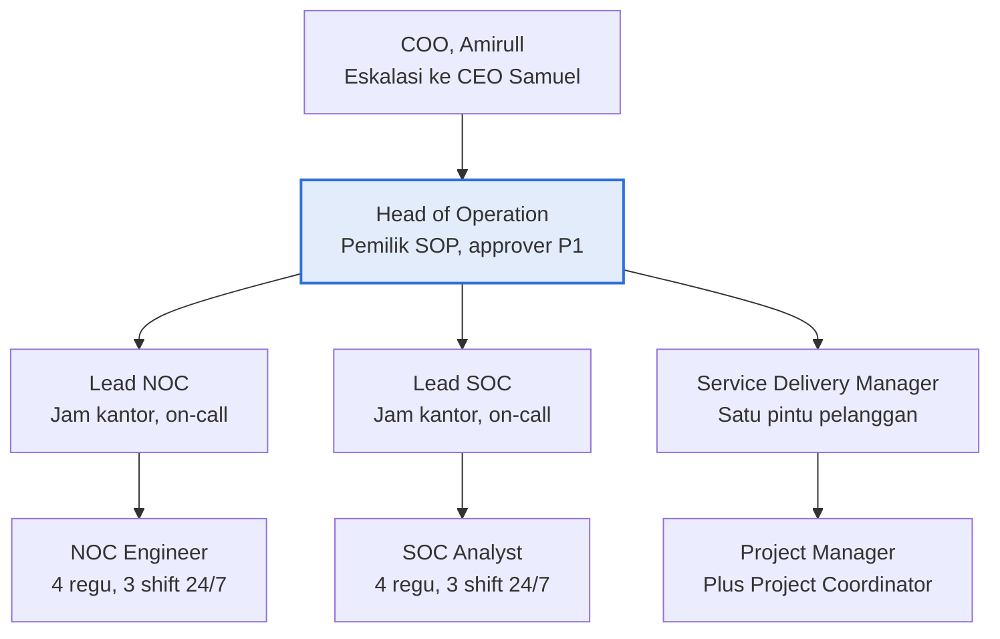
Deskripsi: bagan organisasi tiga tingkat di bawah judul "Head of Operation membawahi tiga sub divisi di bawah COO" dan subjudul "Jabatan dan garis lapor USULAN, disahkan COO". COO (Amirull) berada paling atas dengan catatan eskalasi ke CEO Samuel; Head of Operation (kotak biru, "Pemilik SOP, approver P1") di bawahnya, lalu tiga cabang Lead NOC, Lead SOC, Service Delivery Manager, masing-masing satu tingkat di atas NOC Engineer, SOC Analyst, dan Project Manager (dengan catatan "Plus Project Coordinator"). Kotak biru menandai Head of Operation sebagai simpul utama; kotak lain abu-abu. Catatan: gambar menaruh Project Coordinator hanya sebagai catatan di kotak Project Manager, tidak sebagai kotak sendiri.
Sumber gambar: conv/1bn7EHpmUm2DL7ZJVg284KzCLEQrfPBGv/img/media/rId22.png

## 4. Peran, RACI, record, KPI
- Peran dan job desk lengkap: Bagian 2 sub-bagian 9.1 sampai 9.4 dan tabel ringkasan jabatan.
- RACI: Bagian 2 sub-bagian 10 (12 aktivitas x 6 peran). Sumber menyebut RACI berstatus USULAN.
- KPI: Bagian 2 sub-bagian 11 (13 KPI).
- Matriks severity: Bagian 2 sub-bagian 6. Matriks eskalasi fungsional: Bagian 2 sub-bagian 6.
- Record yang disebut di dokumen: Shift Log (Service Hub), tiket Service Hub (GLPI), change request, laporan IR (format beku SKILL_ir-report, di PRO-OPS-001), berkas data kontak restricted:ops di knowledge base. Tidak ada nomor form SNX-OPS-FRM-xx di dokumen ini.
- Orang yang disebut: Amirull Yusuf Zulkarnain (COO dan Direktur, pemilik dan penyetuju), Samuel (CEO), Laras Rasmawati (VP Commercial), Ahmad Rifai atau "om Ipe" (Tech dan Product), Fani Fatullah (Komisaris dan Advisor), Erik Dwi Yanto (contoh tim Tech Ops, belum dipetakan). Pihak eksternal: Maxcloud, Awandata, Arktech, TelemetryFlow, POLRI/DivTIK.

## 5. Catatan kualitas dan celah (fakta terukur saja)
1. Status DRAFT v0.1; kolom tanda tangan dan tanggal pengesahan kosong; tidak ada tanggal dokumen; kode dokumen berlabel "(USULAN penomoran)". Sumber: Bagian 1 tabel Kontrol dokumen, baris Status "DRAFT v0.1, berlaku setelah disahkan COO" dan baris Kode dokumen; tabel Pengesahan (kolom Tanda tangan dan Tanggal kosong). Tabel Kontrol dokumen tidak punya baris tanggal.
2. Banyak butir berlabel USULAN: penomoran (Bagian 1), garis lapor ke COO (Bagian 3: "garis lapor Operation ke COO adalah USULAN"), jam dan jumlah regu shift (Bagian 5: "(USULAN, jam dan jumlah regu disahkan COO)"), target Ack dan update (Bagian 6: "adalah USULAN internal"), pembagian jenis change (Bagian 7: "Pembagian jenis change adalah USULAN"), durasi hypercare 2 minggu (Bagian 8 butir 2), delapan jabatan dan headcount (Bagian 9: "adalah USULAN yang disahkan COO"), seluruh RACI (Bagian 10: "(USULAN)"), seluruh target KPI (Bagian 11: "target awal di bawah adalah USULAN"), pengecualian dan audit sampling (Bagian 12 butir 2 dan 3), P-10 (Bagian 4).
3. Ketidakkonsistenan internal pemilik dokumen: tabel Kontrol dokumen menulis "Pemilik dokumen | COO (Amirull Yusuf Zulkarnain)", sedangkan Bagian 9.1 (Tanggung jawab) menulis Head of Operation sebagai "pemilik POL-OPS-001 dan PRO-OPS-001 serta review 6 bulanan". Di PRO-OPS-001 tabel Kontrol dokumen, baris Pemilik dokumen = "Head of Operation; disahkan COO" (dicek di sumber PRO-OPS-001).
4. Baseline KPI tidak ada: Bagian 11 menyatakan "baseline saat ini belum diukur"; dua KPI tanpa angka target (sel Target awal "Dikalibrasi setelah baseline" pada "Mean time to restore P1" dan "Mean time to contain insiden keamanan P1"); satu KPI tanpa angka ("Turun tiap triwulan", Rasio false positive rule).
5. Nama pemegang jabatan kosong untuk seluruh delapan jabatan: Bagian 9.1 sampai 9.4 hanya memuat nama jabatan, tanpa nama orang. Bagian 13 butir 2 berbunyi "COO: tetapkan headcount riil NOC, SOC, SD dan PM", artinya headcount riil masih menunggu keputusan; kalimat pembuka Bagian 13 menyebut headcount riil sebagai keputusan yang paling menentukan.
6. Sistem tiket: P-08 (Bagian 4) menetapkan "Semua permintaan dan insiden tercatat sebagai tiket di SINUX Service Hub (GLPI, ticket.sinux.co.id)", tetapi Bagian 13 butir 6 berbunyi "selesaikan katalog layanan, konfigurasi SLA, dan verifikasi pengiriman email notifikasi ... sebelum GLPI dipakai sebagai sistem resmi". Lintas dokumen: SNX-OPS-PRC-01 (tabel sistem pendukung) menulis "Tiket pelanggan Nusagrid | Zammad (integrasi WhatsApp dan telepon)"; sisi POL dan sisi PRC sama-sama terbukti di sumber.
7. Rujukan ke dokumen internal bukan dokumen resmi ISMS/QMS: DOCTRINE §9, DEC-2026-355, HANDOVER §2/§5/§6, CORE §13, SKILL_ops-frontline, SKILL_prod-ops-gate, SKILL_pre-scan, SKILL_divtik-comms, SINUX_SERVICE_HUB (Bagian 1 baris Rujukan wajib, Bagian 4 kolom Dasar, Bagian 6). Isinya tidak ada di sumber ini (tidak dapat diverifikasi). Sejumlah istilah informal muncul: "japri" (P-03), "om Ipe" (Bagian 3 dan matriks eskalasi), "WA owner" (matriks eskalasi baris "P1 saat COO tidak dapat dihubungi").
8. Definisi P1 (Bagian 6, tabel severity) memasukkan "tuntutan komitmen scope atau komersial baru yang tidak bisa ditunda" dan "hal legal", yang bukan kriteria ketersediaan atau keamanan (inferensi).
9. Bagian 13 butir 5 menyebut "nama tool WAF resmi (AegisWAF lawan Wazuh masih rancu di percakapan tim)"; sementara Bagian 2 menyebut AegisWAF dalam daftar layanan yang dikelola SINUX. Dokumen tidak menyelesaikan kerancuan ini.
10. Runbook yang dirujuk tetapi belum ada: Bagian 13 butir 8 "Runbook yang belum ada: Nusagrid VM end-to-end, alur backup dan restore Acronis, checklist onboarding pelanggan, cek mingguan Overseer".
11. Matriks RACI (Bagian 10): baris Change Major memuat dua "R" (kolom NOC dan Head of Operation) dan satu "A" (COO); baris "Change Standar dan Normal" menunjuk Head of Operation sebagai "A". Padahal Bagian 7 (kolom Approval) menulis "Lead sub divisi" untuk Standar dan "Lead plus ack pelanggan" untuk Normal, dan Bagian 9.2 menulis Lead NOC sebagai "approver change Standar dan Normal NOC". Bagian 9.1 menambah wewenang Head of Operation "menyetujui change Normal lintas sub divisi".
12. Dokumen tidak mencantumkan klausul ISO 9001 atau ISO/IEC 27001 maupun kontrol Annex A (pencarian "ISO", "Annex", "27001", "9001" di sumber: nol hasil). Tidak ada nomor record atau form (pencarian "FRM-" dan "record": nol hasil).
13. Lintas dokumen: matriks severity POL-OPS-001 (Bagian 6) tidak memuat kolom target pulih. SNX-OPS-SOP-04 Bagian 6 memuat matriks severity dengan Ack dan update yang sama ditambah kolom "Target pulih (USULAN)": P1 "4 jam", P2 "8 jam", P3 "24 jam", P4 "72 jam". Angka target pulih ini tidak ada di POL-OPS-001 maupun PRO-OPS-001 (pencarian "pulih", "4 jam", "8 jam", "72 jam": nol hasil; "24 jam" di PRO-OPS-001 hanya untuk laporan awal IR P1).

## 6. Kata kunci retrieval
kebijakan Operation, POL-OPS-001, Divisi Operation SINUX, struktur organisasi Operation, Head of Operation, Lead NOC, NOC Engineer, Lead SOC, SOC Analyst, Service Delivery Manager, Project Manager, Project Coordinator, job desk, job description, RACI, KPI Operation, severity P1 P2 P3 P4, SLA Ack, eskalasi, shift 24/7, 3 shift, handover shift, change management, go-gate, DEC-2026-355, DOCTRINE §9, batas MSP, gate G1 G2 G3, hypercare, BAST, Service Hub GLPI, Jumphost, password manager, kebijakan POLRI, ImunifyAV, Arktech, Maxcloud, Awandata, TelemetryFlow, operations policy, escalation matrix, on-call

<!-- FILE: ops/PRO-OPS-001.md -->

---
doc_code: PRO-OPS-001 (dokumen menyebut "USULAN penomoran")
title: Prosedur Operasional Divisi Operation SINUX
department: Operation
doc_type: Prosedur
source: {drive_file_id: 1U8CAdibwBk9x_-Aic2lbev144d6WReTz, filename: PRO-OPS-001_Prosedur_Operasional_Divisi_Operation_SINUX.docx, format: docx, bytes: 183366, retrieved: 2026-10-13}
revision: DRAFT v0.1, berlaku setelah disahkan COO
doc_date: tidak tercantum di dokumen (hanya "DRAFT v0.1"; kolom tanggal pengesahan kosong)
classification_in_doc: RESTRICTED (internal, restricted:ops)
owner_in_doc: Head of Operation; disahkan COO
approver_in_doc: COO, Amirull Yusuf Zulkarnain (Disahkan oleh); Diperiksa oleh Head of Operation; Disusun oleh Divisi Operation; tanda tangan dan tanggal kosong
iso_refs: {iso9001: [], iso27001: []}
kb_sensitivity_suggest: restricted:ops
related_docs: [POL-OPS-001, SKILL_ops-frontline, SKILL_prod-ops-gate, SKILL_incident-rca, SKILL_ir-report, SKILL_divtik-comms, SKILL_monthly-report, SKILL_backup-snapshot-ops, SKILL_prospect-research, SKILL_solutioning-sizing, SKILL_proposal-poc-factory, SKILL_quote-generator, CLAIM_CLASS_POLICY, SINUX_LEGAL]
coverage: {sections_or_sheets: "8 dari 8 bagian bernomor (20 prosedur: SHF-01, NOC-01..06, SOC-01..05, SDPM-01..06, CHG-01, SVC-01) plus Pengesahan", tables: 4, images: "1 dibuka dari 1", notes: "Tidak ada klausul ISO di dokumen. Tanggal dokumen tidak ada. Tanda tangan dan tanggal kosong. Tidak ada matriks severity sendiri: merujuk POL-OPS-001 Bagian 6 (tabel severity ada di POL-OPS-001.md). Stats mesin melaporkan tables=17 karena menghitung separator kolom (2+5+6+4); jumlah tabel riil 4 (Kontrol dokumen, Daftar prosedur, 8.1, Pengesahan)."}
---
# PRO-OPS-001 Prosedur Operasional Divisi Operation SINUX

## 1. Ringkasan (maks 6 butir, fakta)
- Prosedur langkah kerja Divisi Operation SINUX, pasangan POL-OPS-001: 20 prosedur terkode (SHF-01, NOC-01 sampai 06, SOC-01 sampai 05, SDPM-01 sampai 06, CHG-01, SVC-01).
- Tiap prosedur menyebut pelaksana, akuntabel, dan pemicu; dasar kebijakan merujuk kode P-xx atau bagian POL-OPS-001.
- Severity, Ack, wewenang approval, dan job desk tidak didefinisikan di sini; dirujuk ke POL-OPS-001 (bila bertentangan, POL berlaku).
- Memuat tenggat konkret: tiket Service Hub dalam 10 menit sejak alert terkonfirmasi, RCA P1/P2 dalam 2 hari kerja (USULAN), laporan awal IR P1 dalam 24 jam (USULAN), kick-off internal 3 hari kerja sejak PO (USULAN), pengajuan window maintenance minimal 3 hari kerja, laporan bulanan hari kerja ke-5.
- SVC-01 memuat flow Sales sampai Operation (gambar), tabel 11 tahap dengan pemilik, serta checklist gate G1 (7 butir), G2 (3 butir), G3 (8 butir).
- Status DRAFT v0.1, belum disahkan; banyak langkah berlabel USULAN.

## 2. Isi lengkap terstruktur

### 1. Kontrol dokumen
Berisi langkah kerja Divisi Operation SINUX. Aturan, standar, severity, wewenang approval, dan job desk yang dirujuk ditetapkan di POL-OPS-001.

| Item | Isi |
|---|---|
| Kode dokumen | PRO-OPS-001 (USULAN penomoran) |
| Status | DRAFT v0.1, berlaku setelah disahkan COO |
| Klasifikasi | RESTRICTED (internal, restricted:ops) |
| Pemilik dokumen | Head of Operation; disahkan COO |
| Dokumen induk | POL-OPS-001 Kebijakan Divisi Operation SINUX |
| Siklus review | Tiap 6 bulan, atau setelah insiden P1, atau saat kebijakan induk berubah |
| Rujukan teknis | SKILL_ops-frontline, SKILL_prod-ops-gate, SKILL_incident-rca, SKILL_ir-report, SKILL_divtik-comms, SKILL_monthly-report, SKILL_backup-snapshot-ops |

Bila prosedur bertentangan dengan POL-OPS-001, kebijakan berlaku. Langkah bertanda (USULAN) belum punya keputusan owner.

### 2. Daftar prosedur

| Kode | Prosedur | Pelaksana | Akuntabel | Dasar kebijakan |
|---|---|---|---|---|
| SHF-01 | Serah terima shift | Engineer dan Analyst shift | Lead NOC, Lead SOC | P-01, POL §5 |
| NOC-01 | Monitoring dan penanganan alert | NOC Engineer | Lead NOC | P-02, P-08 |
| NOC-02 | Penanganan insiden | NOC Engineer | Lead NOC | P-02, P-05, POL §6 |
| NOC-03 | Service request (VM, IP, firewall, resize) | NOC Engineer | Lead NOC | P-04, P-06 |
| NOC-04 | Backup dan restore | NOC Engineer | Lead NOC | P-04 |
| NOC-05 | Cek rutin dan laporan | NOC Engineer | Lead NOC | P-01 |
| NOC-06 | Window maintenance | NOC Engineer | Lead NOC | P-04, POL §7 |
| SOC-01 | Monitoring dan triage alert | SOC Analyst | Lead SOC | P-02, POL §6 |
| SOC-02 | Respon insiden keamanan | SOC Analyst | Lead SOC | P-04, P-05, P-07 |
| SOC-03 | Laporan insiden | SOC Analyst | Lead SOC | POL §6 |
| SOC-04 | Vulnerability dan threat intel | SOC Analyst | Lead SOC | POL §7 |
| SOC-05 | Tuning deteksi | Lead SOC | Head of Operation | P-04 |
| SDPM-01 | Onboarding pelanggan baru | Project Manager | Service Delivery Manager | P-10, POL §8 |
| SDPM-02 | Siklus proyek | Project Manager | Service Delivery Manager | POL §8 |
| SDPM-03 | BAST dan dokumen pelanggan | Project Manager | Service Delivery Manager | Kebijakan POLRI |
| SDPM-04 | Laporan bulanan dan review layanan | Service Delivery Manager | Head of Operation | POL §11 |
| SDPM-05 | Perubahan scope dan permintaan baru | Service Delivery Manager | Commercial (harga) | P-06 |
| SDPM-06 | Offboarding | Service Delivery Manager | Head of Operation | P-03 |
| CHG-01 | Eksekusi change production | Pelaksana teknis | Approver sesuai POL §7 | P-04 |
| SVC-01 | Flow Sales sampai Operation dan checklist gate | SD dan PM | Head of Operation | POL §8 |

### 3. SHF-01 Serah terima shift
Pelaksana: engineer dan analyst shift keluar dan masuk. Akuntabel: Lead NOC dan Lead SOC. Pemicu: tiap pergantian shift (06:45, 14:45, 22:45 WIB).
1. Shift keluar mengisi Shift Log di Service Hub: tiket terbuka per severity, insiden berjalan, change yang dijadwalkan, alert yang sedang diamati, dan janji ke pelanggan beserta jamnya.
2. Briefing 15 menit tatap muka atau call: tiket P1 dan P2 dibahas satu per satu, P3 dan P4 cukup lewat log.
3. Shift masuk memverifikasi dashboard monitoring sendiri (NOC: Nusametric dan Overseer; SOC: SIEM dan Wazuh) sebelum menandatangani.
4. Kepemilikan tiket P1 dan P2 dipindah eksplisit di Service Hub ke nama engineer shift masuk.
5. Kedua pihak menandai serah terima "diterima" di Shift Log.
6. Insiden P1 yang sedang berjalan tidak dipindah di tengah langkah teknis: shift keluar menyelesaikan langkah aktif, lalu serah terima.

Kredensial tidak pernah ditulis di Shift Log (P-03).

### 4. Prosedur NOC (Network Operations Center)

#### NOC-01 Monitoring dan penanganan alert
Pelaksana: NOC Engineer. Akuntabel: Lead NOC. Pemicu: sepanjang shift.
1. Pantau dashboard aktif tiap shift: Nusametric, Overseer, console Nusagrid, Acronis, dan status Cloudflare untuk fleet WHM.
2. Alert masuk: konfirmasi di dua sinyal (mis. dashboard plus ping atau browser dari vantage eksternal) sebelum dinyatakan insiden.
3. Buat tiket Service Hub dalam 10 menit sejak alert terkonfirmasi, isi severity, layanan, pelanggan, dan bukti awal.
4. Alert palsu atau flapping: catat di Shift Log, ajukan tuning ke Lead NOC, jangan mute permanen tanpa persetujuan Lead.

#### NOC-02 Penanganan insiden
Pelaksana: NOC Engineer. Akuntabel: Lead NOC. Pemicu: alert terkonfirmasi atau laporan pelanggan.
1. Akui ke pelanggan dalam target Ack (POL-OPS-001 §6), template "kami bantu cek ya".
2. Minta identifier: IP, nama instance, atau nama VM.
3. Klasifikasikan ke 8 kelas triage SKILL_ops-frontline §2: akses atau firewall atau VPN, VM lifecycle, down atau performa, OTP atau email, backup atau snapshot, SSL atau DNS, DC atau colo, billing.
4. Diagnosa dulu dengan blok ukur read-only; bedakan gejala dari akar.
5. Butuh ubah production: jalankan CHG-01. Butuh pihak lain: matriks eskalasi POL-OPS-001 §6.
6. Indikasi keamanan (webshell, backdoor, akun disalahgunakan, miner): serahkan ke SOC (SOC-02), NOC tetap memegang sisi ketersediaan.
7. App-level pelanggan: handoff ke developer atau PIC pelanggan (P-05).
8. Pulih: verifikasi dari sisi pelanggan (browser nyata, vantage eksternal), lalu tutup tiket dengan ringkasan akar dan aksi.
9. P1 dan P2: RCA dikirim via email sesuai SKILL_incident-rca dalam 2 hari kerja. (USULAN tenggat)

#### NOC-03 Service request (VM, IP, firewall, resize)
Pelaksana: NOC Engineer. Akuntabel: Lead NOC. Pemicu: tiket permintaan P4.
1. Validasi permintaan dari PIC pelanggan yang terdaftar.
2. Perubahan yang mengubah harga (dedicated CPU, tambah resource berbayar) diteruskan ke Laras sebelum dieksekusi.
3. Resize atau extend yang butuh shutdown dijadwalkan off-office-hour dengan izin tertulis pelanggan.
4. Delete VM: konfirmasi tertulis dua kali dan snapshot terakhir bila pelanggan meminta.
5. Eksekusi lewat CHG-01, catat before dan after di tiket.

#### NOC-04 Backup dan restore
Pelaksana: NOC Engineer. Akuntabel: Lead NOC. Pemicu: shift malam, atau permintaan restore.
1. Tiap shift malam: cek status job backup semua pelanggan ber-layanan backup; gagal 2 kali berturut = tiket P2.
2. Jangan klaim bisa restore untuk pelanggan tanpa layanan backup.
3. Restore produksi butuh approval Lead plus izin pelanggan; restore uji ke path terpisah dulu bila memungkinkan.
4. Uji restore terjadwal minimal sekali per bulan per pelanggan backup, hasilnya masuk laporan bulanan. (USULAN)

#### NOC-05 Cek rutin dan laporan
Pelaksana: NOC Engineer. Akuntabel: Lead NOC. Pemicu: awal shift, mingguan, bulanan.
1. Awal shift: health check daftar layanan kritis (checklist di Service Hub).
2. Mingguan: cek perangkat internal di Overseer, masa berlaku SSL 30 hari ke depan, kapasitas disk dan resource.
3. Bulanan: data untuk laporan bulanan pelanggan diserahkan ke SD dan PM (SDPM-04).

#### NOC-06 Window maintenance
Pelaksana: NOC Engineer. Akuntabel: Lead NOC. Pemicu: change Normal atau Major terjadwal.
1. Ajukan minimal 3 hari kerja sebelumnya lewat change request (CHG-01), kecuali emergency.
2. Notifikasi pelanggan sesuai jenis change (POL-OPS-001 §7) dan pengingat H-0.
3. Eksekusi di Shift 3, satu perubahan satu waktu, verifikasi tiap langkah, rollback bila verifikasi gagal.

### 5. Prosedur SOC (Security Operations Center)
Batas scope: untuk POLRI, SOC adalah tanggung jawab POLRI; SINUX menangani keamanan host yang SINUX kelola sebagai managed services. Untuk Paydia, operasi SIEM dan Wazuh berjalan bersama partner Arktech. Detail regulator dan hasil audit pelanggan FSI diperlakukan data-safe.

#### SOC-01 Monitoring dan triage alert
Pelaksana: SOC Analyst. Akuntabel: Lead SOC. Pemicu: sepanjang shift.
1. Pantau SIEM, Wazuh, EDR, AegisWAF, dan Cloudflare security events tiap shift.
2. Triage tiap alert: true positive, false positive, atau butuh investigasi; catat alasan di tiket.
3. True positive diberi severity sesuai POL-OPS-001 §6; kompromi root atau data pelanggan = P1.
4. Satu insiden keamanan = satu tiket induk, alert terkait ditautkan, bukan tiket terpisah.

#### SOC-02 Respon insiden keamanan
Pelaksana: SOC Analyst. Akuntabel: Lead SOC. Pemicu: true positive atau serahan dari NOC.
1. Forensik dulu, perbaikan kemudian: amankan bukti (log, hash berkas, daftar proses, koneksi aktif) sebelum mengubah apa pun.
2. Webshell tidak pernah di-probe GET atau HEAD, sebab probe sama dengan eksekusi.
3. Karantina dengan `mv` ke folder karantina, bukan `rm`, agar bukti tetap utuh.
4. Containment (blok IP, nonaktifkan akun, isolasi VM) mengikuti CHG-01, kecuali Lead SOC menyatakan darurat dan mencatatnya.
5. Sweep IOC ke host sejenis (by hash) setelah satu host terbukti kompromi.
6. Eradikasi dan pemulihan dikoordinasikan dengan NOC; app-level diserahkan ke developer atau PIC pelanggan.
7. Verifikasi bersih memakai dua sumber independen sebelum menyatakan "aman" (P-07).

#### SOC-03 Laporan insiden
Pelaksana: SOC Analyst. Akuntabel: Lead SOC. Pemicu: insiden keamanan P1 atau P2.
1. Susun laporan IR dengan format beku SKILL_ir-report (lima section dengan urutan tetap).
2. Lead SOC me-review sebelum dikirim.
3. Pesan ke DivTIK memakai SKILL_divtik-comms.
4. P1 keamanan: laporan awal ke pelanggan dalam 24 jam, laporan final setelah eradikasi. (USULAN tenggat)

#### SOC-04 Vulnerability dan threat intel
Pelaksana: SOC Analyst. Akuntabel: Lead SOC. Pemicu: advisory CVE baru.
1. Pantau advisory CVE untuk stack yang SINUX kelola (cPanel, Zimbra, nginx, PHP, hypervisor, Acronis).
2. CVE kritis yang dapat dieksploitasi dari luar dan menyentuh aset SINUX = tiket P2 minimal, rekomendasi patch ke NOC.
3. Patch dieksekusi NOC lewat CHG-01.

#### SOC-05 Tuning deteksi
Pelaksana: Lead SOC. Akuntabel: Head of Operation. Pemicu: mingguan.
1. Tinjau rule yang menghasilkan false positive berulang.
2. Uji rule baru atau perubahan rule di mode observasi sebelum mode blok.
3. Perubahan rule WAF atau SIEM produksi dieksekusi lewat CHG-01.

### 6. Prosedur Service Delivery dan Project Management

#### SDPM-01 Onboarding pelanggan baru
Pelaksana: Project Manager. Akuntabel: Service Delivery Manager. Pemicu: PO atau kontrak ditandatangani.
1. Terima paket handover dari Commercial dan periksa dengan checklist G1 (SVC-01). Tanpa paket lengkap, onboarding tidak dimulai.
2. Kick-off internal (SD dan PM, NOC, SOC bila ada, Tech dan Product) dalam 3 hari kerja sejak PO. (USULAN)
3. Kick-off pelanggan: konfirmasi scope, kanal komunikasi resmi (email plus grup WhatsApp), matriks eskalasi, jadwal.
4. Provisioning dijalankan NOC lewat CHG-01; SD dan PM memantau milestone.
5. Daftarkan pelanggan, aset, dan kontak di Service Hub serta checklist monitoring NOC sebelum layanan dinyatakan live.
6. Jalankan G2 (BAST) lalu G3 (serah terima ke Operation) sesuai SVC-01.

#### SDPM-02 Siklus proyek
Pelaksana: Project Manager. Akuntabel: Service Delivery Manager. Pemicu: proyek implementasi atau migrasi.
1. Inisiasi: project charter singkat (tujuan, scope, out-of-scope, stakeholder, risiko awal).
2. Perencanaan: WBS, jadwal, RACI, rencana komunikasi, rencana rollback untuk tiap migrasi.
3. Eksekusi: status mingguan ke pelanggan dan COO; risiko dan isu dicatat di register proyek.
4. Kontrol: deviasi jadwal lebih dari 1 minggu atau isu yang menyentuh biaya dieskalasi ke COO. (USULAN ambang)
5. Penutupan: BAST, lessons learned disetor ke knowledge base lewat jalur staging, arsip dokumen.

#### SDPM-03 BAST dan dokumen pelanggan
Pelaksana: Project Manager. Akuntabel: Service Delivery Manager. Pemicu: milestone selesai atau akhir periode.
1. BAST dan laporan implementasi dibuat atas nama SINUX dengan gaya SINUX; whitelabel memakai SINUX atau Nusametric.
2. POLRI: Elitery adalah main contractor, SINUX subkontraktor. SINUX menyimpan versi original di Drive; periode dan backdate adalah keputusan main contractor.
3. Dokumen teknis POLRI tanpa harga, diskon, tier, rekomendasi komersil, maupun roadmap; rekomendasi teknis wajib punya pemilik aksi.
4. Output eksternal (proposal, materi pelanggan) melalui review manusia sebelum dikirim.

#### SDPM-04 Laporan bulanan dan review layanan
Pelaksana: Service Delivery Manager. Akuntabel: Head of Operation. Pemicu: awal bulan.
1. Kumpulkan data NOC dan SOC paling lambat hari kerja ke-3 bulan berikutnya. (USULAN)
2. Susun laporan bulanan sesuai SKILL_monthly-report: availability, insiden, tiket, backup, rekomendasi teknis.
3. Kirim paling lambat hari kerja ke-5.
4. Review layanan triwulanan dengan pelanggan enterprise utama. (USULAN)

#### SDPM-05 Perubahan scope dan permintaan baru
Pelaksana: Service Delivery Manager. Akuntabel: Commercial untuk harga. Pemicu: permintaan di luar kontrak.
1. Catat sebagai change of scope di Service Hub.
2. Buat kajian teknis (effort, risiko, dampak) bersama Tech dan Product.
3. Serahkan harga dan komitmen ke Laras; jangan menjanjikan tanggal sebelum Commercial menyetujui.

#### SDPM-06 Offboarding
Pelaksana: Service Delivery Manager. Akuntabel: Head of Operation. Pemicu: kontrak berakhir.
1. Minta konfirmasi tertulis tanggal berakhir dari Commercial.
2. Ekspor data atau backup terakhir sesuai kontrak, serahkan ke pelanggan dengan berita acara.
3. Cabut akses, hapus monitoring, nonaktifkan aset setelah masa retensi kontrak.

### 7. CHG-01 Eksekusi change production
Pelaksana: engineer atau analyst yang ditugaskan. Akuntabel: approver sesuai jenis change (POL-OPS-001 §7). Pemicu: setiap perubahan production pelanggan atau infra SINUX.
1. Ajukan change request di Service Hub: tujuan, target (nama mesin), jenis change, langkah, risiko, backup, perintah rollback, jadwal.
2. Jalankan blok ukur read-only dulu, berhenti, baca hasil bersama approver.
3. Approver memberi ACC tertulis di tiket.
4. Ambil backup atau snapshot, catat lokasinya.
5. Eksekusi blok ubah yang terpisah dari blok ukur; tiap blok diawali cek `hostname` untuk memastikan mesin yang benar.
6. Verifikasi hasil dengan kontrol positif; gagal = rollback, jangan improvisasi.
7. Catat before dan after di tiket, tutup change, simpan ringkasan sebagai packet setor bila menghasilkan pengetahuan baru.

Change Emergency boleh mendahului langkah 1 sampai 3 bila Lead on-duty menyatakannya; change request diisi setelahnya dan COO diberi tahu dalam 30 menit.

### 8. SVC-01 Flow Sales sampai Operation dan checklist gate
Pelaksana: SD dan PM. Akuntabel: Head of Operation. Pemicu: deal baru. Kebijakan gate ada di POL-OPS-001 §8. Diagram: lihat Bagian 3.

Deal yang gagal dicatat lost oleh Commercial dengan alasannya. Prospek yang ditunda tetap dipegang Commercial, bukan Operation.

#### 8.1 Tahapan, pemilik, dan output

| No | Tahap | Pemilik (A) | Terlibat (R atau C) | Output wajib | Rujukan |
|---|---|---|---|---|---|
| 1 | Lead dan kualifikasi | Commercial (Laras) | Tech dan Product (C) | Prospek tercatat, kebutuhan awal, PIC pelanggan | SKILL_prospect-research |
| 2 | Discovery dan sizing | Tech dan Product | SD dan PM (C), Operation (C untuk kelayakan operasi) | Kebutuhan teknis, sizing, arsitektur usulan, asumsi | SKILL_solutioning-sizing |
| 3 | Proposal dan quote | Commercial | Tech dan Product (R bagian teknis) | Proposal, quote bernomor, review manusia sebelum kirim | SKILL_proposal-poc-factory, SKILL_quote-generator, CLAIM_CLASS_POLICY |
| 4 | Negosiasi dan keputusan | Commercial | COO (keputusan harga final) | Deal atau lost; angka komersial final diputus COO | Aturan komersial SINUX |
| 5 | PO atau kontrak | Commercial | Legal (C) | PO atau kontrak ditandatangani, scope dan SLA final | SINUX_LEGAL |
| 6 | G1 kick-off | SD dan PM | Commercial (R), NOC dan SOC (I) | Paket handover lengkap, project charter, jadwal | SDPM-01, SDPM-02 |
| 7 | Provisioning dan implementasi | SD dan PM | NOC dan SOC (R lewat change request), Tech dan Product (C) | Layanan terpasang, before dan after tercatat | CHG-01 |
| 8 | G2 UAT dan BAST | SD dan PM | Pelanggan (A sisi penerimaan) | BAST ditandatangani, daftar isu sisa | SDPM-03 |
| 9 | G3 serah terima ke Operation | Head of Operation | SD dan PM (R), Lead NOC dan Lead SOC (R) | Checklist G3 lolos, layanan masuk BAU | Bagian 8.2 |
| 10 | Hypercare | Lead NOC | SD dan PM (C) | Pemantauan ketat, isu awal ditutup (USULAN 2 minggu) | NOC-01 |
| 11 | BAU dan review layanan | Head of Operation | SD dan PM (R laporan bulanan) | Layanan 24/7, laporan bulanan, review berkala | SDPM-04 |

#### 8.2 Checklist gate
**G1, Commercial ke SD dan PM (paket handover sales)**
- [ ] PO atau kontrak ditandatangani dan diarsip.
- [ ] Scope teknis final, termasuk daftar yang di luar scope.
- [ ] SLA dan target layanan yang dijanjikan ke pelanggan, tertulis.
- [ ] Sizing dan arsitektur yang dipakai di proposal.
- [ ] PIC pelanggan (teknis, komersial, billing) dan kanal komunikasi resmi.
- [ ] Jadwal target live dan batasan pelanggan (window maintenance, blackout).
- [ ] Janji lisan ke pelanggan yang belum ada di kontrak, dicatat terbuka.

**G2, penerimaan pelanggan (BAST)**
- [ ] UAT sesuai scope lolos dan dicatat.
- [ ] BAST ditandatangani pelanggan.
- [ ] Isu sisa punya pemilik dan tanggal.

**G3, SD dan PM ke Operation (wajib sebelum layanan dinyatakan BAU)**
- [ ] Pelanggan, aset, dan kontak terdaftar di Service Hub.
- [ ] Semua aset masuk monitoring NOC (dan SIEM bila layanan SOC), alert sudah teruji.
- [ ] Backup aktif dan restore uji pertama berhasil (bila layanan backup ada).
- [ ] Dokumen as-built: topologi, IP, versi, akses, ketergantungan vendor.
- [ ] Runbook layanan dan matriks eskalasi pelanggan tersedia.
- [ ] Akses Operation lewat Jumphost dan password manager, nol kredensial di chat atau dokumen.
- [ ] SLA dan jam layanan dikonfigurasi di Service Hub.
- [ ] Briefing serah terima ke Lead NOC dan Lead SOC, tanda terima tercatat.

#### 8.3 Bila gate tidak lolos
1. Pemilik gate mencatat kriteria yang belum lolos di tiket, beserta pemilik dan tanggal targetnya.
2. G1 tidak lolos: paket dikembalikan ke Commercial, onboarding belum dimulai.
3. G3 tidak lolos: Operation menolak serah terima secara tertulis; layanan tetap hypercare dengan pemilik SD dan PM sampai kriteria terpenuhi.

### Pengesahan

| Peran | Nama | Tanda tangan | Tanggal |
|---|---|---|---|
| Disusun oleh | Divisi Operation | (kosong) | (kosong) |
| Diperiksa oleh | Head of Operation | (kosong) | (kosong) |
| Disahkan oleh | COO, Amirull Yusuf Zulkarnain | (kosong) | (kosong) |

## 3. Diagram

### 3.1 Flow Sales sampai Operation (gambar sumber, SVC-01)
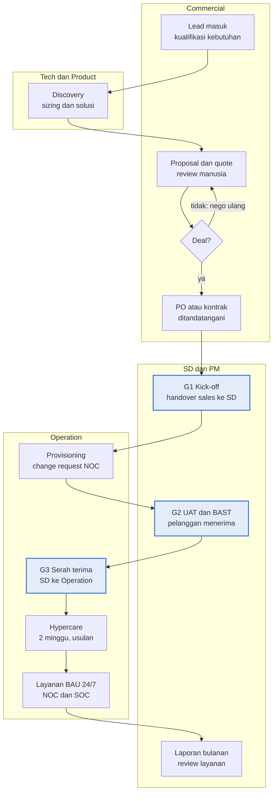
Deskripsi: swimlane empat jalur (Commercial, Tech dan Product, SD dan PM, Operation) berjudul "Deal baru menjadi layanan BAU setelah lolos tiga gate"; subjudul "Kotak berwarna = gate serah terima G1, G2, G3". Alur dimulai Lead masuk (Commercial) ke Discovery (Tech dan Product), kembali ke Proposal dan quote lalu keputusan Deal?; "tidak: nego ulang" kembali ke Proposal dan quote, "ya" ke PO atau kontrak, lalu G1 Kick-off (SD dan PM), Provisioning (Operation), G2 UAT dan BAST (SD dan PM), G3 Serah terima (Operation), Hypercare, Layanan BAU 24/7, dan terakhir panah ke Laporan bulanan di jalur SD dan PM. G1, G2, G3 berwarna biru. Gambar tidak memuat cabang "lost" (hanya disebut di teks bawah gambar) dan menaruh Hypercare setelah G3.
Sumber gambar: conv/1U8CAdibwBk9x_-Aic2lbev144d6WReTz/img/media/rId44.png

### 3.2 SHF-01 Serah terima shift (diturunkan dari teks)
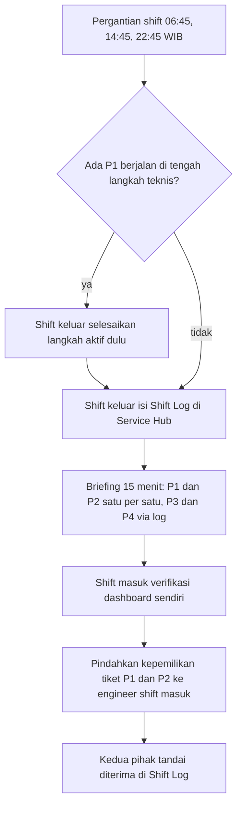

### 3.3 NOC-02 Penanganan insiden (diturunkan dari teks)
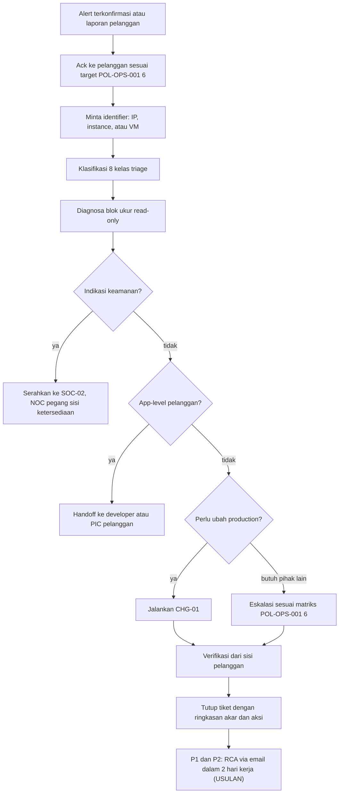

### 3.4 CHG-01 Eksekusi change production (diturunkan dari teks)
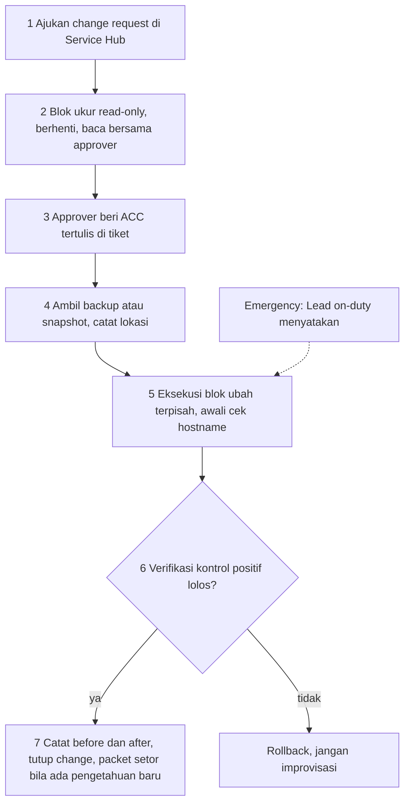
Catatan: untuk Emergency, langkah 1 sampai 3 boleh didahului; change request diisi setelahnya dan COO diberi tahu dalam 30 menit.

## 4. Peran, RACI, record, KPI
- Peran pelaksana dan akuntabel per prosedur: tabel Bagian 2 sub-bagian 2 dan 8.1. Peran yang muncul: Engineer dan Analyst shift, NOC Engineer, SOC Analyst, Lead NOC, Lead SOC, Head of Operation, Project Manager, Service Delivery Manager, Commercial (Laras), Tech dan Product, COO, Legal, Pelanggan (penerima di G2).
- Tabel 8.1 setara RACI sederhana (kolom Pemilik (A) dan Terlibat (R atau C)).
- Orang yang disebut: Amirull Yusuf Zulkarnain (COO), Laras (Commercial), Elitery (main contractor POLRI), Arktech (partner SOC Paydia). Tidak ada nama untuk pemegang jabatan Operation.
- KPI: tidak ada tabel KPI; hanya tenggat prosedural (lihat Bagian 1 butir 4) dan rujukan POL §11 untuk laporan bulanan (SDPM-04).
- Record: Shift Log, tiket Service Hub, change request, laporan IR format beku, RCA via email, laporan bulanan, register proyek, BAST, packet setor ke knowledge base. Tidak ada nomor form SNX-OPS-FRM-xx.

## 5. Catatan kualitas dan celah (fakta terukur saja)
1. Status DRAFT v0.1; tanda tangan dan tanggal kosong; tidak ada tanggal dokumen; kode berlabel "(USULAN penomoran)". Sumber: Bagian 1 tabel Kontrol dokumen (baris Kode dokumen dan Status "DRAFT v0.1, berlaku setelah disahkan COO"; tidak ada baris tanggal) dan tabel Pengesahan (kolom Tanda tangan dan Tanggal kosong).
2. Langkah berlabel USULAN (semua terbukti di sumber): NOC-02 butir 9 "(USULAN tenggat)" RCA 2 hari kerja, NOC-04 butir 4 "(USULAN)" uji restore bulanan, SOC-03 butir 4 "(USULAN tenggat)" laporan awal 24 jam, SDPM-01 butir 2 "(USULAN)" kick-off 3 hari kerja, SDPM-02 butir 4 "(USULAN ambang)" 1 minggu, SDPM-04 butir 1 dan 4 "(USULAN)", SVC-01 tabel 8.1 tahap 10 "(USULAN 2 minggu)".
3. Dokumen tidak memuat matriks severity dan target Ack sendiri; NOC-02 butir 1 menulis "target Ack (POL-OPS-001 §6)" dan SOC-01 butir 3 "severity sesuai POL-OPS-001 §6". Akibatnya dokumen ini tidak berdiri sendiri (inferensi).
4. "SKILL_ir-report (lima section dengan urutan tetap)" (SOC-03 butir 1) dan template "kami bantu cek ya" (NOC-02 butir 1) dirujuk tanpa isi; kelima section tidak disebutkan.
5. Hypercare: tabel 8.1 baris 10 menaruh "Hypercare" dengan Pemilik (A) "Lead NOC" setelah baris 9 "G3 serah terima ke Operation"; Bagian 8.3 butir 3 menulis "layanan tetap hypercare dengan pemilik SD dan PM sampai kriteria terpenuhi". Lintas dokumen: POL-OPS-001 Bagian 8 butir 2 menulis "Selama G3 belum lolos, layanan berstatus hypercare dengan pemilik SD dan PM"; POL-OPS-001 Bagian 9.2 menyebut Lead NOC "pemilik hypercare". Dua urutan dan dua pemilik berbeda. Gambar Bagian 8 juga menaruh kotak "Hypercare, 2 minggu, usulan" setelah "G3 Serah terima" (diperiksa pada gambar rId44).
6. Teks bawah gambar Bagian 8: "Deal yang gagal dicatat lost oleh Commercial dengan alasannya." Gambar (rId44) hanya punya cabang keputusan "Deal?" dengan "tidak: nego ulang" kembali ke "Proposal dan quote", tanpa kotak lost. Tabel 8.1 tahap 4 menulis output "Deal atau lost".
7. NOC-06 butir 1: "Ajukan minimal 3 hari kerja sebelumnya lewat change request (CHG-01)" untuk change Normal atau Major (Pemicu). Lintas dokumen: POL-OPS-001 Bagian 7 kolom Notifikasi pelanggan: Normal "Minimal H-2", Major "Minimal H-5 dan pengingat H-0". Dua ukuran berbeda (pengajuan internal dan notifikasi pelanggan); tidak ada kalimat yang menyelaraskannya.
8. Rujukan ke artefak non-ISMS: tujuh SKILL_* pada baris Rujukan teknis tabel Kontrol dokumen (ops-frontline, prod-ops-gate, incident-rca, ir-report, divtik-comms, monthly-report, backup-snapshot-ops), SKILL_prospect-research, SKILL_solutioning-sizing, SKILL_proposal-poc-factory, SKILL_quote-generator, CLAIM_CLASS_POLICY, SINUX_LEGAL (kolom Rujukan tabel 8.1), serta istilah "packet setor" (CHG-01 butir 7), "jalur staging" (SDPM-02 butir 5), "blok ukur" (NOC-02 butir 4), "blok ubah" (CHG-01 butir 5). Isinya tidak ada di sumber ini (tidak dapat diverifikasi).
9. Tidak ada klausul ISO 9001 atau ISO/IEC 27001 maupun Annex A (pencarian "ISO", "Annex", "27001", "9001": nol hasil); tidak ada kolom atau ketentuan masa simpan record (satu-satunya "retensi" ada di SDPM-06 butir 3, "masa retensi kontrak", tentang aset pelanggan).
10. Tabel Bagian 2: SOC-04 (Vulnerability dan threat intel) kolom Dasar kebijakan "POL §7", sedangkan POL-OPS-001 Bagian 7 adalah change management (inferensi: topik tidak sepadan); SDPM-03 kolom Dasar "Kebijakan POLRI" tanpa nomor bagian.
11. NOC-01 butir 3 menetapkan "Buat tiket Service Hub dalam 10 menit sejak alert terkonfirmasi" (berlaku untuk semua alert, bukan hanya P1 atau P2); angka 10 menit tidak ada di POL-OPS-001 (pencarian "10 menit": nol hasil).

## 6. Kata kunci retrieval
prosedur Operation, PRO-OPS-001, SHF-01, NOC-01, NOC-02, NOC-03, NOC-04, NOC-05, NOC-06, SOC-01, SOC-02, SOC-03, SOC-04, SOC-05, SDPM-01, SDPM-02, SDPM-03, SDPM-04, SDPM-05, SDPM-06, CHG-01, SVC-01, serah terima shift, shift handover, Shift Log, monitoring alert, penanganan insiden, incident handling, 8 kelas triage, service request, backup restore, uji restore, window maintenance, respon insiden keamanan, forensik, webshell, karantina, IOC sweep, laporan IR, RCA, vulnerability CVE, tuning deteksi, onboarding pelanggan, offboarding, BAST, laporan bulanan, change of scope, change production, go-gate, rollback, gate G1 G2 G3, checklist handover, hypercare, Sales ke Operation, flow sales operation, Elitery main contractor, DivTIK

<!-- FILE: ops/SNX-OPS-FRM-01.md -->

---
doc_code: SNX-OPS-FRM-01
title: Project Plan, Scope & Timeline Records
department: Operation
doc_type: Form/Record
source: {drive_file_id: 1q0cl8mLlUDJ-7nvnzozSbjJhE46-Jk-3, filename: SNX-OPS-FRM-01_Project_Plan_Scope_Timeline.xlsx, format: xlsx, bytes: 153326, retrieved: 2026-10-13}
revision: 00 (DRAFT)
doc_date: 13 Oktober 2026 (tanggal draft); tanggal efektif "Ditetapkan saat pengesahan"
classification_in_doc: RESTRICTED (Internal)
owner_in_doc: Project Manager
approver_in_doc: COO, Amirull Yusuf Zulkarnain (status persetujuan "Menunggu")
iso_refs: {iso9001: ["8.1", "8.2.2"], iso27001: ["A5.8"]}
kb_sensitivity_suggest: restricted:ops
related_docs: [SNX-OPS-SOP-01, SNX-OPS-FRM-02, SNX-OPS-FRM-03, SNX-OPS-FRM-05, SNX-OPS-FRM-06, SNX-ISMS-PRO-01]
coverage: {sections_or_sheets: "8 dari 8 sheet", tables: 8, images: "1 dibuka dari 1 (Alur Proses, image1.png)", notes: "Warna sel (biru muda = CONTOH) tidak terbaca dari konversi teks, hanya keterangan legenda. Tanggal sel disimpan sebagai tanggal Excel; nilai rumus yang dicatat adalah nilai tersimpan (cache)."}
---
# SNX-OPS-FRM-01 Project Plan, Scope & Timeline Records

## 1. Ringkasan

- Workbook template per proyek (salin dan ganti nama menjadi `FRM-01_<KodeProyek>.xlsx`) yang merekam rencana proyek: Checklist G1 (paket handover Commercial ke SD dan PM), Project Charter, WBS dan Timeline, Milestone, serta Stakeholder dan rencana komunikasi.
- Delapan sheet: Kontrol Dokumen, Alur Proses, Daftar, Checklist G1, Project Charter, WBS dan Timeline, Milestone, Stakeholder.
- Gate G1: LOLOS bila tidak ada butir berstatus "Belum" (8 butir, pemilik gate Service Delivery Manager). Rumus keputusan memberi TAHAN bila ada butir Belum. Proyek tidak dimulai bila ada butir Belum.
- Progres keseluruhan proyek dihitung otomatis = jumlah (bobot x progres) dibagi jumlah bobot (WBS dan Timeline). Durasi tugas dihitung otomatis dalam hari kalender (Selesai - Mulai + 1).
- Data terisi di workbook adalah CONTOH (bukan data nyata): 5 baris WBS bertanda "CONTOH" di kolom Catatan, 1 baris Milestone bertanda "CONTOH", 1 baris Stakeholder dengan placeholder. Checklist G1 semua berstatus "Belum" (default template). Project Charter kosong.
- Progres keseluruhan tersimpan (cache) 0.23 (23%), berasal dari baris WBS contoh.

## 2. Isi lengkap terstruktur

### Sheet 1. Kontrol Dokumen (A1:E38)

Tujuan sheet: kontrol dokumen, cara pakai, legenda warna, riwayat revisi, pengesahan.

Judul sheet: "Project Plan, Scope & Timeline Records"; subjudul: "PT Strategi Integrasi Nusantara (SINUX) · Divisi Operation".

| Atribut | Isi |
|---|---|
| Nomor dokumen | SNX-OPS-FRM-01 |
| Judul | Project Plan, Scope & Timeline Records |
| Revisi | 00 (DRAFT) |
| Tanggal draft | 13 Oktober 2026 |
| Tanggal efektif | Ditetapkan saat pengesahan |
| Klasifikasi | RESTRICTED (Internal) |
| Pemilik dokumen | Project Manager |
| Disetujui oleh | COO, Amirull Yusuf Zulkarnain |
| Acuan ISO 9001:2015 | Klausul 8.1, 8.2.2 |
| Acuan ISO/IEC 27001:2022 | Klausul atau kontrol Annex A 5.8 |
| Masa simpan record | Durasi kontrak + 3 tahun |
| Tujuan | Merekam rencana proyek: checklist penerimaan G1, project charter, WBS dan jadwal, milestone, serta stakeholder dan komunikasi. |

**Cara pakai**

1. Salin file ini per proyek; ganti nama menjadi FRM-01_<KodeProyek>.xlsx.
2. Isi Checklist G1 sebelum proyek dimulai; proyek tidak dimulai bila ada butir Belum.
3. Isi Project Charter, lalu WBS dan Timeline. Durasi dan progres keseluruhan dihitung otomatis.
4. Perbarui kolom Progres dan Status minimal mingguan (SNX-OPS-SOP-01 Bagian 6.4).
5. Hapus baris CONTOH (biru muda) sebelum dipakai.

**Legenda warna**

| Sel | Arti |
|---|---|
| Sel input | diisi pengguna |
| Baris CONTOH | hapus atau timpa saat dipakai |
| Sel rumus | jangan diubah |

**Riwayat revisi**

| Revisi | Tanggal | Uraian perubahan | Disusun | Disetujui |
|---|---|---|---|---|
| 00 | 13 Oktober 2026 | Draft awal untuk sertifikasi ISO 9001 dan ISO/IEC 27001 | Divisi Operation | Menunggu |
| 00 | 13 Oktober 2026 | Review bahasa dan konsistensi: istilah teknologi dalam bahasa Inggris, bahasa Indonesia formal, label klasifikasi, keselarasan RTO dan target pulih | Divisi Operation | Menunggu |

**Pengesahan**

| Peran | Nama dan jabatan | Tanda tangan | Tanggal |
|---|---|---|---|
| Disusun oleh | Project Manager | (kosong) | (kosong) |
| Diperiksa oleh | ISO/ISMS Coordinator | (kosong) | (kosong) |
| Disetujui oleh | COO, Amirull Yusuf Zulkarnain | (kosong) | (kosong) |

### Sheet 2. Alur Proses (A1:A2)

Tujuan sheet: memuat diagram alur proses (gambar tertanam image1.png). Teks: "Diagram alur proses"; "Kotak biru = output akhir · kotak oranye = cabang ke tindakan atau prosedur lain · garis putus-putus = kembali ke alur utama". Diagram ada di Bagian 3.

### Sheet 3. Daftar (A1:C6): nilai dropdown

Tujuan sheet: sumber nilai dropdown untuk sheet lain.

| Status tugas (kolom A) | Status G1 (kolom B) | Status milestone (kolom C) |
|---|---|---|
| Belum mulai | Belum | Sesuai rencana |
| Berjalan | Lolos | Berisiko |
| Selesai | Tidak berlaku | Terlambat |
| Tertunda | (kosong) | Selesai |
| Dibatalkan | (kosong) | (kosong) |

Pemakaian dropdown (data validation):

| Sheet | Rentang sel | Sumber daftar | Nilai |
|---|---|---|---|
| Checklist G1 | C5:C12 | Daftar!$B$2:$B$4 | Belum, Lolos, Tidak berlaku |
| WBS dan Timeline | K5:K104 | Daftar!$A$2:$A$6 | Belum mulai, Berjalan, Selesai, Tertunda, Dibatalkan |
| Milestone | F5:F24 | Daftar!$C$2:$C$5 | Sesuai rencana, Berisiko, Terlambat, Selesai |

### Sheet 4. Checklist G1 (A1:F14)

Tujuan sheet: "Checklist G1: paket handover Commercial ke SD dan PM". Keterangan: "Pemilik gate: Service Delivery Manager. Gate LOLOS bila tidak ada butir berstatus Belum."

Kolom: No, Kriteria, Status (dropdown), Bukti atau lokasi dokumen, PIC, Tanggal. Kolom D sampai F kosong semua baris.

| No | Kriteria | Status (nilai tersimpan) |
|---|---|---|
| 1 | PO atau kontrak ditandatangani dan diarsip. | Belum |
| 2 | Scope teknis final, termasuk daftar yang di luar scope. | Belum |
| 3 | SLA dan target layanan yang dijanjikan ke pelanggan, tertulis. | Belum |
| 4 | Sizing dan arsitektur yang dipakai di proposal. | Belum |
| 5 | PIC pelanggan (teknis, komersial, billing) dan kanal komunikasi resmi. | Belum |
| 6 | Jadwal target live dan batasan pelanggan (window maintenance, blackout). | Belum |
| 7 | Janji lisan ke pelanggan yang belum ada di kontrak, dicatat terbuka. | Belum |
| 8 | Klasifikasi data pelanggan dan kebutuhan keamanan informasi teridentifikasi (SNX-ISMS-PRO-01). | Belum |

Rumus keputusan (sel C14, label B14 "Keputusan G1"): `=IF(COUNTIF(C5:C12,"Belum")=0,"LOLOS","TAHAN")`. Logika: LOLOS hanya bila tidak ada sel berisi "Belum" pada C5:C12; nilai tersimpan saat ini TAHAN karena semua 8 butir "Belum". Sel kosong tidak dihitung sebagai Belum oleh rumus (fakta rumus).

### Sheet 5. Project Charter (A1:B22)

Tujuan sheet: charter proyek. Kolom A = item, kolom B = isian (kosong pada template kecuali B22).

| Baris | Item | Isi |
|---|---|---|
| 3 | Nama proyek | (kosong) |
| 4 | Kode proyek | (kosong) |
| 5 | Pelanggan | (kosong) |
| 6 | Dasar (nomor kontrak, PKS, PO) | (kosong) |
| 7 | Project Manager | (kosong) |
| 8 | Service Delivery Manager | (kosong) |
| 9 | Sponsor pelanggan | (kosong) |
| 10 | Tanggal mulai baseline | (kosong) |
| 11 | Tanggal selesai baseline | (kosong) |
| 12 | Tujuan proyek | (kosong) |
| 13 | Scope (in-scope) | (kosong) |
| 14 | Di luar scope | (kosong) |
| 15 | Deliverable utama | (kosong) |
| 16 | Asumsi | (kosong) |
| 17 | Kendala | (kosong) |
| 18 | Kriteria penerimaan (dasar UAT) | (kosong) |
| 19 | Klasifikasi data (SNX-ISMS-PRO-01) | (kosong) |
| 20 | Persyaratan keamanan informasi | (kosong) |
| 21 | Risiko awal (rinci di SNX-OPS-FRM-02) | (kosong) |
| 22 | Progres keseluruhan (otomatis dari WBS) | 0.23 (rumus) |

Rumus B22: `=IFERROR(SUMPRODUCT('WBS dan Timeline'!I5:I104,'WBS dan Timeline'!J5:J104)/SUM('WBS dan Timeline'!I5:I104),0)`. Logika: rata-rata tertimbang progres (kolom J) dengan bobot (kolom I); bernilai 0 bila total bobot 0 atau error. Nilai tersimpan 0.23 = (5 x 1 + 30 x 0.6) / 100.

### Sheet 6. WBS dan Timeline (A1:M104)

Tujuan sheet: "WBS dan timeline proyek". Keterangan A2: "Bobot dalam persen (total 100). Progres 0% sampai 100%. Kolom Durasi dihitung otomatis (hari kalender)." Sel I2 "Total bobot:" dan J2 = 100 (rumus `=SUM(I5:I104)`).

Kolom (baris header 4): ID, Fase, Tugas, Pemilik, Mulai, Selesai, Durasi (hari), Deliverable atau bukti, Bobot (%), Progres, Status (dropdown), Bergantung pada, Catatan.

Rumus Durasi (G5:G104): `=IF(AND(E5<>"",F5<>""),F5-E5+1,"")` (hari kalender, inklusif; kosong bila tanggal belum diisi). Kapasitas 100 baris (baris 5 sampai 104); 5 terisi (CONTOH), 95 baris kosong dengan rumus durasi saja.

| ID | Fase | Tugas | Pemilik | Mulai | Selesai | Durasi (hari) | Deliverable atau bukti | Bobot (%) | Progres | Status | Bergantung pada | Catatan |
|---|---|---|---|---|---|---|---|---|---|---|---|---|
| 1.1 | Inisiasi | Kick-off internal dan pelanggan | Project Manager | 2026-11-02 | 2026-11-03 | 2 | Notulen kick-off | 5 | 1 (100%) | Selesai | - | CONTOH |
| 2.1 | Implementasi | Provisioning VM dan network | NOC Engineer | 2026-11-04 | 2026-11-10 | 7 | VM aktif, CR disetujui | 30 | 0.6 (60%) | Berjalan | 1.1 | CONTOH |
| 2.2 | Implementasi | Migrasi data dan aplikasi | NOC Engineer | 2026-11-11 | 2026-11-17 | 7 | Data termigrasi | 35 | 0 | Belum mulai | 2.1 | CONTOH |
| 3.1 | Verifikasi | UAT bersama pelanggan | Project Manager | 2026-11-18 | 2026-11-20 | 3 | FRM-05 ditandatangani | 20 | 0 | Belum mulai | 2.2 | CONTOH |
| 4.1 | Serah terima | BAST, checklist G3, closure | Service Delivery Manager | 2026-11-23 | 2026-11-24 | 2 | FRM-06 | 10 | 0 | Belum mulai | 3.1 | CONTOH |

Agregat: total bobot 100 (5+30+35+20+10); progres keseluruhan tersimpan 0.23.

### Sheet 7. Milestone (A1:G24)

Tujuan sheet: "Milestone proyek". Keterangan A2: "Deviasi = tanggal aktual atau perkiraan dikurangi rencana (hari). Positif berarti terlambat."

Kolom (header baris 4): No, Milestone, Rencana, Aktual atau perkiraan, Deviasi (hari), Status (dropdown), Keterangan. Rumus Deviasi (E5:E24): `=IF(AND(C5<>"",D5<>""),D5-C5,"")`. Kapasitas 20 baris (5 sampai 24); 1 terisi.

| No | Milestone | Rencana | Aktual atau perkiraan | Deviasi (hari) | Status | Keterangan |
|---|---|---|---|---|---|---|
| 1 | Go-live layanan | 2026-11-17 | 2026-11-19 | 2 | Berisiko | CONTOH |

### Sheet 8. Stakeholder (A1:G20)

Tujuan sheet: "Stakeholder dan rencana komunikasi". Keterangan A2: "Kanal resmi: email dan grup WhatsApp proyek. Kredensial tidak pernah dikirim melalui kanal ini."

Kolom (header baris 4): Nama, Organisasi, Peran di proyek, Kontak kerja, Kebutuhan informasi, Frekuensi, Kanal. Kapasitas 16 baris (5 sampai 20); 1 terisi dengan placeholder.

| Nama | Organisasi | Peran di proyek | Kontak kerja | Kebutuhan informasi | Frekuensi | Kanal |
|---|---|---|---|---|---|---|
| [nama PIC] | [pelanggan] | PIC teknis | [email kerja] | Laporan progres, jadwal maintenance | Mingguan | Email |

## 3. Diagram

### 3.1 Alur pengisian Project Plan, Scope & Timeline (sheet Alur Proses)

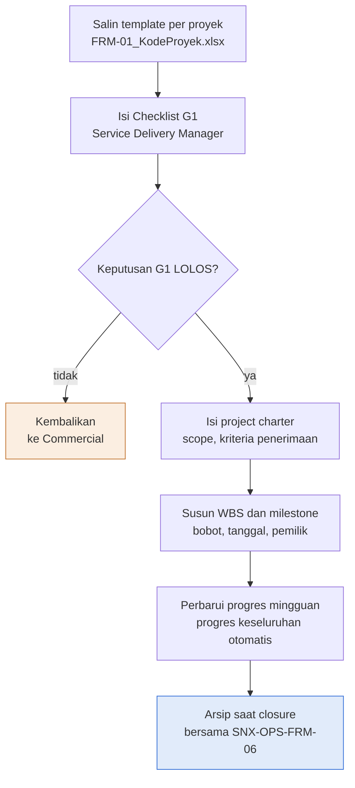

Deskripsi: Alur vertikal tujuh kotak dengan satu keputusan "Keputusan G1 LOLOS?". Cabang tidak menuju kotak oranye "Kembalikan ke Commercial"; cabang ya melanjutkan ke pengisian charter, penyusunan WBS dan milestone, pembaruan progres mingguan, dan berakhir di kotak biru "Arsip saat closure" (bersama SNX-OPS-FRM-06). Pada gambar kotak "Kembalikan" tidak punya panah kembali ke alur utama.

Sumber gambar: `conv/1q0cl8mLlUDJ-7nvnzozSbjJhE46-Jk-3/img/image1.png` (judul gambar "Rencana proyek terisi dari G1 sampai closure"; subjudul "Alur pengisian Project Plan, Scope & Timeline").

## 4. Peran, RACI, record, KPI

| Peran | Keterlibatan menurut sumber |
|---|---|
| Project Manager | Pemilik dokumen; mengisi charter, WBS, milestone, memperbarui progres mingguan |
| Service Delivery Manager | Pemilik gate G1; mengisi Checklist G1 |
| Commercial | Menerima kembali paket bila G1 tidak LOLOS (diagram); pemberi paket handover |
| NOC Engineer | Contoh pemilik tugas provisioning dan migrasi (baris CONTOH) |
| ISO/ISMS Coordinator | Pemeriksa dokumen |
| COO | Penyetuju dokumen |

Record: FRM-01_<KodeProyek>.xlsx per proyek; masa simpan durasi kontrak + 3 tahun; frekuensi pembaruan Progres dan Status minimal mingguan (SNX-OPS-SOP-01 Bagian 6.4). KPI formal: tidak ada.

## 5. Catatan kualitas dan celah

- Data terisi bersifat contoh/dummy. Bukti: kolom Catatan WBS dan Timeline M5 sampai M9 berisi "CONTOH" (5 baris) dan Milestone G5 "CONTOH" (1 baris); sheet Kontrol Dokumen legenda "Baris CONTOH: hapus atau timpa saat dipakai" dan Cara pakai butir 5 "Hapus baris CONTOH (biru muda) sebelum dipakai" (sel biru muda terkonfirmasi di biner: A5 sheet WBS berwarna FFE7EEF7); Project Charter hanya berisi label (kolom B kosong kecuali rumus B22); Stakeholder A5, B5, D5 "[nama PIC]", "[pelanggan]", "[email kerja]"; tanggal contoh seluruhnya November 2026 (WBS E5 sampai F9, Milestone C5 dan D5), setelah tanggal draft 13 Oktober 2026.
- Inkonsistensi pada data contoh: Checklist G1 C5 sampai C12 seluruhnya "Belum" (C14 "TAHAN"), padahal WBS contoh menandai tugas 1.1 "Selesai" (K5) dan 2.1 "Berjalan" (K6); Cara pakai butir 2 menyatakan "proyek tidak dimulai bila ada butir Belum".
- Inkonsistensi pada data contoh: Milestone "Go-live layanan" Rencana 2026-11-17 (C5), sama dengan tanggal selesai migrasi WBS 2.2 (F7 2026-11-17) dan mendahului UAT WBS 3.1 (E8 2026-11-18 sampai F8 2026-11-20) serta BAST dan G3 WBS 4.1 (2026-11-23 sampai 2026-11-24). Perkiraan go-live 2026-11-19 (D5), deviasi 2 hari, status "Berisiko" (F5), jatuh di tengah jendela UAT.
- Daftar Status G1 memuat "Belum, Lolos, Tidak berlaku" (sheet Daftar B2 sampai B4), tetapi rumus C14 `IF(COUNTIF(C5:C12,"Belum")=0,"LOLOS","TAHAN")` hanya memeriksa "Belum"; sel yang dibiarkan kosong tidak menahan gate (fakta rumus).
- Rumus Durasi `F-E+1` memakai hari kalender, dan A2 sheet WBS menyatakan "Kolom Durasi dihitung otomatis (hari kalender)".
- Total bobot 100 hanya tampil di J2 (`=SUM(I5:I104)`); data validation pada sheet WBS hanya ada di K5:K104 (Status), tidak ada validasi yang menolak total bobot selain 100 (diperiksa di biner dengan openpyxl).
- Kolom Bukti atau lokasi dokumen, PIC, dan Tanggal pada Checklist G1 (D5:F12) kosong; tidak ada nama orang pada sheet mana pun selain peran dan nama COO pada Pengesahan.
- Lintas dokumen: Cara pakai butir 4 merujuk "SNX-OPS-SOP-01 Bagian 6.4"; SNX-OPS-SOP-01 6.4 butir 1 menyatakan "memperbarui progres dan status tugas di SNX-OPS-FRM-01 minimal mingguan", cocok. WBS H8 menyebut "FRM-05 ditandatangani" dan H9 "FRM-06"; kedua dokumen ada di md/ops. Checklist G1 memuat 8 butir (butir 8 "Klasifikasi data pelanggan dan kebutuhan keamanan informasi teridentifikasi (SNX-ISMS-PRO-01)"), sedangkan checklist G1 di PRO-OPS-001 Bagian 8.2 memuat 7 butir tanpa butir klasifikasi data.
- Riwayat revisi (Kontrol Dokumen A31 sampai E32): dua baris rev 00 tanggal sama; Disetujui "Menunggu"; frasa "keselarasan RTO dan target pulih" tidak relevan dengan isi workbook (inferensi; pencarian "RTO" hanya menemukan frasa itu).
- Blok Pengesahan pada sheet Kontrol Dokumen (A35 sampai D38) tanpa tanda tangan atau tanggal.

## 6. Kata kunci retrieval

project plan, rencana proyek, scope, timeline, WBS, work breakdown structure, project charter, milestone, stakeholder, rencana komunikasi, Checklist G1, gate G1, handover Commercial ke SD dan PM, Service Delivery Manager, Project Manager, progres otomatis, bobot, durasi hari kalender, dropdown status, SNX-OPS-FRM-01, acceptance criteria, kriteria penerimaan UAT, ISO 9001 8.2.2, Annex A 5.8

<!-- FILE: ops/SNX-OPS-FRM-02.md -->

---
doc_code: SNX-OPS-FRM-02
title: Project Risk Register
department: Operation
doc_type: Register
source: {drive_file_id: 1XvfQ5yYx4H8Y-rgJUKyngfZfn7909L2D, filename: SNX-OPS-FRM-02_Project_Risk_Register.xlsx, format: xlsx, bytes: 127036, retrieved: 2026-10-13}
revision: 00 (DRAFT)
doc_date: 13 Oktober 2026 (tanggal draft); tanggal efektif "Ditetapkan saat pengesahan"
classification_in_doc: RESTRICTED (Internal)
owner_in_doc: Project Manager
approver_in_doc: COO, Amirull Yusuf Zulkarnain (status persetujuan "Menunggu")
iso_refs: {iso9001: ["6.1", "8.1"], iso27001: ["A5.8"]}
kb_sensitivity_suggest: restricted:ops
related_docs: [SNX-OPS-FRM-03, SNX-ISMS-REG-02]
coverage: {sections_or_sheets: "5 dari 5 sheet", tables: 8, images: "1 dibuka dari 1 (Alur Proses, image1.png)", notes: "Warna sel (biru muda = CONTOH) tidak terbaca dari konversi teks, hanya keterangan legenda. Nilai rumus yang dicatat adalah nilai tersimpan (cache). 60 baris kosong Risk Register (baris 7 sampai 66) hanya berisi rumus."}
---
# SNX-OPS-FRM-02 Project Risk Register

## 1. Ringkasan

- Workbook template per proyek (`FRM-02_<KodeProyek>.xlsx`) untuk mencatat, menilai, dan memantau risiko proyek, termasuk risiko keamanan informasi selama proyek.
- Lima sheet: Kontrol Dokumen, Alur Proses, Daftar, Risk Register (62 baris kapasitas, baris 5 sampai 66), Matriks Risiko (5x5).
- Skor = Likelihood (L) x Impact (I), skala 1 sampai 5. Level: Rendah 1 sampai 4, Sedang 5 sampai 9, Tinggi 10 sampai 19, Kritis 20 sampai 25. Skor residual dihitung dengan cara sama dari L residual dan I residual.
- Kolom "Naik ke ISMS" otomatis "Ya" bila skor (inheren) 10 atau lebih (Tinggi atau Kritis); risiko itu wajib disalin ke SNX-ISMS-REG-02. Tinjau mingguan bersama SNX-OPS-FRM-03.
- Data terisi adalah CONTOH (dummy): 2 baris (PR-001, PR-002) pada baris biru muda bertanda "Baris biru muda = CONTOH"; 60 baris sisanya kosong. Keduanya skor 12 (Tinggi), residual 6 (Sedang) dan 4 (Rendah), keduanya Naik ke ISMS = Ya.
- Penanganan per level: Rendah diterima dan dipantau; Sedang mitigasi dalam rencana normal; Tinggi rencana mitigasi wajib bertenggat, dilaporkan ke Head of Operation dan dinaikkan ke register ISMS; Kritis tindakan segera, dilaporkan ke COO, penerimaan risiko hanya oleh COO secara tertulis.

## 2. Isi lengkap terstruktur

### Sheet 1. Kontrol Dokumen (A1:E38)

Tujuan sheet: kontrol dokumen, cara pakai, legenda, riwayat revisi, pengesahan. Judul "Project Risk Register"; subjudul "PT Strategi Integrasi Nusantara (SINUX) · Divisi Operation".

| Atribut | Isi |
|---|---|
| Nomor dokumen | SNX-OPS-FRM-02 |
| Judul | Project Risk Register |
| Revisi | 00 (DRAFT) |
| Tanggal draft | 13 Oktober 2026 |
| Tanggal efektif | Ditetapkan saat pengesahan |
| Klasifikasi | RESTRICTED (Internal) |
| Pemilik dokumen | Project Manager |
| Disetujui oleh | COO, Amirull Yusuf Zulkarnain |
| Acuan ISO 9001:2015 | Klausul 6.1, 8.1 |
| Acuan ISO/IEC 27001:2022 | Klausul atau kontrol Annex A 5.8 |
| Masa simpan record | Durasi kontrak + 3 tahun |
| Tujuan | Mencatat, menilai, dan memantau risiko proyek, termasuk risiko keamanan informasi selama proyek. |

**Cara pakai**

1. Satu file per proyek; ganti nama menjadi FRM-02_<KodeProyek>.xlsx.
2. Tulis risiko dalam pola sebab, kejadian, dampak.
3. Isi Likelihood dan Impact 1 sampai 5 sesuai sheet Matriks Risiko; skor dan level dihitung otomatis.
4. Risiko berlevel Tinggi atau Kritis otomatis ditandai Ya pada kolom Naik ke ISMS dan wajib disalin ke SNX-ISMS-REG-02.
5. Tinjau mingguan bersama laporan progres SNX-OPS-FRM-03.

**Legenda warna**

| Sel | Arti |
|---|---|
| Sel input | diisi pengguna |
| Baris CONTOH | hapus atau timpa saat dipakai |
| Sel rumus | jangan diubah |

**Riwayat revisi**

| Revisi | Tanggal | Uraian perubahan | Disusun | Disetujui |
|---|---|---|---|---|
| 00 | 13 Oktober 2026 | Draft awal untuk sertifikasi ISO 9001 dan ISO/IEC 27001 | Divisi Operation | Menunggu |
| 00 | 13 Oktober 2026 | Review bahasa dan konsistensi: istilah teknologi dalam bahasa Inggris, bahasa Indonesia formal, label klasifikasi, keselarasan RTO dan target pulih | Divisi Operation | Menunggu |

**Pengesahan**

| Peran | Nama dan jabatan | Tanda tangan | Tanggal |
|---|---|---|---|
| Disusun oleh | Project Manager | (kosong) | (kosong) |
| Diperiksa oleh | ISO/ISMS Coordinator | (kosong) | (kosong) |
| Disetujui oleh | COO, Amirull Yusuf Zulkarnain | (kosong) | (kosong) |

### Sheet 2. Alur Proses (A1:A2)

Tujuan sheet: memuat gambar alur (image1.png). Teks: "Diagram alur proses"; "Kotak biru = output akhir · kotak oranye = cabang ke tindakan atau prosedur lain · garis putus-putus = kembali ke alur utama". Diagram ada di Bagian 3.

### Sheet 3. Daftar (A1:D9): nilai dropdown

| Kategori (A) | Respon (B) | Status (C) | Skala (D) |
|---|---|---|---|
| Teknis | Hindari | Terbuka | 1 |
| Jadwal | Mitigasi | Dipantau | 2 |
| Scope | Transfer | Ditutup | 3 |
| Sumber daya | Terima | (kosong) | 4 |
| Supplier | (kosong) | (kosong) | 5 |
| Keamanan informasi | (kosong) | (kosong) | (kosong) |
| Pelanggan | (kosong) | (kosong) | (kosong) |
| Komersial | (kosong) | (kosong) | (kosong) |

Pemakaian dropdown pada sheet Risk Register (7 validasi):

| Kolom | Rentang | Sumber daftar | Nilai |
|---|---|---|---|
| C Kategori | C5:C66 | Daftar!$A$2:$A$9 | Teknis, Jadwal, Scope, Sumber daya, Supplier, Keamanan informasi, Pelanggan, Komersial |
| F L | F5:F66 | Daftar!$D$2:$D$6 | 1, 2, 3, 4, 5 |
| G I | G5:G66 | Daftar!$D$2:$D$6 | 1, 2, 3, 4, 5 |
| J Respon | J5:J66 | Daftar!$B$2:$B$5 | Hindari, Mitigasi, Transfer, Terima |
| M Status | M5:M66 | Daftar!$C$2:$C$4 | Terbuka, Dipantau, Ditutup |
| N L residual | N5:N66 | Daftar!$D$2:$D$6 | 1, 2, 3, 4, 5 |
| O I residual | O5:O66 | Daftar!$D$2:$D$6 | 1, 2, 3, 4, 5 |

### Sheet 4. Risk Register (A1:R66)

Tujuan sheet: "Project risk register". Keterangan A2: "Skor, level, dan kolom Naik ke ISMS dihitung otomatis. Baris biru muda = CONTOH." Header di baris 4; data baris 5 sampai 66 (62 baris kapasitas).

Kolom dan artinya:

| Kolom | Header | Arti |
|---|---|---|
| A | ID | Nomor risiko (contoh PR-001) |
| B | Tanggal | Tanggal risiko dicatat |
| C | Kategori | Dropdown 8 kategori |
| D | Uraian risiko (sebab, kejadian, dampak) | Teks bebas pola sebab, kejadian, dampak |
| E | Pemilik | Pemilik risiko (peran) |
| F | L | Likelihood 1 sampai 5 (dropdown) |
| G | I | Impact 1 sampai 5 (dropdown) |
| H | Skor | Rumus: L x I |
| I | Level | Rumus: Rendah, Sedang, Tinggi, Kritis dari skor |
| J | Respon | Hindari, Mitigasi, Transfer, Terima |
| K | Rencana tindakan | Teks bebas |
| L | Tenggat | Tanggal |
| M | Status | Terbuka, Dipantau, Ditutup |
| N | L residual | Likelihood setelah tindakan (dropdown) |
| O | I residual | Impact setelah tindakan (dropdown) |
| P | Skor residual | Rumus: L residual x I residual |
| Q | Level residual | Rumus level dari skor residual |
| R | Naik ke ISMS | Rumus: "Ya" bila skor inheren 10 atau lebih |

Rumus (baris 5 sebagai contoh, berlaku sama sampai baris 66):

- H: `=IF(OR(F5="",G5=""),"",F5*G5)`. Skor = L x I; kosong bila salah satu kosong.
- I: `=IF(H5="","",IF(H5>=20,"Kritis",IF(H5>=10,"Tinggi",IF(H5>=5,"Sedang","Rendah"))))`.
- P: `=IF(OR(N5="",O5=""),"",N5*O5)`.
- Q: `=IF(P5="","",IF(P5>=20,"Kritis",IF(P5>=10,"Tinggi",IF(P5>=5,"Sedang","Rendah"))))`.
- R: `=IF(H5="","",IF(H5>=10,"Ya","Tidak"))`. Memakai skor inheren (H), bukan residual (P).

Baris terisi (seluruh 2 baris; baris 7 sampai 66 kosong, hanya berisi rumus H, I, P, Q, R):

| ID | Tanggal | Kategori | Uraian risiko | Pemilik | L | I | Skor | Level | Respon | Rencana tindakan | Tenggat | Status | L res | I res | Skor res | Level res | Naik ke ISMS |
|---|---|---|---|---|---|---|---|---|---|---|---|---|---|---|---|---|---|
| PR-001 | 2026-11-02 | Teknis | Window migrasi sempit dan data besar, sehingga migrasi melewati window dan layanan pelanggan terganggu | Project Manager | 3 | 4 | 12 | Tinggi | Mitigasi | Uji migrasi parsial, ukur throughput, siapkan rollback dan window cadangan | 2026-11-09 | Terbuka | 2 | 3 | 6 | Sedang | Ya |
| PR-002 | 2026-11-02 | Keamanan informasi | Kredensial pelanggan dikirim melalui grup chat, sehingga kredensial bocor ke pihak tidak berwenang | Service Delivery Manager | 3 | 4 | 12 | Tinggi | Hindari | Kredensial hanya melalui password manager atau direct message, minta rotate setelah dipakai | 2026-11-03 | Dipantau | 1 | 4 | 4 | Rendah | Ya |

Agregat: 2 risiko terisi, keduanya Tinggi (inheren), 0 Kritis; setelah tindakan 1 Sedang dan 1 Rendah; 2 dari 2 bertanda Naik ke ISMS = Ya. Sheet tidak memuat sel total atau ringkasan.

### Sheet 5. Matriks Risiko (A1:G24)

Tujuan sheet: "Matriks risiko 5x5 dan skala penilaian". Keterangan A3: "Skor = Likelihood x Impact. Rendah 1 sampai 4 · Sedang 5 sampai 9 · Tinggi 10 sampai 19 · Kritis 20 sampai 25". Nilai matriks berupa teks statis (bukan rumus).

**Matriks 5x5 (baris Likelihood, kolom Impact)**

| Likelihood \ Impact | 1 | 2 | 3 | 4 | 5 |
|---|---|---|---|---|---|
| 5 | 5 Sedang | 10 Tinggi | 15 Tinggi | 20 Kritis | 25 Kritis |
| 4 | 4 Rendah | 8 Sedang | 12 Tinggi | 16 Tinggi | 20 Kritis |
| 3 | 3 Rendah | 6 Sedang | 9 Sedang | 12 Tinggi | 15 Tinggi |
| 2 | 2 Rendah | 4 Rendah | 6 Sedang | 8 Sedang | 10 Tinggi |
| 1 | 1 Rendah | 2 Rendah | 3 Rendah | 4 Rendah | 5 Sedang |

**Skala penilaian**

| Skala | Likelihood (kemungkinan) | Impact (dampak) |
|---|---|---|
| 1 | Sangat jarang: kurang dari sekali dalam 3 tahun | Tidak berarti: tanpa gangguan layanan, tanpa data terdampak |
| 2 | Jarang: sekali dalam 1 sampai 3 tahun | Kecil: gangguan kurang dari 1 jam, satu pelanggan, tanpa data sensitif |
| 3 | Mungkin: sekali dalam setahun | Sedang: gangguan 1 sampai 4 jam atau SLA satu pelanggan terancam |
| 4 | Sering: beberapa kali dalam setahun | Besar: breach SLA, beberapa pelanggan, atau data internal bocor |
| 5 | Hampir pasti: bulanan atau lebih sering | Kritis: layanan utama mati lebih dari 4 jam, data pelanggan bocor, sanksi hukum atau kontrak |

**Ketentuan penanganan per level**

| Level | Ketentuan penanganan |
|---|---|
| Rendah | Diterima, dipantau saat review berkala |
| Sedang | Mitigasi dalam rencana normal, pemilik risiko ditetapkan |
| Tinggi | Rencana mitigasi wajib dengan tenggat; dilaporkan ke Head of Operation dan dinaikkan ke register risiko ISMS |
| Kritis | Tindakan segera; dilaporkan ke COO; penerimaan risiko hanya oleh COO secara tertulis |

## 3. Diagram

### 3.1 Alur pengisian Project Risk Register (sheet Alur Proses)

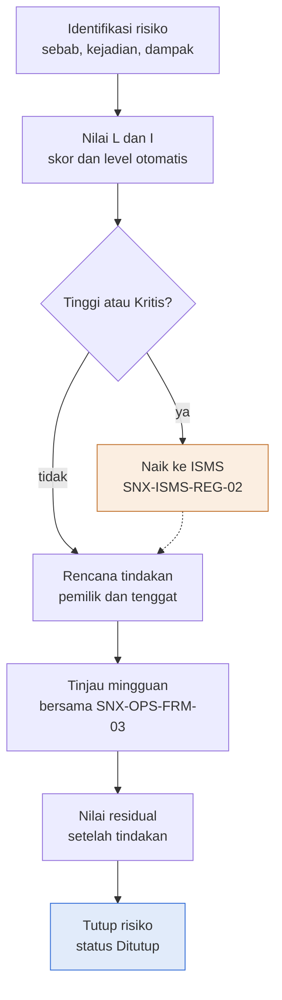

Deskripsi: Alur vertikal tujuh kotak dengan satu keputusan "Tinggi atau Kritis?". Cabang ya menuju kotak oranye "Naik ke ISMS" (SNX-ISMS-REG-02) yang kembali ke alur utama lewat garis putus-putus tepat sebelum "Rencana tindakan"; cabang tidak langsung ke "Rencana tindakan". Alur berlanjut ke Tinjau mingguan, Nilai residual, dan kotak biru "Tutup risiko" (status Ditutup) sebagai output akhir.

Sumber gambar: `conv/1XvfQ5yYx4H8Y-rgJUKyngfZfn7909L2D/img/image1.png` (judul gambar "Risiko proyek dinilai, ditangani, dan dinaikkan bila berat"; subjudul "Alur pengisian Project Risk Register").

### 3.2 Logika skor dan level (diturunkan dari rumus dan teks Matriks Risiko)

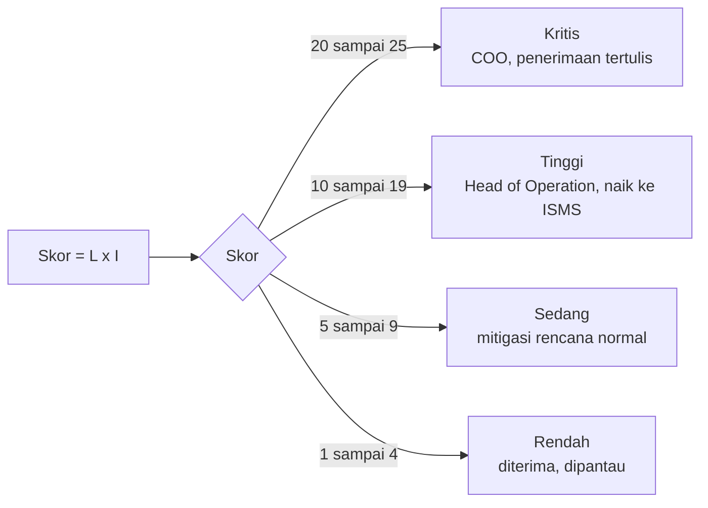

(diturunkan dari teks; bukan gambar sumber)

## 4. Peran, RACI, record, KPI

| Peran | Keterlibatan menurut sumber |
|---|---|
| Project Manager | Pemilik dokumen; contoh pemilik risiko PR-001 |
| Service Delivery Manager | Contoh pemilik risiko PR-002 |
| Head of Operation | Menerima laporan risiko Tinggi |
| COO | Menerima laporan risiko Kritis; satu-satunya yang boleh menerima risiko Kritis secara tertulis; penyetuju dokumen |
| ISO/ISMS Coordinator | Pemeriksa dokumen |

Record: FRM-02_<KodeProyek>.xlsx per proyek, masa simpan durasi kontrak + 3 tahun. Frekuensi tinjau: mingguan, bersama SNX-OPS-FRM-03. KPI formal: tidak ada. Eskalasi: Tinggi atau Kritis ke SNX-ISMS-REG-02.

## 5. Catatan kualitas dan celah

- Data di register adalah CONTOH (dummy), bukan data nyata. Bukti: sheet Risk Register A2 "Baris biru muda = CONTOH"; sheet Kontrol Dokumen legenda "Baris CONTOH: hapus atau timpa saat dipakai"; ID berurutan PR-001 dan PR-002 (A5, A6) dengan tanggal sama 2026-11-02 (B5, B6), setelah tanggal draft 13 Oktober 2026; pemilik berupa peran (E5 "Project Manager", E6 "Service Delivery Manager"); tidak ada kode proyek atau pelanggan; uraian risiko generik (D5 "Window migrasi sempit dan data besar ...", D6 "Kredensial pelanggan dikirim melalui grup chat ..."); kedua contoh memiliki L=3 dan I=4 (F5:G6). Lintas dokumen: K6 "Kredensial hanya melalui password manager atau direct message, minta rotate setelah dipakai" sejalan dengan SNX-OPS-SOP-04 Bagian 7.3 butir 2 ("hanya diterima melalui direct message atau password manager; pelanggan diminta rotate setelah dipakai"). Tenggat PR-002 (L6 2026-11-03) hanya sehari setelah tanggal pencatatan (B6 2026-11-02).
- Kolom "Naik ke ISMS" (R) memakai skor inheren H: `IF(H5>=10,"Ya","Tidak")`, bukan skor residual P. PR-001 dan PR-002 tetap "Ya" walau residual Sedang (Q5) dan Rendah (Q6). Cara pakai butir 4 hanya menulis "Risiko berlevel Tinggi atau Kritis otomatis ditandai Ya" tanpa menyebut inheren atau residual (inferensi: perilaku rumus tidak dijelaskan).
- Rumus level (Rendah kurang dari 5, Sedang 5 sampai 9, Tinggi 10 sampai 19, Kritis 20 atau lebih; kolom I dan Q) cocok dengan seluruh 25 sel sheet Matriks Risiko C6:G10 (setiap sel bertuliskan skor dan level yang sama dengan hasil rumus; dicek satu per satu), dan dengan teks Matriks Risiko A3.
- Nilai Matriks Risiko adalah teks statis (mis. C6 "5 Sedang"); bila ambang di rumus Risk Register diubah, matriks tidak ikut berubah.
- Skala L dan I memakai Daftar kolom D (1 sampai 5) pada validasi F, G, N, O, sementara definisi skala ada di Matriks Risiko A14:C18; validasi data hanya berupa daftar, tidak ada validasi bahwa residual lebih kecil atau sama dengan inheren (diperiksa di biner dengan openpyxl).
- Status "Ditutup" ada di dropdown M (Daftar C4) dan di gambar Alur Proses (kotak "Tutup risiko, status Ditutup"); tidak ada kriteria penutupan tertulis di workbook.
- Kategori "Keamanan informasi", "Supplier", "Pelanggan", "Komersial" ada di dropdown (Daftar A2:A9), tetapi hanya Teknis (C5) dan Keamanan informasi (C6) dipakai di contoh. Kolom register (A4:R4) tidak memuat ID proyek, tanggal tinjau, atau tanggal tutup.
- Lintas dokumen: Cara pakai butir 4 merujuk SNX-ISMS-REG-02 (dokumen ada di md/isms); butir 5 merujuk SNX-OPS-FRM-03, dan sumber FRM-03 Bagian 6 memuat kolom "ID (dari FRM-02)", konsisten.
- Riwayat revisi (Kontrol Dokumen A31 sampai E32): dua baris rev 00 tanggal sama; Disetujui "Menunggu"; frasa "keselarasan RTO dan target pulih" tidak relevan dengan isi workbook (inferensi). Blok Pengesahan (A35 sampai D38) tanpa tanda tangan atau tanggal.

## 6. Kata kunci retrieval

risk register, daftar risiko proyek, penilaian risiko, likelihood, impact, skor risiko L x I, matriks risiko 5x5, level Rendah Sedang Tinggi Kritis, risiko residual, respon risiko Hindari Mitigasi Transfer Terima, naik ke ISMS, SNX-ISMS-REG-02, SNX-OPS-FRM-02, risk treatment, risk acceptance COO, ISO 9001 6.1, Annex A 5.8, Project Manager, Head of Operation, dropdown kategori risiko

<!-- FILE: ops/SNX-OPS-FRM-03.md -->

---
doc_code: SNX-OPS-FRM-03
title: Project Progress & Monitoring Report
department: Operation
doc_type: Form/Record
source: {drive_file_id: 147U5gBLjtLKHau5cQbLUym8iInh2b_RR, filename: SNX-OPS-FRM-03_Project_Progress_Monitoring_Report.docx, format: docx, bytes: 124151, retrieved: 2026-10-13}
revision: 00 (DRAFT)
doc_date: 13 Oktober 2026 (tanggal draft); tanggal efektif "Ditetapkan saat pengesahan"
classification_in_doc: RESTRICTED (Internal), dibagikan ke pelanggan terkait
owner_in_doc: Project Manager
approver_in_doc: COO, Amirull Yusuf Zulkarnain (status persetujuan "Menunggu")
iso_refs: {iso9001: ["8.5.1", "9.1.1"], iso27001: ["A5.8"]}
kb_sensitivity_suggest: restricted:ops
related_docs: [SNX-OPS-SOP-01, SNX-OPS-FRM-01, SNX-OPS-FRM-02, SNX-OPS-FRM-04]
coverage: {sections_or_sheets: "14 dari 14 (atribut, riwayat revisi, petunjuk, diagram, bagian 1 sampai 10, pengesahan)", tables: 12, images: "1 dibuka dari 1", notes: "Template kosong; semua isian berupa placeholder. SNX-OPS-SOP-01 Bagian 6.4 dan SNX-OPS-FRM-04 ada di md/ops (rujukan silang dicek di bagian 5)."}
---
# SNX-OPS-FRM-03 Project Progress & Monitoring Report

## 1. Ringkasan

- Template laporan progres mingguan (atau sesuai rencana komunikasi proyek) dari Project Manager kepada pelanggan dan COO, sesuai SNX-OPS-SOP-01 Bagian 6.4.
- Berisi 10 bagian: identitas, ringkasan status (6 dimensi, Hijau/Kuning/Merah), progres milestone, pekerjaan periode ini, rencana periode berikutnya, risiko dan isu, change request, keputusan dan dukungan, catatan, distribusi dan persetujuan.
- Panduan status: Hijau = sesuai baseline; Kuning = deviasi bisa dipulihkan tanpa mengubah baseline; Merah = butuh keputusan pelanggan atau COO.
- Status Merah dieskalasi ke Head of Operation dan COO (menurut diagram alur).
- Data ditarik dari SNX-OPS-FRM-01 (rencana), FRM-02 (risiko), FRM-04 (change request). Disimpan sebagai PDF `FRM-03_<KodeProyek>_<YYYY-MM-DD>.pdf` di folder proyek.
- Masa simpan record: durasi kontrak + 3 tahun. Dokumen berupa template kosong (tidak ada data nyata atau contoh terisi).

## 2. Isi lengkap terstruktur

### 2.0 Atribut dokumen

| Atribut | Isi |
|---|---|
| Nomor dokumen | SNX-OPS-FRM-03 |
| Judul | Project Progress & Monitoring Report |
| Revisi | 00 (DRAFT) |
| Tanggal draft | 13 Oktober 2026 |
| Tanggal efektif | Ditetapkan saat pengesahan |
| Klasifikasi | RESTRICTED (Internal) |
| Pemilik dokumen | Project Manager |
| Disetujui oleh | COO, Amirull Yusuf Zulkarnain |
| Acuan ISO 9001:2015 | Klausul 8.5.1, 9.1.1 |
| Acuan ISO/IEC 27001:2022 | Klausul atau kontrol Annex A 5.8 |
| Masa simpan record | Durasi kontrak + 3 tahun |

### Riwayat revisi

| Revisi | Tanggal | Uraian perubahan | Disusun | Disetujui |
|---|---|---|---|---|
| 00 | 13 Oktober 2026 | Draft awal untuk sertifikasi ISO 9001:2015 dan ISO/IEC 27001:2022 | Divisi Operation | Menunggu |
| 00 | 13 Oktober 2026 | Review bahasa dan konsistensi: istilah teknologi dalam bahasa Inggris, bahasa Indonesia formal, label klasifikasi, keselarasan RTO dan target pulih | Divisi Operation | Menunggu |

### 2.1 Petunjuk pengisian

Template ini dipakai Project Manager untuk laporan progres mingguan (atau sesuai rencana komunikasi proyek) kepada pelanggan dan COO, sesuai SNX-OPS-SOP-01 Bagian 6.4. Teks dalam kurung siku adalah petunjuk dan dihapus saat diisi. Simpan sebagai PDF dengan nama `FRM-03_<KodeProyek>_<YYYY-MM-DD>.pdf` di folder proyek.

### 2.2 Bagian 1. Identitas laporan

| Item | Isi (placeholder di sumber) |
|---|---|
| Nama proyek | [nama proyek] |
| Kode proyek | [kode proyek, sama dengan SNX-OPS-FRM-01] |
| Pelanggan | [nama pelanggan] |
| Nomor laporan | [urutan laporan, misalnya 05] |
| Periode laporan | [tanggal mulai] sampai [tanggal akhir] |
| Project Manager | [nama] |
| Penerima | [PIC pelanggan, COO, Service Delivery Manager] |
| Klasifikasi | RESTRICTED (Internal), dibagikan ke pelanggan terkait |

### 2.3 Bagian 2. Ringkasan status

| Dimensi | Status (Hijau, Kuning, Merah) | Keterangan singkat |
|---|---|---|
| Keseluruhan | (kosong) | (kosong) |
| Jadwal | (kosong) | [deviasi dari baseline dalam hari] |
| Scope | (kosong) | [ada atau tidak perubahan scope] |
| Mutu | (kosong) | [hasil uji, defect terbuka] |
| Risiko dan isu | (kosong) | [jumlah risiko Tinggi atau Kritis] |
| Keamanan informasi | (kosong) | [insiden, temuan akses, kepatuhan go-gate] |

Panduan status: Hijau = sesuai baseline; Kuning = deviasi bisa dipulihkan tanpa mengubah baseline; Merah = butuh keputusan pelanggan atau COO.

### 2.4 Bagian 3. Progres milestone

| No | Milestone | Rencana selesai | Perkiraan atau aktual selesai | Progres (%) | Status |
|---|---|---|---|---|---|
| 1 | (kosong) | (kosong) | (kosong) | (kosong) | (kosong) |
| 2 | (kosong) | (kosong) | (kosong) | (kosong) | (kosong) |
| 3 | (kosong) | (kosong) | (kosong) | (kosong) | (kosong) |
| 4 | (kosong) | (kosong) | (kosong) | (kosong) | (kosong) |

Progres keseluruhan proyek: [persen, dari SNX-OPS-FRM-01]

### 2.5 Bagian 4. Pekerjaan periode ini

| No | Pekerjaan selesai | Bukti atau referensi (CR, tiket, dokumen) |
|---|---|---|
| 1 | (kosong) | (kosong) |
| 2 | (kosong) | (kosong) |
| 3 | (kosong) | (kosong) |

### 2.6 Bagian 5. Rencana periode berikutnya

| No | Pekerjaan | Pemilik | Target tanggal |
|---|---|---|---|
| 1 | (kosong) | (kosong) | (kosong) |
| 2 | (kosong) | (kosong) | (kosong) |
| 3 | (kosong) | (kosong) | (kosong) |

### 2.7 Bagian 6. Risiko dan isu utama

| ID (dari FRM-02) | Uraian | Level | Tindakan | Pemilik | Tenggat |
|---|---|---|---|---|---|
| (kosong) | (kosong) | (kosong) | (kosong) | (kosong) | (kosong) |
| (kosong) | (kosong) | (kosong) | (kosong) | (kosong) | (kosong) |

### 2.8 Bagian 7. Change request periode ini

| Nomor CR (dari FRM-04) | Uraian | Jenis | Status | Dampak ke jadwal atau scope |
|---|---|---|---|---|
| (kosong) | (kosong) | (kosong) | (kosong) | (kosong) |

### 2.9 Bagian 8. Keputusan dan dukungan yang dibutuhkan

| No | Keputusan atau dukungan | Dari siapa | Dibutuhkan paling lambat |
|---|---|---|---|
| 1 | (kosong) | (kosong) | (kosong) |

### 2.10 Bagian 9. Catatan

[Catatan tambahan, misalnya perubahan PIC, kendala akses, ketergantungan pihak ketiga.]

### 2.11 Bagian 10. Distribusi dan persetujuan laporan

| Peran | Nama | Tanggal | Paraf |
|---|---|---|---|
| Disusun (Project Manager) | (kosong) | (kosong) | (kosong) |
| Diperiksa (Service Delivery Manager) | (kosong) | (kosong) | (kosong) |
| Diterima (PIC pelanggan, opsional) | (kosong) | (kosong) | (kosong) |

### Pengesahan

| Peran | Nama dan jabatan | Tanda tangan | Tanggal |
|---|---|---|---|
| Disusun oleh | Project Manager | (kosong) | (kosong) |
| Diperiksa oleh | ISO/ISMS Coordinator | (kosong) | (kosong) |
| Disetujui oleh | COO, Amirull Yusuf Zulkarnain | (kosong) | (kosong) |

## 3. Diagram

### 3.1 Alur pengisian Project Progress & Monitoring Report

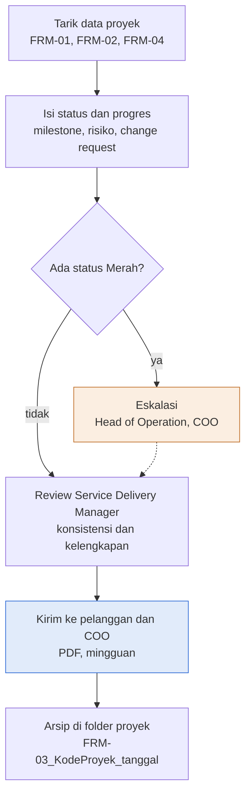

Deskripsi: Alur vertikal enam langkah. Setelah data ditarik dari tiga form dan status diisi, satu keputusan "Ada status Merah?" bercabang: ya ke kotak oranye Eskalasi (Head of Operation, COO) yang kembali ke alur utama lewat garis putus-putus tepat sebelum Review Service Delivery Manager; tidak langsung ke Review. Kotak biru "Kirim ke pelanggan dan COO" (PDF, mingguan) adalah output akhir, diikuti kotak Arsip di folder proyek.

Sumber gambar: `conv/147U5gBLjtLKHau5cQbLUym8iInh2b_RR/img/media/rId21.png` (judul gambar "Laporan progres mingguan dari data proyek ke pelanggan").

## 4. Peran, RACI, record, KPI

| Peran | Keterlibatan menurut sumber |
|---|---|
| Project Manager | Pemilik dokumen; menyusun laporan mingguan; paraf disusun |
| Service Delivery Manager | Memeriksa konsistensi dan kelengkapan sebelum kirim; penerima laporan |
| COO | Penerima laporan; penerima eskalasi status Merah; penyetuju dokumen |
| Head of Operation | Penerima eskalasi bila ada status Merah |
| PIC pelanggan | Penerima laporan; paraf "Diterima" opsional |
| ISO/ISMS Coordinator | Pemeriksa dokumen (blok Pengesahan) |

Record: laporan FRM-03 per periode, format PDF di folder proyek; masa simpan durasi kontrak + 3 tahun. KPI: tidak ada KPI di dokumen ini. Frekuensi: mingguan (atau sesuai rencana komunikasi proyek).

## 5. Catatan kualitas dan celah

- Seluruh isian berupa placeholder kosong atau teks petunjuk dalam kurung siku (mis. Bagian 1 "\[nama proyek\]", sel Status Bagian 2 kosong); tidak ada data nyata maupun contoh terisi.
- Bagian 2 menyebut tiga warna status ("Status (Hijau, Kuning, Merah)") tetapi tidak ada daftar dropdown; kriteria hanya sebagai panduan teks ("Hijau = sesuai baseline; Kuning = deviasi bisa dipulihkan tanpa mengubah baseline; Merah = butuh keputusan pelanggan atau COO"). Tidak ada angka ambang deviasi (hari) untuk membedakan Kuning dan Merah.
- Bagian 3 menyediakan hanya 4 baris milestone; Bagian 4 dan 5 hanya 3 baris; Bagian 6 hanya 2 baris. Tidak dinyatakan apakah boleh ditambah (tidak ada kalimat tentang penambahan baris di sumber).
- Lintas dokumen: Petunjuk pengisian merujuk "SNX-OPS-SOP-01 Bagian 6.4"; SNX-OPS-SOP-01 6.4 butir 2 menulis "Laporan progres mingguan disusun dengan SNX-OPS-FRM-03 dan dikirim ke pelanggan dan COO", cocok. Bagian 7 merujuk "Nomor CR (dari FRM-04)" dan SNX-OPS-FRM-04 ada di md/ops. Kolom "Status" di Bagian 3 (milestone) tidak menyebut nilai; sheet Daftar SNX-OPS-FRM-01 (C2:C5) memakai daftar "Sesuai rencana, Berisiko, Terlambat, Selesai".
- Klasifikasi pada Bagian 1: "RESTRICTED (Internal), dibagikan ke pelanggan terkait": laporan dikirim ke pelanggan walau berlabel internal.
- Gambar (rId21) menyebut kotak "Kirim ke pelanggan dan COO" dengan sub-label "PDF, mingguan" (tetap), sedangkan Petunjuk pengisian menyebut "mingguan (atau sesuai rencana komunikasi proyek)".
- Riwayat revisi: dua baris rev 00 tanggal sama; Disetujui "Menunggu"; frasa "keselarasan RTO dan target pulih" tidak relevan dengan isi form (pencarian "RTO": hanya frasa itu).
- Blok Distribusi dan persetujuan laporan (Bagian 10) serta Pengesahan tanpa nama, tanda tangan, tanggal (hanya nama COO pada Pengesahan sebagai penyetuju).

## 6. Kata kunci retrieval

project progress report, laporan progres proyek, monitoring proyek, status Hijau Kuning Merah, RAG status, milestone, risiko dan isu, change request, eskalasi status Merah, Project Manager, Service Delivery Manager, laporan mingguan, FRM-03, SNX-OPS-FRM-01, SNX-OPS-FRM-02, SNX-OPS-FRM-04, baseline, deviasi jadwal, Annex A 5.8, ISO 9001 9.1.1

<!-- FILE: ops/SNX-OPS-FRM-04.md -->

---
doc_code: SNX-OPS-FRM-04
title: Change Request & Approval Log
department: Operation
doc_type: Form/Record
source: {drive_file_id: 1u5P_nturbvTvvi3hSrCy3ZfAIyiXCqWZ, filename: SNX-OPS-FRM-04_Change_Request_Approval_Log.xlsx, format: xlsx, bytes: 155160, retrieved: 2026-10-13}
revision: 00 (DRAFT)
doc_date: 13 Oktober 2026
classification_in_doc: RESTRICTED (Internal)
owner_in_doc: Head of Operation
approver_in_doc: COO, Amirull Yusuf Zulkarnain
iso_refs: {iso9001: ["8.5.6"], iso27001: ["A 8.32"]}
kb_sensitivity_suggest: restricted:ops
related_docs: [SNX-OPS-SOP-02, SNX-OPS-RPT-01]
coverage: {sections_or_sheets: "5 dari 5", tables: 8, images: "1 dibuka dari 1", notes: "Sheet Change Log hanya berisi 1 baris CONTOH terisi (CR-2026-0001); baris 6 sampai 155 kosong (hanya rumus Go-gate dan PIR). Nilai sel rumus di sumber adalah hasil cache."}
---
# SNX-OPS-FRM-04 Change Request & Approval Log

## 1. Ringkasan
- Form/record berformat Excel untuk mencatat seluruh change request (CR) proyek dan teknis beserta approval, eksekusi, dan hasilnya sesuai SNX-OPS-SOP-02.
- Satu nomor CR per perubahan, format `CR-YYYY-NNNN`. CR juga dibuat di Service Hub; log ini berfungsi sebagai rekap audit.
- Kolom Go-gate otomatis bernilai `CEK` bila backup, rollback, atau approval belum lengkap (kecuali change jenis Emergency).
- Kolom PIR (post implementation review) wajib otomatis `Ya` bila change berjenis Major atau berakhir Rollback; PIR ditinjau dalam 5 hari kerja.
- Sheet Ringkasan menghitung statistik per jenis change per periode untuk laporan KPI bulanan (SNX-OPS-RPT-01).
- Status isi: DATA CONTOH (template). Hanya 1 baris contoh dengan placeholder `[pengaju]`, `[pelanggan]`, `[nama VM]`, `[pelaksana]`; bukan data operasional nyata.

## 2. Isi lengkap terstruktur

### 2.1 Sheet "Kontrol Dokumen"
Tujuan: metadata dokumen, cara pakai, legenda, riwayat revisi, pengesahan.

| Atribut | Nilai |
|---|---|
| Judul sheet | Change Request & Approval Log |
| Organisasi | PT Strategi Integrasi Nusantara (SINUX) · Divisi Operation |
| Nomor dokumen | SNX-OPS-FRM-04 |
| Judul | Change Request & Approval Log |
| Revisi | 00 (DRAFT) |
| Tanggal draft | 13 Oktober 2026 |
| Tanggal efektif | Ditetapkan saat pengesahan |
| Klasifikasi | RESTRICTED (Internal) |
| Pemilik dokumen | Head of Operation |
| Disetujui oleh | COO, Amirull Yusuf Zulkarnain |
| Acuan ISO 9001:2015 | Klausul 8.5.6 |
| Acuan ISO/IEC 27001:2022 | Klausul atau kontrol Annex A 8.32 |
| Masa simpan record | 3 tahun |
| Tujuan | Log seluruh change request proyek dan teknis beserta approval, eksekusi, dan hasilnya sesuai SNX-OPS-SOP-02. |

Cara pakai (verbatim):
1. Satu nomor CR per perubahan: CR-YYYY-NNNN. CR juga dibuat di Service Hub; log ini menjadi rekap audit.
2. Kolom Go-gate otomatis CEK bila backup, rollback, atau approval belum lengkap (kecuali Emergency).
3. Kolom PIR otomatis Ya untuk change Major atau yang berakhir rollback; tinjau dalam 5 hari kerja.
4. Sheet Ringkasan menghitung statistik per jenis change untuk laporan KPI bulanan.

Legenda warna: sel input = diisi pengguna; baris CONTOH = hapus atau timpa saat dipakai; sel rumus = jangan diubah. (Nama warna tidak tertulis di teks sumber; hanya terlihat sebagai pengisi sel.)

Riwayat revisi:

| Revisi | Tanggal | Uraian perubahan | Disusun | Disetujui |
|---|---|---|---|---|
| 00 | 13 Oktober 2026 | Draft awal untuk sertifikasi ISO 9001 dan ISO/IEC 27001 | Divisi Operation | Menunggu |
| 00 | 13 Oktober 2026 | Review bahasa dan konsistensi: istilah teknologi dalam bahasa Inggris, bahasa Indonesia formal, label klasifikasi, keselarasan RTO dan target pulih | Divisi Operation | Menunggu |

Pengesahan:

| Peran | Nama dan jabatan | Tanda tangan | Tanggal |
|---|---|---|---|
| Disusun oleh | Head of Operation | (kosong) | (kosong) |
| Diperiksa oleh | ISO/ISMS Coordinator | (kosong) | (kosong) |
| Disetujui oleh | COO, Amirull Yusuf Zulkarnain | (kosong) | (kosong) |

### 2.2 Sheet "Alur Proses"
Berisi judul "Diagram alur proses" dan legenda: "Kotak biru = output akhir · kotak oranye = cabang ke tindakan atau prosedur lain · garis putus-putus = kembali ke alur utama". Gambar ada di bagian 3.

### 2.3 Sheet "Daftar" (nilai dropdown)

| Jenis | Approval | Ack | Hasil |
|---|---|---|---|
| Standar | Menunggu | Ya | Berhasil |
| Normal | Disetujui | Tidak | Rollback |
| Major | Ditolak | Tidak perlu | Gagal |
| Emergency | Revisi | (kosong) | Dibatalkan |
| Proyek | (kosong) | (kosong) | (kosong) |

Pemetaan data validation di sheet Change Log: F5:F155 = Daftar!A2:A6 (Jenis); L5:L155 = Daftar!B2:B5 (Status approval); N5:N155 = Daftar!C2:C4 (Ack pelanggan); Q5:Q155 = Daftar!D2:D5 (Hasil).

### 2.4 Sheet "Change Log" (A1:U155, kapasitas baris data 5 sampai 155 = 151 baris)
Judul: "Change request and approval log". Subjudul: "Approver sesuai SNX-OPS-SOP-02 Bagian 5. Baris biru muda = CONTOH."

Kolom (header baris 4):

| Kol | Header | Arti / sumber isi | Dropdown atau rumus |
|---|---|---|---|
| A | No CR | Nomor CR format CR-YYYY-NNNN | input |
| B | Tanggal ajukan | Tanggal pengajuan CR; dasar filter periode Ringkasan | input (tanggal) |
| C | Pengaju | Pihak yang mengajukan | input |
| D | Pelanggan / layanan | Pelanggan dan layanan terdampak | input |
| E | Sistem target | Sistem yang diubah | input |
| F | Jenis | Jenis change | dropdown: Standar, Normal, Major, Emergency, Proyek |
| G | Uraian perubahan | Deskripsi perubahan | input |
| H | Dampak dan risiko | Dampak dan risiko perubahan | input |
| I | Backup (lokasi) | Lokasi backup sebelum change | input; dipakai Go-gate |
| J | Rollback | Rencana rollback | input; dipakai Go-gate |
| K | Approver | Penyetuju (sesuai SOP-02 Bagian 5) | input |
| L | Status approval | Status persetujuan | dropdown: Menunggu, Disetujui, Ditolak, Revisi |
| M | Tgl approval | Tanggal persetujuan | input |
| N | Ack pelanggan | Acknowledgement pelanggan | dropdown: Ya, Tidak, Tidak perlu |
| O | Jadwal eksekusi | Tanggal dan jam eksekusi | input |
| P | Pelaksana | Pelaksana change | input |
| Q | Hasil | Hasil eksekusi | dropdown: Berhasil, Rollback, Gagal, Dibatalkan |
| R | Selesai | Waktu selesai | input |
| S | Go-gate | Pemeriksaan kelengkapan sebelum eksekusi | RUMUS |
| T | PIR wajib | Apakah post implementation review wajib | RUMUS |
| U | Catatan | Catatan bebas (contoh berisi "CONTOH") | input |

Rumus (identik tiap baris 5 sampai 155, contoh baris 5):
- Go-gate S: `=IF(A5="","",IF(F5="Emergency","Emergency",IF(AND(I5<>"",J5<>"",L5="Disetujui"),"OK","CEK")))`. Logika: kosong bila No CR kosong; `Emergency` bila jenis Emergency (tidak diperiksa); `OK` bila backup (I) terisi DAN rollback (J) terisi DAN status approval = Disetujui; selain itu `CEK`.
- PIR wajib T: `=IF(A5="","",IF(OR(F5="Major",Q5="Rollback"),"Ya","Tidak"))`. Logika: `Ya` bila jenis Major ATAU hasil Rollback; selain itu `Tidak`.

Baris data terisi (SATU-SATUNYA baris, ditandai CONTOH di kolom U):

| Kol | Nilai |
|---|---|
| A No CR | CR-2026-0001 |
| B Tanggal ajukan | 2026-11-05 |
| C Pengaju | [pengaju] |
| D Pelanggan / layanan | [pelanggan] / layanan VM |
| E Sistem target | [nama VM] |
| F Jenis | Normal |
| G Uraian perubahan | Resize VM 4 vCPU 8 GB menjadi 8 vCPU 16 GB |
| H Dampak dan risiko | Downtime sekitar 10 menit saat restart |
| I Backup (lokasi) | Snapshot [nama snapshot] |
| J Rollback | Kembalikan ke snapshot |
| K Approver | Lead NOC |
| L Status approval | Disetujui |
| M Tgl approval | 2026-11-05 |
| N Ack pelanggan | Ya |
| O Jadwal eksekusi | 2026-11-07 23:30 |
| P Pelaksana | [pelaksana] |
| Q Hasil | Berhasil |
| R Selesai | 2026-11-07 23:52 |
| S Go-gate (hasil rumus) | OK |
| T PIR wajib (hasil rumus) | Tidak |
| U Catatan | CONTOH |

Baris 6 sampai 155: kolom A sampai R kosong; S dan T hanya berisi rumus (hasil kosong).

### 2.5 Sheet "Ringkasan"
Judul "Ringkasan change"; petunjuk: "Isi periode di B3 dan B4; seluruh angka dihitung dari sheet Change Log berdasarkan Tanggal ajukan."
- B3 Periode mulai = 2026-11-01; B4 Periode akhir = 2026-11-30.

Tabel (header baris 6; nilai cache dari baris contoh):

| Jenis | Jumlah | Berhasil | Rollback | Gagal | Tanpa rollback darurat (%) |
|---|---|---|---|---|---|
| Standar | 0 | 0 | 0 | 0 | (kosong) |
| Normal | 1 | 1 | 0 | 0 | 1 (100%) |
| Major | 0 | 0 | 0 | 0 | (kosong) |
| Emergency | 0 | 0 | 0 | 0 | (kosong) |
| Proyek | 0 | 0 | 0 | 0 | (kosong) |
| Total | 1 | 1 | 0 | 0 | 1 (100%) |

Baris tambahan: A13 "CR dieksekusi tanpa go-gate lengkap (status CEK)" B13 = 0.

Rumus:
- Jumlah (B7:B11): `COUNTIFS('Change Log'!F5:F155, <jenis>, 'Change Log'!B5:B155, ">="&B3, 'Change Log'!B5:B155, "<="&B4)`, yaitu hitung CR per jenis dengan Tanggal ajukan di dalam periode.
- Berhasil / Rollback / Gagal (C, D, E): COUNTIFS yang sama ditambah syarat kolom Q = "Berhasil" / "Rollback" / "Gagal".
- Tanpa rollback darurat (%) (F): `=IF(B7=0,"",1-D7/B7)` (1 dikurangi Rollback dibagi Jumlah). Total (baris 12): SUM tiap kolom; F12 `=IF(B12=0,"",1-D12/B12)`.
- B13: COUNTIFS kolom S = "CEK" dengan filter periode yang sama.

## 3. Diagram

### 3.1 Alur pengisian Change Request & Approval Log
Judul gambar: "Setiap change tercatat dari pengajuan sampai hasil" (subjudul "Alur pengisian Change Request & Approval Log").

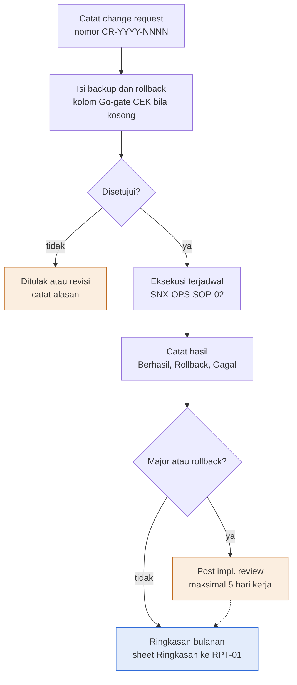

Deskripsi: alur vertikal tujuh kotak. Dari pencatatan CR dan pengisian backup/rollback, keputusan "Disetujui?"; jalur "tidak" bercabang ke kotak oranye "Ditolak atau revisi (catat alasan)" (tidak ada panah lanjutan dari kotak ini pada gambar). Jalur "ya" menuju eksekusi terjadwal (SNX-OPS-SOP-02), pencatatan hasil, lalu keputusan "Major atau rollback?". "ya" ke kotak oranye "Post impl. review" (maksimal 5 hari kerja) yang kembali ke alur utama dengan garis putus-putus; "tidak" langsung ke kotak biru output akhir "Ringkasan bulanan (sheet Ringkasan ke RPT-01)". Warna: biru = output akhir; oranye = cabang ke tindakan lain; garis putus-putus = kembali ke alur utama.
Sumber gambar: conv/1u5P_nturbvTvvi3hSrCy3ZfAIyiXCqWZ/img/image1.png

## 4. Peran, RACI, record, KPI

| Peran / pihak | Keterangan dari sumber |
|---|---|
| Head of Operation | Pemilik dokumen; penyusun (Disusun oleh) |
| ISO/ISMS Coordinator | Pemeriksa (Diperiksa oleh) |
| COO (Amirull Yusuf Zulkarnain) | Penyetuju dokumen |
| Lead NOC | Approver pada baris contoh (K5); approver sebenarnya "sesuai SNX-OPS-SOP-02 Bagian 5" |
| Pengaju, Pelaksana | Placeholder di baris contoh |
| Pelanggan | Memberi Ack (Ya / Tidak / Tidak perlu) |

Record: log CR dengan masa simpan 3 tahun. Metrik yang dihasilkan sheet Ringkasan (input untuk SNX-OPS-RPT-01): jumlah CR per jenis, Berhasil, Rollback, Gagal, persentase tanpa rollback, jumlah CR berstatus Go-gate CEK. RACI tidak ada di dokumen ini.

## 5. Catatan kualitas dan celah
- Dokumen berstatus "00 (DRAFT)" (Kontrol Dokumen B6); kolom "Disetujui" pada riwayat revisi (E30, E31) bernilai "Menunggu"; seluruh tanda tangan dan tanggal pengesahan (Kontrol Dokumen A34 sampai D37) kosong; Tanggal efektif B8 "Ditetapkan saat pengesahan".
- Hanya 1 baris contoh (Change Log baris 5, CR-2026-0001, U5 "CONTOH") dengan placeholder `[pengaju]`, `[pelanggan]`, `[nama VM]`, `[nama snapshot]`, `[pelaksana]`. Tanggal contoh (B5 2026-11-05, M5 2026-11-05, O5 2026-11-07 23:30, R5 2026-11-07 23:52) lebih akhir daripada tanggal draft (13 Oktober 2026), sehingga bukan kejadian nyata. Baris 6 sampai 155 hanya berisi rumus di kolom S dan T (150 sel masing-masing, tanpa nilai input lain; diperiksa di biner dengan openpyxl).
- Baris contoh berada dalam periode default Ringkasan (B3 2026-11-01 sampai B4 2026-11-30) sehingga ikut terhitung (B12 Total = 1). Legenda menyatakan "Baris CONTOH: hapus atau timpa saat dipakai"; bila tidak dihapus, statistik KPI akan menyertakan data contoh.
- Label kolom F Ringkasan "Tanpa rollback darurat (%)" dihitung `1-D/B` (`IF(B7=0,"",1-D7/B7)`) untuk semua jenis change (baris 7 sampai 11 dan Total F12), bukan khusus Emergency; label dan rumus tidak sepenuhnya sepadan (inferensi: maksudnya persentase change tanpa rollback).
- Jumlah (kolom B Ringkasan) menghitung semua baris pada periode berdasarkan Jenis tanpa melihat Hasil, sedangkan kolom Berhasil, Rollback, Gagal hanya menghitung Hasil yang bersangkutan; hasil "Dibatalkan" (Daftar D5) atau kosong tidak masuk ketiganya, sehingga jumlah C+D+E dapat lebih kecil daripada B.
- Nilai approver untuk tiap jenis change tidak dimuat di dokumen ini; Change Log A2 berbunyi "Approver sesuai SNX-OPS-SOP-02 Bagian 5". Lintas dokumen: SNX-OPS-SOP-02 Bagian 5 memuat kolom Approver per jenis (Standar, Normal, Major, Emergency, Proyek) dan Daftar Jenis di sini memuat lima jenis yang sama.
- Rumus Go-gate (S) `IF(F="Emergency","Emergency",IF(AND(I<>"",J<>"",L="Disetujui"),"OK","CEK"))` memeriksa keterisian Backup (I), Rollback (J), dan status approval "Disetujui" (L), tetapi tidak memeriksa Ack pelanggan (N); kolom N hanya dropdown (Daftar C2:C4) tanpa rumus. Lintas dokumen: SNX-OPS-SOP-02 Bagian 4 butir 1 mensyaratkan "ack pelanggan bila menyentuh layanan pelanggan".
- Rumus PIR wajib (T) `IF(OR(F="Major",Q="Rollback"),"Ya","Tidak")` tidak menghitung batas 5 hari kerja (batas hanya ada di Cara pakai butir 3 dan SNX-OPS-SOP-02 6.5 butir 5); tidak ada kolom tanggal PIR atau status PIR di A4:U4.
- Tidak ada kredensial atau data pribadi sensitif. Nama orang hanya pada Pengesahan (COO, B37).

## 6. Kata kunci retrieval
change request, CR, change log, approval, approver, go-gate, PIR, post implementation review, rollback, backup, snapshot, Emergency change, Major change, change standar, change normal, Ack pelanggan, Service Hub, SNX-OPS-SOP-02, SNX-OPS-FRM-04, ISO 9001 8.5.6, Annex A 8.32, change management, pengendalian perubahan, hasil change, ringkasan bulanan, KPI change

<!-- FILE: ops/SNX-OPS-FRM-05.md -->

---
doc_code: SNX-OPS-FRM-05
title: Testing / UAT & Quality Verification Records
department: Operation
doc_type: Form/Record
source: {drive_file_id: 1mTi4unyn2xST8h_ChsS_2w1xTWzSBROs, filename: SNX-OPS-FRM-05_Testing_UAT_Quality_Verification.xlsx, format: xlsx, bytes: 135427, retrieved: 2026-10-13}
revision: 00 (DRAFT)
doc_date: 13 Oktober 2026
classification_in_doc: RESTRICTED (Internal)
owner_in_doc: Project Manager
approver_in_doc: COO, Amirull Yusuf Zulkarnain
iso_refs: {iso9001: ["8.6", "8.7"], iso27001: ["A 8.29"]}
kb_sensitivity_suggest: restricted:ops
related_docs: [SNX-OPS-FRM-01, SNX-OPS-FRM-06]
coverage: {sections_or_sheets: "7 dari 7", tables: 10, images: "1 dibuka dari 1", notes: "Kasus Uji berisi 3 baris CONTOH (kapasitas baris 5 sampai 87); Defect berisi 1 baris CONTOH (kapasitas baris 5 sampai 45); Rencana Uji hanya label tanpa isi kecuali contoh kriteria lulus."}
---
# SNX-OPS-FRM-05 Testing / UAT & Quality Verification Records

## 1. Ringkasan
- Workbook untuk merekam rencana uji, eksekusi kasus uji, defect, dan persetujuan UAT sebagai dasar BAST (gate G2).
- Satu file per proyek atau per rilis, diberi nama `FRM-05_<KodeProyek>.xlsx`.
- Kasus uji dibuat dari kriteria penerimaan di project charter (SNX-OPS-FRM-01); kasus berstatus Gagal wajib punya Defect ID.
- Sheet "Ringkasan dan Persetujuan" menghitung tingkat kelulusan dan memberi rekomendasi otomatis; UAT ditandatangani bila tidak ada defect Kritis atau Tinggi terbuka.
- Contoh kriteria lulus di sumber: 100% kasus Kritis lolos, minimal 95% total kasus lolos, tidak ada defect Kritis atau Tinggi terbuka.
- Status isi: DATA CONTOH (3 kasus uji, 1 defect, placeholder `[penguji]`); bukan data nyata.

## 2. Isi lengkap terstruktur

### 2.1 Sheet "Kontrol Dokumen"

| Atribut | Nilai |
|---|---|
| Judul sheet | Testing / UAT & Quality Verification Records |
| Organisasi | PT Strategi Integrasi Nusantara (SINUX) · Divisi Operation |
| Nomor dokumen | SNX-OPS-FRM-05 |
| Revisi | 00 (DRAFT) |
| Tanggal draft | 13 Oktober 2026 |
| Tanggal efektif | Ditetapkan saat pengesahan |
| Klasifikasi | RESTRICTED (Internal) |
| Pemilik dokumen | Project Manager |
| Disetujui oleh | COO, Amirull Yusuf Zulkarnain |
| Acuan ISO 9001:2015 | Klausul 8.6, 8.7 |
| Acuan ISO/IEC 27001:2022 | Klausul atau kontrol Annex A 8.29 |
| Masa simpan record | Durasi kontrak + 3 tahun |
| Tujuan | Merekam rencana uji, eksekusi kasus uji, defect, dan persetujuan UAT sebagai dasar BAST (gate G2). |

Cara pakai (verbatim):
1. Satu file per proyek atau per rilis; ganti nama menjadi FRM-05_<KodeProyek>.xlsx.
2. Isi Rencana Uji, lalu kasus uji dari kriteria penerimaan di project charter (SNX-OPS-FRM-01).
3. Kasus berstatus Gagal wajib punya Defect ID di sheet Defect.
4. Sheet Ringkasan dan Persetujuan menghitung tingkat kelulusan; UAT ditandatangani bila tidak ada defect Kritis atau Tinggi terbuka.

Legenda warna: sel input = diisi pengguna; baris CONTOH = hapus atau timpa saat dipakai; sel rumus = jangan diubah.

Riwayat revisi:

| Revisi | Tanggal | Uraian perubahan | Disusun | Disetujui |
|---|---|---|---|---|
| 00 | 13 Oktober 2026 | Draft awal untuk sertifikasi ISO 9001 dan ISO/IEC 27001 | Divisi Operation | Menunggu |
| 00 | 13 Oktober 2026 | Review bahasa dan konsistensi: istilah teknologi dalam bahasa Inggris, bahasa Indonesia formal, label klasifikasi, keselarasan RTO dan target pulih | Divisi Operation | Menunggu |

Pengesahan:

| Peran | Nama dan jabatan | Tanda tangan | Tanggal |
|---|---|---|---|
| Disusun oleh | Project Manager | (kosong) | (kosong) |
| Diperiksa oleh | ISO/ISMS Coordinator | (kosong) | (kosong) |
| Disetujui oleh | COO, Amirull Yusuf Zulkarnain | (kosong) | (kosong) |

### 2.2 Sheet "Alur Proses"
Judul "Diagram alur proses"; legenda: kotak biru = output akhir, kotak oranye = cabang ke tindakan atau prosedur lain, garis putus-putus = kembali ke alur utama. Gambar di bagian 3.

### 2.3 Sheet "Daftar" (nilai dropdown)

| Kategori | Status uji | Severity defect | Status defect |
|---|---|---|---|
| Fungsional | Belum | Kritis | Terbuka |
| Kinerja | Lolos | Tinggi | Diperbaiki |
| Keamanan | Gagal | Sedang | Lolos retest |
| Backup dan restore | Diblokir | Rendah | Diterima sebagai isu sisa |
| Monitoring | | | |
| Akses | | | |
| Dokumentasi | | | |

Pemetaan validation: Kasus Uji B5:B87 = Daftar!A2:A8 (Kategori); Kasus Uji G5:G87 = Daftar!B2:B5 (Status uji); Defect D5:D45 = Daftar!C2:C5 (Severity); Defect G5:G45 = Daftar!D2:D5 (Status defect).

### 2.4 Sheet "Rencana Uji" (A1:B11)
Judul: "Rencana uji dan verifikasi mutu". Isian (kolom A = label, kolom B = isi, semua kosong kecuali kriteria lulus):

| Label (kolom A) | Isi (kolom B) |
|---|---|
| Nama dan kode proyek | (kosong) |
| Pelanggan | (kosong) |
| Objek uji (layanan, sistem, versi) | (kosong) |
| Test environment | (kosong) |
| Periode uji | (kosong) |
| Kriteria lulus | Contoh: 100% kasus Kritis lolos, minimal 95% total kasus lolos, tidak ada defect Kritis atau Tinggi terbuka |
| Penguji SINUX | (kosong) |
| Penguji pelanggan | (kosong) |
| Referensi kriteria penerimaan | (kosong) |

### 2.5 Sheet "Kasus Uji" (A1:K87; kapasitas baris data 5 sampai 87 = 83 baris)
Judul "Kasus uji"; "Baris biru muda = CONTOH."

Kolom (header baris 4): ID (nomor kasus, contoh TC-001); Kategori (dropdown Daftar kolom A); Skenario; Langkah; Hasil diharapkan; Hasil aktual; Status (dropdown Belum, Lolos, Gagal, Diblokir); Defect ID (wajib bila Gagal, merujuk sheet Defect); Penguji; Tanggal; Bukti.

Baris contoh (seluruh baris terisi):

| ID | Kategori | Skenario | Langkah | Hasil diharapkan | Hasil aktual | Status | Defect ID | Penguji | Tanggal | Bukti |
|---|---|---|---|---|---|---|---|---|---|---|
| TC-001 | Fungsional | VM dapat diakses dari network kantor pelanggan | Login SSH atau RDP dari IP kantor | Akses berhasil | Akses berhasil | Lolos | (kosong) | [penguji] | 2026-11-18 | Screenshot di folder UAT |
| TC-002 | Backup dan restore | Restore file dari backup harian | Restore satu folder ke path uji | File pulih utuh, checksum sama | (kosong) | Belum | (kosong) | [penguji] | (kosong) | (kosong) |
| TC-003 | Keamanan | Port manajemen tidak terbuka ke internet | Scan dari vantage eksternal | Hanya port layanan yang terbuka | Port 3306 terbuka | Gagal | DF-001 | [penguji] | 2026-11-18 | Hasil scan |

### 2.6 Sheet "Defect" (A1:I45; kapasitas baris data 5 sampai 45 = 41 baris)
Judul "Defect log"; aturan: "Defect berstatus Terbuka dengan severity Kritis atau Tinggi menahan UAT."

Kolom: Defect ID; Kasus uji (ID TC yang gagal); Uraian; Severity (Kritis, Tinggi, Sedang, Rendah); Ditemukan (tanggal); PIC perbaikan; Status (Terbuka, Diperbaiki, Lolos retest, Diterima sebagai isu sisa); Tanggal retest; Catatan.

Baris contoh:

| Defect ID | Kasus uji | Uraian | Severity | Ditemukan | PIC perbaikan | Status | Tanggal retest | Catatan |
|---|---|---|---|---|---|---|---|---|
| DF-001 | TC-003 | Port database terbuka ke internet | Tinggi | 2026-11-18 | NOC Engineer | Terbuka | (kosong) | Perbaikan melalui CR |

### 2.7 Sheet "Ringkasan dan Persetujuan" (A1:D18)
Judul "Ringkasan hasil uji dan persetujuan UAT".

| Metrik | Nilai cache | Rumus | Logika |
|---|---|---|---|
| Total kasus uji | 3 | `=COUNTA('Kasus Uji'!A5:A87)` | hitung ID terisi |
| Lolos | 1 | `=COUNTIF('Kasus Uji'!G5:G87,"Lolos")` | |
| Gagal | 1 | `=COUNTIF(...,"Gagal")` | |
| Diblokir | 0 | `=COUNTIF(...,"Diblokir")` | |
| Belum diuji | 1 | `=COUNTIF(...,"Belum")` | |
| Tingkat kelulusan | 0,3333 (33,3%) | `=IF(B3=0,"",B4/B3)` | Lolos dibagi Total |
| Defect Kritis atau Tinggi masih terbuka | 1 | `=COUNTIFS(Defect!D5:D45,"Kritis",Defect!G5:G45,"Terbuka")+COUNTIFS(...,"Tinggi",...,"Terbuka")+COUNTIFS(...,"Kritis",...,"Diperbaiki")+COUNTIFS(...,"Tinggi",...,"Diperbaiki")` | menghitung defect Kritis/Tinggi berstatus Terbuka ATAU Diperbaiki (belum Lolos retest) |
| Rekomendasi otomatis | BELUM SIAP | `=IF(B3=0,"",IF(AND(B9=0,B7=0,B5=0),"SIAP UAT DITANDATANGANI","BELUM SIAP"))` | SIAP hanya bila defect berat terbuka = 0 DAN belum diuji = 0 DAN gagal = 0 |

Keputusan UAT (pilihan, kotak centang kosong): `[ ] Diterima   [ ] Diterima dengan catatan (isu sisa di Defect)   [ ] Ditolak`.

Blok tanda tangan:

| Peran | Nama dan jabatan | Tanda tangan | Tanggal |
|---|---|---|---|
| Penguji SINUX (Project Manager) | (kosong) | (kosong) | (kosong) |
| Perwakilan pelanggan | (kosong) | (kosong) | (kosong) |
| Service Delivery Manager | (kosong) | (kosong) | (kosong) |

## 3. Diagram

### 3.1 Alur pengisian Testing / UAT & Quality Verification
Judul gambar: "UAT ditandatangani hanya bila defect berat tertutup" (subjudul "Alur pengisian Testing / UAT & Quality Verification").

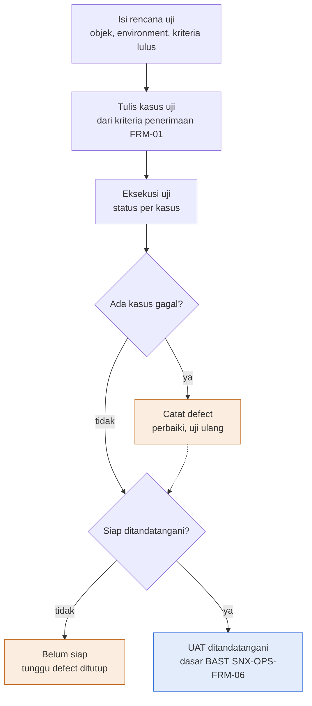

Deskripsi: tiga kotak awal berurutan (rencana uji, kasus uji, eksekusi uji) lalu keputusan "Ada kasus gagal?". Jalur "ya" ke kotak oranye "Catat defect (perbaiki, uji ulang)" yang kembali ke alur utama dengan garis putus-putus (pada titik sebelum keputusan berikutnya); jalur "tidak" ke keputusan "Siap ditandatangani?". Dari keputusan itu, "tidak" ke kotak oranye "Belum siap (tunggu defect ditutup)", "ya" ke kotak biru "UAT ditandatangani (dasar BAST SNX-OPS-FRM-06)". Tidak ada panah dari "Belum siap" kembali ke alur pada gambar.
Sumber gambar: conv/1mTi4unyn2xST8h_ChsS_2w1xTWzSBROs/img/image1.png

## 4. Peran, RACI, record, KPI

| Peran | Keterangan dari sumber |
|---|---|
| Project Manager | Pemilik dokumen; penyusun; Penguji SINUX pada blok tanda tangan |
| ISO/ISMS Coordinator | Pemeriksa dokumen |
| COO (Amirull Yusuf Zulkarnain) | Penyetuju dokumen |
| Service Delivery Manager | Penandatangan persetujuan UAT |
| Perwakilan pelanggan | Penandatangan persetujuan UAT; "Penguji pelanggan" di Rencana Uji |
| NOC Engineer | PIC perbaikan pada defect contoh DF-001 |

Record: file uji per proyek atau rilis, retensi Durasi kontrak + 3 tahun; gate G2 sebelum BAST (SNX-OPS-FRM-06). Metrik: tingkat kelulusan, jumlah defect Kritis/Tinggi belum tutup. Target kelulusan di sumber hanya sebagai contoh (lihat Rencana Uji). RACI tidak ada.

## 5. Catatan kualitas dan celah
- Draft rev 00 (Kontrol Dokumen B6); pengesahan dan tanda tangan kosong (A34 sampai D37); Tanggal efektif B8 "Ditetapkan saat pengesahan".
- Seluruh isi adalah CONTOH (Kasus Uji A2 "Baris biru muda = CONTOH"): 3 kasus uji TC-001 sampai TC-003 (Kasus Uji A5 sampai A7) dan 1 defect DF-001 (Defect A5), penguji `[penguji]` (I5 sampai I7), tanggal 2026-11-18 (Kasus Uji J5 dan J7, Defect E5), setelah tanggal draft 13 Oktober 2026.
- Kriteria lulus pada Rencana Uji B8 berlabel "Contoh:" ("100% kasus Kritis lolos, minimal 95% total kasus lolos, tidak ada defect Kritis atau Tinggi terbuka"); belum ditetapkan sebagai kriteria resmi. Rumus rekomendasi otomatis (Ringkasan dan Persetujuan B10) `AND(B9=0,B7=0,B5=0)` tidak memakai ambang 95% dan 100% Kritis; hanya memeriksa defect berat terbuka = 0, belum diuji = 0, gagal = 0.
- Label A9 "Defect Kritis atau Tinggi masih terbuka" tetapi rumus B9 juga menghitung status "Diperbaiki" (belum "Lolos retest"); jadi nilainya bukan hanya "Terbuka".
- Kasus uji tidak punya kolom Severity atau prioritas (kolom Kasus Uji A4:K4: ID, Kategori, Skenario, Langkah, Hasil diharapkan, Hasil aktual, Status, Defect ID, Penguji, Tanggal, Bukti), sehingga "100% kasus Kritis lolos" pada contoh kriteria tidak dapat dihitung dari kolom yang ada (inferensi).
- Rekomendasi "SIAP UAT DITANDATANGANI" mensyaratkan Gagal (B5, `COUNTIF(G,"Gagal")`) = 0 meskipun defect sudah "Lolos retest"; status kasus Gagal harus diubah ke Lolos setelah retest agar rekomendasi berubah (inferensi dari rumus).
- Contoh DF-001: kasus TC-003 hasil aktual "Port 3306 terbuka" (F7); uraian "Port database terbuka ke internet", severity "Tinggi", status "Terbuka", catatan "Perbaikan melalui CR" (I5). Lintas dokumen: SNX-OPS-SOP-02 6.1 butir 1 menyatakan CR dicatat di SNX-OPS-FRM-04, jadi CR itu akan berada di log FRM-04 (inferensi; FRM-05 tidak menyebut kode FRM-04).
- Kolom "Tanggal retest" (Defect H5) kosong pada contoh. Tidak ada kredensial atau data pribadi.

## 6. Kata kunci retrieval
UAT, user acceptance test, testing, quality verification, kasus uji, test case, defect, defect log, severity defect, retest, tingkat kelulusan, pass rate, kriteria lulus, kriteria penerimaan, BAST, gate G2, test environment, penguji, SNX-OPS-FRM-05, ISO 9001 8.6 8.7, Annex A 8.29, security testing, restore test, verifikasi mutu

<!-- FILE: ops/SNX-OPS-FRM-06.md -->

---
doc_code: SNX-OPS-FRM-06
title: Project Handover / BAST & Closure Report
department: Operation
doc_type: Form/Record
source: {drive_file_id: 1BPtjct3hNbhlUILJ7FTm4EX-_Vhk-KUb, filename: SNX-OPS-FRM-06_Project_Handover_BAST_Closure_Report.docx, format: docx, bytes: 139171, retrieved: 2026-10-13}
revision: 00 (DRAFT)
doc_date: 13 Oktober 2026 (tanggal draft); tanggal efektif "Ditetapkan saat pengesahan"
classification_in_doc: RESTRICTED (Internal)
owner_in_doc: Service Delivery Manager
approver_in_doc: COO, Amirull Yusuf Zulkarnain (status persetujuan "Menunggu")
iso_refs: {iso9001: ["8.5.5", "8.6"], iso27001: ["A5.8"]}
kb_sensitivity_suggest: restricted:ops
related_docs: [SNX-OPS-SOP-01, SNX-OPS-FRM-05, SNX-OPS-FRM-01, SNX-OPS-FRM-09, SNX-OPS-FRM-07, SNX-ISMS-REG-01, SNX-ISMS-REG-04, SNX-ISMS-FRM-01, SNX-ISMS-PRO-01]
coverage: {sections_or_sheets: "16 dari 16 (atribut, riwayat revisi, petunjuk, diagram, bagian A, bagian B, bagian C dengan 5 sub-bagian, pengesahan)", tables: 16, images: "1 dibuka dari 1", notes: "Template kosong. Checklist G3 (bagian B) dicatat lengkap 11 butir. SNX-OPS-SOP-01 Bagian 6.5 dan 6.6, FRM-05, FRM-07 ada di md/ops (rujukan silang dicek di bagian 5)."}
---
# SNX-OPS-FRM-06 Project Handover / BAST & Closure Report

## 1. Ringkasan

- Satu form tiga bagian dipakai berurutan sesuai SNX-OPS-SOP-01 Bagian 6.5 dan 6.6: Bagian A Berita Acara Serah Terima (BAST) ke pelanggan (gate G2), Bagian B checklist serah terima internal SD dan PM ke Operation (gate G3), Bagian C laporan penutupan proyek (closure report).
- Checklist G3 memuat 11 kriteria; layanan dinyatakan BAU hanya bila semua butir berstatus Lolos atau Tidak berlaku. Operation berhak menolak serah terima secara tertulis; selama itu layanan berstatus hypercare dengan pemilik SD dan PM.
- Prasyarat: UAT lolos (SNX-OPS-FRM-05 ditandatangani). Keputusan G3: Diterima (BAU sejak tanggal) atau Ditolak (hypercare dilanjutkan sampai tanggal).
- Pelanggan pemerintah melalui main contractor: BAST atas nama SINUX, versi original disimpan di Drive, periode ditetapkan main contractor; dokumen teknis tanpa harga, diskon, tier, roadmap komersil.
- Masa simpan record: durasi kontrak + 5 tahun.
- Dokumen berupa template kosong (placeholder dalam kurung siku), tanpa data nyata.

## 2. Isi lengkap terstruktur

### 2.0 Atribut dokumen

| Atribut | Isi |
|---|---|
| Nomor dokumen | SNX-OPS-FRM-06 |
| Judul | Project Handover / BAST & Closure Report |
| Revisi | 00 (DRAFT) |
| Tanggal draft | 13 Oktober 2026 |
| Tanggal efektif | Ditetapkan saat pengesahan |
| Klasifikasi | RESTRICTED (Internal) |
| Pemilik dokumen | Service Delivery Manager |
| Disetujui oleh | COO, Amirull Yusuf Zulkarnain |
| Acuan ISO 9001:2015 | Klausul 8.5.5, 8.6 |
| Acuan ISO/IEC 27001:2022 | Klausul atau kontrol Annex A 5.8 |
| Masa simpan record | Durasi kontrak + 5 tahun |

### Riwayat revisi

| Revisi | Tanggal | Uraian perubahan | Disusun | Disetujui |
|---|---|---|---|---|
| 00 | 13 Oktober 2026 | Draft awal untuk sertifikasi ISO 9001:2015 dan ISO/IEC 27001:2022 | Divisi Operation | Menunggu |
| 00 | 13 Oktober 2026 | Review bahasa dan konsistensi: istilah teknologi dalam bahasa Inggris, bahasa Indonesia formal, label klasifikasi, keselarasan RTO dan target pulih | Divisi Operation | Menunggu |

### 2.1 Petunjuk pengisian

Template terdiri dari tiga bagian yang dipakai berurutan sesuai SNX-OPS-SOP-01 Bagian 6.5 dan 6.6:

1. Bagian A, Berita Acara Serah Terima (BAST) implementasi kepada pelanggan (gate G2).
2. Bagian B, checklist serah terima internal dari SD dan PM ke Operation (gate G3).
3. Bagian C, laporan penutupan proyek (closure report).

Teks dalam kurung siku adalah petunjuk. Untuk pelanggan pemerintah melalui main contractor, BAST dibuat atas nama SINUX, versi original disimpan di Drive, dan periode ditetapkan main contractor. Dokumen teknis untuk pelanggan pemerintah tanpa harga, diskon, tier, maupun roadmap komersil.

### 2.2 Bagian A. Berita Acara Serah Terima (BAST), gate G2

Nomor BAST: [nomor sesuai penomoran SINUX]

Kalimat pembuka: "Pada hari ini, [hari], tanggal [tanggal], yang bertanda tangan di bawah ini:"

| Pihak | Nama | Jabatan | Perusahaan |
|---|---|---|---|
| Pihak Pertama (yang menyerahkan) | [nama] | [jabatan] | PT Strategi Integrasi Nusantara (SINUX) |
| Pihak Kedua (yang menerima) | [nama] | [jabatan] | [nama pelanggan] |

"Pihak Pertama telah menyelesaikan dan menyerahkan pekerjaan berikut kepada Pihak Kedua, dan Pihak Kedua menyatakan telah menerimanya:"

| Item | Isi |
|---|---|
| Nama pekerjaan | [nama proyek atau layanan] |
| Dasar pekerjaan | [nomor kontrak, PKS, atau PO] |
| Periode pelaksanaan | [tanggal mulai] sampai [tanggal selesai] |
| Referensi UAT | SNX-OPS-FRM-05 nomor [nomor], tanggal [tanggal] |

**Rincian deliverable yang diserahkan**

| No | Deliverable | Jumlah atau spesifikasi | Status | Keterangan |
|---|---|---|---|---|
| 1 | (kosong) | (kosong) | Diterima | (kosong) |
| 2 | (kosong) | (kosong) | Diterima | (kosong) |
| 3 | (kosong) | (kosong) | Diterima dengan catatan | (kosong) |

Nilai status yang terlihat di template: "Diterima" dan "Diterima dengan catatan" (tidak ada dropdown di docx).

**Catatan atau isu sisa yang disepakati**

| No | Uraian | Pemilik | Target selesai |
|---|---|---|---|
| 1 | (kosong) | (kosong) | (kosong) |

Klausul penutup: "Dengan ditandatanganinya berita acara ini, masa layanan atau garansi berjalan sesuai kontrak sejak tanggal [tanggal]."

| Pihak Pertama | Pihak Kedua |
|---|---|
| PT Strategi Integrasi Nusantara | [nama pelanggan] |
| Tanda tangan dan stempel: | Tanda tangan dan stempel: |
| Nama: [nama] | Nama: [nama] |
| Jabatan: [jabatan] | Jabatan: [jabatan] |

### 2.3 Bagian B. Checklist serah terima ke Operation (gate G3)

Aturan di sumber: "Layanan dinyatakan BAU hanya bila semua butir berstatus Lolos atau Tidak berlaku. Operation berhak menolak serah terima secara tertulis bila checklist belum lengkap; selama itu layanan berstatus hypercare dengan pemilik SD dan PM."

Kolom: No, Kriteria, Status (Lolos, Belum, Tidak berlaku), Bukti atau referensi, PIC. Kolom Status, Bukti, PIC kosong pada template.

| No | Kriteria | Status (Lolos, Belum, Tidak berlaku) | Bukti atau referensi | PIC |
|---|---|---|---|---|
| 1 | Pelanggan, aset, dan kontak terdaftar di ticketing system (Zammad atau Service Hub) | (kosong) | (kosong) | (kosong) |
| 2 | Aset terdaftar di Information Asset Register SNX-ISMS-REG-01 | (kosong) | (kosong) | (kosong) |
| 3 | Semua aset masuk monitoring NOC (dan SIEM bila layanan SOC), alert sudah diuji | (kosong) | (kosong) | (kosong) |
| 4 | Backup aktif dan restore uji pertama berhasil, tercatat di SNX-ISMS-FRM-01 (bila layanan backup ada) | (kosong) | (kosong) | (kosong) |
| 5 | Dokumen as-built: topologi, IP address, versi, akses, ketergantungan vendor | (kosong) | (kosong) | (kosong) |
| 6 | Runbook layanan dan matriks eskalasi pelanggan tersedia | (kosong) | (kosong) | (kosong) |
| 7 | Akses Operation melalui Jumphost dan terdaftar di SNX-ISMS-REG-04; tanpa kredensial di chat atau dokumen | (kosong) | (kosong) | (kosong) |
| 8 | Akses sementara tim proyek yang tidak dibutuhkan lagi sudah dicabut | (kosong) | (kosong) | (kosong) |
| 9 | Parameter SLA tercatat di SNX-OPS-FRM-09 dan jam layanan dikonfigurasi di ticketing system | (kosong) | (kosong) | (kosong) |
| 10 | Jadwal preventive maintenance dimasukkan ke SNX-OPS-FRM-07 | (kosong) | (kosong) | (kosong) |
| 11 | Briefing serah terima ke Lead NOC dan Lead SOC sudah dilaksanakan | (kosong) | (kosong) | (kosong) |

**Keputusan G3:** [ ] Diterima, layanan BAU sejak [tanggal] · [ ] Ditolak, hypercare dilanjutkan sampai [tanggal]

| Peran | Nama | Tanda tangan | Tanggal |
|---|---|---|---|
| Menyerahkan (Project Manager) | (kosong) | (kosong) | (kosong) |
| Menerima (Lead NOC) | (kosong) | (kosong) | (kosong) |
| Menerima (Lead SOC, bila ada layanan SOC) | (kosong) | (kosong) | (kosong) |
| Menyetujui (Head of Operation) | (kosong) | (kosong) | (kosong) |

### 2.4 Bagian C. Laporan penutupan proyek

**C.1 Ringkasan proyek**

| Item | Isi |
|---|---|
| Nama dan kode proyek | (kosong) |
| Pelanggan | (kosong) |
| Tanggal mulai dan selesai baseline | (kosong) |
| Tanggal mulai dan selesai aktual | (kosong) |
| Nomor BAST | (kosong) |
| Tanggal serah terima G3 | (kosong) |

**C.2 Pencapaian terhadap baseline**

| Dimensi | Baseline | Aktual | Deviasi dan penjelasan |
|---|---|---|---|
| Scope | (kosong) | (kosong) | (kosong) |
| Jadwal | (kosong) | (kosong) | (kosong) |
| Mutu (defect, hasil UAT) | (kosong) | (kosong) | (kosong) |
| Jumlah change request | (kosong) | (kosong) | (kosong) |
| Insiden selama proyek | (kosong) | (kosong) | (kosong) |

**C.3 Isu sisa dan pemiliknya**

| No | Isu | Pemilik | Target selesai |
|---|---|---|---|
| 1 | (kosong) | (kosong) | (kosong) |

**C.4 Lessons learned**

| No | Yang berjalan baik | Yang perlu diperbaiki | Tindakan untuk proyek berikutnya |
|---|---|---|---|
| 1 | (kosong) | (kosong) | (kosong) |

**C.5 Arsip**

| Dokumen | Lokasi |
|---|---|
| SNX-OPS-FRM-01 sampai FRM-05 proyek ini | [folder Drive] |
| BAST bertanda tangan (original) | [folder Drive] |
| Lessons learned disetor ke knowledge base | [nomor packet staging] |

| Peran | Nama | Tanda tangan | Tanggal |
|---|---|---|---|
| Disusun (Project Manager) | (kosong) | (kosong) | (kosong) |
| Disetujui (Service Delivery Manager) | (kosong) | (kosong) | (kosong) |

### Pengesahan

| Peran | Nama dan jabatan | Tanda tangan | Tanggal |
|---|---|---|---|
| Disusun oleh | Service Delivery Manager | (kosong) | (kosong) |
| Diperiksa oleh | ISO/ISMS Coordinator | (kosong) | (kosong) |
| Disetujui oleh | COO, Amirull Yusuf Zulkarnain | (kosong) | (kosong) |

## 3. Diagram

### 3.1 Alur pengisian BAST, checklist G3, dan closure report

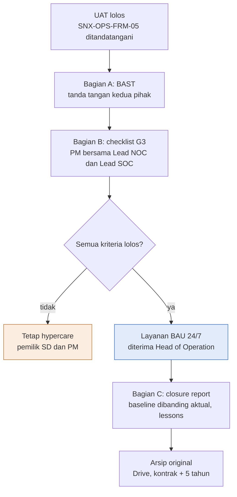

Deskripsi: Alur vertikal dari UAT lolos sampai arsip original. Keputusan "Semua kriteria lolos?" bercabang: tidak ke kotak oranye "Tetap hypercare" (pemilik SD dan PM), ya ke kotak biru "Layanan BAU 24/7" (diterima Head of Operation), yang merupakan output akhir bertanda biru. Setelah BAU lanjut ke Bagian C (closure report) lalu Arsip original (Drive, kontrak + 5 tahun). Pada gambar, kotak Tetap hypercare tidak punya panah kembali ke alur utama.

Sumber gambar: `conv/1BPtjct3hNbhlUILJ7FTm4EX-_Vhk-KUb/img/media/rId21.png` (judul gambar "Layanan baru BAU setelah BAST dan checklist G3 lolos").

## 4. Peran, RACI, record, KPI

| Peran | Keterlibatan menurut sumber |
|---|---|
| Service Delivery Manager | Pemilik dokumen; pemilik hypercare (bersama PM); menyetujui closure report; penyusun Pengesahan |
| Project Manager | Menyerahkan pada G3; menyusun closure report; mengisi checklist G3 bersama Lead NOC dan Lead SOC |
| Lead NOC | Menerima serah terima G3; briefing serah terima (butir 11) |
| Lead SOC | Menerima serah terima G3 bila ada layanan SOC; briefing serah terima |
| Head of Operation | Menyetujui G3; layanan BAU "diterima Head of Operation" (gambar) |
| COO | Penyetuju dokumen |
| ISO/ISMS Coordinator | Pemeriksa dokumen |
| Pihak Pertama / Pihak Kedua pada BAST | SINUX (menyerahkan) / pelanggan (menerima) |

Record: BAST bertanda tangan (original, di Drive), checklist G3, closure report. Masa simpan: durasi kontrak + 5 tahun. KPI: tidak ada KPI di dokumen ini. Gate: G2 (BAST), G3 (serah terima ke Operation); G1 dirujuk di dokumen lain (SNX-OPS-FRM-01).

## 5. Catatan kualitas dan celah

- Seluruh isian berupa placeholder kosong atau teks petunjuk dalam kurung siku (mis. Bagian A "\[nomor sesuai penomoran SINUX\]"); tidak ada data nyata.
- Template BAST (Bagian A, tabel "Rincian deliverable yang diserahkan") memuat nilai status contoh "Diterima" (baris 1 dan 2) dan "Diterima dengan catatan" (baris 3) pada kolom Status; terisi pada template, bukan data nyata.
- Petunjuk pengisian menyebut BAST sebagai "gate G2" dan checklist sebagai "gate G3"; Bagian C (laporan penutupan) tidak diberi nomor gate.
- Checklist butir 3 berbunyi "(dan SIEM bila layanan SOC)" dan butir 4 "(bila layanan backup ada)", sehingga butir bisa Tidak berlaku; tidak ada panduan alasan wajib untuk status Tidak berlaku.
- Lintas dokumen: Checklist G3 (Bagian B) memuat 11 butir, sedangkan checklist G3 di PRO-OPS-001 Bagian 8.2 memuat 8 butir. Butir FRM-06 yang tidak ada padanan terpisah di PRO-OPS-001: butir 2 (Information Asset Register SNX-ISMS-REG-01), butir 8 (akses sementara tim proyek dicabut), dan butir 10 (jadwal PM masuk SNX-OPS-FRM-07). Rujukan FRM-06 ke SNX-OPS-SOP-01 Bagian 6.5 dan 6.6 (Petunjuk pengisian) cocok dengan SOP-01 6.5 butir 4 (BAST di FRM-06) dan 6.6 butir 1 sampai 4 (checklist G3 dan closure report di FRM-06). SNX-OPS-FRM-09 (butir 9) dan SNX-OPS-FRM-07 (butir 10) ada di md/ops; SNX-OPS-FRM-09 dirujuk SNX-OPS-SOP-05, sedangkan SNX-OPS-FRM-07 dirujuk SNX-OPS-SOP-03 (bukan SOP-05).
- Rujukan ke dokumen ISMS dari sumber: SNX-ISMS-REG-01 (butir 2), SNX-ISMS-FRM-01 (butir 4), SNX-ISMS-REG-04 (butir 7); ketiganya ada di md/isms. SNX-ISMS-PRO-01 tidak disebut di sumber FRM-06.
- Gambar (rId21) menyebut kotak "Layanan BAU 24/7"; teks Bagian B tidak memuat kata "24/7" (pencarian "24/7" di sumber: nol hasil). Lintas dokumen: SNX-OPS-SOP-04 Bagian 2 menyebut "selama 24 jam sehari, 7 hari seminggu".
- Gambar tidak memuat batas waktu hypercare (kotak "Tetap hypercare" hanya bersub-label "pemilik SD dan PM") dan tidak ada panah kembali dari "Tetap hypercare" ke checklist.
- Riwayat revisi: dua baris rev 00 bertanggal sama; Disetujui "Menunggu"; frasa "keselarasan RTO dan target pulih" tidak relevan dengan form ini (pencarian "RTO": hanya frasa itu).
- Seluruh blok tanda tangan (BAST, keputusan G3, closure, Pengesahan) kosong.

## 6. Kata kunci retrieval

BAST, berita acara serah terima, handover, serah terima proyek, closure report, laporan penutupan proyek, checklist G3, gate G3, gate G2, hypercare, BAU, business as usual, UAT, FRM-05, Operation, Lead NOC, Lead SOC, Head of Operation, as-built, runbook, Jumphost, preventive maintenance, lessons learned, main contractor, pelanggan pemerintah, Information Asset Register, ISO 9001 8.6, 8.5.5

<!-- FILE: ops/SNX-OPS-FRM-07.md -->

---
doc_code: SNX-OPS-FRM-07
title: Maintenance Schedule & Service Report
department: Operation
doc_type: Form/Record
source: {drive_file_id: 1jrnarc0yyoZhx2MLACZePMNEe0-jb3ZB, filename: SNX-OPS-FRM-07_Maintenance_Schedule_Service_Report.xlsx, format: xlsx, bytes: 130465, retrieved: 2026-10-13}
revision: 00 (DRAFT)
doc_date: 13 Oktober 2026
classification_in_doc: RESTRICTED (Internal)
owner_in_doc: Lead NOC
approver_in_doc: COO, Amirull Yusuf Zulkarnain
iso_refs: {iso9001: ["7.1.3", "8.5.1"], iso27001: ["A 7.13"]}
kb_sensitivity_suggest: restricted:ops
related_docs: [SNX-OPS-SOP-03, SNX-ISMS-SOP-05, SNX-ISMS-PLN-01, SNX-OPS-RPT-01, SNX-OPS-FRM-04]
coverage: {sections_or_sheets: "5 dari 5", tables: 7, images: "1 dibuka dari 1", notes: "Jadwal PM: 9 aktivitas terisi dari kapasitas 40 baris (6 sampai 45). Service Report: 1 baris CONTOH dari kapasitas 151 baris (5 sampai 155). Ambang kepatuhan 95% hanya ada di gambar alur, bukan di rumus."}
---
# SNX-OPS-FRM-07 Maintenance Schedule & Service Report

## 1. Ringkasan
- Workbook berisi jadwal preventive maintenance (PM) tahunan dan service report untuk PM maupun corrective maintenance (CM), sesuai SNX-OPS-SOP-03.
- Jadwal PM memakai kode bulan R (rencana), S (selesai), T (tertunda); kepatuhan dihitung otomatis per aktivitas dan keseluruhan sebagai S dibagi (R+S+T).
- Jadwal PM berisi 9 aktivitas baku (health check, status backup job, kapasitas, SSL, Overseer, patch, uji restore, review firewall/WAF/akun, uji pemulihan) untuk tahun 2027, total 89 siklus rencana per tahun.
- Setiap PM atau CM yang mengubah sistem dicatat di Service Report beserta nomor tiket atau CR; durasi dihitung otomatis dalam menit.
- Lead NOC meninjau kepatuhan bulanan dan menandatangani kolom verifikasi; diagram alur menyebut tindak lanjut Lead NOC bila kepatuhan di bawah 95%.
- Status isi: Jadwal PM adalah rencana baku (belum ada kode S atau T); Service Report hanya 1 baris CONTOH dengan placeholder. Bukan data realisasi nyata.

## 2. Isi lengkap terstruktur

### 2.1 Sheet "Kontrol Dokumen"

| Atribut | Nilai |
|---|---|
| Judul sheet | Maintenance Schedule & Service Report |
| Organisasi | PT Strategi Integrasi Nusantara (SINUX) · Divisi Operation |
| Nomor dokumen | SNX-OPS-FRM-07 |
| Revisi | 00 (DRAFT) |
| Tanggal draft | 13 Oktober 2026 |
| Tanggal efektif | Ditetapkan saat pengesahan |
| Klasifikasi | RESTRICTED (Internal) |
| Pemilik dokumen | Lead NOC |
| Disetujui oleh | COO, Amirull Yusuf Zulkarnain |
| Acuan ISO 9001:2015 | Klausul 7.1.3, 8.5.1 |
| Acuan ISO/IEC 27001:2022 | Klausul atau kontrol Annex A 7.13 |
| Masa simpan record | 3 tahun |
| Tujuan | Jadwal preventive maintenance tahunan dan service report untuk preventive maupun corrective maintenance sesuai SNX-OPS-SOP-03. |

Cara pakai (verbatim):
1. Isi tahun di sheet Jadwal PM sel B3.
2. Per aktivitas, isi bulan dengan kode: R = rencana, S = selesai, T = tertunda. Kepatuhan dihitung otomatis (S dibagi R+S+T).
3. Setiap pelaksanaan PM atau CM yang mengubah sistem dicatat di Service Report beserta nomor tiket atau CR.
4. Lead NOC meninjau kepatuhan bulanan dan menandatangani kolom verifikasi.

Legenda warna: sel input = diisi pengguna; baris CONTOH = hapus atau timpa saat dipakai; sel rumus = jangan diubah.

Riwayat revisi:

| Revisi | Tanggal | Uraian perubahan | Disusun | Disetujui |
|---|---|---|---|---|
| 00 | 13 Oktober 2026 | Draft awal untuk sertifikasi ISO 9001 dan ISO/IEC 27001 | Divisi Operation | Menunggu |
| 00 | 13 Oktober 2026 | Review bahasa dan konsistensi: istilah teknologi dalam bahasa Inggris, bahasa Indonesia formal, label klasifikasi, keselarasan RTO dan target pulih | Divisi Operation | Menunggu |

Pengesahan:

| Peran | Nama dan jabatan | Tanda tangan | Tanggal |
|---|---|---|---|
| Disusun oleh | Lead NOC | (kosong) | (kosong) |
| Diperiksa oleh | ISO/ISMS Coordinator | (kosong) | (kosong) |
| Disetujui oleh | COO, Amirull Yusuf Zulkarnain | (kosong) | (kosong) |

### 2.2 Sheet "Alur Proses"
Judul "Diagram alur proses"; legenda warna sama dengan form lain (biru = output akhir, oranye = cabang ke tindakan atau prosedur lain, putus-putus = kembali ke alur utama). Gambar di bagian 3.

### 2.3 Sheet "Daftar" (nilai dropdown)

| Kode bulan | Jenis | Status SR |
|---|---|---|
| R | PM | Selesai |
| S | CM | Tindak lanjut |
| T | (kosong) | Eskalasi |

Pemetaan validation: Jadwal PM F6:Q45 = daftar inline "R,S,T"; Service Report C5:C155 = Daftar!B2:B3 (Jenis: PM, CM); Service Report J5:J155 = Daftar!C2:C4 (Status SR: Selesai, Tindak lanjut, Eskalasi). Catatan: kode bulan R/S/T pada Daftar!A2:A4 tidak dipakai langsung oleh validation (validation memakai daftar inline).

### 2.4 Sheet "Jadwal PM" (A1:T47)
Judul "Jadwal preventive maintenance". Keterangan: "R = rencana, S = selesai, T = tertunda. Aktivitas harian dan mingguan dicatat per bulan sebagai satu siklus terpenuhi." Tahun (B3) = 2027.

Kolom (header baris 5): No; Aset atau layanan; Aktivitas; Frekuensi; PIC; Jan, Feb, Mar, Apr, Mei, Jun, Jul, Agu, Sep, Okt, Nov, Des (kode R/S/T); Rencana; Selesai; Kepatuhan. Kapasitas baris 6 sampai 45 (40 aktivitas); terisi 9.

Rumus per baris (contoh baris 6):
- Rencana R: `=COUNTIF(F6:Q6,"R")+COUNTIF(F6:Q6,"S")+COUNTIF(F6:Q6,"T")` yaitu jumlah bulan yang berisi kode apa pun (R, S, atau T); jadi siklus yang ditandai S atau T tetap terhitung sebagai rencana.
- Selesai S: `=COUNTIF(F6:Q6,"S")`.
- Kepatuhan T: `=IF(R6=0,"",S6/R6)`.
- Kepatuhan keseluruhan (T47): `=IF(SUM(R6:R45)=0,"",SUM(S6:S45)/SUM(R6:R45))`; label B47 "Kepatuhan PM keseluruhan".

Aktivitas PM terisi (semua baris; nilai cache Selesai = 0, Kepatuhan = 0 karena belum ada kode S):

| No | Aset atau layanan | Aktivitas | Frekuensi | PIC | Bulan berkode R | Rencana |
|---|---|---|---|---|---|---|
| 1 | Semua layanan kritis | Health check layanan kritis | Tiap awal shift | NOC Engineer | Jan sampai Des (12 bulan) | 12 |
| 2 | Acronis, semua pelanggan backup | Pemeriksaan status backup job | Tiap shift malam | NOC Engineer | Jan sampai Des | 12 |
| 3 | VM dan server dikelola | Kapasitas disk, CPU, memori, tren | Mingguan | NOC Engineer | Jan sampai Des | 12 |
| 4 | Sertifikat SSL dikelola | Masa berlaku 30 hari ke depan | Mingguan | NOC Engineer | Jan sampai Des | 12 |
| 5 | Perangkat internal (Overseer) | Pemeriksaan perangkat internal | Mingguan | NOC Engineer | Jan sampai Des | 12 |
| 6 | Server dan OS dikelola | Patch keamanan dan update OS (SNX-ISMS-SOP-05) | Bulanan | NOC Engineer | Jan sampai Des | 12 |
| 7 | Pelanggan berlayanan backup | Uji restore | Bulanan | NOC Engineer | Jan sampai Des | 12 |
| 8 | Firewall, WAF, akun | Review rule dan akun tidak terpakai | Triwulanan | Lead SOC | Mar, Jun, Sep, Des | 4 |
| 9 | Layanan kritis | Uji pemulihan SNX-ISMS-PLN-01 | Tahunan | Head of Operation | Nov | 1 |

Total rencana tahunan (inferensi, jumlah kolom Rencana) = 89 siklus; Kepatuhan PM keseluruhan nilai cache = 0 (kosong bila SUM(R)=0; di sini 0 karena S = 0).
Baris 15 sampai 45: kolom A sampai Q kosong, rumus R/S/T tetap ada.

### 2.5 Sheet "Service Report" (A1:P155; kapasitas baris 5 sampai 155 = 151 baris)
Judul "Service report preventive dan corrective maintenance"; "Durasi dihitung otomatis dalam menit. Baris biru muda = CONTOH."

Kolom (header baris 4): No SR; Tanggal; Jenis (dropdown PM, CM); Aset atau layanan; Pelanggan; Ref tiket atau CR; Aktivitas; Temuan; Tindakan; Status (dropdown Selesai, Tindak lanjut, Eskalasi); Mulai; Selesai; Durasi (menit) (RUMUS); Pelaksana; Diverifikasi; Catatan.

Rumus Durasi M: `=IF(OR(K5="",L5=""),"",ROUND((L5-K5)*1440,0))` yaitu selisih waktu Selesai dikurangi Mulai dikalikan 1440 (menit per hari), dibulatkan; kosong bila salah satu waktu kosong.

Baris contoh (satu-satunya):

| Kolom | Nilai |
|---|---|
| No SR | SR-2026-0001 |
| Tanggal | 2026-11-07 |
| Jenis | PM |
| Aset atau layanan | [nama server] |
| Pelanggan | Internal |
| Ref tiket atau CR | CR-2026-0002 |
| Aktivitas | Patch keamanan OS bulanan |
| Temuan | 3 paket keamanan tersedia |
| Tindakan | Patch dipasang, reboot terjadwal |
| Status | Selesai |
| Mulai | 2026-11-07 23:00 |
| Selesai | 2026-11-07 23:40 |
| Durasi (menit) | 40 (hasil rumus) |
| Pelaksana | [pelaksana] |
| Diverifikasi | [Lead NOC] |
| Catatan | CONTOH |

## 3. Diagram

### 3.1 Alur pengisian Maintenance Schedule & Service Report
Judul gambar: "Jadwal PM dipantau bulanan dengan service report sebagai bukti" (subjudul "Alur pengisian Maintenance Schedule & Service Report").

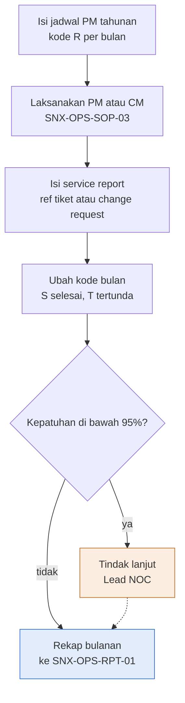

Deskripsi: lima kotak vertikal. Isi jadwal PM tahunan, laksanakan PM atau CM (SNX-OPS-SOP-03), isi service report (ref tiket atau change request), ubah kode bulan (S selesai, T tertunda), lalu keputusan "Kepatuhan di bawah 95%?". "ya" ke kotak oranye "Tindak lanjut (Lead NOC)" yang kembali ke alur utama lewat garis putus-putus; "tidak" ke kotak biru output akhir "Rekap bulanan (ke SNX-OPS-RPT-01)".
Sumber gambar: conv/1jrnarc0yyoZhx2MLACZePMNEe0-jb3ZB/img/image1.png

## 4. Peran, RACI, record, KPI

| Peran | Keterangan dari sumber |
|---|---|
| Lead NOC | Pemilik dokumen; penyusun; meninjau kepatuhan bulanan dan menandatangani kolom verifikasi; tindak lanjut bila kepatuhan < 95% (gambar) |
| NOC Engineer | PIC PM aktivitas 1 sampai 7 |
| Lead SOC | PIC review firewall, WAF, akun (aktivitas 8) |
| Head of Operation | PIC uji pemulihan tahunan SNX-ISMS-PLN-01 (aktivitas 9) |
| ISO/ISMS Coordinator | Pemeriksa dokumen |
| COO (Amirull Yusuf Zulkarnain) | Penyetuju dokumen |

KPI/metrik: Kepatuhan PM per aktivitas dan keseluruhan = S / (R+S+T); ambang 95% disebut hanya di diagram alur (dirujuk sebagai masukan Rekap bulanan ke SNX-OPS-RPT-01). Record: Jadwal PM dan Service Report, retensi 3 tahun. RACI tidak ada.

## 5. Catatan kualitas dan celah
- Draft rev 00 (Kontrol Dokumen B6); pengesahan dan tanda tangan kosong (A34 sampai D37).
- Ambang 95% kepatuhan hanya ada di diagram (kotak keputusan "Kepatuhan di bawah 95%?" yang menuju "Tindak lanjut, Lead NOC"); tidak ada rumus atau format kondisional di Jadwal PM yang menandai kepatuhan kurang dari 95% (format kondisional Jadwal PM hanya F6:Q45 untuk nilai "S" dan "T"; diperiksa di biner dengan openpyxl). Status ambang tidak berlabel USULAN di dokumen ini (pencarian "USULAN" di sumber: nol hasil). Lintas dokumen: SNX-OPS-SOP-03 Bagian 9 memuat target "Kepatuhan jadwal PM ... | 95%" juga tanpa label USULAN.
- Rumus Rencana (R) `COUNTIF(R)+COUNTIF(S)+COUNTIF(T)`, sehingga bila bulan tertunda ditandai T, nilainya tetap masuk penyebut; sesuai Cara pakai butir 2 "S dibagi R+S+T".
- Aktivitas harian dan mingguan (Jadwal PM D6 "Tiap awal shift", D7 "Tiap shift malam", D8 sampai D10 "Mingguan") hanya dicatat sebagai satu siklus per bulan (A2 "dicatat per bulan sebagai satu siklus terpenuhi"), sehingga kepatuhan tidak mencerminkan pelaksanaan per shift atau per minggu. Service Report hanya mencatat pelaksanaan PM atau CM yang mengubah sistem (Cara pakai butir 3).
- Lintas dokumen: contoh Service Report merujuk "CR-2026-0002" (Service Report F5), sedangkan Change Log SNX-OPS-FRM-04 hanya berisi CR-2026-0001 (A5); rujukan lintas dokumen tidak sinkron (data contoh). Sembilan aktivitas Jadwal PM (baris 6 sampai 14) sama dengan sembilan baris tabel frekuensi minimal SNX-OPS-SOP-03 Bagian 6.1, dengan frekuensi yang sama.
- Tanggal contoh (Service Report B5 dan K5 2026-11-07) setelah tanggal draft 13 Oktober 2026; tahun jadwal 2027 (Jadwal PM B3) sementara contoh Service Report bertahun 2026 (A5 "SR-2026-0001").
- Daftar "Status SR" (Daftar C2:C4) mencakup Selesai, Tindak lanjut, Eskalasi, tetapi tidak ada kolom tanggal tindak lanjut atau penerima eskalasi pada Service Report (A4:P4).
- Tidak ada kredensial atau data pribadi. Hanya placeholder `[pelaksana]` (N5), `[Lead NOC]` (O5), `[nama server]` (D5).

## 6. Kata kunci retrieval
preventive maintenance, PM, corrective maintenance, CM, jadwal PM, service report, kepatuhan PM, maintenance schedule, health check, backup job, uji restore, patch keamanan, SSL, Overseer, review firewall WAF, uji pemulihan, durasi menit, verifikasi Lead NOC, SNX-OPS-FRM-07, SNX-OPS-SOP-03, ISO 9001 7.1.3 8.5.1, Annex A 7.13

<!-- FILE: ops/SNX-OPS-FRM-08.md -->

---
doc_code: SNX-OPS-FRM-08
title: Technical Ticket / Incident Register
department: Operation
doc_type: Register
source: {drive_file_id: 1E0-sXiP8r-lS34-PVvt3RYRT04O56Lnz, filename: SNX-OPS-FRM-08_Technical_Ticket_Incident_Register.xlsx, format: xlsx, bytes: 150836, retrieved: 2026-10-13}
revision: 00 (DRAFT)
doc_date: 13 Oktober 2026
classification_in_doc: RESTRICTED (Internal)
owner_in_doc: Lead NOC
approver_in_doc: COO, Amirull Yusuf Zulkarnain
iso_refs: {iso9001: ["8.5.1", "8.7", "9.1.1"], iso27001: ["A 5.25", "A 5.26"]}
kb_sensitivity_suggest: restricted:ops
related_docs: [SNX-OPS-SOP-04, SNX-OPS-FRM-10, SNX-OPS-FRM-09, SNX-OPS-RPT-01]
coverage: {sections_or_sheets: "6 dari 6", tables: 10, images: "1 dibuka dari 1", notes: "1711 sel sumber: 1530 sel rumus. Register kapasitas 301 baris (5 sampai 305), hanya 1 baris CONTOH terisi (TKT-2026-0001); baris 6 sampai 305 hanya rumus kosong (P, S, T, U, V) sehingga tidak ada baris data lain yang hilang. Nilai rumus Durasi pulih contoh terbaca 2 (nilai cache), selisih waktu sebenarnya 2 jam 3 menit."}
---
# SNX-OPS-FRM-08 Technical Ticket / Incident Register

## 1. Ringkasan
- Register rekap audit untuk seluruh tiket teknis dan insiden: waktu Dilaporkan, Ack, Pulih, Ditutup, status SLA internal, dan tautan RCA, sesuai SNX-OPS-SOP-04. Tiket operasional hidup di Zammad (Nusagrid) atau Service Hub GLPI (GMF dan internal); ekspor dari ticketing system boleh ditempel dengan kolom sama.
- Target per severity (sheet Target Severity): P1 Ack 15 menit, update tiap 60 menit, target pulih 4 jam; P2 30 menit, 180 menit, 8 jam; P3 120 menit, 1440 menit, 24 jam; P4 1440 menit, saat selesai, 72 jam. Target pulih berlabel USULAN internal; komitmen ke pelanggan mengikuti kontrak.
- Jam kerja dihitung sebagai jam kalender (penyederhanaan). Ini juga tercatat sebagai butir Terbuka no. 10 di Master List (SNX-OPS-ML-00).
- Kolom otomatis: Respon (menit), Durasi pulih (jam), Ack sesuai target, Pulih sesuai target, RCA wajib (Ya untuk P1 dan P2). Pelanggaran target (breach) = kolom "Ack sesuai target" atau "Pulih sesuai target" bernilai Tidak.
- Sheet Ringkasan menghitung per severity: jumlah tiket, Ack sesuai target (jumlah dan %), Pulih sesuai target (jumlah dan %), RCA wajib tanpa nomor RCA; plus KPI "P1 dan P2 di-ack sesuai target (KPI 95%)".
- Status isi: DATA CONTOH. Hanya 1 baris (TKT-2026-0001) berlabel CONTOH dengan placeholder `[pelanggan]`, `[engineer]`; bukan data operasional nyata.

## 2. Isi lengkap terstruktur

### 2.1 Sheet "Kontrol Dokumen"

| Atribut | Nilai |
|---|---|
| Judul sheet | Technical Ticket / Incident Register |
| Organisasi | PT Strategi Integrasi Nusantara (SINUX) · Divisi Operation |
| Nomor dokumen | SNX-OPS-FRM-08 |
| Revisi | 00 (DRAFT) |
| Tanggal draft | 13 Oktober 2026 |
| Tanggal efektif | Ditetapkan saat pengesahan |
| Klasifikasi | RESTRICTED (Internal) |
| Pemilik dokumen | Lead NOC |
| Disetujui oleh | COO, Amirull Yusuf Zulkarnain |
| Acuan ISO 9001:2015 | Klausul 8.5.1, 8.7, 9.1.1 |
| Acuan ISO/IEC 27001:2022 | Klausul atau kontrol Annex A 5.25, 5.26 |
| Masa simpan record | 3 tahun |
| Tujuan | Register seluruh tiket teknis dan insiden dengan waktu Ack dan pemulihan, status SLA, dan tautan RCA sesuai SNX-OPS-SOP-04. |

Cara pakai (verbatim):
1. Tiket operasional hidup di Zammad (Nusagrid) atau Service Hub GLPI (GMF dan internal). Register ini adalah rekap audit; ekspor dari ticketing system boleh ditempel di sheet Register dengan kolom yang sama.
2. Isi waktu dalam format tanggal dan jam (WIB).
3. Respon, durasi pulih, dan status SLA dihitung otomatis memakai sheet Target Severity.
4. Kolom RCA wajib otomatis Ya untuk P1 dan P2; isi nomor RCA dari SNX-OPS-FRM-10.

Legenda warna: sel input = diisi pengguna; baris CONTOH = hapus atau timpa saat dipakai; sel rumus = jangan diubah. Di sheet Register: "Kolom abu-abu dihitung otomatis. Baris biru muda = CONTOH."

Riwayat revisi:

| Revisi | Tanggal | Uraian perubahan | Disusun | Disetujui |
|---|---|---|---|---|
| 00 | 13 Oktober 2026 | Draft awal untuk sertifikasi ISO 9001 dan ISO/IEC 27001 | Divisi Operation | Menunggu |
| 00 | 13 Oktober 2026 | Review bahasa dan konsistensi: istilah teknologi dalam bahasa Inggris, bahasa Indonesia formal, label klasifikasi, keselarasan RTO dan target pulih | Divisi Operation | Menunggu |

Pengesahan:

| Peran | Nama dan jabatan | Tanda tangan | Tanggal |
|---|---|---|---|
| Disusun oleh | Lead NOC | (kosong) | (kosong) |
| Diperiksa oleh | ISO/ISMS Coordinator | (kosong) | (kosong) |
| Disetujui oleh | COO, Amirull Yusuf Zulkarnain | (kosong) | (kosong) |

### 2.2 Sheet "Alur Proses"
Judul "Diagram alur proses"; legenda warna standar (biru = output akhir, oranye = cabang ke tindakan atau prosedur lain, putus-putus = kembali ke alur utama). Gambar di bagian 3.

### 2.3 Sheet "Target Severity" (A1:D8) , sumber logika SLA
Judul "Target respon dan pemulihan per severity". Keterangan sumber: "Ack dan update dari SNX-OPS-SOP-04. Target pemulihan = USULAN internal; komitmen ke pelanggan mengikuti kontrak. Jam kerja dihitung sebagai jam kalender untuk penyederhanaan."

| Severity | Ack (menit) | Update tiap (menit) | Target pulih (jam), USULAN |
|---|---|---|---|
| P1 | 15 | 60 | 4 |
| P2 | 30 | 180 | 8 |
| P3 | 120 | 1440 | 24 |
| P4 | 1440 | Saat selesai | 72 |

Ekuivalen waktu: P3 Ack 120 menit = 2 jam; P4 Ack 1440 menit = 1 hari; update P3 tiap 1440 menit = 24 jam. Master List (SNX-OPS-ML-00, riwayat review no. 10) menyatakan bahwa target Ack P3 "2 jam kerja" dan P4 "1 hari kerja" dihitung sebagai jam kalender di Excel dan butir ini masih Terbuka karena kalender kerja belum ditetapkan. Riwayat review no. 5 di ML-00: kolom Target pulih (USULAN) ditambahkan ke SOP-04: P1 4 jam, P2 8 jam, P3 24 jam, P4 72 jam (konsisten dengan sheet ini).

### 2.4 Sheet "Daftar" (nilai dropdown)

| Ticketing system | Kanal | Kelas | Severity | Status |
|---|---|---|---|---|
| Zammad | WhatsApp | Akses, firewall, VPN | P1 | Terbuka |
| Service Hub GLPI | Telepon | VM lifecycle | P2 | Ditangani |
| (kosong) | Email | Down atau performa | P3 | Menunggu pelanggan |
| (kosong) | Monitoring | OTP atau email | P4 | Pulih |
| (kosong) | Portal | Backup atau snapshot | (kosong) | Ditutup |
| (kosong) | Internal | SSL atau DNS | (kosong) | (kosong) |
| (kosong) | (kosong) | DC atau colo | (kosong) | (kosong) |
| (kosong) | (kosong) | Billing | (kosong) | (kosong) |
| (kosong) | (kosong) | Keamanan (ke SOC) | (kosong) | (kosong) |

Pemetaan validation sheet Register: B5:B305 = Daftar!A2:A3 (Ticketing system); E5:E305 = Daftar!B2:B7 (Kanal, 6 nilai); F5:F305 = Daftar!C2:C10 (Kelas triage, 9 nilai); G5:G305 = Daftar!D2:D5 (Severity); R5:R305 = Daftar!E2:E6 (Status, 5 nilai).

### 2.5 Sheet "Register" (A1:W305; kapasitas baris data 5 sampai 305 = 301 baris)
Judul "Technical ticket and incident register".

Kolom (header baris 4, 23 kolom) dengan arti dan logika:

| Kol | Header | Arti | Tipe / logika |
|---|---|---|---|
| A | No tiket | Nomor tiket (contoh TKT-2026-0001) | input |
| B | Ticketing system | Sistem tiket asal | dropdown: Zammad, Service Hub GLPI |
| C | Pelanggan | Pelanggan pelapor | input |
| D | Layanan | Layanan terdampak | input |
| E | Kanal | Kanal pelaporan | dropdown: WhatsApp, Telepon, Email, Monitoring, Portal, Internal |
| F | Kelas triage | Kelas klasifikasi tiket | dropdown: Akses, firewall, VPN; VM lifecycle; Down atau performa; OTP atau email; Backup atau snapshot; SSL atau DNS; DC atau colo; Billing; Keamanan (ke SOC) |
| G | Severity | Tingkat severity | dropdown: P1, P2, P3, P4 |
| H | Uraian | Deskripsi masalah | input |
| I | Dilaporkan | Waktu laporan diterima (WIB) | input tanggal-jam |
| J | Ack | Waktu acknowledgement | input tanggal-jam |
| K | Pulih | Waktu layanan pulih | input tanggal-jam |
| L | Ditutup | Waktu tiket ditutup | input tanggal-jam |
| M | PIC | Penanggung jawab teknis | input |
| N | Eskalasi ke | Pihak tujuan eskalasi | input |
| O | Akar ringkas | Ringkasan akar masalah | input |
| P | RCA wajib | Apakah RCA wajib | RUMUS |
| Q | No RCA | Nomor RCA dari SNX-OPS-FRM-10 | input |
| R | Status | Status tiket | dropdown: Terbuka, Ditangani, Menunggu pelanggan, Pulih, Ditutup |
| S | Respon (menit) | Waktu respon | RUMUS |
| T | Durasi pulih (jam) | Waktu pemulihan | RUMUS |
| U | Ack sesuai target | Status SLA Ack | RUMUS |
| V | Pulih sesuai target | Status SLA pemulihan | RUMUS |
| W | Catatan | Catatan bebas | input |

Rumus (identik tiap baris 5 sampai 305, contoh baris 5) dan logikanya:
- RCA wajib P: `=IF(G5="","",IF(OR(G5="P1",G5="P2"),"Ya","Tidak"))`. Ya untuk P1 dan P2; Tidak untuk P3 dan P4; kosong bila severity kosong.
- Respon (menit) S: `=IF(OR(I5="",J5=""),"",ROUND((J5-I5)*1440,0))`. Selisih Ack dikurangi Dilaporkan, dalam menit, dibulatkan ke bilangan bulat.
- Durasi pulih (jam) T: `=IF(OR(I5="",K5=""),"",ROUND((K5-I5)*24,1))`. Selisih Pulih dikurangi Dilaporkan (BUKAN dari Ack), dalam jam, 1 desimal.
- Ack sesuai target U: `=IF(S5="","",IF(S5<=INDEX('Target Severity'!$B$5:$B$8,MATCH(G5,'Target Severity'!$A$5:$A$8,0)),"Ya","Tidak"))`. Membandingkan Respon (menit) dengan kolom Ack (menit) pada Target Severity untuk severity tiket; Ya bila Respon <= target.
- Pulih sesuai target V: `=IF(T5="","",IF(T5<=INDEX('Target Severity'!$D$5:$D$8,MATCH(G5,'Target Severity'!$A$5:$A$8,0)),"Ya","Tidak"))`. Ya bila Durasi pulih <= Target pulih (jam).
- Logika breach SLA: breach Ack = U bernilai "Tidak" (Respon > target Ack); breach pemulihan = V bernilai "Tidak" (Durasi pulih > target pulih). Nilai kosong (belum ada waktu Ack atau Pulih) tidak dihitung sebagai breach maupun sesuai.

Baris data terisi (SATU-SATUNYA baris terisi; baris 6 sampai 305 kosong, hanya rumus):

| Kol | Nilai |
|---|---|
| A No tiket | TKT-2026-0001 |
| B Ticketing system | Zammad |
| C Pelanggan | [pelanggan] |
| D Layanan | VM Nusagrid |
| E Kanal | WhatsApp |
| F Kelas triage | Down atau performa |
| G Severity | P2 |
| H Uraian | VM tidak dapat diakses |
| I Dilaporkan | 2026-11-10 09:02 |
| J Ack | 2026-11-10 09:20 |
| K Pulih | 2026-11-10 11:05 |
| L Ditutup | 2026-11-10 15:00 |
| M PIC | [engineer] |
| N Eskalasi ke | Penyedia infra Nusagrid |
| O Akar ringkas | Node host gagal, VM dipindah |
| P RCA wajib (rumus) | Ya |
| Q No RCA | RCA-2026-001 |
| R Status | Ditutup |
| S Respon (menit, rumus) | 18 |
| T Durasi pulih (jam, rumus) | 2 (nilai cache; selisih sebenarnya 2 jam 3 menit) |
| U Ack sesuai target (rumus) | Ya (18 <= 30) |
| V Pulih sesuai target (rumus) | Ya (2 <= 8) |
| W Catatan | CONTOH |

### 2.6 Sheet "Ringkasan" (A1:G11)
Judul "Ringkasan tiket per periode". Periode mulai B3 = 2026-11-01; Periode akhir B4 = 2026-11-30.

Kolom (header baris 6): Severity; Jumlah tiket; Ack sesuai target; Ack sesuai target (%); Pulih sesuai target; Pulih sesuai target (%); RCA wajib tanpa nomor RCA.

Nilai cache (dari baris contoh):

| Severity | Jumlah tiket | Ack sesuai target | Ack sesuai target (%) | Pulih sesuai target | Pulih sesuai target (%) | RCA wajib tanpa nomor RCA |
|---|---|---|---|---|---|---|
| P1 | 0 | 0 | (kosong) | 0 | (kosong) | 0 |
| P2 | 1 | 1 | 1 (100%) | 1 | 1 (100%) | 0 |
| P3 | 0 | 0 | (kosong) | 0 | (kosong) | 0 |
| P4 | 0 | 0 | (kosong) | 0 | (kosong) | 0 |
| P1 dan P2 di-ack sesuai target (KPI 95%) | | | 1 (100%) | | | |

Logika rumus:
- Jumlah tiket: `COUNTIFS(Register!G5:G305, <severity>, Register!I5:I305, ">="&B3, Register!I5:I305, "<"&(B4+1))` (tiket dengan tanggal Dilaporkan dalam periode, hari terakhir inklusif).
- Ack sesuai target: COUNTIFS yang sama ditambah syarat kolom U = "Ya". Pulih sesuai target: syarat kolom V = "Ya".
- Persentase Ack: Ack Ya dibagi (jumlah U "Ya" + jumlah U "Tidak") pada severity dan periode itu; kosong bila penyebut 0. Persentase Pulih analog dengan kolom V.
- RCA wajib tanpa nomor RCA: COUNTIFS kolom P = "Ya" dan kolom Q = "" (kosong) pada severity dan periode.
- KPI baris 11 (label "P1 dan P2 di-ack sesuai target (KPI 95%)"): `(C7+C8)` dibagi total tiket P1 dan P2 yang U-nya Ya atau Tidak; kosong bila B7+B8 = 0. Ambang KPI = 95% (tertulis di label).

## 3. Diagram

### 3.1 Alur pengisian Technical Ticket / Incident Register
Judul gambar: "Tiket direkap dengan SLA dihitung otomatis" (subjudul "Alur pengisian Technical Ticket / Incident Register").

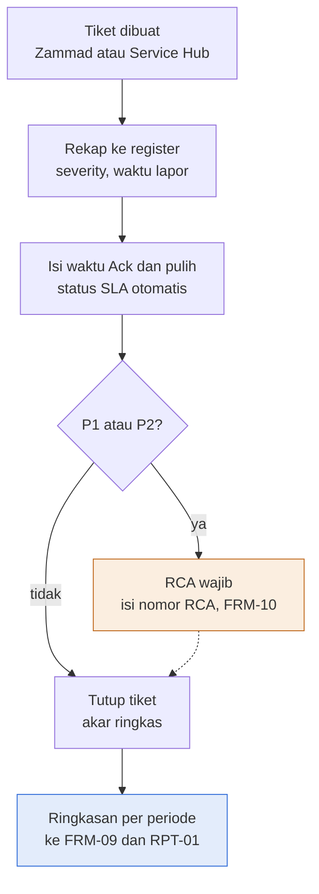

Deskripsi: enam kotak vertikal dan satu keputusan. Tiket dibuat (Zammad atau Service Hub), direkap ke register (severity, waktu lapor), waktu Ack dan pulih diisi dengan status SLA otomatis, lalu keputusan "P1 atau P2?". Jalur "ya" ke kotak oranye "RCA wajib (isi nomor RCA, FRM-10)" yang kembali ke alur utama dengan garis putus-putus; jalur "tidak" langsung ke "Tutup tiket (akar ringkas)". Selanjutnya kotak biru output akhir "Ringkasan per periode (ke FRM-09 dan RPT-01)".
Sumber gambar: conv/1E0-sXiP8r-lS34-PVvt3RYRT04O56Lnz/img/image1.png

## 4. Peran, RACI, record, KPI

| Peran | Keterangan dari sumber |
|---|---|
| Lead NOC | Pemilik dokumen dan penyusun |
| ISO/ISMS Coordinator | Pemeriksa |
| COO (Amirull Yusuf Zulkarnain) | Penyetuju |
| PIC (`[engineer]`) | Penanggung jawab tiket (placeholder pada contoh) |
| Penyedia infra Nusagrid | Contoh tujuan eskalasi (N5) |

KPI dan target (verbatim dari sumber):

| Metrik | Target | Sumber / status |
|---|---|---|
| Ack P1 | 15 menit | Target Severity (Ack dari SNX-OPS-SOP-04) |
| Ack P2 | 30 menit | idem |
| Ack P3 | 120 menit | idem |
| Ack P4 | 1440 menit | idem |
| Update P1 / P2 / P3 / P4 | 60 / 180 / 1440 menit / saat selesai | idem |
| Pulih P1 / P2 / P3 / P4 | 4 / 8 / 24 / 72 jam | USULAN internal (komitmen pelanggan mengikuti kontrak) |
| P1 dan P2 di-ack sesuai target | 95% | label baris 11 Ringkasan ("KPI 95%") |
| RCA | wajib untuk P1 dan P2 | nomor RCA dari SNX-OPS-FRM-10 |

Record: register tiket, retensi 3 tahun. Keluaran periodik diteruskan ke SNX-OPS-FRM-09 dan SNX-OPS-RPT-01. RACI tidak ada.

## 5. Catatan kualitas dan celah
- Draft rev 00 (Kontrol Dokumen B6); pengesahan dan tanda tangan kosong (A34 sampai D37).
- Target pulih seluruhnya berlabel USULAN (Target Severity D4 "Target pulih (jam), USULAN"; A2 "Target pemulihan = USULAN internal"). Target Ack dan update dinyatakan berasal dari SNX-OPS-SOP-04 (A2 "Ack dan update dari SNX-OPS-SOP-04"). Lintas dokumen: nilai Target Severity (P1 15 menit dan 60 menit, P2 30 dan 180, P3 120 dan 1440, P4 1440 dan "Saat selesai"; pulih 4, 8, 24, 72 jam) sama dengan tabel Bagian 6 SNX-OPS-SOP-04 (Ack 15 menit, 30 menit, 2 jam kerja, 1 hari kerja; update Tiap 1 jam, Tiap 3 jam atau per shift, Harian, Saat selesai; target pulih 4, 8, 24, 72 jam). Kedua sisi cocok.
- Jam kerja dihitung sebagai jam kalender: Target Severity A2 "Jam kerja dihitung sebagai jam kalender untuk penyederhanaan"; Ack P3 120 menit dan P4 1440 menit (B7, B8). Lintas dokumen: SNX-OPS-SOP-04 Bagian 6 menulis Ack P3 "2 jam kerja" dan P4 "1 hari kerja"; SNX-OPS-ML-00 Riwayat Review no. 10 (status Terbuka) berbunyi "Target Ack P3 (2 jam kerja) dan P4 (1 hari kerja) dihitung sebagai jam kalender di Excel ... perhitungan jam kerja butuh kalender kerja yang belum ditetapkan".
- Durasi pulih dihitung dari waktu Dilaporkan (I) sampai Pulih (K): `ROUND((K-I)*24,1)` (Register T4 dan rumus T5); Cara pakai tidak menyatakan acuan waktu mulai ini secara eksplisit.
- Tiket yang belum punya waktu Ack atau Pulih menghasilkan U atau V kosong (rumus `IF(S="","",...)`), dan Ringkasan D menghitung persentase dari jumlah "Ya" ditambah "Tidak" sehingga baris kosong tidak masuk penyebut; tiket yang tidak pernah di-ack atau belum pulih tidak tercatat sebagai pelanggaran sampai waktunya diisi (inferensi dari rumus).
- Rumus U dan V memakai `MATCH(G, 'Target Severity'!A5:A8, 0)`; bila Severity kosong tetapi waktu terisi, hasilnya galat #N/A, dan tidak ada pengecekan galat (inferensi dari rumus).
- Dropdown "Kelas triage" (Daftar C10) memuat "Keamanan (ke SOC)" tetapi tidak ada kolom Register (A4:W4) yang menautkan ke SNX-ISMS-FRM-02 atau SNX-ISMS-SOP-01; tautan hanya lewat kolom N "Eskalasi ke" yang tidak punya validasi daftar (teks bebas).
- Hanya 1 baris CONTOH (Register A5 TKT-2026-0001, W5 "CONTOH"); tanggal contoh 2026-11-10 (I5 sampai L5) setelah tanggal draft 13 Oktober 2026; baris contoh masuk periode default Ringkasan (B3 2026-11-01 sampai B4 2026-11-30; B8 = 1) sehingga ikut terhitung bila tidak dihapus.
- Ringkasan memuat baris KPI 95% hanya untuk Ack P1 dan P2 (A11 "P1 dan P2 di-ack sesuai target (KPI 95%)"); tidak ada baris KPI padanan untuk pemulihan, walau kolom E dan F Ringkasan menghitung "Pulih sesuai target" per severity.
- Tidak ada kredensial atau data pribadi sensitif; hanya placeholder (`[pelanggan]`, `[engineer]`).

## 6. Kata kunci retrieval
tiket teknis, incident register, ticket register, severity P1 P2 P3 P4, target Ack, target pulih, recovery time, SLA breach, pelanggaran SLA, Ack sesuai target, RCA wajib, root cause analysis, FRM-10, Zammad, Service Hub GLPI, Nusagrid, kanal WhatsApp, kelas triage, eskalasi, durasi pulih, respon menit, Target Severity, KPI 95%, SNX-OPS-FRM-08, SNX-OPS-SOP-04, ISO 9001 8.7 9.1.1, Annex A 5.25 5.26

<!-- FILE: ops/SNX-OPS-FRM-09.md -->

---
doc_code: SNX-OPS-FRM-09
title: SLA Performance Monitoring Report
department: Operation
doc_type: Laporan
source: {drive_file_id: 14o0dFUVZU-ieDbrLFQXTzwmNIL4SAftF, filename: SNX-OPS-FRM-09_SLA_Performance_Monitoring_Report.xlsx, format: xlsx, bytes: 134604, retrieved: 2026-10-13}
revision: 00 (DRAFT)
doc_date: 13 Oktober 2026
classification_in_doc: RESTRICTED (Internal)
owner_in_doc: Service Delivery Manager
approver_in_doc: COO, Amirull Yusuf Zulkarnain
iso_refs: {iso9001: ["9.1.1", "9.1.2", "9.1.3"], iso27001: ["A 8.16"]}
kb_sensitivity_suggest: restricted:ops
related_docs: [SNX-OPS-SOP-05, SNX-OPS-FRM-08, SNX-OPS-FRM-10, SNX-OPS-RPT-01, SNX-OPS-FRM-04]
coverage: {sections_or_sheets: "6 dari 6", tables: 9, images: "1 dibuka dari 1", notes: "Parameter SLA: 2 baris CONTOH dari kapasitas 40 (baris 5 sampai 44). Downtime Log: 2 baris CONTOH dari kapasitas 202 (baris 5 sampai 206). Laporan Bulanan: 40 baris formula (baris 8 sampai 47), 2 terisi. Kolom Tiket P1 dan P2 serta Di-ack sesuai target (I, J) kosong pada contoh."}
---
# SNX-OPS-FRM-09 SLA Performance Monitoring Report

## 1. Ringkasan
- Workbook tiga bagian: parameter SLA per pelanggan dan layanan, log downtime, dan laporan availability bulanan, sesuai SNX-OPS-SOP-05.
- Availability bulanan = 1 dikurangi (downtime dihitung dalam menit dibagi jumlah menit dalam bulan); status `Tercapai` bila availability >= target, selain itu `Breach`. Anggaran downtime = menit dalam bulan x (1 - target); sisa anggaran = anggaran dikurangi downtime dihitung.
- Downtime dicatat semua; kolom "Dihitung" = Tidak hanya bila ada bukti notifikasi maintenance atau pengecualian kontrak.
- Data respon tiket P1 dan P2 diisi dari ringkasan SNX-OPS-FRM-08; laporan dikirim ke pelanggan paling lambat hari kerja ke-5.
- Contoh target availability: 0,999 (99,9%) untuk Nusagrid IaaS dan 0,995 (99,5%) untuk Managed backup; seluruhnya data CONTOH.
- Status isi: DATA CONTOH (2 parameter SLA, 2 downtime, placeholder `[pelanggan A]`, `[pelanggan B]`, `[PIC pelanggan]`); bukan data nyata.

## 2. Isi lengkap terstruktur

### 2.1 Sheet "Kontrol Dokumen"

| Atribut | Nilai |
|---|---|
| Judul sheet | SLA Performance Monitoring Report |
| Organisasi | PT Strategi Integrasi Nusantara (SINUX) · Divisi Operation |
| Nomor dokumen | SNX-OPS-FRM-09 |
| Revisi | 00 (DRAFT) |
| Tanggal draft | 13 Oktober 2026 |
| Tanggal efektif | Ditetapkan saat pengesahan |
| Klasifikasi | RESTRICTED (Internal) |
| Pemilik dokumen | Service Delivery Manager |
| Disetujui oleh | COO, Amirull Yusuf Zulkarnain |
| Acuan ISO 9001:2015 | Klausul 9.1.1, 9.1.2, 9.1.3 |
| Acuan ISO/IEC 27001:2022 | Klausul atau kontrol Annex A 8.16 |
| Masa simpan record | 3 tahun |
| Tujuan | Parameter SLA per pelanggan, log downtime, dan laporan availability bulanan sesuai SNX-OPS-SOP-05. |

Cara pakai (verbatim):
1. Daftarkan tiap layanan ber-SLA di sheet Parameter SLA saat onboarding.
2. Catat setiap downtime di Downtime Log; kolom Dihitung = Tidak hanya bila ada bukti notifikasi maintenance atau pengecualian kontrak.
3. Pilih bulan laporan di sheet Laporan Bulanan sel B3; availability, status, dan sisa anggaran downtime dihitung otomatis.
4. Isi data respon tiket dari ringkasan SNX-OPS-FRM-08.
5. Laporan dikirim ke pelanggan paling lambat hari kerja ke-5.

Legenda warna: sel input = diisi pengguna; baris CONTOH = hapus atau timpa saat dipakai; sel rumus = jangan diubah.

Riwayat revisi:

| Revisi | Tanggal | Uraian perubahan | Disusun | Disetujui |
|---|---|---|---|---|
| 00 | 13 Oktober 2026 | Draft awal untuk sertifikasi ISO 9001 dan ISO/IEC 27001 | Divisi Operation | Menunggu |
| 00 | 13 Oktober 2026 | Review bahasa dan konsistensi: istilah teknologi dalam bahasa Inggris, bahasa Indonesia formal, label klasifikasi, keselarasan RTO dan target pulih | Divisi Operation | Menunggu |

Pengesahan:

| Peran | Nama dan jabatan | Tanda tangan | Tanggal |
|---|---|---|---|
| Disusun oleh | Service Delivery Manager | (kosong) | (kosong) |
| Diperiksa oleh | ISO/ISMS Coordinator | (kosong) | (kosong) |
| Disetujui oleh | COO, Amirull Yusuf Zulkarnain | (kosong) | (kosong) |

### 2.2 Sheet "Alur Proses"
Judul "Diagram alur proses"; legenda warna standar (biru = output akhir, oranye = cabang ke tindakan atau prosedur lain, putus-putus = kembali ke alur utama). Gambar di bagian 3.

### 2.3 Sheet "Daftar" (nilai dropdown)

| Dihitung | Penyebab |
|---|---|
| Ya | Platform SINUX |
| Tidak | Upstream atau supplier |
| (kosong) | Network |
| (kosong) | Maintenance terjadwal |
| (kosong) | Pelanggan atau app-level |
| (kosong) | Keamanan |
| (kosong) | Lainnya |

Pemetaan validation: Downtime Log G5:G206 = Daftar!A2:A3 (Dihitung); H5:H206 = Daftar!B2:B8 (Penyebab, 7 nilai).

### 2.4 Sheet "Parameter SLA" (A1:I46; baris data 5 sampai 44 = 40 baris, inferensi dari rentang referensi Laporan Bulanan)
Judul "Parameter SLA per layanan". Keterangan: "Target availability dalam persen (0.999 = 99.9%). Kombinasi Pelanggan dan Layanan harus unik."

Kolom: ID; Pelanggan; Layanan; Target availability (desimal, 0,999 = 99,9%); Jam layanan; Pengecualian kontrak; Periode laporan; PIC penerima laporan; Catatan.

Baris terisi (semua):

| ID | Pelanggan | Layanan | Target availability | Jam layanan | Pengecualian kontrak | Periode laporan | PIC penerima laporan | Catatan |
|---|---|---|---|---|---|---|---|---|
| SLA-001 | [pelanggan A] | Nusagrid IaaS | 0,999 | 24x7 | Window maintenance yang dinotifikasi H-2 | Bulanan | [PIC pelanggan] | CONTOH |
| SLA-002 | [pelanggan B] | Managed backup | 0,995 | 24x7 | Gangguan di luar tanggung jawab SINUX sesuai kontrak | Bulanan | [PIC pelanggan] | CONTOH |

### 2.5 Sheet "Downtime Log" (A1:K206; baris data 5 sampai 206 = 202 baris)
Judul "Log downtime"; "Durasi dihitung otomatis dalam menit."

Kolom: Tanggal; Pelanggan; Layanan; Mulai; Pulih; Durasi (menit) (RUMUS); Dihitung (dropdown Ya, Tidak); Penyebab (dropdown 7 nilai); Alasan pengecualian; Ref tiket atau CR; Catatan.

Rumus Durasi F: `=IF(OR(D5="",E5=""),"",ROUND((E5-D5)*1440,0))` (Pulih dikurangi Mulai dalam menit, dibulatkan).

Baris terisi (semua):

| Tanggal | Pelanggan | Layanan | Mulai | Pulih | Durasi (menit, rumus) | Dihitung | Penyebab | Alasan pengecualian | Ref tiket atau CR | Catatan |
|---|---|---|---|---|---|---|---|---|---|---|
| 2026-11-10 | [pelanggan A] | Nusagrid IaaS | 2026-11-10 09:00 | 2026-11-10 09:25 | 25 | Ya | Upstream atau supplier | (kosong) | TKT-2026-0001 | CONTOH |
| 2026-11-14 | [pelanggan A] | Nusagrid IaaS | 2026-11-14 23:30 | 2026-11-14 23:50 | 20 | Tidak | Maintenance terjadwal | Dinotifikasi H-2, CR-2026-0001 | CR-2026-0001 | CONTOH |

### 2.6 Sheet "Laporan Bulanan" (A1:L50)
Judul "Laporan kinerja SLA bulanan". Parameter periode:
- B3 Bulan laporan (tanggal 1) = 2026-11-01 (input).
- B4 Akhir bulan = `=EOMONTH(B3,0)` = 2026-11-30.
- B5 Menit dalam periode = `=DAY(B4)*1440` = 43200.

Kolom (header baris 7): Pelanggan; Layanan; Target; Downtime dihitung (menit); Availability; Status; Anggaran downtime (menit); Sisa anggaran (menit); Tiket P1 dan P2; Di-ack sesuai target; Response SLA; Catatan dan tindakan. Baris 8 sampai 47 (40 baris) menarik data dari Parameter SLA baris 5 sampai 44 satu per satu.

Rumus dan logika (contoh baris 8):
- Pelanggan A, Layanan B, Target C: `=IF('Parameter SLA'!B5="","",'Parameter SLA'!B5)` (dan C5, D5): menyalin dari Parameter SLA.
- Downtime dihitung D: `=IF(A8="","",SUMIFS('Downtime Log'!F5:F206, 'Downtime Log'!B5:B206, A8, 'Downtime Log'!C5:C206, B8, 'Downtime Log'!G5:G206, "Ya", 'Downtime Log'!D5:D206, ">="&B3, 'Downtime Log'!D5:D206, "<"&(B4+1)))`. Menjumlahkan Durasi downtime untuk pelanggan dan layanan yang sama (pencocokan teks persis), Dihitung = Ya, dengan waktu Mulai dalam bulan laporan. Downtime lintas bulan dimasukkan seluruhnya ke bulan Mulai (inferensi dari rumus).
- Availability E: `=IF(A8="","",1-D8/$B$5)`.
- Status F: `=IF(A8="","",IF(E8>=C8,"Tercapai","Breach"))`.
- Anggaran downtime G: `=IF(A8="","",ROUND($B$5*(1-C8),1))`.
- Sisa anggaran H: `=IF(A8="","",G8-D8)` (negatif berarti anggaran terlampaui).
- Response SLA K: `=IF(OR(I8="",I8=0),"",J8/I8)`. I (Tiket P1 dan P2) dan J (Di-ack sesuai target) adalah input manual dari ringkasan SNX-OPS-FRM-08; L adalah catatan dan tindakan (input).

Nilai cache untuk baris terisi:

| Pelanggan | Layanan | Target | Downtime dihitung (menit) | Availability | Status | Anggaran downtime (menit) | Sisa anggaran (menit) | Tiket P1 dan P2 | Di-ack sesuai target | Response SLA | Catatan dan tindakan |
|---|---|---|---|---|---|---|---|---|---|---|---|
| [pelanggan A] | Nusagrid IaaS | 0,999 | 25 | 0,9994213 (99,942%) | Tercapai | 43,2 | 18,2 | (kosong) | (kosong) | (kosong) | (kosong) |
| [pelanggan B] | Managed backup | 0,995 | 0 | 1 (100%) | Tercapai | 216 | 216 | (kosong) | (kosong) | (kosong) | (kosong) |

Catatan hitung: downtime 20 menit pada 2026-11-14 (Dihitung = Tidak) tidak masuk D8 (hanya 25 menit yang Dihitung = Ya). Baris 10 sampai 47: rumus kosong.

Blok pengesahan laporan (baris 49 dan 50): "Disusun (Service Delivery Manager)" dan "Diperiksa (Head of Operation)" (tanpa nama, tanggal, atau tanda tangan terisi).

## 3. Diagram

### 3.1 Alur pengisian SLA Performance Monitoring Report
Judul gambar: "Availability bulanan dihitung dari log downtime" (subjudul "Alur pengisian SLA Performance Monitoring Report").

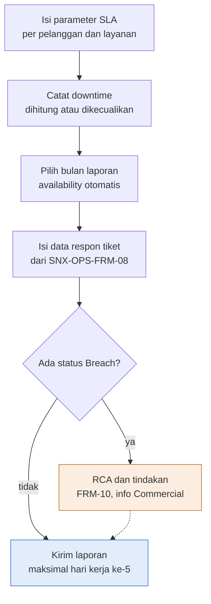

Deskripsi: empat kotak berurutan (isi parameter SLA, catat downtime, pilih bulan laporan, isi data respon tiket dari SNX-OPS-FRM-08) lalu keputusan "Ada status Breach?". Jalur "ya" ke kotak oranye "RCA dan tindakan (FRM-10, info Commercial)" yang kembali ke alur utama lewat garis putus-putus; jalur "tidak" ke kotak biru output akhir "Kirim laporan (maksimal hari kerja ke-5)".
Sumber gambar: conv/14o0dFUVZU-ieDbrLFQXTzwmNIL4SAftF/img/image1.png

## 4. Peran, RACI, record, KPI

| Peran | Keterangan dari sumber |
|---|---|
| Service Delivery Manager | Pemilik dokumen; penyusun dokumen dan laporan bulanan |
| ISO/ISMS Coordinator | Pemeriksa dokumen (Kontrol Dokumen) |
| Head of Operation | Pemeriksa laporan bulanan (baris 50 Laporan Bulanan) |
| COO (Amirull Yusuf Zulkarnain) | Penyetuju dokumen |
| Commercial | Menerima informasi bila ada Breach (gambar) |
| PIC penerima laporan (pelanggan) | Penerima laporan; placeholder `[PIC pelanggan]` |

Target dan KPI dalam dokumen:

| Metrik | Nilai | Catatan |
|---|---|---|
| Target availability contoh | 99,9% (Nusagrid IaaS), 99,5% (Managed backup) | CONTOH; target nyata per kontrak |
| Jam layanan contoh | 24x7 | CONTOH |
| Batas kirim laporan | maksimal hari kerja ke-5 | Cara pakai dan gambar |
| Anggaran downtime | menit dalam bulan x (1 - target); contoh 43,2 menit pada 99,9% bulan 30 hari | rumus |
| Response SLA | Di-ack sesuai target / Tiket P1 dan P2 | tanpa ambang di dokumen ini (ambang 95% ada di SNX-OPS-FRM-08) |

Record: retensi 3 tahun. RACI tidak ada.

## 5. Catatan kualitas dan celah
- Draft rev 00; pengesahan dan tanda tangan kosong (Kontrol Dokumen A35 sampai D38). Pengesahan laporan bulanan memakai "Diperiksa (Head of Operation)" (Laporan Bulanan A50), sedangkan Kontrol Dokumen memakai "Diperiksa oleh | ISO/ISMS Coordinator" (B37); dua konteks berbeda, bukan konflik pasti.
- Seluruh isi CONTOH: Parameter SLA I5 dan I6, Downtime Log K5 dan K6 "CONTOH"; target 99,9% (D5 0.999) dan 99,5% (D6 0.995) hanya contoh. Tanggal contoh (Downtime Log A5 2026-11-10 dan A6 2026-11-14) setelah tanggal draft 13 Oktober 2026.
- Availability memakai total menit kalender dalam bulan (Laporan Bulanan B5 `=DAY(B4)*1440`) sebagai penyebut (E8 `1-D8/$B$5`) tanpa memperhatikan kolom "Jam layanan" (Parameter SLA E); layanan non 24x7 akan terhitung 24x7. Rumus di seluruh workbook hanya merujuk kolom B, C, D Parameter SLA, jadi kolom Jam layanan dan Pengecualian kontrak (F) tidak dipakai rumus mana pun (inferensi dari rumus; dicek dengan openpyxl).
- Persyaratan "Kombinasi Pelanggan dan Layanan harus unik" (Parameter SLA A2) tidak ditegakkan oleh rumus atau validation (validasi data hanya pada Downtime Log G dan H). SUMIFS Laporan Bulanan D8 memakai pencocokan teks persis pada Pelanggan dan Layanan, sehingga perbedaan penulisan nama di Downtime Log membuat downtime tidak terhitung (inferensi).
- Downtime dihitung berdasarkan waktu Mulai pada bulan laporan (D8: `'Downtime Log'!D >= B3` dan `< B4+1`); downtime yang melintasi pergantian bulan tidak dipecah (inferensi).
- Kolom "Alasan pengecualian" (Downtime Log I) tidak divalidasi terhadap "Pengecualian kontrak" di Parameter SLA (F); satu-satunya kontrol adalah format kondisional I5:I206 yang menandai sel kosong bila Dihitung = "Tidak", ditambah aturan teks Cara pakai butir 2.
- Kolom Tiket P1 dan P2 (Laporan Bulanan I) dan Di-ack sesuai target (J) kosong pada contoh dan tanpa rumus; Cara pakai butir 4 "Isi data respon tiket dari ringkasan SNX-OPS-FRM-08" (diisi manual, bukan tautan rumus). Kolom Response SLA (K) hanya rasio J/I tanpa status target.
- Gambar (image1) menyebut keputusan "Ada status Breach?" yang menuju "RCA dan tindakan (FRM-10, info Commercial)"; Laporan Bulanan F memberi status Tercapai atau Breach, dan tidak ada rumus atau format kondisional yang memicu RCA atau notifikasi Commercial otomatis.
- Daftar Penyebab "Upstream atau supplier" (Daftar B3) dapat diberi Dihitung = Ya atau Tidak; Cara pakai butir 2 menyebut Dihitung = Tidak "hanya bila ada bukti notifikasi maintenance atau pengecualian kontrak"; contoh 1 (Downtime Log baris 5) upstream tetap "Ya".
- Lintas dokumen: SNX-OPS-SOP-05 Bagian 4 mendefinisikan availability "(Menit dalam periode dikurangi menit downtime yang dihitung) dibagi menit dalam periode", cocok dengan E8; anggaran downtime contoh G8 = 43,2 menit (99,9% dari 43.200 menit), cocok dengan "sekitar 43 menit" di SOP-05 6.4 butir 1. Early warning 50% anggaran (SOP-05 6.4 butir 2) tidak punya rumus atau penanda di Laporan Bulanan (format kondisional H hanya untuk nilai kurang dari 0).
- Tidak ada kredensial atau data pribadi (hanya placeholder `[pelanggan A]`, `[pelanggan B]`, `[PIC pelanggan]`).

## 6. Kata kunci retrieval
SLA, availability, downtime, log downtime, anggaran downtime, error budget, sisa anggaran, Breach, Tercapai, target availability 99,9%, parameter SLA, laporan bulanan SLA, pengecualian kontrak, maintenance terjadwal, notifikasi H-2, Response SLA, P1 P2, Nusagrid IaaS, Managed backup, Commercial, SNX-OPS-FRM-09, SNX-OPS-SOP-05, ISO 9001 9.1, Annex A 8.16, monitoring kinerja

<!-- FILE: ops/SNX-OPS-FRM-10.md -->

---
doc_code: SNX-OPS-FRM-10
title: Root Cause Analysis & Corrective Action Report
department: Operation
doc_type: Form/Record
source: {drive_file_id: 1XFMQDye_WWWomRpwmT6KGMRdi4EVbRsS, filename: SNX-OPS-FRM-10_RCA_Corrective_Action_Report.docx, format: docx, bytes: 140695, retrieved: 2026-10-13}
revision: 00 (DRAFT)
doc_date: 13 Oktober 2026 (tanggal draft); tanggal efektif "Ditetapkan saat pengesahan"
classification_in_doc: RESTRICTED (Internal)
owner_in_doc: Head of Operation
approver_in_doc: COO, Amirull Yusuf Zulkarnain (status persetujuan "Menunggu")
iso_refs: {iso9001: ["10.2"], iso27001: ["A5.27"]}
kb_sensitivity_suggest: restricted:ops
related_docs: [SNX-OPS-SOP-04, SNX-OPS-SOP-02, SNX-OPS-FRM-08, SNX-OPS-FRM-04, SNX-ISMS-FRM-02, SNX-ISMS-REG-02]
coverage: {sections_or_sheets: "14 dari 14 (atribut, riwayat revisi, petunjuk, diagram, bagian 1 sampai 9, pengesahan)", tables: 12, images: "1 dibuka dari 1", notes: "Template kosong. SNX-OPS-FRM-08, FRM-04, SNX-ISMS-FRM-02 dan REG-02 ada di md/ops dan md/isms (rujukan silang dicek di bagian 5)."}
---
# SNX-OPS-FRM-10 Root Cause Analysis & Corrective Action Report

## 1. Ringkasan

- Template RCA dan tindakan korektif. Wajib untuk insiden P1 dan P2, insiden berulang, breach SLA, dan ketidaksesuaian audit (sesuai SNX-OPS-SOP-04 Bagian 7.5 dan ISO 9001 klausul 10.2).
- RCA insiden dikirim ke pelanggan via email paling lambat 2 hari kerja setelah layanan pulih. Fokus pada sistem dan proses, bukan menyalahkan orang.
- Struktur: identitas, ringkasan (2 sampai 3 kalimat), dampak, kronologi, analisis akar masalah (5 Why atau Fishbone dengan 6 kategori), tindakan (koreksi, korektif, preventif), verifikasi efektivitas, komunikasi, persetujuan.
- RCA ditutup hanya setelah tindakan terbukti efektif; bila tidak efektif kembali ke analisis. Penutupan memperbarui risiko di SNX-ISMS-REG-02.
- Insiden keamanan informasi juga dicatat di SNX-ISMS-FRM-02. Tindakan yang mengubah production lewat SNX-OPS-SOP-02.
- Masa simpan 5 tahun. Dokumen berupa template kosong, tidak ada data nyata.

## 2. Isi lengkap terstruktur

### 2.0 Atribut dokumen

| Atribut | Isi |
|---|---|
| Nomor dokumen | SNX-OPS-FRM-10 |
| Judul | Root Cause Analysis & Corrective Action Report |
| Revisi | 00 (DRAFT) |
| Tanggal draft | 13 Oktober 2026 |
| Tanggal efektif | Ditetapkan saat pengesahan |
| Klasifikasi | RESTRICTED (Internal) |
| Pemilik dokumen | Head of Operation |
| Disetujui oleh | COO, Amirull Yusuf Zulkarnain |
| Acuan ISO 9001:2015 | Klausul 10.2 |
| Acuan ISO/IEC 27001:2022 | Klausul atau kontrol Annex A 5.27 |
| Masa simpan record | 5 tahun |

### Riwayat revisi

| Revisi | Tanggal | Uraian perubahan | Disusun | Disetujui |
|---|---|---|---|---|
| 00 | 13 Oktober 2026 | Draft awal untuk sertifikasi ISO 9001:2015 dan ISO/IEC 27001:2022 | Divisi Operation | Menunggu |
| 00 | 13 Oktober 2026 | Review bahasa dan konsistensi: istilah teknologi dalam bahasa Inggris, bahasa Indonesia formal, label klasifikasi, keselarasan RTO dan target pulih | Divisi Operation | Menunggu |

### 2.1 Petunjuk pengisian

Template ini wajib untuk insiden P1 dan P2, insiden berulang, breach SLA, dan ketidaksesuaian audit, sesuai SNX-OPS-SOP-04 Bagian 7.5 dan ISO 9001 klausul 10.2. RCA insiden dikirim ke pelanggan via email paling lambat 2 hari kerja setelah layanan pulih. Fokus pada sistem dan proses, bukan menyalahkan orang. Insiden keamanan informasi juga dicatat di SNX-ISMS-FRM-02.

### 2.2 Bagian 1. Identitas

| Item | Isi (placeholder di sumber) |
|---|---|
| Nomor RCA | RCA-[YYYY]-[nomor urut] |
| Sumber | [ ] Insiden · [ ] Breach SLA · [ ] Temuan audit · [ ] Keluhan pelanggan · [ ] Lainnya |
| Referensi | [nomor tiket FRM-08, CR FRM-04, atau temuan audit] |
| Pelanggan dan layanan terdampak | (kosong) |
| Severity | [P1, P2, P3, P4] |
| Waktu mulai gangguan | [tanggal, jam WIB] |
| Waktu terdeteksi | [tanggal, jam WIB] |
| Waktu pulih | [tanggal, jam WIB] |
| Durasi dampak | [menit] |
| Disusun oleh | (kosong) |
| Tanggal RCA | (kosong) |

### 2.3 Bagian 2. Ringkasan

[Dua sampai tiga kalimat: apa yang terjadi, dampaknya, dan apa yang sudah dilakukan.]

### 2.4 Bagian 3. Dampak

| Aspek | Uraian |
|---|---|
| Layanan dan pengguna terdampak | (kosong) |
| Dampak ke SLA | [menit downtime yang dihitung, sisa anggaran] |
| Dampak ke data (confidentiality, integrity, availability) | (kosong) |
| Dampak ke pelanggan lain | (kosong) |

### 2.5 Bagian 4. Kronologi

| Waktu (WIB) | Kejadian atau tindakan | Oleh |
|---|---|---|
| (kosong) | (kosong) | (kosong) |
| (kosong) | (kosong) | (kosong) |
| (kosong) | (kosong) | (kosong) |
| (kosong) | (kosong) | (kosong) |

### 2.6 Bagian 5. Analisis akar masalah

Metode: [ ] 5 Why · [ ] Fishbone (Ishikawa) · [ ] Lainnya: [sebutkan]

**5 Why**

| Tingkat | Pertanyaan: mengapa? | Jawaban berbasis bukti |
|---|---|---|
| 1 | (kosong) | (kosong) |
| 2 | (kosong) | (kosong) |
| 3 | (kosong) | (kosong) |
| 4 | (kosong) | (kosong) |
| 5 | (kosong) | (kosong) |

**Kategori penyebab (fishbone)**

| Kategori | Faktor yang ditemukan |
|---|---|
| Manusia | (kosong) |
| Proses atau prosedur | (kosong) |
| Teknologi atau sistem | (kosong) |
| Supplier atau pihak ketiga | (kosong) |
| Lingkungan | (kosong) |
| Pengukuran atau monitoring | (kosong) |

Akar masalah: [satu pernyataan yang jelas, didukung bukti]

Mengapa tidak terdeteksi lebih awal: [celah monitoring atau prosedur]

### 2.7 Bagian 6. Tindakan

| No | Jenis | Tindakan | Pemilik | Tenggat | Status |
|---|---|---|---|---|---|
| 1 | Koreksi (memulihkan) | (kosong) | (kosong) | (kosong) | (kosong) |
| 2 | Korektif (menghilangkan akar) | (kosong) | (kosong) | (kosong) | (kosong) |
| 3 | Preventif (mencegah di tempat lain) | (kosong) | (kosong) | (kosong) | (kosong) |

Tindakan yang mengubah production dijalankan melalui SNX-OPS-SOP-02. Risiko baru yang ditemukan ditambahkan ke SNX-ISMS-REG-02.

### 2.8 Bagian 7. Verifikasi efektivitas

| Item | Isi |
|---|---|
| Kriteria efektif | [misalnya tidak berulang dalam 90 hari, alert baru terbukti menangkap gejala] |
| Tanggal verifikasi | (kosong) |
| Hasil | [ ] Efektif · [ ] Belum efektif, tindakan lanjutan: |
| Diverifikasi oleh | (kosong) |

### 2.9 Bagian 8. Komunikasi

| Item | Isi |
|---|---|
| Dikirim ke pelanggan | [tanggal, penerima] |
| Dibahas internal | [tanggal, forum] |
| Lessons learned disetor ke knowledge base | [nomor packet staging] |

### 2.10 Bagian 9. Persetujuan RCA

| Peran | Nama | Tanda tangan | Tanggal |
|---|---|---|---|
| Disusun (Lead NOC atau Lead SOC) | (kosong) | (kosong) | (kosong) |
| Disetujui (Head of Operation) | (kosong) | (kosong) | (kosong) |

### Pengesahan

| Peran | Nama dan jabatan | Tanda tangan | Tanggal |
|---|---|---|---|
| Disusun oleh | Head of Operation | (kosong) | (kosong) |
| Diperiksa oleh | ISO/ISMS Coordinator | (kosong) | (kosong) |
| Disetujui oleh | COO, Amirull Yusuf Zulkarnain | (kosong) | (kosong) |

## 3. Diagram

### 3.1 Alur Root Cause Analysis & Corrective Action

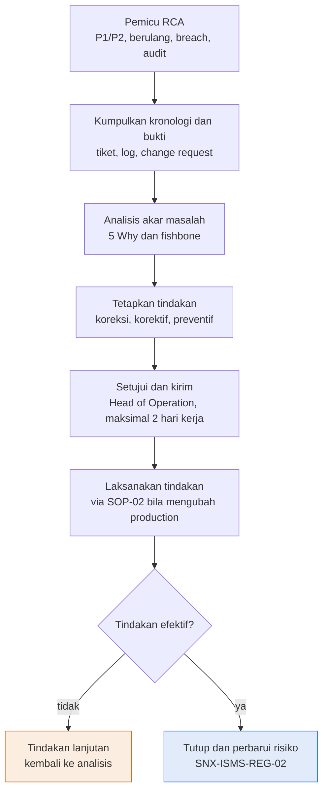

Deskripsi: Alur vertikal enam kotak berurutan dari Pemicu RCA sampai Laksanakan tindakan, lalu keputusan "Tindakan efektif?". Cabang tidak menuju kotak oranye "Tindakan lanjutan" (teks "kembali ke analisis"), cabang ya menuju kotak biru "Tutup dan perbarui risiko" (SNX-ISMS-REG-02) sebagai output akhir. Pada gambar, tidak ada panah yang digambar dari Tindakan lanjutan kembali ke Analisis akar masalah; arah kembali hanya dinyatakan dalam teks kotak.

Sumber gambar: `conv/1XFMQDye_WWWomRpwmT6KGMRdi4EVbRsS/img/media/rId21.png` (judul gambar "RCA ditutup hanya setelah tindakan terbukti efektif").

## 4. Peran, RACI, record, KPI

| Peran | Keterlibatan menurut sumber |
|---|---|
| Lead NOC atau Lead SOC | Menyusun RCA |
| Head of Operation | Pemilik dokumen; menyetujui dan mengirim RCA (maksimal 2 hari kerja); penyusun Pengesahan |
| ISO/ISMS Coordinator | Pemeriksa dokumen |
| COO | Penyetuju dokumen |
| Pelanggan | Penerima RCA via email |

Record: RCA-[YYYY]-[nomor urut], masa simpan 5 tahun. Tenggat kirim RCA: 2 hari kerja setelah pulih. Kriteria efektif: ditetapkan per RCA (contoh di sumber: tidak berulang dalam 90 hari, alert baru terbukti menangkap gejala). KPI formal: tidak ada di dokumen ini (KPI RCA terkirim 100% dalam 2 hari kerja ada di SNX-OPS-SOP-04).

## 5. Catatan kualitas dan celah

- Seluruh isian berupa placeholder kosong atau petunjuk dalam kurung siku (mis. Bagian 1 "RCA-\[YYYY\]-\[nomor urut\]"); tidak ada data nyata.
- Gambar (rId21) menempatkan kotak "Setujui dan kirim" (sub-label "Head of Operation, maksimal 2 hari kerja") sebelum "Laksanakan tindakan" dan keputusan "Tindakan efektif?"; artinya RCA dikirim ke pelanggan sebelum efektivitas tindakan terbukti (inferensi dari urutan gambar). Judul gambar sendiri berbunyi "RCA ditutup hanya setelah tindakan terbukti efektif". Bagian 7 (Verifikasi efektivitas) dan Bagian 9 (Persetujuan RCA) ada dalam satu form yang sama.
- Metode analisis (Bagian 5): "\[ \] 5 Why · \[ \] Fishbone (Ishikawa) · \[ \] Lainnya"; tidak ada panduan kapan metode mana dipakai.
- Tabel Tindakan (Bagian 6) hanya 3 baris (Koreksi, Korektif, Preventif; satu per jenis); tidak dinyatakan apakah boleh lebih.
- Kriteria efektif (Bagian 7) "\[misalnya tidak berulang dalam 90 hari, alert baru terbukti menangkap gejala\]" hanya contoh dalam kurung siku, bukan ketentuan.
- Sumber RCA (Bagian 1) mencakup "Keluhan pelanggan" dan "Lainnya" (checkbox), padahal Petunjuk pengisian hanya menyebut "insiden P1 dan P2, insiden berulang, breach SLA, dan ketidaksesuaian audit" (gambar kotak "Pemicu RCA" menyebut empat pemicu yang sama).
- Lintas dokumen: Petunjuk pengisian merujuk "SNX-OPS-SOP-04 Bagian 7.5"; SNX-OPS-SOP-04 7.5 butir 1 menulis "Insiden P1 dan P2 wajib RCA dengan SNX-OPS-FRM-10, dikirim ke pelanggan via email dalam 2 hari kerja setelah pulih" dan butir 3 menambah insiden berulang, cocok dengan Petunjuk. Rujukan lain (SNX-OPS-FRM-08 dan FRM-04 di Bagian 1 Referensi, SNX-ISMS-FRM-02 di Petunjuk, SNX-ISMS-REG-02 di Bagian 6, SNX-OPS-SOP-02 di Bagian 6) menunjuk dokumen yang ada di md/ops dan md/isms.
- Persetujuan RCA di Bagian 9 hanya "Disusun (Lead NOC atau Lead SOC)" dan "Disetujui (Head of Operation)"; Pengesahan dokumen memuat Head of Operation (Disusun oleh), ISO/ISMS Coordinator (Diperiksa oleh), COO (Disahkan).
- Riwayat revisi: dua baris rev 00 tanggal sama; Disetujui "Menunggu"; frasa "keselarasan RTO dan target pulih" tidak relevan dengan isi form (tidak ada RTO; pencarian "RTO" hanya menemukan frasa itu).

## 6. Kata kunci retrieval

RCA, root cause analysis, corrective action, tindakan korektif, tindakan preventif, koreksi, 5 Why, fishbone, Ishikawa, CAPA, nonconformity, ketidaksesuaian, verifikasi efektivitas, kronologi insiden, post-incident review, breach SLA, insiden berulang, Head of Operation, Lead NOC, Lead SOC, SNX-OPS-FRM-10, ISO 9001 10.2, Annex A 5.27, lessons learned

<!-- FILE: ops/SNX-OPS-ML-00.md -->

---
doc_code: SNX-OPS-ML-00
title: Master List (Master list dokumen Divisi Operation untuk ISO 9001:2015 dan ISO/IEC 27001:2022)
department: Operation
doc_type: Register
source: {drive_file_id: 11KICKwmsIgl5TEgdX_5AgLa-mfoIBVTH, filename: SNX-OPS-ML-00_Master_List_Dokumen_OPS.xlsx, format: xlsx, bytes: 18376, retrieved: 2026-10-13, binary_from: "upload owner 14 Okt 2026, ukuran cocok Drive"}
revision: 00 (DRAFT)
doc_date: 13 Oktober 2026
classification_in_doc: RESTRICTED (Internal)
owner_in_doc: tidak tertulis eksplisit (penomoran selaras dengan ISO/ISMS Coordinator; disetujui COO)
approver_in_doc: COO, Amirull Yusuf Zulkarnain
iso_refs: {iso9001: ["lihat kolom Acuan ISO 9001:2015 per dokumen"], iso27001: ["lihat kolom Acuan ISO/IEC 27001:2022 per dokumen"]}
kb_sensitivity_suggest: restricted:ops
related_docs: [POL-OPS-001, PRO-OPS-001, SNX-OPS-PRC-01, SNX-OPS-SOP-01, SNX-OPS-SOP-02, SNX-OPS-SOP-03, SNX-OPS-SOP-04, SNX-OPS-SOP-05, SNX-OPS-FRM-01, SNX-OPS-FRM-02, SNX-OPS-FRM-03, SNX-OPS-FRM-04, SNX-OPS-FRM-05, SNX-OPS-FRM-06, SNX-OPS-FRM-07, SNX-OPS-FRM-08, SNX-OPS-FRM-09, SNX-OPS-FRM-10, SNX-OPS-RPT-01, SNX-ISMS-REG-01, SNX-ISMS-PRO-01, SNX-ISMS-REG-02, SNX-ISMS-REG-03, SNX-ISMS-SOA-01, SNX-ISMS-SOP-01, SNX-ISMS-SOP-02, SNX-ISMS-REG-04, SNX-ISMS-SOP-03, SNX-ISMS-FRM-01, SNX-ISMS-SOP-04, SNX-ISMS-SOP-05, SNX-ISMS-FRM-02, SNX-ISMS-PLN-01, SNX-ISMS-FRM-03]
coverage: {sections_or_sheets: "4 dari 4 (nama sheet dibaca dari biner: Master List, Keterkaitan, Keputusan dan Gap, Riwayat Review)", tables: 4, images: "17 halaman render dibuka dari 17; 0 gambar tertanam (drawing1.xml pada sheet Master List kosong)", notes: "Versi berbasis biner xlsx (upload owner 14 Okt 2026). Seluruh 32 baris x 13 kolom Master List, 3 baris Keterkaitan, 9 butir Keputusan dan Gap, 11 butir Riwayat Review dicocokkan sel demi sel dengan biner (32 dari 32 baris sama dengan md lama). Tidak ada rumus, tidak ada merged cell, tidak ada komentar sel. Koreksi dari md lama: penanda penomoran adalah <area> (SNX-<area>-<jenis>-<nn>), bukan <dept>. Kolom Target dan Catatan di sheet Keputusan dan Gap kosong di sumber."}
---
# SNX-OPS-ML-00 Master List Dokumen Divisi Operation

## 1. Ringkasan
- Master list 32 dokumen Divisi Operation untuk ISO 9001:2015 dan ISO/IEC 27001:2022: bagian A "Project & Service Operations" (16 dokumen: PRC-01, SOP-01 sampai SOP-05, FRM-01 sampai FRM-10) dan bagian B "Information Security ISO 27001" (16 dokumen: 15 berpenomoran SNX-ISMS dan SNX-OPS-RPT-01). Format: 16 Word dan 16 Excel. Seluruh status "Draft rev 00".
- Keterangan header: SNX-OPS-ML-00, Revisi 00 (DRAFT), 13 Oktober 2026, RESTRICTED (Internal), disetujui COO Amirull Yusuf Zulkarnain. Penomoran SNX-<area>-<jenis>-<nn> adalah usulan dan dapat diselaraskan dengan master list ISO/ISMS Coordinator.
- Tabel Keterkaitan: 3 dokumen yang sudah ada (POL-OPS-001 usulan Kebijakan Divisi Operation, PRO-OPS-001 Prosedur Operasional Divisi Operation, knowledge base SINUX) dan hubungannya dengan paket ini.
- Tabel Keputusan dan Gap: 9 butir seluruhnya berstatus Terbuka (penomoran, pengesahan target USULAN, validasi 15 risiko, 45 kontrol SoA, evaluasi 8 supplier, lengkapi Asset Register, celah prosedur teknis A 8.15/8.17/8.20 sampai 8.22/8.24, bukti penerapan 1 sampai 3 bulan, jadwal audit internal dan tinjauan manajemen).
- Tabel Riwayat Review: 11 butir; 9 Selesai (no 1 sampai 9) dan 2 Terbuka (no 10 jam kerja vs jam kalender, no 11 paket dokumen).
- Seluruh isi adalah rencana paket dokumen (DRAFT); belum ada record implementasi.

## 2. Isi lengkap terstruktur

### 2.0 Struktur workbook (dibaca dari biner xlsx)

| Sheet | Rentang | Sel terisi | Merged cell | Rumus | Data validation | Fitur lain |
|---|---|---|---|---|---|---|
| Master List | A1:M36 | 431 (A1 judul, A2 keterangan, A4:M4 header 13 kolom, A5:M36 data 32 baris x 13 kolom, tidak ada sel kosong) | 0 | 0 | tidak ada | freeze pane di D5 (3 kolom pertama dan 4 baris pertama terkunci), autofilter A4:M36, kolom Status berlatar krem, gridlines disembunyikan |
| Keterkaitan | A1:C6 | 13 | 0 | 0 | tidak ada | header A3:C3 |
| Keputusan dan Gap | A1:F12 | 43 | 0 | 0 | D4:D12 daftar (list) "Terbuka,Dalam proses,Selesai" | conditional formatting D4:D12: "Selesai" hijau, "Terbuka" merah muda; kolom Target (E) dan Catatan (F) berlatar krem sebagai sel isian dan kosong di sumber |
| Riwayat Review | A1:E15 | 62 | 0 | 0 | tidak ada (kolom Status E5:E15 bebas isi) | conditional formatting E5:E15: "Selesai" hijau, "Terbuka" kuning |

Tidak ada rumus, komentar sel, atau gambar di seluruh workbook (drawing1.xml pada sheet Master List kosong). Nilai dropdown "Dalam proses" tersedia di sheet Keputusan dan Gap tetapi tidak dipakai oleh satu pun baris (9 dari 9 "Terbuka"). Metadata berkas: dibuat 13 Oktober 2026 (stempel 06:09 UTC), pembuat tercatat "openpyxl", terakhir disimpan lewat LibreOffice 24.2.7.2.

Judul sheet 1: "Master List". A1 (judul): "Master list dokumen Divisi Operation untuk ISO 9001:2015 dan ISO/IEC 27001:2022". A2 (keterangan, verbatim): "SNX-OPS-ML-00 · Revisi 00 (DRAFT) · 13 Oktober 2026 · RESTRICTED (Internal) · Disetujui oleh COO, Amirull Yusuf Zulkarnain. Penomoran SNX-<area>-<jenis>-<nn> adalah usulan dan dapat diselaraskan dengan master list ISO/ISMS Coordinator."

### 2.1 Tabel master list (32 dokumen, semua kolom)
Kolom A sampai M (header di baris 4, data baris 5 sampai 36): No; Bagian; Nomor; Judul; Jenis; Format; Pemilik; Acuan ISO 9001:2015; Acuan ISO/IEC 27001:2022; Masa simpan record; Status; Folder; Nama file.

| No | Bagian | Nomor | Judul | Jenis | Format | Pemilik | Acuan ISO 9001:2015 | Acuan ISO/IEC 27001:2022 | Masa simpan record | Status | Folder | Nama file |
|---|---|---|---|---|---|---|---|---|---|---|---|---|
| 1 | A. Project & Service Operations | SNX-OPS-PRC-01 | Operations Business Process Flow | Proses bisnis | Word | Head of Operation | 4.4, 8.1, 8.2, 8.5 | 4.4, 8.1 | Berlaku sampai digantikan | Draft rev 00 | A_Project_Service_Operations | SNX-OPS-PRC-01_Operations_Business_Process_Flow.docx |
| 2 | A. Project & Service Operations | SNX-OPS-SOP-01 | SOP Project Management & Delivery | SOP | Word | Service Delivery Manager | 8.1, 8.2, 8.5.1, 8.6 | 5.8, 5.37 | Berlaku sampai digantikan | Draft rev 00 | A_Project_Service_Operations | SNX-OPS-SOP-01_SOP_Project_Management_Delivery.docx |
| 3 | A. Project & Service Operations | SNX-OPS-SOP-02 | SOP Project Change Management | SOP | Word | Head of Operation | 6.3, 8.5.6 | 8.32 | Berlaku sampai digantikan | Draft rev 00 | A_Project_Service_Operations | SNX-OPS-SOP-02_SOP_Project_Change_Management.docx |
| 4 | A. Project & Service Operations | SNX-OPS-SOP-03 | SOP Preventive & Corrective Maintenance | SOP | Word | Lead NOC | 7.1.3, 8.5.1, 10.2 | 7.13, 8.6 | Berlaku sampai digantikan | Draft rev 00 | A_Project_Service_Operations | SNX-OPS-SOP-03_SOP_Preventive_Corrective_Maintenance.docx |
| 5 | A. Project & Service Operations | SNX-OPS-SOP-04 | SOP Technical Incident Handling & Escalation | SOP | Word | Lead NOC | 8.5.1, 8.7, 10.2 | 5.24, 5.26, 8.16 | Berlaku sampai digantikan | Draft rev 00 | A_Project_Service_Operations | SNX-OPS-SOP-04_SOP_Technical_Incident_Handling_Escalation.docx |
| 6 | A. Project & Service Operations | SNX-OPS-SOP-05 | SOP Service Level Agreement (SLA) Monitoring | SOP | Word | Service Delivery Manager | 8.2.3, 9.1.1, 9.1.2 | 5.22, 8.16 | Berlaku sampai digantikan | Draft rev 00 | A_Project_Service_Operations | SNX-OPS-SOP-05_SOP_SLA_Monitoring.docx |
| 7 | A. Project & Service Operations | SNX-OPS-FRM-01 | Project Plan, Scope & Timeline Records | Form atau record | Excel | Project Manager | 8.1, 8.2.2 | 5.8 | Durasi kontrak + 3 tahun | Draft rev 00 | A_Project_Service_Operations | SNX-OPS-FRM-01_Project_Plan_Scope_Timeline.xlsx |
| 8 | A. Project & Service Operations | SNX-OPS-FRM-02 | Project Risk Register | Form atau record | Excel | Project Manager | 6.1, 8.1 | 5.8 | Durasi kontrak + 3 tahun | Draft rev 00 | A_Project_Service_Operations | SNX-OPS-FRM-02_Project_Risk_Register.xlsx |
| 9 | A. Project & Service Operations | SNX-OPS-FRM-03 | Project Progress & Monitoring Report | Form atau record | Word | Project Manager | 8.5.1, 9.1.1 | 5.8 | Durasi kontrak + 3 tahun | Draft rev 00 | A_Project_Service_Operations | SNX-OPS-FRM-03_Project_Progress_Monitoring_Report.docx |
| 10 | A. Project & Service Operations | SNX-OPS-FRM-04 | Change Request & Approval Log | Form atau record | Excel | Head of Operation | 8.5.6 | 8.32 | 3 tahun | Draft rev 00 | A_Project_Service_Operations | SNX-OPS-FRM-04_Change_Request_Approval_Log.xlsx |
| 11 | A. Project & Service Operations | SNX-OPS-FRM-05 | Testing / UAT & Quality Verification Records | Form atau record | Excel | Project Manager | 8.6, 8.7 | 8.29 | Durasi kontrak + 3 tahun | Draft rev 00 | A_Project_Service_Operations | SNX-OPS-FRM-05_Testing_UAT_Quality_Verification.xlsx |
| 12 | A. Project & Service Operations | SNX-OPS-FRM-06 | Project Handover / BAST & Closure Report | Form atau record | Word | Service Delivery Manager | 8.5.5, 8.6 | 5.8 | Durasi kontrak + 5 tahun | Draft rev 00 | A_Project_Service_Operations | SNX-OPS-FRM-06_Project_Handover_BAST_Closure_Report.docx |
| 13 | A. Project & Service Operations | SNX-OPS-FRM-07 | Maintenance Schedule & Service Report | Form atau record | Excel | Lead NOC | 7.1.3, 8.5.1 | 7.13 | 3 tahun | Draft rev 00 | A_Project_Service_Operations | SNX-OPS-FRM-07_Maintenance_Schedule_Service_Report.xlsx |
| 14 | A. Project & Service Operations | SNX-OPS-FRM-08 | Technical Ticket / Incident Register | Form atau record | Excel | Lead NOC | 8.5.1, 8.7, 9.1.1 | 5.25, 5.26 | 3 tahun | Draft rev 00 | A_Project_Service_Operations | SNX-OPS-FRM-08_Technical_Ticket_Incident_Register.xlsx |
| 15 | A. Project & Service Operations | SNX-OPS-FRM-09 | SLA Performance Monitoring Report | Form atau record | Excel | Service Delivery Manager | 9.1.1, 9.1.2, 9.1.3 | 8.16 | 3 tahun | Draft rev 00 | A_Project_Service_Operations | SNX-OPS-FRM-09_SLA_Performance_Monitoring_Report.xlsx |
| 16 | A. Project & Service Operations | SNX-OPS-FRM-10 | Root Cause Analysis & Corrective Action Report | Form atau record | Word | Head of Operation | 10.2 | 5.27 | 5 tahun | Draft rev 00 | A_Project_Service_Operations | SNX-OPS-FRM-10_RCA_Corrective_Action_Report.docx |
| 17 | B. Information Security ISO 27001 | SNX-ISMS-REG-01 | Information Asset Register | Register | Excel | Head of Operation | 7.1.3 | 5.9, 5.10, 5.11, 5.12 | Berlaku sampai digantikan | Draft rev 00 | B_Information_Security_ISO27001 | SNX-ISMS-REG-01_Information_Asset_Register.xlsx |
| 18 | B. Information Security ISO 27001 | SNX-ISMS-PRO-01 | Information Classification & Handling Procedure | Prosedur | Word | ISMS Coordinator | 7.5.3 | 5.12, 5.13, 5.14, 5.33, 7.10, 8.10 | Berlaku sampai digantikan | Draft rev 00 | B_Information_Security_ISO27001 | SNX-ISMS-PRO-01_Information_Classification_Handling_Procedure.docx |
| 19 | B. Information Security ISO 27001 | SNX-ISMS-REG-02 | Information Security Risk Assessment Register | Register | Excel | ISMS Coordinator | 6.1 | 6.1.2, 8.2 | Berlaku sampai digantikan | Draft rev 00 | B_Information_Security_ISO27001 | SNX-ISMS-REG-02_IS_Risk_Assessment_Register.xlsx |
| 20 | B. Information Security ISO 27001 | SNX-ISMS-REG-03 | Information Security Risk Treatment Plan | Register | Excel | ISMS Coordinator | 6.1 | 6.1.3, 8.3 | Berlaku sampai digantikan | Draft rev 00 | B_Information_Security_ISO27001 | SNX-ISMS-REG-03_IS_Risk_Treatment_Plan.xlsx |
| 21 | B. Information Security ISO 27001 | SNX-ISMS-SOA-01 | Statement of Applicability (SoA) | Statement of Applicability | Excel | ISMS Coordinator | - | 6.1.3 d | Berlaku sampai digantikan | Draft rev 00 | B_Information_Security_ISO27001 | SNX-ISMS-SOA-01_Statement_of_Applicability.xlsx |
| 22 | B. Information Security ISO 27001 | SNX-ISMS-SOP-01 | SOP Information Security Incident Management | SOP | Word | Lead SOC | 10.2 | 5.24, 5.25, 5.26, 5.27, 5.28, 6.8 | Berlaku sampai digantikan | Draft rev 00 | B_Information_Security_ISO27001 | SNX-ISMS-SOP-01_SOP_IS_Incident_Management.docx |
| 23 | B. Information Security ISO 27001 | SNX-ISMS-SOP-02 | SOP User Access Control & Authorization | SOP | Word | Head of Operation | 7.1.3 | 5.15, 5.16, 5.17, 5.18, 8.2, 8.3, 8.5 | Berlaku sampai digantikan | Draft rev 00 | B_Information_Security_ISO27001 | SNX-ISMS-SOP-02_SOP_User_Access_Control_Authorization.docx |
| 24 | B. Information Security ISO 27001 | SNX-ISMS-REG-04 | User Access Register & Periodic Access Review | Register | Excel | Head of Operation | 7.1.3 | 5.15, 5.18, 8.2 | 3 tahun | Draft rev 00 | B_Information_Security_ISO27001 | SNX-ISMS-REG-04_User_Access_Register_Periodic_Review.xlsx |
| 25 | B. Information Security ISO 27001 | SNX-ISMS-SOP-03 | SOP Backup & Recovery | SOP | Word | Lead NOC | 7.1.3, 8.5.3 | 8.13, 8.14 | Berlaku sampai digantikan | Draft rev 00 | B_Information_Security_ISO27001 | SNX-ISMS-SOP-03_SOP_Backup_Recovery.docx |
| 26 | B. Information Security ISO 27001 | SNX-ISMS-FRM-01 | Backup Log & Restore Testing Records | Form atau record | Excel | Lead NOC | 8.5.3 | 8.13 | 3 tahun | Draft rev 00 | B_Information_Security_ISO27001 | SNX-ISMS-FRM-01_Backup_Log_Restore_Testing_Records.xlsx |
| 27 | B. Information Security ISO 27001 | SNX-ISMS-SOP-04 | SOP IT Asset & Configuration Management | SOP | Word | Head of Operation | 7.1.3, 8.5.2 | 5.9, 5.11, 7.14, 8.9, 8.19 | Berlaku sampai digantikan | Draft rev 00 | B_Information_Security_ISO27001 | SNX-ISMS-SOP-04_SOP_IT_Asset_Configuration_Management.docx |
| 28 | B. Information Security ISO 27001 | SNX-ISMS-SOP-05 | SOP Vulnerability & Patch Management | SOP | Word | Lead SOC | 10.2 | 5.7, 8.7, 8.8, 8.19 | Berlaku sampai digantikan | Draft rev 00 | B_Information_Security_ISO27001 | SNX-ISMS-SOP-05_SOP_Vulnerability_Patch_Management.docx |
| 29 | B. Information Security ISO 27001 | SNX-ISMS-FRM-02 | Security Incident & Investigation Records | Form atau record | Excel | Lead SOC | 10.2 | 5.25, 5.26, 5.27, 5.28 | 5 tahun | Draft rev 00 | B_Information_Security_ISO27001 | SNX-ISMS-FRM-02_Security_Incident_Investigation_Records.xlsx |
| 30 | B. Information Security ISO 27001 | SNX-ISMS-PLN-01 | Business Continuity / IT Recovery Plan | Rencana | Word | Head of Operation | 6.1, 7.1.3 | 5.29, 5.30, 8.14 | Berlaku sampai digantikan | Draft rev 00 | B_Information_Security_ISO27001 | SNX-ISMS-PLN-01_Business_Continuity_IT_Recovery_Plan.docx |
| 31 | B. Information Security ISO 27001 | SNX-ISMS-FRM-03 | Supplier Technical & Security Evaluation Records | Form atau record | Excel | Head of Operation | 8.4 | 5.19, 5.20, 5.21, 5.22, 5.23 | Durasi kontrak + 3 tahun | Draft rev 00 | B_Information_Security_ISO27001 | SNX-ISMS-FRM-03_Supplier_Technical_Security_Evaluation.xlsx |
| 32 | B. Information Security ISO 27001 | SNX-OPS-RPT-01 | Operations KPI & Performance Monitoring Report | Laporan | Excel | Head of Operation | 9.1, 9.3.2 | 9.1 | 3 tahun | Draft rev 00 | B_Information_Security_ISO27001 | SNX-OPS-RPT-01_Operations_KPI_Performance_Report.xlsx |

Ringkasan hitung (dari tabel): bagian A = 16 dokumen (6 dokumen proses dan SOP berformat Word: PRC-01, SOP-01 sampai SOP-05; 10 dokumen FRM); bagian B = 16 dokumen. Rincian pemilik per peran ada di bagian 4.

### 2.2 Tabel Keterkaitan
Sheet "Keterkaitan". A1: "Keterkaitan dengan dokumen yang sudah ada". Header di baris 3, data baris 4 sampai 6.

| Dokumen yang sudah ada | Hubungan dengan paket ini | Usulan |
|---|---|---|
| POL-OPS-001 Kebijakan Divisi Operation SINUX | Memuat kebijakan umum, struktur, standar shift, severity, change, job desk, RACI, KPI | Jadikan kebijakan induk Divisi Operation; isi severity dan change identik dengan SNX-OPS-SOP-02 dan SNX-OPS-SOP-04 |
| PRO-OPS-001 Prosedur Operasional Divisi Operation SINUX | Memuat prosedur NOC, SOC, SDPM, CHG, SVC yang kini diperinci dalam SOP ISO | Pertahankan sebagai prosedur kerja harian, atau tarik setelah SOP ISO disahkan agar tidak ada dua versi |
| Knowledge base SINUX (skills, runbook) | Sumber prosedur teknis rinci: ops-frontline, prod-ops-gate, incident-rca, ir-report, backup-snapshot-ops | Dirujuk dari SOP sebagai instruksi kerja; tidak perlu dijadikan dokumen ISO terpisah |

Kolom pada sumber: "Dokumen yang sudah ada", "Hubungan dengan paket ini", "Usulan".

### 2.3 Tabel Keputusan dan Gap (9 butir)
Sheet "Keputusan dan Gap". A1: "Keputusan yang dibutuhkan dan celah yang tersisa". Header di baris 3 (A sampai F), data baris 4 sampai 12. Kolom: No; Pemutus atau pemilik; Keputusan atau tindakan; Status (dropdown "Terbuka,Dalam proses,Selesai"); Target; Catatan (kolom Target dan Catatan kosong di sumber).

| No | Pemutus atau pemilik | Keputusan atau tindakan | Status | Target | Catatan |
|---|---|---|---|---|---|
| 1 | ISO/ISMS Coordinator | Setujui atau selaraskan skema penomoran SNX-<area>-<jenis>-<nn> dengan master list perusahaan. | Terbuka | (kosong) | (kosong) |
| 2 | COO | Sahkan target berlabel USULAN: target Ack dan pemulihan per severity, jenis change, RTO dan RPO sistem internal, tenggat patch, durasi hypercare. | Terbuka | (kosong) | (kosong) |
| 3 | ISMS Coordinator dan pemilik risiko | Validasi 15 risiko usulan di SNX-ISMS-REG-02 dan rencana penanganannya di SNX-ISMS-REG-03, termasuk kriteria penerimaan risiko. | Terbuka | (kosong) | (kosong) |
| 4 | ISMS Coordinator | Putuskan 45 kontrol SoA berstatus Perlu keputusan (di luar paket Operation: kebijakan, SDM, fisik, secure development). | Terbuka | (kosong) | (kosong) |
| 5 | Commercial dan Legal | Verifikasi status kontrak, NDA, dan sertifikasi 8 supplier di SNX-ISMS-FRM-03, lalu lakukan evaluasi pertama. | Terbuka | (kosong) | (kosong) |
| 6 | Head of Operation | Lengkapi Information Asset Register dari sumber aktual (console Nusagrid, Overseer, Acronis, Cloudflare, lisensi). | Terbuka | (kosong) | (kosong) |
| 7 | Head of Operation | Celah prosedur teknis yang belum ada di paket ini dan umumnya ditanya auditor: logging dan retensi log (A 8.15), network security dan network segmentation (A 8.20 sampai 8.22), clock synchronization (A 8.17), cryptography dan key management (A 8.24). | Terbuka | (kosong) | (kosong) |
| 8 | Head of Operation | Kumpulkan bukti penerapan minimal 1 sampai 3 bulan sebelum audit tahap 2: record terisi (tiket, CR, backup log, uji restore, review akses, laporan SLA dan KPI). | Terbuka | (kosong) | (kosong) |
| 9 | ISMS Coordinator | Jadwalkan audit internal dan tinjauan manajemen yang memakai SNX-OPS-RPT-01 sebagai masukan. | Terbuka | (kosong) | (kosong) |

### 2.4 Tabel Riwayat Review (11 butir, verbatim)
Sheet "Riwayat Review". A1: "Riwayat review dokumen". A2 (keterangan): "Review 13 Oktober 2026: seluruh 32 dokumen (16 Word, 16 Excel) dan diagram alur proses. Kriteria: bahasa Indonesia profesional, istilah teknologi tidak diterjemahkan, konsistensi antardokumen, kebenaran rujukan."

| No | Dokumen | Temuan | Tindakan | Status |
|---|---|---|---|---|
| 1 | Semua dokumen | Istilah teknologi diterjemahkan ke bahasa Indonesia (kata sandi, basis data, kerentanan, ancaman, jaringan, enkripsi, kontainmen, eradikasi, karantina, perangkat lunak, alamat IP, sistem tiket, dan lain-lain) | Dikembalikan ke istilah Inggris: password, database, vulnerability, threat, network, encryption, containment, eradication, quarantine, software, IP address, ticketing system (280 titik) | Selesai |
| 2 | Semua dokumen | Ungkapan tidak formal (lewat, mis., maks, japri, dulu, nol) | Diganti: melalui, misalnya, maksimal, direct message, terlebih dahulu, tanpa | Selesai |
| 3 | SNX-ISMS-PRO-01, SNX-ISMS-REG-01 | Label klasifikasi bercampur bahasa (PUBLIK, INTERNAL, RESTRICTED, RAHASIA) | Diseragamkan: PUBLIC, INTERNAL, RESTRICTED, SECRET | Selesai |
| 4 | SNX-ISMS-SOP-03 dan SNX-ISMS-PLN-01 | RTO sistem internal kritis tidak konsisten: SOP Backup 8 jam untuk semua, BCP 4 jam (password manager, Jumphost), 8 jam (ticketing), 24 jam (knowledge base) | SOP Backup kini merujuk RTO di SNX-ISMS-PLN-01 Bagian 4 | Selesai |
| 5 | SNX-OPS-SOP-04 dan SNX-OPS-FRM-08 | Target pulih per severity hanya ada di register tiket, tidak di SOP | Kolom Target pulih (USULAN) ditambahkan ke SOP: P1 4 jam, P2 8 jam, P3 24 jam, P4 72 jam | Selesai |
| 6 | SNX-ISMS-SOP-05 | Sumber advisory menyebut ID-SIRTII yang sudah berada di bawah BSSN | Diganti BSSN dan CSIRT sektor terkait; KEV diperjelas sebagai CISA KEV | Selesai |
| 7 | SNX-OPS-SOP-05 (diagram) | Singkatan SDM ambigu (umum dibaca Sumber Daya Manusia) | Diganti SD Manager | Selesai |
| 8 | SNX-ISMS-SOP-02, SNX-ISMS-REG-04 | Level akses berbahasa Indonesia (Baca, Agen, Koleksi) | Diganti Read-only, Agent, Collection | Selesai |
| 9 | Semua dokumen | Rujukan nomor dokumen dan Bagian antardokumen | Diverifikasi otomatis, seluruhnya valid; tidak ada perubahan | Selesai |
| 10 | SNX-OPS-FRM-08 | Target Ack P3 (2 jam kerja) dan P4 (1 hari kerja) dihitung sebagai jam kalender di Excel | Dibiarkan dengan catatan di sheet Target Severity; perhitungan jam kerja butuh kalender kerja yang belum ditetapkan | Terbuka |
| 11 | Paket dokumen | Target berlabel USULAN, penomoran dokumen, 45 kontrol SoA, dan celah prosedur A 8.15, 8.17, 8.20 sampai 8.22, 8.24 | Lihat sheet Keputusan dan Gap | Terbuka |

## 3. Diagram
Tidak ada gambar tertanam: drawing1.xml pada sheet Master List kosong, dan 17 halaman render (page-01 sampai page-17, hanya potongan tabel per kolom karena sheet lebih lebar dari satu halaman) dibuka seluruhnya dan hanya memuat tabel. Hasil review pada sumber menyebut "diagram alur proses" dari 32 dokumen secara umum; diagram itu bukan bagian berkas ini. Tabel sumber tidak memuat alur bertahap, sehingga mermaid di bawah hanya pengelompokan dokumen (diturunkan dari tabel master list dan kolom Folder):

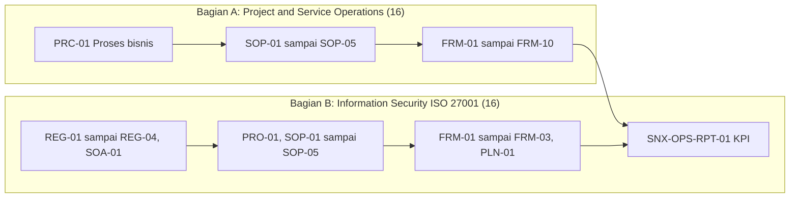

(Diturunkan dari teks; hubungan RPT-01 sebagai masukan dari FRM-01 sampai FRM-09 dan register mengikuti diagram RPT-01 dan butir Gap no 9. Panah antar kelompok SOP dan form adalah pengelompokan jenis dokumen, bukan alur resmi dari sumber.)

## 4. Peran, RACI, record, KPI

| Peran | Dokumen yang dimiliki (jumlah, dihitung dari tabel 2.1) |
|---|---|
| Head of Operation | 11: PRC-01, SOP-02, FRM-04, FRM-10, ISMS-REG-01, ISMS-SOP-02, ISMS-REG-04, ISMS-SOP-04, ISMS-PLN-01, ISMS-FRM-03, RPT-01 |
| Service Delivery Manager | 4: SOP-01, SOP-05, FRM-06, FRM-09 |
| Project Manager | 4: FRM-01, FRM-02, FRM-03, FRM-05 |
| Lead NOC | 6: SOP-03, SOP-04, FRM-07, FRM-08, ISMS-SOP-03, ISMS-FRM-01 |
| Lead SOC | 3: ISMS-SOP-01, ISMS-SOP-05, ISMS-FRM-02 |
| ISMS Coordinator | 4: ISMS-PRO-01, ISMS-REG-02, ISMS-REG-03, ISMS-SOA-01 |

Pemutus pada tabel Keputusan dan Gap: ISO/ISMS Coordinator (no 1), COO (no 2), ISMS Coordinator dan pemilik risiko (no 3), ISMS Coordinator (no 4, 9), Commercial dan Legal (no 5), Head of Operation (no 6, 7, 8).

Masa simpan record per dokumen (dari tabel 2.1): Berlaku sampai digantikan (kebijakan, SOP, rencana, register acuan); 3 tahun (FRM-04, FRM-07, FRM-08, FRM-09, RPT-01, ISMS REG-04, ISMS FRM-01); Durasi kontrak + 3 tahun (OPS FRM-01, FRM-02, FRM-03, FRM-05, ISMS FRM-03); Durasi kontrak + 5 tahun (OPS FRM-06); 5 tahun (OPS FRM-10, ISMS FRM-02). Target dan KPI tidak dimuat dokumen ini selain referensi target USULAN pada butir Gap no 2.

## 5. Catatan kualitas dan celah

- Status dokumen: setiap 32 baris tabel Master List kolom "Status" berisi "Draft rev 00" (baris no 1 sampai 32); judul sumber: "SNX-OPS-ML-00 · Revisi 00 (DRAFT) · 13 Oktober 2026 · RESTRICTED (Internal) · Disetujui oleh COO, Amirull Yusuf Zulkarnain". Penomoran usulan: "Penomoran SNX-<area>-<jenis>-<nn> adalah usulan" (subjudul) dan Keputusan no 1 berstatus Terbuka (pemutus ISO/ISMS Coordinator). Catatan: tulisan "Disetujui oleh COO" ada di subjudul, sedangkan status semua dokumen masih draft; sumber tidak menyebut tanggal persetujuan.
- Seluruh 9 butir bagian Keputusan dan Gap (no 1 sampai 9) berstatus "Terbuka"; kolom "Target" dan "Catatan" kosong pada ke-9 baris (sel-sel itu tampil sebagai dua koma kosong berurutan di teks konektor), jadi tidak ada tenggat atau penanggung jawab tanggal.
- Riwayat Review: 9 butir "Selesai" (no 1 sampai 9) dan 2 butir "Terbuka" (no 10 dan 11). No 10 (SNX-OPS-FRM-08): "Target Ack P3 (2 jam kerja) dan P4 (1 hari kerja) dihitung sebagai jam kalender di Excel"; tindakan: "Dibiarkan dengan catatan di sheet Target Severity". Sisi FRM-08 terbukti: sheet Target Severity ada di SNX-OPS-FRM-08 (lihat catatan FRM-08 bagian 5). No 11: "Target berlabel USULAN, penomoran dokumen, 45 kontrol SoA, dan celah prosedur A 8.15, 8.17, 8.20 sampai 8.22, 8.24" dengan tindakan "Lihat sheet Keputusan dan Gap".
- Angka yang dikutip ML-00 dan sudah dicocokkan ke sumber dokumen lain (cek ke biner xlsx di raw/ dengan openpyxl): "15 risiko usulan di SNX-ISMS-REG-02" cocok (sheet Register Risiko memuat 15 baris ISR-001 sampai ISR-015); "45 kontrol SoA berstatus Perlu keputusan" cocok (sheet SoA SNX-ISMS-SOA-01 memuat 45 sel "Perlu keputusan"); "8 supplier di SNX-ISMS-FRM-03" cocok (sheet Daftar Supplier memuat SUP-001 sampai SUP-008). Angka "280 titik" (Riwayat Review no 1, "Dikembalikan ke istilah Inggris ... (280 titik)") adalah hitungan penggantian istilah di seluruh paket 32 dokumen; tidak dapat dihitung ulang dari satu berkas, dicatat sebagai klaim sumber yang tidak diverifikasi.
- Penomoran: subjudul (A2) dan Keputusan no 1 (C4) menulis skema "SNX-<area>-<jenis>-<nn>" (fakta dari biner; md versi teks salah membaca penanda sebagai `<dept>` atau hilang). Nomor dokumen pada kolom "Nomor" berpola SNX-OPS-... (17 baris) dan SNX-ISMS-... (15 baris), sehingga segmen `<area>` bernilai OPS atau ISMS.
- Penempatan SNX-OPS-RPT-01: baris no 32 tabel Master List: Bagian "B. Information Security ISO 27001", Folder "B_Information_Security_ISO27001", padahal nomornya OPS (baris OPS lain no 1 sampai 16 ada di Bagian A dan Folder "A_Project_Service_Operations"). Metadata Google Drive (get_file_metadata, 13 Oktober 2026): parentId RPT-01 = 11V6YWsv0NSM3tVPt7SBZ6WlLuj8yNZsO, sedangkan FRM-02 dan FRM-10 memiliki parentId 1HJe8WE2BqIwoyDNG58l7ICj0euZPyp8m (hanya dua form OPS yang dicek metadatanya; klaim sebelumnya "lima form OPS" tidak terbukti dan dipersempit).
- SoA (baris no 21, SNX-ISMS-SOA-01): kolom Acuan ISO 9001:2015 "-" dan Acuan ISO/IEC 27001:2022 "6.1.3 d". Sisi SoA terbukti: sheet Kontrol Dokumen SoA sel B12 = "Klausul -" dan B13 = "Klausul atau kontrol Annex A 6.1.3 d".
- Acuan RPT-01 (baris no 32): ISO 9001 "9.1, 9.3.2" dan ISO 27001 "9.1". Sisi RPT-01 terbukti: sheet Kontrol Dokumen B12 = "Klausul 9.1, 9.3.2" dan B13 = "Klausul atau kontrol Annex A 9.1". Annex A ISO/IEC 27001:2022 bernomor 5.x sampai 8.x sehingga "Annex A 9.1" bukan kontrol yang ada; maksudnya kemungkinan klausul 9.1 (inferensi).
- Konsistensi lintas dokumen (diverifikasi dengan skrip, 13 Oktober 2026): untuk 17 baris yang punya berkas di md/ops (PRC-01, SOP-01 sampai SOP-05, FRM-01 sampai FRM-10, RPT-01), kolom Judul, Pemilik, Acuan ISO 9001, Acuan ISO 27001, dan Masa simpan sama dengan tabel Kontrol Dokumen masing-masing berkas (hasil: 17 dari 17 cocok). Baris ISMS (no 17 sampai 31) tidak dibandingkan di berkas ini kecuali SoA dan FRM-03 untuk angka di atas. POL-OPS-001 dan PRO-OPS-001 bukan baris tabel Master List (hanya muncul di tabel Keterkaitan).
- Tabel Keterkaitan, sisi POL-OPS-001 terbukti: "Memuat kebijakan umum, struktur, standar shift, severity, change, job desk, RACI, KPI" cocok dengan Bagian 4, 3, 5, 6, 7, 9, 10, 11 di POL-OPS-001. Sisi PRO-OPS-001 terbukti: "prosedur NOC, SOC, SDPM, CHG, SVC" cocok dengan kode prosedur NOC-01..06, SOC-01..05, SDPM-01..06, CHG-01, SVC-01 (ditambah SHF-01). Pernyataan usulan "isi severity dan change identik dengan SNX-OPS-SOP-02 dan SNX-OPS-SOP-04" tidak identik harfiah: Bagian 7 POL memuat 4 jenis change, SOP-02 memuat 5 (menambah Proyek), dan SOP-04 menambah kolom "Target pulih (USULAN)" yang tidak ada di tabel severity POL Bagian 6. Baris ketiga (knowledge base SINUX: ops-frontline, prod-ops-gate, incident-rca, ir-report, backup-snapshot-ops) tidak diperiksa terhadap repositori KB.
- Jumlah dokumen per format di Riwayat Review ("seluruh 32 dokumen (16 Word, 16 Excel)") cocok dengan kolom Format di tabel Master List (16 Word, 16 Excel).
- Berkas ini kini dibaca dari biner xlsx: nama 4 sheet, koordinat sel, freeze pane, autofilter, data validation (Keputusan dan Gap D4:D12) dan conditional formatting terverifikasi; tidak ada rumus, merged cell, atau komentar. Sebelumnya (versi hanya teks konektor) nama sheet hanya inferensi. Catatan ketidakkonsistenan kecil: dropdown Status hanya ada di sheet Keputusan dan Gap, sedangkan kolom Status di Riwayat Review (E5:E15) dan Master List (K5:K36) bebas isi tanpa validasi.
- Tidak ada kredensial atau data pribadi sensitif; satu-satunya nama orang adalah COO (Amirull Yusuf Zulkarnain) di subjudul.

## 6. Kata kunci retrieval
master list dokumen, daftar induk dokumen, Divisi Operation, SNX-OPS, SNX-ISMS, 32 dokumen, ISO 9001:2015, ISO/IEC 27001:2022, Annex A, SOP, FRM, REG, PLN, SOA, SoA, masa simpan record, retention, pemilik dokumen, Keterkaitan, POL-OPS-001, PRO-OPS-001, keputusan dan gap, riwayat review, target USULAN, RTO RPO, bukti penerapan audit tahap 2, audit internal, tinjauan manajemen, penomoran dokumen, SNX-OPS-ML-00

<!-- FILE: ops/SNX-OPS-PRC-01.md -->

---
doc_code: SNX-OPS-PRC-01
title: Operations Business Process Flow
department: Operation
doc_type: lainnya (peta proses bisnis / business process flow)
source: {drive_file_id: 15GrP-ihMm6MC5szQqlAgGlmWjnQ5TmH0, filename: SNX-OPS-PRC-01_Operations_Business_Process_Flow.docx, format: docx, bytes: 342402, retrieved: 2026-10-13}
revision: 00 (DRAFT)
doc_date: 13 Oktober 2026 (tanggal draft); tanggal efektif ditetapkan saat pengesahan
classification_in_doc: RESTRICTED (Internal)
owner_in_doc: Head of Operation
approver_in_doc: COO, Amirull Yusuf Zulkarnain (Disetujui oleh; status "Menunggu"); Diperiksa oleh ISO/ISMS Coordinator
iso_refs: {iso9001: ["4.4", "8.1", "8.2", "8.5", "8.6", "8.7", "9.1", "10.2"], iso27001: ["4.4", "6.1", "8.1", "9.1", "Annex A 5.37"]}
kb_sensitivity_suggest: restricted:ops
related_docs: [POL-OPS-001, PRO-OPS-001, SNX-OPS-ML-00, SNX-OPS-SOP-01, SNX-OPS-SOP-02, SNX-OPS-SOP-03, SNX-OPS-SOP-04, SNX-OPS-SOP-05, SNX-OPS-FRM-01, SNX-OPS-FRM-02, SNX-OPS-FRM-03, SNX-OPS-FRM-04, SNX-OPS-FRM-05, SNX-OPS-FRM-06, SNX-OPS-FRM-07, SNX-OPS-FRM-08, SNX-OPS-FRM-09, SNX-OPS-FRM-10, SNX-OPS-RPT-01, SNX-ISMS-PRO-01, SNX-ISMS-REG-01, SNX-ISMS-REG-02, SNX-ISMS-REG-03, SNX-ISMS-REG-04, SNX-ISMS-SOA-01, SNX-ISMS-SOP-01, SNX-ISMS-SOP-02, SNX-ISMS-SOP-03, SNX-ISMS-SOP-04, SNX-ISMS-SOP-05, SNX-ISMS-FRM-01, SNX-ISMS-FRM-02, SNX-ISMS-FRM-03, SNX-ISMS-PLN-01]
coverage: {sections_or_sheets: "9 dari 9 bagian bernomor plus Riwayat revisi dan Pengesahan", tables: 7, images: "2 dibuka dari 2", notes: "Tidak ada celah baca. Stats mesin melaporkan tables=30 karena menghitung separator kolom; jumlah tabel riil 7 (hitungan baris pemisah tabel pada text.md sumber). Dua baris riwayat revisi sama-sama bernomor 00 bertanggal 13 Oktober 2026."}
---
# SNX-OPS-PRC-01 Operations Business Process Flow

## 1. Ringkasan (maks 6 butir, fakta)
- Memetakan proses bisnis Divisi Operation SINUX dari kontrak ditandatangani sampai layanan berjalan, diukur, dan diperbaiki; menjadi rujukan pendekatan proses ISO 9001:2015 klausul 4.4 dan perencanaan operasional ISO/IEC 27001:2022 klausul 8.1.
- Delapan proses inti (SIPOC): Penjualan dan kontrak, Perencanaan proyek, Implementasi dan delivery, UAT verifikasi serah terima, Operasi layanan 24/7, Pemantauan SLA, Pengukuran kinerja, Perbaikan; tiap proses punya pemilik, input, output, pelanggan proses, prosedur, dan record bukti.
- Serah terima Sales sampai Operation melewati 3 gate (G1 Kick-off, G2 UAT dan BAST, G3 Serah terima operasi) dengan pemilik gate: Service Delivery Manager, Project Manager, Head of Operation. Operation berhak menolak G3 secara tertulis.
- Memetakan 9 proses pendukung ISMS dan 8 sistem pendukung operasi (Zammad, GLPI Service Hub, Nusametric, Overseer, Wazuh, AegisWAF, Cloudflare, Acronis, Jumphost, vault, Google Drive).
- Status 00 (DRAFT) tanggal 13 Oktober 2026; persetujuan COO "Menunggu"; klasifikasi RESTRICTED (Internal).
- Banyak kode form/SOP/record dirujuk (SNX-OPS-FRM-01 sampai 10, SNX-OPS-RPT-01, SNX-ISMS-*) yang di luar batch ini.

## 2. Isi lengkap terstruktur

### Atribut dokumen

| Atribut | Isi |
|---|---|
| Nomor dokumen | SNX-OPS-PRC-01 |
| Judul | Operations Business Process Flow |
| Revisi | 00 (DRAFT) |
| Tanggal draft | 13 Oktober 2026 |
| Tanggal efektif | Ditetapkan saat pengesahan |
| Klasifikasi | RESTRICTED (Internal) |
| Pemilik dokumen | Head of Operation |
| Disetujui oleh | COO, Amirull Yusuf Zulkarnain |
| Acuan ISO 9001:2015 | Klausul 4.4, 8.1, 8.2, 8.5 |
| Acuan ISO/IEC 27001:2022 | Klausul atau kontrol Annex A 4.4, 8.1 |
| Masa simpan record | Berlaku sampai digantikan |

### Riwayat revisi

| Revisi | Tanggal | Uraian perubahan | Disusun | Disetujui |
|---|---|---|---|---|
| 00 | 13 Oktober 2026 | Draft awal untuk sertifikasi ISO 9001:2015 dan ISO/IEC 27001:2022 | Divisi Operation | Menunggu |
| 00 | 13 Oktober 2026 | Review bahasa dan konsistensi: istilah teknologi dalam bahasa Inggris, bahasa Indonesia formal, label klasifikasi, keselarasan RTO dan target pulih | Divisi Operation | Menunggu |

### 1. Tujuan
Memetakan proses bisnis Divisi Operation SINUX, dari kontrak ditandatangani sampai layanan berjalan, diukur, dan diperbaiki. Peta menjadi rujukan pendekatan proses ISO 9001:2015 klausul 4.4 dan perencanaan operasional ISO/IEC 27001:2022 klausul 8.1. Setiap tahap menyebut pemilik, input, output, dan record yang menjadi bukti audit.

### 2. Ruang lingkup
Berlaku untuk seluruh layanan yang dikelola Divisi Operation (NOC, SOC, serta Service Delivery dan Project Management):
- Nusagrid Public Cloud dan Private Cloud (IaaS, VM, storage).
- Managed services infrastruktur, termasuk fleet WHM dan cPanel pelanggan pemerintah.
- Backup dan DR berbasis Acronis.
- Observability Nusametric dan monitoring Overseer.
- Security operations (SOC 24/7), WAF (AegisWAF, Cloudflare), dan SIEM (Wazuh).
- Proyek implementasi dan migrasi untuk pelanggan.

Di luar ruang lingkup: app-level pelanggan (isi aplikasi, plugin, database aplikasi, kode pelanggan), keputusan harga dan komersial, serta SOC yang menurut kontrak menjadi tanggung jawab pelanggan.

### 3. Referensi
- ISO 9001:2015 klausul 4.4, 8.1, 8.2, 8.5, 8.6, 8.7, 9.1, 10.2.
- ISO/IEC 27001:2022 klausul 4.4, 6.1, 8.1, 9.1 dan Annex A 5.37 (documented operating procedures).
- POL-OPS-001 Kebijakan Divisi Operation SINUX dan PRO-OPS-001 Prosedur Operasional Divisi Operation SINUX.
- Seluruh dokumen pada master list SNX-OPS-ML-00.

### 4. Peta proses tingkat atas
Diagram: lihat Bagian 3.1. Teks sumber: proses inti berjalan dari kiri atas ke kiri bawah. Tahap 4 dan 5 ditandai biru karena di sinilah tanggung jawab berpindah dari proyek ke operasi. Garis putus-putus menunjukkan siklus perbaikan berkelanjutan (PDCA): hasil pengukuran dan RCA kembali ke operasi harian dan ke perencanaan proyek berikutnya.

### 5. Uraian proses (SIPOC)

| No | Proses | Pemilik | Input utama | Output utama | Pelanggan proses | Prosedur | Record bukti |
|---|---|---|---|---|---|---|---|
| 1 | Penjualan dan kontrak | Commercial (VP Commercial) | Kebutuhan pelanggan, sizing teknis | PO atau kontrak, scope, SLA | SD dan PM | Prosedur Commercial | Kontrak, paket handover G1 |
| 2 | Perencanaan proyek | Project Manager | Paket G1, kontrak | Project plan, scope, timeline, risk register | Tim implementasi | SNX-OPS-SOP-01 | SNX-OPS-FRM-01, SNX-OPS-FRM-02 |
| 3 | Implementasi dan delivery | Project Manager | Project plan, change request | Layanan terpasang, laporan progres | Pelanggan, NOC, SOC | SNX-OPS-SOP-01, SNX-OPS-SOP-02 | SNX-OPS-FRM-03, SNX-OPS-FRM-04 |
| 4 | UAT, verifikasi, serah terima | Service Delivery Manager | Layanan terpasang, kriteria uji | UAT lolos, BAST, serah terima ke Operation | Pelanggan, Operation | SNX-OPS-SOP-01 | SNX-OPS-FRM-05, SNX-OPS-FRM-06 |
| 5 | Operasi layanan 24/7 | Head of Operation (Lead NOC, Lead SOC) | Layanan BAU, alert, tiket | Layanan tersedia, tiket selesai, maintenance terlaksana | Pelanggan | SNX-OPS-SOP-03, SNX-OPS-SOP-04, SNX-ISMS-SOP-01 | SNX-OPS-FRM-07, SNX-OPS-FRM-08, SNX-ISMS-FRM-02 |
| 6 | Pemantauan SLA | Service Delivery Manager | Data monitoring dan tiket | Laporan SLA bulanan | Pelanggan, manajemen | SNX-OPS-SOP-05 | SNX-OPS-FRM-09 |
| 7 | Pengukuran kinerja | Head of Operation | Laporan SLA, tiket, change, backup | Laporan KPI, masukan tinjauan manajemen | COO, manajemen | SNX-OPS-SOP-05 | SNX-OPS-RPT-01 |
| 8 | Perbaikan | Head of Operation | Insiden P1 dan P2, temuan audit, KPI di bawah target | RCA, tindakan korektif, risiko diperbarui | Semua proses | SNX-OPS-SOP-04 | SNX-OPS-FRM-10, SNX-ISMS-REG-02 |

### 6. Alur serah terima Sales sampai Operation
Diagram: lihat Bagian 3.2. Setiap deal baru berpindah tangan tiga kali. Tiap perpindahan wajib lolos gate tertulis:

| Gate | Dari | Ke | Pemilik gate | Bukti |
|---|---|---|---|---|
| G1 Kick-off | Commercial | SD dan PM | Service Delivery Manager | Checklist G1 pada SNX-OPS-FRM-01 |
| G2 UAT dan BAST | SD dan PM | Pelanggan | Project Manager | SNX-OPS-FRM-05, BAST pada SNX-OPS-FRM-06 |
| G3 Serah terima operasi | SD dan PM | NOC dan SOC | Head of Operation | Checklist G3 pada SNX-OPS-FRM-06 |

Operation berhak menolak serah terima G3 secara tertulis bila checklist belum lengkap. Selama G3 belum lolos, layanan berstatus hypercare dengan pemilik SD dan PM.

### 7. Interaksi dengan proses pendukung

| Proses pendukung | Dokumen | Keterkaitan dengan proses inti |
|---|---|---|
| Klasifikasi dan penanganan informasi | SNX-ISMS-PRO-01 | Label dokumen proyek, BAST, laporan, dan record operasi |
| Inventaris aset dan konfigurasi | SNX-ISMS-REG-01, SNX-ISMS-SOP-04 | Aset baru didaftarkan sebelum G3; perubahan konfigurasi melalui SNX-OPS-SOP-02 |
| Penilaian dan penanganan risiko | SNX-ISMS-REG-02, SNX-ISMS-REG-03, SNX-ISMS-SOA-01 | Risiko proyek berat dan temuan RCA dinaikkan ke register risiko ISMS |
| Kontrol akses | SNX-ISMS-SOP-02, SNX-ISMS-REG-04 | Akses pelanggan dibuat saat onboarding dan dicabut saat offboarding |
| Backup dan pemulihan | SNX-ISMS-SOP-03, SNX-ISMS-FRM-01 | Backup aktif dan restore teruji adalah syarat G3 |
| Vulnerability dan patch | SNX-ISMS-SOP-05 | Patch dieksekusi sebagai change atau preventive maintenance |
| Insiden keamanan | SNX-ISMS-SOP-01, SNX-ISMS-FRM-02 | Insiden teknis berindikasi keamanan diserahkan ke SOC |
| Kelangsungan layanan | SNX-ISMS-PLN-01 | Skenario gangguan besar dan target pemulihan layanan |
| Evaluasi supplier | SNX-ISMS-FRM-03 | Upstream infra, partner SOC, dan vendor lisensi dievaluasi berkala |

### 8. Sistem pendukung operasi

| Fungsi | Sistem | Catatan |
|---|---|---|
| Tiket pelanggan Nusagrid | Zammad (integrasi WhatsApp dan telepon) | Ticketing system untuk layanan Nusagrid |
| Tiket GMF dedicated dan permintaan internal | SINUX Service Hub (GLPI, ticket.sinux.co.id) | Termasuk change request dan Shift Log |
| Monitoring availability | Nusametric, Overseer, console Nusagrid | Sumber data SLA |
| Monitoring keamanan | Wazuh, AegisWAF, Cloudflare, EDR | Sumber data SOC |
| Backup | Acronis Cyber Protect | Sumber data backup log |
| Akses production | Jumphost SINUX ter-audit | Rekam sesi untuk audit akses |
| Penyimpanan kredensial | Password manager internal (vault) | Kredensial tidak pernah di chat, tiket, atau dokumen |
| Dokumen dan record | Google Drive SINUX, terkendali sesuai SNX-ISMS-PRO-01 | Master record mengikuti masa simpan di tiap dokumen |

### 9. Pengendalian proses
1. Setiap proses punya pemilik yang bertanggung jawab atas kinerja dan dokumennya (Bagian 5).
2. Kinerja proses diukur bulanan melalui SNX-OPS-RPT-01 dan dibahas dalam tinjauan manajemen.
3. Perubahan pada proses ini diajukan ke Head of Operation, dikaji dampaknya terhadap SLA dan keamanan informasi, lalu disahkan COO sebelum dokumen direvisi.
4. Ketidaksesuaian proses (gate dilewati, record tidak lengkap, SLA terlewat berulang) ditangani melalui SNX-OPS-FRM-10.

### Pengesahan

| Peran | Nama dan jabatan | Tanda tangan | Tanggal |
|---|---|---|---|
| Disusun oleh | Head of Operation | (kosong) | (kosong) |
| Diperiksa oleh | ISO/ISMS Coordinator | (kosong) | (kosong) |
| Disetujui oleh | COO, Amirull Yusuf Zulkarnain | (kosong) | (kosong) |

## 3. Diagram

### 3.1 Peta proses operasi SINUX (gambar 1)
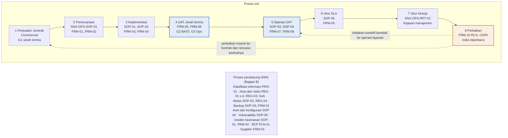
Deskripsi: judul gambar "Kebutuhan pelanggan menjadi layanan yang diukur dan diperbaiki", subjudul "Peta proses operasi SINUX: proses inti (atas dan tengah) ditopang proses pendukung ISMS (bawah)". Baris atas berisi kotak 1 sampai 4 dari kiri ke kanan, panah turun dari kotak 4 ke kotak 5 di kanan baris tengah, lalu baris tengah berjalan ke kiri: 5, 6, 7, 8. Kotak 4 dan 5 berwarna biru (titik pindah tanggung jawab proyek ke operasi), kotak 8 berwarna oranye. Dua garis putus-putus keluar dari kotak 8: ke atas ke kotak 1 berlabel "perbaikan masuk ke kontrak dan rencana berikutnya", dan ke kotak 5 berlabel "tindakan korektif kembali ke operasi layanan". Kotak abu-abu di bawah memuat daftar proses pendukung ISMS. Tata letak dua baris pada gambar disederhanakan menjadi satu baris pada mermaid; urutan panah setia ke gambar.
Sumber gambar: conv/15GrP-ihMm6MC5szQqlAgGlmWjnQ5TmH0/img/media/rId23.png

### 3.2 Flow Sales sampai Operation (gambar 2)

Deskripsi: swimlane empat jalur (Commercial, Tech dan Product, SD dan PM, Operation), judul "Deal baru menjadi layanan BAU setelah lolos tiga gate". Isi dan urutan identik dengan gambar flow di PRO-OPS-001 (SVC-01): dari Lead masuk sampai Laporan bulanan, tiga kotak gate biru (G1, G2, G3), cabang "tidak: nego ulang" kembali ke Proposal dan quote. Tidak ada cabang lost pada gambar. Teks Bagian 6 menyatakan G3 tidak lolos berarti hypercare di bawah pemilik SD dan PM, sedangkan gambar menempatkan Hypercare setelah G3.
Sumber gambar: conv/15GrP-ihMm6MC5szQqlAgGlmWjnQ5TmH0/img/media/rId28.png

## 4. Peran, RACI, record, KPI
- Pemilik proses (Bagian 5): Commercial (VP Commercial) untuk proses 1; Project Manager untuk 2 dan 3; Service Delivery Manager untuk 4 dan 6; Head of Operation (Lead NOC, Lead SOC) untuk 5; Head of Operation untuk 7 dan 8.
- Pemilik gate: lihat tabel Bagian 6. Pembuat dokumen: Head of Operation; pemeriksa: ISO/ISMS Coordinator; penyetuju: COO Amirull Yusuf Zulkarnain. Tidak ada nama untuk Head of Operation maupun ISO/ISMS Coordinator.
- Record bukti per proses: tabel SIPOC (FRM-01 sampai FRM-10, RPT-01, REG-02, ISMS-FRM-02). Masa simpan record: "Berlaku sampai digantikan" (atribut dokumen).
- KPI: tidak ada angka KPI di dokumen; hanya menyebut pengukuran bulanan via SNX-OPS-RPT-01 dan tinjauan manajemen (Bagian 9).

## 5. Catatan kualitas dan celah (fakta terukur saja)
1. Status DRAFT revisi 00; kolom Disetujui "Menunggu"; tanda tangan dan tanggal pengesahan kosong; dua baris riwayat revisi sama-sama bernomor 00 dengan tanggal sama. Sumber: tabel atribut (Revisi "00 (DRAFT)"), tabel Riwayat revisi (dua baris "00 | 13 Oktober 2026 | ... | Divisi Operation | Menunggu"), tabel Pengesahan (kolom Tanda tangan dan Tanggal kosong).
2. Label ISO di atribut dokumen: baris "Acuan ISO/IEC 27001:2022" berbunyi "Klausul atau kontrol Annex A 4.4, 8.1", tetapi Bagian 3 menulis "ISO/IEC 27001:2022 klausul 4.4, 6.1, 8.1, 9.1 dan Annex A 5.37". Angka 4.4 dan 8.1 adalah klausul utama, bukan nomor kontrol Annex A (inferensi dari struktur standar).
3. Pada tabel SIPOC Bagian 5, proses 1 (Penjualan dan kontrak) kolom Prosedur tertulis "Prosedur Commercial" tanpa kode dokumen. Proses 2 merujuk SNX-OPS-SOP-01 (dokumen ada, md/ops/SNX-OPS-SOP-01.md, judul "SOP Project Management & Delivery" per tabel atribut sumbernya).
4. Tabel SIPOC proses 5 (Operasi layanan 24/7) kolom Prosedur: "SNX-OPS-SOP-03, SNX-OPS-SOP-04, SNX-ISMS-SOP-01"; proses 6 dan 7 merujuk SNX-OPS-SOP-05. Lintas dokumen (judul dari tabel atribut sumber masing-masing): SNX-OPS-SOP-03 berjudul "SOP Preventive & Corrective Maintenance", SNX-OPS-SOP-04 "SOP Technical Incident Handling & Escalation", SNX-OPS-SOP-05 "SOP Service Level Agreement (SLA) Monitoring". Judul SOP-03 tidak memuat "operasi layanan 24/7" (inferensi: pemetaan proses 5 ke SOP-03 bersifat longgar).
5. Dokumen ini tidak merujuk kode prosedur PRO-OPS-001 (pencarian "SHF-01", "NOC-0", "SOC-0", "SDPM", "CHG-01", "SVC-01" di sumber: nol hasil) walaupun Bagian 3 mencantumkan "PRO-OPS-001 Prosedur Operasional Divisi Operation SINUX". Dua skema kode berjalan paralel (POL/PRO dan SNX-OPS-SOP/FRM) (inferensi).
6. Sistem tiket: Bagian 8 baris pertama "Tiket pelanggan Nusagrid | Zammad (integrasi WhatsApp dan telepon)", baris kedua "Tiket GMF dedicated dan permintaan internal | SINUX Service Hub (GLPI, ticket.sinux.co.id)". Lintas dokumen: POL-OPS-001 Bagian 4 P-08 menetapkan "Semua permintaan dan insiden tercatat sebagai tiket di SINUX Service Hub (GLPI, ticket.sinux.co.id)" tanpa menyebut Zammad.
7. Pemilik proses 4 (UAT, verifikasi, serah terima) di SIPOC: "Service Delivery Manager". Bagian 6 tabel gate: G1 pemilik "Service Delivery Manager", G2 "Project Manager", G3 "Head of Operation". Lintas dokumen: POL-OPS-001 Bagian 8 tabel gate memuat pemilik yang sama (G1 Service Delivery Manager, G2 Project Manager, G3 Head of Operation), jadi konsisten dengan POL. Proses 4 yang dimiliki SDM mencakup serah terima, padahal pemilik G2 dan G3 pada tabel yang sama adalah PM dan Head of Operation.
8. Frasa "keselarasan RTO dan target pulih" pada baris kedua riwayat revisi tidak punya isi: pencarian "RTO" dan "RPO" di sumber hanya menemukan frasa itu sendiri.
9. Hypercare: Bagian 6 (teks di bawah tabel gate) menulis "Selama G3 belum lolos, layanan berstatus hypercare dengan pemilik SD dan PM", sedangkan gambar Bagian 6 (rId28) menaruh kotak "Hypercare, 2 minggu, usulan" setelah kotak "G3 Serah terima". Label "usulan" hanya ada di gambar, tidak di teks.
10. Klasifikasi tertulis "RESTRICTED (Internal)" (tabel atribut); lintas dokumen: POL-OPS-001 dan PRO-OPS-001 menulis "RESTRICTED (internal, restricted:ops)" pada tabel Kontrol dokumen masing-masing.

## 6. Kata kunci retrieval
peta proses bisnis, business process flow, SNX-OPS-PRC-01, SIPOC, proses inti Operation, Sales ke Operation, gate G1 G2 G3, pemilik gate, handover, hypercare, BAU, pendekatan proses ISO 9001 4.4, perencanaan operasional ISO 27001 8.1, Annex A 5.37, PDCA, perbaikan berkelanjutan, RCA CAPA, SNX-OPS-FRM-01 sampai FRM-10, SNX-OPS-RPT-01, proses pendukung ISMS, sistem pendukung operasi, Zammad, GLPI Service Hub, Nusametric, Overseer, Wazuh, AegisWAF, Cloudflare, Acronis Cyber Protect, Jumphost, vault, Google Drive, pengendalian proses

<!-- FILE: ops/SNX-OPS-RPT-01.md -->

---
doc_code: SNX-OPS-RPT-01
title: Operations KPI & Performance Monitoring Report
department: Operation
doc_type: Laporan
source: {drive_file_id: 1rSuMH8wK5BTGUHLm8KjGig1LZOKWcECO, filename: SNX-OPS-RPT-01_Operations_KPI_Performance_Report.xlsx, format: xlsx, bytes: 110990, retrieved: 2026-10-13}
revision: 00 (DRAFT)
doc_date: 13 Oktober 2026
classification_in_doc: RESTRICTED (Internal)
owner_in_doc: Head of Operation
approver_in_doc: COO, Amirull Yusuf Zulkarnain
iso_refs: {iso9001: ["9.1", "9.3.2"], iso27001: ["9.1 (tertulis sebagai Annex A 9.1 di sumber)"]}
kb_sensitivity_suggest: restricted:ops
related_docs: [SNX-OPS-FRM-01, SNX-OPS-FRM-04, SNX-OPS-FRM-07, SNX-OPS-FRM-08, SNX-OPS-FRM-09, SNX-OPS-FRM-10, SNX-ISMS-FRM-01, SNX-ISMS-FRM-02, SNX-ISMS-REG-03, SNX-ISMS-REG-04]
coverage: {sections_or_sheets: "4 dari 4", tables: 7, images: "1 dibuka dari 1", notes: "Seluruh 17 KPI dicatat. Sumber TIDAK memuat kolom definisi, rumus numerator/denominator, frekuensi, atau pemilik per KPI; kolom yang ada: Sub divisi, KPI, Arah, Target, Sumber. Nilai bulanan Jan sampai Des kosong (belum ada data aktual)."}
---
# SNX-OPS-RPT-01 Operations KPI & Performance Monitoring Report

## 1. Ringkasan
- Laporan bulanan KPI dan kinerja Divisi Operation; masukan pemantauan klausul 9.1 dan tinjauan manajemen klausul 9.3.2.
- Sheet KPI memuat 17 KPI: NOC (6), SOC (4), SD dan PM (4), ISMS (2), Semua (1), dengan arah (≥ atau ≤), target, dan sumber data; tahun 2027, kolom Januari sampai Desember.
- Nilai aktual bulan sebelumnya diisi setiap awal bulan; persentase ditulis sebagai pecahan (0,95 = 95%). Status memakai nilai bulan terakhir (Tercapai, Di bawah target, atau Belum diukur); rata-rata YTD dihitung otomatis; sel bulan merah berarti di bawah target.
- Target adalah target awal dan dikalibrasi setelah 3 bulan data (cara pakai no. 5).
- Sheet Narasi Bulanan berisi 13 butir ringkasan untuk COO dan tinjauan manajemen (kosong, diisi per bulan).
- Status isi: template dengan 17 KPI dan target terisi, tanpa nilai aktual; bukan data realisasi. Frekuensi pelaporan bulanan; pemilik per KPI tidak tertulis.

## 2. Isi lengkap terstruktur

### 2.1 Sheet "Kontrol Dokumen"

| Atribut | Nilai |
|---|---|
| Judul sheet | Operations KPI & Performance Monitoring Report |
| Organisasi | PT Strategi Integrasi Nusantara (SINUX) · Divisi Operation |
| Nomor dokumen | SNX-OPS-RPT-01 |
| Revisi | 00 (DRAFT) |
| Tanggal draft | 13 Oktober 2026 |
| Tanggal efektif | Ditetapkan saat pengesahan |
| Klasifikasi | RESTRICTED (Internal) |
| Pemilik dokumen | Head of Operation |
| Disetujui oleh | COO, Amirull Yusuf Zulkarnain |
| Acuan ISO 9001:2015 | Klausul 9.1, 9.3.2 |
| Acuan ISO/IEC 27001:2022 | Klausul atau kontrol Annex A 9.1 |
| Masa simpan record | 3 tahun |
| Tujuan | Laporan bulanan KPI dan kinerja Divisi Operation, masukan pemantauan klausul 9.1 dan tinjauan manajemen klausul 9.3.2. |

Cara pakai (verbatim):
1. Isi tahun di sheet KPI sel B3.
2. Setiap awal bulan, isi nilai aktual bulan sebelumnya dari sumber data di kolom Sumber. Persentase ditulis sebagai pecahan (0.95 = 95%).
3. Status bulan terakhir dan rata-rata tahun berjalan dihitung otomatis; sel bulan merah berarti di bawah target.
4. Isi sheet Narasi Bulanan sebagai ringkasan untuk COO dan bahan tinjauan manajemen.
5. Target adalah target awal dan dikalibrasi setelah 3 bulan data.

Legenda warna: sel input = diisi pengguna; baris CONTOH = hapus atau timpa saat dipakai; sel rumus = jangan diubah.

Riwayat revisi:

| Revisi | Tanggal | Uraian perubahan | Disusun | Disetujui |
|---|---|---|---|---|
| 00 | 13 Oktober 2026 | Draft awal untuk sertifikasi ISO 9001 dan ISO/IEC 27001 | Divisi Operation | Menunggu |
| 00 | 13 Oktober 2026 | Review bahasa dan konsistensi: istilah teknologi dalam bahasa Inggris, bahasa Indonesia formal, label klasifikasi, keselarasan RTO dan target pulih | Divisi Operation | Menunggu |

Pengesahan:

| Peran | Nama dan jabatan | Tanda tangan | Tanggal |
|---|---|---|---|
| Disusun oleh | Head of Operation | (kosong) | (kosong) |
| Diperiksa oleh | ISO/ISMS Coordinator | (kosong) | (kosong) |
| Disetujui oleh | COO, Amirull Yusuf Zulkarnain | (kosong) | (kosong) |

### 2.2 Sheet "Alur Proses"
Judul "Diagram alur proses"; legenda warna standar (biru = output akhir, oranye = cabang ke tindakan atau prosedur lain, putus-putus = kembali ke alur utama). Gambar di bagian 3. Sheet ini tidak memiliki sheet "Daftar" (tidak ada dropdown di workbook ini).

### 2.3 Sheet "KPI" (A1:U24) , DAFTAR KPI LENGKAP
Judul "Operations KPI dan performance monitoring". Tahun (B3) = 2027.

Kolom (header baris 5): No; Sub divisi; KPI; Arah; Target; Sumber; Jan, Feb, Mar, Apr, Mei, Jun, Jul, Agu, Sep, Okt, Nov, Des (nilai aktual bulanan, input, kosong); Rata-rata YTD (RUMUS); Bulan terakhir (RUMUS); Status (RUMUS).

Seluruh 17 KPI (verbatim dari sumber; persentase target ditulis 0,xx = xx%):

| No | Sub divisi | KPI (nama/definisi tertulis) | Arah | Target | Sumber data | Frekuensi | Pemilik KPI |
|---|---|---|---|---|---|---|---|
| 1 | NOC | Availability layanan yang dikelola | ≥ | 0,999 (99,9%) | SNX-OPS-FRM-09 | Bulanan | Tidak tertulis per KPI (sub divisi NOC) |
| 2 | NOC | Tiket P1 dan P2 di-ack dalam target | ≥ | 0,95 (95%) | SNX-OPS-FRM-08 | Bulanan | Tidak tertulis per KPI (sub divisi NOC) |
| 3 | NOC | Backup job sukses | ≥ | 0,98 (98%) | SNX-ISMS-FRM-01 | Bulanan | Tidak tertulis per KPI (sub divisi NOC) |
| 4 | NOC | Uji restore berhasil | ≥ | 0,95 (95%) | SNX-ISMS-FRM-01 | Bulanan | Tidak tertulis per KPI (sub divisi NOC) |
| 5 | NOC | Kepatuhan jadwal preventive maintenance | ≥ | 0,95 (95%) | SNX-OPS-FRM-07 | Bulanan | Tidak tertulis per KPI (sub divisi NOC) |
| 6 | NOC | Change tanpa rollback darurat | ≥ | 0,95 (95%) | SNX-OPS-FRM-04 | Bulanan | Tidak tertulis per KPI (sub divisi NOC) |
| 7 | SOC | Alert kritis di-triage dalam 15 menit | ≥ | 0,95 (95%) | SIEM, SNX-ISMS-FRM-02 | Bulanan | Tidak tertulis per KPI (sub divisi SOC) |
| 8 | SOC | Vulnerability Darurat dan Kritis ditutup dalam tenggat | ≥ | 0,95 (95%) | Tiket vulnerability | Bulanan | Tidak tertulis per KPI (sub divisi SOC) |
| 9 | SOC | Laporan IR tepat waktu dan sesuai format | ≥ | 1 (100%) | SNX-ISMS-FRM-02 | Bulanan | Tidak tertulis per KPI (sub divisi SOC) |
| 10 | SOC | Insiden keamanan berulang dengan akar sama | ≤ | 0 | SNX-ISMS-FRM-02 | Bulanan | Tidak tertulis per KPI (sub divisi SOC) |
| 11 | SD dan PM | Laporan SLA terkirim hari kerja ke-5 | ≥ | 1 (100%) | SNX-OPS-FRM-09 | Bulanan | Tidak tertulis per KPI (sub divisi SD dan PM) |
| 12 | SD dan PM | Proyek selesai sesuai jadwal baseline | ≥ | 0,8 (80%) | SNX-OPS-FRM-01 | Bulanan | Tidak tertulis per KPI (sub divisi SD dan PM) |
| 13 | SD dan PM | Onboarding live sesuai tanggal kontrak | ≥ | 0,9 (90%) | SNX-OPS-FRM-01 | Bulanan | Tidak tertulis per KPI (sub divisi SD dan PM) |
| 14 | SD dan PM | RCA P1 dan P2 terkirim dalam 2 hari kerja | ≥ | 1 (100%) | SNX-OPS-FRM-10 | Bulanan | Tidak tertulis per KPI (sub divisi SD dan PM) |
| 15 | ISMS | Review akses privileged triwulanan terlaksana | ≥ | 1 (100%) | SNX-ISMS-REG-04 | Bulanan (kolom bulanan; kegiatan triwulanan) | Tidak tertulis per KPI (sub divisi ISMS) |
| 16 | ISMS | Tindakan risk treatment selesai sesuai target | ≥ | 0,9 (90%) | SNX-ISMS-REG-03 | Bulanan | Tidak tertulis per KPI (sub divisi ISMS) |
| 17 | Semua | Serah terima shift ditandai diterima | ≥ | 1 (100%) | Shift Log | Bulanan | Tidak tertulis per KPI (semua sub divisi) |

Catatan kolom "Frekuensi": sumber hanya menyediakan kolom Jan sampai Des dan perintah "Setiap awal bulan, isi nilai aktual bulan sebelumnya", sehingga frekuensi pelaporan = bulanan (dasar tertulis). Kolom "Pemilik KPI": sumber hanya punya kolom Sub divisi; pemilik dokumen laporan adalah Head of Operation.

Definisi operasional (numerator/denominator): TIDAK tertulis di sumber. Dalam tabel berikut kolom "Rumus indikator" adalah inferensi dari nama KPI dan kolom Sumber, bukan teks sumber.

| No | Rumus indikator (inferensi) | Keterkaitan ke sumber (fakta) |
|---|---|---|
| 1 | Availability = 1 - downtime dihitung / menit dalam bulan | Laporan Bulanan FRM-09 kolom Availability (rumus tertulis di FRM-09) |
| 2 | Tiket P1 dan P2 di-ack sesuai target / total tiket P1 dan P2 | Ringkasan FRM-08 baris 11 "P1 dan P2 di-ack sesuai target (KPI 95%)" |
| 3 | Backup job sukses / total backup job | Sumber SNX-ISMS-FRM-01 (di luar batch) |
| 4 | Uji restore berhasil / total uji restore | SNX-ISMS-FRM-01 (di luar batch) |
| 5 | Kepatuhan PM = Selesai / (R+S+T) | FRM-07 Jadwal PM sel Kepatuhan keseluruhan (rumus tertulis di FRM-07); ambang 95% selaras dengan diagram FRM-07 |
| 6 | 1 - Rollback / Jumlah change | FRM-04 Ringkasan kolom "Tanpa rollback darurat (%)" (rumus 1 - Rollback/Jumlah) |
| 7 | Alert kritis di-triage dalam 15 menit / total alert kritis | SIEM, SNX-ISMS-FRM-02 (di luar batch) |
| 8 | Vulnerability Darurat dan Kritis ditutup dalam tenggat / total | Tiket vulnerability (SNX-ISMS-SOP-05, di luar batch) |
| 9 | Laporan IR tepat waktu dan sesuai format / total laporan IR | SNX-ISMS-FRM-02 (di luar batch) |
| 10 | Jumlah insiden keamanan berulang dengan akar sama (hitungan, target 0) | SNX-ISMS-FRM-02 (di luar batch) |
| 11 | Laporan SLA terkirim paling lambat hari kerja ke-5 / total laporan | FRM-09 (batas hari kerja ke-5 tertulis di FRM-09) |
| 12 | Proyek selesai sesuai jadwal baseline / total proyek selesai | SNX-OPS-FRM-01 (di luar batch) |
| 13 | Onboarding live sesuai tanggal kontrak / total onboarding | SNX-OPS-FRM-01 (di luar batch) |
| 14 | RCA P1 dan P2 terkirim dalam 2 hari kerja / total RCA P1 dan P2 | SNX-OPS-FRM-10 (di luar batch); batas 2 hari kerja tidak tercantum di FRM-08 |
| 15 | Review akses privileged triwulanan terlaksana / review terjadwal | SNX-ISMS-REG-04 (di luar batch) |
| 16 | Tindakan risk treatment selesai sesuai target / total tindakan jatuh tempo | SNX-ISMS-REG-03 (di luar batch) |
| 17 | Serah terima shift ditandai diterima / total serah terima | Shift Log (tidak ada di master list) |

Rumus sel (identik tiap baris KPI 6 sampai 22, contoh baris 6):
- Rata-rata YTD S: `=IF(COUNT(G6:R6)=0,"",AVERAGE(G6:R6))` (rata-rata sederhana dari bulan yang terisi; tidak berbobot).
- Bulan terakhir T: `=IF(COUNT(G6:R6)=0,"",LOOKUP(2,1/(G6:R6<>""),G6:R6))` (nilai bulan terisi paling kanan).
- Status U: `=IF(T6="","Belum diukur",IF(D6="≥",IF(T6>=E6,"Tercapai","Di bawah target"),IF(T6<=E6,"Tercapai","Di bawah target")))`. Untuk arah ≥: Tercapai bila bulan terakhir >= target; untuk arah ≤: Tercapai bila bulan terakhir <= target; Belum diukur bila belum ada nilai. Status memakai bulan terakhir, BUKAN rata-rata YTD.
- Total (C24 "KPI tercapai (bulan terakhir)", U24): `=COUNTIF(U6:U22,"Tercapai")&" dari "&(ROWS(U6:U22)-COUNTIF(U6:U22,"Belum diukur"))`. Nilai cache: "0 dari 0".

Nilai cache semua KPI: Rata-rata YTD dan Bulan terakhir kosong; Status = "Belum diukur".

Ringkasan per sub divisi (dihitung dari tabel): NOC 6 KPI, SOC 4, SD dan PM 4, ISMS 2, Semua 1; total 17. Arah ≥ = 16 KPI; arah ≤ = 1 KPI (No 10). Target 1 (100%) pada 5 KPI (No 9, 11, 14, 15, 17); sebaran target lain: 0,999 (No 1), 0,98 (No 3), 0,95 (No 2, 4, 5, 6, 7, 8), 0,9 (No 13, 16), 0,8 (No 12); No 10 bertarget 0 (hitungan).

### 2.4 Sheet "Narasi Bulanan" (A1:B16)
Judul "Narasi kinerja bulanan untuk COO dan tinjauan manajemen". Kolom A label, kolom B isian (kosong). Butir:

| Baris | Label | Isi (B) |
|---|---|---|
| 3 | Bulan laporan | (kosong) |
| 4 | Ringkasan kinerja (satu paragraf) | (kosong) |
| 5 | KPI di bawah target dan penyebabnya | (kosong) |
| 6 | Insiden P1 dan P2 serta status RCA | (kosong) |
| 7 | Breach SLA dan tindakan | (kosong) |
| 8 | Status change, maintenance, dan backup | (kosong) |
| 9 | Status risiko keamanan informasi (perubahan level, RTP terlambat) | (kosong) |
| 10 | Temuan audit dan ketidaksesuaian terbuka | (kosong) |
| 11 | Masukan pelanggan dan keluhan | (kosong) |
| 12 | Kebutuhan sumber daya (personel, alat, anggaran) | (kosong) |
| 13 | Peluang perbaikan | (kosong) |
| 14 | Keputusan yang dibutuhkan dari manajemen | (kosong) |
| 15 | Disusun oleh dan tanggal | (kosong) |
| 16 | Diperiksa oleh COO dan tanggal | (kosong) |

## 3. Diagram

### 3.1 Alur pengisian Operations KPI & Performance Monitoring Report
Judul gambar: "KPI bulanan menjadi masukan tinjauan manajemen" (subjudul "Alur Operations KPI & Performance Monitoring Report").

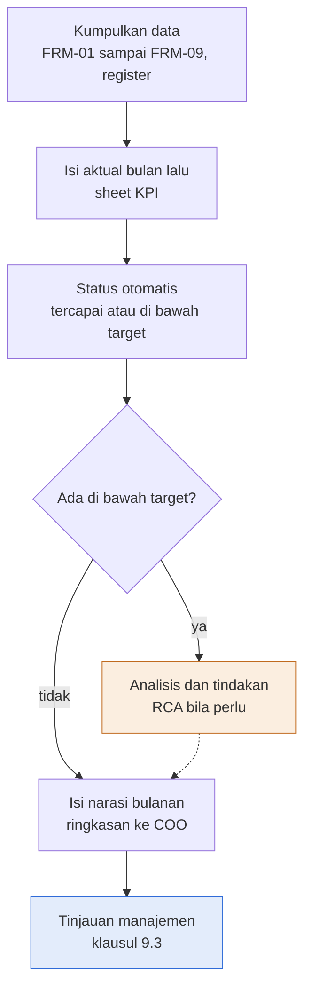

Deskripsi: alur vertikal. Kumpulkan data (FRM-01 sampai FRM-09, register), isi aktual bulan lalu di sheet KPI, status otomatis (tercapai atau di bawah target), lalu keputusan "Ada di bawah target?". "ya" ke kotak oranye "Analisis dan tindakan (RCA bila perlu)" yang kembali ke alur utama lewat garis putus-putus; "tidak" ke "Isi narasi bulanan (ringkasan ke COO)", lalu kotak biru output akhir "Tinjauan manajemen (klausul 9.3)".
Sumber gambar: conv/1rSuMH8wK5BTGUHLm8KjGig1LZOKWcECO/img/image1.png

## 4. Peran, RACI, record, KPI

| Peran | Keterangan dari sumber |
|---|---|
| Head of Operation | Pemilik dokumen; penyusun; dalam master list juga pemilik RPT-01 |
| ISO/ISMS Coordinator | Pemeriksa dokumen |
| COO (Amirull Yusuf Zulkarnain) | Penyetuju dokumen; penerima narasi bulanan; "Diperiksa oleh COO dan tanggal" pada Narasi Bulanan |
| Sub divisi NOC, SOC, SD dan PM, ISMS, Semua | Pengelompokan KPI (kolom B); tidak ditulis sebagai pemilik formal |

Record: laporan KPI bulanan, retensi 3 tahun; masukan klausul 9.1 dan tinjauan manajemen 9.3.2. RACI tidak ada. KPI lengkap ada di 2.3.

## 5. Catatan kualitas dan celah
- Draft rev 00 (Kontrol Dokumen B6); pengesahan dan tanda tangan kosong (A35 sampai D38); tahun KPI 2027 (sheet KPI B3); nilai aktual bulanan kosong (G6:R22 tanpa isi; dicek di biner dengan openpyxl) sehingga seluruh Status (U6:U22) "Belum diukur".
- Sumber tidak punya kolom definisi, rumus indikator (numerator dan denominator), frekuensi, atau pemilik per KPI (kolom sheet KPI A5:U5: No, Sub divisi, KPI, Arah, Target, Sumber, Jan sampai Des, Rata-rata YTD, Bulan terakhir, Status); bagi auditor ini celah (sebagian dapat dipenuhi dari rumus FRM-04, FRM-07, FRM-08, FRM-09 yang dirujuk di kolom Sumber). Kolom "Rumus indikator" di bagian 2.3 adalah inferensi.
- Target berstatus "Target adalah target awal dan dikalibrasi setelah 3 bulan data" (Cara pakai butir 5, B22); tidak berlabel USULAN secara eksplisit (pencarian "USULAN" di sumber: nol hasil). Lintas dokumen: SNX-OPS-ML-00 sheet Keputusan dan Gap no. 2 (COO) berbunyi "Sahkan target berlabel USULAN: target Ack dan pemulihan per severity, jenis change, RTO dan RPO sistem internal, tenggat patch, durasi hypercare"; target KPI tidak disebut spesifik di butir itu.
- Referensi ISO/IEC 27001:2022 tertulis "Klausul atau kontrol Annex A 9.1" (Kontrol Dokumen B13); Annex A edisi 2022 bernomor 5.x sampai 8.x (tidak ada 9.1 pada Annex A); 9.1 adalah klausul utama Pemantauan, pengukuran, analisis, dan evaluasi (inferensi: maksudnya klausul 9.1). Lintas dokumen: SNX-OPS-ML-00 baris 32 (SNX-OPS-RPT-01) mencatat acuan ISO 27001 "9.1".
- KPI No 6 "Change tanpa rollback darurat" (sumber F11 SNX-OPS-FRM-04) memakai kolom "Tanpa rollback darurat (%)" FRM-04 yang rumusnya `1-D/B` untuk semua jenis change (cek di FRM-04 Ringkasan F7 sampai F12), bukan khusus Emergency; definisi KPI dan rumus sumber tidak sepadan.
- KPI No 14 "RCA P1 dan P2 terkirim dalam 2 hari kerja" bersumber SNX-OPS-FRM-10 (F19). Lintas dokumen: FRM-10 Petunjuk pengisian memuat "paling lambat 2 hari kerja setelah layanan pulih", dan SNX-OPS-SOP-04 7.5 butir 1 serta Bagian 10 memuat target yang sama (100%). Register FRM-08 tidak punya kolom tanggal kirim RCA (hanya "RCA wajib" dan "No RCA"), sehingga data KPI ini tidak dapat dihitung dari FRM-08 (inferensi).
- Sumber KPI No 17 "Shift Log" (F22) dan KPI No 8 "Tiket vulnerability" (F13) tidak memiliki nomor dokumen pada master list SNX-OPS-ML-00 (32 baris, tidak ada Shift Log atau tiket vulnerability); sumber KPI No 7 (F12) "SIEM, SNX-ISMS-FRM-02" memuat "SIEM" yang juga tanpa nomor dokumen.
- KPI No 10 (D15 "≤", E15 0) berarah turun dengan target 0 (hitungan), tetapi dirata-rata dengan rumus yang sama dengan persentase (`AVERAGE(G:R)`, kolom S); "Rata-rata YTD" adalah rata-rata sederhana bulanan (tidak berbobot volume).
- Status berdasar "Bulan terakhir" (T, `LOOKUP(2,1/(G:R<>""),G:R)`; Status U membandingkan T dengan target), bukan YTD. KPI triwulanan No 15 ("Review akses privileged triwulanan terlaksana") tetap berada di kolom bulanan tanpa aturan pengisian bulan tanpa kegiatan; nilai kosong dilewati LOOKUP sehingga status memakai bulan terisi terakhir (inferensi dari rumus).
- Tidak ada KPI untuk pemulihan tiket ("Pulih sesuai target" di FRM-08), UAT atau kualitas (FRM-05), atau response SLA selain Ack P1 dan P2 (No 2) dan availability (No 1), berdasarkan daftar 17 KPI (fakta daftar KPI).
- Singkatan "SD dan PM" (B16 sampai B19) tidak dijabarkan di dokumen (pencarian "Service Delivery" di sumber: nol hasil). Lintas dokumen: SNX-OPS-ML-00 Riwayat Review no. 7 menyebut singkatan "SDM" diganti "SD Manager" (pada diagram SNX-OPS-SOP-05).
- Tidak ada kredensial atau data pribadi.

## 6. Kata kunci retrieval
KPI operasi, Operations KPI, performance monitoring, laporan KPI bulanan, target KPI, availability 99,9%, Ack P1 P2 95%, backup job sukses, uji restore, kepatuhan PM, change tanpa rollback, alert kritis triage, vulnerability ditutup, laporan IR, insiden berulang, laporan SLA hari kerja ke-5, proyek sesuai jadwal baseline, onboarding, RCA 2 hari kerja, review akses privileged, risk treatment, serah terima shift, narasi bulanan, tinjauan manajemen, management review, ISO 9001 9.1 9.3.2, SNX-OPS-RPT-01, sub divisi NOC SOC SD PM ISMS

<!-- FILE: ops/SNX-OPS-SOP-01.md -->

---
doc_code: SNX-OPS-SOP-01
title: SOP Project Management & Delivery
department: Operation
doc_type: SOP
source: {drive_file_id: 1lv4ALJnqGG9s9cHnzz38yOTJC57pmPgo, filename: SNX-OPS-SOP-01_SOP_Project_Management_Delivery.docx, format: docx, bytes: 218390, retrieved: 2026-10-13}
revision: 00 (DRAFT)
doc_date: 13 Oktober 2026 (tanggal draft); tanggal efektif ditetapkan saat pengesahan
classification_in_doc: RESTRICTED (Internal)
owner_in_doc: Service Delivery Manager
approver_in_doc: COO, Amirull Yusuf Zulkarnain (Disetujui oleh; status "Menunggu"); Diperiksa oleh ISO/ISMS Coordinator
iso_refs: {iso9001: ["8.1", "8.2", "8.2.2", "8.2.3", "8.5.1", "8.6"], iso27001: ["Annex A 5.8", "Annex A 5.37"]}
kb_sensitivity_suggest: restricted:ops
related_docs: [SNX-OPS-PRC-01, SNX-OPS-SOP-02, SNX-OPS-FRM-01, SNX-OPS-FRM-02, SNX-OPS-FRM-03, SNX-OPS-FRM-04, SNX-OPS-FRM-05, SNX-OPS-FRM-06, SNX-ISMS-PRO-01, SNX-ISMS-SOP-02, SNX-ISMS-SOP-03, SNX-ISMS-REG-01, SNX-ISMS-REG-04]
coverage: {sections_or_sheets: "8 dari 8 bagian bernomor (6 sub-bagian prosedur 6.1 sampai 6.6) plus Riwayat revisi dan Pengesahan", tables: 7, images: "1 dibuka dari 1", notes: "Tidak ada celah baca. Stats mesin melaporkan tables=22 karena menghitung separator kolom; jumlah tabel riil 7 (hitungan baris pemisah tabel pada text.md sumber)."}
---
# SNX-OPS-SOP-01 SOP Project Management & Delivery

## 1. Ringkasan (maks 6 butir, fakta)
- SOP mengatur perencanaan, pelaksanaan, pengendalian, dan penutupan proyek implementasi dan migrasi pelanggan, dari gate G1 (paket handover Commercial) sampai G3 (serah terima ke Operation).
- Prosedur enam fase: Inisiasi (G1), Perencanaan, Eksekusi, Pemantauan dan pengendalian, Verifikasi dan penerimaan (G2), Serah terima ke operasi (G3) dan penutupan.
- Tenggat kunci: kick-off internal paling lambat 3 hari kerja setelah PO; progres diperbarui minimal mingguan; deviasi jadwal lebih dari 1 minggu atau isu biaya dieskalasi ke COO; hypercare 2 minggu setelah go-live kecuali kontrak menetapkan lain.
- Record: SNX-OPS-FRM-01 sampai FRM-06 dengan masa simpan Durasi kontrak + 3 tahun (FRM-01, 02, 03, 05), 3 tahun (FRM-04), Durasi kontrak + 5 tahun (FRM-06).
- KPI proyek: selesai sesuai jadwal baseline 80%, onboarding live sesuai tanggal kontrak 90%, laporan progres tepat waktu 100%, closure lengkap 100%; kalibrasi setelah 3 bulan data.
- Pemilik SOP: Service Delivery Manager; status DRAFT revisi 00, persetujuan COO "Menunggu".

## 2. Isi lengkap terstruktur

### Atribut dokumen

| Atribut | Isi |
|---|---|
| Nomor dokumen | SNX-OPS-SOP-01 |
| Judul | SOP Project Management & Delivery |
| Revisi | 00 (DRAFT) |
| Tanggal draft | 13 Oktober 2026 |
| Tanggal efektif | Ditetapkan saat pengesahan |
| Klasifikasi | RESTRICTED (Internal) |
| Pemilik dokumen | Service Delivery Manager |
| Disetujui oleh | COO, Amirull Yusuf Zulkarnain |
| Acuan ISO 9001:2015 | Klausul 8.1, 8.2, 8.5.1, 8.6 |
| Acuan ISO/IEC 27001:2022 | Klausul atau kontrol Annex A 5.8, 5.37 |
| Masa simpan record | Berlaku sampai digantikan |

### Riwayat revisi

| Revisi | Tanggal | Uraian perubahan | Disusun | Disetujui |
|---|---|---|---|---|
| 00 | 13 Oktober 2026 | Draft awal untuk sertifikasi ISO 9001:2015 dan ISO/IEC 27001:2022 | Divisi Operation | Menunggu |
| 00 | 13 Oktober 2026 | Review bahasa dan konsistensi: istilah teknologi dalam bahasa Inggris, bahasa Indonesia formal, label klasifikasi, keselarasan RTO dan target pulih | Divisi Operation | Menunggu |

### 1. Tujuan
Menetapkan cara SINUX merencanakan, melaksanakan, mengendalikan, dan menutup proyek implementasi dan migrasi pelanggan, sehingga hasilnya sesuai scope, jadwal, mutu, dan persyaratan keamanan informasi yang disepakati.

### 2. Ruang lingkup
Berlaku untuk seluruh proyek yang dijalankan Divisi Operation: onboarding layanan Nusagrid, migrasi ke cloud, implementasi managed services, backup dan DR, observability, security, serta proyek gabungan bersama partner. Berlaku sejak paket handover diterima dari Commercial (gate G1) sampai proyek ditutup dan layanan diserahkan ke operasi (gate G3).

### 3. Referensi
- ISO 9001:2015 klausul 8.1, 8.2.2, 8.2.3, 8.5.1, 8.6.
- ISO/IEC 27001:2022 Annex A 5.8 (keamanan informasi dalam manajemen proyek).
- SNX-OPS-PRC-01 Operations Business Process Flow.
- SNX-OPS-SOP-02 Project Change Management.

### 4. Definisi

| Istilah | Arti |
|---|---|
| Project charter | Ringkasan tujuan, scope, out-of-scope, stakeholder, dan risiko awal proyek |
| WBS | Work Breakdown Structure, pemecahan pekerjaan menjadi paket tugas yang terukur |
| Baseline | Scope, jadwal, dan biaya yang disetujui pada awal proyek, dipakai sebagai pembanding |
| Gate G1, G2, G3 | Titik serah terima wajib: G1 Commercial ke SD dan PM, G2 penerimaan pelanggan (BAST), G3 serah terima ke Operation |
| Hypercare | Masa pemantauan ketat setelah go-live sebelum layanan dinyatakan BAU |

### 5. Peran dan tanggung jawab

| Peran | Tanggung jawab |
|---|---|
| Service Delivery Manager | Pemilik SOP; menerima atau menolak paket G1; mengawal hubungan pelanggan; menyetujui closure |
| Project Manager | Menyusun dan menjalankan rencana proyek; mengelola risiko, isu, dan laporan progres; pemilik G2 |
| NOC dan SOC | Melaksanakan provisioning dan konfigurasi melalui change request; menerima layanan di G3 |
| Tech dan Product | Memberi masukan desain, sizing, dan arsitektur; reviewer teknis |
| Commercial | Menyerahkan paket G1; memutus perubahan harga dan scope komersial |
| Head of Operation | Pemilik gate G3; eskalasi isu lintas sub divisi |
| COO | Keputusan atas deviasi biaya, scope besar, dan change Major |

### 6. Prosedur
Diagram alur: lihat Bagian 3. Teks sumber di bawah gambar: kotak biru adalah output akhir; kotak oranye adalah cabang ke tindakan atau prosedur lain; garis putus-putus kembali ke alur utama.

#### 6.1 Inisiasi (gate G1)
1. Project Manager menerima paket handover dari Commercial dan memeriksanya dengan checklist G1 pada SNX-OPS-FRM-01 (sheet Checklist G1).
2. Paket tidak lengkap dikembalikan ke Commercial secara tertulis; proyek belum dimulai.
3. Project Manager menyusun project charter pada SNX-OPS-FRM-01: tujuan, scope, out-of-scope, stakeholder, asumsi, kendala, dan kriteria penerimaan.
4. Project Manager mengidentifikasi risiko awal, termasuk risiko keamanan informasi (data pelanggan, akses, migrasi), pada SNX-OPS-FRM-02.
5. Kick-off internal dilaksanakan paling lambat 3 hari kerja setelah PO, dihadiri SD dan PM, NOC, SOC bila relevan, dan Tech dan Product.

#### 6.2 Perencanaan
1. Susun WBS dan jadwal pada SNX-OPS-FRM-01 (sheet WBS dan Timeline), lengkap dengan pemilik, tanggal, dan ketergantungan.
2. Tetapkan milestone dan kriteria uji untuk tiap deliverable; kriteria ini menjadi dasar SNX-OPS-FRM-05.
3. Susun rencana komunikasi: kanal resmi (email dan grup WhatsApp proyek), frekuensi laporan, dan matriks eskalasi pelanggan.
4. Untuk migrasi, siapkan rencana rollback dan window waktu yang disetujui pelanggan.
5. Tentukan persyaratan keamanan informasi proyek: klasifikasi data sesuai SNX-ISMS-PRO-01, kebutuhan akses sesuai SNX-ISMS-SOP-02, dan backup sebelum migrasi sesuai SNX-ISMS-SOP-03.
6. Kick-off pelanggan: konfirmasi scope, jadwal, PIC, kanal, dan kriteria penerimaan. Notulen disimpan bersama SNX-OPS-FRM-01.
7. Baseline rencana disetujui Service Delivery Manager sebelum eksekusi.

#### 6.3 Eksekusi
1. Semua pekerjaan pada environment production pelanggan dijalankan melalui change request sesuai SNX-OPS-SOP-02, dengan go-gate: approval, backup, rollback satu perintah, satu langkah satu waktu, terdokumentasi.
2. Akses ke sistem pelanggan hanya melalui Jumphost dan akun yang terdaftar di SNX-ISMS-REG-04. Kredensial disimpan di password manager, tidak di chat, tiket, atau dokumen.
3. Aset dan konfigurasi baru dicatat di SNX-ISMS-REG-01 saat dibuat.
4. Pekerjaan app-level pelanggan (isi aplikasi, plugin, database aplikasi, kode) diserahkan ke developer atau PIC pelanggan.

#### 6.4 Pemantauan dan pengendalian
1. Project Manager memperbarui progres dan status tugas di SNX-OPS-FRM-01 minimal mingguan.
2. Laporan progres mingguan disusun dengan SNX-OPS-FRM-03 dan dikirim ke pelanggan dan COO.
3. Risiko dan isu ditinjau mingguan di SNX-OPS-FRM-02; risiko berstatus Tinggi atau Kritis dilaporkan ke Head of Operation.
4. Perubahan scope, jadwal, atau biaya diajukan sebagai change request proyek (SNX-OPS-SOP-02). Perubahan harga diputus Commercial.
5. Deviasi jadwal lebih dari 1 minggu dari baseline, atau isu yang menyentuh biaya, dieskalasi ke COO.

#### 6.5 Verifikasi dan penerimaan (gate G2)
1. Uji fungsional, kinerja, dan keamanan dijalankan sesuai kriteria pada SNX-OPS-FRM-05.
2. Temuan uji dicatat sebagai defect, diperbaiki, lalu diuji ulang.
3. UAT bersama pelanggan; hasil ditandatangani pada SNX-OPS-FRM-05.
4. BAST implementasi diterbitkan pada SNX-OPS-FRM-06 setelah UAT lolos.
5. Untuk pelanggan pemerintah melalui main contractor, BAST dibuat atas nama SINUX, versi original disimpan di Drive, dan periode ditetapkan main contractor. Dokumen teknis tanpa harga, diskon, tier, maupun roadmap komersil.

#### 6.6 Serah terima ke operasi (gate G3) dan penutupan
1. Project Manager melengkapi checklist G3 pada SNX-OPS-FRM-06.
2. Head of Operation memeriksa checklist bersama Lead NOC dan Lead SOC. Checklist belum lengkap berarti layanan tetap hypercare dengan pemilik SD dan PM.
3. Hypercare berjalan 2 minggu setelah go-live, kecuali kontrak menetapkan lain.
4. Closure report disusun pada SNX-OPS-FRM-06: pencapaian terhadap baseline, isu sisa, lessons learned.
5. Lessons learned disetor ke knowledge base SINUX melalui jalur staging; dokumen proyek diarsip sesuai masa simpan.

### 7. Record terkait

| Record | Nomor | Penyimpanan | Masa simpan |
|---|---|---|---|
| Project plan, scope, timeline, checklist G1 | SNX-OPS-FRM-01 | Drive proyek | Durasi kontrak + 3 tahun |
| Project risk register | SNX-OPS-FRM-02 | Drive proyek | Durasi kontrak + 3 tahun |
| Laporan progres | SNX-OPS-FRM-03 | Drive proyek, email pelanggan | Durasi kontrak + 3 tahun |
| Change request log | SNX-OPS-FRM-04 | Service Hub, Drive | 3 tahun |
| Record UAT dan verifikasi | SNX-OPS-FRM-05 | Drive proyek | Durasi kontrak + 3 tahun |
| BAST, checklist G3, closure report | SNX-OPS-FRM-06 | Drive proyek (original bertanda tangan) | Durasi kontrak + 5 tahun |

### 8. Pemantauan kinerja

| Indikator | Target | Sumber |
|---|---|---|
| Proyek selesai sesuai jadwal baseline | 80% | SNX-OPS-FRM-01 |
| Onboarding live sesuai tanggal kontrak | 90% | SNX-OPS-FRM-01 |
| Laporan progres terkirim tepat waktu | 100% | SNX-OPS-FRM-03 |
| Proyek ditutup dengan BAST dan closure report lengkap | 100% | SNX-OPS-FRM-06 |

Target di atas adalah target awal dan dikalibrasi setelah 3 bulan data.

### Pengesahan

| Peran | Nama dan jabatan | Tanda tangan | Tanggal |
|---|---|---|---|
| Disusun oleh | Service Delivery Manager | (kosong) | (kosong) |
| Diperiksa oleh | ISO/ISMS Coordinator | (kosong) | (kosong) |
| Disetujui oleh | COO, Amirull Yusuf Zulkarnain | (kosong) | (kosong) |

## 3. Diagram

### 3.1 Alur SOP Project Management & Delivery (gambar)
```mermaid
flowchart TB
  A["Terima paket handover<br/>Commercial ke Project Manager"]
  B{"Checklist G1 lengkap?"}
  R["Kembalikan<br/>ke Commercial, tertulis"]
  C["Project charter dan risiko awal<br/>SNX-OPS-FRM-01, SNX-OPS-FRM-02"]
  D["Kick-off internal dan pelanggan<br/>maksimal 3 hari kerja sejak PO"]
  E["Rencana dan baseline disetujui<br/>WBS, jadwal, rollback, keamanan"]
  F["Eksekusi melalui change request<br/>SNX-OPS-SOP-02, akses via Jumphost"]
  X["Change proyek<br/>SNX-OPS-SOP-02"]
  G["Pantau dan lapor mingguan<br/>SNX-OPS-FRM-03, risiko di FRM-02"]
  H{"UAT lolos?"}
  Y["Perbaiki defect<br/>uji ulang di FRM-05"]
  I["BAST dan checklist G3<br/>SNX-OPS-FRM-06"]
  J["Hypercare lalu closure<br/>lessons learned ke knowledge base"]
  A --> B
  B -->|"tidak"| R
  B -->|"ya"| C
  C --> D
  D --> E
  E --> F
  F -->|"scope berubah"| X
  X -.-> G
  F --> G
  G --> H
  H -->|"tidak"| Y
  H -->|"ya"| I
  I --> J
  style I fill:#e3ecfb,stroke:#2f6fdb,stroke-width:2px
  style R fill:#fbeee2,stroke:#c0702b,stroke-width:2px
  style X fill:#fbeee2,stroke:#c0702b,stroke-width:2px
  style Y fill:#fbeee2,stroke:#c0702b,stroke-width:2px
```
Deskripsi: judul gambar "Proyek baru dimulai dari G1 dan berakhir di G3", subjudul "Alur SOP Project Management & Delivery". Satu jalur vertikal dari Terima paket handover sampai Hypercare lalu closure dengan tiga belah ketupat (Checklist G1 lengkap?, UAT lolos? ) dan tiga kotak oranye cabang: Kembalikan ke Commercial (tertulis), Change proyek (SNX-OPS-SOP-02, garis putus-putus kembali ke jalur utama sebelum "Pantau dan lapor mingguan"), dan Perbaiki defect (uji ulang di FRM-05). Kotak biru: BAST dan checklist G3. Pada gambar, panah dari "Perbaiki defect" dan "Kembalikan" tidak digambar kembali ke alur utama; hanya cabang Change proyek yang punya garis putus-putus kembali.
Sumber gambar: conv/1lv4ALJnqGG9s9cHnzz38yOTJC57pmPgo/img/media/rId25.png

## 4. Peran, RACI, record, KPI
- Peran dan tanggung jawab: tabel Bagian 5 (7 peran). Tidak ada tabel RACI formal; tidak ada nama orang kecuali COO Amirull Yusuf Zulkarnain.
- Pemilik gate pada SOP ini: G1 diterima/ditolak oleh Service Delivery Manager (dan diperiksa Project Manager), G2 Project Manager, G3 Head of Operation.
- Record: tabel Bagian 7 (FRM-01 sampai FRM-06 plus masa simpan).
- KPI: tabel Bagian 8 (4 indikator).

## 5. Catatan kualitas dan celah (fakta terukur saja)
1. Status DRAFT revisi 00; persetujuan "Menunggu"; tanda tangan dan tanggal kosong; dua baris riwayat revisi bernomor sama (00) bertanggal sama. Sumber: tabel atribut (Revisi "00 (DRAFT)"), tabel Riwayat revisi (dua baris "00 | 13 Oktober 2026 | ... | Menunggu"), tabel Pengesahan (kolom Tanda tangan dan Tanggal kosong).
2. Kalimat riwayat revisi baris kedua "keselarasan RTO dan target pulih" tidak punya padanan: pencarian "RTO", "RPO", "pulih" di sumber hanya menemukan kalimat riwayat itu sendiri.
3. Hypercare: Bagian 6.6 butir 2 "Checklist belum lengkap berarti layanan tetap hypercare dengan pemilik SD dan PM" dan butir 3 "Hypercare berjalan 2 minggu setelah go-live, kecuali kontrak menetapkan lain". Lintas dokumen: PRO-OPS-001 tabel 8.1 baris 10 menaruh Hypercare (Pemilik "Lead NOC") setelah baris 9 G3, dengan "(USULAN 2 minggu)"; POL-OPS-001 Bagian 8 butir 2 menulis "Durasi hypercare standar 2 minggu. (USULAN)". Di SOP ini durasi 2 minggu tidak berlabel USULAN (pencarian "USULAN" di sumber: nol hasil).
4. Kick-off internal "paling lambat 3 hari kerja setelah PO" (6.1 butir 5) dan eskalasi "Deviasi jadwal lebih dari 1 minggu dari baseline" (6.4 butir 5) tidak berlabel USULAN di SOP ini. Lintas dokumen: PRO-OPS-001 SDPM-01 butir 2 "dalam 3 hari kerja sejak PO. (USULAN)" dan SDPM-02 butir 4 "(USULAN ambang)".
5. Gate G1: POL-OPS-001 Bagian 8 tabel gate menetapkan pemilik G1 "Service Delivery Manager". Di SOP ini langkah 6.1 (menerima dan memeriksa paket G1) dijalankan Project Manager, sedangkan Bagian 5 tabel peran menulis SDM "menerima atau menolak paket G1". Pembagian kerja PM dan SDM pada G1 tidak dinyatakan eksplisit dalam satu kalimat (inferensi dari dua lokasi).
6. Rujukan record: Bagian 6.1 dan 6.2 menyebut FRM-01 sheet "Checklist G1" dan "WBS dan Timeline"; Bagian 6.5 butir 4 dan 6.6 menyebut FRM-06 untuk BAST, checklist G3, dan closure report. Lintas dokumen: sumber SNX-OPS-FRM-01 memuat sheet bernama "Checklist G1" dan "WBS dan Timeline"; sumber SNX-OPS-FRM-06 memuat "Bagian A. Berita Acara Serah Terima (BAST)", "Bagian B. Checklist serah terima ke Operation (gate G3)", dan "Bagian C. Laporan penutupan proyek". Kedua sisi cocok.
7. Bagian 8 tabel indikator: "Proyek selesai sesuai jadwal baseline | 80% | SNX-OPS-FRM-01" dan "Onboarding live sesuai tanggal kontrak | 90% | SNX-OPS-FRM-01". Lintas dokumen: POL-OPS-001 Bagian 11 untuk dua KPI yang sama menulis sumber data "Register proyek" dan "Service Hub".
8. SOP ini tidak merujuk POL-OPS-001 atau PRO-OPS-001 (pencarian "POL-OPS", "PRO-OPS": nol hasil); Bagian 3 merujuk SNX-OPS-PRC-01 dan SNX-OPS-SOP-02.
9. Bagian 6.6 butir 5 "Lessons learned disetor ke knowledge base SINUX melalui jalur staging" bukan dokumen ISMS; tata caranya tidak dijelaskan di sumber.

## 6. Kata kunci retrieval
SOP project management, manajemen proyek, delivery, SNX-OPS-SOP-01, project charter, WBS, baseline, kick-off, gate G1 G2 G3, BAST, UAT, hypercare, closure report, lessons learned, paket handover Commercial, change request proyek, laporan progres mingguan, risk register proyek, Jumphost, password manager, ISO 9001 8.1 8.2 8.5.1 8.6, Annex A 5.8, keamanan informasi manajemen proyek, KPI proyek, jadwal baseline 80%, onboarding live 90%, main contractor, pelanggan pemerintah

<!-- FILE: ops/SNX-OPS-SOP-02.md -->

---
doc_code: SNX-OPS-SOP-02
title: SOP Project Change Management
department: Operation
doc_type: SOP
source: {drive_file_id: 15FTuu06HTHoF-Vi0qzqvwmfQH5tEdT63, filename: SNX-OPS-SOP-02_SOP_Project_Change_Management.docx, format: docx, bytes: 171827, retrieved: 2026-10-13}
revision: 00 (DRAFT)
doc_date: 13 Oktober 2026 (tanggal draft); tanggal efektif ditetapkan saat pengesahan
classification_in_doc: RESTRICTED (Internal)
owner_in_doc: Head of Operation
approver_in_doc: COO, Amirull Yusuf Zulkarnain (Disetujui oleh; status "Menunggu"); Diperiksa oleh ISO/ISMS Coordinator
iso_refs: {iso9001: ["6.3", "8.5.6"], iso27001: ["Annex A 8.32"]}
kb_sensitivity_suggest: restricted:ops
related_docs: [SNX-OPS-FRM-04, SNX-OPS-FRM-03, SNX-ISMS-REG-01, DOCTRINE §9, DEC-2026-355]
coverage: {sections_or_sheets: "8 dari 8 bagian bernomor (prosedur 6.1 sampai 6.6) plus Riwayat revisi dan Pengesahan", tables: 6, images: "1 dibuka dari 1", notes: "Tidak ada celah baca. Stats mesin melaporkan tables=21 karena menghitung separator kolom; jumlah tabel riil 6 (hitungan baris pemisah tabel pada text.md sumber)."}
---
# SNX-OPS-SOP-02 SOP Project Change Management

## 1. Ringkasan (maks 6 butir, fakta)
- SOP mengendalikan perubahan scope proyek dan perubahan teknis pada production pelanggan serta infrastruktur SINUX agar dikaji, disetujui, dapat dikembalikan, dan terdokumentasi sebelum dieksekusi.
- Go-gate lima syarat: approval tertulis plus ack pelanggan, backup dengan lokasi dicatat, rollback satu perintah atau satu langkah tertulis, eksekusi satu langkah satu waktu dengan verifikasi, before dan after terdokumentasi.
- Lima jenis change: Standar (Lead sub divisi), Normal (Lead plus ack pelanggan, notifikasi minimal H-2), Major (COO plus ack pelanggan, minimal H-5 dan pengingat H-0), Emergency (Lead on-duty, COO diberi tahu 30 menit), Proyek (Service Delivery Manager, harga oleh Commercial).
- Tenggat: CR Emergency dilengkapi paling lambat 1 hari kerja; post implementation review change Major dan change rollback dalam 5 hari kerja.
- Larangan eksplisit: restart VM tanpa izin pelanggan, delete VM tanpa konfirmasi tertulis dua kali, `yum install` atau `remove perl-*` di server cPanel.
- KPI: CR disetujui sebelum eksekusi 100%, change tanpa rollback darurat 95%, CR Emergency lengkap 1 hari kerja 100%, insiden akibat change dilaporkan bulanan tren menurun.

## 2. Isi lengkap terstruktur

### Atribut dokumen

| Atribut | Isi |
|---|---|
| Nomor dokumen | SNX-OPS-SOP-02 |
| Judul | SOP Project Change Management |
| Revisi | 00 (DRAFT) |
| Tanggal draft | 13 Oktober 2026 |
| Tanggal efektif | Ditetapkan saat pengesahan |
| Klasifikasi | RESTRICTED (Internal) |
| Pemilik dokumen | Head of Operation |
| Disetujui oleh | COO, Amirull Yusuf Zulkarnain |
| Acuan ISO 9001:2015 | Klausul 6.3, 8.5.6 |
| Acuan ISO/IEC 27001:2022 | Klausul atau kontrol Annex A 8.32 |
| Masa simpan record | Berlaku sampai digantikan |

### Riwayat revisi

| Revisi | Tanggal | Uraian perubahan | Disusun | Disetujui |
|---|---|---|---|---|
| 00 | 13 Oktober 2026 | Draft awal untuk sertifikasi ISO 9001:2015 dan ISO/IEC 27001:2022 | Divisi Operation | Menunggu |
| 00 | 13 Oktober 2026 | Review bahasa dan konsistensi: istilah teknologi dalam bahasa Inggris, bahasa Indonesia formal, label klasifikasi, keselarasan RTO dan target pulih | Divisi Operation | Menunggu |

### 1. Tujuan
Mengendalikan setiap perubahan pada scope proyek dan pada environment production pelanggan maupun infrastruktur SINUX, agar perubahan dikaji, disetujui, dapat dikembalikan, dan terdokumentasi sebelum dieksekusi.

### 2. Ruang lingkup
Berlaku untuk dua jenis perubahan:
1. Perubahan proyek: scope, jadwal, deliverable, atau sumber daya proyek yang sudah ber-baseline.
2. Perubahan teknis: konfigurasi, kapasitas, versi, network, rule keamanan, data, atau akses pada sistem production pelanggan dan infrastruktur internal SINUX.

Tidak berlaku untuk perubahan app-level pelanggan yang menjadi tanggung jawab developer atau PIC pelanggan.

### 3. Referensi
- ISO 9001:2015 klausul 6.3 (perencanaan perubahan) dan 8.5.6 (pengendalian perubahan).
- ISO/IEC 27001:2022 Annex A 8.32 (change management).
- DOCTRINE §9 dan keputusan DEC-2026-355 (go-gate production).
- SNX-OPS-FRM-04 Change Request & Approval Log.

### 4. Prinsip go-gate
Tidak ada perubahan production yang dieksekusi sebelum lima syarat ini terpenuhi:
1. Approval tertulis dari approver yang berwenang plus ack pelanggan bila menyentuh layanan pelanggan.
2. Backup atau snapshot diambil dan lokasinya dicatat.
3. Rollback dapat dijalankan dengan satu perintah atau satu langkah yang sudah ditulis.
4. Eksekusi satu langkah satu waktu, dengan verifikasi di antara langkah.
5. Before dan after terdokumentasi di change request.

Diagram alur change management: lihat Bagian 3.

### 5. Klasifikasi change dan wewenang approval

| Jenis | Kriteria | Contoh | Approver | Notifikasi pelanggan |
|---|---|---|---|---|
| Standar | Pra-disetujui, berulang, risiko rendah, prosedur baku | Tambah rule firewall Accept untuk IP pelanggan, reset password atas permintaan PIC | Lead sub divisi | Konfirmasi di tiket |
| Normal | Dampak terbatas, butuh jadwal | Resize VM, ubah konfigurasi web server, instal SSL, ubah rule WAF | Lead plus ack pelanggan | Minimal H-2 |
| Major | Dampak luas atau sulit dikembalikan | Migrasi, upgrade versi platform, perubahan core network | COO plus ack pelanggan | Minimal H-5 dan pengingat H-0 |
| Emergency | Dibutuhkan segera untuk memulihkan layanan atau menahan insiden | Containment insiden aktif, pemulihan layanan P1 | Lead on-duty, dicatat; COO diberi tahu dalam 30 menit | Saat itu juga |
| Proyek | Perubahan scope, jadwal, atau deliverable proyek | Tambah VM di luar BOQ, geser go-live | Service Delivery Manager; harga oleh Commercial | Tertulis ke PIC pelanggan |

### 6. Prosedur

#### 6.1 Pengajuan
1. Pengaju membuat change request di Service Hub dan mencatatnya di SNX-OPS-FRM-04 dengan nomor CR unik.
2. Isi minimal: tujuan, sistem atau mesin target, jenis change, langkah eksekusi, dampak ke layanan, risiko, rencana backup, perintah rollback, jadwal, dan pelaksana.
3. Change proyek melampirkan dampak terhadap scope, jadwal, dan biaya.

#### 6.2 Kajian dan approval
1. Approver mengkaji dampak, risiko, kesiapan rollback, dan kecocokan jadwal (off-office-hour untuk change yang butuh downtime).
2. Change yang menyentuh kontrol keamanan (akses, rule WAF atau firewall, encryption, logging) dikaji juga oleh Lead SOC.
3. Approver memberi status Disetujui, Ditolak, atau Revisi di SNX-OPS-FRM-04 beserta tanggal.
4. Change proyek yang mengubah harga diteruskan ke Commercial; Operation tidak menjanjikan tanggal sebelum Commercial menyetujui.

#### 6.3 Persiapan
1. Notifikasi pelanggan sesuai Bagian 5.
2. Jalankan blok ukur read-only terlebih dahulu dan baca hasilnya bersama approver.
3. Ambil backup atau snapshot dan catat lokasinya di CR.

#### 6.4 Eksekusi
1. Setiap blok perintah diawali pemeriksaan `hostname` untuk memastikan mesin yang benar.
2. Blok ubah terpisah dari blok ukur; satu langkah satu waktu.
3. Restart VM pelanggan selalu didahului izin pelanggan.
4. Delete VM bersifat unrecoverable dan butuh konfirmasi tertulis pelanggan dua kali.
5. Di server cPanel, perintah `yum install` atau `remove perl-*` dilarang.

#### 6.5 Verifikasi, rollback, dan penutupan
1. Verifikasi dengan kontrol positif dan dari sisi pelanggan (browser nyata, vantage eksternal).
2. Verifikasi gagal berarti rollback, bukan improvisasi. Rollback dicatat di CR.
3. Catat before dan after, status akhir (Berhasil, Rollback, Gagal), dan waktu selesai di SNX-OPS-FRM-04.
4. Perbarui SNX-ISMS-REG-01 bila konfigurasi atau aset berubah.
5. Change Major dan change yang berakhir rollback ditinjau ulang (post implementation review) dalam 5 hari kerja.

#### 6.6 Change emergency
1. Lead on-duty boleh mengeksekusi sebelum CR lengkap, dengan tetap mengambil backup bila memungkinkan dan mencatat setiap langkah.
2. CR dilengkapi paling lambat 1 hari kerja setelahnya dan ditinjau Head of Operation.
3. COO diberi tahu dalam 30 menit sejak eksekusi.

### 7. Record terkait

| Record | Nomor | Masa simpan |
|---|---|---|
| Change Request & Approval Log | SNX-OPS-FRM-04 | 3 tahun |
| Information Asset Register (pembaruan konfigurasi) | SNX-ISMS-REG-01 | Berlaku sampai digantikan |
| Laporan progres proyek (change proyek) | SNX-OPS-FRM-03 | Durasi kontrak + 3 tahun |

### 8. Pemantauan kinerja

| Indikator | Target |
|---|---|
| Change dieksekusi dengan CR disetujui sebelum eksekusi (kecuali Emergency) | 100% |
| Change tanpa rollback darurat | 95% |
| CR Emergency dilengkapi dalam 1 hari kerja | 100% |
| Insiden yang disebabkan change | Dilaporkan bulanan, tren menurun |

### Pengesahan

| Peran | Nama dan jabatan | Tanda tangan | Tanggal |
|---|---|---|---|
| Disusun oleh | Head of Operation | (kosong) | (kosong) |
| Diperiksa oleh | ISO/ISMS Coordinator | (kosong) | (kosong) |
| Disetujui oleh | COO, Amirull Yusuf Zulkarnain | (kosong) | (kosong) |

## 3. Diagram

### 3.1 Alur change management (gambar)
```mermaid
flowchart TB
  A["Ajukan change request<br/>SNX-OPS-FRM-04"]
  B["Klasifikasi change<br/>Standar, Normal, Major, Emergency"]
  C["Kajian dampak<br/>risiko, backup, rollback, jadwal"]
  D{"Disetujui?"}
  R1["Ditolak atau revisi<br/>kembali ke pengaju"]
  E["Jadwal dan notifikasi<br/>pelanggan H-2 atau H-5"]
  F["Blok ukur, lalu backup<br/>read-only terlebih dahulu, snapshot dicatat"]
  G["Eksekusi bertahap<br/>satu langkah satu waktu"]
  H{"Verifikasi lolos?"}
  R2["Rollback<br/>satu perintah, catat"]
  I["Tutup dan PIR<br/>before dan after di log"]
  A --> B
  B --> C
  C --> D
  D -->|"tidak"| R1
  D -->|"ya"| E
  E --> F
  F --> G
  G --> H
  H -->|"tidak"| R2
  H -->|"ya"| I
  style I fill:#e3ecfb,stroke:#2f6fdb,stroke-width:2px
  style R1 fill:#fbeee2,stroke:#c0702b,stroke-width:2px
  style R2 fill:#fbeee2,stroke:#c0702b,stroke-width:2px
```
Deskripsi: judul gambar "Tidak ada perubahan production tanpa approval, backup, dan rollback", subjudul "Alur SNX-OPS-SOP-02 (go-gate DOCTRINE §9, DEC-2026-355)". Satu jalur vertikal dari Ajukan change request sampai Tutup dan PIR (kotak biru), dengan dua belah ketupat (Disetujui?, Verifikasi lolos?) yang masing-masing mempunyai cabang "tidak" ke kotak oranye (Ditolak atau revisi: kembali ke pengaju; Rollback: satu perintah, catat). Gambar tidak menggambar panah kembali dari kotak oranye ke alur utama dan tidak menggambar jalur Emergency ataupun jenis Proyek.
Sumber gambar: conv/15FTuu06HTHoF-Vi0qzqvwmfQH5tEdT63/img/media/rId23.png

## 4. Peran, RACI, record, KPI
- Approver per jenis change: tabel Bagian 5 (Lead sub divisi, Lead plus ack pelanggan, COO plus ack pelanggan, Lead on-duty, Service Delivery Manager).
- Peran lain di prosedur: Pengaju (membuat CR), Approver, Lead SOC (kajian change yang menyentuh kontrol keamanan), Commercial (harga change proyek), Head of Operation (meninjau CR Emergency), COO (diberi tahu Emergency), Pelanggan (ack, izin restart, konfirmasi delete). Tidak ada nama orang kecuali COO Amirull Yusuf Zulkarnain.
- Record: tabel Bagian 7. Masa simpan: FRM-04 3 tahun; REG-01 berlaku sampai digantikan; FRM-03 Durasi kontrak + 3 tahun.
- KPI: tabel Bagian 8 (4 indikator).

## 5. Catatan kualitas dan celah (fakta terukur saja)
1. Status DRAFT revisi 00; persetujuan "Menunggu"; tanda tangan dan tanggal kosong; dua baris riwayat revisi bernomor sama. Sumber: tabel atribut (Revisi "00 (DRAFT)"), tabel Riwayat revisi (dua baris "00 | 13 Oktober 2026 | ... | Menunggu"), tabel Pengesahan (kolom Tanda tangan dan Tanggal kosong).
2. Jenis change Standar, Normal, Major, Emergency ditulis sebagai ketentuan di Bagian 5 tanpa label USULAN (pencarian "USULAN" di sumber: nol hasil). Lintas dokumen: POL-OPS-001 Bagian 7 menulis "Pembagian jenis change adalah USULAN". SOP ini menambah jenis kelima "Proyek" (Bagian 5, baris Proyek), yang tidak ada di tabel POL-OPS-001 Bagian 7 (hanya Standar, Normal, Major, Emergency).
3. Tambahan di SOP ini yang tidak ada di POL-OPS-001 Bagian 7 maupun PRO-OPS-001 CHG-01: kajian Lead SOC untuk change yang menyentuh kontrol keamanan (6.2 butir 2: "dikaji juga oleh Lead SOC"); PIR "dalam 5 hari kerja" untuk change Major dan rollback (6.5 butir 5); CR Emergency "dilengkapi paling lambat 1 hari kerja setelahnya dan ditinjau Head of Operation" (6.6 butir 2); status akhir "Berhasil, Rollback, Gagal" (6.5 butir 3). PRO-OPS-001 CHG-01 paragraf Emergency menulis "change request diisi setelahnya" tanpa tenggat; pencarian "PIR", "post implementation", "Berhasil" di POL dan PRO tidak menemukan padanan.
4. Notifikasi COO untuk Emergency: SOP-02 6.6 butir 3 "COO diberi tahu dalam 30 menit sejak eksekusi". POL-OPS-001 Bagian 7 (baris Emergency: "COO diberi tahu dalam 30 menit") dan PRO-OPS-001 CHG-01 ("COO diberi tahu dalam 30 menit") tidak menyebut titik awal. POL-OPS-001 Bagian 6 (eskalasi P1) menulis "COO dalam 30 menit" tanpa titik awal. SOP-02 Bagian 5 (baris Emergency) juga menulis tanpa titik awal.
5. Approval Standar dan Normal di SOP ini (Bagian 5): "Lead sub divisi" dan "Lead plus ack pelanggan", selaras dengan POL-OPS-001 Bagian 7. Lintas dokumen: matriks RACI POL-OPS-001 Bagian 10 baris "Change Standar dan Normal" menempatkan Head of Operation sebagai "A".
6. Notifikasi "Minimal H-2" dan "Minimal H-5 dan pengingat H-0" (Bagian 5): satuan hari (kalender atau kerja) tidak ditegaskan (pencarian "hari kerja" di sumber hanya muncul pada PIR 5 hari kerja dan CR Emergency 1 hari kerja). Lintas dokumen: PRO-OPS-001 NOC-06 butir 1 "Ajukan minimal 3 hari kerja sebelumnya".
7. Gambar Bagian 4 (rId23): kotak "Klasifikasi change" hanya menulis "Standar, Normal, Major, Emergency" (tanpa Proyek); tidak ada jalur Emergency terpisah; kotak oranye "Ditolak atau revisi" (sub-label "kembali ke pengaju") dan "Rollback" tidak punya panah keluar ke alur utama. Teks 6.2 butir 3 menyebut status "Disetujui, Ditolak, atau Revisi", gambar menyebut "Ditolak atau revisi".
8. Rujukan "DOCTRINE §9 dan keputusan DEC-2026-355" (Bagian 3) adalah dokumen internal yang isinya tidak ada di sumber ini (tidak dapat diverifikasi).
9. Acuan ISO di atribut (9001: 6.3, 8.5.6; 27001: Annex A 8.32) sama dengan Bagian 3 Referensi. Tidak ada tabel peran formal atau RACI di SOP ini (pencarian "RACI": nol hasil; peran hanya muncul dalam kolom Approver Bagian 5).

## 6. Kata kunci retrieval
SOP change management, manajemen perubahan, SNX-OPS-SOP-02, change request, CR, go-gate, DOCTRINE §9, DEC-2026-355, Standar Normal Major Emergency, change proyek, approval, ack pelanggan, backup snapshot, rollback, blok ukur read-only, hostname check, post implementation review, PIR, SNX-OPS-FRM-04, Change Request & Approval Log, restart VM izin pelanggan, delete VM konfirmasi dua kali, cPanel yum install dilarang, ISO 9001 6.3 8.5.6, Annex A 8.32, KPI change tanpa rollback darurat 95%, Lead SOC kontrol keamanan

<!-- FILE: ops/SNX-OPS-SOP-03.md -->

---
doc_code: SNX-OPS-SOP-03
title: SOP Preventive & Corrective Maintenance
department: Operation
doc_type: SOP
source: {drive_file_id: 10odQYr4B2cyaAX9Z98EKxv4HUjgwIoYc, filename: SNX-OPS-SOP-03_SOP_Preventive_Corrective_Maintenance.docx, format: docx, bytes: 174745, retrieved: 2026-10-13}
revision: 00 (DRAFT)
doc_date: 13 Oktober 2026 (tanggal draft); tanggal efektif ditetapkan saat pengesahan
classification_in_doc: RESTRICTED (Internal)
owner_in_doc: Lead NOC
approver_in_doc: COO, Amirull Yusuf Zulkarnain (Disetujui oleh; status "Menunggu"); Diperiksa oleh ISO/ISMS Coordinator
iso_refs: {iso9001: ["7.1.3", "8.5.1", "10.2"], iso27001: ["Annex A 7.13", "Annex A 8.6"]}
kb_sensitivity_suggest: restricted:ops
related_docs: [SNX-OPS-SOP-02, SNX-OPS-SOP-04, SNX-OPS-FRM-04, SNX-OPS-FRM-07, SNX-OPS-FRM-08, SNX-OPS-FRM-10, SNX-OPS-RPT-01, SNX-ISMS-SOP-04, SNX-ISMS-SOP-05, SNX-ISMS-PLN-01, SNX-ISMS-FRM-01]
coverage: {sections_or_sheets: "9 dari 9 bagian bernomor (ditambah blok Diagram alur proses tanpa nomor) plus Riwayat revisi dan Pengesahan", tables: 8, images: "1 dibuka dari 1", notes: "Tidak ada celah baca. Stats mesin melaporkan tables=22 karena menghitung separator kolom; jumlah tabel riil 8 (hitungan baris pemisah tabel pada text.md sumber; termasuk tabel frekuensi PM yang bersarang di daftar bernomor 6.1)."}
---
# SNX-OPS-SOP-03 SOP Preventive & Corrective Maintenance

## 1. Ringkasan (maks 6 butir, fakta)
- SOP perawatan terencana (preventive maintenance, PM) dan perbaikan terkendali (corrective maintenance, CM) atas VM dan platform Nusagrid, server WHM dan cPanel, network device, WAF dan proxy, monitoring, backup, serta sistem internal (tiket, Jumphost, password manager).
- Jadwal PM tahunan disusun Lead NOC paling lambat Desember untuk tahun berikutnya pada SNX-OPS-FRM-07; sembilan aktivitas minimal dengan frekuensi (tiap awal shift, tiap shift malam, mingguan, bulanan, triwulanan, minimal tahunan).
- PM yang mengubah sistem dijalankan sebagai change Standar atau Normal (SNX-OPS-SOP-02) di window maintenance (umumnya Shift 3, 23:00 sampai 07:00 WIB); CM dicatat sebagai tiket di SNX-OPS-FRM-08; pemulihan P1 boleh sebagai change Emergency.
- Temuan berulang pada aset yang sama dievaluasi sebagai problem dan dapat memicu RCA (SNX-OPS-FRM-10).
- KPI: kepatuhan jadwal PM 95%, uji restore bulanan per pelanggan backup 100%, insiden akibat kerusakan yang seharusnya terdeteksi PM ditinjau bulanan tren menurun.
- Record: FRM-07, FRM-08, FRM-04, ISMS-FRM-01 dengan masa simpan 3 tahun.

## 2. Isi lengkap terstruktur

### Atribut dokumen

| Atribut | Isi |
|---|---|
| Nomor dokumen | SNX-OPS-SOP-03 |
| Judul | SOP Preventive & Corrective Maintenance |
| Revisi | 00 (DRAFT) |
| Tanggal draft | 13 Oktober 2026 |
| Tanggal efektif | Ditetapkan saat pengesahan |
| Klasifikasi | RESTRICTED (Internal) |
| Pemilik dokumen | Lead NOC |
| Disetujui oleh | COO, Amirull Yusuf Zulkarnain |
| Acuan ISO 9001:2015 | Klausul 7.1.3, 8.5.1, 10.2 |
| Acuan ISO/IEC 27001:2022 | Klausul atau kontrol Annex A 7.13, 8.6 |
| Masa simpan record | Berlaku sampai digantikan |

### Riwayat revisi

| Revisi | Tanggal | Uraian perubahan | Disusun | Disetujui |
|---|---|---|---|---|
| 00 | 13 Oktober 2026 | Draft awal untuk sertifikasi ISO 9001:2015 dan ISO/IEC 27001:2022 | Divisi Operation | Menunggu |
| 00 | 13 Oktober 2026 | Review bahasa dan konsistensi: istilah teknologi dalam bahasa Inggris, bahasa Indonesia formal, label klasifikasi, keselarasan RTO dan target pulih | Divisi Operation | Menunggu |

### 1. Tujuan
Memastikan infrastruktur dan layanan yang dikelola SINUX dirawat secara terencana (preventive maintenance) dan diperbaiki secara terkendali saat terjadi kerusakan atau penurunan kinerja (corrective maintenance), sehingga availability layanan terjaga dan kejadian berulang dapat dicegah.

### 2. Ruang lingkup
Berlaku untuk perangkat, platform, dan layanan yang dikelola SINUX: VM dan platform Nusagrid, server WHM dan cPanel, network device, WAF dan proxy, sistem monitoring, sistem backup, serta sistem internal pendukung operasi (tiket, Jumphost, password manager). Perawatan fisik di data center dijalankan bersama penyedia DC sesuai kontraknya.

### 3. Referensi
- ISO 9001:2015 klausul 7.1.3 (infrastruktur), 8.5.1, 10.2.
- ISO/IEC 27001:2022 Annex A 7.13 (equipment maintenance), 8.6 (capacity management).
- SNX-OPS-SOP-02 Project Change Management.
- SNX-ISMS-SOP-05 Vulnerability & Patch Management.

### 4. Definisi

| Istilah | Arti |
|---|---|
| Preventive maintenance (PM) | Perawatan terjadwal untuk mencegah gangguan: health check, pembersihan kapasitas, patch, uji restore, renewal sertifikat |
| Corrective maintenance (CM) | Perbaikan setelah ditemukan kerusakan, kegagalan, atau penurunan kinerja |
| Window maintenance | Jadwal yang disepakati untuk pekerjaan yang berdampak ke layanan, umumnya Shift 3 (23:00 sampai 07:00 WIB) |

### 5. Peran dan tanggung jawab

| Peran | Tanggung jawab |
|---|---|
| Lead NOC | Pemilik SOP; menyusun jadwal PM tahunan; meninjau service report; approver change Standar dan Normal |
| NOC Engineer | Melaksanakan PM dan CM; mengisi service report |
| Lead SOC | Menyetujui PM yang menyentuh kontrol keamanan; menyuplai daftar patch keamanan |
| Service Delivery Manager | Mengkomunikasikan jadwal maintenance ke pelanggan; merangkum hasil di laporan bulanan |
| Penyedia DC dan upstream | Perawatan fasilitas fisik dan platform sesuai kontrak |

Diagram alur proses: lihat Bagian 3.

### 6. Prosedur preventive maintenance

#### 6.1 Perencanaan
1. Lead NOC menyusun jadwal PM tahunan pada SNX-OPS-FRM-07 (sheet Jadwal PM) paling lambat Desember untuk tahun berikutnya.
2. Jadwal mencakup minimal aktivitas berikut:

| Aktivitas | Frekuensi minimal |
|---|---|
| Health check layanan kritis (dashboard, resource, status layanan) | Tiap awal shift |
| Pemeriksaan status backup job | Tiap shift malam |
| Kapasitas disk, CPU, memori, dan tren pertumbuhan | Mingguan |
| Masa berlaku sertifikat SSL (30 hari ke depan) | Mingguan |
| Pemeriksaan perangkat internal di Overseer | Mingguan |
| Patch keamanan dan update OS sesuai SNX-ISMS-SOP-05 | Bulanan, atau segera untuk patch kritis |
| Uji restore per pelanggan berlayanan backup | Bulanan |
| Review rule firewall, WAF, dan akun tidak terpakai | Triwulanan |
| Uji pemulihan sesuai SNX-ISMS-PLN-01 | Minimal tahunan |

3. Pelanggan diinformasikan jadwal yang berdampak ke layanan sesuai jenis change di SNX-OPS-SOP-02.

#### 6.2 Pelaksanaan
1. PM yang tidak berdampak ke layanan (pemeriksaan read-only) dijalankan langsung oleh NOC Engineer.
2. PM yang mengubah sistem (patch, restart, perubahan konfigurasi) dijalankan sebagai change Standar atau Normal sesuai SNX-OPS-SOP-02, di window maintenance.
3. Engineer mengisi service report pada SNX-OPS-FRM-07 (sheet Service Report): aktivitas, temuan, tindakan, status, dan bukti.
4. Temuan yang tidak bisa diselesaikan saat PM dibuat tiket corrective maintenance.

#### 6.3 Evaluasi
1. Lead NOC meninjau kepatuhan jadwal PM bulanan (rencana lawan realisasi) di SNX-OPS-FRM-07.
2. Temuan berulang pada aset yang sama dievaluasi sebagai masalah (problem) dan dapat memicu RCA sesuai SNX-OPS-FRM-10.

### 7. Prosedur corrective maintenance
1. Kerusakan atau penurunan kinerja dicatat sebagai tiket di SNX-OPS-FRM-08 dengan severity sesuai SNX-OPS-SOP-04.
2. Engineer mendiagnosa dengan blok ukur read-only, membedakan gejala dari akar.
3. Perbaikan yang mengubah production dijalankan melalui SNX-OPS-SOP-02; untuk pemulihan P1 boleh sebagai change Emergency.
4. Kerusakan di platform upstream atau fasilitas DC dieskalasi ke penyedia sesuai matriks eskalasi SNX-OPS-SOP-04.
5. Setelah perbaikan, verifikasi dari sisi pelanggan, catat di service report, lalu tutup tiket.
6. Penggantian atau pembuangan perangkat dan media penyimpanan mengikuti SNX-ISMS-SOP-04 (penghapusan data aman).

### 8. Record terkait

| Record | Nomor | Masa simpan |
|---|---|---|
| Jadwal PM dan service report | SNX-OPS-FRM-07 | 3 tahun |
| Tiket corrective | SNX-OPS-FRM-08 | 3 tahun |
| Change request maintenance | SNX-OPS-FRM-04 | 3 tahun |
| Record uji restore | SNX-ISMS-FRM-01 | 3 tahun |

### 9. Pemantauan kinerja

| Indikator | Target |
|---|---|
| Kepatuhan jadwal PM (realisasi dibanding rencana) | 95% |
| Uji restore bulanan terlaksana per pelanggan backup | 100% |
| Insiden akibat kerusakan yang seharusnya terdeteksi PM | Ditinjau bulanan, tren menurun |

### Pengesahan

| Peran | Nama dan jabatan | Tanda tangan | Tanggal |
|---|---|---|---|
| Disusun oleh | Lead NOC | (kosong) | (kosong) |
| Diperiksa oleh | ISO/ISMS Coordinator | (kosong) | (kosong) |
| Disetujui oleh | COO, Amirull Yusuf Zulkarnain | (kosong) | (kosong) |

## 3. Diagram

### 3.1 Alur SOP Preventive & Corrective Maintenance (gambar)
```mermaid
flowchart TB
  A["Jadwal PM tahunan<br/>Lead NOC, SNX-OPS-FRM-07"]
  B{"Berdampak ke layanan?"}
  CR["Change request<br/>SOP-02, window maint."]
  C["Laksanakan PM<br/>health check, patch, uji restore"]
  D["Isi service report<br/>temuan, tindakan, bukti"]
  E{"Ada kerusakan?"}
  CM["Corrective maint.<br/>tiket FRM-08, SOP-04"]
  F["Review kepatuhan bulanan<br/>rencana dibanding realisasi"]
  G{"Temuan berulang?"}
  RCA["RCA<br/>SNX-OPS-FRM-10"]
  H["Rekap ke laporan bulanan<br/>SD dan PM, SNX-OPS-RPT-01"]
  A --> B
  B -->|"ya"| CR
  B -->|"tidak"| C
  CR -.-> C
  C --> D
  D --> E
  E -->|"ya"| CM
  E -->|"tidak"| F
  CM -.-> F
  F --> G
  G -->|"ya"| RCA
  G -->|"tidak"| H
  RCA -.-> H
  style H fill:#e3ecfb,stroke:#2f6fdb,stroke-width:2px
  style CR fill:#fbeee2,stroke:#c0702b,stroke-width:2px
  style CM fill:#fbeee2,stroke:#c0702b,stroke-width:2px
  style RCA fill:#fbeee2,stroke:#c0702b,stroke-width:2px
```
Deskripsi: judul gambar "Maintenance terencana mencegah, maintenance korektif memulihkan", subjudul "Alur SOP Preventive & Corrective Maintenance". Jalur vertikal dari Jadwal PM tahunan sampai Rekap ke laporan bulanan (kotak biru) dengan tiga belah ketupat (Berdampak ke layanan?, Ada kerusakan?, Temuan berulang?). Cabang "ya" masing-masing menuju kotak oranye di kanan (Change request SOP-02 window maintenance; Corrective maint. tiket FRM-08 SOP-04; RCA SNX-OPS-FRM-10), dan masing-masing kotak oranye punya garis putus-putus kembali ke jalur utama (ke Laksanakan PM, ke Review kepatuhan bulanan, ke Rekap).
Sumber gambar: conv/10odQYr4B2cyaAX9Z98EKxv4HUjgwIoYc/img/media/rId25.png

## 4. Peran, RACI, record, KPI
- Peran dan tanggung jawab: tabel Bagian 5 (5 peran: Lead NOC, NOC Engineer, Lead SOC, Service Delivery Manager, Penyedia DC dan upstream). Tidak ada RACI formal; tidak ada nama orang kecuali COO Amirull Yusuf Zulkarnain.
- Frekuensi PM: tabel 9 aktivitas pada Bagian 6.1.
- Record: tabel Bagian 8 (4 record, masa simpan 3 tahun).
- KPI: tabel Bagian 9 (3 indikator).

## 5. Catatan kualitas dan celah (fakta terukur saja)
1. Status DRAFT revisi 00; persetujuan "Menunggu"; tanda tangan dan tanggal kosong; dua baris riwayat revisi bernomor sama. Sumber: tabel atribut (Revisi "00 (DRAFT)"), tabel Riwayat revisi (dua baris "00 | 13 Oktober 2026 | ... | Menunggu"), tabel Pengesahan (kolom Tanda tangan dan Tanggal kosong).
2. Kalimat riwayat revisi "keselarasan RTO dan target pulih" tidak punya padanan: pencarian "RTO", "RPO", "pulih" di sumber hanya menemukan kalimat riwayat itu sendiri, jadi SOP ini tidak memuat RTO, RPO, atau target pulih. Uji pemulihan hanya dirujuk di tabel 6.1 baris "Uji pemulihan sesuai SNX-ISMS-PLN-01 | Minimal tahunan".
3. Severity tidak didefinisikan di SOP ini; Bagian 7 butir 1 menulis "dengan severity sesuai SNX-OPS-SOP-04". Lintas dokumen: SNX-OPS-SOP-04 Bagian 6 memuat matriks severity P1 sampai P4; POL-OPS-001 Bagian 6 juga memuat matriks severity (Ack dan update sama) dan PRO-OPS-001 NOC-02 butir 1 menulis "target Ack (POL-OPS-001 §6)". Di SOP-03 tidak ada rujukan ke POL-OPS-001 atau PRO-OPS-001 (pencarian "POL-OPS", "PRO-OPS": nol hasil).
4. Bagian 7 butir 4 mengeskalasi ke penyedia "sesuai matriks eskalasi SNX-OPS-SOP-04". Lintas dokumen: SNX-OPS-SOP-04 Bagian 6 memuat "Matriks eskalasi fungsional"; POL-OPS-001 Bagian 6 juga memuat "Matriks eskalasi fungsional" (isi POL berbeda cakupan: tabel dengan baris Nusagrid, WAF, SOC, dan lain-lain). Dua lokasi untuk matriks eskalasi (inferensi bahwa isinya perlu disamakan; kesamaan isi belum dibandingkan baris per baris).
5. Window maintenance: Bagian 4 baris Window maintenance "umumnya Shift 3 (23:00 sampai 07:00 WIB)". Lintas dokumen: POL-OPS-001 Bagian 5 tabel shift "Shift 3, Malam | 23:00 sampai 07:00" (kolom Fokus: "Window maintenance off-office-hour") konsisten. PRO-OPS-001 NOC-06 butir 1 menambah "Ajukan minimal 3 hari kerja sebelumnya", yang tidak disebut di SOP ini.
6. Uji restore: tabel 6.1 baris "Uji restore per pelanggan berlayanan backup | Bulanan" dan Bagian 9 "Uji restore bulanan terlaksana per pelanggan backup | 100%", tanpa label USULAN (pencarian "USULAN": nol hasil). Lintas dokumen: PRO-OPS-001 NOC-04 butir 4 "Uji restore terjadwal minimal sekali per bulan per pelanggan backup ... (USULAN)"; POL-OPS-001 Bagian 9.2 Lead NOC "memastikan uji restore bulanan berjalan". Nilai konsisten, status keputusan berbeda.
7. Cek rutin: tabel 6.1 (health check "Tiap awal shift", backup job "Tiap shift malam", SSL 30 hari "Mingguan", Overseer "Mingguan"). Lintas dokumen: PRO-OPS-001 NOC-04 butir 1 ("Tiap shift malam: cek status job backup") dan NOC-05 butir 1 dan 2 (health check awal shift; mingguan Overseer, SSL 30 hari) sama.
8. Bagian 9: target "Kepatuhan jadwal PM ... 95%" dan "Uji restore bulanan ... 100%". Lintas dokumen: tabel KPI POL-OPS-001 Bagian 11 tidak memuat kepatuhan jadwal PM maupun uji restore; sebaliknya POL-OPS-001 memuat "Backup job sukses | 98%" yang tidak ada di SOP-03.
9. Pemilik SOP adalah Lead NOC (tabel atribut), sedangkan Pengesahan "Diperiksa oleh | ISO/ISMS Coordinator" tanpa nama; tidak ada nama orang pemegang jabatan selain COO.
10. Gambar (rId25): panah garis putus-putus kembali ke alur utama dari ketiga kotak oranye (Change request, Corrective maint., RCA). Teks hanya menyatakan umum di bawah gambar "garis putus-putus kembali ke alur utama" dan tidak menjelaskan titik kembali tiap cabang selain pada gambar.

## 6. Kata kunci retrieval
SOP preventive maintenance, corrective maintenance, perawatan terencana, SNX-OPS-SOP-03, jadwal PM tahunan, service report, health check awal shift, backup job shift malam, kapasitas disk CPU memori, SSL 30 hari, Overseer, patch bulanan, uji restore bulanan, review firewall WAF triwulanan, uji pemulihan tahunan, window maintenance Shift 3, change Standar Normal, change Emergency P1, tiket corrective FRM-08, SNX-OPS-FRM-07, RCA FRM-10, problem management, penghapusan data aman, ISO 9001 7.1.3 8.5.1 10.2, Annex A 7.13 8.6, KPI kepatuhan jadwal PM 95%, Lead NOC

<!-- FILE: ops/SNX-OPS-SOP-04.md -->

---
doc_code: SNX-OPS-SOP-04
title: SOP Technical Incident Handling & Escalation
department: Operation
doc_type: SOP
source: {drive_file_id: 1p9vcA1Sj6xHIbpuIS1Lb8uBTisv2WeuG, filename: SNX-OPS-SOP-04_SOP_Technical_Incident_Handling_Escalation.docx, format: docx, bytes: 203585, retrieved: 2026-10-13}
revision: 00 (DRAFT)
doc_date: 13 Oktober 2026 (tanggal draft); tanggal efektif "Ditetapkan saat pengesahan"
classification_in_doc: RESTRICTED (Internal)
owner_in_doc: Lead NOC
approver_in_doc: COO, Amirull Yusuf Zulkarnain (status persetujuan "Menunggu")
iso_refs: {iso9001: ["8.5.1", "8.7", "10.2"], iso27001: ["A5.24", "A5.26", "A8.16"]}
kb_sensitivity_suggest: restricted:ops
related_docs: [SNX-ISMS-SOP-01, SNX-OPS-SOP-02, SNX-OPS-FRM-08, SNX-OPS-FRM-10, SNX-ISMS-FRM-02, SNX-OPS-FRM-04, SNX-OPS-SOP-05]
coverage: {sections_or_sheets: "12 dari 12 (atribut, riwayat revisi, bagian 1 sampai 10, pengesahan)", tables: 10, images: "1 dibuka dari 1", notes: "Tidak ada celah baca. Target pulih berlabel USULAN. Rujukan HANDOVER §2, SKILL_ops-frontline dan SKILL_incident-rca adalah artefak internal yang isinya tidak ada di sumber. SNX-OPS-FRM-08 ada (md/ops/SNX-OPS-FRM-08.md) dan sheet Target Severity-nya cocok dengan tabel Bagian 6."}
---
# SNX-OPS-SOP-04 SOP Technical Incident Handling & Escalation

## 1. Ringkasan

- SOP menetapkan cara mendeteksi, mencatat, mengklasifikasi, menangani, mengeskalasi, dan menutup insiden teknis. Berlaku 24 jam sehari, 7 hari seminggu, untuk gangguan teknis pada layanan yang dikelola SINUX (terdeteksi monitoring atau dilaporkan pelanggan).
- Empat level severity: P1 Kritis, P2 Tinggi, P3 Sedang, P4 Rendah. Ack P1 15 menit, P2 30 menit, P3 2 jam kerja, P4 1 hari kerja. Target pulih (berlabel USULAN) P1 4 jam, P2 8 jam, P3 24 jam, P4 72 jam.
- Tiket wajib dibuat paling lambat 10 menit setelah alert terkonfirmasi (minimal dua sinyal) dan dicatat di SNX-OPS-FRM-08.
- Eskalasi P1: Lead langsung, COO dalam 30 menit, CEO bila COO tidak tersedia. P2: Lead dalam 1 jam. P3: Lead bila melewati target. P4: tidak perlu.
- Insiden P1 dan P2 wajib RCA (SNX-OPS-FRM-10), dikirim ke pelanggan via email paling lambat 2 hari kerja setelah pulih. Insiden berulang (3 kali atau lebih pada layanan yang sama dalam 30 hari) diperlakukan sebagai problem dan wajib RCA.
- Insiden berindikasi keamanan informasi diserahkan ke SNX-ISMS-SOP-01 (SOC); NOC tetap menangani sisi availability.

## 2. Isi lengkap terstruktur

### 2.0 Atribut dokumen

| Atribut | Isi |
|---|---|
| Nomor dokumen | SNX-OPS-SOP-04 |
| Judul | SOP Technical Incident Handling & Escalation |
| Revisi | 00 (DRAFT) |
| Tanggal draft | 13 Oktober 2026 |
| Tanggal efektif | Ditetapkan saat pengesahan |
| Klasifikasi | RESTRICTED (Internal) |
| Pemilik dokumen | Lead NOC |
| Disetujui oleh | COO, Amirull Yusuf Zulkarnain |
| Acuan ISO 9001:2015 | Klausul 8.5.1, 8.7, 10.2 |
| Acuan ISO/IEC 27001:2022 | Klausul atau kontrol Annex A 5.24, 5.26, 8.16 |
| Masa simpan record | Berlaku sampai digantikan |

### Riwayat revisi

| Revisi | Tanggal | Uraian perubahan | Disusun | Disetujui |
|---|---|---|---|---|
| 00 | 13 Oktober 2026 | Draft awal untuk sertifikasi ISO 9001:2015 dan ISO/IEC 27001:2022 | Divisi Operation | Menunggu |
| 00 | 13 Oktober 2026 | Review bahasa dan konsistensi: istilah teknologi dalam bahasa Inggris, bahasa Indonesia formal, label klasifikasi, keselarasan RTO dan target pulih | Divisi Operation | Menunggu |

### 2.1 Tujuan (Bagian 1)

SOP ini menetapkan cara mendeteksi, mencatat, mengklasifikasi, menangani, mengeskalasi, dan menutup insiden teknis, agar layanan pulih secepat mungkin dan insiden besar tidak terulang.

### 2.2 Ruang lingkup (Bagian 2)

Berlaku untuk seluruh gangguan teknis pada layanan yang dikelola SINUX, baik terdeteksi melalui monitoring maupun dilaporkan pelanggan, selama 24 jam sehari, 7 hari seminggu. Insiden yang berindikasi keamanan informasi (kompromi, webshell, malware, kebocoran data, akun disalahgunakan) diserahkan ke SNX-ISMS-SOP-01; NOC tetap menangani sisi availabilitynya.

### 2.3 Referensi (Bagian 3)

- ISO 9001:2015 klausul 8.5.1, 8.7 (output tidak sesuai), 10.2.
- ISO/IEC 27001:2022 Annex A 5.24, 5.26, 8.16.
- HANDOVER §2 (definisi P1 dari owner), SKILL_ops-frontline (triage frontline), SKILL_incident-rca.
- SNX-OPS-FRM-08 Technical Ticket / Incident Register, SNX-OPS-FRM-10 RCA & Corrective Action Report.

### 2.4 Definisi (Bagian 4)

| Istilah | Arti |
|---|---|
| Insiden | Gangguan tidak terencana atau penurunan mutu layanan |
| Service request | Permintaan standar pelanggan (resize, tambah IP, reset) yang bukan gangguan; dicatat sebagai P4 |
| Ack | Pengakuan pertama ke pelanggan bahwa tiket diterima dan sedang ditangani |
| Workaround | Pemulihan sementara sebelum akar masalah diperbaiki |
| Problem | Akar masalah dari satu atau beberapa insiden, ditangani melalui RCA |

### 2.5 Peran dan tanggung jawab (Bagian 5)

| Peran | Tanggung jawab |
|---|---|
| NOC Engineer (on-duty) | Mendeteksi, mencatat, triage, menangani, berkomunikasi dengan pelanggan, menutup tiket |
| Lead NOC | Pemilik SOP; eskalasi teknis kedua; menyusun RCA P1 dan P2 |
| SOC Analyst | Menangani insiden berindikasi keamanan sesuai SNX-ISMS-SOP-01 |
| Head of Operation | Penanggung jawab P1 sampai RCA selesai; memanggil personel off-duty |
| Service Delivery Manager | Komunikasi formal ke pelanggan untuk P1 dan P2; memastikan RCA terkirim |
| COO | Diberi tahu dalam 30 menit untuk P1; keputusan bila P1 menuntut komitmen baru |

### 2.6 Severity, target respon, dan eskalasi (Bagian 6)

**Matriks severity P1 sampai P4 (lengkap)**

| Severity | Definisi | Contoh | Ack | Update ke pelanggan | Target pulih (USULAN) | Eskalasi hierarki |
|---|---|---|---|---|---|---|
| P1 Kritis | Kompromi root atau host baru; production pelanggan down berkepanjangan dan jalur vendor buntu; insiden keamanan data pelanggan; tuntutan komitmen scope atau komersial baru yang tidak bisa ditunda; hal legal | VM produksi mati dan upstream tidak merespon | 15 menit | Tiap 1 jam | 4 jam | Lead langsung, COO dalam 30 menit, CEO bila COO tidak tersedia |
| P2 Tinggi | Layanan terdegradasi signifikan atau satu layanan produksi mati dengan jalur perbaikan jelas | Backup job gagal 2 kali berturut, SSL produksi expired | 30 menit | Tiap 3 jam atau per shift | 8 jam | Lead dalam 1 jam |
| P3 Sedang | Gangguan terbatas, ada workaround | Satu akun tidak bisa akses, OTP tidak masuk, lambat intermiten | 2 jam kerja | Harian | 24 jam | Lead bila melewati target |
| P4 Rendah | Service request, pertanyaan, perubahan terjadwal | Resize VM, tambah IP, permintaan laporan | 1 hari kerja | Saat selesai | 72 jam | Tidak perlu |

Catatan sumber di bawah tabel: "Target di atas adalah target internal; target pulih sama dengan sheet Target Severity pada SNX-OPS-FRM-08. Komitmen ke pelanggan mengikuti kontrak masing-masing dan tidak boleh melebihi kapasitas riil."

**Matriks eskalasi fungsional**

| Situasi | Eskalasi ke |
|---|---|
| Infra Nusagrid backend (hypervisor, console, node, billing sistem) | Penyedia infrastruktur Nusagrid (Maxcloud atau Awandata), via grup Nusagrid |
| WAF, load balancer, proxy, web, DC fisik, network | Tech dan Product |
| SOC, SIEM, Wazuh untuk pelanggan dengan partner SOC | Partner SOC (Arktech) |
| Platform Nusametric | TelemetryFlow |
| Harga, quote, kontrak | Commercial |
| Pelanggan pemerintah di lapangan | PIC proyek sesuai format komunikasi pelanggan |
| P1 saat COO tidak dapat dihubungi | CEO |

Nama dan kontak PIC eksternal disimpan di file kontak restricted:ops, tidak di dokumen ini.

### 2.7 Prosedur (Bagian 7)

Diagram alur ada di Bagian 3 file ini.

**7.1 Deteksi dan pencatatan**

1. Insiden terdeteksi dari monitoring (Nusametric, Overseer, console Nusagrid, Acronis, Cloudflare) atau laporan pelanggan (Zammad melalui WhatsApp, telepon, email; Service Hub untuk GMF dan internal).
2. Alert dikonfirmasi minimal dari dua sinyal sebelum dinyatakan insiden.
3. Tiket dibuat paling lambat 10 menit setelah konfirmasi, berisi pelanggan, layanan, waktu mulai, gejala, dan bukti awal, lalu dicatat di SNX-OPS-FRM-08.

**7.2 Triage**

1. Akui ke pelanggan sesuai target Ack. Status disampaikan setelah dicek di monitoring, dengan frasa "dari pantauan kami".
2. Minta identifier: IP, nama instance, atau nama VM.
3. Tetapkan severity (Bagian 6) dan kelas triage: akses atau firewall atau VPN, VM lifecycle, down atau performa, OTP atau email, backup, SSL atau DNS, DC atau colo, billing.
4. Berindikasi keamanan: serahkan ke SOC (SNX-ISMS-SOP-01).
5. Menyangkut app-level pelanggan: serahkan ke developer atau PIC pelanggan dengan penjelasan tertulis.
6. Menyangkut harga: serahkan ke Commercial.

**7.3 Diagnosa dan pemulihan**

1. Diagnosa dengan blok ukur read-only; bedakan gejala dari akar.
2. Kredensial pelanggan hanya diterima melalui direct message atau password manager; pelanggan diminta rotate setelah dipakai.
3. Pemulihan yang mengubah production mengikuti SNX-OPS-SOP-02 (P1 boleh sebagai change Emergency).
4. Eskalasi bila target terlewat atau butuh pihak lain, sesuai Bagian 6.
5. Insiden P1 yang berjalan saat pergantian shift tidak dipindah di tengah langkah teknis.

**7.4 Verifikasi dan penutupan**

1. Verifikasi dari sisi pelanggan (browser nyata, vantage eksternal) dan konfirmasi pelanggan.
2. Tutup tiket dengan ringkasan gejala, akar (bila sudah diketahui), tindakan, dan waktu pulih.
3. Lengkapi SNX-OPS-FRM-08: waktu Ack, waktu pulih, status SLA.

**7.5 RCA dan tindakan korektif**

1. Insiden P1 dan P2 wajib RCA dengan SNX-OPS-FRM-10, dikirim ke pelanggan via email dalam 2 hari kerja setelah pulih.
2. Tindakan korektif dicatat dengan pemilik dan tenggat, lalu dipantau sampai efektif.
3. Insiden berulang (3 kali atau lebih pada layanan yang sama dalam 30 hari) diperlakukan sebagai problem dan wajib RCA walau severity rendah.

### 2.8 Komunikasi pelanggan (Bagian 8)

| Saat | Isi minimal | Kanal |
|---|---|---|
| Ack | Tiket diterima, nomor tiket, sedang dicek | Kanal pelanggan melapor |
| Update berkala | Kondisi terkini, langkah berikutnya, estimasi bila ada | Sama, frekuensi sesuai severity |
| Pulih | Waktu pulih, ringkasan tindakan | Sama, plus email untuk P1 dan P2 |
| RCA | Kronologi, akar, tindakan korektif | Email resmi |

### 2.9 Record terkait (Bagian 9)

| Record | Nomor | Masa simpan |
|---|---|---|
| Technical Ticket / Incident Register | SNX-OPS-FRM-08 | 3 tahun |
| RCA & Corrective Action Report | SNX-OPS-FRM-10 | 5 tahun |
| Security Incident & Investigation Records | SNX-ISMS-FRM-02 | 5 tahun |
| Change request emergency | SNX-OPS-FRM-04 | 3 tahun |

### 2.10 Pemantauan kinerja (Bagian 10)

| Indikator | Target |
|---|---|
| Tiket P1 dan P2 di-ack dalam target | 95% |
| Mean time to restore P1 | Dikalibrasi setelah 3 bulan data |
| RCA P1 dan P2 terkirim dalam 2 hari kerja | 100% |
| Tindakan korektif selesai sesuai tenggat | 90% |

### Pengesahan

| Peran | Nama dan jabatan | Tanda tangan | Tanggal |
|---|---|---|---|
| Disusun oleh | Lead NOC | (kosong) | (kosong) |
| Diperiksa oleh | ISO/ISMS Coordinator | (kosong) | (kosong) |
| Disetujui oleh | COO, Amirull Yusuf Zulkarnain | (kosong) | (kosong) |

## 3. Diagram

### 3.1 Alur penanganan insiden (Bagian 7)

```mermaid
flowchart TD
    A["Deteksi<br/>monitoring, laporan pelanggan"] --> B["Catat tiket<br/>maksimal 10 menit, Zammad atau GLPI"]
    B --> C["Triage dan severity<br/>P1 sampai P4, Ack sesuai target"]
    C -->|"melewati target"| X1["Eskalasi<br/>matriks Bagian 6"]
    C --> D{"Insiden keamanan?"}
    D -->|"ya"| X2["SOC menangani<br/>SNX-ISMS-SOP-01"]
    D -->|"tidak"| E["Diagnosa<br/>blok ukur read-only, gejala vs akar"]
    E --> F{"Perlu ubah prod?"}
    F -->|"ya"| X3["Change request<br/>SNX-OPS-SOP-02"]
    F -->|"tidak"| G["Pulihkan layanan<br/>workaround atau perbaikan"]
    G --> H["Verifikasi dan tutup<br/>vantage eksternal, konfirmasi pelanggan"]
    H --> I{"P1 atau P2?"}
    I -->|"ya"| J["RCA dan CAPA<br/>SNX-OPS-FRM-10, 2 hari kerja"]
    classDef branch fill:#fbeee1,stroke:#c0702a
    classDef output fill:#e1ebfa,stroke:#2f6bd6
    class X1,X2,X3 branch
    class J output
```

Deskripsi: Diagram vertikal satu jalur utama dari Deteksi sampai RCA dan CAPA. Tiga kotak oranye di kanan adalah cabang ke tindakan atau prosedur lain (Eskalasi, SOC menangani, Change request); kotak biru (RCA dan CAPA) adalah output akhir. Ada tiga titik keputusan belah ketupat: Insiden keamanan?, Perlu ubah prod?, dan P1 atau P2?; dua yang pertama punya cabang ya dan tidak, sedangkan P1 atau P2? hanya menggambar cabang "ya" ke RCA dan CAPA. Panah "melewati target" keluar dari kotak Triage dan severity ke Eskalasi. Pada gambar, panah dari Eskalasi, SOC menangani, dan Change request tidak digambar kembali ke alur utama.

Sumber gambar: `conv/1p9vcA1Sj6xHIbpuIS1Lb8uBTisv2WeuG/img/media/rId26.png` (judul gambar "Setiap insiden dicatat, dipulihkan, lalu P1 dan P2 wajib RCA"; subjudul "Alur SNX-OPS-SOP-04; cabang kanan menyerahkan ke prosedur lain").

### 3.2 Alur eskalasi per severity (diturunkan dari teks Bagian 6)

```mermaid
flowchart LR
    P1["P1 Kritis<br/>Ack 15 menit, update tiap 1 jam"] --> L1["Lead langsung"] --> C1["COO dalam 30 menit"] --> E1["CEO bila COO tidak tersedia"]
    P2["P2 Tinggi<br/>Ack 30 menit, update tiap 3 jam atau per shift"] --> L2["Lead dalam 1 jam"]
    P3["P3 Sedang<br/>Ack 2 jam kerja, update harian"] --> L3["Lead bila melewati target"]
    P4["P4 Rendah<br/>Ack 1 hari kerja, update saat selesai"] --> L4["Tidak perlu eskalasi"]
```

(diturunkan dari teks; bukan gambar sumber)

## 4. Peran, RACI, record, KPI

Peran dan tanggung jawab ada di 2.5. Record di 2.9. KPI di 2.10. Sumber tidak memuat tabel RACI formal.

| Aktivitas | Pelaksana menurut sumber |
|---|---|
| Deteksi, catat tiket, triage, diagnosa, tutup tiket | NOC Engineer (on-duty) |
| Eskalasi teknis kedua, susun RCA P1 dan P2 | Lead NOC |
| Insiden berindikasi keamanan | SOC Analyst (SNX-ISMS-SOP-01) |
| Penanggung jawab P1 sampai RCA selesai, panggil personel off-duty | Head of Operation |
| Komunikasi formal pelanggan P1 dan P2, pastikan RCA terkirim | Service Delivery Manager |
| Diberi tahu P1 dalam 30 menit, keputusan komitmen baru | COO |
| Eskalasi bila COO tidak dapat dihubungi | CEO |

## 5. Catatan kualitas dan celah (fakta terukur saja)

- Kolom "Target pulih (USULAN)" di tabel Bagian 6 berlabel USULAN; belum final. Catatan di bawah tabel menulis "target pulih sama dengan sheet Target Severity pada SNX-OPS-FRM-08". Lintas dokumen: sumber SNX-OPS-FRM-08 sheet Target Severity (D4 "Target pulih (jam), USULAN") memuat P1 4, P2 8, P3 24, P4 72 jam, sama dengan tabel Bagian 6 ("4 jam", "8 jam", "24 jam", "72 jam"). Kedua sisi cocok.
- Mean time to restore P1: Bagian 10 "Dikalibrasi setelah 3 bulan data" (belum ada angka).
- Riwayat revisi memuat dua baris bernomor revisi 00 dengan tanggal sama (13 Oktober 2026); baris kedua menyebut "keselarasan RTO dan target pulih", padahal dokumen ini tidak memuat angka RTO atau RPO (pencarian "RTO" dan "RPO" hanya menemukan kalimat riwayat itu).
- Kolom Disetujui pada riwayat revisi "Menunggu"; kolom Tanda tangan dan Tanggal pada blok Pengesahan kosong; kolom "Nama dan jabatan" berisi jabatan (Lead NOC, ISO/ISMS Coordinator) dan hanya COO yang bernama (Amirull Yusuf Zulkarnain).
- Gambar (rId26) menulis "maksimal 10 menit, Zammad atau GLPI" pada kotak "Catat tiket"; teks Bagian 7.1 butir 1 menyebut "Zammad melalui WhatsApp, telepon, email; Service Hub untuk GMF dan internal" dan tidak menyebut GLPI (pencarian "GLPI" di teks: nol hasil).
- Gambar hanya menggambar cabang "ya" pada keputusan "P1 atau P2?" (menuju "RCA dan CAPA"); tidak ada cabang "tidak". Teks 7.5 butir 3 menambah kasus RCA untuk insiden berulang ("3 kali atau lebih pada layanan yang sama dalam 30 hari") yang tidak ada di gambar.
- Gambar menempatkan panah "Eskalasi" (sub-label "matriks Bagian 6") dari kotak "Triage dan severity" dengan label "melewati target"; teks 7.3 butir 4 menempatkan eskalasi pada tahap diagnosa dan pemulihan ("Eskalasi bila target terlewat atau butuh pihak lain, sesuai Bagian 6").
- Perbandingan lintas dokumen (fakta angka): target pulih P1 "4 jam" (240 menit) di sini; SNX-OPS-SOP-05 Bagian 6.4 butir 1 menulis "Untuk 99.9%, anggaran sekitar 43 menit per bulan 30 hari" (target 99.9% di Bagian 4 SOP-05). Kedua dokumen tidak menjelaskan hubungan keduanya (target pulih internal versus komitmen kontrak); SOP-05 tidak memuat angka target pulih.
- Bagian 6 menetapkan Ack P1 "15 menit" dan 7.1 butir 3 menetapkan tiket dibuat "paling lambat 10 menit setelah konfirmasi". Titik awal hitung Ack tidak didefinisikan: definisi "Ack" di Bagian 4 hanya berbunyi "Pengakuan pertama ke pelanggan bahwa tiket diterima dan sedang ditangani". Tidak ada konflik angka (inferensi); titik awal Ack tidak dinyatakan.
- Rujukan non-dokumen resmi: "HANDOVER §2", "SKILL_ops-frontline", "SKILL_incident-rca" (Bagian 3; bukan nomor dokumen SNX; isinya tidak ada di sumber).
- Nama PIC eksternal sengaja tidak ditulis: Bagian 6 di bawah matriks eskalasi "Nama dan kontak PIC eksternal disimpan di file kontak restricted:ops, tidak di dokumen ini."

## 6. Kata kunci retrieval

incident handling, penanganan insiden, eskalasi, escalation matrix, severity P1 P2 P3 P4, Ack 15 menit, target pulih, recovery target, NOC, SOC, Lead NOC, RCA, corrective action, CAPA, tiket 10 menit, Zammad, Service Hub, GLPI, Nusametric, Overseer, Nusagrid, Maxcloud, Awandata, Arktech, TelemetryFlow, change emergency, SNX-OPS-FRM-08, SNX-OPS-FRM-10, ISO 9001 10.2, Annex A 5.24 5.26 8.16, insiden berulang, problem management, customer communication

<!-- FILE: ops/SNX-OPS-SOP-05.md -->

---
doc_code: SNX-OPS-SOP-05
title: SOP Service Level Agreement (SLA) Monitoring
department: Operation
doc_type: SOP
source: {drive_file_id: 1S4RFEDaTYU9mZYWjHHbYBfo8SRgBAq9-, filename: SNX-OPS-SOP-05_SOP_SLA_Monitoring.docx, format: docx, bytes: 165510, retrieved: 2026-10-13}
revision: 00 (DRAFT)
doc_date: 13 Oktober 2026 (tanggal draft); tanggal efektif "Ditetapkan saat pengesahan"
classification_in_doc: RESTRICTED (Internal)
owner_in_doc: Service Delivery Manager
approver_in_doc: COO, Amirull Yusuf Zulkarnain (status persetujuan "Menunggu")
iso_refs: {iso9001: ["8.2.3", "9.1.1", "9.1.2", "9.1.3"], iso27001: ["A5.22", "A8.16"]}
kb_sensitivity_suggest: restricted:ops
related_docs: [SNX-OPS-SOP-04, SNX-OPS-FRM-08, SNX-OPS-FRM-09, SNX-OPS-FRM-10, SNX-ISMS-FRM-03]
coverage: {sections_or_sheets: "11 dari 11 (atribut, riwayat revisi, bagian 1 sampai 8, pengesahan)", tables: 7, images: "1 dibuka dari 1", notes: "Tidak ada celah baca. SNX-OPS-FRM-09 (tempat perhitungan SLA) ada di md/ops/SNX-OPS-FRM-09.md. Target response dan resolution per severity tidak ada angka di dokumen ini: Bagian 4 mendefinisikannya per severity dan sebagai target pemulihan kontrak, Bagian 6.1 mencatatnya per pelanggan di FRM-09."}
---
# SNX-OPS-SOP-05 SOP Service Level Agreement (SLA) Monitoring

## 1. Ringkasan

- SOP menetapkan cara SINUX mengukur, memantau, melaporkan, dan menindaklanjuti pencapaian SLA ke pelanggan, termasuk SLA yang diterima dari supplier (upstream infrastruktur, partner SOC, penyedia platform).
- Target standar availability yang dikomunikasikan: 99.9% per bulan. Anggaran downtime sekitar 43 menit per bulan 30 hari.
- Early warning: bila downtime yang dihitung melewati 50% anggaran sebelum akhir bulan, Lead NOC memberi tahu Service Delivery Manager dan Head of Operation, dan change non-darurat pada layanan itu ditinjau ulang.
- Siklus bulanan: data dikumpulkan paling lambat hari kerja ke-3 bulan berikutnya; laporan SLA dikirim ke pelanggan paling lambat hari kerja ke-5; review layanan triwulanan dengan pelanggan enterprise utama.
- Breach dicatat di SNX-OPS-FRM-09, dianalisis dengan SNX-OPS-FRM-10 (RCA), tindakan ditetapkan Head of Operation, konsekuensi kontraktual ditangani Commercial.
- KPI SOP: laporan SLA terkirim hari kerja ke-5 100%; layanan dengan availability sesuai target kontrak 100%; breach dengan RCA dan tindakan perbaikan 100%.

## 2. Isi lengkap terstruktur

### 2.0 Atribut dokumen

| Atribut | Isi |
|---|---|
| Nomor dokumen | SNX-OPS-SOP-05 |
| Judul | SOP Service Level Agreement (SLA) Monitoring |
| Revisi | 00 (DRAFT) |
| Tanggal draft | 13 Oktober 2026 |
| Tanggal efektif | Ditetapkan saat pengesahan |
| Klasifikasi | RESTRICTED (Internal) |
| Pemilik dokumen | Service Delivery Manager |
| Disetujui oleh | COO, Amirull Yusuf Zulkarnain |
| Acuan ISO 9001:2015 | Klausul 8.2.3, 9.1.1, 9.1.2 |
| Acuan ISO/IEC 27001:2022 | Klausul atau kontrol Annex A 5.22, 8.16 |
| Masa simpan record | Berlaku sampai digantikan |

### Riwayat revisi

| Revisi | Tanggal | Uraian perubahan | Disusun | Disetujui |
|---|---|---|---|---|
| 00 | 13 Oktober 2026 | Draft awal untuk sertifikasi ISO 9001:2015 dan ISO/IEC 27001:2022 | Divisi Operation | Menunggu |
| 00 | 13 Oktober 2026 | Review bahasa dan konsistensi: istilah teknologi dalam bahasa Inggris, bahasa Indonesia formal, label klasifikasi, keselarasan RTO dan target pulih | Divisi Operation | Menunggu |

### 2.1 Tujuan (Bagian 1)

SOP ini menetapkan cara SINUX mengukur, memantau, melaporkan, dan menindaklanjuti pencapaian Service Level Agreement (SLA) kepada pelanggan, sehingga komitmen layanan dapat dibuktikan dengan data dan penyimpangan ditangani sebelum menjadi masalah kontrak.

### 2.2 Ruang lingkup (Bagian 2)

Berlaku untuk semua layanan dengan SLA tertulis di kontrak, PKS, atau perjanjian layanan, termasuk SLA yang SINUX terima dari supplier (upstream infrastruktur, partner SOC, penyedia platform) karena memengaruhi SLA ke pelanggan.

### 2.3 Referensi (Bagian 3)

- ISO 9001:2015 klausul 8.2.3, 9.1.1, 9.1.2 (kepuasan pelanggan), 9.1.3.
- ISO/IEC 27001:2022 Annex A 5.22 (pemantauan layanan supplier), 8.16.
- SNX-OPS-SOP-04 Technical Incident Handling & Escalation.
- SNX-OPS-FRM-09 SLA Performance Monitoring Report.

### 2.4 Definisi (Bagian 4)

| Istilah | Arti dan rumus |
|---|---|
| Availability | (Menit dalam periode dikurangi menit downtime yang dihitung) dibagi menit dalam periode, dalam persen |
| Downtime yang dihitung | Waktu layanan tidak tersedia, tidak termasuk window maintenance yang sudah dinotifikasi dan gangguan di luar tanggung jawab SINUX sesuai kontrak |
| Response SLA | Persentase tiket yang di-ack dalam target per severity |
| Resolution SLA | Persentase tiket yang dipulihkan dalam target pemulihan kontrak |
| Breach | Pencapaian di bawah target kontrak dalam satu periode |

Rumus availability: Availability (%) = (menit periode - menit downtime dihitung) / menit periode x 100.

Target standar availability yang dikomunikasikan adalah 99.9% per bulan. Bahasa kompensasi atau service credit hanya ada di dokumen kontraktual, tidak di materi pemasaran atau proposal.

**Tabel target SLA (dikumpulkan dari seluruh dokumen)**

| Parameter | Target | Lokasi di sumber |
|---|---|---|
| Availability standar yang dikomunikasikan | 99.9% per bulan | Bagian 4 |
| Anggaran downtime untuk 99.9% | sekitar 43 menit per bulan 30 hari | 6.4 butir 1 |
| Ambang peringatan dini | downtime dihitung melewati 50% anggaran sebelum akhir bulan | 6.4 butir 2 |
| Batas pengumpulan data bulanan | hari kerja ke-3 bulan berikutnya | 6.2 butir 4 |
| Batas kirim laporan SLA bulanan ke pelanggan | hari kerja ke-5 | 6.5 butir 1 |
| Frekuensi review layanan | triwulanan, pelanggan enterprise utama | 6.5 butir 3 |
| Response SLA | persentase tiket di-ack dalam target per severity; target Ack per severity ada di SNX-OPS-SOP-04 Bagian 6 (P1 15 menit, P2 30 menit, P3 2 jam kerja, P4 1 hari kerja) | Bagian 4 |
| Resolution SLA | persentase tiket pulih dalam target pemulihan kontrak (angka mengikuti kontrak, tidak ada di dokumen ini) | Bagian 4 |
| KPI laporan SLA terkirim hari kerja ke-5 | 100% | Bagian 8 |
| KPI layanan dengan availability sesuai target kontrak | 100% | Bagian 8 |
| KPI breach dengan RCA dan tindakan perbaikan | 100% | Bagian 8 |

### 2.5 Peran dan tanggung jawab (Bagian 5)

| Peran | Tanggung jawab |
|---|---|
| Service Delivery Manager | Pemilik SOP; menyusun dan mengirim laporan SLA; memimpin review layanan |
| Lead NOC | Menyediakan data availability dan tiket; validasi downtime |
| Lead SOC | Menyediakan data SLA layanan SOC |
| Head of Operation | Meninjau breach dan tindakan perbaikan |
| Commercial | Menangani konsekuensi kontraktual dari breach |

### 2.6 Prosedur (Bagian 6)

Diagram alur ada di Bagian 3 file ini. Keterangan warna di sumber: kotak biru adalah output akhir; kotak oranye adalah cabang ke tindakan atau prosedur lain; garis putus-putus kembali ke alur utama.

**6.1 Registrasi SLA**

1. Saat onboarding (gate G1), Service Delivery Manager mencatat parameter SLA tiap pelanggan pada SNX-OPS-FRM-09 (sheet Parameter SLA): layanan, target availability, target response dan resolution, jam layanan, pengecualian, dan periode laporan.
2. SLA dari supplier yang menopang layanan pelanggan dicatat juga, untuk melihat apakah SLA ke pelanggan didukung SLA dari hulu.

**6.2 Pengumpulan data**

1. Data availability diambil dari Nusametric, Overseer, dan console Nusagrid.
2. Data tiket diambil dari SNX-OPS-FRM-08 (Zammad untuk Nusagrid, Service Hub untuk GMF dan internal).
3. Setiap downtime dicatat dengan waktu mulai, waktu pulih, penyebab, dan apakah dihitung atau dikecualikan beserta alasannya.
4. Data dikumpulkan paling lambat hari kerja ke-3 bulan berikutnya.

**6.3 Perhitungan dan validasi**

1. Hitung availability, response SLA, dan resolution SLA di SNX-OPS-FRM-09.
2. Lead NOC memvalidasi pengecualian downtime; pengecualian tanpa bukti notifikasi maintenance tidak boleh dikecualikan.

**6.4 Pemantauan berjalan (early warning)**

1. Lead NOC memantau sisa anggaran downtime bulan berjalan. Untuk 99.9%, anggaran sekitar 43 menit per bulan 30 hari.
2. Bila downtime yang dihitung melewati 50% anggaran sebelum akhir bulan, Lead NOC memberi tahu Service Delivery Manager dan Head of Operation, dan change non-darurat pada layanan itu ditinjau ulang.

**6.5 Pelaporan dan review**

1. Laporan SLA bulanan dikirim ke pelanggan paling lambat hari kerja ke-5.
2. Laporan berisi availability, daftar downtime, response dan resolution SLA, insiden P1 dan P2 beserta status RCA, serta rekomendasi teknis.
3. Review layanan triwulanan dilaksanakan bersama pelanggan enterprise utama; masukan kepuasan pelanggan dicatat.
4. Untuk pelanggan pemerintah, laporan teknis tanpa harga, diskon, tier, maupun roadmap komersil.

**6.6 Penanganan breach**

1. Breach dicatat di SNX-OPS-FRM-09 dan dianalisis dengan SNX-OPS-FRM-10.
2. Head of Operation menetapkan tindakan perbaikan beserta pemilik dan tenggat.
3. Konsekuensi kontraktual ditangani Commercial.
4. Breach yang disebabkan supplier dicatat pada SNX-ISMS-FRM-03 sebagai bahan evaluasi supplier.

### 2.7 Record terkait (Bagian 7)

| Record | Nomor | Masa simpan |
|---|---|---|
| SLA Performance Monitoring Report | SNX-OPS-FRM-09 | 3 tahun |
| Technical Ticket / Incident Register | SNX-OPS-FRM-08 | 3 tahun |
| RCA untuk breach | SNX-OPS-FRM-10 | 5 tahun |
| Evaluasi supplier | SNX-ISMS-FRM-03 | Durasi kontrak + 3 tahun |

### 2.8 Pemantauan kinerja (Bagian 8)

| Indikator | Target |
|---|---|
| Laporan SLA terkirim hari kerja ke-5 | 100% |
| Layanan dengan availability sesuai target kontrak | 100% |
| Breach dengan RCA dan tindakan perbaikan | 100% |

### Pengesahan

| Peran | Nama dan jabatan | Tanda tangan | Tanggal |
|---|---|---|---|
| Disusun oleh | Service Delivery Manager | (kosong) | (kosong) |
| Diperiksa oleh | ISO/ISMS Coordinator | (kosong) | (kosong) |
| Disetujui oleh | COO, Amirull Yusuf Zulkarnain | (kosong) | (kosong) |

## 3. Diagram

### 3.1 Alur SOP SLA Monitoring (Bagian 6)

```mermaid
flowchart TD
    A["Registrasi parameter SLA<br/>saat G1, SNX-OPS-FRM-09"] --> B["Kumpulkan data<br/>monitoring dan tiket FRM-08"]
    B --> C["Catat setiap downtime<br/>dihitung atau dikecualikan"]
    C --> D{"Anggaran >50% terpakai?"}
    D -->|"ya"| W["Peringatan dini<br/>Lead NOC ke SD Manager"]
    D -->|"tidak"| E["Hitung dan validasi<br/>availability, response SLA"]
    W -.-> E
    E --> F{"Target tercapai?"}
    F -->|"tidak"| BR["Breach: RCA<br/>FRM-10, info Commercial"]
    F -->|"ya"| G["Kirim laporan SLA<br/>maksimal hari kerja ke-5"]
    BR -.-> G
    G --> H["Review layanan triwulanan<br/>pelanggan enterprise utama"]
    classDef branch fill:#fbeee1,stroke:#c0702a
    classDef output fill:#e1ebfa,stroke:#2f6bd6
    class W,BR branch
    class G output
```

Deskripsi: Alur vertikal dengan sepuluh bentuk (enam kotak utama, dua belah ketupat, dua kotak oranye) dari registrasi parameter SLA sampai review triwulanan. Dua keputusan belah ketupat: "Anggaran >50% terpakai?" (ya ke Peringatan dini, tidak langsung ke Hitung dan validasi) dan "Target tercapai?" (tidak ke Breach: RCA, ya langsung ke Kirim laporan SLA). Kotak oranye (Peringatan dini, Breach: RCA) adalah cabang ke tindakan lain dan masing-masing kembali ke alur utama lewat garis putus-putus (ke Hitung dan validasi, dan ke Kirim laporan SLA). Kotak biru "Kirim laporan SLA" adalah output akhir; setelahnya masih ada kotak Review layanan triwulanan.

Sumber gambar: `conv/1S4RFEDaTYU9mZYWjHHbYBfo8SRgBAq9-/img/media/rId25.png` (judul gambar "SLA dibuktikan dengan data dan breach selalu ditindaklanjuti"; subjudul "Alur SOP SLA Monitoring").

## 4. Peran, RACI, record, KPI

Peran di 2.5, record di 2.7, KPI di 2.8. Sumber tidak memuat tabel RACI formal.

| Aktivitas | Pelaksana menurut sumber |
|---|---|
| Registrasi parameter SLA (G1) | Service Delivery Manager |
| Data availability dan tiket, validasi downtime, pantau anggaran downtime | Lead NOC |
| Data SLA layanan SOC | Lead SOC |
| Susun dan kirim laporan SLA, pimpin review layanan | Service Delivery Manager |
| Tinjau breach dan tetapkan tindakan perbaikan, pemilik, tenggat | Head of Operation |
| Konsekuensi kontraktual breach | Commercial |

## 5. Catatan kualitas dan celah

- Dokumen tidak memuat angka target response dan resolution per severity: Bagian 4 hanya mendefinisikan "Response SLA | Persentase tiket yang di-ack dalam target per severity" dan "Resolution SLA | ... target pemulihan kontrak". Lintas dokumen: angka Ack dan target pulih internal ada di SNX-OPS-SOP-04 Bagian 6 (kolom "Target pulih (USULAN)" berlabel USULAN).
- Anggaran downtime "sekitar 43 menit per bulan 30 hari" (6.4 butir 1): 0.1% dari 43.200 menit (30 hari) = 43,2 menit, konsisten (hitungan). Anggaran untuk bulan 31 hari tidak disebut.
- Perbandingan lintas dokumen: target pulih P1 di SNX-OPS-SOP-04 Bagian 6 adalah "4 jam" (240 menit), melebihi anggaran downtime bulanan 43 menit di dokumen ini bila satu insiden P1 seluruhnya dihitung sebagai downtime (hitungan). Tidak ada dokumen yang menjelaskan hubungan kedua angka.
- Early warning (6.4 butir 2) memakai ambang "melewati 50% anggaran"; nilai menit (sekitar 21,5 menit) tidak dinyatakan di sumber, itu hasil hitungan dari 43 menit (inferensi).
- Lintas dokumen: SNX-OPS-FRM-09 (sheet Parameter SLA, Downtime Log, Laporan Bulanan) dan SNX-OPS-FRM-08 ada di md/ops dan dirujuk di 6.1 butir 1, 6.2 butir 2, dan 6.3 butir 1 sebagai tempat parameter, data tiket, dan perhitungan; nama sheet "Parameter SLA" cocok dengan sumber FRM-09.
- Referensi ISO 9001 klausul 9.1.3 muncul di Bagian 3 tetapi tidak ada di atribut "Acuan ISO 9001:2015" (hanya "Klausul 8.2.3, 9.1.1, 9.1.2"). Klausul 9.1.2 diberi keterangan "(kepuasan pelanggan)" di Bagian 3.
- Gambar (rId25) tidak menggambar langkah "Lead NOC memvalidasi pengecualian downtime" (6.3 butir 2) secara terpisah, melainkan digabung dalam kotak "Hitung dan validasi"; kotak "Peringatan dini" bertulis "Lead NOC ke SD Manager" saja, sedangkan teks 6.4 butir 2 menyebut Service Delivery Manager dan Head of Operation.
- Riwayat revisi: dua baris rev 00 tanggal sama; kolom Disetujui "Menunggu"; blok Pengesahan tanpa tanda tangan dan tanggal.
- Frasa "keselarasan RTO dan target pulih" di riwayat revisi baris kedua tidak berpasangan dengan angka RTO (pencarian "RTO": hanya kalimat riwayat itu).

## 6. Kata kunci retrieval

SLA monitoring, service level agreement, availability 99.9%, downtime budget, anggaran downtime 43 menit, early warning 50%, breach SLA, response SLA, resolution SLA, laporan SLA bulanan, hari kerja ke-5, review layanan triwulanan, Service Delivery Manager, Lead NOC, Lead SOC, SNX-OPS-FRM-09, SNX-OPS-FRM-08, Nusametric, Overseer, service credit, maintenance window, supplier SLA, evaluasi supplier, ISO 9001 9.1, Annex A 5.22 8.16
