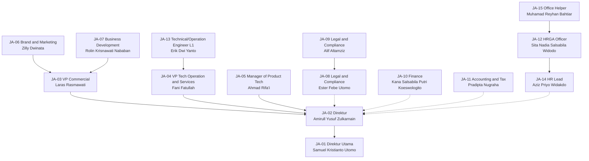
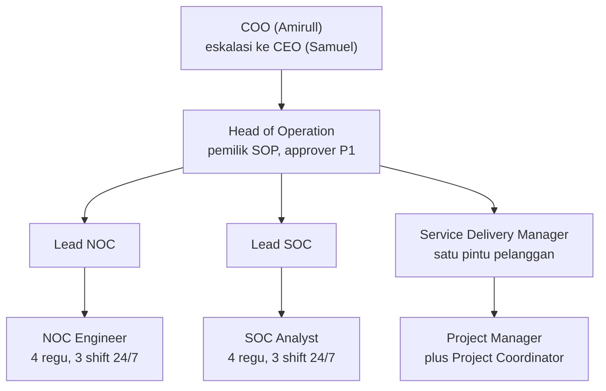
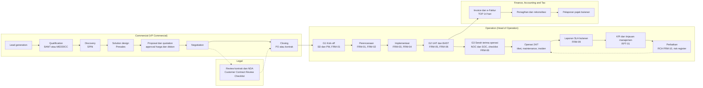
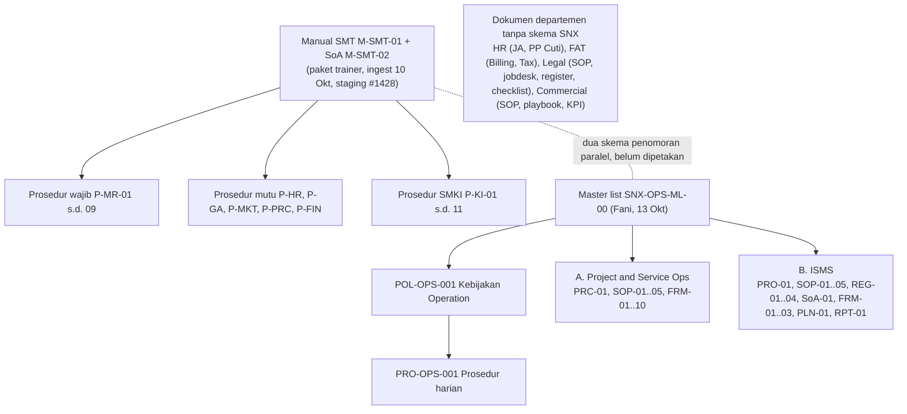

# ISO SINUX Supporting Docs: sintesis, verdict 112 dokumen, handoff

as_of: 2026-10-14 | lane: ISO Supporting Documents (ingest 13 sampai 14 Okt 2026) | status: NON-KANONIK, dokumen sumber DRAFT | sensitivitas isi: internal
Isi: indeks 64 dokumen, peta proses, gap auditor, PASS/FAIL (putaran 1 sampai 4), verdict council (tier W/P/G/O + jawaban owner 14 Okt), handoff, input owner 112 dokumen + Supporting PIC.
Navigasi: `readme-iso-supdocs-2026-10-14.md`. Penutup sesi dan keputusan owner: verdict bagian 7 dan handoff (`05_HANDOFF`). Setiap bagian diawali penanda `<!-- FILE: path -->` (path relatif terhadap folder md/ korpus; sama dengan nama berkas di staging `isoraw-*`).

<!-- FILE: 00_INDEX.md -->

---
name: 00_INDEX
title: Indeks knowledge pack Supporting Documents SINUX (ingest 13 sampai 14 Okt 2026)
packet_prev: "[staging #1428 (ingest ISO 10 Okt), staging #1615 (penutup sesi 13 Okt), checkpoint 14 Okt #1677 sampai #1680, #1696, #1699, #1701, #1705, #1715]"
sumber: [Drive folder "Operation ISO-9001/27001 - Fani F" (1bM4YuiCpQb_70d1f7ZnVMx6XyWOXlaDF), Drive folder "Supporting Documents" (1JA0Gl0-C7Pj304cmCoJ_Mr8TowewtN1_)]
as_of: 2026-10-14
status: NON-KANONIK, bahan training dan persiapan auditor ISO. Dokumen sumber berstatus DRAFT.
---
# Indeks knowledge pack Supporting Documents SINUX (13 sampai 14 Okt 2026)

> Status sertifikasi (owner 14 Okt): **AUDIT PERDANA** ISO 9001:2015 + ISO/IEC 27001:2022. Verdict 112 dokumen: `04_COUNCIL_VERDICT_112_DOKUMEN.md`.

## Cara pakai (untuk AI dan tim)
1. Mulai dari `01_PETA_PROSES_SINUX.md` (organisasi, alur bisnis ujung ke ujung, angka kunci).
2. Untuk kebutuhan auditor ISO, buka `02_GAP_AUDITOR.md` (pemetaan ke checklist sesi 10 Okt).
3. Status mutu ingest (PASS/FAIL tiap gerbang) ada di `03_QA_PASS_FAIL.md`; detail verifikasi di `_qa/`.
4. Detail per dokumen: satu berkas md per dokumen sumber (tabel di bawah). Struktur tiap berkas seragam:
   frontmatter (kode, sumber Drive, revisi, acuan ISO, sensitivitas) lalu 1 Ringkasan, 2 Isi lengkap, 3 Diagram mermaid,
   4 Peran/RACI/record/KPI, 5 Catatan kualitas (berkutipan), 6 Kata kunci.
5. Dokumen sumber = DRAFT rev 00 dan banyak target berlabel USULAN. Jangan dikutip ke pelanggan atau auditor sebagai ketentuan berlaku sebelum disahkan COO.
6. Sesi lanjutan (generate SOP dan diskusi): baca `04_COUNCIL_VERDICT_112_DOKUMEN.md` (paket minimum, prioritas, ajudikasi konflik), lalu `02_GAP_AUDITOR.md`, lalu md per departemen. Fakta kanon tetap dari KB SINUX; pack ini NON-KANONIK.

## Cakupan
- Putaran 1 (13 Okt): 48 dokumen. Putaran 2 (14 Okt): +6 Eranyacloud, +3 Legal baru, Customer Contract Review Checklist ditulis ulang, +2 residu paket ISO. Putaran 3 (14 Okt, upload owner): 6 dokumen TEXT_ONLY ditingkatkan ke biner, +5 dokumen baru (SLA Consulting Eranyacloud, F-MR-03-01 v18KB, F-MR-09-01, F-MR-09-02, Laporan Insiden), Commercial BP 2024 dilengkapi visual. Total 64 berkas md sumber, semua mermaid lolos render mmdc. Materi AIA diabaikan atas keputusan owner.
- Dokumen tambahan putaran 2: `04_COUNCIL_VERDICT_112_DOKUMEN.md` (verdict Fable + Opus atas 112 dokumen harapan owner), `_input/EXPECTED_DOCS_PIC_2026-10-14.md` (input owner verbatim + Supporting PIC), `_qa/M1_expected_vs_corpus.md` (pemetaan 112 butir).
- Folder `eranyacloud/` = REFERENSI EKSTERNAL (perusahaan lama owner, 2024), bukan dokumen SINUX.
- Operation 20 (Fani: Project and Service Operations + induk), Information Security 15 (Fani: ISMS ISO 27001), HR 2 (Aziz), FAT 2, Legal 5, Commercial 4.
- Subfolder Supporting Documents "Management" dan "Dep. Ops" kosong per 13 Okt 2026.
- 42 biner diunduh utuh (ukuran byte cocok, CRC zip lulus). 6 berkas yang dulu TEXT_ONLY (Master List OPS, PP Cuti, Sales Playbook, 3 docx Legal) kini berbasis biner dari upload owner 14 Okt (ukuran byte cocok Drive). Tidak ada lagi berkas TEXT_ONLY.

## Daftar dokumen
| Kode | Judul | Departemen | Jenis | Sensitivitas KB (usulan) | Berkas md | Drive fileId | Mode | Mermaid |
|---|---|---|---|---|---|---|---|---|
| POL-OPS-001 (dokumen menyebut "USULAN penomoran") | Kebijakan Divisi Operation SINUX | Operation | Kebijakan | restricted:ops | `ops/POL-OPS-001.md` | `1bn7EHpmUm2DL7ZJVg284KzCLEQrfPBGv` | biner | 1 |
| PRO-OPS-001 (dokumen menyebut "USULAN penomoran") | Prosedur Operasional Divisi Operation SINUX | Operation | Prosedur | restricted:ops | `ops/PRO-OPS-001.md` | `1U8CAdibwBk9x_-Aic2lbev144d6WReTz` | biner | 4 |
| SNX-OPS-FRM-01 | Project Plan, Scope & Timeline Records | Operation | Form/Record | restricted:ops | `ops/SNX-OPS-FRM-01.md` | `1q0cl8mLlUDJ-7nvnzozSbjJhE46-Jk-3` | biner | 1 |
| SNX-OPS-FRM-02 | Project Risk Register | Operation | Register | restricted:ops | `ops/SNX-OPS-FRM-02.md` | `1XvfQ5yYx4H8Y-rgJUKyngfZfn7909L2D` | biner | 2 |
| SNX-OPS-FRM-03 | Project Progress & Monitoring Report | Operation | Form/Record | restricted:ops | `ops/SNX-OPS-FRM-03.md` | `147U5gBLjtLKHau5cQbLUym8iInh2b_RR` | biner | 1 |
| SNX-OPS-FRM-04 | Change Request & Approval Log | Operation | Form/Record | restricted:ops | `ops/SNX-OPS-FRM-04.md` | `1u5P_nturbvTvvi3hSrCy3ZfAIyiXCqWZ` | biner | 1 |
| SNX-OPS-FRM-05 | Testing / UAT & Quality Verification Records | Operation | Form/Record | restricted:ops | `ops/SNX-OPS-FRM-05.md` | `1mTi4unyn2xST8h_ChsS_2w1xTWzSBROs` | biner | 1 |
| SNX-OPS-FRM-06 | Project Handover / BAST & Closure Report | Operation | Form/Record | restricted:ops | `ops/SNX-OPS-FRM-06.md` | `1BPtjct3hNbhlUILJ7FTm4EX-_Vhk-KUb` | biner | 1 |
| SNX-OPS-FRM-07 | Maintenance Schedule & Service Report | Operation | Form/Record | restricted:ops | `ops/SNX-OPS-FRM-07.md` | `1jrnarc0yyoZhx2MLACZePMNEe0-jb3ZB` | biner | 1 |
| SNX-OPS-FRM-08 | Technical Ticket / Incident Register | Operation | Register | restricted:ops | `ops/SNX-OPS-FRM-08.md` | `1E0-sXiP8r-lS34-PVvt3RYRT04O56Lnz` | biner | 1 |
| SNX-OPS-FRM-09 | SLA Performance Monitoring Report | Operation | Laporan | restricted:ops | `ops/SNX-OPS-FRM-09.md` | `14o0dFUVZU-ieDbrLFQXTzwmNIL4SAftF` | biner | 1 |
| SNX-OPS-FRM-10 | Root Cause Analysis & Corrective Action Report | Operation | Form/Record | restricted:ops | `ops/SNX-OPS-FRM-10.md` | `1XFMQDye_WWWomRpwmT6KGMRdi4EVbRsS` | biner | 1 |
| SNX-OPS-ML-00 | Master List (Master list dokumen Divisi Operation untuk ISO 9001:2015  | Operation | Register | restricted:ops | `ops/SNX-OPS-ML-00.md` | `11KICKwmsIgl5TEgdX_5AgLa-mfoIBVTH` | biner (upload owner) | 1 |
| SNX-OPS-PRC-01 | Operations Business Process Flow | Operation | lainnya (peta proses bisnis /  | restricted:ops | `ops/SNX-OPS-PRC-01.md` | `15GrP-ihMm6MC5szQqlAgGlmWjnQ5TmH0` | biner | 2 |
| SNX-OPS-RPT-01 | Operations KPI & Performance Monitoring Report | Operation | Laporan | restricted:ops | `ops/SNX-OPS-RPT-01.md` | `1rSuMH8wK5BTGUHLm8KjGig1LZOKWcECO` | biner | 1 |
| SNX-OPS-SOP-01 | SOP Project Management & Delivery | Operation | SOP | restricted:ops | `ops/SNX-OPS-SOP-01.md` | `1lv4ALJnqGG9s9cHnzz38yOTJC57pmPgo` | biner | 1 |
| SNX-OPS-SOP-02 | SOP Project Change Management | Operation | SOP | restricted:ops | `ops/SNX-OPS-SOP-02.md` | `15FTuu06HTHoF-Vi0qzqvwmfQH5tEdT63` | biner | 1 |
| SNX-OPS-SOP-03 | SOP Preventive & Corrective Maintenance | Operation | SOP | restricted:ops | `ops/SNX-OPS-SOP-03.md` | `10odQYr4B2cyaAX9Z98EKxv4HUjgwIoYc` | biner | 1 |
| SNX-OPS-SOP-04 | SOP Technical Incident Handling & Escalation | Operation | SOP | restricted:ops | `ops/SNX-OPS-SOP-04.md` | `1p9vcA1Sj6xHIbpuIS1Lb8uBTisv2WeuG` | biner | 2 |
| SNX-OPS-SOP-05 | SOP Service Level Agreement (SLA) Monitoring | Operation | SOP | restricted:ops | `ops/SNX-OPS-SOP-05.md` | `1S4RFEDaTYU9mZYWjHHbYBfo8SRgBAq9-` | biner | 1 |
| SNX-ISMS-FRM-01 | Backup Log & Restore Testing Records | Information Security | Form/Record | restricted:ops | `isms/SNX-ISMS-FRM-01.md` | `1J436lMZJSgowkEeMD6m45N70h7Go6_ZV` | biner | 1 |
| SNX-ISMS-FRM-02 | Security Incident & Investigation Records | Information Security | Form/Record | restricted:ops | `isms/SNX-ISMS-FRM-02.md` | `1ILWYIkwaqe3SkpTsEPzY_IB-HMqCqui2` | biner | 1 |
| SNX-ISMS-FRM-03 | Supplier Technical & Security Evaluation Records | Information Security | Form/Record | restricted:ops | `isms/SNX-ISMS-FRM-03.md` | `1I0qEhkegW3w-k7YvTnKftqvUUbMg3rmg` | biner | 1 |
| SNX-ISMS-PLN-01 | Business Continuity / IT Recovery Plan | Information Security | Rencana | restricted:ops | `isms/SNX-ISMS-PLN-01.md` | `1vwD5tORDQNQ7SNaQ6w4KitPKTcsw9ZVX` | biner | 1 |
| SNX-ISMS-PRO-01 | Information Classification & Handling Procedure | Information Security | Prosedur | restricted:ops | `isms/SNX-ISMS-PRO-01.md` | `1h5PtuUGE8UDPbwPtccUQ8pgwgAoW64Io` | biner | 1 |
| SNX-ISMS-REG-01 | Information Asset Register | Information Security | Register | restricted:ops | `isms/SNX-ISMS-REG-01.md` | `1mMx6v0UhAWMQU6I6rAfsZz20nsjv-FkP` | biner | 1 |
| SNX-ISMS-REG-02 | Information Security Risk Assessment Register | Information Security | Register | restricted:ops | `isms/SNX-ISMS-REG-02.md` | `1skCiIY43Vz6qfT71vEKz55EZFGHVCl4Q` | biner | 1 |
| SNX-ISMS-REG-03 | Information Security Risk Treatment Plan | Information Security | Rencana | restricted:ops | `isms/SNX-ISMS-REG-03.md` | `1NdkQrRWevHXuH9thxmoTPsRIf0wNl-MJ` | biner | 1 |
| SNX-ISMS-REG-04 | User Access Register & Periodic Access Review | Information Security | Register | restricted:ops | `isms/SNX-ISMS-REG-04.md` | `14JtND6eqCuvufrVoPDzKJyrHp4eQsGjT` | biner | 1 |
| SNX-ISMS-SOA-01 | Statement of Applicability (SoA) | Information Security | Register | restricted:ops | `isms/SNX-ISMS-SOA-01.md` | `1g9Yiuv6EDJP2ikgAbpcnRVE0ZVFkLWG2` | biner | 1 |
| SNX-ISMS-SOP-01 | SOP Information Security Incident Management | Information Security | SOP | restricted:ops | `isms/SNX-ISMS-SOP-01.md` | `1MApsp9RPPMO1Xottjb2fGQJlaQas2M99` | biner | 1 |
| SNX-ISMS-SOP-02 | SOP User Access Control & Authorization | Information Security | SOP | restricted:ops | `isms/SNX-ISMS-SOP-02.md` | `1JoSiwoMglIxy7Ic3t0EhRfvzJgf5ydzT` | biner | 1 |
| SNX-ISMS-SOP-03 | SOP Backup & Recovery | Information Security | SOP | restricted:ops | `isms/SNX-ISMS-SOP-03.md` | `1z6y_n2i6cTN6C1y7alJsCasuy9hU6Qzc` | biner | 1 |
| SNX-ISMS-SOP-04 | SOP IT Asset & Configuration Management | Information Security | SOP | restricted:ops | `isms/SNX-ISMS-SOP-04.md` | `1L6fR1mUiCePwKjyrpSPOrCz-6FpJbDpg` | biner | 1 |
| SNX-ISMS-SOP-05 | SOP Vulnerability & Patch Management | Information Security | SOP | restricted:ops | `isms/SNX-ISMS-SOP-05.md` | `160t8vg9Eb_ItxjLuWxLG17OIAKpxSsKC` | biner | 1 |
| HR-JA-001 (usulan, validasi Document Control) | SINUX Job Analysis 2026 | HR | Job description | restricted:hr | `hr/HR-JA-001.md` | `1m91WrfxiL4BnQSMItHSgF_VP9eUD5Vt1` | biner | 1 |
| tidak bernomor | BAB VI HARI LIBUR, CUTI, DAN MENINGGALKAN PEKERJAAN (berkas PP - Cuti; | HR | Kebijakan | restricted:hr | `hr/HR-PP-Cuti.md` | `1i2JaRaQolbKxKL9HjDao2s4F0bzma9-Z` | biner (upload owner) | 2 |
| tidak bernomor | Standar Operasional Prosedur (SOP) - Billing dan Invoicing | FAT | SOP | restricted:finance | `fat/FAT-SOP-Billing-Invoicing.md` | `1sZfTBx1ZxBIryhzJHf14eOcRR7HuQ1E1Qox3DdwmHKI` | biner | 1 |
| tidak bernomor | SOP Tax Process (file: 6. SOP Tax Administration & Reporting) | FAT | SOP | restricted:finance | `fat/FAT-SOP-Tax-Administration-Reporting.md` | `1iMKby6u4X8MYyGlrC5qz73D0y2anOv87` | biner | 1 |
| 001/LEGAL/SINUX/X/2026 | Company Licenses and Permits Register (Daftar Perizinan Perusahaan dan | Legal | Register | restricted:legal | `legal/001-LEGAL-SINUX-X-2026.md` | `1a1hDz9zwdRHBAHaU9wALSdg66R4bD8mGD-86TyzJewk` | biner | 1 |
| tidak bernomor (field Nomor Dokumen kosong) | Customer Contract Review Checklist | Legal | Checklist | restricted:legal | `legal/LEG-Checklist-Contract-Review.md` | `1lsdhtFZrf7bdckagXYtEXxmIyRw3jNw-28iXJpoTeaY` | biner | 1 |
| tidak bernomor (field Nomor Dokumen kosong) | Data Protection & Confidentiality Compliance Review | Legal | Form/Record | restricted:legal | `legal/LEG-Data-Protection-Confidentiality-Review.md` | `1m9mIkrMmiIY4TNmbV7j_rRuXKPUnfiK_EP80myS6lN8` | biner | 1 |
| tidak bernomor | Jobdesk Line Manager Legal | Legal | Job description | restricted:legal | `legal/LEG-Jobdesk-Line-Manager-Legal.md` | `1Mv6TuLy8QsllpA4YTTjmNg7Hsur4yWiL` | biner (upload owner) | 1 |
| tidak bernomor | Jobdesk Staff Legal | Legal | Job description | restricted:legal | `legal/LEG-Jobdesk-Staff-Legal.md` | `1dOku3703JwQCVeC39tl9x6k0FMa4f3nW` | biner (upload owner) | 1 |
| tidak bernomor (field Nomor Dokumen kosong) | Legal Risk Register | Legal | Register | restricted:legal | `legal/LEG-Legal-Risk-Register.md` | `1ysIL0ytnspFGsYpSolSnuBpCG_MFE9IoiTJIhWfIIhA` | biner | 1 |
| tidak bernomor | SOP Divisi Legal | Legal | SOP | restricted:legal | `legal/LEG-SOP-Divisi-Legal.md` | `19peOeN1yA-GwAlfNylE6xQR7rHVKRsZb` | biner (upload owner) | 3 |
| tidak bernomor (field Nomor Dokumen kosong) | Vendor/Supplier Contract Review Checklist | Legal | Checklist | restricted:legal | `legal/LEG-Vendor-Supplier-Contract-Review-Checklist.md` | `1xU1pbum660ZzBCuTA5klCyAVK1iWonLCY0NOejqSlHg` | biner | 1 |
| tidak bernomor | Commercial Onboarding. Jul 2026 (New Employee Onboarding, Commercial D | Commercial | Materi onboarding | restricted:commercial | `commercial/COM-Commercial-Onboarding-Jul2026.md` | `16TIN9Tsv_sBXMrL4KHeO8f6Ao0F-KsAS` | biner | 6 |
| tidak bernomor | KPI COMMERCIAL & MARKETING (KPI Individu - Laras, Olin, Zily) | Commercial | Register | restricted:commercial | `commercial/COM-KPI-Commercial-Marketing.md` | `1TNg8MveAYQ26Fkalk7UlL_iu7FC6EUIb` | biner | 1 |
| tidak bernomor | Sales Playbook | Commercial | Playbook | restricted:commercial | `commercial/COM-Sales-Playbook.md` | `1RVxuhUAFVTqwbtArb9uG4i2paG7Ph35w` | biner (upload owner) | 3 |
| tidak bernomor | Sales Standard Operating Procedure | Commercial | SOP | restricted:commercial | `commercial/COM-Sales-SOP.md` | `19Hex8udn1JDG4NKY7hZaODjroHeHwMM0` | biner | 4 |
| F-MR-03-01 | Rencana Audit Internal | Manajemen Representatif (MR) | Form/Record (template kosong) | internal | `iso_residual/F-MR-03-01-Rencana-Audit-Internal-v18KB.md` | `1uzwxX2HsWssOWa1vY0_Hj8Sl-zRXPqkW` | biner | 1 |
| F-MR-03-01 | Rencana Audit Internal Tahun 2026 | Manajemen Representatif (MR) | FRM | internal | `iso_residual/F-MR-03-01-Rencana-Audit-Internal-v43KB.md` | `1Ue9W0hjYRwg79d3-T5ftkHxDj3DklY3f` | biner | 1 |
| F-MR-09-01 (dari nama berkas Drive; footer cetak di dalam be | REKAMAN HASIL KOMUNIKASI & PENYADARAN | Manajemen Representatif (MR) | Form/Record (template kosong) | internal | `iso_residual/F-MR-09-01-Rekap-Hasil-Kegiatan-Komunikasi.md` | `1IHo6tojy0Eh2O5nOGQ2q67Xbaj0bXu5G` | biner | 1 |
| F-MR-09-02 (dari nama berkas Drive; footer cetak di dalam be | DAFTAR HADIR KEGIATAN KOMUNIKASI & PENYADARAN | Manajemen Representatif (MR) | Form/Record (template kosong) | internal | `iso_residual/F-MR-09-02-Daftar-Hadir-Kegiatan-Komunikasi.md` | `1VWdXdhqi9s9SYqnUb19_vGoHFwOc2oqj` | biner | 1 |
| tidak bernomor | PELAPORAN INSIDEN KEAMANAN INFORMASI | Information Security (inferensi dari jud | Form/Record (template kosong;  | internal | `iso_residual/Laporan-Insiden-Keamanan-Layanan-TI.md` | `1Ub2XwGzYFofqUhEoctB4LzNJSt5DsOsU` | biner | 1 |
| M-SMT-01 | Manual Terintegrasi Sistem Manajemen Mutu & Keamanan Informasi berbasi | Information Security (inferensi; pemilik | lainnya (Manual sistem manajem | internal | `iso_residual/M-SMT-01-Manual-Manajemen-Terintegrasi.md` | `1Yx_Hg1a3cIeN40Zld2OFU3QEfzux2aGO` | biner | 5 |
| tidak bernomor (kode berkas ERY-BF-BaU diberikan saat ekstra | Customer On Boarding Process - BaU | Referensi eksternal (Eranyacloud 2024) | lainnya (diagram swimlane alur | restricted:commercial | `eranyacloud/ERY-BF-BaU.md` | `1O3dX7n5bLQQG9JObahA5mE40Zfc0GEBz` | biner | 1 |
| tidak bernomor (kode berkas ERY-BF-Project diberikan saat ek | Customer On Boarding Process - Project | Referensi eksternal (Eranyacloud 2024) | lainnya (diagram swimlane alur | restricted:commercial | `eranyacloud/ERY-BF-Project.md` | `1Xs_97hMaf85B7UboAQlfCKUVXotOo4q7` | biner | 1 |
| tidak bernomor (kode berkas ERY-BP-Existing diberikan saat e | Ticketing Incident/Request Flow | Referensi eksternal (Eranyacloud 2024) | lainnya (diagram swimlane alur | restricted:commercial | `eranyacloud/ERY-BP-Existing.md` | `19bgVYey2KgExPFIa5FxMR-94jkJ62V5x` | biner | 1 |
| tidak bernomor (kode berkas ERY-Commercial-Business-Process- | Commercial Business Process (subjudul sampul: Customer Onboarding Proc | Referensi eksternal (Eranyacloud 2024) | lainnya (deck/PDF proses komer | restricted:commercial | `eranyacloud/ERY-Commercial-Business-Process-2024.md` | `1L3lEAHBGex37daCpRjjqHIczleyQYJwa` | biner (upload owner) | 1 |
| tidak bernomor (kode berkas ERY-OPS-MS-Ticketing-Flow diberi | Managed Service Ticketing Flow | Referensi eksternal (Eranyacloud 2024) | lainnya (diagram swimlane alur | restricted:commercial | `eranyacloud/ERY-OPS-MS-Ticketing-Flow.md` | `1M17eccvaLQEnCWH4Dea1gzq9N3E3xiOz` | biner | 1 |
| tidak bernomor (kode berkas ERY-OPS-Ticketing-Incident diber | Ticketing Incident/Request Flow | Referensi eksternal (Eranyacloud 2024) | lainnya (diagram swimlane alur | restricted:commercial | `eranyacloud/ERY-OPS-Ticketing-Incident.md` | `1E5Da10daw97Sdz0p9Zpsyf4vVflKdVq4` | biner | 1 |
| tidak bernomor (kode berkas ERY-SLA-Consulting diberikan saa | SLA Consulting (judul dari nama berkas; sheet tanpa sel judul, blok ta | Referensi eksternal (Eranyacloud 2024) | lainnya (tabel SLA waktu penge | restricted:commercial | `eranyacloud/ERY-SLA-Consulting.md` | `168hxWk3jU_0hrDJLXf2-cNn_2zgSNMas` | biner (upload owner) | 1 |

<!-- FILE: 01_PETA_PROSES_SINUX.md -->

---
name: 01_PETA_PROSES_SINUX
title: Peta organisasi, proses ujung ke ujung, dan angka kunci SINUX (dari 48 dokumen tim, 13 Okt 2026)
as_of: 2026-10-13
status: NON-KANONIK. Sintesis orkestrator dari berkas md di folder ini. Setiap butir menunjuk dokumen sumber. Dokumen sumber DRAFT.
kb_sensitivity_suggest: restricted:ops
---
# Peta organisasi, proses, dan angka kunci SINUX

> Pembaruan 14 Okt 2026 (owner): status sertifikasi = **AUDIT PERDANA** ISO 9001:2015 + ISO/IEC 27001:2022 (bukan surveillance). Fani Fatullah = VP Tech Operation and Services, fulltime (KB kanon masih menulis Komisaris dan Advisor, usang). Verdict 112 dokumen: `04_COUNCIL_VERDICT_112_DOKUMEN.md`. Owner 14 Okt (kedua): sistem tiket "zammad untuk ops, glpi untuk generalist"; Bila Parwasto = Kana Salsabila Putri Koeswologito (JA-10 Finance); "Sita Nadia Scifin" = nama kontak WA JA-12.

## 1. Organisasi perusahaan (sumber: `hr/HR-JA-001.md`, SINUX Job Analysis 2026)

15 jabatan, masing-masing dengan pemegang bernama. Garis lapor tegas diambil dari dokumen. Garis putus-putus = sumber hanya menulis "Management / Direktur" (inferensi garis ke Direktur).

Panah = "melapor ke". Bagan ini diturunkan dari teks HR-JA-001 (dokumen sumber tidak memuat bagan). Slide 9 "Organization Structure" di deck Commercial Onboarding kosong (terverifikasi lapisan teks, gambar tertanam, render 150 dpi).

### 1.1 Divisi Operation (sumber: `ops/POL-OPS-001.md` Bagian 3 dan 9, gambar rId22)

Jabatan dan garis lapor berlabel USULAN. Delapan jabatan Operation belum punya nama pemegang. HR-JA-001 hanya memuat satu jabatan teknis di bawah VP Tech Operation (JA-13 Erik, Engineer L1), sehingga struktur Operation di POL-OPS-001 belum terisi orang.

### 1.2 Konflik jabatan yang perlu keputusan owner (bukti di `_qa/V2_kb_crosscheck.md`)
| Orang | HR-JA-001 (13 Okt) | Dokumen lain | KB kanon | Catatan |
|---|---|---|---|---|
| Fani Fatullah | VP Tech Operation and Services (atasan Erik) | POL-OPS-001: Komisaris dan Advisor | Komisaris dan Advisor, belum full-time (PPL §9, PPL §2, DEC-2026-056) | Owner menyatakan Fani sudah pindah posisi dan fulltime: KB dan POL-OPS-001 usang |
| Samuel | Direktur Utama | CEO (POL-OPS-001, SOP Billing, Jobdesk Legal) | CEO | Sebutan jabatan ganda |
| Amirull | Direktur | COO (semua dokumen Fani sebagai penyetuju) | COO | Sebutan jabatan ganda |
| Aziz | HR Lead | - | HRBP and GA | Beda sebutan |
| Atasan Line Manager Legal | "Management / Direktur" | Jobdesk: CEO; SOP Legal: `[ISI]` | - | Tiga versi |
| Finance Lead / Finance Staff | tidak ada (hanya JA-10 Finance, JA-11 Accounting and Tax) | dipakai sebagai approver di SOP Billing dan SOP Tax | - | Peran tanpa padanan jabatan |

## 2. Proses bisnis ujung ke ujung (lead sampai layanan berjalan dan ditagih)

Gabungan `commercial/COM-Sales-SOP.md`, `commercial/COM-Commercial-Onboarding-Jul2026.md`, `legal/LEG-SOP-Divisi-Legal.md`, `ops/SNX-OPS-PRC-01.md` (gate G1 sampai G3), `fat/FAT-SOP-Billing-Invoicing.md`. Sintesis orkestrator; detail tiap langkah ada di dokumen masing-masing.

Catatan: titik pemicu invoice (sesudah BAST, termin, atau berlangganan) mengikuti kontrak; SOP Billing memakai dokumen pendukung (PO, BAST, dan lainnya) yang definisinya berbeda di Bagian 4.1 dan 5.1 (lihat catatan kualitas di md Billing).

## 3. Hierarki dokumen sistem manajemen (lama vs baru)

Dua SoA ada bersamaan: M-SMT-02 (paket trainer: 92 Ya / 1 Tidak per tabel, ringkasan menulis 90/3) dan SNX-ISMS-SOA-01 (Fani: 48 usulan Ya, 45 Perlu keputusan, 0 berlaku final). Wajib dipilih satu sebelum audit (lihat `02_GAP_AUDITOR.md`).

## 4. Angka kunci operasional (semua DRAFT; label USULAN ditulis bila ada di sumber)
| Topik | Nilai | Sumber md |
|---|---|---|
| Severity insiden teknis, Ack | P1 15 menit, P2 30 menit, P3 2 jam kerja, P4 1 hari kerja | ops/POL-OPS-001 §6, ops/SNX-OPS-SOP-04, ops/SNX-OPS-FRM-08 |
| Update ke pelanggan | P1 tiap 1 jam, P2 tiap 3 jam atau per shift, P3 harian, P4 saat selesai | ops/SNX-OPS-SOP-04 |
| Target pulih (USULAN) | P1 4 jam, P2 8 jam, P3 24 jam, P4 72 jam | ops/SNX-OPS-SOP-04, FRM-08 |
| Eskalasi P1 | Lead langsung, COO dalam 30 menit, CEO bila COO tidak tersedia | ops/SNX-OPS-SOP-04 |
| Availability | 99.9% per bulan (anggaran downtime sekitar 43 menit per 30 hari), peringatan bila lebih dari 50% terpakai | ops/SNX-OPS-SOP-05 |
| Laporan SLA | data hari kerja ke-3, laporan hari kerja ke-5, review triwulanan | ops/SNX-OPS-SOP-05 |
| Insiden keamanan | lapor event ke SOC 1 jam; COO 30 menit untuk P1; pelanggan 24 jam untuk P1; UU PDP 3 x 24 jam; tidak ada tenggat lapor BSSN | isms/SNX-ISMS-SOP-01 |
| RTO (USULAN, internal) | 4 jam: managed services server, monitoring, password manager, Jumphost, WAF; 8 jam: ticketing; 24 jam: knowledge base | isms/SNX-ISMS-PLN-01 §4 |
| RPO | 24 jam monitoring, ticketing, password manager, KB; 1 minggu konfigurasi Jumphost dan WAF | isms/SNX-ISMS-PLN-01 §4 |
| Backup | sistem internal kritis harian retensi 30 hari; konfigurasi tiap perubahan dan mingguan retensi 90 hari; uji restore bulanan per pelanggan, triwulanan internal | isms/SNX-ISMS-SOP-03 |
| Patch (USULAN) | Darurat 72 jam (mitigasi 24 jam), Kritis CVSS 9.0+ 7 hari, Tinggi 30 hari, Sedang 90 hari, Rendah siklus berikutnya | isms/SNX-ISMS-SOP-05 |
| Review akses | privileged triwulan, biasa semester, temuan ditutup 10 hari kerja, akun tidak aktif lebih dari 90 hari = temuan; mover dicabut 5 hari kerja, leaver hari terakhir | isms/SNX-ISMS-SOP-02, REG-04 |
| Risiko IS | 15 risiko usulan: Kritis 1 (ISR-002 webshell fleet WHM/cPanel pelanggan pemerintah, L5 x I4 = 20), Tinggi 10, Sedang 4 | isms/SNX-ISMS-REG-02 |
| Supplier | 8 supplier; kontrak dan NDA "Belum diketahui" 8/8; evaluasi Tinggi 6 bulan, lainnya 12 bulan; skor 80+ disetujui, di bawah 60 tinjau ulang | isms/SNX-ISMS-FRM-03 |
| KPI Operation | 17 KPI (RPT-01), nilai aktual kosong | ops/SNX-OPS-RPT-01 |
| Billing | TOP 14 hari kalender, PPN 12% (satu butir masih 11%), PPh 23 2%, arsip 10 tahun | fat/FAT-SOP-Billing-Invoicing |
| Cuti | tahunan 12 hari (14 hari kerja bila masa kerja lebih dari 3 tahun, sesuai sumber), sisa maks 6 hari sampai 30 Juni, ajukan 7 hari kerja sebelumnya | hr/HR-PP-Cuti |
| Legal | pengingat kontrak dan izin 90/60/30 hari; somasi atau klaim dilaporkan maks 1 hari kerja | legal/LEG-SOP-Divisi-Legal |
| Sales | update CRM maks 24 jam; email 1 hari kerja; WhatsApp 2 jam kerja; pipeline minimal 3x target; win rate 30% atau lebih | commercial/COM-Sales-SOP, COM-Commercial-Onboarding |
| KPI Commercial | revenue Laras "3 M / yearly", Olin "1,5 M / yearly" (satuan M tidak didefinisikan); realisasi belum diisi | commercial/COM-KPI-Commercial-Marketing |

## 5. Sistem pendukung yang disebut dokumen (dicocokkan ke KB, detail `_qa/V2_kb_crosscheck.md`)
| Fungsi | Sistem menurut dokumen | Status di KB |
|---|---|---|
| Tiket pelanggan Nusagrid | Zammad (WhatsApp dan telepon) | NOT_IN_KB (KB: tiket via WhatsApp dan GLPI Service Hub) |
| Tiket GMF dedicated dan internal | SINUX Service Hub (GLPI, ticket.sinux.co.id) | MATCH |
| Monitoring | Nusametric, Overseer, console Nusagrid | MATCH |
| Keamanan | Wazuh, AegisWAF, Cloudflare, EDR | sebagian |
| Backup | Acronis Cyber Protect | MATCH |
| Akses production | Jumphost SINUX ter-audit | MATCH |
| Kredensial | password manager internal (vault) | CONFLICT: REG-01 "Aktif" vs REG-02 dan KB "deployed, belum live" |

<!-- FILE: 02_GAP_AUDITOR.md -->

---
name: 02_GAP_AUDITOR
title: Pemetaan dokumen baru (13 Okt) ke checklist auditor ISO dan temuan sesi 10 Okt
as_of: 2026-10-13
dasar: staging #1428 (ingest paket ISO trainer/auditor, 10 Okt; vonis "BELUM siap stage 1", 5 risiko besar) dan #1615
status: NON-KANONIK. Penilaian orkestrator, bukan auditor. Semua dokumen baru DRAFT rev 00, belum disahkan.
kb_sensitivity_suggest: internal
---
# Pemetaan ke checklist auditor ISO 9001 dan 27001

> Pembaruan 14 Okt 2026: owner menegaskan ini AUDIT PERDANA (sertifikasi awal). Verdict 112 dokumen dan paket minimum ada di `04_COUNCIL_VERDICT_112_DOKUMEN.md`. Supporting PIC per departemen ada di `_input/EXPECTED_DOCS_PIC_2026-10-14.md`.

## 1. Lima butir yang owner minta disiapkan untuk auditor
| Butir auditor | Status 10 Okt (#1428) | Yang ditambah dokumen 13 Okt | Status sekarang | Sisa kerja |
|---|---|---|---|---|
| Struktur organisasi | Lampiran 2 Struktur Organisasi kosong (tanpa bagan, tanpa nama) | HR-JA-001: 15 jabatan bernama + garis lapor; POL-OPS-001: struktur Divisi Operation (8 jabatan, USULAN, tanpa nama); slide org di deck Commercial kosong | SEBAGIAN | Bagan resmi bertanda tangan; selaraskan sebutan (Direktur vs CEO/COO); isi nama 8 jabatan Operation; status Fani (VP Tech Operation fulltime) disahkan |
| Job description | generik (gudang, impor), tidak ada untuk IT/SOC/security | HR-JA-001 (15 jabatan), Jobdesk Staff Legal, Jobdesk Line Manager Legal, job desk jabatan Operation di POL-OPS-001 §9 | SEBAGIAN BESAR | KPI per jabatan tidak ada di HR-JA-001; jabatan Operation (Lead NOC/SOC, SDM, PM) belum punya pemegang; JA-13 Engineer L1 satu-satunya jabatan teknis bernama |
| Daftar SOP | 31 prosedur paket trainer (banyak salinan pihak lain) | 32 dokumen Operation/ISMS di master list SNX-OPS-ML-00 + SOP Billing, SOP Tax, SOP Legal, Sales SOP, PP Cuti | ADA (draft) | Satu master list perusahaan; petakan atau tarik P-MR/P-KI lama vs SNX-OPS/SNX-ISMS baru |
| Contoh implementasi tiap SOP | hanya 7 dari 31 punya rekaman, semuanya bermasalah | form dan register baru (FRM, REG) berisi baris CONTOH bertanggal November sampai Desember 2026 (sesudah tanggal draft), bukan record nyata | BELUM | Isi record nyata 1 sampai 3 bulan sebelum stage 2 (keputusan #8 di ML-00): tiket, CR, backup log, uji restore, review akses, laporan SLA dan KPI |
| KPI/target per departemen | F-MR-08-01/02 kosong | Operation: 17 KPI (RPT-01) + KPI di POL-OPS-001; Commercial: KPI individu Laras, Olin, Zily; Legal: KPI di jobdesk (sebagian tanpa target) | SEBAGIAN | HR, FAT, Management belum punya KPI; realisasi semua KPI kosong; target banyak USULAN |

## 2. Lima risiko besar sesi 10 Okt, dicek ulang
| Risiko #1428 | Dampak dokumen baru |
|---|---|
| 1. Sisa bisnis/perusahaan lain di dokumen inti (reksa dana, kecamatan/Dukcapil, PT lain) | Dokumen baru (Fani, HR, FAT, Legal, Commercial) bersih dari sisa itu: grep 15 penanda #1428 (reksa, kecamatan, kependudukan, Dukcapil, Generasi Paham, Ayovest, APLN, PT GPT, PT SMT, Pertamina, Anggun Cipta, Sahridaya, Investment Product, manajer investasi) di 42 teks konversi dan 48 md = 0 hit. Dokumen lama di paket trainer TETAP bermasalah sampai diganti atau ditarik |
| 2. Bagan org, job desc, KPI, nama kosong | Membaik banyak (lihat tabel 1), belum tuntas |
| 3. Bukti implementasi hampir nol | Belum berubah: semua record baru adalah template dengan baris CONTOH |
| 4. SoA tidak konsisten, tidak terhubung ke risiko | SoA baru SNX-ISMS-SOA-01 terhubung ke REG-02/REG-03 (24 dari 25 kontrol RTP konsisten); 45 dari 93 kontrol "Perlu keputusan"; kontrol 6.3 dipakai RTP-004 dan RTP-013 tetapi SoA "Perlu keputusan". Dua SoA (M-SMT-02 lama dan SOA-01 baru) beredar bersamaan |
| 5. Penomoran dan substansi kebijakan teknis keliru | Skema baru SNX-* rapi dan rujukan antardokumen valid (ML-00 Riwayat Review #9), tetapi POL-OPS-001/PRO-OPS-001 memakai skema ketiga (SHF-01, NOC-01) dan merujuk artefak internal (DOCTRINE, DEC, SKILL_*) yang tidak dikenal auditor |

## 3. Keputusan yang menunggu owner (gabungan ML-00 sheet Keputusan dan Gap + temuan ingest)
| No | Pemutus | Keputusan | Sumber |
|---|---|---|---|
| 1 | ISO/ISMS Coordinator | Setujui skema penomoran SNX dan selaraskan dengan master list perusahaan (P-MR, P-KI, M-SMT) | ML-00 #1 |
| 2 | COO | Sahkan target USULAN: Ack dan target pulih per severity, jenis change, RTO/RPO internal, tenggat patch, durasi hypercare | ML-00 #2 |
| 3 | ISMS Coordinator + pemilik risiko | Validasi 15 risiko REG-02 dan RTP REG-03, termasuk kriteria penerimaan; penerimaan tertulis COO untuk ISR-002 (Kritis) | ML-00 #3, REG-02 |
| 4 | ISMS Coordinator | Putuskan 45 kontrol SoA "Perlu keputusan"; pilih satu SoA (M-SMT-02 atau SOA-01) | ML-00 #4, ingest |
| 5 | Commercial + Legal | Verifikasi kontrak, NDA, sertifikasi 8 supplier FRM-03, lalu evaluasi pertama | ML-00 #5 |
| 6 | Head of Operation | Isi Information Asset Register dari sumber aktual (Nusagrid, Overseer, Acronis, Cloudflare, lisensi) | ML-00 #6 |
| 7 | Head of Operation | Prosedur yang belum ada: logging dan retensi log (A 8.15), network security dan segmentasi (A 8.20 s.d. 8.22), clock sync (A 8.17), kriptografi (A 8.24) | ML-00 #7 |
| 8 | Head of Operation | Kumpulkan bukti penerapan 1 s.d. 3 bulan sebelum audit stage 2 | ML-00 #8 |
| 9 | ISMS Coordinator | Jadwalkan audit internal dan tinjauan manajemen memakai RPT-01 | ML-00 #9 |
| 10 | Owner | Status dan tanggal efektif jabatan Fani (VP Tech Operation and Services, fulltime) untuk disamakan di POL-OPS-001 dan KB. **Owner 14 Okt: "fani sudah jadi vp sekarang"** (tanggal efektif belum disebut) | ingest, V2 |
| 11 | Owner/HR | Rekonsiliasi roster: KB memuat Reza Ardi, Bila Parwasto, Daffa Deta Prawira yang tidak ada di HR-JA-001; Alif tidak ada di KB; Kana ADA di KB `knowledge/PERSONAS.md` baris "Kana Salsabila (Bila Parwasto)" (koreksi 14 Okt atas klaim V2 lama "Kana tidak ada di KB", diukur repo_grep di c750f35c). **Owner 14 Okt: Bila Parwasto = Kana Salsabila Putri Koeswologito (finance); "Sita Nadia Scifin" hanya nama kontak WA.** Reza Ardi dan Daffa Deta Prawira masih terbuka | V2 |
| 12 | Owner/Ops | Sistem tiket resmi: Zammad (PRC-01, SOP-04, FRM-08) vs WhatsApp + GLPI Service Hub (KB, POL-OPS-001 P-08). **DIPUTUS owner 14 Okt: "sistem tiket zammad untuk ops, glpi untuk generalist"** | V2, S5 |
| 13 | Owner/Commercial | Klaim Sales Playbook yang bertentangan dengan KB: SLA 99.9% dan backup "setiap VM + standby", respons kritis 1 jam (SOP-04: 15 menit Ack), Arcfra/Virtuozzo vs larangan positioning Arcfra (PRD §11) | V2 |
| 14 | FAT | PPN 11% vs 12% di SOP Billing; titik awal TOP 14 hari (tiga versi); definisi "4 dokumen wajib" | B6, V1 |

## 4. Prioritas persiapan (rekomendasi tunggal orkestrator)
Satu langkah bernilai tertinggi: tetapkan satu master list dokumen ISO perusahaan (gabungan paket trainer yang dibersihkan + paket SNX Fani + dokumen departemen), lalu tarik semua dokumen pihak lain. Tanpa itu, auditor akan melihat dua SoA, tiga skema penomoran, dan dua versi struktur jabatan. Sesudahnya: pengesahan COO atas target USULAN, lalu mulai mengisi record nyata (bukti implementasi) karena butir itu butuh waktu kalender 1 sampai 3 bulan dan tidak bisa dikebut di akhir.

Dissent (Ops): mengisi record nyata bisa dimulai sekarang paralel, tidak perlu menunggu master list, karena form SNX sudah siap pakai. Pembalik: bila jadwal stage 1 sudah dekat (belum diketahui), urutkan record dulu.

<!-- FILE: 03_QA_PASS_FAIL.md -->

---
name: 03_QA_PASS_FAIL
title: Hasil gerbang mutu ingest Supporting Documents (13 sampai 14 Okt 2026)
as_of: 2026-10-14
kb_sensitivity_suggest: internal
---
# Hasil PASS / FAIL ingest

## 1. Gerbang
| No | Gerbang | Cara ukur | Hasil | Verdict |
|---|---|---|---|---|
| G1 | Inventaris lengkap | Drive search parentId per folder + createdTime > 10 Okt (dua kaki); subfolder Management dan Dep. Ops kosong | 48 berkas di 2 folder induk | PASS |
| G2 | Unduhan biner utuh | ukuran byte = fileSize Drive; CRC zip (docx/xlsx), pdfinfo (pdf) | 39/39 biner unggahan cocok byte dan CRC lulus; 3 Google Doc diekspor valid (Billing docx CRC lulus, Licenses Register PDF 6 halaman, Contract Checklist PDF 3 halaman) | PASS (42) |
| G3 | Berkas biner tidak terunduh | konektor Drive mengembalikan base64 inline untuk berkas kecil, tidak bisa ditulis byte-exact ke disk (1 percobaan ketik ulang terbukti rusak, dibuang) | 6 berkas TEXT_ONLY: Master List OPS, PP Cuti, Sales Playbook, 3 docx Legal | PARTIAL (isi teks lengkap, layout dan gambar tidak terlihat) |
| G4 | Satu md per sumber | ledger 7 batch vs manifest | 48/48, nol hilang, nol ganda | PASS |
| G5 | Semua gambar dibaca | ledger images_opened vs sumber | 38 diagram tertanam + 46 halaman PDF Commercial + 9 halaman PDF Legal: semua dibuka | PASS |
| G6 | Token kunci sumber ada di md | skrip: kode dokumen, persen, durasi, kontrol Annex A dari teks konversi dicari di md | 100% untuk 42 dokumen biner (2 PDF Legal tanpa token terukur; 5 "miss" = lebar kolom HTML, bukan isi) | PASS |
| G7 | Mermaid valid | render setiap blok dengan mmdc (Chromium) | 67/67 blok dokumen + 4/4 blok sintesis lolos render | PASS |
| G8 | Kredensial dan data pribadi | regex secret + pemeriksaan subagen | 0 kredensial, 0 NIK/rekening/gaji ditemukan; 0 redaksi diperlukan | PASS |
| G9 | Gaya | hitung em-dash di md | 0 | PASS |
| G10 | Kesetiaan isi (verifikator Opus independen) | 18 dokumen: sekitar 1.700 sel, 300 angka, 13 gambar dicek kotak per kotak | 0 angka salah; 9 kesalahan kecil (atribusi, sisipan tanpa tanda inferensi) ditemukan dan diperbaiki | PASS |
| G11 | Klaim "Catatan kualitas" berkutipan | 3 subagen audit ulang bagian 5 di 48 md | ops: semua klaim berkutipan, 3 klaim tak terbukti dihapus, 7 dikoreksi; isms: 150 klaim, 106 terbukti, 44 diperbaiki; lainnya: sekitar 30 dikoreksi, 1 dihapus | PASS sesudah perbaikan |
| G12 | Kaki kedua TEXT_ONLY | read_file_content vs search_files MAX_ALLOWED | 5/6 PASS; Sales Playbook terpotong di kedua kanal | PARTIAL (Sales Playbook) |
| G13 | Cocok dengan KB kanon | 39 klaim lintas dokumen vs query_kb (sha cefd8427, tidak stale) | MATCH 11, PARTIAL 13, CONFLICT 6, NOT_IN_KB 8, KB_STALE 1 | INFO (bukan gagal ingest; daftar konflik untuk owner) |
| G14 | Sisa perusahaan lain (risiko #1 sesi 10 Okt) | grep 15 penanda di 42 teks + 48 md | 0 hit | PASS |
| G15 | Laporan verifikator sendiri diaudit | orkestrator grep ulang klaim V2 | 1 klaim V2 salah (Pradipta, Sita Nadia, Ester disebut tidak ada di HR-JA-001, padahal ada): dikoreksi di laporan V2 | PASS sesudah koreksi |

## 2. FAIL dan PARTIAL yang tersisa (status akhir 14 Okt 2026)
1. ~~Sales Playbook PARTIAL~~ **SELESAI putaran 3**: biner upload owner dibaca sel per sel, 49 Q&A = lengkap. Klaim "terpotong" lama dicabut (renderer Drive memang berakhir di Q&A ke-49).
2. ~~Layout 6 berkas TEXT_ONLY~~ **SELESAI putaran 3**: keenamnya kini berbasis biner (ukuran byte cocok Drive), dropdown, warna, merge, freeze terbaca.
3. **Struktur organisasi di deck Commercial (slide 9) kosong di sumber.** Bukan cacat ingest.
4. **Dokumen sumber sendiri belum siap audit**: semua DRAFT, tanda tangan kosong, record berisi CONTOH. Lihat `02_GAP_AUDITOR.md` dan `04_COUNCIL_VERDICT_112_DOKUMEN.md`.
5. **Materi AIA (pptx sekitar 75 MB)**: DIABAIKAN atas keputusan owner 14 Okt 2026. Bukan FAIL ingest.

## 3. Jejak verifikasi
`_qa/V1_fidelity_report.md` (Opus), `_qa/V2_kb_crosscheck.md`, `_qa/V3_textonly_report.md`, `_qa/S5_ops.md`, `_qa/S5_isms.md`, `_qa/S5_other.md`, `_ledger/B1..B7.json`, `_qa/V4_fidelity_round2_3.md`, `_ledger/E1,E2,L1,U1,U2,U3.json`.

## 4. Putaran 2 (14 Okt 2026): retry PARTIAL/FAIL + upload baru
| No | Gerbang | Hasil | Verdict |
|---|---|---|---|
| R1 | Inventaris ulang (createdTime dan modifiedTime > 13 Okt) | Baru: folder "Sample old - Eranyacloud" 7 berkas; Legal 3 Google Doc baru; Customer Contract Review Checklist diubah 16:04Z (3 hal jadi 6 hal) | PASS |
| R2 | Unduhan biner putaran 2 | 5 PNG Eranyacloud, 4 PDF Legal (ekspor), Manual M-SMT-01 .doc 606.208 B, F-MR-03-01 .docm 43.012 B: ukuran cocok fileSize Drive, CRC/pdfinfo lulus | PASS (11) |
| R3 | Ekstraksi putaran 2 | 12 md: 11 baru (eranyacloud 6, legal 3, iso_residual 2) + 1 ditulis ulang (Customer Contract Review Checklist); semua gambar dan halaman render dibuka | PASS |
| R4 | Mermaid seluruh korpus | 86/86 blok lolos render mmdc | PASS |
| R5 | Token recall putaran 2 | 100% (2 "miss" = lebar kolom HTML) | PASS |
| R6 | Frontmatter YAML seluruh korpus | 8 berkas gagal parse (titik dua dalam nilai) diperbaiki otomatis (`tools/fmfix.py`), 0 gagal | PASS sesudah perbaikan |
| R7 | Jalur Chrome untuk berkas kecil / di atas 10 MB | Browser terhubung (akun u/4 terbaca) tetapi fetch unduhan dari halaman ditolak ("Failed to fetch"); browser macOS putus | FAIL, dialihkan ke upload manual owner |
| R8 | Commercial Business Process-2024.pdf (12,8 MB, di atas batas 10 MB) | Teks lengkap via renderer Drive; visual belum | PARTIAL |
| R9 | Masih tertahan (menunggu upload owner) | Sales Playbook (terpotong), Master List OPS, PP Cuti, 3 docx Legal, SLA Consulting.xlsx, F-MR-03-01 .docm 18 KB, F-MR-09-01/02 .xls, Laporan Insiden .doc, Commercial BP 2024 (visual), AIA pptx 77 MB | PENDING |
| R10 | Pemetaan 112 dokumen harapan + council Fable/Opus | M1 112/112 butir terpetakan; verdict dan ajudikasi di 04_COUNCIL_VERDICT | PASS |
| R9 (ditutup putaran 3) | Semua butir tertahan diterima dari upload owner kecuali AIA (diabaikan owner) | Lihat bagian 5 | PASS |

## 5. Putaran 3 (14 Okt 2026): upload manual owner
| No | Gerbang | Cara ukur | Hasil | Verdict |
|---|---|---|---|---|
| U1 | Integritas upload | ukuran byte berkas upload vs fileSize Drive; CRC zip; olefile untuk .doc/.xls | 13 berkas upload = 12 unik (2 salinan .docm 18 KB identik md5); 12/12 cocok byte dengan Drive; .doc Laporan Insiden memuat Excel tertanam (diekstrak olefile) | PASS |
| U2 | TEXT_ONLY ke biner | 6 md ditulis ulang dari biner (Master List OPS, PP Cuti, Sales Playbook, 3 docx Legal) | 6/6, tidak ada lagi TEXT_ONLY | PASS |
| U3 | Dokumen baru | ERY-SLA-Consulting, F-MR-03-01 v18KB, F-MR-09-01, F-MR-09-02, Laporan Insiden Keamanan Layanan TI | 5/5 md, semua gambar/render dibuka | PASS |
| U4 | Commercial BP 2024 visual | biner 12.814.439 byte; tabel SLA halaman 14 (gambar raster) dibaca dari gambar resolusi asli diperbesar 2x | 28/28 sel SLA cocok; md naik dari PARTIAL ke lengkap | PASS |
| U5 | Verifikasi independen (V4, Opus) | 10 berkas wajib + 4 acak, sel per sel, paragraf per paragraf, diagram kotak per kotak | 14/14 PASS (5 sesudah koreksi kecil: 1 klaim salah ketik keliru, 1 kutipan rusak, 1 atribusi OCR "Extemal", 1 klaim turunan, 1 hitungan ambigu); 0 angka salah, 0 halusinasi | PASS |
| U6 | Mermaid seluruh korpus akhir | render mmdc semua blok (dokumen + sintesis) | 91/91 | PASS |
| U7 | Token recall seluruh korpus akhir | `tools/gate.py` | 100%; "miss" hanya lebar kolom HTML (49%, 50%, 11%, 22%, 43%, 46%, 53%) | PASS |
| U8 | Frontmatter YAML | `tools/fmcheck.py` | bad 0 | PASS |
| U9 | Em-dash dan kredensial | pemindaian Unicode U+2014 dan regex secret seluruh `md/` | 0 em-dash, 0 kredensial (1 hit regex = label klasifikasi "SECRET" di SOP-04, bukan secret) | PASS |
| U10 | Sisa perusahaan lain | 15 penanda #1428 + "SAC NUSANTARA", "1 Juli 2005", "reksadana", "PT SMT", "APLN" | hit hanya di `iso_residual/` (paket trainer) dan laporan QA/sintesis yang mengutipnya; dokumen SINUX baru bersih | PASS (temuan dicatat sebagai celah audit) |
| U11 | Keputusan owner | audit perdana; "@a" = Alif Altamziz (JA-09); AIA diabaikan | diterapkan ke 02, 04, `_input/EXPECTED_DOCS_PIC`, indeks | PASS |

**Rekap akhir korpus:** 64 md dokumen sumber (ops 20, isms 15, hr 2, fat 2, legal 8, commercial 4, iso_residual 6, eranyacloud 7) + 5 sintesis + 1 input + 10 laporan QA + 13 ledger. FAIL ingest tersisa: 0. PARTIAL tersisa: 0. Diabaikan atas keputusan owner: 1 (AIA).

## 6. Putaran 4 (14 Okt 2026): cek kelengkapan dan kesegaran ulang
| No | Gerbang | Cara ukur | Hasil | Verdict |
|---|---|---|---|---|
| K1 | Kelengkapan folder | Enumerasi ulang Drive per parentId: "Supporting Documents" (7 subfolder: Dep. Commercial 4, Dep. FAT 2, Dep. HR 2, Dep. Legal 8, Sample old - Eranyacloud 7, Management 0, Dep. Ops 0) dan "Operation ISO-9001/27001 - Fani F" (root 3, A_Project_Service_Operations 16, B_Information_Security_ISO27001 16) | 58 berkas Drive = 58 fileId di md; selisih 0 dua arah. Ditambah 6 residu paket ISO (ukuran byte tetap sama dengan yang diingest) = 64 | PASS |
| K2 | Berkas baru di seluruh Drive | search modifiedTime > 2026-10-10 (bukan folder) | Semua hasil ISO sudah diingest; hanya AIA pptx 77 MB (diabaikan owner) dan satu spreadsheet non-ISO milik pihak lain ("Project Control") | PASS |
| K3 | Kesegaran versi | modifiedTime Drive vs waktu unduh biner per fileId | 1 berkas berubah sesudah diunduh: Legal Risk Register (edit 17:08:49Z, ekspor 17:04:36Z). Diekspor ulang 14 Okt (6 halaman): isi sama dengan teks resmi yang sudah dipakai md (Bagian VI 7 kolom, 8 area kosong); md hanya diperbarui catatan sumber | PASS sesudah ekspor ulang |
| K4 | Residual sesi 10 Okt (#1615 bagian 7) | F-MR-03-01 dua versi, F-MR-09-01/02, Excel tertanam Laporan Insiden, Manual | Semua kini terbaca dari biner (putaran 2 dan 3) | TERTUTUP |

<!-- FILE: 04_COUNCIL_VERDICT_112_DOKUMEN.md -->

---
name: 04_COUNCIL_VERDICT_112_DOKUMEN
title: Verdict, rekomendasi, dan ajudikasi council (Fable + Opus) atas daftar 112 dokumen ISO dari owner
as_of: 2026-10-14
input: _input/EXPECTED_DOCS_PIC_2026-10-14.md, _qa/M1_expected_vs_corpus.md, _qa/COUNCIL_fable.md, _qa/COUNCIL_opus.md, _qa/COUNCIL2_fable.md, _qa/COUNCIL2_opus.md, _staging/READJ_18_items.md
status: "NON-KANONIK. Rekomendasi, bukan instruksi membuat dokumen (owner: \"Belum ada instruksi buat\")."
kb_sensitivity_suggest: internal
---
# Verdict council atas 112 dokumen ISO (14 Okt 2026)

> **Pembaruan 14 Okt (owner):** ini **AUDIT PERDANA** (sertifikasi awal), bukan surveillance. Lihat bagian 5 baris Status sertifikasi dan aturan revisi di bagian 2. "@a" Legal = Alif Altamziz. Materi AIA diabaikan (owner). Council 2 (Fable + Opus, 14 Okt) memutus ulang 18 butir yang dulu jatuh ke OPSIONAL karena premis surveillance; tier final kini W 43, P 22, G 13, O 34 (bagian 2).

## 1. Verdict tunggal (Fable dan Opus sepakat): SEBAGIAN berlebihan
- **Bentuknya berlebihan.** Daftar meminta tiap departemen membuat versinya sendiri: 6 risk register, 6 laporan KPI, 5 register NC, 5 peta proses, dan sekitar 14 SOP yang tidak diminta standar. Semua itu cukup jadi satu dokumen perusahaan dengan kolom atau tab per departemen.
- **Substansinya tidak berlebihan.** Inti yang wajib justru belum ada. Dari 112 butir, nol yang disahkan. Audit internal belum terbukti terjadi, SoA masih punya 45 kontrol terbuka, dan rekaman nyata hampir nol (lihat M1).
- **Premis owner benar untuk luas sampling, tidak untuk kedalaman.** Surveillance selalu memeriksa audit internal, tinjauan manajemen, penutupan NC lama, keluhan, kemajuan sasaran, dan perubahan. Proses lain cukup disampling. *(Premis surveillance digugurkan owner 14 Okt; untuk audit perdana stage 2 menyisir seluruh klausul dan kontrol SoA dalam lingkup. Lihat bagian 2 revisi 1 dan 2.)*
- **Ada yang tidak ada di daftar** (Opus):
  - SK Tim ISO dengan nama MR atau ISMS Coordinator.
  - Aturan teknis A 8.15 logging, 8.16 monitoring, 8.17 clock sync, 8.20 sampai 8.22 jaringan, 8.24 kriptografi, dan 5.23 cloud.
  - Butir ini juga tercatat di ML-00 Keputusan dan Gap #7.

## 2. Tier final per butir (hasil ajudikasi orkestrator)
- Kedua council sepakat di 87 dari 112 butir. 25 sisanya diputus dengan aturan berikut.
  - **WAJIB vs PERLU:** ambil PERLU, kecuali butir yang pasti diminta auditor (Mgmt 2, 3, 10) dan rekaman ISMS yang pasti disampling untuk MSP (Ops 24 review akses, Ops 26 log backup dan uji restore). Butir-butir itu jadi WAJIB.
  - ~~**PERLU vs OPSIONAL:** ambil yang lebih ringan sesuai premis awal owner ("tahun 1 surveillance").~~ Aturan ini GUGUR 14 Okt (lihat revisi 2). Pengecualian Legal 10 (PDP) tetap PERLU karena risiko nyata (dissent security Opus).
  - **REVISI 1, 14 Okt (owner: "audit perdana"):** karena ini sertifikasi awal, kolom PERLU diperlakukan sebagai WAJIB untuk stage 2. Council 2 (Fable dan Opus) SETUJU, dengan catatan: wajib berlaku pada isi dan bukti, bukan selalu dokumen terpisah; rekaman yang bergantung kejadian (clearance, keluhan) cukup ditunjukkan mekanismenya bila kejadiannya belum ada.
  - **REVISI 2, 14 Okt (council 2):** 18 butir yang dulu diputus "P vs O ambil yang ringan" diputus ulang oleh Fable dan Opus secara independen (`_qa/COUNCIL2_fable.md`, `_qa/COUNCIL2_opus.md`). Sepakat 15 dari 18. Beda 3 (HR 12 dan FAT 8: Opus G, Fable O; Ops 9: Opus P, Fable G) diputus orkestrator ke tier lebih berat karena premis audit perdana. Hasil: P 3 (Com 2, Ops 9, Ops 27), G 13 (Mgmt 4; HR 3, 6, 9, 12; Legal 3, 5, 6, 8; FAT 8; Com 3, 4, 5), O 2 (FAT 2, FAT 7).
  - **Tier G = GABUNG-WAJIB-ISI:** tidak perlu dokumen mandiri, tetapi isinya WAJIB sudah ada di dokumen induk yang disebut (bagian 3) dan disahkan sebelum stage 1. Bukan "nanti saja".
  - **Efektif wajib untuk audit perdana: W 43 + P 22 = 65 butir sebagai dokumen/rekaman, + 13 butir G sebagai isi wajib di dokumen induk. O 34 tetap opsional/gabung.**
- Skrip: `tools/adjudicate.py` (asersi total 112).
- OPSIONAL/GABUNG (O) artinya **digabung ke dokumen lain atau tidak dibuat terpisah**, bukan dihapus. Draft yang sudah ada (seri SNX Fani) tetap dipertahankan.

| Dept | WAJIB (W) | PERLU (P, efektif wajib) | GABUNG-WAJIB-ISI (G) | OPSIONAL/GABUNG (O) |
|---|---|---|---|---|
| Management (21) | 1, 2, 3, 5, 6, 7, 8, 10, 13, 14, 15, 16, 17, 18, 19, 20 (16) | 9, 12 (2) | 4 (1) | 11, 21 (2) |
| HR (17) | 8, 10, 13 (3) | 7, 11, 14, 15 (4) | 3, 6, 9, 12 (4) | 1, 2, 4, 5, 16, 17 (6) |
| Legal (13) | 1, 7, 9 (3) | 10 (1) | 3, 5, 6, 8 (4) | 2, 4, 11, 12, 13 (5) |
| FAT (13) | (0) | 10 (1) | 8 (1) | 1 s.d. 7, 9, 11, 12, 13 (11) |
| Commercial (16) | 7, 8, 11 (3) | 2, 9, 10, 12 (4) | 3, 4, 5 (3) | 1, 6, 13 s.d. 16 (6) |
| Ops (32) | 3, 10, 11, 12, 16 s.d. 26, 28, 30, 31 (18) | 2, 5, 6, 7, 9, 13, 14, 15, 27, 29 (10) | (0) | 1, 4, 8, 32 (4) |
| **Total** | **43** | **22** | **13** | **34** |

Skrip `tools/adjudicate.py` menghasilkan tabel ini (keluaran `work/adjudicate_out2.txt`, asersi total 112 dan 18 butir revisi 2).

Catatan FAT: nol WAJIB hanya berlaku bila keuangan ditempatkan sebagai proses penunjang dalam lingkup (dissent Fable). Bila penagihan dianggap bagian dari penyerahan layanan, approval invoice menjadi rekaman yang disampling. Council 2: FAT 2, 7, 8 saling terkait; bila SOP Billing masuk master list, ketiganya naik ke P bersama (Fable), dan SOP Billing/Tax jangan masuk master list sebelum cacat maker = checker = approver (A 5.3) dan PPN diperbaiki (Opus). FAT 8 tetap G: DoA keuangan tertulis + jejak approval yang ada, bukan register baru.

## 3. Penggabungan yang disepakati (gabungan usulan kedua council)
| Gabungan | Menyerap butir | Pemilik |
|---|---|---|
| Manual/Pedoman SMT tipis rev 01 (lingkup dan pengecualian, konteks, pihak berkepentingan, peta proses, struktur dan peran) | Mgmt 1, 2, 3, 4, 9, 11; HR 1; FAT 1; Com 1; Ops 1 (PRC-01 sebagai lampiran) | MR |
| Satu Kebijakan Mutu dan Keamanan Informasi | Mgmt 5, 6 | Direksi |
| Satu Matriks Sasaran dan KPI (tab per departemen, realisasi bulanan; RPT-01 dan KPI Commercial jadi tab) | Mgmt 7, 8; HR 17; Legal 13; FAT 12; Com 15; Ops 32 | MR |
| Satu workbook risiko (metodologi skala tunggal REG-02, R&O perusahaan berkolom departemen, REG-02, REG-03 RTP; FRM-02 untuk proyek) | Mgmt 10, 14; HR 16; Legal 11; FAT 11; Com 14; Ops 8, 19, 20 | ISMS Coordinator |
| Satu prosedur kendali dokumen dan rekaman + master list (kolom pengesahan, nomor lama sebagai alias, retensi, klasifikasi) | Mgmt 12, 13; Legal 4; FAT 5, 9 | MR |
| Satu register NC/CA (sumber audit, keluhan, insiden; FRM-10 untuk RCA rinci) | Mgmt 18, 20; Legal 12; FAT 13; Com 12, 16; Ops 16 | MR |
| Satu SoA + persetujuan (SOA-01) | Mgmt 15; Ops 21 | ISMS Coordinator |
| HR: HR-JA-001 final + bagan + wewenang; satu prosedur siklus karyawan; satu matriks kompetensi dan rekam pelatihan/awareness; satu form clearance | Mgmt 9; HR 2 s.d. 12, 14, 15; FAT 8 (DoA keuangan, revisi 2) | HR + FAT |
| Satu register legal (regulasi + status kepatuhan, izin, dokumen legal, PDP, kontrak dengan pengingat 90/60/30) | Legal 1, 2, 5, 6, 10; Com 9 | Legal |
| Satu form tinjauan persyaratan dan persetujuan penawaran/kontrak | Com 3, 4, 7, 8; Legal 3, 7 | Commercial + Legal |
| Satu paket evaluasi pemasok (FRM-03 + checklist kontrak vendor Legal) | Ops 31; Legal 8 | Ops + Legal |
| Handover G1 di prosedur Ops; akses sistem keuangan masuk REG-04; keluhan sebagai jenis tiket | Com 5, 10; Ops 7; FAT 10; Ops 24; Com 6, 12; Ops 14 | Ops |
| Template NDA (Legal), rekaman tanda tangan karyawan di HR | Legal 9; HR 13 | Legal + HR |

## 4. Paket minimum yang direkomendasikan (basis Opus, sudah memasukkan penggabungan Fable)

**22 dokumen** (revisi 2: +COM-Sales-SOP dan +SNX-ISMS-SOP-04, keduanya P sepakat council 2). 14 di antaranya sudah ada sebagai draft.
1. Manual tipis rev 01
2. Kebijakan terintegrasi
3. Matriks sasaran dan KPI
4. Workbook risiko + RTP
5. SoA tunggal (SOA-01)
6. Kendali dokumen + master list
7. HR-JA-001 final + bagan + SK Tim ISO
8. Prosedur siklus karyawan
9. Template NDA
10. Register legal
11. PRO-01 klasifikasi
12. SNX-OPS-SOP-01 proyek
13. SNX-OPS-SOP-02 change
14. SNX-OPS-SOP-04 + SNX-ISMS-SOP-01 insiden
15. SNX-OPS-SOP-05 SLA + pemeliharaan
16. ISMS SOP-02 akses
17. ISMS SOP-03 backup
18. ISMS SOP-05 patch
19. PLN-01 BCP
20. Standar keamanan teknis **BARU** (logging, jaringan, kriptografi, sinkron waktu, cloud)
21. COM-Sales-SOP (beri nomor SNX-COM, penyetuju, riwayat revisi, wewenang harga; isi G Com 3, 4 masuk sini)
22. SNX-ISMS-SOP-04 aset dan konfigurasi

SOP Billing dan SOP Tax boleh tetap di luar inti (Sales SOP kini masuk inti, revisi 2). Bila dimasukkan ke master list, perbaiki dulu (PPN 11% vs 12%, maker = checker = approver).

**18 jenis rekaman:**
- Program dan laporan audit internal; notula tinjauan manajemen + tindak lanjut; register NC/CA.
- Realisasi KPI bulanan; kompetensi, pelatihan, dan awareness; NDA bertanda tangan.
- Tinjauan dan persetujuan penawaran/kontrak + register kontrak; umpan balik pelanggan (review layanan triwulanan SOP-05 boleh dipakai); evaluasi 8 pemasok.
- Register aset dari sumber nyata; register dan review akses; log backup + uji restore.
- Tiket/insiden (ekspor dari tool, bukan disalin ke Excel); change log; satu set rekaman proyek nyata (G1, rencana, FRM-03 progres, UAT, BAST); laporan SLA bulanan.
- Uji BCP tabletop + penerimaan risiko residual ISR-002.
- Clearance offboarding hanya bila ada karyawan keluar.

Fable menyarankan 39 artefak (24 dokumen + 15 set rekaman). Opus menyarankan 38 (20 + 18). Selisihnya ada di dokumen prosedur terpisah: Prosedur Evaluasi dan Peningkatan, dan Prosedur SDM. Standar tidak mewajibkan prosedur 9.2 dan 9.3 terdokumentasi, cukup program dan hasilnya. Ajudikasi: ikut Opus, prosedur evaluasi cukup jadi bagian Manual tipis. Estimasi Opus sekitar 30 hari-orang, dibanding 90 sampai 130 hari-orang untuk 112 butir penuh (inferensi).

**Empat gelombang** (kedua council sepakat; waktu adalah inferensi):

| Gelombang | Kapan | Isi | Gerbang keluar |
|---|---|---|---|
| G1 Fakta dan keputusan | Minggu 1 | Status sertifikat dan tanggal audit CB; pilih satu SoA, satu skema nomor, satu skala risiko, satu sistem tiket; tarik dokumen paket trainer bersisa perusahaan lain; SK Tim ISO bernama sesuai HR-JA-001 | Keputusan tertulis |
| G2 Inti disahkan | Minggu 1 s.d. 3 | Dokumen 1 s.d. 10 ditulis/dirapikan dan disahkan; validasi REG-02/03; 45 kontrol SoA diputus dengan alasan (Kontrak/Regulasi kini nol dipakai) | Semua bertanda tangan, master list bersih |
| G3 Rekaman berjalan | Paralel mulai minggu 1, 6 s.d. 12 minggu | 18 jenis rekaman; prioritas yang butuh waktu kalender: KPI bulanan, backup/restore, review akses, tiket, change | 2 s.d. 3 bulan data nyata, bukan CONTOH |
| G4 Siklus evaluasi | Setelah 1 s.d. 2 bulan data | Audit internal penuh dua standar oleh auditor independen dari area yang diaudit, lalu NC/CA, lalu tinjauan manajemen dengan semua masukan 9.3.2 | Laporan audit internal, notula TM, NC terbuka berencana |

Karena ini audit perdana (konfirmasi owner 14 Okt): stage 1 menilai kesiapan dokumen, lingkup, risiko, SoA, dan bukti bahwa audit internal serta tinjauan manajemen sudah berjalan; stage 2 menilai implementasi seluruh proses dalam lingkup. Bila jadwal stage 1 kurang dari 6 minggu, G4 dimajukan bersama G1 + dokumen 2, 4, 5 + rekaman yang ada (Opus, inferensi).

## 5. Ajudikasi konflik
| Konflik | Putusan | Dasar |
|---|---|---|
| Status sertifikasi | **DIPUTUS OWNER 14 Okt 2026: AUDIT PERDANA (sertifikasi awal), bukan surveillance.** Kata owner: "ya kamu benar ini adalah audit perdana". Ini sejalan dengan bukti paket trainer ("audit eksternal perdana", Manual "Penerbitan Awal" 1 Sep 2026, vonis 10 Okt "BELUM siap stage 1", seri SNX "draft awal untuk sertifikasi"). KB [BUS §13] upd 2026-06-19 "ISO 27001 + 9001 = ONGOING (surveillance)" USANG untuk butir ini dan perlu dikoreksi lewat jalur kanon. | Konsekuensi (dissent Fable dan Opus yang kini berlaku): butir PERLU efektif menjadi WAJIB (kini 22 butir setelah revisi 2, ditambah 13 butir G sebagai isi wajib) karena stage 2 menyisir semua klausul dan kontrol SoA dalam lingkup; siklus audit internal + tinjauan manajemen wajib selesai sebelum stage 2 (lazim diminta CB, inferensi, cek ISO/IEC 17021-1). Paket minimum dan urutan gelombang tetap; kedalaman rekaman naik |
| Dua SoA (M-SMT-02 vs SNX-ISMS-SOA-01) | SOA-01 jadi basis dan menggantikan M-SMT-02 lewat riwayat revisi. Kontrol 6.3 wajib Ya. 45 kontrol diputus dengan alasan | SOA-01 tertaut REG-02/03 (24 dari 25 kontrol RTP konsisten); M-SMT-02 tidak konsisten (92/1 vs 90/3) |
| Tiga skema penomoran | SNX-* jadi skema perusahaan (SNX-MR, SNX-HR, SNX-LEG, SNX-FAT, SNX-COM); nomor lama jadi kolom alias; POL/PRO-OPS-001 dibersihkan dari rujukan DOCTRINE/DEC/SKILL_* | Skema terbesar, rujukan valid (ML-00); 7.5.3 menuntut kendali, bukan skema |
| Dua skala risiko (Legal "Sangat Tinggi 17-25" vs ISMS "Kritis 20-25") | **Konflik kosmetik.** Pakai label REG-02 untuk semua | Opus menghitung ulang: L x I pada skala 1-5 tidak pernah menghasilkan 17, 18, atau 19, jadi kedua rentang mengelompokkan skor yang sama |
| Manual M-SMT-01 bersisa template perusahaan lain | Jangan dipakai dalam bentuk sekarang. Tipiskan jadi rev 01 (8 sampai 12 halaman) | Sisa reksadana, PT APLN, PT GPT, PT SMT, APERD. Cacat substansi: pengecualian "7.1.4" salah nomor (judulnya 7.1.5), 8.5.3 tidak sah karena SINUX menyimpan data/VM pelanggan (inferensi), alasan 8.3 masih "reksadana", lingkup tidak menyebut cloud/SOC/managed services |
| Audit internal Agustus dan TM 21 Sep | Dianggap BELUM terbukti terjadi. **Jangan membuat rekaman bertanggal mundur.** Lakukan siklus nyata di G4 | F-MR-03-01 hanya 1 kegiatan (Tim ISO & IT, Agustus 2026), lebih awal dari Manual 1 Sep; tidak ada laporan audit; TM tanpa hasil audit |
| Supporting PIC | Catat apa adanya. "@a" di Legal = Alif Altamziz (JA-09), dikonfirmasi owner 14 Okt 2026. "Bila Parwasto" = Kana Salsabila Putri Koeswologito (JA-10 Finance), dikonfirmasi owner 14 Okt 2026. "Sita Nadia Scifin" = nama kontak WhatsApp JA-12 Sita Nadia Salsabila Widodo (owner 14 Okt 2026). Nama di dokumen formal (SK Tim ISO, pemilik risiko, penyetuju) wajib ada di roster resmi | PIC bukan persyaratan ISO; 5.3 menuntut peran dan wewenang ditetapkan |
| Sistem tiket | **DIPUTUS OWNER 14 Okt 2026:** "sistem tiket zammad untuk ops, glpi untuk generalist". Dua sistem dengan pembagian lingkup; prosedur wajib menyebut sistem mana untuk jenis tiket apa | Auditor akan mengambil sampel dari sistem yang disebut prosedur |

## 6. Dissent yang dicatat
1. **Konsultan (Fable):** 39 artefak bisa ditekan jadi 30 tanpa Pedoman SMT, tetapi kursi auditor menolak karena sebagian auditor lokal masih mengharapkan Manual.
2. **Security (Opus):** PDP (Legal 10), backup/restore (Ops 26), dan patch (Ops 28) tetap dikerjakan walau tidak disampling. Alasannya: ISR-002 Kritis (webshell fleet WHM pemerintah), banyak pelanggan tanpa backup aktif menurut KB, dan password manager belum live (REG-01 menulis "Aktif", keliru).
3. **Ops:** register per departemen boleh dipertahankan, asal hanya tab dari satu file induk.
4. **Premis:** kursi konsultan menerima kata owner, kursi auditor menunggu sertifikat. Konsensus: rencanakan untuk skenario yang lebih berat, karena set WAJIB sama dan salah tebak ke arah ringan lebih mahal.
5. **Terhadap 02_GAP_AUDITOR:** SoA tunggal dan pengesahan draft yang sudah ada lebih dulu daripada master list perusahaan (Fable).
6. **Council 2, Fable:** HR 12 dan FAT 8 cukup O (bukti A 6.1/7.2 di matriks kompetensi + NDA; A 5.3 lewat review akses REG-04); Ops 9 cukup G (FRM-03 terisi di bawah SOP-01). Diputus ke tier lebih berat (lihat revisi 2).
7. **Council 2, HR 9 (Fable):** turun ke G bukan berarti ringan; awareness ISMS (27001 7.3) seluruh karyawan harus sudah terjadi dengan rekaman nyata 2 sampai 3 bulan sebelum stage 2.
8. **Council 2, Legal 6 (Fable + Opus):** tab perizinan register legal (NIB, sertifikat standar OSS, PSE, izin sektoral) harus terisi nyata sebelum stage 1, karena CB memverifikasi legalitas entitas di stage 1; status PSE dan izin sektoral layanan cloud perlu dicek terhadap regulasi terkini (inferensi).

## 7. Jawaban owner 14 Okt 2026 atas keputusan G1 dan konfirmasi
Sumber: pesan owner 14 Okt 2026 sesudah packet penutup #1730. Kata owner dipertahankan verbatim; tafsir ditandai.

| No | Keputusan G1 / konfirmasi | Jawaban owner 14 Okt 2026 (verbatim) | Status | Konsekuensi untuk SOP |
|---|---|---|---|---|
| 1 | Sistem tiket | "sistem tiket zammad untuk ops, glpi untuk generalist" | DIPUTUS | Dua sistem dengan pembagian lingkup: Zammad untuk tiket Ops, GLPI (Service Hub) untuk tiket generalist. SOP-04, PRC-01, FRM-08 dan POL-OPS-001 P-08 (kini "semua tiket di GLPI") wajib diselaraskan; definisi "generalist" belum dirinci (inferensi: tiket umum/internal non-Ops, perlu konfirmasi saat menulis SOP) |
| 2 | SoA | "soa jujur belum terpikir, yang relevan saja" | ARAH, belum diputus | Kontrol dipilih berdasar relevansi; 45 kontrol "Perlu keputusan" di SOA-01 diputus satu per satu dengan alasan tertulis (rekomendasi council: SOA-01 basis, 6.3 Ya) |
| 3 | Skema penomoran | "ini belum terstandar, tiap divisi beda beda" | TERBUKA | Rekomendasi council (SNX-* perusahaan, nomor lama jadi alias) tetap usulan; master list menunggu keputusan |
| 4 | Skala risiko | "ini belum dipikirkan" | TERBUKA | Rekomendasi council (label REG-02, Kritis 20-25) tetap usulan |
| 5 | Nama MR / ISMS Coordinator / Ketua Tim ISO, approver | "ini belum terpikir juga" | TERBUKA | SK Tim ISO belum bisa disusun; SOP memakai jabatan tanpa nama |
| 6 | Lingkup dan pengecualian | "ini belum terpikir juga" | TERBUKA | Manual tipis rev 01 menunggu; pengecualian 7.1.4/8.5.3/8.3 di M-SMT-01 tetap tidak dipakai |
| 7 | Keuangan dalam lingkup | "keuangan mungkin masuk tp karna baru pertama juga belum" | ARAH, belum diputus | Kata owner dipertahankan apa adanya. Tier FAT tetap (P 10, G 8, sisanya O); SOP Billing/Tax tetap di luar master list sampai diputus |
| 8 | Supporting PIC FAT "Bila Parwasto" | "bila parwasto itu kana salsabila putri koeswologito/finance" | SELESAI | Bila Parwasto = Kana Salsabila Putri Koeswologito (JA-10 Finance). Nama di KB "Bila Parwasto" merujuk orang yang sama |
| 9 | Supporting PIC HR "Sita Nadia Scifin" | "sita nadia itu hanya nama kontak WA saja" | SELESAI | Orang yang sama dengan JA-12 Sita Nadia Salsabila Widodo (HRGA Officer); "Scifin" hanya nama kontak WhatsApp |
| 10 | Status sertifikasi | "ini audit perdana benar" | SELESAI (kedua kali) | AUDIT PERDANA; KB [BUS §13] "ONGOING (surveillance)" wajib dikoreksi |
| 11 | Jabatan Fani | "fani sudah jadi vp sekarang" | SELESAI | Fani Fatullah = VP Tech Operation and Services; KB "Komisaris dan Advisor, belum full-time" wajib dikoreksi |

<!-- FILE: 05_HANDOFF_SESI_2026-10-14.md -->

---
name: 05_HANDOFF_SESI_2026-10-14
title: Packet PENUTUP sesi lane ISO Supporting Documents (13 sampai 14 Okt 2026), HANDOFF-3BLOK
as_of: 2026-10-14
request_id: iso-ingest-v3-13-close-20261014
status: NON-KANONIK. PENDING review owner.
kb_sensitivity_suggest: internal
---
# Tutup sesi lane ISO Supporting Documents | packet PENUTUP sesi 13 sampai 14 Okt 2026

request_id: iso-ingest-v3-13-close-20261014 | interface: claude (surface owner, sesi otonom) | tanggal: 14 Okt 2026
Hubungan packet:
- Melanjutkan #1615 (penutup 10 sampai 13 Okt), Next action #3 "ingest supporting documents": SELESAI.
- Packet ini mengungguli checkpoint #1677 sampai #1680, #1696, #1699, #1701, #1705, #1715 untuk instruksi kerja (penyetor sama). Checkpoint tetap bukti detail.
- Isi pengetahuan ada di 12 packet: #1718 indeks korpus, #1719 verdict 112 dokumen (final revisi 2), #1720 Management, #1721 dan #1722 Operation, #1723 ISMS, #1724 HR, #1725 FAT, #1726 Legal, #1727 Commercial, #1728 ISO residual, #1729 Eranyacloud (referensi eksternal). Server me-relabel #1718, #1719 (ke restricted:legal) dan #1728 (ke restricted:hr).

## BLOK 1. Papan status

| Lane | Goal | Hasil | Status |
|---|---|---|---|
| Ingest Supporting Documents + folder Fani | Semua berkas baru dibaca penuh (teks, gambar, PDF), jadi md AI-friendly + mermaid | 64 md dokumen sumber (ops 20, isms 15, hr 2, fat 2, legal 8, commercial 4, iso_residual 6, eranyacloud 7), 91/91 mermaid render | SELESAI |
| Retry PARTIAL/FAIL | Nol TEXT_ONLY, nol PARTIAL | 6 TEXT_ONLY ke biner via upload owner (12/12 cocok byte); Commercial BP 2024 lengkap visual | SELESAI |
| Verdict 112 dokumen | Apakah berlebihan? Council Fable + Opus | SEBAGIAN berlebihan (bentuk), substansi tidak; tier final W 43, P 22, G 13, O 34 | SELESAI |
| Simpan konteks | Staging terstruktur + berkas untuk folder Project | 12 packet isi + packet ini; pack v3 + zip dikirim ke owner | SELESAI |
| Materi AIA | Ingest best effort | Diabaikan atas keputusan owner | DITUTUP |
| Generate SOP | Belum ada instruksi | Bahan siap di bagian G tiap digest | BY-TRIGGER besok |

Keputusan owner (verbatim inti):
- 13 Okt: "Sesi ini masih murni untuk training dan ingest data full"
- 14 Okt: "Sekarang tuntaskan, ingest semuanya. termasuk yang partial dan yang fail, retry"
- 14 Okt: "Belum ada instruksi buat, hanya belajar dan ingest total untuk dipanggil di sesi lain"
- 14 Okt: "ya kamu benar ini adalah audit perdana" (mengoreksi premis "tahun 1 surveilance")
- 14 Okt: "kamu benar itu alif" ("@a" Legal = Alif Altamziz, JA-09)
- 14 Okt: "materi AIA itu besar sekali 75mb jadi ignore"
- 14 Okt: "besok mungkin sesi akan dipanggil lagi untuk generate SOP dan diskusi"

Gerbang (diukur di sesi ini, dua kanal untuk klaim kunci):

| Gerbang | Hasil |
|---|---|
| Integritas biner (byte = fileSize Drive, CRC zip, pdfinfo, olefile) | LULUS: 42 putaran 1, 11 putaran 2, 12 upload putaran 3 |
| Satu md per sumber, semua gambar/halaman dibuka | LULUS (ledger B1..B7, E1, E2, L1, U1..U3) |
| Token recall sumber ke md | LULUS 100% ("miss" hanya lebar kolom HTML) |
| Mermaid render mmdc | LULUS 91/91 |
| Frontmatter YAML, em-dash, kredensial, data pribadi | LULUS (bad 0, 0, 0, 0) |
| Verifikasi independen Opus | V1 18 dok, V4 14 dok, V5 10 digest (303 klaim): semua PASS sesudah koreksi kecil; 0 angka salah tersisa |
| Residu perusahaan lain | Hanya di iso_residual (paket trainer) dan laporan yang mengutipnya; dokumen SINUX baru bersih |

## BLOK 2. Prompt sesi berikut (tempel apa adanya)

"Lanjut lane ISO SINUX: generate SOP dan diskusi persiapan AUDIT PERDANA ISO 9001:2015 + ISO/IEC 27001:2022. Model sesi utama: Fable (diskusi dan keputusan) lalu Opus 5.5 effort high untuk penulisan SOP spec-locked; subagen drafting per departemen Sonnet 5.5 effort medium; verifikator independen Opus 5.5 effort high. Pre-scan: kb_anchor, lalu relay_get rid iso-ingest-v3-13-close-20261014 (packet ini), #1719 (verdict) dan digest departemen yang relevan (#1720 sampai #1729). Bila owner melampirkan `SINUX_SupportingDocs_md_v3_2026-10-14.zip`, pakai md di dalamnya sebagai sumber detail. Urutan kerja: (1) mintakan 7 keputusan G1 di Blok 3 ke owner; (2) generate SOP mengikuti paket minimum 22 dokumen (verdict bagian 4), prioritas tier W lalu P, isi tier G masuk dokumen induk; (3) setiap angka USULAN tetap berlabel USULAN sampai disahkan COO. Larangan: jangan membuat rekaman bertanggal mundur; jangan menyalin residu paket trainer (PT. SAC NUSANTARA, reksadana, PT. APLN, PT.GPT, PT SMT); Eranyacloud hanya pembanding, istilah Severity-nya berlawanan arah dengan P1-P4 SINUX. Nol kredensial, nol mutasi Drive/KB tanpa go-gate."

## BLOK 3. Residual dan keputusan terbuka

Keputusan G1 (rekomendasi council di verdict bagian 5). Jawaban owner 14 Okt sesudah #1730 ada di verdict bagian 7; ringkas: 1 DIPUTUS (Zammad untuk Ops, GLPI untuk generalist), 2 dan 7 ARAH belum diputus, 3 sampai 6 TERBUKA.
1. Sistem tiket tunggal: Zammad (dokumen Fani) vs WhatsApp + GLPI Service Hub (KB).
2. SoA tunggal: SNX-ISMS-SOA-01 sebagai basis, 45 kontrol "Perlu keputusan" diputus, kontrol 6.3 Ya.
3. Skema penomoran: SNX-* perusahaan (SNX-MR, SNX-HR, SNX-LEG, SNX-FAT, SNX-COM), nomor lama jadi alias.
4. Skala risiko: label REG-02 (Kritis 20-25) untuk semua.
5. Nama MR / ISMS Coordinator / Ketua Tim ISO (SK Tim ISO), pemegang 8 jabatan Operation, approver bernama.
6. Lingkup dan pengecualian: Manual M-SMT-01 diganti Manual tipis rev 01 (pengecualian 7.1.4/8.5.3/8.3 saat ini keliru).
7. Status keuangan dalam lingkup (menentukan FAT 2, 7, 8 naik ke P bersama atau tetap).

Konfirmasi data owner yang tertunda:
- SELESAI 14 Okt: "Bila Parwasto" = Kana Salsabila Putri Koeswologito (JA-10 Finance); "Sita Nadia Scifin" = nama kontak WhatsApp JA-12 Sita Nadia Salsabila Widodo.
- Tanggal stage 1 dan lembaga sertifikasi; versi resmi F-MR-03-01 (v43KB terisi vs v18KB template).
- Daftar izin nyata (NIB, sertifikat standar OSS, PSE, izin sektoral) harus terisi sebelum stage 1 (council 2).

Koreksi kanon yang perlu jalur go-gate owner (bukan dikerjakan sesi ini):
- KB [BUS §13] upd 2026-06-19 "ISO 27001 + 9001 = ONGOING (surveillance)": USANG, kini AUDIT PERDANA.
- KB menulis Fani Fatullah "Komisaris dan Advisor, belum full-time": USANG, kini VP Tech Operation and Services, fulltime (owner 13 Okt; ditegaskan 14 Okt "fani sudah jadi vp sekarang").
- KB roster "Bila Parwasto": orang yang sama dengan Kana Salsabila Putri Koeswologito (JA-10 Finance), kata owner 14 Okt. KB `knowledge/PERSONAS.md` SUDAH menulis "Kana Salsabila (Bila Parwasto)"; `knowledge/SINUX_HR.md` dan `knowledge/SINUX_PEOPLE.md` hanya "Bila Parwasto" (kandidat tambah alias).
- Lokasi kanon terukur (repo_grep @ c750f35c, 14 Okt) untuk fold berikut: `knowledge/SINUX_BUSINESS.md` baris 486 "ISO 27001 + 9001 = ONGOING (surveillance)"; `knowledge/SINUX_PEOPLE.md` baris 85 dan 258 (Fani "Komisaris & Advisor", "belum full-time"); `knowledge/PERSONAS.md` baris 49 dan 85 (Fani Komisaris/Advisor, persona PARKED). Role RBAC `komisaris` milik Fani (DEC-2026-056, RBAC_MATRIX) adalah keputusan akses tersendiri: jangan diubah tanpa keputusan owner.
- Status fold kanon: TIDAK dikerjakan sesi ini atas kata owner 14 Okt ("belum kanonik/w2 belum done"); semua kandidat menunggu jalur W2/review relay.
- Password manager: REG-01 "Aktif" vs KB/REG-02 "belum live" (Opus: REG-01 keliru).

Temuan penting untuk diskusi:
- Audit internal Agustus dan TM 21 Sep belum terbukti (F-MR-03-01 hanya 1 kegiatan; tidak ada laporan). Siklus nyata wajib sebelum stage 2.
- Semua 64 dokumen sumber DRAFT, nol disahkan; rekaman nyata hampir nol (semua CONTOH).
- Praktik Eranyacloud yang belum ada di SINUX: KB per tiket, review Tech Lead sebelum BAST, Definition of Done dengan UAT bertanda tangan QA, level project berbasis MRR, review quotation wajib.

Backup dan rollback:
- Nol mutasi Drive, KB, repo, aset pelanggan. Nol tulis kanon. Tidak ada rollback.
- Durable: staging #1718 sampai #1729 + packet ini; berkas `SINUX_SupportingDocs_KnowledgePack_v3_2026-10-14.md` dan `SINUX_SupportingDocs_md_v3_2026-10-14.zip` dikirim ke owner untuk ditaruh di folder Project SINUX (sesi ini tidak bisa menulis ke Project). Container kerja efemeral; sumber ulang = Drive per fileId (indeks #1718).

COS dan dewan senior:
- Rekomendasi tunggal: sesi besok mulai dari 7 keputusan G1 (30 sampai 60 menit owner), baru generate SOP. Alasan: teks SOP Ops, ISMS, Commercial bergantung pada sistem tiket, SoA, penomoran, dan nama approver; menulis SOP dulu berarti menulis ulang.
- Dissent (Ops/Konsultan): bila owner ingin cepat, mulai dari SOP yang tidak bergantung keputusan (Manual tipis rev 01, Kebijakan terintegrasi, prosedur kendali dokumen) secara paralel.
- Pembalik: bila jadwal stage 1 kurang dari 6 minggu, siklus audit internal + TM (G4) dimajukan paralel dengan G1 (verdict bagian 4).
- Red Team: angka target di dokumen sumber berlabel USULAN; jangan dikutip ke auditor atau pelanggan sebagai ketentuan berlaku sebelum disahkan COO.

<!-- FILE: _input/COUNCIL_BRIEF.md -->

# Brief council: verdict daftar 112 dokumen ISO (14 Okt 2026)

Pertanyaan owner (verbatim): "Mungkin ini agak berlebih dan terlalu proper, padahal ini adalah tahun 1 surveilance ISO kami jadi tidak se strict ini. bawa council Fable dan Opus untuk veridct, rekomendasi dan ajudikasi."
Batas: "Belum ada instruksi buat, hanya belajar dan ingest total untuk dipanggil di sesi lain." Jadi council memberi verdict, rekomendasi, ajudikasi saja. Tidak membuat dokumen.

Premis terlindungi (kata owner): ini tahun 1 surveillance ISO. Catatan bukti yang bentrok (jangan diam-diam ditafsir ulang, laporkan konfliknya): KB kanon SINUX menulis status ISO "ongoing, bukan certified" (V2 cross-check 13 Okt); paket trainer 10 Okt menyebut "audit eksternal perdana"; notula Tinjauan Manajemen 21 Sep 2026; Manual M-SMT-01 berlaku 1 Sep 2026; F-MR-03-01 jadwal audit internal hanya Tim ISO & IT Agustus 2026. Daftar 112 butir berjudul "persiapan AUDIT INTERNAL ISO 9001 & ISO 27001".

Bahan (baca):
- md/_input/EXPECTED_DOCS_PIC_2026-10-14.md (112 butir + Supporting PIC)
- md/_qa/M1_expected_vs_corpus.md (pemetaan 112 butir ke korpus: ADA_SIAP 19, ADA_TEMPLATE 28, SEBAGIAN 28, PAKET_TRAINER 8, TIDAK_ADA 29; 43 WAJIB_TERDOKUMENTASI)
- md/02_GAP_AUDITOR.md, md/01_PETA_PROSES_SINUX.md, md/03_QA_PASS_FAIL.md
- detail bila perlu: md/ops, md/isms, md/hr, md/fat, md/legal, md/commercial, md/iso_residual

Konteks perusahaan: SINUX system integrator sekitar 15 karyawan bernama (HR-JA-001), divisi Operation 8 jabatan usulan belum terisi orang, layanan cloud Nusagrid, SOC, managed services, pelanggan pemerintah (POLRI) dan enterprise.

Keluaran yang diminta (Bahasa Indonesia, tanpa em-dash, tabel untuk perbandingan):
1. VERDICT: apakah 112 butir berlebihan untuk konteks owner? Ya/tidak/sebagian, dengan alasan berbasis standar (apa yang WAJIB terdokumentasi menurut ISO 9001:2015 dan ISO/IEC 27001:2022, apa yang biasanya disampling auditor surveillance tahun 1 versus audit sertifikasi, dan apa yang praktik baik saja).
2. Klasifikasi 112 butir ke 3 tier: WAJIB (dokumen/record yang diminta standar atau pasti diminta auditor), PERLU (bukti operasi yang auditor sampling, cukup ringan), OPSIONAL/GABUNG (bisa digabung, dipangkas, atau cukup sebagai bagian dokumen lain). Sebut nomor butir per tier per departemen, dan usulan penggabungan (misal satu Risk Register perusahaan dengan kolom departemen, satu KPI matrix, satu prosedur kontrol dokumen dan rekaman untuk semua departemen, satu NC/CA register).
3. Rekomendasi tunggal paket minimum yang cukup (berapa dokumen dan record) plus urutan prioritas 3 sampai 4 gelombang, disesuaikan ukuran SINUX.
4. Ajudikasi konflik: dua SoA (M-SMT-02 vs SNX-ISMS-SOA-01), tiga skema penomoran, dua skala risiko, Manual M-SMT-01 bersisa template perusahaan lain, status sertifikasi (surveillance vs belum certified), audit internal yang belum terbukti terjadi, PIC yang tidak ada di HR-JA-001 (Bila Parwasto; "@a" di Legal).
5. Dissent penting, sebut singkat.
Tandai semua inferensi. Jangan mengutip ISO di luar pengetahuan yang yakin; bila ragu tulis "perlu cek teks standar".

<!-- FILE: _input/EXPECTED_DOCS_PIC_2026-10-14.md -->

---
name: EXPECTED_DOCS_PIC_2026-10-14
title: Daftar dokumen yang diharapkan dari tim + Supporting PIC per departemen (input owner, verbatim)
as_of: 2026-10-14
source: pesan owner (Amirull) di sesi ingest 14 Okt 2026, ditempel apa adanya
status: INPUT OWNER. Belum ada instruksi membuat dokumen; untuk dipelajari dan diingest.
kb_sensitivity_suggest: internal
---
# Expected data dari tim (persiapan AUDIT INTERNAL ISO 9001 & ISO 27001)

Kutipan owner: "Tambahan juga terkait persiapan AUDIT INTERNAL ISO 9001 & ISO 27001, aku minta masing masing Dep ada perwakilan sebagai "Supporting PIC" yang memiliki Responsibility untuk mempersiapkan data, melakukan koordinasi, dan membantu implementasi."

## Supporting PIC (sebagaimana ditulis owner)
| Departemen | Supporting PIC (tulisan owner) |
|---|---|
| Management | @Ayzulkarnain |
| Dep. HR | @Sita Nadia Scifin |
| Dep. Legal | @Ester Utomo @a |
| Dep. FAT | @Bila Parwasto @Pradipta Nugraha Finance |
| Dep. Commercial | @Laras Rasmawati |
| Dep. Ops | @Erik Dwi Yanto pak @Fani Fatullah |

Catatan orkestrator (bukan kata owner): "@a" di Legal = Alif Altamziz (dikonfirmasi owner 14 Okt 2026: "kamu benar itu alif"). "@Ayzulkarnain" = Amirull Yusuf Zulkarnain (inferensi dari nama). Bila Parwasto ada di KB tetapi tidak di HR-JA-001.

## 1. MANAGEMENT
1. ISO Certification Scope Statement.
2. Organization Context – Internal & External Issues.
3. Interested Parties & Requirements Matrix.
4. Company Business Process Mapping.
5. Quality Management Policy.
6. Information Security Management Policy.
7. Company Quality Objectives & KPI Matrix.
8. Information Security Objectives & KPI Matrix.
9. Management Roles, Responsibilities & Authority Matrix.
10. Company Strategic Risk & Opportunity Register.
11. Integrated Management System Manual
12. ISO Master Document List & Document Control Register.
13. ISO Document Approval Records.
14. Information Security Risk Assessment Methodology & Approval.
15. Statement of Applicability (SoA) Approval.
16. Internal Audit Program & Schedule.
17. Internal Audit Report & Findings Register.
18. Corrective Action Monitoring Register.
19. Management Review Meeting Minutes.
20. Management Review Action Plan & Follow-up Records.
21. ISO Implementation & Certification Readiness Report.

## 2. HR
1. HR Business Process Flow.
2. SOP Recruitment & Selection.
3. SOP Employee Onboarding.
4. SOP Training & Development.
5. SOP Performance Management / Employee Evaluation.
6. SOP Employee Offboarding.
7. Organization Structure & Job Description seluruh jabatan.
8. Employee Competency Matrix.
9. Annual Training Plan & Training Matrix.
10. Training Attendance & Training Evaluation Report.
11. ISO Awareness & Information Security Awareness Records.
12. Employee Personnel File Checklist.
13. Employee Confidentiality / NDA Acknowledgement Records (berkoordinasi dengan Legal).
14. Employee Offboarding & Clearance Checklist.
15. Employee Asset Handover Records (berkoordinasi dengan FAT/Ops).
16. HR Risk Register.
17. HR KPI & Performance Monitoring Report

## 3. LEGAL
1. Legal & Regulatory Requirements Register.
2. Legal Compliance Evaluation Report.
3. SOP Contract Review & Legal Approval.
4. SOP Legal Document Control & Retention.
5. Company Legal Documents Register.
6. Company Licenses & Permits Register.
7. Customer Contract Review Checklist.
8. Vendor / Supplier Contract Review Checklist.
9. NDA / Confidentiality Agreement Template.
10. Data Protection & Confidentiality Compliance Review.
11. Legal Risk Register.
12. Legal Compliance Monitoring & Corrective Action Report.
13. Legal KPI / Compliance Performance Report.

## 4. FAT (Finance, Accounting & Tax)
1. FAT Business Process Flow.
2. SOP Billing & Invoicing.
3. SOP Account Receivable & Collection.
4. SOP Payment & Disbursement Approval.
5. SOP Financial Document Control & Retention.
6. SOP Tax Administration & Reporting.
7. Billing & Collection Monitoring Register.
8. Financial Transaction Approval Records.
9. Financial Document Register.
10. Financial Information Access Authorization Records (berkoordinasi dengan Ops/IT).
11. FAT Risk Register.
12. FAT KPI & Performance Monitoring Report.
13. FAT Nonconformity & Corrective Action Records.

## 5. COMMERCIAL
1. Commercial Business Process Flow.
2. SOP Sales & Business Development.
3. SOP Customer Requirement Identification & Review.
4. SOP Proposal & Quotation Management.
5. SOP Sales-to-Operations Handover.
6. SOP Customer Communication & Complaint Handling.
7. Customer Requirement Review Records.
8. Proposal, Quotation & Commercial Approval Records.
9. Customer Contract / Agreement Register.
10. Sales-to-Operations Handover Checklist.
11. Customer Satisfaction Survey & Evaluation Report.
12. Customer Complaint & Resolution Register.
13. Customer Information Handling Records (berkoordinasi dengan Ops).
14. Commercial Risk Register.
15. Commercial KPI & Performance Monitoring Report.
16. Commercial Nonconformity & Corrective Action Records.

## 6. OPS (Operations)
### A. Project & Service Operations
1. Operations Business Process Flow.
2. SOP Project Management & Delivery.
3. SOP Project Change Management.
4. SOP Preventive & Corrective Maintenance.
5. SOP Technical Incident Handling & Escalation.
6. SOP Service Level Agreement (SLA) Monitoring.
7. Project Plan, Scope & Timeline Records.
8. Project Risk Register.
9. Project Progress & Monitoring Report.
10. Change Request & Approval Log.
11. Testing / UAT & Quality Verification Records.
12. Project Handover / BAST & Closure Report.
13. Maintenance Schedule & Service Report.
14. Technical Ticket / Incident Register.
15. SLA Performance Monitoring Report.
16. Root Cause Analysis & Corrective Action Report.
### B. Information Security – ISO 27001
17. Information Asset Register.
18. Information Classification & Handling Procedure.
19. Information Security Risk Assessment Register.
20. Information Security Risk Treatment Plan.
21. Statement of Applicability (SoA) – penyusunan teknis bersama ISO/ISMS Coordinator.
22. SOP Information Security Incident Management.
23. SOP User Access Control & Authorization.
24. User Access Register & Periodic Access Review.
25. SOP Backup & Recovery.
26. Backup Log & Restore Testing Records.
27. SOP IT Asset & Configuration Management.
28. SOP Vulnerability & Patch Management.
29. Security Incident & Investigation Records.
30. Business Continuity / IT Recovery Plan beserta bukti pengujian, sesuai kebutuhan risiko.
31. Supplier Technical & Security Evaluation Records (berkoordinasi dengan Commercial/Legal).
32. Operations KPI & Performance Monitoring Report

## Catatan owner
- "Mungkin ini agak berlebih dan terlalu proper, padahal ini adalah tahun 1 surveilance ISO kami jadi tidak se strict ini. bawa council Fable dan Opus untuk veridct, rekomendasi dan ajudikasi."
- "Belum ada instruksi buat, hanya belajar dan ingest total untuk dipanggil di sesi lain"

- Koreksi owner 14 Okt 2026 (sesudah verdict council): "ya kamu benar ini adalah audit perdana." Jadi status = sertifikasi awal, bukan surveillance.
- Owner 14 Okt 2026: "terkait materi AIA itu besar sekali 75mb jadi ignore."
- Owner 14 Okt 2026: "bila parwasto itu kana salsabila putri koeswologito/finance" (Supporting PIC FAT @Bila Parwasto = Kana Salsabila Putri Koeswologito, JA-10 Finance).
- Owner 14 Okt 2026: "sita nadia itu hanya nama kontak WA saja" (Supporting PIC HR @Sita Nadia Scifin = JA-12 Sita Nadia Salsabila Widodo; "Scifin" nama kontak WhatsApp).
